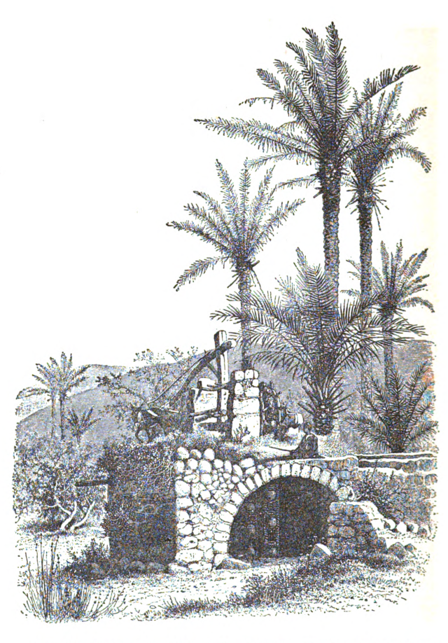

## Pagina originale 188

Le foglie sono ovate, acuminate, alquanto cuoriformi alla base, pallide e pubescenti sulle nervature della pagina inferiore; compaiono dopo i fiori rosati o quasi bianchi. Il ben noto frutto ovale, di colore arancione, ha un sapore in certo modo intermedio fra quello di una pesca e quello di una susina (156).

### 168. *Pterocarpus santalinus* L. f.

**1 Re 10:11–12** — Anche la flotta di HIRAM, che portava oro da Ofir, recò da Ofir grandissima quantità di alberi di almug e pietre preziose. Con gli alberi di almug il re fece colonne per la casa del Signore e per la casa del re, e anche arpe e salteri per i cantori; alberi di almug come quelli non giunsero più né si videro fino a questo giorno.

**2 Cronache 9:10–11** — Anche i servi di HURAM e i servi di SALOMONE, che portavano oro da Ofir, recarono alberi di algum e pietre preziose. Con gli alberi di algum il re fece terrazze per la casa del Signore e per il palazzo del re, e arpe e salteri per i cantori; prima d'allora non se n'erano mai visti di simili nel paese di Giuda.

L'uso della parola «algum» nel secondo di questi passi sembra un errore per «almug», come suggerisce una nota marginale della versione Authorized: in 2 Cronache 2:8, infatti, si dice che l'albero di «algum» sia originario del Libano, non di Ofir. Non si sa con certezza dove si trovasse geograficamente l'«Ofir» biblica, ma sembra fosse il nome di un paese, o di più paesi, situato oltre lo stretto di Bab el-Mandeb (299). È stata variamente collocata in Africa, India, Arabia, Ceylon, nella penisola malese (156), in Armenia, nelle isole Molucche, in Crimea e perfino in Perù (306)! Tutte le merci provenienti da Ofir erano trasportate per nave lungo il Mar Rosso e sbarcate nel porto di SALOMONE a Ezion-geber, presso Elath, all'estremità del golfo di Akaba; da lì erano condotte direttamente a Gerusalemme (299). Gli studiosi moderni si dividono in tre gruppi riguardo alla posizione di Ofir: quelli che la collocano in Arabia, quelli che la collocano in India e quelli che la collocano nell'Africa occidentale, presso il Mozambico. Le prove e gli argomenti a favore di ciascuna teoria sono ben riassunti nel «Dictionary of the Bible» di SMITH (306).

L'identificazione degli alberi di «almug» e «algum» dei due passi citati sopra ha un preciso rapporto con il problema della posizione di Ofir, poiché si afferma che il legno degli «alberi di almug» fosse una delle principali importazioni da quella terra misteriosa. Alcuni commentatori hanno pensato (299) che l'albero di «almug» fosse il sandalo bianco, *Santalum album* (si veda sotto *Aquilaria agallocha*). Quest'albero è stato proposto anche per gli «aloe» di Salmi 45:8, Cantico 4:14 e Proverbi 7:17. Raggiunge venti o trenta piedi d'altezza ed è originario dei monti della costa del Malabar e delle isole dell'arcipelago indiano. Per lo più, tuttavia, non raggiunge l'altezza massima, ma rimane un alberello basso, simile a un ligustro. I fiori si aprono giallo pallido e scoloriscono in porpora rugginoso; non sono profumati, ma il legno è stato molto apprezzato in Oriente fin dai tempi più remoti per il suo delizioso odore. In India e in Cina è impiegato per offrire sacrifici bruciati agli idoli e viene lavorato in collane, ventagli, scatole e molti altri oggetti d'uso domestico. Gli insetti sono respinti dal suo odore intenso e non lo attaccano. Alcuni scrittori suppongono che la grande predilezione degli Ebrei e degli altri popoli orientali per gli odori fragranti dovesse rendere questo legno molto richiesto per le lire e i liuti sui quali si sarebbero suonate le note acute destinate a guidare le voci d'Israele nella lode a GEOVA. In Cina è ancora usato per fabbricare strumenti musicali. In alcune parti dell'Oriente viene ridotto in polvere, mescolato con acqua e spruzzato sui visitatori.

Le dimensioni normalmente piccole del sandalo bianco rendono però difficile credere che fosse questo l'«almug» con cui si fecero le «colonne» e le «terrazze» del palazzo e del tempio di SALOMONE, ossia «pilastri» e «balaustrate» secondo MOFFATT o «piattaforme rialzate» secondo GOODSPEED e le versioni moderne. Il suo valore principale risiedeva nelle proprietà odorose, non nel legname. Altri autori hanno proposto il deodara, *Cedrus deodara* Loud., il «legno degli dèi» in sanscrito e in hindi, ma si tratta di un albero himalayano e probabilmente da escludere. La Settanta traduce «almug» con «legno lavorato»; le versioni greche dicono «ξύλα πελεκητά», letteralmente «un tagliatore di legno»

## Pagina originale 189

(184), o «ξύλα πεύκινα», letteralmente «fatto di legno d'abete» (27). Le versioni MOFFATT, JASTROW e GOODSPEED dicono tutte «sandalwood» o «sandal-wood», senza precisare di quale tipo. TRISTRAM lo identifica decisamente con il sandalo rosso, *Pterocarpus santalinus*¹¹⁴ (184), seguito in questo da JONES, SMITH e altri studiosi moderni (27, 306). La maggior parte di questi commentatori, tuttavia, insieme a GROSER (146) e a HURLBUT e McCLURE (179), considera l'albero di «almug» identico all'«algum» di 2 Cronache 2:8 (306). Questo è assai improbabile, anche se le parole si somigliano, come ha sottolineato MOFFATT, poiché si dice che l'«algum»¹¹⁵ provenisse dal Libano. WILLIAM SMITH ritiene ancora possibile che l'«almug»¹¹⁶ e l'«algum» fossero lo stesso albero, se si considera la menzione in 2 Cronache una successiva ed erronea interpolazione di qualche scriba, oppure se si suppone che il re HIRAM avesse importato gli alberi da Ofir e li avesse poi rispediti da Tiro a SALOMONE insieme ai cedri e agli abeti indigeni del Libano (306). Questo ragionamento sembra alquanto forzato e preferiamo seguire JOHN SMITH identificando l'«algum» con la sabina orientale, *Sabina excelsa* (si veda la relativa voce). MOFFATT lo considera il cipresso, *Cupressus sempervirens* var. *horizontalis* (si veda la relativa voce). Alcuni commentatori hanno anche suggerito che l'«almug» fosse lo stesso albero che forniva il «legno di tuia» di Apocalisse 18:12, ma noi identifichiamo quest'ultimo con *Tetraclinis articulata* (si veda la relativa voce). GIUSEPPE FLAVIO fornisce una descrizione particolareggiata del legno importato da SALOMONE da Ofir, ma lo chiama «pino» (si veda sotto *Pinus brutia*). HENSLOW (172a) identificava l'«almug» con il tasso.

Il sandalo rosso, o «red saunders-wood», è un grande albero leguminoso indigeno dell'India e di Ceylon. Il legno è duro e molto pesante, di colore rosso o granata, prende una bella lucidatura e si presterebbe molto bene agli scopi per cui SALOMONE lo richiedeva (299, 306). Ancora oggi viene usato per fabbricare lire e altri strumenti musicali (184, 299).

### 169. *Punica granatum* L.

(Pagina 199; FIGURA 38; FIGURA 76)

**Esodo 28:33–34** — In basso, tutt'intorno all'orlo, farai melagrane di azzurro, porpora e scarlatto, e fra esse, tutt'intorno, campanelli d'oro: un campanello d'oro e una melagrana, un campanello d'oro e una melagrana, tutt'intorno all'orlo della veste.

**Esodo 39:24–26** — Sull'orlo della veste fecero melagrane di azzurro, porpora, scarlatto e lino ritorto. Fecero campanelli d'oro puro e posero i campanelli fra le melagrane sull'orlo della veste, tutt'intorno fra le melagrane: un campanello e una melagrana, un campanello e una melagrana, tutt'intorno all'orlo della veste da indossare per il ministero, come il Signore aveva comandato a MOSÈ.

**Numeri 13:23** — [...] portarono anche melagrane e fichi.

**Numeri 20:5** — Perché ci avete fatti salire dall'Egitto per condurci in questo luogo malvagio? Non è un luogo di sementi, né di fichi, né di viti, né di melagrane; non vi è nemmeno acqua da bere.

**Numeri 33:19–20** — Partirono da Rithmah e si accamparono a Rimmon-parez. E partirono da Rimmon-parez [...].

**Deuteronomio 8:8** — Un paese di frumento e d'orzo, di viti, fichi e melagrane [...].

**Giosuè 15:32** — E Lebaoth, Shilhim, Ain e Rimmon [...].

**Giosuè 19:7 e 13** — Ain, Remmon, Ether e Ashan: quattro città con i loro villaggi [...] E di là [...] giunge a Remmon-methoar, fino a Neah.

**Giudici 20:45** — Si voltarono e fuggirono verso il deserto, fino alla roccia di Rimmon [...].

**1 Samuele 14:2** — SAUL rimaneva all'estremità di Gibeah, sotto un melograno che è a Migron [...].

**2 Samuele 4:2** — [...] i figli di RIMMON, un Beerothita.

**1 Re 6:32** — [...] vi scolpì figure di cherubini, palme e fiori aperti.

**1 Re 7:18 e 20** — Fece le colonne e due file tutt'intorno sopra un reticolato, per coprire i capitelli che erano in cima, con melagrane [...] Anche i capitelli sulle due colonne avevano melagrane più in alto, presso il rigonfiamento accanto al reticolato; e le melagrane erano duecento, disposte in file tutt'intorno sull'altro capitello.

**2 Re 5:18** — In questo il Signore perdoni il tuo servo: quando il mio signore entra

¹¹⁴ Chiamato anche *Lingoum santalinum* (L. f.) Kuntze.

¹¹⁵ L'ebraico è «algoomim»; LEESSER lo interpreta come «sandal-wood» o «sandel-wood», usando entrambe le grafie nel testo.

¹¹⁶ L'ebraico è «almoogim» e LEESSER lo traduce «sandel-trees».

## Pagina originale 190

nella casa di RIMMON per adorarvi e si appoggia alla mia mano e io mi inchino nella casa di RIMMON: quando mi inchino nella casa di RIMMON [...].

**2 Re 25:17** — [...] e il lavoro a reticolo e le melagrane tutt'intorno sul capitello, tutto di bronzo [...].

**2 Cronache 3:16** — [...] fece cento melagrane e le pose sulle catene.

**2 Cronache 4:13** — E quattrocento melagrane sui due reticolati: due file di melagrane su ciascun reticolato [...].

**Cantico dei Cantici 4:3 e 13** — Le tue labbra sono come un filo scarlatto e il tuo parlare è grazioso; le tue tempie sono come uno spicchio di melagrana fra i tuoi riccioli [...] Le tue piante sono un giardino di melograni, con frutti deliziosi [...].

**Cantico dei Cantici 6:7 e 11** — Come uno spicchio di melagrana sono le tue tempie fra i tuoi riccioli [...] Scesi nel giardino dei noci per vedere i frutti della valle e osservare se la vite fioriva e i melograni germogliavano.

**Cantico dei Cantici 7:12** — Alziamoci presto per andare alle vigne; vediamo se la vite fiorisce, se appaiono i teneri grappoli e se i melograni germogliano: là ti darò il mio amore.

**Cantico dei Cantici 8:2** — [...] ti farei bere vino speziato del succo della mia melagrana.

**Gioele 1:12** — La vite è seccata e il fico languisce; anche il melograno, la palma e il melo, tutti gli alberi del campo, sono appassiti [...].

**Aggeo 2:19** — È forse ancora il seme nel granaio? Finora la vite, il fico, il melograno e l'olivo non hanno portato frutto; da questo giorno io vi benedirò.

La parola ebraica tradotta «melagrana» in tutti i passi sopra menzionati è «rimmôn» (greco «ῥοά», «ῥοιά» o «κώδων», che significa «una campana») e non vi è alcun dubbio sulla correttezza dell'identificazione. È probabile che i nomi propri delle città di Remmon e Rimmon nei libri di Numeri, Giosuè e Giudici si riferiscano all'abbondanza di melograni in quelle località (27, 184). «Rimmon-parez», «Remmomphares» nella Douay e «Rimmon-perez» in GOODSPEED e MOFFATT, di Numeri 33:19–20 significa letteralmente «melagrana della breccia» (27). Il «Remmon» e il «Remmon-methoar» di Giosuè 19:7 e 13 sono resi meglio con «En-Rimmon» e «Rimmon» da MOFFATT e con «En-rimmon» e «Rimmonah» dalla versione GOODSPEED, poiché «methoar» non fa parte del nome del luogo. Senza dubbio hanno una derivazione simile. In 2 Samuele 4:2 vediamo che era usato anche come nome di persona. Il RIMMON di 2 Re 5:18, invece, era una divinità assira venerata a Damasco, identificata dagli studiosi moderni con RAMMAN, l'ADAD babilonese e l'HADAD siriano, dio del tuono, del vento e delle tempeste, che nella teologia speculativa simboleggiava la giustizia retributiva (158). Molti commentatori ritengono che la melagrana dovesse essere connessa a questo culto, forse come simbolo della divinità. Il nome arabo della melagrana è ancora «rummân» (266, 306).

Il melograno, *Punica granatum*¹¹⁷, è di solito piccolo e cespuglioso, ma talvolta può diventare un grande arbusto ramificato o un alberello alto venti o trenta piedi (293, 299). I rami, opposti o alterni, sono spesso spinosi. Le foglie, oblungo-lanceolate e a margine intero, sono disposte sui fusti in modo opposto, alterno o verticillato e cadono presto (266). I vistosi fiori campanulati sono rossi, gialli o bianchi, generalmente scarlatti. Il frutto globoso è grande come un'arancia o una mela media; ha una scorza dura di colore rosso vivo o giallastro a maturità ed è sormontato dai lobi persistenti del calice, che ricordano una rosetta o una corona. Sotto la scorza vi è una polpa cremisi, succosa e gradevolmente acidula, nella quale sono immersi molti semi rossi (158). I fiori del melograno servirono senza dubbio da modello per i «campanelli d'oro», in ebraico «pa'amon», e i «fiori aperti», in ebraico «tzitzim p'turay», ricamati sulle vesti del tempio; il frutto servì da modello per altri ornamenti (178). I lobi eretti del calice sul frutto ispirarono la corona di SALOMONE e, incidentalmente, tutte le corone da allora in poi.

Il melograno è originario dell'Asia, probabilmente della regione dall'India settentrionale al Levante, ma viene coltivato fin dalla preistoria e oggi è comune in Terra Santa, in Egitto e lungo entrambe le sponde del Mediterraneo. È abbondantemente coltivato in Palestina e cresce spontaneo in Siria, Libano e Galaad (266). Nella Bibbia è elencato fra i frutti piacevoli dell'Egitto (Numeri 20:5) e fra le benedizioni promesse della Palestina (Deuteronomio 8:8). La polpa del frutto è stata largamente usata fin dai tempi di

¹¹⁷ Scritto erroneamente «*Pumica granatum*» dalla signora BARNEVELD (47).

## Pagina originale 191

SALOMONE per preparare bevande rinfrescanti e sorbetti e viene anche mangiata cruda. La scorza astringente del frutto immaturo fornisce un colorante rosso ed è stata usata in medicina e per conciare il marocchino rosso (101, 158). Anche i fiori forniscono un colorante rosso. Nei luoghi d'origine, i frutti del melograno raggiungono una dolcezza squisita che li rende molto apprezzati in quei climi caldi. Dal succo di melagrana si ricava un vino speziato (Cantico 8:2) e molti sorbetti musulmani devono ancora oggi il proprio sapore a questo succo. Anche i semi teneri vengono mangiati, cosparsi di zucchero oppure, essiccati, come dolciume. Furono i Mori a introdurre dall'Africa in Spagna il metodo di conciare il cuoio con scorze di melagrana e a rendere Cordova celebre per i suoi cuoi pregiati.

In tempi assai remoti il melograno cominciò a essere considerato una pianta sacra (268). Per il gran numero dei suoi semi divenne simbolo di fertilità. Era ritenuto sacro in Egitto e il suo frutto caratteristico è facilmente riconoscibile nelle iscrizioni e nelle sculture egizie (306). In Persia ornava la sommità dello scettro reale. A Rodi i suoi fiori facevano parte dello stemma reale. Un'antica raffigurazione di GIOVE lo mostra con una melagrana in mano. Alla luce di tutto ciò non sorprende affatto trovare che, nel tempio di SALOMONE, ornasse il reticolato in cima ai pilastri e, ricamato in azzurro, porpora e scarlatto, i lembi delle vesti sacerdotali, o efod (126). Il dottor EVENARI descrive un «meraviglioso ornamento a melagrana sulle pareti di un antico tempio ebraico a Cafarnao, nel quale si dice che GESÙ abbia predicato». La bellezza dei frutti delicatamente cremisi fece sì che fossero usati nel canto e nella poesia come termine di paragone per la bellezza delle giovani guance arrossate, proprio come noi oggi usiamo la pesca quando diciamo che le guance di qualcuno «avevano il vellutato colore delle pesche mature».

L'affermazione di JONES (184) secondo cui le arance sanguigne si otterrebbero innestando un ramo di arancio comune su un melograno è falsa.

Antiche leggende raccontano che il melograno fosse l'«albero della vita» nel giardino dell'Eden; per questa credenza divenne nell'arte paleocristiana simbolo della speranza nella vita eterna. In Turchia una sposa getta a terra una melagrana matura e il numero di semi che ne escono indica quanti figli avrà (298).

Nella mitologia greca CERERE, dea della terra, si adirò quando ZEUS diede sua figlia PROSERPINA in sposa a PLUTONE, dio degli inferi. Nella sua ira CERERE lasciò il cielo e scese sulla terra, benedicendo tutti gli uomini gentili con lei e maledicendo quelli che non lo erano. Ma maledisse gli uomini a tal punto che ZEUS si rese presto conto del proprio errore e ordinò a PLUTONE di restituire PROSERPINA. Egli lo fece, ma prima le chiese di mangiare una melagrana. Avendola mangiata, rimase in suo potere e dovette tornare con lui nell'Ade per sei mesi ogni anno. Così, per metà dell'anno CERERE è felice in compagnia della figlia e la terra è feconda, verde e calda; per gli altri sei mesi CERERE è sola e adirata e la terra è spoglia, sterile e fredda (298). Per Greci e Romani la melagrana divenne quindi simbolo degli inferi e del loro potere; rappresentava tutti i semi che devono essere posti sottoterra per germogliare, poi emergono alla luce per una stagione e infine, a tempo debito, vedono i propri semi tornare nell'oscurità sotto la superficie della terra. Il primo melograno, secondo la mitologia greca, era una bella ninfa cui un indovino aveva predetto che un giorno avrebbe portato una corona. BACCO, dio del vino, la trasformò in melograno e una corona fu posta sulla sommità del suo frutto (298). Anche in Cina la melagrana simboleggia la fertilità e le donne offrono melagrane alla dea della misericordia nella speranza di essere benedette con figli. Le porcellane dei templi cinesi sono decorate con raffigurazioni di questo frutto (298).

## Pagina originale 192

**FIGURA 28.** Veduta di un giardino a Haifa, che mostra una «sakiyeh» usata per sollevare l'acqua fino alla cisterna adiacente, con palme da datteri (*Phoenix dactylifera*) sullo sfondo. Ai tempi biblici quest'albero aveva un numero quasi innumerevole di usi. Serviva come punto di riferimento, per l'ombra e il legname, per fornire coperture e materiali isolanti per le case, rivestire recinzioni di canne, fabbricare cordoni e funi, spolverini e scope, fornire frutti commestibili per l'uomo e mangime per il bestiame, fare collane e braccialetti e perfino produrre «bevanda forte» e «miele»! (Incisione su legno da *Picturesque Palestine* di C. W. Wilson, 1883; si vedano anche le figure 9, 70 e 92.)

## Pagina originale 193

### 170. *Quercus aegilops* L. — 171. *Quercus coccifera* L.

### 172. *Quercus coccifera* var. *pseudococcifera* (Desf.) Boiss.

### 173. *Quercus ilex* L. — 174. *Quercus lusitanica* Lam.

(FIGURA 29; FIGURA 84)

**Genesi 12:6** — ABRAMO attraversò il paese fino al luogo di Sichem, fino alla pianura di Moreh [...].

**Genesi 13:18** — Allora ABRAMO spostò la tenda e venne ad abitare nella pianura di Mamre, che è a Hebron [...].

**Genesi 14:13** — Venne uno che era scampato e lo riferì ad ABRAMO l'Ebreo, poiché egli abitava nella pianura di MAMRE l'Amorreo [...].

**Genesi 18:1 e 8** — Il Signore gli apparve nelle pianure di Mamre [...] ed egli stava presso di loro sotto l'albero, ed essi mangiarono.

**Genesi 35:4 e 8** — [...] GIACOBBE li nascose sotto la quercia che era presso Sichem [...] e fu sepolta sotto Bethel, sotto una quercia; le fu dato il nome di Allon-bachuth.

**Genesi 38:28 e 30** — [...] la levatrice prese un filo scarlatto e glielo legò alla mano [...] Poi uscì suo fratello, che aveva il filo scarlatto sulla mano [...].

**Esodo 25:4** — E azzurro, porpora e scarlatto [...].

**Esodo 26:1** — Farai inoltre il tabernacolo con dieci teli di lino fino ritorto, azzurro, porpora e scarlatto [...].

**Esodo 28:33** — In basso, sull'orlo, farai melagrane di azzurro, porpora e scarlatto [...].

**Esodo 34:13** — Distruggerete i loro altari, spezzerete le loro immagini e abbatterete i loro boschetti.

**Esodo 35:23** — Ogni uomo presso il quale si trovavano azzurro, porpora e scarlatto [...] li portò.

**Esodo 39:24** — Sull'orlo della veste fecero melagrane di azzurro, porpora e scarlatto [...].

**Levitico 14:4, 6 e 51–52** — Il sacerdote ordinerà di prendere, per colui che dev'essere purificato, due uccelli vivi e puri, legno di cedro, scarlatto e issopo [...] Quanto all'uccello vivo, prenderà quello, il legno di cedro, lo scarlatto e l'issopo e li immergerà, insieme all'uccello vivo, nel sangue dell'uccello ucciso sopra l'acqua corrente [...] Prenderà il legno di cedro, l'issopo, lo scarlatto e l'uccello vivo, li immergerà nel sangue dell'uccello ucciso e nell'acqua corrente e aspergerà la casa sette volte. Purificherà la casa [...] con lo scarlatto.

**Numeri 19:6** — Il sacerdote prenderà legno di cedro, issopo e scarlatto e li getterà in mezzo al fuoco che brucia la giovenca.

**Numeri 24:6** — [...] come gli alberi di legno d'aloe che il Signore ha piantato [...].

**Deuteronomio 11:30** — Non sono essi oltre il Giordano, lungo la via dove tramonta il sole, nel paese dei Cananei che abitano nella pianura di fronte a Gilgal, presso le pianure di Moreh?

**Deuteronomio 12:2–3** — Distruggerete interamente tutti i luoghi nei quali le nazioni di cui prenderete possesso servivano i loro dèi, sugli alti monti, sui colli e sotto ogni albero verde. Abbatterete i loro altari, spezzerete le loro colonne e brucerete nel fuoco i loro boschetti [...].

**Deuteronomio 16:21** — Non pianterai per te un boschetto di alcun albero presso l'altare del Signore tuo Dio [...].

**Giosuè 24:26** — GIOSUÈ scrisse queste parole nel libro della legge di Dio; prese una grande pietra e la eresse là, sotto una quercia che era presso il santuario del Signore.

**Giudici 3:7** — I figli d'Israele [...] servirono i BAALIM e i boschetti.

**Giudici 6:11** — Venne un angelo del Signore e si sedette sotto una quercia che era a Ophrah, appartenente a JOASH, l'Abiezrita [...].

**Giudici 9:6** — Tutti gli uomini di Sichem e tutta la casa di Millo si radunarono, andarono e fecero re ABIMELECH, presso la pianura della colonna che era a Sichem.

**2 Samuele 18:9–10** — [...] ASSALONNE cavalcava un mulo; il mulo passò sotto i fitti rami di una grande quercia e la sua testa rimase impigliata nella quercia; egli rimase sospeso fra cielo e terra, mentre il mulo che era sotto di lui proseguì. Un uomo lo vide e lo riferì a JOAB, dicendo: «Ecco, ho visto ASSALONNE appeso a una quercia».

**1 Re 13:14** — [...] lo trovò seduto sotto una quercia [...].

**1 Re 14:23** — Anche loro si costruirono alture, immagini e boschetti su ogni alto colle e sotto ogni albero verde.

**1 Re 18:19** — [...] e i quattrocentocinquanta profeti di BAAL e i quattrocento profeti dei boschetti [...].

**2 Re 17:10 e 16** — Si eressero immagini e boschetti su ogni alto colle e sotto ogni albero verde [...] fecero un boschetto, adorarono tutto l'esercito del cielo e servirono BAAL.

**2 Re 18:4** — Rimosse le alture, spezzò le immagini e abbatté i boschetti [...].

## Pagina originale 194

**2 Re 21:7** — Pose nella casa un'immagine scolpita del boschetto che aveva fatto [...].

**2 Re 23:6** — Portò fuori dalla casa del Signore il boschetto, fuori da Gerusalemme, fino al torrente Kidron; lo bruciò presso il torrente Kidron e lo ridusse in polvere [...].

**2 Re 23:14** — Spezzò le immagini e abbatté i boschetti [...].

**1 Cronache 10:12** — [...] seppellirono le loro ossa sotto la quercia a Jabesh [...].

**2 Cronache 2:7 e 14** — Mandami dunque ora un uomo abile a lavorare l'oro, l'argento e il bronzo [...] e il cremisi [...] abile a lavorare l'oro e l'argento [...] e il cremisi [...].

**2 Cronache 3:14** — Fece il velo di azzurro, porpora e cremisi [...].

**2 Cronache 28:4** — Offriva inoltre sacrifici e bruciava incenso sulle alture, sui colli e sotto ogni albero verde.

**Salmi 1:3** — Sarà come un albero piantato presso i corsi d'acqua, che porta il suo frutto nella sua stagione; neppure la sua foglia appassirà [...].

**Isaia 1:18 e 29–30** — Venite ora e ragioniamo insieme, dice il Signore: sebbene i vostri peccati siano come scarlatto, diverranno bianchi come neve; sebbene siano rossi come cremisi, diverranno come lana [...] Poiché si vergogneranno delle querce che avete desiderato e sarete confusi per i giardini che avete scelto. Sarete infatti come una quercia la cui foglia appassisce e come un giardino che non ha acqua.

**Isaia 2:13** — E contro tutti i cedri del Libano, alti ed elevati, e contro tutte le querce di Bashan.

**Isaia 6:13** — Ma vi sarà ancora una decima parte, che tornerà e sarà divorata: come un tiglio e come una quercia, la cui sostanza rimane in essi quando perdono le foglie [...].

**Isaia 27:9** — [...] i boschetti e le immagini non rimarranno in piedi [...].

**Isaia 44:14** — Si taglia cedri, prende il cipresso e la quercia [...].

**Isaia 61:3** — [...] affinché siano chiamati alberi di giustizia, piantagione del Signore [...].

**Geremia 4:30** — [...] sebbene tu ti vesta di cremisi [...].

**Geremia 10:3** — [...] uno taglia un albero dalla foresta [...].

**Geremia 17:8** — Sarà come un albero piantato presso le acque, che stende le sue radici lungo il fiume; non vedrà quando viene il caldo, ma la sua foglia sarà verde; non avrà timore nell'anno della siccità e non cesserà di portare frutto.

**Ezechiele 6:13** — [...] sotto ogni albero verde e sotto ogni quercia folta, nel luogo dove offrivano soavi profumi a tutti i loro idoli.

**Ezechiele 20:28** — [...] videro ogni alto colle e tutti gli alberi folti e vi offrirono i loro sacrifici [...].

**Ezechiele 27:6** — Con le querce di Bashan hanno fatto i tuoi remi [...].

**Ezechiele 31:14** — Affinché nessuno di tutti gli alberi presso le acque si esalti per la sua altezza, né spinga la cima fra i fitti rami, né i loro alberi si ergano nella loro altezza, tutti quelli che bevono acqua [...].

**Daniele 4:10–12** — [...] Vidi, ed ecco un albero in mezzo alla terra, la cui altezza era grande. L'albero crebbe e divenne forte; la sua altezza raggiungeva il cielo ed era visibile fino all'estremità di tutta la terra. Le sue foglie erano belle e i suoi frutti abbondanti; vi era cibo per tutti: le bestie dei campi trovavano ombra sotto di esso e gli uccelli del cielo dimoravano fra i suoi rami, e ogni carne se ne nutriva.

**Osea 4:13** — Sacrificano sulle cime dei monti e bruciano incenso sui colli, sotto querce, pioppi e olmi, perché la loro ombra è buona [...].

**Amos 2:9** — [...] era forte come le querce [...].

**Michea 7:14** — Pasci il tuo popolo con la tua verga, il gregge della tua eredità, che dimora solitario nel bosco, in mezzo al Carmelo [...].

**Zaccaria 11:2** — [...] Urlate, querce di Bashan, perché la foresta della vendemmia è abbattuta.

**Susanna 58** — Ora dunque dimmi: sotto quale albero li hai sorpresi insieme? Ed egli rispose: sotto un leccio.

**Ebrei 9:19** — [...] prese il sangue dei vitelli e dei capri, con acqua, lana scarlatta e issopo, e asperse il libro stesso e tutto il popolo.

**Apocalisse 18:12** — [...] e porpora, seta e scarlatto [...].

Le parole ebraiche tradotte «scarlatto» nei passi citati sopra sono «tola», «karmil», «tola'at» o «tola'ath», «tola'ath shânî» o «tola'at shani» e «shâni» (306). Il colorante scarlatto usato per tingere il filo di lino e la lana ai tempi biblici si ricavava da un insetto, *Coccus ilicis*, spesso chiamato «kermes» nelle opere più antiche, che infesta la quercia spinosa, *Quercus coccifera*¹¹⁸ (299). Questa quercia cresce da sei a trentacinque o più piedi d'altezza e abita le regioni montuose di Siria, Libano, Hauran e Palestina, ricoprendo i colli rocciosi palestinesi di una fitta boscaglia di alberi generalmente alti soltanto otto-dodici piedi (293). Si ramifica dalla base ed è riccamente fogliosa. Le piccole foglie lisce e sempreverdi hanno picciolo corto, consistenza rigida, forma ovata, superficie ondulata e margini fortemente spinosi. Produce ghiande in abbondanza. L'insetto che fornisce il colorante scarlatto è una cocciniglia che ricopre i giovani rametti con masse bianche e soffici, proprio come l'affine cocciniglia del carminio, *Coccus cacti*, infesta il cactus a pale *Nopalea coccinellifera* Salm-Dyck.

L'arte di estrarre i coloranti e applicarli ai vari tessuti fu appresa

¹¹⁸ Nota anche come *Quercus coccifera* var. *genuina* Boiss.

## Pagina originale 195

dall'uomo in epoca assai remota (306). Il filo scarlatto era impiegato al tempo della nascita di ZARA, intorno al 1727 a.C.; azzurro e porpora sono menzionati al tempo dell'Esodo, intorno al 1491 a.C. Si ritiene, tuttavia, che gli Ebrei stessi non conoscessero queste arti. Probabilmente dipendevano dai Fenici per i coloranti e dagli Egizi per l'arte di applicarli (306). Il colorante porpora degli antichi, «argâmân», in realtà di un colore rossastro chiaro, si otteneva dalle conchiglie di alcuni gasteropodi marini del genere *Purpura* e di pochi molluschi affini, in particolare *Murex trunculus* L., presenti nel Mediterraneo e nel Mar Rosso. Il colorante era prodotto ed esportato soprattutto dalla città di Tiro e divenne perciò ben presto noto come porpora di Tiro. Si dice che il segreto della preparazione di questo colorante fosse noto soltanto agli abitanti di quella città e che sia andato perduto per sempre quando Tiro fu distrutta. Una parte del colorante azzurro, «tecêleth» o «t'chaylet», in realtà violetto, si ricavava da un'altra specie di mollusco, *Helix ianthina*, presente lungo la costa della Fenicia. Altro colorante azzurro proveniva dal lichene *Roccella tinctoria* (si veda la relativa voce). Il vermiglione, «shâshar», era un pigmento ricavato dal minerale cinabro (158). Il colorante giallo si otteneva dall'henné (si veda sotto *Lawsonia inermis*). Alcuni studiosi affermano che a quel tempo il colorante azzurro fosse estratto anche dalla pianta dell'indaco, *Indigofera tinctoria* L. e specie affini, e dal guado, *Isatis tinctoria* L., e il rosso dalla robbia, *Rubia tinctoria* L. (299). La maggior parte dei commentatori ritiene però che scarlatto e cremisi, «carmil» o «karmil», si ricavassero esclusivamente dalla cocciniglia che infesta la quercia spinosa, particolarmente abbondante in Armenia e in altre terre orientali. Il nome arabo dell'insetto è ancora «kermez» (306). La tinta prodotta era cremisi piuttosto che scarlatta.

Alcuni commentatori sono certi che la «quercia» di Isaia 2:13 e 44:14 fosse la quercia vallonea, *Quercus aegilops*, comune nelle fasce montane intermedie e probabilmente abbondante intorno a Bashan ai tempi biblici quanto oggi, se non di più. La «quercia» di Genesi 35:4 e 8 è ritenuta il leccio, *Q. ilex*¹¹⁹, comune dalle coste della Siria fino alla Giudea. Altri autori affermano che oggi intorno a Bashan siano comuni tre specie di quercia: la vallonea, la quercia spinosa e la quercia di Cipro, *Q. lusitanica*¹²⁰ (124d); i riferimenti di Isaia 2:13, Ezechiele 27:6 e Zaccaria 11:2 probabilmente alludevano dunque a tutte e tre. La «quercia» di Giosuè 24:26 e 1 Re 13:14 è ritenuta *Q. coccifera* var. *pseudococcifera*¹²¹. EVENARI identifica tutte le querce della Palestina con *Q. calliprinos* Webb, *Q. ithaburensis* (Decne.) Boiss. o *Q. infectoria* Oliv.

Alcuni studiosi ritengono che le «querce» menzionate in Giudici 6:11 e Amos 2:9 e l'«albero» di Genesi 18:8 fossero in realtà terebinti, *Pistacia terebinthus* var. *palaestina* (si veda la relativa voce), ma alla maggior parte dei commentatori questo sembra assai meno ragionevole che identificarli con querce. Allo stesso modo, la maggior parte degli studiosi moderni ritiene che l'albero al quale rimase appeso ASSALONNE fosse davvero una quercia e non un terebinto, come sostenevano alcuni autori antichi.

Le varie parole ebraiche usate per «quercia» nell'Antico Testamento sono «el», «êlon», «ilan», «allah», «allôn» ed «èlâh» o «âlâhim». JOHN SMITH offre un ottimo riepilogo della complessa situazione, osservando nel suo «Bible Plants» che alcuni commentatori ritengono queste sei parole, non tutte tradotte «quercia» nella nostra versione Authorized, denominazioni ebraiche non soltanto di querce, ma anche di qualsiasi «albero grande o folto» (299). CELSIUS pensava che cinque delle parole indicassero il terebinto e che soltanto «allôn» designasse vere querce (299). DINSMORE ritiene che «allôn» si applichi soltanto a *Q. coccifera* (267). TRISTRAM era dell'opinione che «allah» e «allôn» (greco «βάλανος», che significa «ghianda») si riferissero alle querce sempreverdi, *Q. ilex*, *Q. palaestina* Ky. e *Q. coccifera*, mentre «el», «elôn» e «îlan» (greco «τερέβινθος», «δένδρον», che significa «un albero») si riferissero alle querce decidue, *Q. sessiliflora* Salisb.

¹¹⁹ Considerato da EVENARI sconosciuto in Palestina e dubbio in Libano, ma segnalato in Palestina da LÖW (218) e Post (267).

¹²⁰ Nota anche come *Quercus infectoria* Oliv., nome usato dal dottor EVENARI, che considera questa specie molto scarsa in Galilea.

¹²¹ Nota anche come *Quercus pseudococcifera* Desf.; considerata una «varietà assai dubbia» da EVENARI.

## Pagina originale 196

¹²², *Q. lusitanica*, *Q. aegilops*, *Q. cerris* L., *Q. ehrenbergii* Kotschy, *Q. look* Kotschy, *Q. libani* Oliv. e *Q. syriaca* Ky.¹²³ (184), tutte comuni nella regione (299). Con ventiquattro tipi di querce in Terra Santa, sembra assai probabile che gli Ebrei e gli altri antichi abitanti dovessero avere più parole per indicarli. Post registra oggi per le querce della regione nomi tanto diversi quanto «ballut», «abbas», «sindyân», «likk», «mall» e «mallal» (267). ROSENMÜLLER assegna il terebinto a «el» ed «elâh» e la quercia ad «allâh», «allôn» ed «êlôn» (306). Altri commentatori ritengono che soltanto «allâh» e «allôn» si riferiscano alle querce, mentre «el», «êlah», «êlôn» e «ilan», tutti derivati dalla radice «el», che implica forza, si riferiscano al terebinto. FRASER osserva che «le parole ebraiche comunemente rese “quercia” e “terebinto” sono assai simili; la differenza fra esse consiste in parte soltanto nei segni vocalici aggiunti al testo dagli scribi masoretici nel Medioevo. Gli studiosi non concordano sugli equivalenti corretti delle parole [...] nel clima caldo e arido di Moab il terebinto è l'albero principale, mentre la quercia prospera maggiormente nei distretti più freschi e piovosi di Galaad e della Galilea, al nord. È dunque naturale che il terebinto sia soprattutto l'albero sacro del sud e la quercia del nord; ma in tutta la Palestina, considerata nel suo insieme, se possiamo giudicare dai resoconti dei viaggiatori, la quercia sembra essere l'albero più comune e quindi, forse, quello più frequentemente venerato» (124d). Nella maggior parte dei luoghi in cui compare nella Bibbia, «el» è reso con «uomini potenti» o con un'espressione simile (27). Ci sembra che questa parola e i suoi derivati, quando applicati agli alberi, si riferiscano molto più logicamente alla quercia, simbolo di forza da tempo immemorabile (298), che al terebinto, che non le è affine.

In Genesi 12:6, 13:18 e 18:1, Deuteronomio 11:30 e Giudici 9:6, la versione Authorized traduce «êlon» o «aylon» con «pianura» o «pianure», ma gli studiosi moderni sembrano concordare che avrebbe dovuto essere reso piuttosto con un albero di qualche specie. In questi passi MOFFATT dice «quercia oracolare», «querce», «quercia circolare» e «albero sacro». Le versioni GOODSPEED e JASTROW dicono «terebinto» in tutti. La versione Douay usa «quercia» soltanto in Giudici 9:6, «valle» e «vallata» negli altri passi. Nelle valli del Libano e dove cresce isolata, come a Mamre, *Q. coccifera* forma un albero grande e imponente (299). Secondo Post (265), la sua varietà *pseudococcifera* è quella regolarmente piantata presso le tombe in Oriente (27). Nel 1860 THOMSON diceva: «Non credo che ABRAMO abbia piantato l'albero celebrato a Hebron. Era una quercia venerabile, non un terebinto, e non vidi alcun terebinto nei dintorni» (299, 319). La quercia è sempre stata rispettata e perfino venerata ai tempi biblici per le sue grandi dimensioni e la sua forza, e i grandi uomini venivano solitamente sepolti alla sua ombra (124d, 299). Nel 1856 BONER descrisse la quercia di ABRAMO come una magnifica quercia spinosa, alquanto isolata, ma con altri alberi non lontani. «I nodi sporgenti delle radici alla base sembravano quasi pezzi di roccia bruno scuro. Il fusto è enorme e quanto mai ruvido e informe. I rami, largamente espansi in diversi gruppi e con le estremità ricadenti sul prato, gettano la loro ombra sopra un vasto cerchio» (299). Era di altezza moderata. Il tronco misurava ventitré piedi di circonferenza e l'ampiezza dei rami novanta piedi (184). I musulmani la tenevano in grande venerazione e credevano fermamente che chiunque l'avesse tagliata o danneggiata avrebbe perso il figlio primogenito. Nell'inverno del 1850 perse un grosso ramo a causa di una forte nevicata; il timore di toccarla rese quasi impossibile trovare operai che aiutassero a rimuovere il ramo caduto (299). Il dottor CHARLES EDWARD MOLDENKE, padre del maggiore dei due autori, visitò questa località il 2 gennaio 1897 e, rischiando la vita per mano delle guardie turche, raccolse un campione da quest'albero. Il campione è oggi conservato nel Britton Herbarium del New York Botanical Garden e risulta essere *Q. coccifera* var. *pseudococcifera* (233). Post applica il nome «quercia di ABRAMO» a *Q. palaestina*, segnalando sia questa

¹²² Nota anche come *Quercus sessilis* Ehrh., *Q. robur* var. *sessilis* Ait. e *Q. robur* var. *nigra* Lam.

¹²³ Nota anche come *Quercus lusitanica* var. *syriaca* A. DC., *Q. lusitanica* var. *latifolia* Boiss. e *Q. infectoria* var. *latifolia* (Boiss.) Nabelek.

## Pagina originale 197

sia *Q. coccifera* var. *pseudococcifera* da Hebron (267).

TRISTRAM riteneva che la parola ebraica «elâh» (greco «τερέβινθος», «δρῦς»), usata in Genesi 35:4 e 2 Samuele 18:9, si riferisse al terebinto anziché alle querce; la versione GOODSPEED, seguendo la Settanta, dice «terebinto» nel primo di questi due passi ma non nel secondo, e identifica con il terebinto l'«êlôn» di Genesi 12:6, 13:18 e 18:1, Deuteronomio 11:30 e Giudici 9:6. Se la parola «elâh» significa terebinto, come sostengono alcuni autori, allora l'albero nel quale ASSALONNE rimase impigliato con i capelli doveva essere un terebinto; THOMSON, però, dice: «l'albero nel quale ASSALONNE rimase impigliato era l'alah, non l'allon, e sono persuaso che fosse una quercia. Quel campo di battaglia si trovava sui monti a est del Giordano, da sempre celebri per le grandi querce, non per i terebinti; ed è così ancora oggi. In questo paese non esiste nulla di simile a un bosco di terebinti. Era una quercia, ne sono fermamente convinto. Nella stessa località vi sono ancora migliaia di alberi del genere, mirabilmente adatti a impigliare ribelli dai lunghi capelli; ma non terebinti. Vedo affermare dai sostenitori di questa traduzione che la quercia non è un albero comune né particolarmente notevole in questo paese, lasciando intendere che lo sia il terebinto. Difficilmente si potrebbe commettere un errore maggiore. È “semplicemente ridicolo” paragonarne la forza e le dimensioni con quelle di una quercia» (299). Riguardo alle foreste di querce, dice: «Oltre al vasto bosco che ci circonda, a nord del Tabor, e a quelli del Libano e dell'Hermon, di Galaad e Bashan, pensate alle vaste foreste che si estendono per almeno trenta miglia lungo i colli a ovest di Nazaret, sul Carmelo e a sud oltre Cesarea di Palestina. Il terebinto è deciduo e pertanto non è un albero prediletto per l'ombra. Viene assai raramente piantato nei cortili delle case, sopra le tombe o nei luoghi di ritrovo dei villaggi. È la bella quercia sempreverde che si trova là, *Quercus pseudococcifera*. Senza dubbio i boschetti idolatrici tanto spesso menzionati nella storia ebraica erano di querce» (299).

*Quercus aegilops* è una specie decidua abbondante in Siria e nella Palestina settentrionale, nelle fasce montane intermedie. Raggiunge quindici-cinquanta piedi d'altezza e forma foreste fitte. A Bashan cresce fino a dimensioni particolarmente grandi ed è senza dubbio la «quercia di Bashan» di cui parlano Isaia, Ezechiele e THOMSON (124d, 299). Porta ghiande molto grandi che gli abitanti usano come alimento; le cupole sono largamente impiegate nella concia del cuoio, nella tintura e nella fabbricazione dell'inchiostro e costituiscono un'importante merce di scambio. Si suppone che questo fosse l'albero cui si riferiva DANIELE. Potrebbe essere anche l'«albero piantato presso i corsi d'acqua» di Salmi 1:3: sebbene infatti le sue foglie non siano sempreverdi, sono coriacee, lucide e cadono molto tardi (267). *Q. lusitanica* è un piccolo albero deciduo, raramente alto più di venti piedi e meno comune delle specie appena discusse, ma importante per le galle prodotte sulle foglie e sui rametti dalle punture di piccoli insetti. Queste galle, o «mele di quercia», sono un'importante merce di scambio, usata per conciare il cuoio, tingere e fabbricare inchiostro (299). FRASER afferma che le cupole delle ghiande sono usate dai tintori con il nome di «Valonia» (124d). Le sue grandi ghiande sono mangiate dagli abitanti (124d).

Il clima della Palestina è per lo più troppo caldo perché la quercia prosperi davvero nelle valli basse (268); le querce della Terra Santa si trovano quindi soprattutto sui colli e sui versanti montuosi. Sul monte Carmelo *Quercus coccifera* var. *pseudococcifera* costituisce i nove decimi della vegetazione arborea ed è quasi altrettanto abbondante sui versanti occidentali dell'Antilibano e di altre catene montuose.

I numerosi riferimenti dell'Antico Testamento ai «boschetti», generalmente in relazione al culto di BAAL o di altri dèi pagani, in Esodo 34:13, Deuteronomio 16:21, Giudici 3:7, 1 Re 14:23 e 18:19, 2 Re 17:16 ecc., sono stati ritenuti da molti scrittori riferimenti a boschetti di querce sacre. Il culto degli idoli sulle «alture» fu praticato fino alla fine della storia biblica e se ne possono ancora vedere vestigia oggi in Palestina (124d, 299). Il dottor THOMSON, nella sua celebre storia della Palestina intitolata «The Land and the Book» (319), dice: «Ogni cima di colle ben visibile ha un willey o mazar sotto una quercia espansa, cui la gente si reca in visita religiosa e dove sale per adorare e sciogliere voti. Tutte le sette del paese, senza eccezione, hanno per queste “alture” una predilezione forte quanto quella degli Ebrei nei
