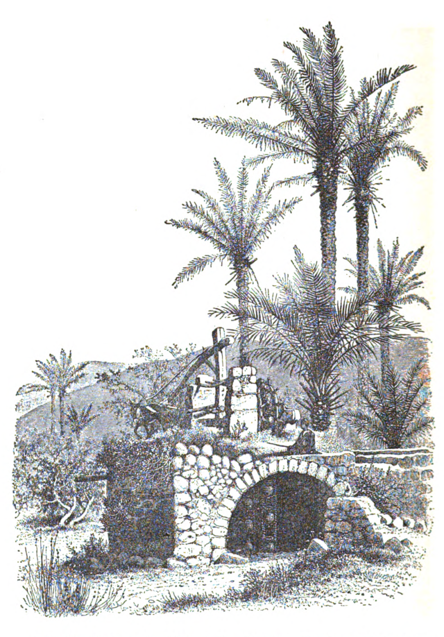

## Pagina originale 192

**FIGURA 28.** Veduta di un giardino a Haifa, che mostra una «sakiyeh» usata per sollevare l'acqua fino alla cisterna adiacente, con palme da datteri (*Phoenix dactylifera*) sullo sfondo. Ai tempi biblici quest'albero aveva un numero quasi innumerevole di usi. Serviva come punto di riferimento, per l'ombra e il legname, per fornire coperture e materiali isolanti per le case, rivestire recinzioni di canne, fabbricare cordoni e funi, spolverini e scope, fornire frutti commestibili per l'uomo e mangime per il bestiame, fare collane e braccialetti e perfino produrre «bevanda forte» e «miele»! (Incisione su legno da *Picturesque Palestine* di C. W. Wilson, 1883; si vedano anche le figure 9, 70 e 92.)
