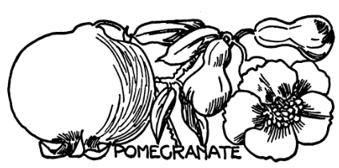
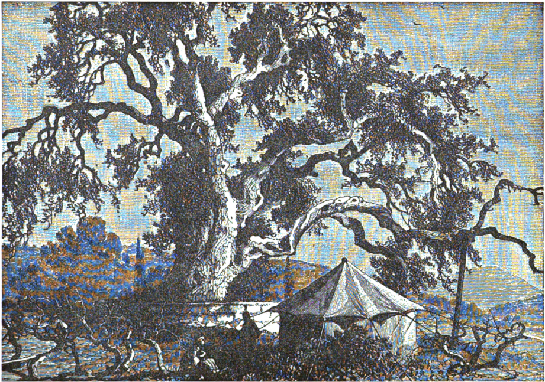

## Pagina originale 198

tempi antichi [...] Una di queste alture, con il suo boschetto di querce venerabili, si trova proprio sulla sommità del Libano, a est di Jezzin. Ha forma ovale, corrispondente alla cima del monte, e il boschetto fu piantato regolarmente tutt'intorno al margine esterno». Egli menziona un altro boschetto sui monti del Libano, «frequentato da Ebrei, Arabi selvaggi del deserto, musulmani, Metuali e cristiani» (124d, 299). La parola impiegata per «boschetti» in questi numerosi versetti è «asherah» o «asherim». GESENIUS e altri scrittori l'hanno identificata con ASTARTE o ASHTEROTH, la dea fenicia e cananea della fertilità e della riproduzione, talvolta descritta come moglie di BAAL. ASHTEROTH era simbolicamente rappresentata in forma di albero, come sappiamo dalle sculture recuperate fra le rovine di Ninive. È probabile che rappresentazioni scolpite di ASTARTE fossero comuni presso i suoi altari su tutte le «alture»; da 2 Re 21:7 e 23:6 sembra che anche a esse fosse applicata la parola «asherah», poiché leggiamo che «pose nella casa un'immagine scolpita del boschetto» e «portò il boschetto fuori dalla casa del Signore [...] lo bruciò [...] e lo ridusse in polvere». Un'iscrizione su un sarcofago trovato nella tomba del re ASHMUNAZER a Sidone indica che ASTARTE era anche una dea dei Sidoni (299). MOFFATT e la versione GOODSPEED adottano «palo sacro» per alcuni dei riferimenti ai «boschetti» delle versioni Authorized e Douay e «Astarte» per altri. JASTROW dice «Asherah», «Asherim» o «Asheroth» in tutti questi passi; in Deuteronomio 16:21 dice «Asherah di qualunque specie di albero». Il riferimento ai «boschetti» in Genesi 21:33 è diverso da quelli appena discussi. La parola usata là è «eshel» e oggi si ritiene che si riferisca alla tamerice (si veda sotto *Tamarix articulata*). LEESSER traduce questa parola con «frutteto».

Gli autori più antichi supponevano che l'«holm tree» di Susanna fosse il vero «holm», o agrifoglio, *Ilex aquifolium* L. Quest'albero, però, non è noto con certezza in Palestina: Post lo registra soltanto da un'unica raccolta sui monti del distretto settentrionale del Libano. GOODSPEED traduce la parola con «quercia sempreverde» e la maggior parte degli studiosi concorda oggi che si trattasse del leccio sempreverde, *Q. ilex* (299).

WILLIAM SMITH cita Genesi 14:6 come riferimento alle querce, ma ammette che l'«El-paran» del passo possa essere soltanto un unico nome proprio di luogo, come lo considerano le versioni Authorized, JASTROW, MOFFATT e GOODSPEED, anziché due parole che significano «la quercia, o il terebinto, o il boschetto di Paran». La versione Douay lo considera «le pianure di Pharam». La parola «elim» usata in Esodo 15:27 è una forma plurale di «el» e significa letteralmente «querce» (27). In questo passo, però, dove è il nome della seconda stazione in cui gli Israeliti si fermarono dopo aver attraversato il Mar Rosso, si ritiene che significhi «boschetto» e si riferisca alle settanta palme che vi crescevano (306). Anche le altre forme plurali, «eloth» ed «elath», sono interpretate da STANLEY, SMITH e altri come riferimenti ai palmeti di Akaba (306). «Elim», tuttavia, ricorre anche in Isaia 1:29 e 61:3 ed Ezechiele 31:14. In Isaia 61:3 la versione Douay dice «potenti della giustizia», JASTROW dice «terebinti di giustizia», MOFFATT «robuste querce di bontà» e la versione GOODSPEED «querce di giustizia». In Isaia 1:29 queste versioni dicono rispettivamente «idoli», «terebinti», «alberi sacri» e «terebinti»! Nel versetto di Ezechiele tutte le versioni usano il termine generico «alberi». WILLIAM SMITH ritiene che negli ultimi due versetti «possa essere indicato qualunque albero robusto e rigoglioso» (306). La versione JASTROW usa «terebinto» in Genesi 12:6, 13:18, 14:13, 18:1 e 35:4, Deuteronomio 11:30, Giudici 6:11 e 9:6, 2 Samuele 18:9–10, 1 Re 13:14, 1 Cronache 10:12 e Isaia 1:29–30 e 6:13, invece di «pianura», «pianure», «quercia» e «querce» usati dalla versione King James, e «aloe» per gli «alberi di legno d'aloe» di Numeri 24:6.

In tutte le religioni e mitologie dell'emisfero settentrionale la quercia ha rappresentato il simbolo della forza e della robustezza. Era sacra tanto a GIOVE quanto a THOR (126). Il profeta e mago medievale MERLINO operava i suoi incantesimi sotto una quercia. I Druidi compivano i loro riti mistici

## Pagina originale 199

sotto le querce (126). ERISITTONE fu condannato alla fame perpetua per aver abbattuto una quercia sacra a CERERE. Si credeva che le querce attirassero i fulmini, o «folgori di GIOVE», più spesso di ogni altro albero, perché la loro forza superiore le rendeva più degne di riceverli (125). I contadini piantavano querce per «attirare» i fulmini lontano dalle case. I corvi si posavano abitualmente sul leccio e gracchiavano i loro lugubri avvertimenti premonitori; esso divenne quindi un albero funebre. Nelle leggende cristiane tutti gli alberi della foresta si ribellarono all'idea di dare il proprio legno per la croce di GESÙ, tranne il leccio (126). GESÙ tuttavia lo perdonò perché era disposto a morire con lui e, dopo la risurrezione, apparve ai santi all'ombra di un leccio (298). Le querce erano le tradizionali dimore delle driadi. La quercia occupa un posto importante nel folclore di Germania, Lituania, Irlanda, Grecia, Finlandia, Austria, Inghilterra (125) e degli Indiani d'America. Nella mitologia greca le sue radici scendevano fino all'Ade; nella tradizione cristiana i suoi rami erano levati al cielo in preghiera. Divenne l'albero di MARIA, madre di CRISTO. Si supponeva che le querce curassero ogni sorta di malattia (125), non soltanto degli esseri umani ma anche dei cavalli, e offrissero riposo all'infelice Ebreo errante. GIOVANNA D'ARCO fu accusata di adorare una quercia stregata (298).

**MELOGRANO**

## Pagina originale 200

**FIGURA 29.** La quercia di ABRAMO (*Quercus coccifera* var. *pseudococcifera*) presso Hebron, negli anni Settanta dell'Ottocento. Quando uno dei rami inferiori fu spezzato da una forte nevicata nell'inverno del 1850, venne tagliato in tronchi e trasportato a Gerusalemme: erano sette carichi di cammello! Attualmente l'albero è stato quasi distrutto. (Incisione su legno da *Picturesque Palestine* di C. W. Wilson, 1883; si veda anche la figura 84.)

## Pagina originale 201

### 175. *Retama raetam* (Forsk.) Webb. & Berth.

(FIGURA 78)

**Numeri 33:18–19** — Partirono da Hazeroth e si accamparono a Rithmah. E partirono da Rithmah [...].

**1 Re 19:4–5** — Egli invece si inoltrò nel deserto per una giornata di cammino e venne a sedersi sotto un ginepro; chiese per sé la morte e disse: «Basta! Ora, Signore, prendi la mia vita, perché non sono migliore dei miei padri». Mentre giaceva e dormiva sotto un ginepro, ecco, un angelo lo toccò e gli disse: «Alzati e mangia».

**Salmi 120:4** — Frecce aguzze del potente, con carboni di ginepro.

Le parole ebraiche tradotte «ginepro» nelle versioni Authorized e Douay sono «rotem» o «rothem» e «r'tamim», e «ritmah» o «rithmah» (greco «ῥαθμέν»); non hanno nulla a che vedere con i veri ginepri, *Juniperus*. In realtà il «ginepro» scritturistico era una specie di ginestra nota come ginestra bianca, *Retama raetam*¹²⁴ (266, 268, 299). Il portamento è simile a quello della ginestra dei carbonai, *Cytisus scoparius* (L.) Link, ma i rami sono più lunghi e flessibili e formano un denso cespuglio eretto alto tre-dodici piedi. Sebbene le foglie siano molto piccole e rade, semplici e lineari, offre nondimeno un'ombra assai gradevole nelle regioni desertiche. I fiori bianchi papilionacei sono dolcemente profumati e riuniti in gruppi quasi sessili lungo i rametti (266, 268). La ginestra bianca è un bell'arbusto, abbondante nelle regioni desertiche palestinesi; cresce sui colli, nei luoghi rocciosi, nelle gole e nei terreni sabbiosi. È comune intorno al Mar Morto, in Galaad, nella valle del Giordano, nel deserto siriano, in Libano, sul monte Carmelo e in tutti i deserti verso sud fino all'Arabia Petrea, al Sinai e all'Egitto (266)¹²⁵. Si dice che si trovi anche sulle coste filistea e fenicia (326). Nel «deserto» è in molti luoghi l'unico cespuglio che offra ombra (299). TRISTRAM descrive la pianta con grande efficacia: «È una delle piante di più squisita bellezza del paese. Le delicate e impalpabili sfumature rosa e bianche di un intero pendio ricoperto dall'arbusto in fiore, come l'ho visto in Galaad, non sono superate neppure dai fiori di melo di un frutteto inglese» (326). Il «Rithmah» di Numeri 33:18–19, «Rethma» nella versione Douay, è una variante della stessa parola ebraica (27), che significa «luogo di ginestre» (184), e probabilmente si riferisce all'abbondanza di queste piante in quella località. Nel passo di 1 Re citato sopra la versione GOODSPEED rende più correttamente il «ginepro» delle versioni Authorized e Douay con «albero di ginestra»; JASTROW dice «broom-tree», LEESSER «cespuglio di ginestra», mentre MOFFATT dice «cespuglio del ruscello» e «cespuglio». La Revised Version propone «ginestra» in una nota marginale (27). Il nome arabo dell'albero è «retem» (184) o «rethem» (306).

L'espressione «carboni di ginepro» usata in Salmi 120:4, «carboni ardenti» in MOFFATT, «carboni vivi di ginestra» in GOODSPEED, «carboni di ginestra» in JASTROW e «carboni che devastano» nella Douay, si riferisce al largo impiego del legno della ginestra bianca per fabbricare carbone (27). Il salmista reale dichiara che i carboni di questa pianta producono il fuoco più violento fra tutte le sostanze combustibili reperibili nel deserto e, per questo motivo, costituirebbero la punizione più adatta alle lingue ingannatrici (262). Si dice che questo carbone sia di qualità particolarmente fine e costituisca un'importante merce di scambio fra Beduini ed Egizi (299). Il legno della ginestra bianca brucia, a quanto si afferma, estremamente bene anche senza essere trasformato in carbone. GIROLAMO e gli autori del Talmud concordano nel credere che questo fosse il legno cui

¹²⁴ Nota anche come *Genista monosperma* (L.) Lam., *G. raetam* Forsk. e *Spartium monospermum* L.

¹²⁵ EVENARI considera l'areale di questa pianta più limitato, escludendone luoghi come il Libano e il monte Carmelo, dai quali è stata segnalata da Post e da altri studiosi.

## Pagina originale 202

DANIELE si riferiva quando parlava di «carboni di ginepro». Alcuni commentatori hanno perfino suggerito che il rumore particolarmente forte e crepitante prodotto dalla combustione del legno di ginestra servisse a DANIELE anche come simbolo delle rumorose e ingiuste affermazioni dei calunniatori del giusto (268).

Le «radici di ginepro» di Giobbe 30:4 non sono radici né di un ginepro né della ginestra bianca. Le radici della ginestra bianca, come quelle della ginestra dei carbonai, sono estremamente nauseabonde e anche alquanto velenose se mangiate (299). Non potrebbero essere consumate nel modo descritto da GIOBBE. Si suppone oggi che le «radici di ginepro» di GIOBBE fossero la pianta parassita commestibile *Cynomorium coccineum* (si veda la relativa voce).

Un'antica leggenda cristiana narra che, mentre GESÙ pregava in quella notte fatale nel giardino del Getsemani, fosse continuamente disturbato dal rumoroso crepitio e «stridore di sega» di una ginestra. Quando infine i soldati lo condussero via, egli disse alla ginestra: «Possa tu bruciare sempre con tanto rumore quanto ne fai ora» (298). Un'altra leggenda dice che il crepitio delle ginestre fra le quali si nascondevano quasi rivelò ai soldati di ERODE il luogo dove si trovavano MARIA e il bambino GESÙ (298).

### 176. *Rhamnus palaestina* Boiss.

**Genesi 3:18** — Ti produrrà anche spine e cardi [...].

**Esodo 22:6** — Se divampa un fuoco e si attacca alle spine, così che ne siano consumati i covoni, il grano in piedi o il campo, chi ha acceso il fuoco dovrà certamente risarcire.

**Giobbe 41:2** — Puoi mettergli un uncino nel naso o trapassargli la mascella con una spina?

**Salmi 58:9** — Prima che le vostre pentole sentano le spine, egli le spazzerà via come con un turbine [...].

**Proverbi 15:19** — La via del pigro è come una siepe di spine [...].

**Ecclesiaste 10:8** — [...] chi abbatte una siepe sarà morso da un serpente.

**Isaia 5:5** — [...] toglierò la sua siepe [...].

**Isaia 7:23–25** — In quel giorno ogni luogo dove vi erano mille viti [...] sarà soltanto rovi e spine [...] tutta la terra diventerà rovi e spine. Su tutti i colli che saranno dissodati con la zappa non verrà il timore di rovi e spine [...].

**Isaia 10:17** — [...] brucerà e divorerà le sue spine e i suoi rovi in un giorno.

**Isaia 33:12** — [...] saranno bruciati nel fuoco come spine tagliate.

**Ezechiele 2:6** — Tu, figlio dell'uomo, non temerli né temere le loro parole, sebbene rovi e spine siano con te [...].

**Ezechiele 13:5** — Non siete saliti nelle brecce né avete riparato la siepe per la casa d'Israele, affinché resista nella battaglia nel giorno del Signore.

**Ezechiele 22:30** — Cercai fra loro un uomo che riparasse la siepe [...].

**Osea 2:6** — Perciò, ecco, chiuderò la tua via con spine [...].

**Naum 3:17** — [...] i tuoi capitani come grandi cavallette che si accampano nelle siepi nel giorno del freddo, ma quando sorge il sole fuggono [...].

**Marco 12:1** — [...] Un uomo piantò una vigna e la circondò di una siepe [...].

**Luca 14:23** — [...] esci per le strade e lungo le siepi [...].

Nella Bibbia si usano più di venti parole diverse per riferirsi a piante spinose o aculeate. Di queste, tre sono state rese «spine» nella versione Authorized: «chadek», «kêtz» e «kimmeshonim». Come nel caso di «rovi», «pruni», «ortiche» e «cardi», vi sono state molte divergenze sull'identità delle «spine» della Bibbia. Sotto queste tre parole gli Ebrei comprendevano apparentemente tutti gli arbusti spinosi della regione che non avessero nomi propri ben noti. Qui le «spine» di Numeri 33:55 sono riferite a *Rubus sanctus* (si veda la relativa voce); quelle di Matteo 27:29 e Giovanni 19:2 a *Paliurus spina-christi* (si veda la relativa voce); quelle di Isaia 7:19 e 55:13, Giudici 8:7 e Matteo 7:16 a *Zizyphus spina-christi* (si veda la relativa voce); quelle di Matteo 13:7 ed Ebrei 6:8 a *Centaurea calcitrapa* (si veda la relativa voce); e quelle di Isaia 34:13 e Osea 9:6 a *Xanthium spinosum* (si veda la relativa voce).

Lo spincervino palestinese, *Rhamnus palaestina*¹²⁶, è un arbusto o alberello alto tre-sei piedi, con rami vellutati e spinosi e foglie sempreverdi oblungo-cuneate, quasi spatolate, ottuse e scarsamente crenate; porta gruppi di piccoli fiori unisessuali che sbocciano in marzo e aprile. Cresce in

¹²⁶ Chiamato anche *Rhamnus punctata* var. *palaestina* (Boiss.) Post.

## Pagina originale 203

macchie e sui versanti collinari dalla Siria e dal Libano, attraverso la Palestina, fino all'Arabia Petrea e al Sinai (266). È noto come «suwwayd» nella parte meridionale dell'areale e «ajrayna» in quella settentrionale.

La parola ebraica tradotta «siepe» in Ecclesiaste 10:8 è «m'socchah». LEESSER la traduce «recinto». La «siepe» del libro di Ezechiele, invece, è rappresentata dalla parola ebraica «gader».

Il balsamo di Gerico, *Balanites aegyptiaca* (si veda la relativa voce), e il licio europeo, *Lycium europaeum* L., sono anch'essi arbusti spinosi largamente usati come siepi in Palestina e potrebbero quindi essere implicati nei passi di Proverbi e Osea citati sopra. *Rhamnus cathartica* L., talvolta proposto, è da escludere perché non è noto in quella parte del mondo. Sono possibili specie di biancospino, *Crataegus*, poiché nella regione ve ne sono cinque indigene (266). Alcuni autori identificano le «spine del deserto» di Giudici 8:7 con varie piante desertiche, come *Capparis sicula*, *Nitraria schoberi* L., *Ononis spinosa* L. e diverse specie spinose di *Acacia* e *Astragalus*. Noi le discutiamo sotto *Zizyphus*.

La «spina» di Giobbe 41:2 non è considerata un riferimento botanico dai traduttori moderni. La parola usata nel versetto è tradotta «uncino» dalle versioni GOODSPEED e JASTROW, «gaffa» da MOFFATT e «fibbia» dalla versione Douay. La resa di MOFFATT di questo versetto relativo alla caccia al coccodrillo è: «Puoi [...] far passare una corda attraverso le sue branchie o portarlo con una gaffa fra le mascelle?». Gli zoologi noteranno con interesse questa allusione alle «branchie» di un coccodrillo in una traduzione del 1925!

La frase «sebbene rovi e spine siano con te» di Ezechiele 2:6 è resa «sebbene ti taglino e feriscano» da MOFFATT, «anche quando cardi e spine ti circondano» da GOODSPEED, «poiché sei fra increduli e distruttori» dalla Douay e «sebbene ribelli e sprezzanti siano con te» da JASTROW!

### 177. *Ricinus communis* L.

(FIGURA 39)

**Giona 4:6–7** — Il Signore Dio preparò una zucca e la fece crescere sopra GIONA, perché facesse ombra alla sua testa e lo liberasse dalla sua afflizione. GIONA si rallegrò moltissimo della zucca. Ma, quando l'indomani sorse l'alba, Dio preparò un verme, che colpì la zucca, ed essa appassì [...].

La parola ebraica tradotta «zucca» dalla versione Authorized è «kikayon» o «kikajon» (greco «κολοκύνθη») e si è molto discusso sulla pianta cui si riferisce. Una nota marginale delle versioni Authorized e Revised dà la traduzione alternativa «palmchrist» o «Palma Christi» (27). La versione Douay dice «edera».

La «palm-christ», o «Palma Christi», è il comune ricino, *Ricinus communis* (101), e molti commentatori hanno supposto che questa fosse la pianta che offrì ombra a GIONA e fu poi attaccata da un «verme», tanto da appassire e morire. GIROLAMO e altri autori hanno ritenuto che si trattasse di questa pianta anche per la somiglianza fra il nome egizio del ricino, «kibil», e la parola ebraica usata in Giona (299). Il nome arabo registrato da Post, tuttavia, è «khurwa'» (267). Il ricino è un arbusto delicato, alto tre-dodici o più piedi; i nuovi getti, i piccioli e i peduncoli sono più o meno glauchi e squamettati. Le foglie sono spesso enormi, peltate, palmate e divise in sette-undici lobi lanceolati e dentati. Le foglie giovani sono generalmente porpora intenso, quelle più vecchie verde vivo. I piccoli fiori unisessuali sono portati in racemi ascellari e terminali. I frutti sono capsule spinose oblungo-ellissoidali, contenenti semi splendidamente disegnati e screziati (267). Le enormi foglie di questa pianta si prestano ottimamente a produrre un'ampia ombra quando crescono accanto a un pergolato, una capanna o un rifugio, oppure sporgono sopra una panca. Secondo Post, la specie si trova nei luoghi incolti, soprattutto vicino all'acqua, tanto in Libano quanto in Palestina, ed è spesso coltivata (265, 267). Nei climi caldi assume portamento arboreo e offre un'ombra fitta grazie all'abbondanza delle enormi foglie simili a ombrelli. Secondo PRATT (268), in Oriente si distingue per la rapidità della crescita. L'olio estratto dai semi di ricino era largamente usato dagli Ebrei nei loro riti

## Pagina originale 204

cerimoniali ed è menzionato fra i cinque tipi di olio che la tradizione rabbinica autorizza per tale uso. È notevole, tuttavia, che né gli antichi Ebrei né gli abitanti moderni della Palestina e della Siria lo usassero come medicina. PRATT è del tutto convinto che il ricino fosse la «zucca» di GIONA (268), ma i primi padri della Chiesa discussero animatamente la questione. GIROLAMO a un certo punto decise perfino che dovesse essere l'edera comune, *Hedera helix* (si veda la relativa voce), seguito in questo dall'attuale versione Douay.

SANT'AGOSTINO non concordava con i sostenitori del ricino e dell'edera. Stabilì che la «zucca» di GIONA fosse davvero una vera zucca, che, a suo dire, in Oriente cresce ancor più rapidamente del ricino e avvizzisce in modo altrettanto completo e improvviso quando viene attaccata da un insetto minatore sotterraneo. JOHN SMITH concorda con questa identificazione (299). Molte vere zucche hanno foglie larghe che potrebbero servire altrettanto bene a ombreggiare un pergolato e, in effetti, sono oggi largamente impiegate proprio a questo scopo in Terra Santa (299). STAUNTON e STURTEVANT (299) affermano che la «zucca» di GIONA fosse *Cucurbita pepo* var. *ovifera* (L.) L. H. Bailey. Dicono: «Questa cucurbita è una piccola zucca a forma di pera, dalle foglie larghe. È comunemente usata per i pergolati in Oriente. Spesso cresce di circa un piede al giorno e avvizzisce altrettanto rapidamente». Altri commentatori propongono la zucca comune, *C. pepo* L. L'unico difetto della teoria è che *Cucurbita pepo* e tutte le sue varietà sono indigene dell'America tropicale e quindi non potevano essere note in Palestina ai tempi biblici, benché oggi vi si trovino, come il fico d'India e la robinia. Se la pianta di GIONA era una vera zucca, è assai più probabile che si trattasse della zucca a collo ricurvo, *C. moschata* Duch., originaria dell'Asia meridionale, oppure della zucca a fiori bianchi, *Lagenaria leucantha* (Duch.) Rusby, proveniente dall'Abissinia. È possibile anche la zucca invernale, *Cucurbita maxima* Duch., sebbene abbia avuto origine nell'Africa centrale e sia dubbio che potesse essere stata introdotta in Palestina già al tempo di GIONA, nell'862 a.C. Post registra tutte e tre come molto coltivate oggi in Palestina (266).

TRISTRAM propendeva per una vera zucca, respingendo il ricino perché «è un arbusto e non è adatto» (184). Le versioni Authorized, Douay, JASTROW e GOODSPEED concordano tutte nell'affermare che GIONA fece una «capanna», ombreggiata dalla zucca. MOFFATT la chiama «rifugio». Nessuna di queste versioni afferma o lascia intendere che fosse un pergolato o un graticcio. Il ricino è quindi adatto al contesto quanto una zucca. WILLIAM SMITH dice: «Non può esservi ragionevole dubbio che il kikâyôn che offrì ombra al profeta GIONA davanti a Ninive sia *Ricinus communis*, o pianta dell'olio di ricino, un tempo originaria dell'Asia e oggi naturalizzata in America, Africa ed Europa meridionale. Questa pianta varia considerevolmente nelle dimensioni: in India è un albero, ma in Inghilterra raramente supera tre o quattro piedi d'altezza. Le foglie sono grandi e palmate, con lobi seghettati, e offrirebbero un ottimo riparo al profeta colpito dal sole» (306). Un'ulteriore prova a sostegno del ricino è il fatto che, dove il «kikayon» è coltivato in Egitto, produce l'«olio kiki», commercialmente importante, che certamente non è un estratto di una zucca (98)!

Le «zucche selvatiche» di 2 Re 4:39 sono da noi discusse sotto *Citrullus colocynthis* (si veda la relativa voce).

### 178. *Roccella tinctoria* Lam. & P. DC.

**Esodo 25:4** — E azzurro, porpora e scarlatto [...].

**Esodo 26:1** — Farai inoltre il tabernacolo con dieci teli di lino fino ritorto, azzurro, porpora e scarlatto [...].

**Esodo 28:33** — In basso, sull'orlo, farai melagrane di azzurro, porpora e scarlatto [...].

**Esodo 35:23** — Ogni uomo presso il quale si trovavano azzurro, porpora e scarlatto [...] li portò.

**Esodo 39:1 e 24** — Con l'azzurro, la porpora e lo scarlatto fecero vesti per il servizio [...] Sull'orlo della veste fecero melagrane di azzurro, porpora e scarlatto [...].

**2 Cronache 3:14** — Fece il velo di azzurro, porpora e cremisi [...].

**Ester 8:15** — MARDOCHEO uscì dalla presenza del re in abiti regali azzurri e bianchi, con una grande corona d'oro e una veste di lino fino e porpora.

**Ezechiele 27:7** — [...] azzurro e porpora dalle isole di Elishah erano la tua copertura.

## Pagina originale 205

Secondo diversi studiosi recenti, FÉLIX HENNEGUEY, *Les Lichens Utiles* 57–65 (1883), BRUCE FINK in *Contributions from the United States National Herbarium* 14:36 (1910) e LOUIS C. WHEELER in *The Bryologist* 41:109 (1938), almeno una parte del colorante azzurro, in ebraico «t'chaylet», dei tempi dell'Antico Testamento era estratta dall'umile lichene *Roccella tinctoria*. Anche in epoche recenti questo lichene è stato usato in Francia e altrove per ottenere il colorante con cui tingere le sete. Alcuni scrittori sostengono che almeno il colorante porpora dell'Antico Testamento provenisse anch'esso da questa fonte. La maggior parte dei commentatori ritiene però che il porpora degli antichi Ebrei fosse la stessa porpora di Tiro menzionata in Marco 15:17 e provenisse certamente da un mollusco marino (si veda sotto *Quercus aegilops*). Non è tuttavia impossibile che varie tinte e sfumature fossero ottenute mescolando i coloranti del lichene e dei molluschi.

### 179. *Rosa phoenicia* Boiss.

**Cantico dei Cantici 4:13–14** — Le tue piante sono un giardino di melograni, con frutti deliziosi; henné con nardo. Nardo e zafferano [...].

**2 Esdra 2:19** — [...] e sette grandi monti sui quali crescevano rose e gigli, con i quali colmerò di gioia i tuoi figli.

**Sapienza 2:8** — Coroniamoci di boccioli di rosa prima che appassiscano.

Come si è già detto, le «rose» delle Scritture sono fra le piante bibliche più controverse. Non vi è unanimità fra i commentatori riguardo ad alcuna di esse. È evidente che sotto questo nome la versione Authorized indicava diverse piante. Oggi si ritiene che la «rosa» di Siracide 24:14 e 39:13 fosse l'oleandro, *Nerium oleander* (si veda la relativa voce). Noi identifichiamo la «rosa» di Isaia 35:1 con *Narcissus tazetta* (si veda la relativa voce). La celebre «rosa di Sharon» menzionata in Cantico 2:1 e la «rosa» di Siracide 50:8 sono discusse sotto *Tulipa montana* (si veda la relativa voce).

Vari commentatori hanno proposto piante diverse per le «rose» e i «boccioli di rosa» di 2 Esdra 12:19 e Sapienza 2:8, fra cui la rosa canina, *Rosa canina* L., specie di cisto, *Cistus*, l'oleandro, *Nerium oleander*, e perfino l'altea arbustiva, o rosa di Siria, *Hibiscus syriacus* L.; quest'ultima è oggi comunemente nota come «rosa di Sharon», ma, a dispetto del nome, è originaria della Cina, non della Terra Santa (229). Sembra tuttavia più probabile che queste «rose» di 2 Esdra e della Sapienza fossero rose fenicie, *Rosa phoenicia* (306).

«The Rose Annual for 1946» offre la seguente tiepida raccomandazione di identificare queste piante apocrife con rose: «Qui siamo su un terreno diverso. I libri non soltanto sono più tardi, ma hanno un'atmosfera e un tono allusivo del tutto differenti: quelli dell'Alessandrino ellenizzato, non dell'Ebreo palestinese. La rosa avrebbe quindi potuto essere usata come illustrazione, sebbene Gerico fosse celebre per il balsamo, non per le rose. La cosiddetta “rosa di Gerico”, acquistata in Terra Santa, che si espande e si ravviva quando viene immersa nell'acqua dopo un tempo anche lunghissimo, è una crucifera. Ma la pianta di cui si parla sembra dover essere coltivata con irrigazione artificiale, di cui le rose non hanno bisogno, anche se avessimo prove che fossero coltivate a Gerico. Il canonico TRISTRAM e il signor McLEAN, nell'Encyclopaedia Biblica, pensano che sia indicato il rododendro; il nome, si noti, significa albero di rose, ma confesso che questa ipotesi non mi soddisfa. Se non è davvero una rosa, perché non il balsamo, balsamodendron, che STRABONE (1763) dice fosse coltivato in un “paradiso”, o giardino botanico, a Gerico e in nessun altro luogo? In ogni caso, coronarsi di boccioli di rosa durante un banchetto è un'usanza puramente greca, presa in prestito dai Romani; e poiché da MARZIALE, vi. 80, sappiamo che circa un secolo dopo l'Egitto coltivava perfino rose sotto vetro per mandarle a Roma per i banchetti, possiamo essere abbastanza certi che almeno l'allusione del libro della Sapienza si riferisca davvero a una rosa» (181). Per tutte le «rose» dell'Antico Testamento la stessa fonte ritiene necessario ricorrere ad altre identificazioni, non rosacee.

Le versioni Douay e GOODSPEED continuano a chiamarle come nella versione Authorized. La rosa fenicia è un arbusto alto da tre a

## Pagina originale 206

nove piedi, con lunghi rami rampicanti muniti di aculei uncinati sparsi. Le foglie inferiori hanno cinque foglioline e le superiori tre, ovato-ellittiche e grossolanamente seghettate, verde scuro sulla pagina superiore e verde chiaro su quella inferiore. I numerosi fiori bianchi sono portati in pannocchie corimbose e, a tempo debito, seguiti da frutti rossi ovati, chiamati «cinorrodi». È comune in tutta la Siria, il Libano e la Palestina (266). È erronea l'affermazione di alcuni studiosi (27) secondo cui in Palestina non si troverebbero vere rose. Almeno quattro tipi vi crescono spontanei, sebbene la maggior parte non sia comune; altri tipi crescono sui monti della Siria e del Libano (266, 306). Nella regione vengono oggi coltivate anche cinque specie esotiche.

Il riferimento di Cantico 4:13–14 è singolare. Le versioni Authorized, Douay, JASTROW e GOODSPEED usano tutte due volte «spikenard» o «nard», ma MOFFATT rende il passo: «Le tue grazie sono un paradiso di melograni, con henné e rose, e nardo e zafferano». Vediamo così che considera il primo «nardo» in realtà come rose.

La rosa occupa un posto importante nelle leggende, nella mitologia e nel folclore di quasi ogni paese e popolo dell'emisfero settentrionale. Raffigurazioni di rose compaiono su monete, stemmi, bandiere, sigilli, dipinti e oggetti d'arte di ogni genere. L'Inghilterra ebbe perfino le sue guerre delle Rose. La rosa è legata nei racconti a BRAHMA, VISHNU, MAOMETTO, BUDDHA, CONFUCIO, ZOROASTRO, al papa, ai crociati, a VENERE, CUPIDO, ZEFIRO, NERONE, CLEOPATRA, ALESSANDRO MAGNO, MARIA regina di Scozia, MARIA madre di GESÙ, SAN VINCENZO, SAN FRANCESCO D'ASSISI, ELISABETTA d'Ungheria e perfino a LADY GODIVA (125, 126, 298)! Anche riassumere brevemente le molte storie sulle rose nella storia e nella mitologia richiederebbe più pagine di quante ne siano disponibili qui.

### 180. *Rubus sanctus* Schreb. — 181. *Rubus ulmifolius* Schott

**Numeri 33:55** — [...] quelli di loro che lascerete rimanere saranno pungiglioni nei vostri occhi e spine nei vostri fianchi [...].

**Giudici 8:7 e 16** — [...] allora lacererò la vostra carne con le spine del deserto e con i rovi [...] Prese gli anziani della città, spine del deserto e rovi, e con essi impartì una lezione agli uomini di Succoth.

**Isaia 7:23–25** — In quel giorno ogni luogo dove vi erano mille viti [...] sarà soltanto rovi e spine [...] tutta la terra diventerà rovi e spine. Su tutti i colli che saranno dissodati con la zappa non verrà il timore di rovi e spine [...].

**Isaia 9:18** — La malvagità brucia come il fuoco: divorerà i rovi e le spine [...].

**Luca 6:44** — [...] né da un cespuglio di rovo si raccoglie uva.

Le parole ebraiche rese «pruni» nella versione Authorized sono «atâb» o «atad» (greco «ῥάμνος») e «choach» (greco «κνίδη», tradotto nei dizionari «un'ortica»); quelle rese «rovi» sono «sillon» o «silonim», «sirpad», «shamîr» e «chedek», greco per le ultime due «ἀκανθίαι», tradotto nei dizionari «una pianta pungente che può essere dolorosa», e «barkanim», greco «ἄκανθαι». In Numeri 33:35 la parola resa «spine» è «sikim». Molti commentatori hanno tranquillamente supposto che tutti i passi in cui ricorrono queste parole si riferissero a veri rovi del genere *Rubus*. Gli studiosi moderni, tuttavia, ritengono che non sia così. Per esempio, il «pruno» di Giudici 9:14–15 è oggi identificato con il licio europeo, *Lycium europaeum* (si veda la relativa voce), mentre quello di Isaia 34:13 è il cardo siriano, *Notobasis syriaca*, e il cardogna macchiato, *Scolymus maculatus*, alle cui voci si rimanda. Il «rovo» di Michea 7:4 è qui identificato con *Solanum sodomeum* (si veda la relativa voce) e i «rovi» di Ezechiele 2:6 e 28:24 con il pungitopo, *Ruscus aculeatus* (si veda la relativa voce).

Le versioni MOFFATT e GOODSPEED considerano il «rovo» di Ezechiele 28:24 e il «pruno» di Luca 6:44 rispettivamente veri rovi e pruni. JOHN SMITH riteneva (299) che i «pruni» di Giudici 9:14–15 e Isaia 34:13 si riferissero a *Rubus sanctus*. Identificava i «rovi» di Giudici 8:7 ed Ezechiele 28:24 con *Rosa rubiginosa* L., specie non nota nella regione della Terra Santa. PRATT considerava il «pruno» di Giudici 9:14–15 *Zizyphus vulgaris*. Altri hanno proposto *Lycium afra* L. per tutti i «pruni» della Bibbia (299), ma questa specie è sconosciuta in Palestina. Le ortiche sono state

## Pagina originale 207

proposte da alcuni scrittori per i «rovi». È stato indicato anche *Rubus fruticosus* L. (184), ma neppure questa specie è nota in Palestina (266).

Il rovo palestinese, *Rubus sanctus*¹²⁷, e l'affine rovo a foglie d'olmo, *R. ulmifolius*¹²⁸, sono arbusti sempreverdi aculeati, che si espandono per mezzo di polloni; i fusti e i giovani getti sono ricoperti da un'intensa pruina e da peli corti. Gli aculei sono robusti, eretti e pelosi. Le foglie sono formate da tre-cinque foglioline coriacee, con denti acuti e irregolari, glabre o più o meno pubescenti per peli stellati e ispide per setole sulla pagina superiore, bianco-lanose inferiormente. I racemi allungati sono coperti di tomento appressato e muniti di robusti aculei uncinati. I fiori sono bianchi, rosa, rosei o porpora e il frutto è rotondo od ovoide e nero. Il rovo palestinese cresce soprattutto vicino all'acqua, mentre quello a foglie d'olmo è comune nelle macchie del Libano e della Palestina (266). Il «rovo comune» che TRISTRAM descrive come «abbondante in Palestina, soprattutto intorno a Betlemme» (184) è senza dubbio *R. sanctus*, non *R. fruticosus* come afferma JONES.

Alcuni autori hanno pensato che le «spine» di Salmi 58:9 fossero *Rubus sanctus*, ma a noi sembra più probabile *Rhamnus palaestina*. Nell'opera di DALMAN (98), la pianta di Isaia è interpretata come *Daucus aureus* Desf. Alcuni commentatori sostengono che i «rovi» di Giudici 8:7 e 16, in ebraico «barkonim», fossero «uno strumento per trebbiare dai denti aguzzi, o una pianta usata come tale» (27). JONES cita decisamente questi due versetti per *Rubus fruticosus* (184). JASTROW sostituisce con «pungiglioni» le «spine» della versione King James di Numeri 33:55 e usa «spine» dove la King James usa «pungiglioni».

### 182. *Ruscus aculeatus* L.

**Ezechiele 2:6** — Tu, figlio dell'uomo, non temerli né temere le loro parole, sebbene rovi e spine siano con te [...].

**Ezechiele 28:24** — Non vi sarà più per la casa d'Israele un rovo pungente [...].

Uno sguardo alle discussioni sotto *Lycium*, *Notobasis*, *Rubus* e *Solanum* basterà a mostrare quanta diversità di opinione vi sia sull'identità dei «rovi» e dei «pruni» della Bibbia. Il riferimento di Ezechiele 28:24 fu considerato relativo a *Rosa rubiginosa* L. da uno studioso non meno autorevole del celebre botanico di Kew JOHN SMITH (299), ma Post non registra questa specie nella regione (266). Altri ritenevano che il riferimento fosse a *Rubus discolor* (233).

La parola ebraica usata in entrambi questi passi di Ezechiele è «sillon» (greco «ἄκανθα ὀδύνης», tradotto nei dizionari «una pianta pungente che è dolorosa»). Questa parola è quasi identica all'arabo «shallûm» (267) o «sullaon» (184), che è il nome attuale del pungitopo, *Ruscus aculeatus*, e quindi assai probabilmente si riferisce a questa pianta (184, 299). Il pungitopo cresce da un piede e mezzo a tre piedi d'altezza, con rami ascendenti. I rametti, qui chiamati fillocladi, sono appiattiti e simili a foglie, di forma ovato-lanceolata, lunghi da mezzo pollice a un pollice e assottigliati in una punta spinosa. I piccoli fiori unisessuali, verdastri, sono portati singolarmente o a coppie su corti pedicelli, inseriti sulla nervatura mediana al di sotto della metà del fillocladio, e sono accompagnati da una brattea rigida. Il frutto è una bacca rossa di circa mezzo pollice di diametro. La pianta è comune nei boschi rocciosi delle regioni settentrionali, del Libano e della Palestina, soprattutto intorno al monte Tabor e al monte Carmelo (267).

Sembra esservi notevole dubbio sul significato effettivo di «sillon» in Ezechiele 2:6. Il «sebbene rovi e spine siano con te» della versione Authorized è reso da MOFFATT con «sebbene ti taglino e feriscano». La versione GOODSPEED dice «anche quando cardi e spine ti circondano», JASTROW dice «sebbene ribelli e sprezzanti siano con te» e la Douay «poiché sei fra increduli e distruttori». Le Bibbie con note marginali danno «ribelli» come traduzione alternativa di «rovi».

¹²⁷ Chiamato anche *Rubus anatolicus* Focke, *R. ulmifolius* var. *anatolicus* (Focke) Focke e, erroneamente, *R. discolor* Weihe & Nees.

¹²⁸ Chiamato anche *Rubus rusticanus* Merc. e *R. discolor* Weihe & Nees.
