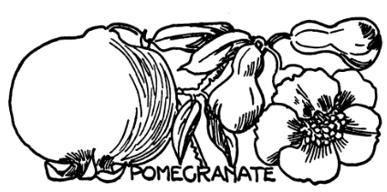

## Pagina originale 199

sotto le querce (126). ERISITTONE fu condannato alla fame perpetua per aver abbattuto una quercia sacra a CERERE. Si credeva che le querce attirassero i fulmini, o «folgori di GIOVE», più spesso di ogni altro albero, perché la loro forza superiore le rendeva più degne di riceverli (125). I contadini piantavano querce per «attirare» i fulmini lontano dalle case. I corvi si posavano abitualmente sul leccio e gracchiavano i loro lugubri avvertimenti premonitori; esso divenne quindi un albero funebre. Nelle leggende cristiane tutti gli alberi della foresta si ribellarono all'idea di dare il proprio legno per la croce di GESÙ, tranne il leccio (126). GESÙ tuttavia lo perdonò perché era disposto a morire con lui e, dopo la risurrezione, apparve ai santi all'ombra di un leccio (298). Le querce erano le tradizionali dimore delle driadi. La quercia occupa un posto importante nel folclore di Germania, Lituania, Irlanda, Grecia, Finlandia, Austria, Inghilterra (125) e degli Indiani d'America. Nella mitologia greca le sue radici scendevano fino all'Ade; nella tradizione cristiana i suoi rami erano levati al cielo in preghiera. Divenne l'albero di MARIA, madre di CRISTO. Si supponeva che le querce curassero ogni sorta di malattia (125), non soltanto degli esseri umani ma anche dei cavalli, e offrissero riposo all'infelice Ebreo errante. GIOVANNA D'ARCO fu accusata di adorare una quercia stregata (298).

**MELOGRANO**
