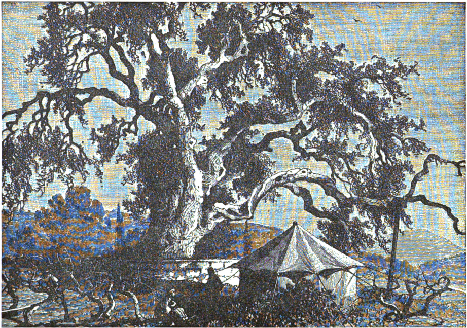

## Pagina originale 200

**FIGURA 29.** La quercia di ABRAMO (*Quercus coccifera* var. *pseudococcifera*) presso Hebron, negli anni Settanta dell'Ottocento. Quando uno dei rami inferiori fu spezzato da una forte nevicata nell'inverno del 1850, venne tagliato in tronchi e trasportato a Gerusalemme: erano sette carichi di cammello! Attualmente l'albero è stato quasi distrutto. (Incisione su legno da *Picturesque Palestine* di C. W. Wilson, 1883; si veda anche la figura 84.)
