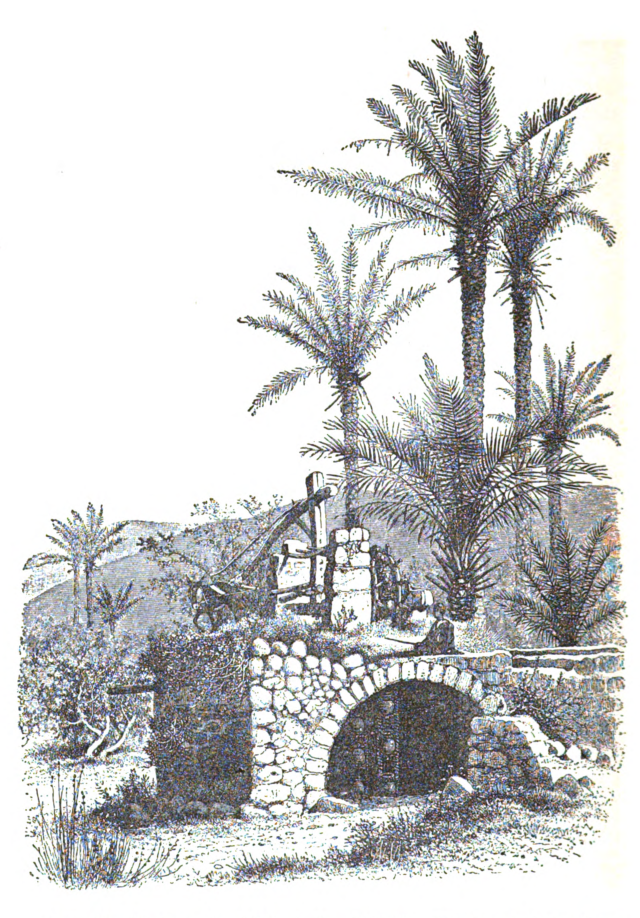
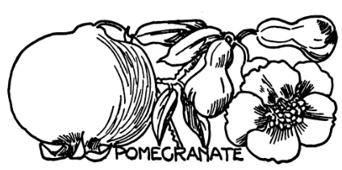
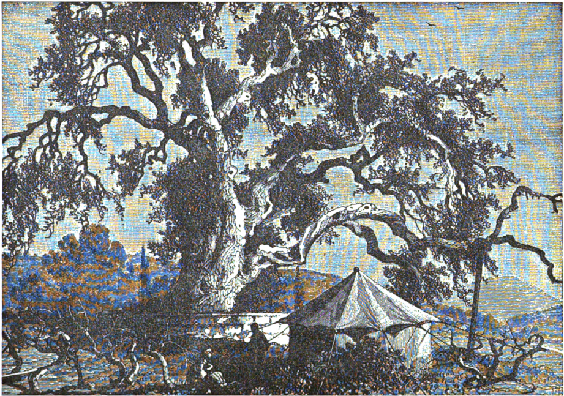

# Le piante della Bibbia

H. N. Moldenke e A. L. Moldenke

## Pagina originale 1

### Cenni storici

L'interesse popolare per la botanica della Bibbia risale a tempi molto antichi. Le piante e i loro prodotti sono menzionati in centinaia di versetti dell'Antico e del Nuovo Testamento, oltre che nei libri apocrifi: non sorprende, quindi, che i primi teologi, ecclesiastici ed eruditi se ne siano occupati con grande interesse. Fin dai suoi inizi, la letteratura teologica è ricca di riferimenti e commenti sulle piante della Bibbia e delle terre bibliche. Vi fu, naturalmente, un lungo periodo in cui nessuno osava mettere in discussione le traduzioni o le interpretazioni dei passi biblici proposte dai capi della Chiesa che allora detenevano l'autorità. Giunse però il momento in cui cominciarono a essere poste domande e comparvero diverse sette o confessioni, inizialmente perseguitate e represse come «eretiche». Furono messe in dubbio le traduzioni e perfino la canonicità di alcuni capitoli e di interi libri. Ne seguirono, com'era naturale, discussioni e polemiche accese, talvolta aspre, fra studiosi e teologi sulla traduzione e sull'interpretazione di determinate parole o espressioni ebraiche o greche nei passi che si riferiscono, o si ritiene si riferiscano, alle piante o ai prodotti vegetali. Non abbiamo tentato di esaminare l'enorme letteratura teologica sull'argomento, né di includerla nella nostra bibliografia, soprattutto perché quegli autori non avevano una formazione botanica e le loro argomentazioni, pur essendo spesso interessanti, sono perlopiù di natura metafisica, filosofica, morale o filologica.

Tralasciando i contributi occasionali, ma non per questo meno importanti, di Aristotele, Platone, Plinio, Dioscoride, Erodoto, Teofrasto, e perfino di Plutarco e Giuseppe Flavio, troviamo che il primo libro di cui si abbia notizia dedicato interamente alle piante menzionate nelle Scritture fu quello di Levinus Lemmens, pubblicato nel 1566 (206). Era un'opera di 161 pagine dal titolo imponente: *Herbarum atque arborum quae in Bibliis passim obviae sunt et ex quibus sacri vates similitudines desumunt, ac collationes rebus accommodant, dilucida explicatio; in qua narratione singula loca explanantur quibus Prophetae observata stirpium natura, conciones suas illustrant, divina oracula fulciunt*. Fu ristampata nel 1568 con un altro titolo: *Similitudinum ac parabolarum quae in Bibliis ex herbis atque arboribus desumuntur dilucida explicatio…*. Seguì nel 1587 *An herbal for the Bible* di Thomas Newton, di 287 pagine: in realtà si trattava di una traduzione, per quanto modificata, dell'opera di Lemmens. L'unico altro contributo degno di nota del XVI secolo fu quello di F. Valles, *De iis, quae scripta sunt physice in Libris Sacris; sive, de sacre philosophia*, opera di 978 pagine pubblicata per la prima volta nel 1588.

Il XVII secolo si aprì con il *Sacrorum Bibliorum arboretum morale* di L. Rumetius, di 118 pagine, pubblicato nel 1606 e poi ampliato nel 1626 fino a comprendere tre volumi per complessive 901 pagine, e con il *Sacrorum arborum, fruticum et herbarum* di Clemens Anomoeus, uscito nel 1609 con 223 pagine. Seguirono un'opera portoghese di 582 pagine di F. I. de Barreira, nel 1622; l'*Arboretum sacrum* di Johannes Meurs, nel 1642; e due libri di A. Cocquius: *Historia ac contemplatio sacra plantarum arborum & herbarum quarum fit mentio in Sacra Scriptura* nel 1664 e *Observationes et exercitationes philologico-physiologicae* nel 1671. E. Castelli pubblicò nel 1667 un libro sulle piante menzionate nella Bibbia. Vi furono poi brevi trattati dedicati a singole piante: Du Pas scrisse sul giglio del campo, Mundelstrup sul pomo di Sodoma, Ravius sulla mandragora e Meyer sul sicomoro. Nel 1663 apparve la prima delle numerose edizioni dell'assai popolare *Arboretum biblicum* di J. H. Ursinus, opera di 638 pagine.

## Pagina originale 2

L'*Arboretum biblicum* fu seguito, nel 1694, dallo *Scripture herbal* di William Westmacott.

Nel XVIII secolo apparvero le numerose e importantissime opere di Celsius, Hiller, Scheuchzer, Shaw, Oedman, Harris e Taylor. Nel 1740 fu pubblicata la prima edizione della *Phytotheologia* di J. B. Rohr; nel 1745 e nel 1747 uscirono i due volumi dello *Hierobotanicon* di Celsius, generalmente considerati tra le opere fondamentali di questo campo di studi.

Non vi è forse un altro ramo della botanica nel quale così tante persone abbiano parlato, discusso e scritto senza nemmeno prendersi la briga di esaminare direttamente le questioni controverse: in altre parole, senza applicare il metodo scientifico! Ai vecchi autori, in massima parte teologi, ecclesiastici e studiosi dei classici, sembrava del tutto superfluo, se non irrilevante, chiedersi quali piante crescessero realmente nelle terre bibliche ai loro tempi. Anche studiosi con una discreta conoscenza della storia naturale tardarono a capire che le piante di una regione potevano differire notevolmente da quelle di un'altra. Per secoli studiosi ed erboristi cercarono di riconoscere in Germania, Francia, Inghilterra o Scandinavia le piante descritte dalla Grecia da Teofrasto o Dioscoride. A quanto pare, non veniva loro in mente che una pianta descritta in Grecia potesse non essere originaria anche della Svezia, dell'Inghilterra o del Sudafrica. Viceversa, per secoli gli erboristi cercarono negli scritti degli antichi Greci, Romani e Arabi le descrizioni delle piante comuni ai bordi delle strade britanniche e olandesi, senza quasi mai rendersi conto dell'inutilità di un tale tentativo.

Non sorprende, dunque, che gran parte dei primi autori sulle piante della Bibbia abbia fondato la maggior parte, se non la totalità, delle proprie argomentazioni sulla filologia comparata, sull'etimologia, sulle opinioni dei «Padri della Chiesa» e sulle «prove interne» offerte dalle Scritture stesse. Era inevitabile giungere, con questi mezzi, a conclusioni spesso assai divergenti e in non pochi casi del tutto errate. Kitto riassunse efficacemente la situazione con queste parole:

«Le storie naturali della Bibbia costituiscono una categoria a sé, che ha con le scienze naturali un rapporto più debole di qualsiasi altra. Sono opere di critica piuttosto che di storia naturale, lavori di filologi piuttosto che di naturalisti. Tutto ciò che l'erudizione poteva fare in tali materie è stato fatto; ciò che avrebbero potuto fare la scienza, l'osservazione e una ricerca ben indirizzata è rimasto invece incompiuto. Il procedimento consueto nelle opere di questa classe è stato esaurire le risorse della filologia e delle congetture per cercare di scoprire il significato del nome ebraico e l'oggetto da esso designato. Per la natura stessa del problema, la conclusione raggiunta è spesso insoddisfacente o incerta. Una volta adottata una conclusione, però, si passa al vaglio degli antichi scrittori greci e romani per ricavarne la storia e la descrizione dell'oggetto, e soprattutto indicazioni che possano concordare con quelle degli autori sacri o illustrarle. Tutto questo era perfettamente legittimo; ma il valore delle informazioni così raccolte, come contributo a una storia naturale della Palestina, avrebbe potuto essere grandemente accresciuto se si fossero cercate conferme e chiarimenti nelle reali condizioni del paese e nella natura dei suoi prodotti nei diversi regni naturali» (202).

Nel 1757 l'«immortale svedese» Carlo Linneo pubblicò, curandone l'edizione, l'*Iter palaestinum* (160) del suo compianto allievo e devoto seguace F. Hasselquist. L'opera, di 619 pagine, fu immediatamente tradotta, per ordine della regina di Svezia, in tedesco, inglese e francese. L'edizione inglese si intitola *Voyages and travels in the Levant in the years 1749, 50, 51, 52: containing observations in natural history, physick, agriculture, and commerce: particularly in the Holy Land and the natural history of the Scriptures*. Questo libro segna l'inizio di un'epoca completamente nuova nello studio delle piante bibliche. Nella prefazione Linneo scrive:

«In una mia lezione di botanica del 1747 elencai i paesi di cui conoscevamo la storia naturale e quelli di cui eravamo ignoranti. Fra questi ultimi vi era la Palestina: ne sapevamo meno che delle regioni più remote dell'India. E sebbene la storia naturale di questo straordinario paese fosse di somma importanza per gli ecclesiastici e gli studiosi delle Scritture…»

## Pagina originale 3

«…che si erano adoperati al massimo per conoscere gli animali ivi menzionati, non potevano tuttavia determinarli con un ragionevole grado di certezza prima che qualcuno si fosse recato nel paese e ne avesse studiato la storia naturale» (162).

Colpito da questo rammarico espresso da Linneo nel 1747, il suo allievo Hasselquist, benché fragile e cagionevole di salute, intraprese due anni dopo un viaggio in Egitto e Palestina. Riuscì a esplorare gran parte della Terra Santa e a raccogliere numerosi appunti e campioni da inviare in Svezia; ma il caldo eccessivo della Palestina si rivelò troppo gravoso per lui, che morì a Smirne a 31 anni, «consumandosi», come lamentò il suo grande maestro e biografo, «come una lampada il cui olio è esaurito». I risultati delle ricerche di Hasselquist — le prime compiute in quelle regioni da un naturalista qualificato — furono tuttavia resi pubblici da Linneo nel 1757. Per quanto imperfetto, a causa del poco tempo che Hasselquist poté trascorrere in Palestina prima della morte, questo lavoro rimane uno dei libri più preziosi mai scritti sull'argomento. Segna l'inizio di una nuova epoca: per la prima volta nella storia uno studioso della storia naturale della Bibbia aveva realmente visitato le terre bibliche e ne aveva studiato direttamente l'ambiente naturale. Gli scritti di tutti i predecessori, compresi Lemmens, Ursinus, Shaw e persino Celsius — amico e mecenate di Linneo — si basavano su testimonianze indirette e supposizioni, spesso completamente errate. Da Hasselquist in poi almeno alcuni studiosi di storia naturale biblica fondarono ragionamenti e commenti su osservazioni reali anziché su semplici ipotesi, assunti e artifici linguistici.

A Hasselquist seguì, nell'esplorazione delle terre bibliche, un altro naturalista dal destino sfortunato, Pehr Forsskål, che viaggiò in Egitto, Arabia e nelle regioni intorno al Mar Rosso. Sventure e avversità ne accompagnarono il cammino. Il suo corpo era tormentato dalle malattie; fu ripetutamente assalito da ladri e banditi, che una volta lo spogliarono di tutti i suoi averi, risparmiando soltanto gli esemplari vegetali essiccati che avevano disprezzato come «senza valore». Le disgrazie culminarono quando guide e portatori lo abbandonarono nel mezzo del deserto arabico, lasciandolo a morire di fame e sete. Dopo la sua morte prematura, nel 1775 e nel 1776, C. Niebuhr pubblicò i risultati della sua coraggiosa opera pionieristica. Un volume di 164 pagine descriveva mammiferi, uccelli, pesci, insetti, anfibi, vermi e materia medica della regione (121); un secondo volume di 377 pagine descriveva le piante (122). Grazie dunque al lavoro pieno di sacrifici di Hasselquist e Forsskål, entrambi pagato con la vita, il mondo ricevette finalmente una descrizione di prima mano di almeno una parte delle piante e degli animali delle terre bibliche.

È sorprendente constatare quanto lentamente i botanici abbiano seguito l'esempio dei due pionieri e intrapreso esplorazioni sistematiche della Terra Santa. Nonostante il lavoro tragicamente interrotto di Hasselquist e Forsskål, il lamento di Linneo rimase valido per un periodo incredibilmente lungo: si sapeva assai di più di terre molto più lontane e isolate che della Palestina e dei paesi circostanti. Nel 1863 uno scrittore della *London Quarterly Review* (301) raccontava di aver visitato il grande museo britannico di storia naturale a South Kensington e di avervi trovato esemplari di piante e animali di ogni parte del mondo in grande abbondanza, ma quasi nessuno della Palestina! Anche al tempo in cui scriviamo, questa singolare scarsità di materiale proveniente dalla Terra Santa nei principali musei ed erbari è ben visibile e, per chi studia le piante della Bibbia, molto deplorevole.

I libri di Ursinus sono tipici della categoria di opere sulla storia naturale della Bibbia descritta così appropriatamente da Kitto. Ursinus offre illustrazioni schematiche delle piante più importanti, spesso quasi ridicole per la loro inesattezza, e brevi descrizioni tratte soprattutto dagli antichi naturalisti greci e romani; approfondisce invece l'origine linguistica dei nomi, esaminando i testi ebraici e greci originali. Nel 1793 apparve la prima edizione di *The natural history of the Bible* di T. M. Harris, un'opera di 297 pagine. Nel 1828 il grande botanico C. P. Thunberg pubblicò nove dissertazioni sulle piante della Bibbia dal titolo *Afhandling om de wäxter…*

## Pagina originale 4

*…som i Bibelon omtales* (321). La splendida opera di Kitto, *Palestine: the physical geography and natural history of the Holy Land*, fu stampata nel 1841. È citato molto spesso il famoso *Scripture herbal* di Marie Callcott, che nel 1842 riunì in 568 pagine gran parte delle informazioni pertinenti raccolte dai precedenti autori. Merita una menzione anche *Plants and trees of Scripture* di Pratt, apparso anonimo nel 1851, come pure *The plants of the Bible* di J. H. Balfour, del 1857. La *Natural history of the Bible* del canonico Tristram — opera di 524 pagine la cui prima edizione uscì nel 1867 — è citata molto di frequente, soprattutto nei commentari biblici e negli scritti teologici. Abbiamo personalmente trovato estremamente utile il volume del celebre botanico dei Kew Gardens John Smith, *Bible plants, their history*, di 265 pagine, pubblicato nel 1878; lo citeremo centinaia di volte nelle pagine successive.

Nel decennio 1883-1893 uscì la prima edizione della monumentale *Flora of Syria, Palestine, and Sinai* di G. E. Post. Una seconda edizione apparve nel 1932-1933. Al momento in cui scriviamo, è ancora l'unica flora complessiva e autorevole a nostra disposizione per questa parte tanto importante e affascinante della superficie terrestre. *Scriptural natural history. I. Trees and plants mentioned in the Bible*, di W. H. Groser, pubblicato inizialmente nel 1888, è un libro pregevole e maneggevole. Nel 1928 e 1929 la rivista *American Forests & Forest Life* pubblicò un'interessante serie di articoli di A. Borah sugli alberi della Bibbia. Diversi autori hanno trattato di botanica biblica nel *Gardeners' Chronicle* e ancora nel 1934 un articolo stimolante sui «Fiori della Bibbia» apparve su *Nature Magazine*.

Vediamo quindi come l'interesse per l'argomento sia rimasto vivo fino ai nostri giorni. All'Università Ebraica di Gerusalemme vi è, infatti, un professore di botanica biblica e si conducono intense ricerche sulla materia. Ci si attende con fiducia che il dottor Ha-Reubeni, i suoi studenti e i successori gettino nuova luce preziosa sulle piante della Bibbia. Un'altra prova della perdurante popolarità di questo ramo della botanica è il fatto che molti fra i migliori libri dedicati all'argomento siano stati ristampati in due, tre, quattro o più edizioni e alcuni tradotti in varie lingue. L'edizione del 1940 di un nostro precedente lavoro sull'argomento (233) andò rapidamente esaurita. Ciò portò alla pubblicazione di un compendio a cura della signorina E. A. King e della signorina C. H. Woodward nel *Journal of the New York Botanical Garden* (192, 347), nonché al volume della signorina King *Bible plants for American gardens*, nel 1941 (187). Anche queste opere esaurirono presto le copie. Le prime due vennero ristampate due volte e si sta preparando un'ulteriore edizione.

Consapevole della popolarità del tema, il New York Botanical Garden ne fece il soggetto della propria partecipazione annuale all'International Flower Show tenutosi al Grand Central Palace di New York nel marzo 1941. La mostra attirò l'attenzione generale e conquistò il primo premio con medaglia d'oro. Da allora il Giardino ha ricostruito molte volte, in una delle sue serre espositive e durante il periodo natalizio, la scena della Natività a Betlemme, utilizzando nell'allestimento soltanto autentiche piante bibliche. Il fatto che tali esposizioni abbiano catturato l'immaginazione e l'interesse del pubblico è dimostrato dalle folle che le visitano regolarmente e dalla lunga serie di articoli di giornale, riviste e periodici religiosi citati nella nostra bibliografia (318, 348-372): si tratta, in realtà, soltanto di una selezione parziale delle segnalazioni più importanti giunte alla nostra conoscenza. Al Giardino sono arrivate lettere su questo tema da ogni parte degli Stati Uniti e del Canada e da diversi paesi stranieri.

Esistono attualmente almeno due giardini biblici allestiti da chiese nell'Occidente, e un noto architetto progetta di proporre disegni specifici di giardini di piante bibliche per chiese, sinagoghe e altre istituzioni religiose, fra cui monasteri, conventi e seminari teologici. Diverse persone ci hanno scritto di voler creare nella propria città giardini biblici simili ai già popolari giardini dedicati a Shakespeare.

Uno degli errori più frequenti in cui predicatori e scrittori religiosi privi di formazione botanica sono caduti nel passato — e nel quale, sorprendentemente, continuano a cadere anche oggi — consiste nell'identificare le piante delle…

## Pagina originale 5

…Scritture con quelle che crescono spontaneamente nelle regioni in cui essi vivono: Francia, Germania, Inghilterra, Scozia, Stati Uniti, Canada e così via. Quest'errore era comprensibile e scusabile in tempi lontani, prima di Linneo, Hasselquist e Forsskål, quando poche persone, eccetto i soldati, viaggiavano molto e quasi nessuno si rendeva conto delle grandi differenze fra le flore dei diversi paesi. A Linneo, fra molti altri meriti, spetta quello di aver dimostrato e sottolineato che flora e fauna variano da luogo a luogo in funzione del clima, dei suoli, delle barriere naturali, della latitudine e della longitudine, e così via. Nemmeno lui ne aveva piena consapevolezza prima del suo viaggio in Lapponia. Eppure oggi si tratta di una nozione così diffusa che sembra incredibile che i predicatori continuino a identificare l'«olmo», il «sicomoro», il «giglio», la «rosa», la «vite» e altre piante delle Scritture con specie che portano questi nomi nei boschi e nei campi americani! E nondimeno questa pratica è stata assai diffusa e continua tuttora, suscitando lo stupore divertito dei botanici.

Un altro errore comune di chi visita la Terra Santa senza essere botanico è supporre che tutte le piante che vi vede oggi vi crescessero naturalmente anche nell'antichità biblica, oppure che debba necessariamente trovarvi ancora le piante che la Bibbia colloca in quelle terre. Entrambe le supposizioni sono infondate, poiché non tengono conto del fatto che le flore cambiano, specialmente in regioni come la Palestina e l'Egitto, dove l'essere umano, noto per la capacità di turbare i delicati equilibri della natura, è stato attivo in un modo o nell'altro per almeno seimila anni. Molte piante oggi comunissime in Terra Santa non vi si trovavano affatto all'epoca biblica.

Gli esempi possibili sono numerosi, ma fra i più notevoli vi è la robinia americana, *Robinia pseudo-acacia* L., introdotta in Palestina soltanto in tempi relativamente recenti e ora prospera e in espansione come nella sua terra d'origine. Un altro esempio è il fico d'India americano, *Opuntia ficus-indica* (L.) Mill., introdotto molto tempo fa e tanto favorito dalle condizioni palestinesi da trovarsi oggi «dappertutto» (266), come elemento vistoso e caratteristico del paesaggio. È ormai così tipico che gli artisti, dipingendo episodi della vita di Gesù o di personaggi dell'Antico Testamento, sono incorsi più volte nel ridicolo errore di rappresentare il paesaggio circostante pieno di cactus fioriti o carichi di frutti. Ogni botanico sa naturalmente che i cactus del genere *Opuntia* erano sconosciuti in tutto il Vecchio Mondo prima della scoperta e dell'esplorazione dell'America e della loro successiva introduzione.

Allo stesso modo l'opopanax, *Vachellia farnesiana* (L.) Wight & Arn., si trova oggi in tutto il Levante nelle siepi e lungo i corsi d'acqua, ma è una pianta americana. Anche il gelso bianco, *Morus alba* L., è oggi coltivato «dappertutto» (267) in Terra Santa, e si potrebbe essere indotti a ritenerlo il gelso della Bibbia. *M. alba*, però, è originario della Cina e, secondo gli autori, è abbastanza certo che nei tempi biblici non fossero ancora stabiliti commerci con la Cina: dunque non poteva trovarsi allora in Terra Santa. Lo stesso discorso riguarda il salice piangente, *Salix babylonica* L., ora ampiamente coltivato e inselvatichito in Palestina, ma originario del Giappone o della Cina; gli antichi Israeliti non avrebbero potuto conoscerlo.

Allo stesso modo, il cosiddetto «ibisco siriaco» o «rosa di Sharon», impropriamente denominato (*Hibiscus syriacus* L.), la saponaria (*Saponaria officinalis* L.) e numerose specie del genere *Citrus* sono oggi comuni in Terra Santa in seguito a introduzioni relativamente recenti. Centinaia di altre piante esotiche vivono attualmente in Siria, Libano e Palestina senza essere presenti nei tempi biblici; molte si diffondono oggi nella campagna e crescono come se fossero autoctone. Esiste perfino una leggenda secondo cui la verbena blu, *Verbena hastata* L., cresceva ai piedi della croce quando Gesù fu crocifisso; anche questa possibilità è però esclusa dagli autori, poiché la specie è confinata ad alcune zone degli Stati Uniti e del Canada. Eig elenca 115 specie vegetali endemiche della Palestina e calcola che costituiscano soltanto circa un quarto delle piante oggi presenti nella regione (119). Quanto doveva differire la flora della Palestina biblica da quella dei nostri giorni!

Le complicazioni provocate dall'introduzione di specie esotiche in Palestina sono bene illustrate da un brano del dottor J. C. Geikie nel libro *Life…*

## Pagina originale 6

*…and Words of Christ*, dove l'odierno miscuglio di piante autoctone ed esotiche è descritto efficacemente attraverso gli occhi di un osservatore non botanico:

«Nell'estensione di un unico paesaggio è possibile incontrare ogni clima, dal freddo dell'Europa settentrionale al caldo dell'India. La quercia, il pino, il noce, l'acero, il ginepro, l'ontano, il pioppo, il salice, il frassino, l'edera e il biancospino crescono rigogliosi sulle alture dell'Hermon, del Bashan e della Galilea. Così il viaggiatore proveniente dalle regioni temperate più settentrionali, in alcuni luoghi, si trova circondato dagli alberi e dalla vegetazione del proprio paese. Vede il melo, il pero e il susino e si rallegra di ritrovare il familiare frumento e l'orzo, i piselli, le patate, i cavoli, le carote, la lattuga, l'indivia e la senape. L'inglese è lieto di vedersi circondato da molti fiori della terra natale: delle duemila o duemilacinquecento specie floreali della Palestina, forse cinquecento sono britanniche. Sembra di essere a casa quando si vedono anemoni, ranuncoli, ninfee gialle, tulipani, crochi, giacinti, reseda, gerani, malve, rovi comuni, rose canine, margherite, senecioni, denti di leone, salvia, timo, maggiorana, anagallide azzurra e bianca, ciclamini, verbene, mente, marrubio, ortiche dei bordi stradali e cardi; negli stagni si ritrovano il crescione d'acqua, la lenticchia d'acqua e i giunchi.

«Il viaggiatore dei paesi più meridionali non si sente meno a casa; da qualunque regione arrivi, dalla soleggiata Spagna all'India occidentale, riconoscerà forme familiari: il carrubo, l'oleandro e il salice lungo torrenti e corsi d'acqua; il sicomoro, il fico, l'olivo, la palma da dattero, il cosiddetto albero del paradiso o “orgoglio dell'India”, il pistacchio, il tamarisco, l'acacia, le alte erbe e le canne tropicali; oppure frutti come datteri, melagrane, uva, arance, pomeli, lime, banane, mandorle e fichi d'India. La vista di campi di cotone, miglio, riso, canna da zucchero o mais, o perfino dell'indaco indiano, e di appezzamenti con meloni, zucche, tabacco, igname, patata dolce e altre colture da campo o da orto meridionali e tropicali, lo riporterà con il pensiero alla propria casa» (128a).

Vi è, tuttavia, anche l'altro lato della medaglia. Molte piante che in epoca biblica crescevano abbondanti in Terra Santa e nei paesi vicini non vi si trovano più oppure sono presenti in quantità molto inferiori. Alcune sono state soppiantate da specie straniere più invasive, proprio come in molte parti dell'America la vegetazione autoctona viene scalzata dalle infestanti europee o asiatiche. Altre specie originarie della Palestina sono scomparse o quasi, a causa dell'eccessivo sfruttamento agricolo del suolo, della distruzione delle foreste e dei conseguenti cambiamenti climatici e ambientali. Se riflettiamo per un momento sulle enormi trasformazioni verificatesi nel Midwest americano in seguito alla coltivazione della terra negli ultimi 75 anni, e ricordiamo poi che il territorio palestinese è stato coltivato senza interruzione per gli ultimi tremila o quattromila anni, possiamo farci un'idea dei mutamenti che devono esservi avvenuti.

Un tempo la Palestina era una terra di palme, con la palma da dattero tanto abbondante e caratteristica quanto in Egitto. Lo sappiamo non soltanto grazie alle testimonianze degli antichi storici, ma anche per i numerosi resti fossili di tronchi di palma sepolti nelle sabbie mobili. Oggi la palma da dattero deve essere accuratamente coltivata. Ai tempi biblici i cedri imponenti rivestivano i pendii del Libano e di altre catene montuose; ora i pochi esemplari superstiti devono essere recintati e protetti con cura dalle autorità perché la specie non venga del tutto sterminata nella propria terra d'origine.

Chiunque si addentri anche solo superficialmente nella letteratura sulle piante bibliche rimane subito colpito dalle straordinarie discrepanze, dalle contraddizioni, dalle identificazioni palesemente errate, dalle dichiarazioni inesatte e dalla confusione generale che la caratterizzano. Le ragioni di questa deplorevole confusione sono molteplici. Anzitutto bisogna ricordare che la botanica come scienza esatta è uno sviluppo relativamente recente del sapere umano. È vero che gli esseri umani hanno sempre prestato attenzione e interesse alle piante circostanti; ma, fino a tempi piuttosto recenti, nella storia dell'umanità tale interesse non poteva essere definito una scienza esatta. Certamente, quando furono composti e poi messi per iscritto i libri della Bibbia, soprattutto quelli dell'Antico Testamento, non esisteva nulla che somigliasse a una scienza botanica rigorosa o a una nomenclatura botanica: di conseguenza…

## Pagina originale 7

…l'esattezza e la precisione dei termini erano impossibili. In secondo luogo, gli autori dei libri biblici non erano botanici e neppure «naturalisti» — forse con una sola possibile eccezione. Erano in gran parte uomini semplici, con un vocabolario limitato, e il loro scopo non era scrivere di botanica. La Bibbia non fu concepita dai suoi autori come un manuale di storia naturale. Per gli scrittori sacri gli aspetti botanici erano del tutto secondari e subordinati agli aspetti morali, etici, teologici e storici, che ai loro occhi avevano importanza e significato assai maggiori. Dovrebbe dunque sorprendere più il fatto di trovare precisione botanica che quello di non trovarla.

In terzo luogo occorre tenere presente la storia delle Scritture. Secondo quanto generalmente ammesso dagli studiosi della materia (102), una parte considerevole del materiale dell'Antico Testamento ebbe origine nella forma di poesia — canti e ballate, ciò che oggi chiameremmo canti popolari — tramandati da una generazione all'altra di cantori e narratori per centinaia di anni prima di essere messi per iscritto; in alcuni casi, addirittura prima dell'invenzione della scrittura. Si ritiene che i cosiddetti «Libri della Legge» (Pentateuco o Torah), che nella cronologia di Ussher descriverebbero eventi compresi fra il 4004 e il 1451 a.C., non siano stati completati in forma scritta fino al 444 a.C. circa; i «Profeti» (*Nebi'im*) intorno al 250 a.C.; e gli altri libri dell'Antico Testamento, ossia gli «Scritti sacri» (*Ketubim*) e i libri poetici, intorno al 150-100 a.C. L'Esateuco (dalla Genesi a Giosuè) fu probabilmente scritto, almeno in parte, da numerosi scribi, con continue aggiunte, nel X o IX secolo a.C.

In una situazione del genere, con molto materiale rimasto per secoli sotto forma di canti o ballate e poi messo per iscritto, in parte, da autori diversi, in momenti diversi e perlopiù molto tempo dopo i fatti narrati, non stupisce che siano sorti problemi terminologici e probabili identificazioni sbagliate: parole diverse per designare la stessa pianta, oppure la stessa parola usata per piante differenti, perfino nei testi «originali».

In quarto luogo, va ricordato che anche dopo essere stati messi per iscritto i libri della Bibbia rimasero esposti a possibili mutamenti. La Bibbia ebraica fu tradotta per la prima volta in greco tra il III e il I secolo a.C.; molto più tardi furono i Riformatori a separare nei libri apocrifi quelli che non avevano un originale ebraico. Il più antico testo ebraico della Bibbia oggi a noi noto è il testo masoretico, che potrebbe essere stato redatto tra il VI e l'VIII secolo d.C., sebbene un'autorità come Goodspeed e altri studiosi di valore paragonabile sostengano che ciò non avvenne prima del IX secolo (5). È probabile, benché non certo, che il testo abbia raggiunto una forma stabile intorno al II secolo d.C. Da allora fu copiato e ricopiato da monaci solitari nel raccoglimento delle loro celle monastiche. Questa copiatura fu senza dubbio condotta con grande fedeltà e devozione da persone per le quali ogni «iota e apice» era sacro; si può quindi ragionevolmente supporre che in quel periodo vi siano entrate pochissime alterazioni puramente accidentali (8).

Resta tuttavia un intervallo enorme tra il tempo della prima trascrizione — a partire dal X secolo a.C. — e quello in cui il testo avrebbe assunto forma stabile, nel II secolo d.C.: durante tale periodo errori, corruzioni, aggiunte o omissioni accidentali o intenzionali, e altre modifiche di varia natura avrebbero potuto, e probabilmente dovettero, insinuarsi nei testi (10, 11, 12). Prima ancora vi fu il periodo molto più lungo durante il quale il materiale fu tramandato oralmente da cantori e narratori, di generazione in generazione, come il folclore di ogni popolo. Possiamo soltanto immaginare i cambiamenti verificatisi allora.

Anche il testo masoretico ha conosciuto numerose «edizioni» e traduzioni. Fra le principali si ricordano quella samaritana, scritta nell'antico carattere ebraico o *ibri*, detto anche samaritano, del I o II secolo d.C.; quelle di Aquila, Simmaco, Teodozione, Origene, Esichio e Luciano, ricondotte dagli autori all'incirca al II secolo; le varie edizioni della Settanta in caratteri onciali, dal IV al VII secolo, e le successive edizioni in corsivo dal X al XIV secolo; la Vulgata, o traduzione latina di Girolamo, che gli autori collocano al II secolo; e le versioni caldee…

## Pagina originale 8

…o *Targum*, datate dagli autori tra il II e il IV secolo d.C. (306). Vi furono inoltre varie versioni egiziane, del III e IV secolo, fra cui quelle dette menfitica o copta, tebaica, e basmurica o ammoniana; nonché versioni etiopi e siriache (IV secolo), armene (V), gotiche (VI), slave (IX) e arabe (X). Secondo l'American Bible Society, al tempo della stesura di quest'opera la Bibbia era stata tradotta in 1.118 lingue e dialetti differenti!

A questo proposito bisogna ricordare che, per un essere umano, è impossibile tradurre da una lingua a un'altra conservando esattamente lo stesso significato. Ogni lingua contiene sfumature e connotazioni che non possono essere rese con assoluta precisione in un'altra. Ogni nuova traduzione comporta quindi la perdita di qualcosa dell'originale, o l'aggiunta di qualcosa. E quando le traduzioni vengono eseguite una a partire dall'altra, in una lunga catena, anziché tornare ogni volta ai testi «originali», tali differenze di significato aumentano ulteriormente. I testi «originali», inoltre, non sono sempre disponibili per i traduttori. È importante osservare che molte delle antiche versioni e traduzioni furono realizzate senza disporre di testi «originali» che oggi abbiamo; d'altra parte, numerosi testi antichi disponibili allora sono poi andati perduti. Tutto questo contribuisce a spiegare una parte della confusione esistente.

Vale qui la pena citare un passo della prefazione alla revisione del 1946 della Jewish Publication Society: «La necessità storica di tradurre si è ripresentata in occasione di tutti i grandi cambiamenti nella vicenda di Israele. Basti ricordare la Settanta, ossia la traduzione greca delle Scritture, frutto del contatto di Israele con la civiltà ellenistica che allora dominava il mondo; la traduzione araba del gaon Saadia, quando la grande maggioranza del popolo ebraico cadde sotto il dominio di sovrani musulmani; e la traduzione tedesca di Mendelssohn e della sua scuola, agli albori di una nuova epoca che portò gli ebrei europei, in gran parte parlanti un dialetto tedesco, a contatti più stretti con i vicini. Queste traduzioni sono tutte prodotti storici intimamente legati alle peregrinazioni di Israele tra le nazioni e, più in generale, ai grandi avvenimenti dell'umanità.

«Per quanto antico e continuo sia stato questo compito di traduzione, sarebbe sbagliato pensare che non suscitasse perplessità. È certo, quanto meno, che le opinioni fossero divise sull'opportunità di imprese del genere. Mentre Filone e i suoi correligionari di Alessandria consideravano la traduzione dei Settanta un'opera di uomini ispirati, i rabbini palestinesi finirono per vedere il giorno in cui la Settanta fu completata come uno dei più sfortunati della storia d'Israele, ritenendo che la Torah non potesse mai essere tradotta adeguatamente. Vi sono anche sufficienti indicazioni che gli effetti di tali traduzioni non furono tutti desiderabili» (16).

Un confronto attento tra le numerose edizioni e versioni rivela molte differenze. Ciò vale per gli aspetti botanici come per tutti gli altri, e sarà abbondantemente illustrato nelle pagine seguenti. Ogni volta che il testo veniva tradotto era sottoposto alla critica editoriale, a una sorta di «revisione»; e le opinioni dei diversi revisori ne hanno spesso alterato il significato originario. Le prime traduzioni nelle lingue volgari erano perlopiù traduzioni non dei testi originali, ma di versioni latine del IV secolo che, per quanto meritorie, si basavano a loro volta su conoscenze del tutto insufficienti delle fonti originarie (10).

Nel 1611 fu completata la traduzione inglese nota come *Authorized Version* di Giacomo I. A essa, nonostante i grandi meriti, dobbiamo nuovamente una parte importante della confusione sulle piante bibliche che ha tratto in inganno gli scrittori da allora fino a oggi. Fu proprio questa versione a perpetuare e, in alcuni casi, a introdurre l'errata identificazione delle piante bibliche con comuni piante inglesi. È molto spiacevole che la botanica non fosse più progredita quando si affrontò una traduzione destinata a essere quasi universalmente usata dai protestanti per i successivi 336 anni. In essa i pioppi tremuli vengono chiamati «gelsi», i gelsi «sicomini», una specie di fico «sicomoro», il legno d'aquilaria «aloe», l'acanto «ortica», il mandorlo «nocciolo», il ginepro «erica», l'aneto «anice», l'albicocco «melo»…

## Pagina originale 9

…il bosso viene chiamato «avorio», il cipresso «bosso», la pianta alofila indicata come *saltwort* «malva», il terebinto «olmo» e il platano «castagno»! Analogamente, in zoologia, l'antilope diventa un «bue selvatico», il toro un «unicorno», l'ippopotamo un «behemoth», le iene «creature lamentose», lo sciacallo una «volpe» o un «drago», il pellicano un «cormorano», l'oca un «volatile ingrassato», la poiana uno *glede* (termine inglese antico), l'avvoltoio barbuto un *ossifrage*, gli struzzi «gufi», la gru una «rondine», il coccodrillo «balena», «leviatano» o «drago», le locuste «bruchi devastatori» (*palmerworms*) e le vacche marine «tassi»!

La versione di re Giacomo, tuttavia, non fu l'unica versione inglese «autorizzata». Ve ne furono altre di Wycliffe (XIV secolo), Tyndale (1525), Coverdale (1535), Matthew (1537), Taverner (1539) e Cranmer (1539), oltre alla cosiddetta Bibbia di Ginevra di Whittingham (1557 e 1560), adottata dai puritani e prima a omettere tutti i libri apocrifi. Apparve successivamente la *Bishops' Bible*, del 1568 e del 1572.

La Bibbia di Lutero uscì inizialmente come *Septemberbibel*, traduzione del Nuovo Testamento datata settembre 1522 a Wittenberg. Il frontespizio non recava né data né nome dell'editore. La Bibbia di Zurigo comparve nel 1530: era una versione tedesca costituita dalla traduzione di Lutero con l'aggiunta dei Profeti e degli Apocrifi. La Bibbia di Berleburg (1726-1742) era una traduzione tedesca basata sulle due precedenti e connotata da tendenze mistiche. Nel 1735 Wertheim pubblicò la Bibbia che porta il suo nome, una versione razionalista tedesca. La *Probe-Bibel*, o «Bibbia di prova» (1892), fu la revisione della Bibbia di Lutero commissionata dal congresso della Chiesa protestante tedesca riunito a Eisenach.

La Bibbia di Reims e Douai di Gregory Martin, del 1582 e 1609, divenne la versione cattolica ufficiale in inglese. Sia la versione ginevrina sia quella di Douai aggiunsero ai testi note di natura fortemente controversa, tanto politiche quanto teologiche (306). La Bibbia di Douai fu rivista dal vescovo Challoner a metà del XVIII secolo.

La Bibbia Mazarina, detta anche Bibbia di Gutenberg o «delle quarantadue righe», è un'edizione della Vulgata stampata, secondo gli autori, a Metz intorno al 1450-1455 da Gutenberg e collaboratori. Fu la prima Bibbia realizzata con caratteri mobili e probabilmente il primo libro completo stampato con questo procedimento. Uno dei suoi nomi deriva dal rinvenimento, avvenuto intorno al 1760, nella biblioteca di Mazarino. La «Bibbia delle trentasei righe», edizione in folio della cosiddetta *Biblia Latina*, prende il nome dalla disposizione della pagina in due colonne di trentasei righe; è detta anche «Bibbia di Bamberga» perché probabilmente fu stampata in quella città nel 1460.

La Bibbia Leopolita (1561), tradotta dal latino della Vulgata in polacco da Giovanni di Leopoli, fu pubblicata a Cracovia. Destinata ai cattolici, non ricevette però l'approvazione del papa. La Bibbia di San Venceslao, o di Wenzel, fu pubblicata a Praga dai gesuiti per i cattolici di Boemia fra il 1677 e il 1715. La Bibbia di Wuyeck o Wujek è la versione ufficiale polacca cattolica realizzata dal gesuita Wujek e stampata a Cracovia: Nuovo Testamento nel 1593 e Antico Testamento nel 1599.

La Bibbia di Ferrara (1553) fu la prima edizione in spagnolo dell'Antico Testamento eseguita direttamente dall'ebraico, da Duarte Pivel, espressamente per gli ebrei; nello stesso anno uscì un'altra edizione destinata ai cristiani. La Bibbia di Pfister prende il nome dallo stampatore Albert Pfister; quella di Schelhorn perché Schelhorn la descrisse nel 1760. La Bibbia di Kralice, o dei Fratelli, è la più importante versione boema, pubblicata dai Fratelli Uniti a Kralice, in Moravia, tra il 1579 e il 1593. La Bibbia di Ostrog è la prima Bibbia completa stampata in slavo ecclesiastico, nel 1581.

Fra le numerose altre edizioni ve ne sono alcune la cui fama deriva soprattutto da particolarità o errori di stampa o di traduzione, come le seguenti. La «Bibbia incatenata» (1539) è la Grande Bibbia di Cranmer, così chiamata perché spesso veniva fissata con una catena nelle chiese, a disposizione dei lettori. La «Bibbia degli insetti» (*Bug Bible*, 1551) reca nel Salmo 91:5 l'espressione inglese «non dovrai temere alcun *bugges*…»

## Pagina originale 10

…«…[ossia: terrori] notturni», formulazione presente anche nelle versioni di Coverdale e Taverner. La «Bibbia delle brache» (*Breeches Bible* o Bibbia di Ginevra, 1560) legge in Genesi 3:7: «Cucirono insieme foglie di fico e si fecero delle brache», invece di «grembiuli». La «Bibbia dei fabbricanti di posti» (*Placemaker's Bible*, intorno al 1562) legge in Matteo 5:9 «Beati i *placemakers*» al posto di *peacemakers*, cioè gli «operatori di pace».

La «Bibbia dell'Orso» (*Biblia del Oso*) fu la prima traduzione spagnola pubblicata della Bibbia intera. Prende nome dall'animale raffigurato sul frontespizio ed è datata 1567-1569 a Basilea. La «Bibbia della triaca» (*Treacle Bible* o *Bishops' Bible*, 1568) legge in Geremia 8:22: «Non vi è triaca in Galaad?». La «Bibbia del pollice» (*Thumb Bible*, Aberdeen, intorno al 1607) era grande circa quanto un pollice: un pollice quadrato, con spessore di mezzo pollice. La «Bibbia della resina» (*Rosin Bible*), ossia la Bibbia di Douai del 1609, presenta in Geremia 8:22: «Non vi è resina [balsamo] in Galaad?». 

La «Bibbia del “lui”» (*He Bible*), prima edizione del 1611 della versione di re Giacomo, legge in Rut 3:15: «Egli [anziché: ella] entrò in città», come fa anche la *Revised Version*. La «Bibbia del “lei”» (*She Bible*), seconda edizione della versione di re Giacomo apparsa nello stesso anno, corregge tale errore. La «Bibbia adultera» o «malvagia» (*Adulterous/Wicked Bible*, 1631) stampa il settimo comandamento in Esodo 20:14 come «Commetterai adulterio», omettendo la negazione. La «Bibbia dello stampatore» (*Printer's Bible*, intorno al 1702) legge in Salmo 119:161 «Gli stampatori [invece dei principi] mi hanno perseguitato senza motivo».

La «Bibbia dell'aceto» (*Vinegar Bible*, Clarendon Press, Oxford, 1717) ha il titolo «Parabola dell'aceto [anziché: della vigna]» sopra il capitolo 20 del Vangelo di Luca. La «Bibbia degli assassini» (*Murderer's Bible*, intorno al 1801) legge in Giuda 16 «Costoro sono assassini [anziché: mormoratori]». La «Bibbia del “rimanere”» (*To-remain Bible*, Bible Society di Cambridge, 1805) inserisce le parole «a rimanere» in Galati 4:29 al posto di una virgola. La «Bibbia dei pesci in piedi» (*Standing Fishes' Bible*, 1806) legge in Ezechiele 47:10 «I pesci [anziché: i pescatori] staranno sulla sua riva». La «Bibbia della discolpa» (*Discharge Bible*, 1806) legge in 1 Timoteo 5:21 «Ti esonero [anziché: ti scongiuro] davanti a Dio».

La «Bibbia dell'odio per la moglie» (*Wifehater Bible*, 1810) legge in Luca 14:26: «Se uno viene a me e non odia suo padre… sì, e anche la propria moglie [invece della propria vita]». La «Bibbia delle orecchie per orecchio» (*Ears-to-ear Bible*, 1810) legge in Matteo 13:43: «Chi ha orecchie per orecchio [anziché: per udire], ascolti». La «Bibbia dei cammelli di Rebecca» (*Rebekah's Camels Bible*, 1823) legge in Genesi 24:61: «Rebecca si alzò e con lei i suoi cammelli [anziché: le sue ancelle]» (158).

In anni molto recenti, rispetto all'epoca di composizione di quest'opera, sono comparse diverse nuove e ottime traduzioni bibliche. Fra queste va ricordata la traduzione del Nuovo Testamento in inglese corrente di R. F. Weymouth del 1947 (15); la revisione della versione Challoner-Reims preparata sotto la direzione del vescovo Edwin V. O'Hara e completata nel 1941; e la *Revised Standard Version*, pubblicata nel 1946 dall'International Council of Religious Education sotto la direzione di L. A. Weigle. Un altro importante contributo recente è la traduzione inglese del Nuovo Testamento secondo il testo orientale, dalla *Peshitta* o dalle fonti aramaiche originali, eseguita da G. M. Lamsa nel 1940.

La resa del Nuovo Testamento in *Basic English* del 1941 è di notevole interesse, sebbene non abbia un valore particolare per il nostro studio. Il tentativo di rendere l'intero Nuovo Testamento in una lingua di mille parole non si presta, naturalmente, alla precisione scientifica (7).

Dal nostro punto di vista, le traduzioni di maggiore importanza sono però quelle eccellenti del dottor James Moffatt, del 1922-1925 (10, 11, 12), e del dottor Edgar J. Goodspeed e dei suoi collaboratori, del 1939 (5). Queste due traduzioni sono quasi rivoluzionarie nella forma. Gli autori non soltanto sono tornati a tutte le fonti originali, comprese molte non disponibili ai traduttori precedenti, ma hanno anche studiato e confrontato tutte le versioni anteriori, formulando il testo definitivo nell'inglese corrente parlato negli Stati Uniti dell'epoca. Nelle questioni scientifiche appare evidente che abbiano studiato le opere degli scrittori botanici e zoologici, comprese quelle discusse in questi cenni storici. Non hanno esitato ad accogliere i risultati della moderna ricerca scientifica nei casi pertinenti.

Lo stesso grande elogio si applica alle versioni dell'Antico Testamento di Leeser e Jastrow preparate per i lettori ebrei di lingua inglese. È un vero piacere leggere la loro resa di molti passi il cui significato era stato oscurato dall'inglese antiquato e medievaleggiante delle versioni precedenti. Numerosi errori sono stati corretti. Purtroppo, a nostro parere, anche in queste splendide versioni persistono esempi di identificazione sbagliata, e perfino alcune nuove ambiguità e scelte poco avvedute…

*La frase prosegue nella pagina originale 11 e sarà completata nel blocco successivo.*

## Pagina originale 11

…furono introdotte nuove formulazioni. L'invenzione del nome «albero che si desta» per il mandorlo ne è un esempio.

Come esempio tipico delle differenze che si incontrano anche soltanto fra le varie traduzioni inglesi di uno stesso passo, si può citare Naum 2:3. La versione di re Giacomo lo rende «e gli abeti saranno scossi violentemente»; la versione di Jastrow «e le lance di cipresso sono fatte vibrare»; quella di Goodspeed «e i destrieri da guerra scalpitano»; Moffatt «e i loro cavalli scalpitano durante l'adunata»; la versione Douay «e i conducenti sono storditi». La stessa parola, dunque, è interpretata in modi che vanno dagli alberi alle lance, dai cavalli agli uomini!

Oltre alle inesattezze e alle ambiguità delle traduzioni, i commentatori hanno pubblicato molte affermazioni del tutto fantasiose. Uno, per esempio, ha sostenuto che la vivace colorazione prodotta dall'henné sulle piante dei piedi e sui palmi delle mani delle donne orientali dovesse essere rinnovata ogni due settimane circa, mentre il colore sulle unghie «rimane permanente per anni» (146). Ne conseguirebbe che in Oriente le unghie delle mani non crescano con la stessa rapidità che in Occidente: una supposizione del tutto smentita dai fatti! Un altro commentatore ha affermato che «le arance sanguigne si ottengono innestando un ramo [d'arancio] sul fusto di un melograno» (184). Questi sono esempi tipici delle centinaia di affermazioni erronee che affollano la letteratura sulle piante della Bibbia.

## Pagina originale 12

**Carta della vegetazione della Palestina moderna.** Preparata dal dott. Michael Zohary; disegnata da Erwin Raisz, 1951.

## Pagina originale 13

### Descrizione del territorio

Esaminando un elenco degli animali e delle piante menzionati nella Bibbia, si nota subito che si tratta principalmente di specie dell'Egitto e della Palestina (301), sebbene vi siano naturalmente anche riferimenti a quelle dell'Arabia, della penisola del Sinai e della Siria, nonché a diverse merci costituite da prodotti animali o vegetali importati dallo Yemen, dalla Somalia, dall'India e da Ceylon. È stato osservato (184) che la fauna e la flora della Bibbia concordano bene con i dati conosciuti relativi alla geografia e alla cronologia dei luoghi e degli avvenimenti. Gli animali domestici e i cereali appartengono perlopiù alla Mesopotamia, alla Persia e ad altre regioni a oriente della Palestina, un'area che molti antropologi considerano la culla del genere umano. Quelli del Pentateuco sono generalmente originari, o almeno erano molto diffusi, in Egitto e nella penisola del Sinai; quelli dei libri storici e della maggior parte dei Profeti appartengono più propriamente alla Palestina; quelli di Giobbe, invece, sono più tipicamente assiri che egiziani, arabi o palestinesi. La notevole scarsità di riferimenti al mare è coerente con il dato storico secondo cui gli Ebrei non ebbero mai il controllo della costa.

Sono forse opportune qui alcune parole sul clima e sulla fitogeografia attuali delle terre bibliche (146). Il clima della regione comprendente Libano, Siria, Palestina, Transgiordania ed Egitto è estremamente vario. Il dottor Post ha affermato con efficacia (266) che quest'area «non ha eguali sulla Terra, a parità di estensione, non soltanto per gli eventi emozionanti e importanti della storia umana di cui è stata teatro, ma per la sua struttura geologica singolare, la grande varietà del rilievo e del clima e la straordinaria fauna e flora. È il punto d'incontro di tre continenti, poiché l'Asia Minore, dal punto di vista della storia naturale, deve essere considerata appartenente all'Europa piuttosto che all'Asia, e costituisce così un anello di collegamento fra tutti».

Sulle cime innevate dei monti del Libano, che raggiungono i 10.200 piedi, e in parti della catena dell'Antilibano (fra 4.000 e 8.700 piedi d'altitudine), il clima è quasi artico per la sua rigidità; nelle parti più basse del Ghor, o valle del Giordano, è invece decisamente tropicale. Tra questi due estremi di temperatura, e tra gli estremi altimetrici del Libano e del Mar Morto (1.292 piedi sotto il livello del mare), si incontrano quasi tutti i tipi intermedi di ambiente. Vi sono la distinta fascia costiera occidentale con dune sabbiose e prati rigogliosi, la regione delle pianure interne e delle colline pedemontane, le alture più elevate e gli alti altopiani oltre il Giordano. Si aggiungono poi i deserti circostanti della Siria e, verso sud e sud-ovest, quelli dell'Arabia, della penisola del Sinai e dell'Egitto. In Egitto gli elementi più notevoli sono il fertilissimo delta e la valle del Nilo, i vasti deserti aridi e gli uadi sparsi con le loro oasi, caratteristici anche dei deserti dell'Arabia.

La diversità delle condizioni climatiche e fisiche ha prodotto una varietà corrispondente di forme di vita selvatica. Pipistrelli tropicali, civette indiane e nettarinie etiopiche si trovano…

**Figura 13 — Carta della vegetazione della Palestina moderna**, preparata dal dott. Michael Zohary (1951). (1) Boschi mediterranei sempreverdi e macchia (*pino di Gerusalemme, quercia spinosa, terebinto palestinese, lentisco, carrubo*). (2) Boschi e macchia mediterranei caducifogli (*quercia del Tabor, storace, pistacchio atlantico*). (3) Vegetazione della fascia dei terreni leggeri (*Eragrostis*, quercia del Tabor, carrubo, lentisco). (4) Boschi di carrubo e lentisco su suoli sabbiosi. (5) Formazione mediterranea a piccoli arbusti (*Ononis, Salvia, Echinops, Carlina, Ballota*). (6) Formazione mediterranea a piccoli arbusti, come la precedente, accompagnata da *Zizyphus lotus*. (7) Steppe irano-turaniche a piccoli arbusti (*Artemisia herba-alba, Noëa, Haloxylon*). (8) Steppe irano-turaniche arbustive (*Retama duriaei*). (9) Steppe irano-turaniche arbustive (*Zizyphus lotus*). (10) Steppe irano-turaniche (comunità non ancora identificate). (11) Vegetazione delle sabbie costiere mobili e semistabili (*Artemisia, Lotus*). (12) Vegetazione desertica saharo-sindiana su hammada e terreni gessosi (*Anabasis, Salsola, Zygophyllum, Suaeda*). (13) Vegetazione desertica saharo-sindiana su suoli sabbioso-limusi (*Artemisia monosperma*, steppe di graminacee annuali). (14) Vegetazione desertica saharo-sindiana delle dune (*Aristida, Retama*) nel Negev occidentale. (15) Vegetazione del deserto sabbioso del Negev orientale e di Edom (*Retama, Anabasis, Haloxylon, Zilla*). (16) Vegetazione del deserto sabbioso dello Uadi Araba (*Haloxylon persicum, Haloxylon salicornicum*). (17) Vegetazione dei deserti salini (*Tamarix, Arthrocnemum, Suaeda, Atriplex, Salsola, Nitraria*). (18) Vegetazione delle oasi sudano-deccaniche (*Zizyphus, Balanites, Acacia*). (19) Vegetazione infestante e idrofila delle pianure alluvionali (*Prosopis, Phragmites, Populus euphratica, Potamogeton*).

## Pagina originale 14

…in Palestina, accanto a pettirossi, allodole, fringuelli e scriccioli europei. Le piante della pianura costiera e degli altopiani meridionali sono in gran parte uguali, o molto simili, a quelle comuni in tutta la regione mediterranea a oriente di Gibilterra. Vi si trovano il pino d'Aleppo, il mirto, il leccio, l'olivo, il corbezzolo, il carrubo, l'arancio, il cedro, la vite, il fico e il melograno, «e i corsi d'acqua sono sovrastati dai fiori rosati dell'oleandro» (146).

Il resto degli altopiani, che costituiscono la maggior parte della Palestina a est del Giordano e della Transgiordania a ovest del fiume, presenta una flora di diffusione più ampia. Vi crescono piante dell'Europa e dell'Asia centrale, comprese perfino alcune delle stesse specie che si trovano spontaneamente in Inghilterra (benché non tante quante alcuni autori vorrebbero far credere: nella maggior parte dei casi le somiglianze riguardano il genere, non la specie). Fra queste piante degli altopiani figurano pini, ginepri, terebinti, mandorli, albicocchi, peschi, biancospini, sorbi, edera, caprifogli, noci, gelsi, querce, pioppi, salici, «i maestosi cedri del Libano, il malinconico cipresso e il platano dall'ombra ampia e distesa» (146).

La vegetazione della valle del Giordano è del tipo più strettamente affine a quella dell'Africa settentrionale, con la presenza anche di alcune specie dell'India occidentale e dell'Europa. Qui un tempo prosperava in gran numero la palma da dattero, mentre ora ne rimangono pochissime. Qui crescono le acacie e le ginestre *retam* del deserto del Sinai, oltre a molte piante meno note comuni in Africa settentrionale e in Arabia.

Le catene del Libano e dell'Antilibano, nonostante l'altitudine e il freddo, sono completamente prive di specie vegetali propriamente artiche; si ritiene che ciò sia dovuto a un periodo geologico molto caldo, precedente all'attuale, che le avrebbe senza dubbio eliminate (266). Vi sono tuttavia numerose piante endemiche. La catena dell'Antilibano corre all'incirca parallela a quella, più elevata, del Libano e termina nell'imponente monte Hermon (9.400 piedi d'altitudine), che domina la Palestina settentrionale e orientale. Tra l'Hermon e i monti di Galaad si estende un grande altopiano lavico lungo quaranta miglia, formatosi con le antiche eruzioni dei numerosi coni vulcanici che ancora ne punteggiano la superficie. Queste colate laviche sono in gran parte responsabili della fertilità dei campi di grano di Basan.

Le precipitazioni nella catena montuosa più occidentale variano da 36 a 50 pollici, poiché questi rilievi ostacolano il passaggio verso est dei venti carichi d'umidità provenienti dal Mediterraneo. Sulla seconda catena le precipitazioni sono circa la metà di quelle del Libano; sull'altopiano orientale non superano i 10-12 pollici. Sebbene l'intera regione Libano-Siria-Palestina-Transgiordania-Sinai abbia un'estensione approssimativamente pari a quella dello Stato di New York o dell'Inghilterra, possiede una flora vascolare che comprende almeno 126 famiglie, 850 generi e 3.500 specie (266). Includendo la porzione biblica dell'Egitto, la superficie complessiva delle terre bibliche corrisponderebbe pressappoco a quella di New York e Maryland insieme, o sarebbe inferiore a quella di Inghilterra e Scozia sommate. In tutta questa regione, salvo nelle parti più remote, crescono ormai erbe infestanti introdotte dall'Europa, dall'Asia, dall'Africa e perfino dall'America; in coltivazione vi sono centinaia di specie esotiche provenienti da ogni parte del mondo.

La sterilità e la desolazione di tanta parte della Palestina, della Siria e della Transgiordania odierne sono attribuite principalmente a due cause: in primo luogo, l'abbattimento delle foreste naturali da parte degli abitanti e delle successive ondate d'invasori, dal tempo di Sennacherib (705-681 a.C.) a quello di Tito (70 d.C.), con la conseguente esposizione del terreno all'erosione e l'asportazione dello strato superficiale fertile, come accade in alcune zone del Midwest americano; in secondo luogo, l'abbandono dell'antico sistema di coltivazione a terrazze, precursore della moderna aratura secondo le curve di livello.

«In origine, la Palestina era davvero “una buona terra, terra di torrenti d'acqua, di sorgenti e di acque sotterranee che scaturiscono da valli e monti”; una terra i cui abitanti potevano “mangiare pane senza scarsità” e “non mancare di nulla”. Era “una porzione piacevole” e “una terra deliziosa” (Deuteronomio 8:7-9; Geremia 12:10; Malachia 3:12). Ma secoli di cattiva amministrazione e trascuratezza si sono uniti alle forze naturali nel rendere desolata questa terra un tempo privilegiata. Le piogge invernali hanno trascinato via il sottile suolo dei pendii; la spada del conquistatore e l'ascia del contadino hanno abbattuto tanto gli alberi della foresta quanto quelli da frutto; molte…»

## Pagina originale 15

«…sorgenti si sono così prosciugate e molti ruscelli oggi alimentano soltanto paludi malsane; “la terra geme e langue” e l'antica predizione si compie per effetto di leggi naturali ma infallibili» (146): «Quando il Libano appassisce nella vergogna, Sharon diventa un deserto e Basan e Carmelo rimangono senza foglie» (Isaia 33:9, traduzione di Moffatt). Il botanico moderno conferma anche la precisione, altrettanto completa e letterale, dell'antica denuncia profetica: «Sulla terra del mio popolo cresceranno spine e rovi; sì, su tutte le case di gioia della città festosa […] La spina e il cardo cresceranno sui loro altari» (Isaia 32:13; Osea 10:8).

L'anno in Palestina si divide naturalmente in due stagioni. Secondo Dalman (97), esse cominciano con le «piogge» invernali, da dicembre o poco prima, che durano circa duecento giorni; poi i venti invertono la direzione e quelli orientali, o desertici, completano il resto dell'anno con l'aridità dell'«estate». Pare che ancora oggi gli abitanti della Palestina facciano raramente riferimento al tempo e agli avvenimenti mediante date di calendario formali, preferendo un calendario naturale scandito dai periodi di semina, potatura e raccolto delle principali colture. In tutta la Bibbia non si trovano riferimenti a un calendario formale. Gli Ebrei regolavano i propri calendari naturali secondo la luna; i popoli vicini non ebrei avevano analoghi sistemi di computo del tempo, ma regolati sul sole (97).

Fonda, del Servizio statunitense per la conservazione del suolo, scrive: «Anche nel senso più materiale, il salmista che compose il Salmo 24, “Del Signore è la terra e quanto contiene”, sapeva ciò che scriveva. Attraverso i secoli l'uomo ha contestato in un modo o nell'altro questa custodia della terra, rivendicandone l'uso per vantaggi personali e spesso egoistici. Alcune parti delle antiche terre bibliche sono fra i paesi che offrono le testimonianze più impressionanti al mondo dell'erosione del suolo e del suo sfruttamento».

Il dottor W. C. Lowdermilk, eminente studioso dell'uso del territorio nelle regioni bibliche e altrove, afferma: «Dalla Mesopotamia provengono le storie del “Diluvio”, di Noè e dell'Arca; di Giona e Ninive e della “Torre di Babele”. Qui si collocava anche il luogo tradizionale del Giardino dell'Eden, dove Adamo ed Eva raccoglievano il cibo. Oggi è così privo di vegetazione da sembrare rasato con un rasoio». Favolose città antiche, ora sepolte in profondità dalle sabbie mobili, frantoi in rovina e segnati dal tempo e altre testimonianze dell'attività e della vita umana attestano silenziosamente la generosa prosperità che l'uomo un tempo traeva da un terreno fertile e da un'agricoltura fiorente.

«Il paese che abbiamo attraversato per esplorarlo è un paese straordinariamente buono, una terra dove scorrono latte e miele». Questa fu la relazione della minoranza presentata da Giosuè e Caleb a Mosè, che aveva mandato loro e altri dieci uomini a esplorare la terra di Canaan. Il dottor Lowdermilk scrive che «la Terra Promessa», che tremila anni fa «scorreva latte e miele», è stata tanto devastata dall'erosione che il suolo è stato spazzato via da almeno metà delle aree collinari. L'esame dei siti di antichi villaggi abbandonati e dei luoghi oggi occupati mostra quanto le terre della Palestina si siano spopolate dal settimo secolo (120).

## Pagina originale 16

**Figura 14 — Veduta di Betlemme da sud-ovest.** L'abbandono dell'antico sistema di coltivazione a terrazze sui ripidi pendii, come quello illustrato, completò in breve la distruzione del territorio, iniziata in origine con il disboscamento indiscriminato e proseguita attraverso lo sfruttamento sconsiderato dell'uomo durante seimila o più anni di storia. Gli alberi frondosi sono olivi. Le rovine che si vedono in primo piano sono oggi spesso ricoperte da capperi e fichi d'India. (Incisione su legno tratta da *Picturesque Palestine* di C. W. Wilson, 1883.)

## Pagina originale 17

### Indicazioni per chi utilizza quest'opera

Le citazioni delle Scritture riportate all'inizio dei capitoli sono tratte in ogni caso dalla versione autorizzata di re Giacomo, poiché è quella più largamente usata fra i lettori di lingua inglese. Per risparmiare spazio, in ciascun capitolo si citano soltanto i versetti più importanti o interessanti e, quando i riferimenti sono lunghi, soltanto le parti più pertinenti di ogni versetto. Alla fine di ciascun capitolo abbiamo collocato, immediatamente sotto i versetti citati, i nomi delle piante che riteniamo vi siano menzionate. Questi nomi e le rispettive attribuzioni agli autori seguono in generale Post (266, 267) oppure, per batteri e schizofite affini, l'ultima edizione del manuale di Bergey (52).

Quando vengono omessi versetti o parti di versetti, l'omissione è segnalata da una serie di punti, la cui lunghezza non corrisponde a un numero definito di versetti o di parole tralasciati. Quando una citazione termina alla fine di un versetto, vi si pone un punto, indipendentemente dal segno di punteggiatura originale, salvo nei casi di punto interrogativo ed esclamativo, che vengono naturalmente conservati. In tutti gli altri casi si mantengono l'ortografia, le maiuscole e la punteggiatura dell'originale. Non conserviamo, tuttavia, il corsivo usato dalla versione di re Giacomo per le parole aggiunte dai traduttori: mettiamo invece in corsivo, in ciascuna citazione, le parole che interessano in modo particolare il capitolo. Tutti i nomi di persona sono stampati in maiuscoletto secondo le norme delle case editrici delle università di Cambridge e Oxford, salvo quando siano usati in un senso che non indica effettivamente persone.

Nel testo dei capitoli ci riferiamo alla versione autorizzata del 1611, realizzata sotto Giacomo I, chiamandola «Versione autorizzata» o «Versione di re Giacomo» (2, 3, 17); all'edizione del 1914 della versione Challoner–Rheims–Douay come «versione Douay» (1); alla revisione del 1941 della Challoner–Rheims–Douay, curata sotto il patrocinio del Comitato episcopale della Confraternita della Dottrina Cristiana, come «versione O'Hara» (13); ai tre volumi del dottor Moffatt come «versione Moffatt» (10, 11, 12); alla traduzione del Nuovo Testamento del dottor Lamsa come «versione Lamsa» (8); alla quinta edizione (1943) della traduzione in inglese corrente del dottor Weymouth come «versione Weymouth» (15); all'edizione del 1946 della Jewish Publication Society of America come «versione Jastrow» (16); alla Revised Standard Version del 1946 come «versione Weigle» (14); alla *Complete Bible: an American translation* del 1939, di E. J. Goodspeed, T. J. Meek, L. Waterman, J. M. P. Smith e A. R. Gordon, come «versione Goodspeed» (5); e ai *Twenty-four books of the Holy Scriptures carefully translated after the best Jewish authorities*, pubblicati da I. Leeser nel 1913, come «versione Leeser» (9).

I numeri fra parentesi disseminati nell'opera rinviano alle voci della nostra bibliografia, alle pagine 259–270: si tratta delle fonti da cui sono tratte le affermazioni citate o che ne costituiscono il fondamento. Non abbiamo cercato di rimandare a tutti i luoghi della bibliografia in cui una certa affermazione compare, poiché molte ricorrono in numerose opere citate. Si segnalano così soltanto quelle più importanti o controverse.

Per l'interesse generale del lettore, abbiamo seguito la prassi degli autori precedenti sull'argomento, riportando brevemente in molti capitoli miti, superstizioni e leggende interessanti riguardanti le piante trattate o loro parenti stretti. Non abbiamo cercato di rendere esaustiva questa trattazione della mitologia e del folclore vegetale, né quella dei loro impieghi medicinali o nelle arti contemporanee. Il materiale di questo genere che…

## Pagina originale 18

... che viene presentato è tratto in gran parte da *Bible Flowers* di R. A. Cotes (95), da *Flowers and Flower Lore* di H. Friend (125, 126), da *Myths and Legends of Flowers, Trees, Fruits, and Plants in All Ages and in All Climes* di Skinner (298), da precedenti opere sulla storia naturale delle Scritture e da fonti di consultazione generali quali il dizionario di Webster (158) e la *Twentieth Century Encyclopedia* (373). Per ulteriori informazioni sull'argomento si rimanda il lettore a tali opere. Rivolgiamo qui il nostro sincero ringraziamento agli editori e ai titolari dei diritti d'autore di questi libri, delle varie edizioni e traduzioni della Bibbia o delle sue singole parti, nonché delle numerose altre pubblicazioni elencate nella bibliografia e citate in diverse sezioni della presente opera, per averci gentilmente autorizzato a riportare brani dei loro lavori.

Alcune versioni della Bibbia non impiegano gli stessi nomi per i diversi libri che la compongono, né li dispongono sempre nello stesso ordine. I nomi e la successione adottati in questa opera sono quelli della versione di re Giacomo. Analogamente, la numerazione dei capitoli e dei versetti qui utilizzata è quella di tale versione. I lettori che desiderino consultare un determinato riferimento in un'altra versione devono tener conto delle differenze che spesso si riscontrano nella numerazione dei capitoli e dei versetti. Per risparmiare spazio, indichiamo il Cantico dei Cantici semplicemente come «Cantico» e gli Atti degli Apostoli come «Atti». La tabella seguente mostra i diversi nomi con cui i libri della Bibbia compaiono nelle principali Bibbie protestanti, cattoliche ed ebraiche oggi in uso. Il numero che precede ciascun nome indica la posizione del libro nell'ordine proprio di quella versione.

| Versione autorizzata | Versione Douay | Versione Jastrow |
| --- | --- | --- |
| 1 Genesi | 1 Genesi | 1 Genesi |
| 2 Esodo | 2 Esodo | 2 Esodo |
| 3 Levitico | 3 Levitico | 3 Levitico |
| 4 Numeri | 4 Numeri | 4 Numeri |
| 5 Deuteronomio | 5 Deuteronomio | 5 Deuteronomio |
| 6 Giosuè | 6 Giosuè | 6 Giosuè |
| 7 Giudici | 7 Giudici | 7 Giudici |
| 8 Rut | 8 Rut | 31 Rut |
| 9 I Samuele | 9 I Re | 8 I Samuele |
| 10 II Samuele | 10 II Re | 9 II Samuele |
| 11 I Re | 11 III Re | 10 I Re |
| 12 II Re | 12 IV Re | 11 II Re |
| 13 I Cronache | 13 I Paralipomeni | 38 I Cronache |
| 14 II Cronache | 14 II Paralipomeni | 39 II Cronache |
| 15 Esdra | 15 I Esdra | 36 Esdra |
| 16 Neemia | 16 II Esdra | 37 Neemia |
| 17 Ester | 19 Ester | 34 Ester |
| 18 Giobbe | 20 Giobbe | 29 Giobbe |
| 19 Salmi | 21 Salmi | 27 Salmi |
| 20 Proverbi | 22 Proverbi | 28 Proverbi |
| 21 Ecclesiaste | 23 Ecclesiaste | 33 Ecclesiaste |
| 22 Cantico di Salomone | 24 Cantico dei Cantici | 30 Cantico dei Cantici |
| 23 Isaia | 27 Isaia | 12 Isaia |
| 24 Geremia | 28 Geremia | 13 Geremia |
| 25 Lamentazioni | 29 Lamentazioni | 32 Lamentazioni |
| 26 Ezechiele | 31 Ezechiele | 14 Ezechiele |
| 27 Daniele | 32 Daniele | 35 Daniele |
| 28 Osea | 33 Osea | 15 Osea |
| 29 Gioele | 34 Gioele | 16 Gioele |
| 30 Amos | 35 Amos | 17 Amos |
| 31 Abdia | 36 Abdia | 18 Abdia |
| 32 Giona | 37 Giona | 19 Giona |
| 33 Michea | 38 Michea | 20 Michea |
| 34 Naum | 39 Naum | 21 Naum |
| 35 Abacuc | 40 Abacuc | 22 Abacuc |
| 36 Sofonia | 41 Sofonia | 23 Sofonia |
| 37 Aggeo | 42 Aggeo | 24 Aggeo |
| 38 Zaccaria | 43 Zaccaria | 25 Zaccaria |
| 39 Malachia | 44 Malachia | 26 Malachia |
| 40 I Esdra |   |   |
| 41 II Esdra |   |   |
| 42 Tobia | 17 Tobia |   |
| 43 Giuditta | 18 Giuditta |   |
| 44 Aggiunte a Ester |   |   |

## Pagina originale 19

| Versione autorizzata | Versione Douay | Versione Jastrow |
| --- | --- | --- |
| 45 Sapienza di Salomone | 25 Sapienza |   |
| 46 Ecclesiastico (Sapienza di Siracide) | 26 Ecclesiastico |   |
| 47 Baruc | 30 Baruc |   |
| 48 Susanna |   |   |
| 49 Cantico dei tre giovani |   |   |
| 50 Bel e il drago |   |   |
| 51 Preghiera di Manasse |   |   |
| 52 I Maccabei | 45 I Maccabei |   |
| 53 II Maccabei | 46 II Maccabei |   |
| 54 Matteo | 47 Matteo |   |
| 55 Marco | 48 Marco |   |
| 56 Luca | 49 Luca |   |
| 57 Giovanni | 50 Giovanni |   |
| 58 Atti degli Apostoli | 51 Atti degli Apostoli |   |
| 59 Romani | 52 Lettera di san Paolo ai Romani |   |
| 60 I Corinzi | 53 I Corinzi |   |
| 61 II Corinzi | 54 II Corinzi |   |
| 62 Galati | 55 Galati |   |
| 63 Efesini | 56 Efesini |   |
| 64 Filippesi | 57 Filippesi |   |
| 65 Colossesi | 58 Colossesi |   |
| 66 I Tessalonicesi | 59 I Tessalonicesi |   |
| 67 II Tessalonicesi | 60 II Tessalonicesi |   |
| 68 I Timoteo | 61 I Timoteo |   |
| 69 II Timoteo | 62 II Timoteo |   |
| 70 Tito | 63 Tito |   |
| 71 Filemone | 64 Filemone |   |
| 72 Ebrei | 65 Ebrei |   |
| 73 Giacomo | 66 san Giacomo |   |
| 74 I Pietro | 67 I san Pietro |   |
| 75 II Pietro | 68 II san Pietro |   |
| 76 I Giovanni | 69 I san Giovanni |   |
| 77 II Giovanni | 70 II san Giovanni |   |
| 78 III Giovanni | 71 III san Giovanni |   |
| 79 Giuda | 72 san Giuda |   |
| 80 Apocalisse | 73 Apocalisse |   |

La tabella seguente indica alcuni dei casi in cui i riferimenti alle piante differiscono nella numerazione dei capitoli e dei versetti fra le tre principali versioni della Bibbia.

| Versione autorizzata | Versione Douay | Versione Jastrow |
| --- | --- | --- |
| Levitico 6:15 | Levitico 6:15 | Levitico 6:8 |
| Levitico 6:21 | Levitico 6:21 | Levitico 6:14 |
| Numeri 16:46–50 | Numeri 16:46–50 | Numeri 17:11–15 |
| Numeri 17:1–8 | Numeri 17:1–8 | Numeri 17:16–23 |
| Deuteronomio 29:18 | Deuteronomio 29:18 | Deuteronomio 29:17 |
| I Re 4:25 | III Re 4:25 | I Re 5:5 |
| I Re 4:28 | III Re 4:28 | I Re 5:8 |
| I Re 4:33 | III Re 4:33 | I Re 5:13 |
| I Re 5:8 | III Re 5:8 | I Re 5:22 |
| I Re 5:10 | III Re 5:10 | I Re 5:24 |
| I Re 5:11 | III Re 5:11 | I Re 5:25 |
| I Cronache 12:40 | I Paralipomeni 12:40 | I Cronache 12:41 |
| II Cronache 2:7–8 | II Paralipomeni 2:7–8 | II Cronache 2:6–7 |
| II Cronache 2:10 | II Paralipomeni 2:10 | II Cronache 2:9 |
| II Cronache 2:14–15 | II Paralipomeni 2:14–15 | II Cronache 2:13–14 |
| Giobbe 40:21–22 | Giobbe 40:16–17 | Giobbe 40:21–22 |
| Giobbe 41:2 | Giobbe 40:21 | Giobbe 40:26 |
| Salmi 4:7 | Salmi 4:8 | Salmi 4:8 |
| Salmi 37:36 | Salmi 36:35 | Salmi 37:35 |
| Salmi 38:11 | Salmi 37:12 | Salmi 38:12 |
| Salmi 45 | Salmi 44 | Salmi 45 |
| Salmi 45:8 | Salmi 44:9 | Salmi 45:9 |
| Salmi 51:7 | Salmi 50:9 | Salmi 51:9 |
| Salmi 52:8 | Salmi 51:10 | Salmi 52:10 |
| Salmi 58:9 | Salmi 57:10 | Salmi 58:10 |
| Salmi 60 | Salmi 59 | Salmi 60 |
| Salmi 65:9 | Salmi 64:10 | Salmi 65:10 |
| Salmi 65:13 | Salmi 64:12 | Salmi 65:14 |
| Salmi 69:21 | Salmi 68:22 | Salmi 69:22 |
| Salmi 72:6 | Salmi 71:6 | Salmi 72:6 |
| Salmi 72:16 | Salmi 71:16 | Salmi 72:16 |
| Salmi 75:8 | Salmi 74:9 | Salmi 75:9 |

## Pagina originale 20

| Versione autorizzata | Versione Douay | Versione Jastrow |
| --- | --- | --- |
| Salmi 78:24 | Salmi 77:24 | Salmi 78:24 |
| Salmi 78:47 | Salmi 77:47 | Salmi 78:47 |
| Salmi 80:8–16 | Salmi 79:9–17 | Salmi 80:9–17 |
| Salmi 81:16 | Salmi 80:17 | Salmi 81:17 |
| Salmi 83:13 | Salmi 82:14 | Salmi 83:14 |
| Salmi 84:6 | Salmi 83:6–7 | Salmi 84:7 |
| Salmi 92:12 | Salmi 91:13 | Salmi 92:13 |
| Salmi 102:4 | Salmi 101:4 | Salmi 102:5 |
| Salmi 102:11 | Salmi 101:12 | Salmi 102:12 |
| Salmi 103:15 | Salmi 102:15 | Salmi 103:15 |
| Salmi 120:4 | Salmi 119:4 | Salmi 120:4 |
| Salmi 128:3 | Salmi 127:3 | Salmi 128:3 |
| Salmi 137:2 | Salmi 136:2 | Salmi 137:2 |
| Cantico 6:2–3 | Cantico 6:1–2 | Cantico 6:2–3 |
| Cantico 6:7 e 11 | Cantico 6:6 e 10 | Cantico 6:7 e 11 |
| Cantico 7:8 | Cantico 7:8 | Cantico 7:9 |
| Cantico 7:12–13 | Cantico 7:12–13 | Cantico 7:13–14 |
| Isaia 9:10 | Isaia 9:10 | Isaia 9:9 |
| Geremia 9:15 | Geremia 9:15 | Geremia 9:14 |
| Daniele 4:10–12 | Daniele 4:7–9 | Daniele 4:7–9 |
| Osea 2:5–6 | Osea 2:5–6 | Osea 2:7–8 |
| Osea 2:8–9 | Osea 2:8–9 | Osea 2:10–11 |
| Osea 2:12 | Osea 2:12 | Osea 2:14 |
| Osea 12:1 | Osea 12:1 | Osea 12:2 |
| Osea 14:7–8 | Osea 14:8–9 | Osea 14:8–9 |
| Gioele 3:18 | Gioele 3:18 | Gioele 4:18 |
| Amos 6:14 | Amos 6:15 | Amos 6:14 |
| Giona 2:5 | Giona 2:6 | Giona 2:6 |
| Naum 2:3 | Naum 2:3 | Naum 2:4 |
| Ecclesiastico 24:15 | Ecclesiastico 24:21 |   |
| Matteo 17:20 | san Matteo 17:19 |   |

* * *

Nessuna opera sulle piante della Bibbia potrebbe davvero cominciare senza citare anzitutto il bellissimo racconto della creazione del mondo vegetale e l'altrettanto splendido racconto del giardino dell'Eden. Li riportiamo qui nella Versione autorizzata e nella traduzione di Moffatt.

**Genesi 1:11–13; 2:8–9, 15–17; 3:1–6 — Versione autorizzata.** «E Dio disse: Produca la terra erba, piante che facciano seme e alberi da frutto che producano frutto secondo la loro specie, con il seme in esso, sulla terra. E così avvenne. La terra produsse erba, piante che portavano seme secondo la loro specie e alberi che producevano frutto, con il seme in esso, secondo la loro specie. E Dio vide che era cosa buona. E fu sera e fu mattina: il terzo giorno. ... E il Signore Dio piantò un giardino a oriente, in Eden, e vi pose l'uomo che aveva formato. E il Signore Dio fece spuntare dal suolo ogni albero piacevole alla vista e buono da mangiare; nel mezzo del giardino vi erano anche l'albero della vita e l'albero della conoscenza del bene e del male. ... Il Signore Dio prese l'uomo e lo pose nel giardino dell'Eden, perché lo coltivasse e lo custodisse. E il Signore Dio comandò all'uomo dicendo: Di ogni albero del giardino puoi mangiare liberamente; ma dell'albero della conoscenza del bene e del male non devi mangiare, perché nel giorno in cui ne mangerai certamente morirai. ... Ora il serpente era più astuto di qualsiasi bestia dei campi che il Signore Dio aveva fatto. E disse alla donna: Davvero Dio ha detto: Non mangiate di ogni albero del giardino? La donna rispose al serpente: Possiamo mangiare del frutto degli alberi del giardino; ma del frutto dell'albero che è in mezzo al giardino Dio ha detto: Non ne mangiate e non lo toccate, altrimenti morirete. E il serpente disse alla donna: Non morirete affatto; Dio sa infatti che, nel giorno in cui ne mangerete, i vostri occhi si apriranno e sarete come dèi, conoscendo il bene e il male. Quando la donna vide che l'albero era buono da mangiare, gradevole agli occhi e desiderabile per acquistare saggezza, prese del suo frutto e ne mangiò; ne diede anche a suo marito, che era con lei, ed egli ne mangiò».

**Traduzione di Moffatt.** «E Dio disse: La terra faccia spuntare verdura, piante che portano seme e alberi che producono frutti di ogni specie, frutti che contengano il loro seme. E così avvenne: la terra produsse vegetazione, piante che portavano semi di ogni specie e alberi che producevano frutti di ogni specie con il seme in essi. Dio vide che era cosa buona. Venne la sera e venne il mattino, formando il terzo giorno. ... Nella terra di Eden, a oriente, Dio l'Eterno piantò un parco, dove pose l'uomo che aveva modellato. E Dio l'Eterno fece crescere dal suolo ogni sorta di alberi belli da vedere e buoni da mangiare, con l'albero della vita e l'albero che dava la conoscenza del bene e del male al centro del parco. ... Dio l'Eterno prese l'uomo e lo pose nel parco di Eden perché lo coltivasse e ne avesse cura. Poi Dio l'Eterno diede all'uomo questo comando: Puoi mangiare liberamente di qualunque albero del parco, disse, ma non devi mangiare dell'albero che dà la conoscenza del bene e del male, perché nel giorno in cui ne mangerai morirai».

## Pagina originale 21
«... Ora il serpente era astuto, più astuto di ogni creatura che Dio l'Eterno avesse fatto; disse alla donna: Dunque Dio ha detto che non dovete mangiare frutto da nessuno degli alberi del parco? La donna rispose al serpente: Possiamo mangiare frutto dagli alberi del parco; ma quanto all'albero che si trova al centro del parco, Dio ha detto: Non dovete mangiarne il frutto, né toccarlo, altrimenti morirete. No, disse il serpente alla donna, non morirete; Dio sa che, nel giorno in cui ne mangerete, i vostri occhi si apriranno e diventerete come dèi, conoscendo il bene e il male. Così, quando la donna vide che l'albero era buono da mangiare e piacevole alla vista, desiderabile da contemplare, prese parte del frutto e ne mangiò; ne diede anche al marito, che ne mangiò».

## Pagina originale 22

**Figura 15 — *Acacia tortilis*, l'«albero di shittah», una delle fonti del «legno di shittim» dell'Antico Testamento.** È l'albero più grande e più comune nel deserto del Sinai. Il suo legno fu utilizzato per costruire l'Arca del Tabernacolo. (Incisione su legno tratta da *Picturesque Palestine* di C. W. Wilson, 1883.)

## Pagina originale 23

### 1. *Acacia nilotica* (L.) Forsk. — 2. *Loranthus acaciae* Zucc.

(Figura 45)

**Esodo 3:2–4.** «E l'angelo del Signore gli apparve in una fiamma di fuoco, in mezzo a un roveto; egli guardò, ed ecco, il roveto ardeva nel fuoco, ma non si consumava. Mosè disse: Ora mi avvicinerò per vedere questo grande spettacolo e perché il roveto non bruci. E ... Dio lo chiamò dal mezzo del roveto».

Vi è una grande diversità di opinioni su questi versetti. Vi sono naturalmente coloro che ritengono soprannaturale l'avvenimento descritto e lo considerano, pertanto, un autentico miracolo. Fra i commentatori che pensano sia possibile trovare una spiegazione naturale, alcuni ritengono che il fenomeno del roveto che «ardeva nel fuoco» e tuttavia «non si consumava» possa essere stato provocato da un esemplare particolarmente vigoroso di dittamo, o frassinella, *Dictamnus albus* L.¹ Si tratta di una robusta pianta erbacea, alta fino a tre piedi, con foglie pennato-composte formate da cinque a otto paia di foglioline e pannocchie di fiori purpurei (266). L'intera pianta è coperta di minuscole ghiandole oleifere; l'olio che esse producono è talmente volatile da diffondersi continuamente nell'aria circostante e, se una fiamma non protetta viene avvicinata, un improvviso guizzo di fuoco può avvolgere la pianta. Altre autorità sostengono invece che il roveto in questione fosse *Acacia seyal* (si veda la voce relativa). La parola ebraica usata è «seneh» o «s'neh» (in greco *bátos*, indicante qualsiasi arbusto spinoso), e Tristram e altri ritengono (27, 146) che il roveto debba essere stato l'acacia spinosa o mimosa egiziana², *Acacia nilotica*, comune in tutta la penisola arabica e in Egitto, dove è chiamata «sunt» (146, 184). Tristram ne segnala la presenza sulle rive del Mar Morto (326). Si è persino pensato che le montagne sulle quali cresce abbiano tratto da questa pianta il nome di Sinai e che quella regione sia il «deserto di Sin» o «seneh» (184).

La spiegazione più logica sembra essere quella di Smith, il quale suggerisce (299) che la «fiamma di fuoco» possa essere stata il vischio dai fiori cremisi noto come *Loranthus acaciae*, che cresce in grande abbondanza su diversi arbusti e alberi spinosi di *Acacia* nella Terra Santa e nel Sinai, comprese *A. nilotica* e *A. seyal*. Quando è in piena fioritura, questo vischio conferisce all'arbusto o all'albero l'aspetto di una pianta avvolta dalle fiamme, perché i suoi fiori dai colori vivacissimi, simili al fuoco, risaltano con particolare evidenza contro il fogliame verde e i fiori gialli delle piante ospiti. Smith richiama l'attenzione sull'aspetto quasi mozzafiato di questo vischio quando cresce sull'opoponaco a fiori gialli, *Vachellia farnesiana* (Willd.) Wight & Arn.³, oggi così comune nelle siepi e lungo i corsi d'acqua del Libano e della Palestina. Quest'ultima, tuttavia, è una pianta americana, introdotta nella Terra Santa soltanto in epoca recente, e non può aver avuto alcun ruolo nel racconto del «roveto ardente». Neppure gli arbusti oggi chiamati in inglese «burning bush», *Euonymus americanus* L. ed *E. atropurpureus* Jacq., possono esservi stati coinvolti, come taluni hanno ipotizzato, poiché sono anch'essi piante americane, sconosciute nella Terra Santa e nel Sinai (158).

Le versioni di Jastrow e Douay rendono i versetti in questione quasi esattamente come la versione di re Giacomo, e anche la traduzione di Goodspeed continua a servirsi del termine generico «roveto». Moffatt, invece, è più preciso — e, a nostro avviso, giustamente. La sua versione dice: «L'angelo dell'Eterno gli apparve in una fiamma di fuoco che si alzava da un cespuglio spinoso. Quando guardò, ecco il cespuglio spinoso era avvolto dalle fiamme, eppure non si consumava! “Mi avvicinerò”, disse Mosè, “e vedrò questa meraviglia: perché il cespuglio spinoso non è ancora bruciato?”. ... Dio lo chiamò dal cespuglio spinoso...».

¹ Chiamato anche *Dictamnus fraxinella* Pers.

² Chiamata anche *Mimosa nilotica* L. e *Acacia arabica* var. *nilotica* (L.) Asch. & Schweinf.

³ Chiamata anche *Acacia farnesiana* (L.) Willd., *Mimosa farnesiana* L. e *M. scorpioides* Forsk.

## Pagina originale 24

### 3. *Acacia seyal* Delile — 4. *Acacia tortilis* Hayne

(Pagina 110 — Figura 15)

**Esodo 25:5, 10, 13, 23 e 28.** «E pelli di montone tinte di rosso, pelli di tasso e legno di shittim. ... Faranno un'arca di legno di shittim: avrà due cubiti e mezzo di lunghezza, un cubito e mezzo di larghezza e un cubito e mezzo di altezza. ... Farai delle stanghe di legno di shittim e le rivestirai d'oro. ... Farai anche una tavola di legno di shittim. ... Farai le stanghe di legno di shittim e le rivestirai d'oro, affinché con esse si possa trasportare la tavola».

**Esodo 26:15–16, 26, 32 e 37.** «Farai per il tabernacolo delle assi di legno di shittim, poste verticalmente. ... Farai delle traverse di legno di shittim. ... Lo appenderai a quattro colonne di legno di shittim. ... Per la cortina farai cinque colonne di legno di shittim».

**Esodo 27:1 e 6.** «Farai un altare di legno di shittim, lungo cinque cubiti e largo cinque cubiti. ... Farai delle stanghe per l'altare, stanghe di legno di shittim, e le rivestirai di bronzo».

**Esodo 30:1 e 5.** «Farai un altare sul quale bruciare incenso; lo farai di legno di shittim. ... Farai le stanghe di legno di shittim...».

**Esodo 35:7 e 24.** «E pelli di montone tinte di rosso, pelli di tasso e legno di shittim. ... E chiunque possedeva legno di shittim per qualsiasi lavoro del servizio lo portò».

**Esodo 36:20, 31 e 36.** «Fece per il tabernacolo delle assi di legno di shittim, poste verticalmente. ... Fece delle traverse di legno di shittim. ... Vi fece quattro colonne di legno di shittim».

**Esodo 37:1, 4, 10, 15, 25 e 28.** «E Bezaleel fece l'arca di legno di shittim. ... Fece delle stanghe di legno di shittim e le rivestì d'oro. ... Fece la tavola di legno di shittim. ... Fece le stanghe di legno di shittim. ... Fece l'altare dell'incenso di legno di shittim. ... Fece le stanghe di legno di shittim».

**Esodo 38:1 e 6.** «Fece l'altare degli olocausti di legno di shittim. ... Fece le stanghe di legno di shittim e le rivestì di bronzo».

**Numeri 25:1.** «Israele dimorava a Shittim e il popolo cominciò a prostituirsi con le figlie di Moab».

**Numeri 33:49.** «Si accamparono presso il Giordano, da Bet-Iesimot fino ad Abel-Shittim, nelle pianure di Moab».

**Deuteronomio 10:3.** «E feci un'arca di legno di shittim».

**Giosuè 2:1.** «Giosuè, figlio di Nun, mandò segretamente da Shittim due uomini a esplorare il paese».

**Giosuè 3:1.** «Giosuè si alzò di buon mattino; partirono da Shittim e giunsero al Giordano».

**Isaia 41:19.** «Pianterò nel deserto il cedro, l'albero di shittah, il mirto e l'olivo; porrò insieme nella landa l'abete, il pino e il bosso».

**Gioele 3:18.** «In quel giorno i monti stilleranno vino nuovo, i colli scorreranno latte e tutti i torrenti di Giuda saranno pieni d'acqua; una sorgente uscirà dalla casa del Signore e irrigherà la valle di Shittim».

**Michea 6:5.** «O popolo mio, ricorda ciò che progettò Balak, re di Moab, e ciò che gli rispose Balaam, figlio di Beor, da Shittim fino a Gàlgala».

Non vi è dubbio sull'identità della pianta indicata dalla parola ebraica «shittah» (singolare) o «shittim» (plurale). Nella Versione autorizzata di re Giacomo il nome «albero di shittah» compare una sola volta (Isaia 41:19), mentre «legno di shittim» ricorre ventisei volte, sempre in relazione all'arca del tabernacolo, che, insieme all'altare e alla tavola, doveva essere realizzata con questo legno. La versione Douay impiega l'espressione «legno di setim». Nella versione riveduta si usano le espressioni «albero di acacia» e «legno di acacia», una resa sulla quale concordano praticamente tutte le traduzioni moderne, comprese quelle di Moffatt, Jastrow e Goodspeed. L'«albero di shittah» appartiene senza dubbio a una specie del genere *Acacia*, del quale si trovano tre o quattro specie nelle terre bibliche. La maggior parte degli studiosi ritiene che *A. seyal* e *A. tortilis* siano le specie più probabilmente richiamate in questi riferimenti, poiché sono gli unici alberi da legname di dimensioni apprezzabili nel deserto arabico. Sono essenzialmente alberi di regioni aride, apparentemente capaci di prosperare in territori secchissimi, nei quali nessun altro albero riesce a sopravvivere. *A. tortilis* è di gran lunga (268) l'albero più grande e più comune nei deserti dell'Arabia, dove gli Israeliti vagarono per quarant'anni. È particolarmente evidente sul monte Sinai. Gli Arabi nomadi del deserto ne raccolgono ancora oggi il legno per farne combustibile, nonché foglie e fiori per nutrire il bestiame. Il suo legno è durissimo, a grana fitta, durevole, di colore bruno-aranciato, eccellente per i lavori di ebanisteria e ancora molto apprezzato (299). Era dunque assai adatto alla costruzione del tabernacolo. Gli antichi Egizi fissavano con legno di acacia i coperchi delle casse da mummia fatte di sicomoro. In condizioni favorevoli...

## Pagina originale 25

... l'albero può raggiungere dimensioni considerevoli, fino a un'altezza di venti o persino venticinque piedi; nel deserto, però, assume di solito un portamento più arbustivo, ed è spesso piccolo, contorto, nodoso e deformato dal vento. I rami sono provvisti di spine bianche, sottili e robuste, lunghe circa un pollice e mezzo e disposte a coppie. Le foglie sono bipennate e i fiori sono riuniti in numerosi piccoli capolini gialli. La corteccia viene usata per conciare il cuoio. Il frutto è un baccello sottile, ricurvo. Il corrispondente termine greco per «albero di shittah» o «legno di shittim» è «ξύλον ἄσηπτον», vale a dire legno non soggetto a marcire.

Il nome egiziano dell'acacia è «sont», «sant» o «santh». Jablonski, Celsius e molti altri autori affermano che il nome ebraico deriva da questo termine egiziano. Stanley e W. Smith (306) ritengono che l'uso prevalente nelle Scritture della forma plurale «shittim» anziché «shittah» possa spiegarsi con il fatto che questi alberi crescono raramente isolati, ma formano solitamente macchie intricate.

Molti autori pensano che l'albero indicato sia più probabilmente *A. seyal* (178), sebbene possano essere coinvolte anche *A. nilotica* (L.) Forsk. e *A. arabica* Willd. *A. seyal* è molto comune in alcune parti della penisola del Sinai. Il legno di *A. seyal* e di *A. arabica* produce la ben nota gomma brunastra chiamata gomma arabica. Non sappiamo se gli antichi Ebrei conoscessero questa sostanza e i suoi impieghi. La quasi completa assenza di riferimenti all'albero di shittah nei libri più tardi della Bibbia lascia supporre che non fosse originario della Palestina settentrionale (146). *A. seyal* soddisfa perfettamente questo requisito, poiché è abbastanza comune nella regione del Sinai, mentre in Palestina si incontra soltanto là dove si è spinto risalendo la valle del Giordano. Sul lato occidentale del Mar Morto vi è una valle, il Wadi Seyal, che si dice abbia preso il nome dalla presenza di alcune acacie. Procedendo verso sud dal Mar Morto, le acacie diventano più abbondanti. I loro luoghi prediletti sono gli uadi, o burroni, molto a sud. Il nome specifico di *A. seyal* deriva dalla parola araba «seyal», che significa torrente; quest'acacia è talvolta chiamata «albero del torrente», alludendo al suo habitat negli uadi percorsi da corsi d'acqua impetuosi durante la stagione piovosa. Post ritiene che questi alberi fossero più numerosi nell'antichità, «riempissero la maggior parte delle valli desertiche e crescessero nelle fenditure delle rocce e sui fianchi dei monti oggi spogli».

Nei libri dei Numeri, di Gioele, di Giosuè e di Michea, secondo la Versione autorizzata, la parola «shittim» è usata come nome di luogo, probabilmente perché a quell'epoca le acacie vi crescevano in abbondanza. L'«Abel-Shittim» — o «Abel ha-Shittim», secondo Smith (306) — di Numeri 33:49 significa letteralmente «il prato (o il luogo umido) delle acacie» ed è generalmente considerato lo stesso luogo chiamato semplicemente «Shittim» negli altri passi, escluso quello di Gioele. Il «Nachal-Shittim», o Wadi Sunt come verrebbe chiamato oggi, di Gioele difficilmente poteva essere lo stesso luogo, ma, secondo Smith, non vi è alcun indizio che ne permetta l'esatta localizzazione. Poiché l'acacia non è un albero della Palestina settentrionale, non sorprende affatto che la «valle di Shittim» e l'ultimo accampamento d'Israele fra la conquista degli altopiani transgiordani e l'attraversamento del Giordano — le pianure di «Shittim», dove quell'albero cresceva — ne abbiano preso il nome. La versione Douay traduce «valle di Shittim» di Gioele 3:18 come «torrente delle spine», mentre nei passi di Giosuè e Michea continua a chiamare il luogo «Setim».

Tristram ritiene che il «roveto ardente» di Mosè (Esodo 3:2) fosse *A. seyal* o forse l'egiziana *A. nilotica*, localmente chiamata «sunt», e che questa pianta corrisponda alla parola ebraica «seneh» o «senna» ovunque essa ricorra nella Bibbia. J. Smith (299) respinge questa teoria, ritenendola poco plausibile, ma oggi molti studiosi sono dell'opinione che la storia di Mosè e del «roveto ardente» possa effettivamente essere un'allegoria riferita all'aspetto fiammeggiante del vischio parassita *Loranthus acaciae* tra i rami di un'acacia (si veda la voce *Acacia nilotica*).

Mentre non vi è dubbio sull'identità dello «shittim» della Bibbia, qualche dubbio è stato espresso sullo «shittah» di Isaia. Isaia predisse che mirti, olivi, abeti, platani e cipressi — insieme all'«albero di shittah» — sarebbero stati piantati in luoghi allora desertici. Il significato generale...

## Pagina originale 26

... è abbastanza evidente: alberi caratteristici di suoli ricchi e fertili sarebbero cresciuti nelle terre secche e sterili del deserto. L'acacia, però, è normalmente un albero dei deserti, perciò la sua presenza nell'elenco indebolisce la forza dell'immagine. Probabilmente è stata la percezione di questa incongruenza a indurre i traduttori della Settanta a rendere la parola con «bosso» nella prima parte del versetto (ma non nell'ultima). Numerosi autori condividono tale opinione, e ritengono che l'«albero di shittah» di Isaia sia *Buxus longifolia*. Moffatt, tuttavia, lo considera ancora un'acacia, anche se traduce «bosso» dell'ultima parte dello stesso versetto con «cipresso». La sua versione del versetto dice: «Pianterò cedri nel deserto, acacie, mirti, olivi e platani; porrò abeti nella landa e cipressi». La versione Douay recita: «Pianterò nel deserto il cedro, la spina, il mirto e l'olivo; porrò nella landa l'abete, l'olmo e il bosso insieme». L'uso della parola «spina» da parte della versione Douay si presta alla stessa obiezione avanzata contro l'acacia in questo passo. La versione Goodspeed dice: «Pianterò nel deserto il cedro, l'acacia, il mirto e l'olivo; porrò nella landa il cipresso, il platano e anche il larice».

Groser osserva (146) che dal punto di vista linguistico «shittah» e «shittim» sembrano forme della stessa parola, ma che il contesto del passo di Isaia pare richiedere un albero normalmente sconosciuto nel deserto. Altrove nel libro di Isaia, la parola usata per il bosso è completamente diversa. È possibile che coloro che misero per primi per iscritto il materiale che ora compone il libro, o uno dei copisti successivi, abbiano commesso un errore in questa frase, sostituendo alla parola che significa bosso quella che significa acacia.

Il dottor Evenari ci scrive che «le acacie, *A. seyal*, *A. tortilis* e *A. spirocarpa*, che sono le tre specie in questione, crescono soltanto negli uadi desertici, luoghi che durante una parte dell'anno possono riempirsi d'acqua e dai quali il sale è stato dilavato. Non si trovano mai nel deserto aperto. Isaia potrebbe quindi intendere davvero le acacie, poiché parla del vero e proprio deserto».

L'albero possiede anche un'altra qualità economica: oltre a fornire la celebre gomma arabica destinata al commercio, viene oggi abbattuto in grande quantità dai carbonai per produrre carbone vegetale. Si dice che il suo carbone sia il migliore ottenibile in Palestina.

Numerosi scrittori e viaggiatori della Terra Santa privi di formazione botanica hanno sostenuto che l'acacia della Bibbia sia *Robinia pseudo-acacia* L., la comune robinia dell'America nordorientale. Questo albero esotico fu introdotto in Palestina alla fine del XVII o all'inizio del XVIII secolo e oggi vi prospera molto bene. Si sta diffondendo e naturalizzando (71), perciò non sorprende che viaggiatori ignari della sua storia lo scambino per una pianta indigena. Tuttavia non era presente nella Terra Santa — né in nessun altro luogo al di fuori dell'America nordorientale — ai tempi della Bibbia! Neppure il cosiddetto «legno di shittim» degli Stati Uniti meridionali (*Bumelia*) ha alcunché a che vedere con la pianta biblica di questo nome!

### 5. *Acanthus syriacus* Boiss.

(Cfr. Figura 48)

**Giobbe 30:7.** «Ragghiavano fra i cespugli; si radunavano sotto le ortiche».

**Sofonia 2:9.** «Certamente Moab sarà come Sodoma e i figli di Ammon come Gomorra, un luogo dove crescono ortiche, con saline, una desolazione perpetua».

Molti autori, fra cui Groser (146), ritengono che i passi citati si riferiscano a vere ortiche del genere *Urtica*. Tristram, invece, sostiene che almeno le «ortiche» di Giobbe non fossero vere ortiche, perché è assai difficile immaginare creature «radunate insieme» («accalcate», secondo Goodspeed; «accoppiate», secondo Moffatt; «ritenevano piacevole» secondo Douay!) nel modo descritto sotto piante di quel genere, che in Palestina sono persino più urticanti che da noi. Inoltre il fatto che nel passo di Giobbe sia impiegato il termine ebraico «chârûl» anziché «kimmosh», che compare nei passi di Isaia e Osea riferiti alle vere ortiche, sembra indicare che sia intesa una pianta diversa. Tristram riteneva (299) che le «ortiche» di Giobbe fossero piante di acanto, perenni, vigorose e dalle foglie spinose...

## Pagina originale 27

... comuni come infestanti in tutti i paesi orientali e usate da tempo immemorabile come modelli per le decorazioni artistiche a foglie e a volute. La maggior parte degli autori considera *Acanthus spinosus* L. la specie in questione, ma Post (265) identifica la varietà della Terra Santa come *A. syriacus*.

Moffatt e Goodspeed traducono entrambi «ortiche» del passo di Giobbe con «sterpaglia». La versione Douay rende il versetto così: «Si compiacevano fra queste cose e ritenevano delizioso stare sotto i rovi». La versione di Jastrow concorda qui con quella autorizzata.

Anche nel passo di Sofonia la parola originale è «chârûl». Essa è resa con «ortiche» nelle versioni autorizzata e Jastrow, con «erbacce» da Moffatt e Goodspeed e con «spine» nella Douay. Troviamo quindi la medesima parola ebraica tradotta come «ortiche», «sterpaglia», «rovi», «spine» ed «erbacce». È possibile che in ciascun caso si intenda effettivamente la pianta di acanto. Celsius e Smith (306) sostenevano che «chârûl» designasse l'arbusto *Paliurus aculeatus*, detto spina di Cristo; Royle, invece, pensava alla senape selvatica, *Sinapis arvensis*. Quest'ultima interpretazione viene qui accolta per Proverbi 24:31, ma non per i passi di Giobbe e Sofonia citati all'inizio di questa sezione. Dalman propone, per il passo in questione, o il cardo a crescita elevata *Cynara syriaca* Boiss., che spesso supera i sei piedi d'altezza, oppure *Gymnarrhena micrantha* Desf., che cresce abbastanza da permettere alle persone di sedervisi sotto (98).

### 6. *Acetobacter acetigenum* (Henneberg) Bergey — 7. *Acetobacter acetum* (Thomsen) H.B.H.H. — 8. *Acetobacter plicatum* Fuhrmann — 9. *Acetobacter xylinum* (Brown) Bergey

**Rut 2:14.** «E Booz le disse: All'ora del pasto vieni qui, mangia del pane e intingi il tuo boccone nell'aceto».

**Salmi 69:21.** «... e quando avevo sete mi diedero da bere aceto».

**Proverbi 10:26.** «Come l'aceto ai denti e come il fumo agli occhi, così è il pigro per quelli che lo mandano».

**Proverbi 25:20.** «Come chi toglie il mantello quando fa freddo, e come l'aceto versato sul nitro, così è chi canta canzoni a un cuore afflitto».

**Matteo 27:34 e 48.** «Gli diedero da bere aceto mescolato con fiele. ... E subito uno di loro corse, prese una spugna e la riempì d'aceto».

**Marco 15:36.** «Uno corse e riempì una spugna d'aceto».

**Luca 23:36.** «Anche i soldati lo schernivano, avvicinandosi e offrendogli aceto».

**Giovanni 19:29–30.** «Là c'era un recipiente pieno d'aceto; riempirono una spugna d'aceto, la fissarono a dell'issopo e gliela accostarono alla bocca. ... Quando Gesù ebbe ricevuto l'aceto, disse: È compiuto».

La parola tradotta con «aceto» nei passi dell'Antico Testamento è l'ebraico «chômets». Questo liquido consisteva generalmente in vino o in qualche altra bevanda forte diventata acida. Talvolta era prodotto artificialmente aggiungendo orzo al vino, rendendolo così soggetto a fermentazione. Il fatto che fosse assai acido è indicato dai proverbi citati sopra, mentre il passo dei Salmi mostra che era considerato una bevanda sgradevole. Era tuttavia bevuto dai lavoratori, come attesta il versetto del libro di Rut.

Molto simile al «chômets» o «ch'metz» degli Ebrei era l'«acetum» o «posca» dei Romani: un vino leggero e acido, diffuso fra i soldati. Fu questa bevanda a essere offerta a Gesù sulla croce, nel tentativo di tenerlo in vita ancora un poco.

In entrambi i casi l'«aceto» era probabilmente ricavato dal vino attraverso l'azione fermentativa dei quattro batteri elencati all'inizio del capitolo. Si tratta di batteri che producono acido acetico e costituiscono la maggior parte di ciò che comunemente è chiamato «madre dell'aceto».

È interessante notare che le versioni di Moffatt e Lamsa continuano a impiegare la parola «aceto» tanto nei passi dell'Antico quanto in quelli del Nuovo Testamento riportati sopra, mentre Goodspeed la usa soltanto per l'Antico Testamento, sostituendola nel Nuovo con «vino», «vino inacidito» e «vino comune». La versione Douay usa «aceto» in tutti i riferimenti, tranne nella prima parte del passo di Matteo...

## Pagina originale 28

…dove viene impiegata la parola «vino». La versione *Basic English* usa «bevanda amara» e «vino amaro»; la versione di O'Hara usa «fiele» e «vino comune», mentre Weymouth impiega «fiele», «vino acido» e «vino». La versione di Jastrow usa «aceto».

Nella cosiddetta *Vinegar Bible*, stampata dalla Clarendon Press di Oxford nel 1717, la parabola della vigna porta per errore il titolo «Parabola dell'aceto» (158).

### 10. *Aegilops variabilis* Eig — 11. *Alopecurus anthoxanthoides* Boiss. — 12. *Avena sterilis* L. — 13. *Eragrostis megastachya* (Koel.) Link — 14. *Nardurus orientalis* Boiss. — 15. *Polypogon monspeliensis* (L.) Desf.

**Genesi 1:11–12.** «E Dio disse: La terra produca erba… E la terra produsse erba…».

**Numeri 22:4.** «…Ora questa moltitudine divorerà tutto ciò che ci circonda, come il bue bruca l'erba del campo…».

**Deuteronomio 11:15.** «E farò crescere erba nei tuoi campi per il tuo bestiame…».

**Deuteronomio 32:2.** «La mia dottrina stilli come la pioggia… e come gli acquazzoni sull'erba».

**I Re 18:5.** «…Percorri il paese, fino a tutte le sorgenti d'acqua e a tutti i torrenti: forse troveremo erba per mantenere in vita cavalli e muli, e non perderemo tutti gli animali».

**II Re 19:26.** «…Erano come l'erba del campo e come il verde germoglio, come l'erba sui tetti e come il grano disseccato prima che cresca».

**Giobbe 40:15.** «…Mangia erba come un bue».

**Salmi 37:2.** «Perché saranno presto falciati come l'erba e appassiranno come il verde germoglio».

**Salmi 72:6.** «Scenderà come la pioggia sull'erba falciata…».

**Salmi 90:5–6.** «…Sono come l'erba che cresce. Al mattino fiorisce e cresce; alla sera viene recisa e appassisce».

**Salmi 102:4 e 11.** «Il mio cuore è colpito e inaridito come l'erba… Sono appassito come l'erba».

**Salmi 103:15.** «Quanto all'uomo, i suoi giorni sono come l'erba: fiorisce come il fiore del campo».

**Salmi 104:14.** «Fa crescere l'erba per il bestiame e le piante al servizio dell'uomo…».

**Salmi 129:6.** «Siano come l'erba sui tetti, che appassisce prima di essere cresciuta».

**Proverbi 27:25.** «Appare il fieno e si mostra l'erba tenera…».

**Isaia 15:6.** «Perché le acque di Nimrim saranno desolate: il fieno è appassito, l'erba viene meno, non vi è più nulla di verde».

**Isaia 35:7.** «…Nella dimora degli sciacalli, dove ciascuno riposava, vi sarà erba con canne e giunchi».

**Isaia 40:6–8.** «…Ogni carne è erba, e tutta la sua bellezza è come il fiore del campo: l'erba si secca, il fiore appassisce… Certamente il popolo è erba. L'erba si secca, il fiore appassisce…».

**Geremia 14:6.** «Gli asini selvatici stavano sulle alture… i loro occhi si spegnevano perché non c'era erba».

**Matteo 6:30.** «Se dunque Dio riveste così l'erba del campo, che oggi c'è e domani è gettata nel forno, non vestirà molto più voi, gente di poca fede?».

**Luca 12:28.** «Se dunque Dio riveste l'erba che oggi è nel campo e domani viene gettata nel forno…».

**Giovanni 6:10.** «…Ora in quel luogo c'era molta erba…».

**Giacomo 1:10.** «…Perché passerà come il fiore dell'erba».

**I Pietro 1:24.** «Poiché ogni carne è come l'erba e tutta la gloria dell'uomo come il fiore dell'erba. L'erba appassisce e il suo fiore cade».

**Apocalisse 8:7.** «…E tutta l'erba verde fu bruciata».

**Apocalisse 9:4.** «E fu loro ordinato di non danneggiare l'erba della terra…».

La parola «erba» compare 48 volte nella Bibbia, ma in molti casi è impiegata in senso chiaramente figurato. Poiché la vegetazione erbacea verde rapidamente scolorisce e appassisce sotto il sole ardente della Palestina, essa ha offerto agli scrittori biblici un simbolo immediato del carattere fugace della fortuna, della fama e della reputazione umane (306). È divenuta emblema del precoce avvizzimento, della decadenza e della morte (Salmi 37:2 e 90:5; Isaia 40:6–8). In molti di questi casi la parola si riferiva probabilmente alle tenere piante erbacee verdi in generale, piuttosto che specificamente alle graminacee, alcune delle quali, anzi, sono molto resistenti. Una delle parole ebraiche adoperate — «yârâk» o «yêrek» (greco *chlōrós*) — significa «verde» e sembra essere qui un termine generale per ogni vegetazione verde che cresce nei campi e nei prati ed è adatta all'alimentazione del bestiame. È la parola usata in Numeri 22:4. L'«erba» del campo menzionata in Matteo e Luca sembra rinviare evidentemente al «giglio» del campo, esaminato in quest'opera sotto *Anemone coronaria* (vedi). Anche il «fiore del campo» di Isaia 40:6–8 si riferisce probabilmente a questo anemone.

## Pagina originale 29

Post (267) registra circa 460 specie diverse di graminacee nella regione della Terra Santa; alcune sono esaminate separatamente nella presente opera (vedi *Arundo*, *Lolium*, *Phragmites*, *Saccharum*, *Triticum*, *Hordeum* e *Sorghum*). Molte altre sono specie introdotte dopo i tempi biblici; altre ancora sono rare o hanno una distribuzione locale e non si accordano con il contesto dei versetti citati. A nostro giudizio, le sei graminacee elencate all'inizio del capitolo figurano tra le più probabili candidate per le piante richiamate nei passi biblici riportati. Sono specie indigene, abbondanti e ampiamente diffuse, e senza dubbio erano familiari ai personaggi dell'Antico come del Nuovo Testamento.

La parola ebraica usata in Genesi 1:11 è «déshe» o «dehsheh» (greco *botánē*) ed è forse l'equivalente più vicino alla nostra «erba» nel senso di manto erboso, distinta dalle «erbe» in generale. In Salmi 72:6 il termine ebraico «gēz» o «gayz» indica l'erba falciata o il campo falciato di altre traduzioni. In Isaia 15:6 e 35:7, I Re 18:5, Giobbe 40:15 e Salmi 104:14 è impiegato un terzo vocabolo, «châtzîr» (greco *chórtos*, *chóa* o *póa*), il cui significato è più vicino a «foraggio», cioè cibo secco per il bestiame. La stessa parola è tradotta «fieno» in Proverbi 27:25 e «porri» in Numeri 11:5 (vedi *Allium porrum*). Almeno nella maggior parte dei casi sembra indicare gli steli di graminacee alte, poiché in Palestina non esiste vero fieno nel senso in cui oggi intendiamo questa parola (184). In effetti, in Palestina i pascoli e i prati erbosi sono scarsissimi, almeno quelli rigogliosi quali si trovano in Europa e nell'America settentrionale orientale, eccetto che nelle pianure costiere, dove cresce erba alta e lussureggiante, in parte simile alla nostra (184). Nella valle del Giordano si trova una vegetazione erbacea folta e di rapida crescita, comprendente graminacee, simile a quella delle praterie; nel resto del paese, però, le graminacee sono per lo più sparse, spesso concentrate presso i corsi d'acqua (cfr. I Re 18:5). Alcune specie sono piante desertiche dure e tenaci.

L'«erba» di Geremia 1:11 nella Versione Autorizzata è un errore per «grano» (vedi *Triticum aestivum*). La parola «eseb» indica piante destinate all'alimentazione umana in Genesi 1:30 e 2:5, Esodo 9:22 e Isaia 42:15, ma può anche significare foraggio per il bestiame, come in Salmi 104:14, Deuteronomio 11:15 e Geremia 14:6. Moffatt traduce l'«erba» di Isaia 35:7 con «pascolo»: «La tana degli sciacalli e delle iene diverrà pascolo per i vostri greggi, e canne e giunchi prospereranno». Per tutti i riferimenti esaminati in questo capitolo, la versione di Jastrow segue molto da vicino la Versione Autorizzata, con le seguenti eccezioni. In Isaia 15:6 Jastrow sostituisce «erba» e «vegetazione» a «fieno» ed «erba» della Versione Autorizzata e in Geremia 14:6 impiega «vegetazione» al posto di «erba». La sua resa di Isaia 35:7 è molto diversa: «Nella dimora degli sciacalli riposeranno le mandrie; sarà un recinto per canne e giunchi».

### 16. *Agrostemma githago* L. — 17. *Solanum incanum* L.

(Figura 79)

**Giobbe 31:40.** «Crescano cardi invece di frumento e gittaione invece di orzo».

Si è discusso e dibattuto molto sull'identità del «loglio» (*cockle*) di questo passo. Il vocabolo ebraico impiegato è «caoshah» o «coash» (299), oppure «boshâh» (306); la parola greca è *bátos*, che designa una qualsiasi pianta spinosa. Le Bibbie con note marginali offrono la traduzione alternativa «erbacce nocive». Secondo la *Bible Encyclopedia* (179), la forma plurale della stessa parola è resa «uva selvatica» in Isaia 5:2–4. Poiché il significato originario della voce ebraica sarebbe «puzzo» (299), Tristram ritiene che in Giobbe si intenda «erbacce puzzolenti» in generale. È anche la conclusione di Moffatt, che traduce «erbacce nocive», di Goodspeed, che traduce «erbacce maleodoranti», e della versione di Jastrow, che reca «erbacce dannose». La versione Douay usa «spine». William Smith (306) scrive: «Siamo inclini a credere che *boshâh* designi qualsiasi erbaccia o frutto cattivo, e in Giobbe potrebbe significare orzo guasto o annerito. Oppure potrebbe indicare alcune delle graminacee inutili che hanno una certa somiglianza con l'orzo, come *Hordeum murinum* e altre».

Alcuni autori hanno proposto specie di *Aconitum* e delle Aracee, ma…

## Pagina originale 30

…non sembra che queste siano candidate probabili quanto il comune gittaione, *Agrostemma githago*⁴, poiché quelle piante non sono abitualmente infestanti dei campi di cereali, come lo è il gittaione. Alcuni commentatori (268) hanno suggerito rovi di more, papaveri, sambuco nano e aconito bianco. Celsius ha sostenuto l'identificazione con *Aconitum napellus* L., ma si tratta soprattutto di una pianta dei boschi montani, mai dei campi coltivati a cereali. Pratt, Hasselquist e Royle propendevano tutti per la morella tomentosa, *Solanum incanum*. Secondo alcuni, questa solanacea è un'erbaccia comune in Palestina e in Egitto e le sue bacche assomigliano a grappoli d'uva nella forma, benché siano intensamente narcotiche e velenose. È possibile che questa specie si accordi sia con il riferimento di Giobbe sia con quello di Isaia. Il dottor Evenari afferma però che è poco comune, trovandosi attualmente soltanto nella valle del Giordano e nel Wadi Arabah. Il gittaione, d'altra parte, secondo Post (265) è comune nei campi di cereali di tutta la regione. È un'infestante vigorosa e molto molesta delle coltivazioni, alta da uno a tre piedi, ricoperta di una fitta pubescenza biancastra e dotata di fiori vistosi, simili a quelli della licnide, purpurei, rossi oppure bianchi. Sembrerebbe adattarsi molto bene al contesto del passo di Giobbe.

### 18. *Alhagi camelorum* var. *turcorum* (Boiss.) Boiss.

(Figura 42)

**Ecclesiastico 24:15.** «Ho emanato un dolce profumo come di cannella e aspalato, e ho diffuso un odore gradevole come la migliore mirra, come galbano, onice e storace odoroso, e come il fumo dell'incenso nel tabernacolo».

Vi è stata molta incertezza sull'«aspalato» di questo passo degli Apocrifi (158). È l'unico luogo della Bibbia in cui compare la parola e sembra chiaramente trattarsi del nome greco di una pianta profumata. Teofrasto menziona un «aspalato», insieme alla cannella e alla cassia, come pianta originaria dell'India. La sua pianta sembra essere *Myrica sapida* Wall., arbusto o piccolo albero del Nepal, ed è naturalmente una possibilità per l'identificazione della pianta della Scrittura, soprattutto perché nel testo viene anch'essa associata alla cannella indiana. Dioscoride afferma che ai suoi tempi l'aspalato veniva impiegato per addensare gli unguenti.

Gerarde parla di un «aspalato» chiamato *lignum Rhodium* o *lignum Rhodianum*. I botanici moderni ritengono che si trattasse del legno di due specie affini alle convolvulacee, piccoli arbusti eretti e ramificati, *Convolvulus floridus* L.f. e *C. scoparius* L.f., originari delle Isole Canarie. Il legno è profumato e produce un olio chiamato «olio di rodio». Le foglie sono piccole e sericee e i fiori bianchi e rosa (299). Benché queste piante siano spesso menzionate in relazione all'«aspalato» biblico (306), non sembra probabile che fossero conosciute in tempi così antichi. Smith pensa che possa trattarsi di «qualche specie affine, originaria dell'Europa meridionale e dotata delle stesse qualità» (299). Plinio parla di un «aspalato» che cresce in Spagna e nell'isola di Cipro: è un arbusto spinoso bianco, alto quanto un albero di medie dimensioni, impiegato nella preparazione di profumi e unguenti (299).

Goodspeed sostituisce «spina del cammello» nel passo dell'Ecclesiastico e a noi sembra che questa sia la più probabile tra tutte le identificazioni proposte. La spina del cammello, *Alhagi camelorum* var. *turcorum*, è un arbusto con numerosi fusti e molti rami, fittamente munito di acute spine ascellari provenienti da peduncoli abortiti. Le foglie semplici sono oblungo-obovate e a margine intero. Post (266) lo segnala anche in Libano, a Damasco e in Palestina. Anche *A. maurorum* Medic. (vedi), dalla distribuzione più ampia, è talvolta chiamato «spina del cammello», ma probabilmente non è la pianta cui si fa riferimento qui.

Linneo adottò il nome *Aspalathus* per un genere di piccoli e graziosi arbusti leguminosi originari del Sudafrica, con foglie sericee o simili a quelle dell'erica. Tali piante, tuttavia, non hanno assolutamente alcuna relazione con l'«aspalato» dei Greci e dei Romani, né con quello degli Ebrei (299).

⁴ Talvolta trattato con i nomi sinonimici *Githago segetum* Link e *Lychnis githago* (L.) Scop.

## Pagina originale 31

### 19. *Alhagi maurorum* Medic. — 20. *Fraxinus ornus* L. — 21. *Tamarix mannifera* (Ehrenb.) Bunge

**Baruc 1:10.** «Ed essi dissero: Ecco, vi abbiamo mandato del denaro per comprare olocausti, sacrifici per il peccato e incenso; preparate anche manna e offrite sull'altare del Signore nostro Dio».

Questo versetto del libro apocrifo di Baruc si riferisce a qualcosa che avvenne molto tempo dopo che la manna caduta nel «deserto» aveva cessato di essere usata dagli Israeliti come pane. Poiché la «manna» qui menzionata poteva apparentemente essere, ed effettivamente veniva, acquistata con denaro, vi sono pochi dubbi che fosse una gomma resinosa ricavata da alberi originari del Levante. Una manna gommosa di questo genere è la linfa solidificata dei fusti o l'essudato gommoso delle foglie dell'alhagi spinoso, detto anche manna del Sinai, *Alhagi maurorum*¹; della tamerice della manna, *Tamarix mannifera*²; e dell'orniello, *Fraxinus ornus*.

L'alhagi spinoso appartiene al complesso gruppo degli *Astragalus* della famiglia delle leguminose; è un arbusto basso, cespuglioso, con numerosi fusti e molte ramificazioni, alto fino a circa tre piedi, con ramoscelli sottili, un poco pelosi, densamente provvisti di sottili spine ascellari. Le foglie sono semplici, obovato-oblunghe e a margine intero. I fiori, simili a quelli del pisello, sono riuniti in racemi ascellari pauciflori. Cresce nei luoghi incolti dalla Siria e dal Libano, attraverso la Palestina, fino all'Arabia Petrea e al Sinai. Durante le ore calde della giornata, dalle foglie e dai fusti trasuda una sostanza gommosa dolce. A contatto con l'aria questa si indurisce e viene quindi raccolta scuotendo gli arbusti sopra un telo disteso. Il professor Don era talmente convinto che questa fosse la «manna» degli Israeliti da proporre di cambiare il nome scientifico della pianta in *Manna hebraica* (299)! Essa è strettamente affine alla spina del cammello, *A. camelorum* var. *turcorum* (vedi), che Goodspeed considera l'«aspalato» di Ecclesiastico 24:15.

La tamerice della manna è un arbusto molto ramificato o un piccolo albero alto da nove a quindici piedi o più, con rami piuttosto rigidi ma caduchi e foglie minute, squamiformi, fitte e semiamplessicauli. I piccolissimi fiori rosa sono riuniti in racemi terminali piuttosto brevi, disposti a pannocchia, che compaiono dopo le foglie. Si trova nei deserti dalla Palestina all'Arabia Petrea e al Sinai. Secondo Hume è presente «dappertutto» nel territorio del Sinai (266). In determinate stagioni dell'anno, i suoi giovani fusti vengono punti dalla proboscide di una piccola cocciniglia (*Coccus manniparus*), e da queste punture trasuda un liquido simile al miele (184, 299). Il liquido indurisce rapidamente e cade dall'albero. Ancora oggi viene raccolto dagli Arabi beduini, che lo conservano come miele o ne fanno focacce, considerandolo una grande prelibatezza (101). Wolstead attribuisce l'improvvisa scomparsa della manna dopo il passaggio degli Israeliti oltre il Giordano al fatto che, pur continuando a crescervi la tamerice, il clima non è favorevole alla vita e al benessere dell'insetto che la punge (299). Così, dopo l'ingresso nella Terra Promessa, gli Ebrei avrebbero dovuto procurarsi la manna mediante acquisti e commerci. Un autore recente (27a, 27b) ha affermato che «è stato dimostrato al di là di ogni dubbio che la comparsa della manna è un fenomeno ben conosciuto anche in altri paesi, sotto il nome di “melata”, che è una dolce secrezione degli afidi e delle cocciniglie». Si tratta di una confusione terminologica. In America il termine *honeydew* («melata») si applica di solito alla secrezione molto dolce degli insetti appena ricordati, non alla linfa essudata dall'albero che non sia effettivamente passata attraverso il loro apparato digerente. La melata, nel senso che diamo noi al termine, si presenta in quantità minutissime ed è usata come alimento dalle formiche, ma non può essere raccolta agevolmente per il consumo umano.

L'orniello, detto anche frassino della manna, è un albero alto da quindici a cinquanta piedi, con foglie imparipennate formate da tre o quattro paia di foglioline da lanceolate a rotondo-ovate, finemente dentellate. A differenza dei comuni frassini americani, i fiori compaiono contemporaneamente alle foglie o dopo di esse e sono portati in racemi che formano una pannocchia nelle ascelle fogliari superiori e terminali. I frutti sono samare alate molto simili a quelle prodotte dalle nostre specie. Questo albero europeo cresce anche in Siria e in…

¹ Conosciuto anche come *Hedysarum alhagi* L. e *Alhagi mannifera* Desv.

² Conosciuto anche come *Tamarix gallica* var. *mannifera* Ehrenb. e *T. nilotica* var. *mannifera* (Ehrenb.) Schweinf.

## Pagina originale 32

…Libano. La manna che se ne ricava è un essudato dolciastro ottenuto sotto forma di scaglie («manna in scaglie»), di frammenti («manna comune») oppure di una massa viscosa («manna grassa»). Il suo principale componente chimico è chiamato mannina. Attualmente è utilizzata in medicina come blando lassativo, emolliente ed espettorante (158).

Il termine greco per il tipo di «manna» trattato in questo capitolo è *mánna*, mentre quello ebraico impiegato è «mân».

Alcuni commentatori hanno ritenuto che tutta la «manna» della Bibbia, compresa quella di Esodo 16:13–15, provenisse da queste tre specie di alberi e arbusti, ma oggi non si considera generalmente possibile questa identificazione (vedi *Lecanora affinis*). Altri commentatori hanno proposto che l'«erica» di Geremia 17:6 e 48:6 fosse *Tamarix mannifera*, le cui foglie e ramificazioni ricordano quelle delle eriche; noi, invece, consideriamo tale «erica» come *Juniperus oxycedrus* (vedi). L'orniello è stato proposto come il cosiddetto «frassino» di Isaia 44:14, ma quest'ultimo viene qui trattato sotto *Pinus halepensis* (vedi).

### 22. *Allium ascalonicum* L. — 23. *Allium sativum* L.

**Numeri 11:5.** «Ci ricordiamo dei pesci che mangiavamo gratuitamente in Egitto, dei cetrioli, dei meloni, dei porri, delle cipolle e dell'aglio».

Il comune aglio, *Allium sativum*, è una pianta perenne bulbosa e rustica, coltivata in Europa, nell'Asia occidentale e in Egitto (126), come senza dubbio accadeva anche ai tempi di Mosè (98, 299). È ben conosciuto come stimolante culinario ed è tuttora estremamente apprezzato dalle popolazioni del Mediterraneo. Viene ampiamente impiegato nella cucina ed è spesso mangiato crudo, su fette di pane. Il suo bulbo ha un odore forte e caratteristico e un sapore pungente; è costituito da numerosi bulbilli più piccoli, detti «spicchi», strettamente addossati l'uno all'altro.

Post (265, 267) registra circa 67 specie di cipolle e agli nella regione della Terra Santa; non desta dunque meraviglia che gli Ebrei abbiano sviluppato un particolare gusto per queste piante. John Smith (299) ritiene che lo scalogno, *A. ascalonicum*, sia probabilmente la specie indicata dal vocabolo ebraico «shoomim» nel versetto citato sopra e tradotta costantemente con «aglio». La parola greca per «aglio» in questo passo è *tà skórda* o *skórodon*. Lo scalogno ha un sapore più delicato rispetto ad *A. sativum* e, secondo questa descrizione, si trova sia spontaneo sia coltivato presso la città un tempo famosa di Ascalona, in Palestina: da qui il suo epiteto specifico. William Smith, tuttavia, sostiene con decisione (306) che la specie in questione sia *A. sativum*, perché «abbonda in Egitto». W. T. Stearn, autore di notevoli ricerche sul genere *Allium*, ci informa che *A. sativum* «non è una specie europea; è un'antichissima pianta coltivata, non conosciuta con assoluta certezza allo stato selvatico, ma senza dubbio originaria dell'Asia centrale. Lo scalogno (*A. ascalonicum*) è anch'esso una pianta coltivata, sconosciuta allo stato spontaneo, ma è evidentemente una varietà di *A. cepa* L., le cui forme selvatiche più vicine si trovano nell'Asia centrale. L'epiteto *Ascalonia* attribuito dagli scrittori romani Columella e Plinio a una varietà di cipolla indica soltanto che era coltivata nei dintorni di Ascalona. Tanto la cipolla quanto l'aglio erano ben conosciuti dai Romani».

Il Talmud prescrive (57) che molti tipi di cibo siano regolarmente insaporiti con aglio, il quale rimane un alimento prediletto dagli Ebrei, nelle cui usanze, in tutte le terre in cui vivono, si conservano tuttora tante tracce delle origini orientali. Si dice che l'aglio sia stato introdotto nell'Europa occidentale dai Crociati. In medicina viene impiegato come stimolante digestivo, diuretico e antispasmodico. Secondo una tradizione orientale, quando Satana uscì dal giardino dell'Eden dopo la «caduta» dell'uomo, nel punto dove posò il piede destro nacquero cipolle e in quello dove posò il sinistro nacque l'aglio. Questa leggenda allude ai poteri magici (125, 126) un tempo attribuiti a tali ortaggi e non intende denigrarli a causa del loro odore, poiché il loro odore intenso non è affatto sgradevole in…

## Pagina originale 33

### 24. *Allium cepa* L.

**Numeri 11:5.** «Ci ricordiamo dei pesci che mangiavamo gratuitamente in Egitto, dei cetrioli, dei meloni, dei porri, delle cipolle e dell'aglio».

Non vi è dubbio che le «cipolle» menzionate qui — «betsâlîm» (306) o «belsal» (299) in ebraico e *krómmya* o *krómmyon* in greco — siano *Allium cepa*, probabilmente nella varietà che oggi conosciamo come cipolla egiziana, nella quale il bulbo compatto e rivestito di tuniche, formato da strati corrispondenti alle larghe e carnose basi di foglie strettamente sovrapposte, produce numerosi getti laterali. Le foglie sono sottili, cilindriche e cave. L'intera pianta possiede il caratteristico sapore e odore pungente delle alliacee. Sebbene non se ne conosca con certezza il paese d'origine (299), in Egitto viene coltivata da tempi immemorabili (306). Post (265) afferma che la cipolla è coltivata ovunque nella regione. Senza dubbio era largamente usata nell'alimentazione ai tempi di Mosè, come lo è oggi sia in Egitto sia in Palestina (98).

Erodoto riferisce un'antica iscrizione nella Grande Piramide (102) di Cheope, o Khufu, secondo cui fu pagata la somma di 1.600 talenti d'argento per fornire agli operai cipolle, aglio e ravanelli durante la costruzione della piramide. Poiché il valore stimato (158) del talento ebraico d'argento è di circa 2.176 dollari statunitensi, ciò significa che per questo scopo furono spesi circa 3.481.600 dollari. Questo dato dà una discreta idea della quantità di ortaggi consumati nella costruzione di questa sola piramide, intorno al 3700 a.C.

Hasselquist scrive (268): «Chiunque abbia assaggiato le cipolle in Egitto deve riconoscere che non se ne possono trovare di migliori in alcun'altra parte dell'universo. Qui sono dolci, mentre in altri paesi sono sgradevoli e forti. Qui sono morbide, mentre nelle regioni settentrionali e altrove sono dure e le loro tuniche sono così compatte da renderle difficili da digerire. Perciò in nessun altro luogo possono essere consumate con minor danno e maggior soddisfazione che in Egitto». Con esse si prepara una zuppa di cipolle, oppure vengono tagliate in quattro, cotte al forno e mangiate. Si dice che alcuni degli abitanti più poveri della regione vivano quasi esclusivamente di cipolle (126), mentre quelli più ricchi le mangiano cotte insieme alla carne arrostita. Gli antichi Egizi giuravano sulla cipolla e furono persino accusati di venerarla come una divinità (126). In essa vedevano simboleggiato l'universo, poiché nella loro cosmogonia le diverse sfere del cielo, della terra e degli inferi erano concentriche, come gli strati del bulbo della cipolla (298). Per questo ai sacerdoti egiziani era proibito mangiarla (cfr. Plutarco, *De Iside et Osiride*, 2:253).

Alla luce delle entusiastiche descrizioni della qualità delle cipolle egiziane non è difficile comprendere perché gli Israeliti, in un momento di ribelle scontento nel deserto, poco prima della terribile piaga di Kibrot-attaava, se ne ricordassero e desiderassero persino tornare in Egitto per averle! In quel periodo di privazioni e fame, la libertà, le viti e gli ulivi della Terra Promessa e perfino le case felici e indipendenti di cui avrebbero poi goduto sotto gli alberi di fico e di mirto della Palestina «non contavano nulla in confronto alle cipolle, ai porri e all'aglio della schiavitù» (95).

In tempi più recenti la cipolla è stata considerata una pianta di cattivo presagio e di sventura (95). Sognare cipolle indicava discordie domestiche e preannunciava una malattia imminente. Altre persone semplici attribuivano alla cipolla proprietà magiche (125, 126) e credevano che, appendendo un mazzo di cipolle nelle stanze dove si riunivano le persone, i bulbi avrebbero attirato su di sé le malattie che altrimenti le avrebbero colpite (298). Skinner afferma che la cipolla è ritenuta sacra a san Tommaso e che nel periodo natalizio rivaleggia spesso in popolarità con il vischio. «Negli antichi giochi delle festività, un giovane allegro che impersonava il santo danzava alla luce del fuoco quando ardevano i ceppi di Natale e consegnava alle ragazze presenti una cipolla, che esse dovevano tagliare in quattro parti. Ciascuna sussurrava alla cipolla il nome del giovane dal quale aspettava una proposta di matrimonio, la agitava sopra il capo e recitava questa formula: “Buon san Tommaso, rendimi giustizia e manda stanotte il mio vero amore, affinché io possa vederlo in volto e stringerlo fra le mie braccia”. La fanciulla sarebbe andata a letto entro il rintocco della mezzanotte e…

## Pagina originale 34

…se il destino fosse stato benevolo, avrebbe avuto una confortante visione delle proprie nozze» (298).

### 25. *Allium porrum* L. — 26. *Trigonella foenum-graecum* L.

**Numeri 11:5.** «Ci ricordiamo dei pesci che mangiavamo gratuitamente in Egitto, dei cetrioli, dei meloni, dei porri, delle cipolle e dell'aglio».

Vi sono dubbi sul fatto che i «porri», indicati qui dalla parola ebraica «châtsîr» o «chatzir» e dai termini greci *tà prássa* o *práson*, siano il vero porro, *Allium porrum*, oppure una leguminosa del tutto estranea a esso, nota come fieno greco, *Trigonella foenum-graecum*. Entrambe le piante sono conosciute in Egitto e nella Terra Santa da tempi immemorabili ed entrambe vi sono apprezzate come alimento.

Il bulbo del porro si distingue da quello della cipolla e dell'aglio perché è sottile, lungamente cilindrico e lungo sei pollici o più. Le foglie sono succulente, ma piatte e largamente lineari. Il sapore ricorda quello della cipolla, ma è più pungente. Le foglie sono mangiate come condimento, soprattutto in Europa, oppure cotte nelle zuppe (158). I bulbi vengono tagliati in piccoli pezzi e usati per insaporire la carne.

La parola ebraica «châtsîr» è tradotta in modi diversi in altri passi della Bibbia. Ricorre venti volte nel testo ebraico. In I Re 18:15, Giobbe 40:15, Salmi 37:2, 90:15, 103:15, 104:14, 129:6 e 147:8, Isaia 37:27, 40:6–8, 44:4 e 51:12 è resa «erba» nella Versione Autorizzata; in Giobbe 8:12 appare come «pianta»; in Proverbi 27:25 e Isaia 15:6 viene tradotta «fieno», e in Isaia 34:13 viene resa con «cortile» (249). In realtà, questo termine designa letteralmente «erba» (306) e deriva da una radice linguistica che significa «essere verde». Diversi commentatori, come Ludolf e Maillet, hanno quindi sostenuto che in questo passo si faccia riferimento a qualsiasi cibo verde, come lattuga o indivia. Avrebbe in tal caso un significato simile alla parola odierna «verdure». Tuttavia, poiché in Numeri 11:5 il termine si trova associato a parole che indicano inequivocabilmente cipolla e aglio, poiché riguarda una pianta molto comune in Egitto e poiché tutte le traduzioni più antiche e quelle moderne lo hanno uniformemente tradotto «porro», noi riteniamo che in questo versetto si faccia riferimento ad *Allium porrum* (98).

Hengstenberg, Kitto e altri autori (299, 306) ritengono invece che il fieno greco sia la pianta che gli Israeliti rimpiangevano nel deserto. Il fieno greco è una pianta annuale, simile al trifoglio, con foglie trifogliate e piccoli fiori gialli ascellari. I semi sono mucillaginosi e fortemente aromatici e vengono consumati bolliti o crudi, mescolati con miele. Un tempo erano impiegati in medicina e ancora oggi i veterinari li usano per insaporire i medicinali destinati ai cavalli. Servono inoltre a profumare il fieno deteriorato. Grandi quantità della pianta giovane sono mangiate con gusto, in insalata, dagli Egiziani più poveri (cfr. Mayer, *Reise nach Aegypten*, p. 226). Ancora oggi viene coltivata negli orti e venduta nelle strade del Cairo (122). Sonnini scrive (307): «In questo fertile paese gli Egiziani stessi consumano il fieno greco in tale abbondanza che lo si può chiamare propriamente il cibo dell'uomo. Nel mese di novembre gridano per le strade della città: “Halbeh verde in vendita!”. Viene legato in grandi mazzi, che gli abitanti comprano a basso prezzo e mangiano con incredibile avidità senza alcun condimento». Forskål lo include nella sua *materia medica* dell'Egitto (121).

Il vero porro, d'altra parte (268), è tuttora uno degli alimenti preferiti degli Ebrei ed è comune nella dieta egiziana quanto probabilmente lo era duemila anni fa. Si dice che sia la cipolla sia il porro crescano spontaneamente nei deserti intorno al Cairo. Il fatto che gli Ebrei oggi consumino così abbondantemente il porro, anziché il fieno greco, costituisce un forte argomento contro l'ultima identificazione, poiché gli Ebrei sono noti per la tenacia e la persistenza dei loro costumi attraverso i secoli. Cipolle e porri sono considerati dai Turchi prelibatezze degne del paradiso. Groser (146) suggerisce che, poiché la parola ebraica «châtsîr» significa letteralmente «erba», il porro dovesse essere considerato dai Semiti «l'erba» per eccellenza. Stearn mette in dubbio che si potesse vivere quasi esclusivamente di cipolle, considerato il basso contenuto di carboidrati e di vitamine…

## Pagina originale 35

…della cipolla, «che è essenzialmente un aromatizzante, capace di rendere più gradevoli altri alimenti più nutrienti, ma forse insipidi». Egli esprime inoltre dubbi sul fatto che porri e cipolle crescano spontaneamente nei deserti intorno al Cairo e afferma che «il porro d'Egitto chiamato *A. kurrat* è ritenuto quello rinvenuto nelle tombe egiziane» (203a).

Poiché in Oriente il porro è sempre stato il cibo dei poveri (126), è diventato simbolo di umiltà. Plinio ricorda che l'imperatore Nerone ne era molto ghiotto e in tal modo lo elevò a una condizione rispettabile presso i Romani, ma dopo la sua morte veniva spesso chiamato con scherno «Porrophagus», cioè «mangiatore di porri» (81). In tempi più recenti il porro è divenuto l'emblema nazionale del Galles (125), perché gli antichi colori dei Cimri erano il bianco e il verde: il bianco per le nevi delle loro roccaforti montane, il verde per la vegetazione rigogliosa delle pianure. Nelle prime lotte per l'indipendenza, un soldato gallese colse un porro dal fusto bianco e dalle foglie verdi e se lo fissò al berretto per ricordare ai compagni i colori degli antenati. Da allora il Gallese considera il porro come l'Irlandese considera il trifoglio e lo Scozzese il cardo e lo indossa scrupolosamente il giorno di san Davide (1º marzo) (125, 126).

### 27. *Aloë succotrina* Lam.

(Figura 49)

**Giovanni 19:39.** «…E portò una mistura di mirra e aloe».

Gli «aloe» dell'Antico Testamento erano probabilmente *Aquilaria agallocha* oppure *Santalum album* (vedi le rispettive voci), ma quelli portati da Nicodemo per imbalsamare il corpo di Gesù erano senza dubbio veri aloe, *Aloë succotrina*³. Il succo addensato di questi aloe costituisce la droga purgativa ed emmenagoga che porta questo nome. Era nota agli antichi e veniva usata dagli Egiziani nella loro arte altamente sviluppata dell'imbalsamazione. Il suo odore, tuttavia, non è particolarmente gradevole e il sapore è molto amaro (125). Attualmente viene adoperata soprattutto dai veterinari come medicamento per cavalli (299).

Malgrado la maggior parte degli autori più recenti concordi sul fatto che gli aloe di Nicodemo fossero veri aloe, Groser (146) continua a considerarli identici agli «aloe» dell'Antico Testamento, mentre Shaw (293) non tenta di identificare alcuna delle piante designate nella Bibbia con questo nome. Le parole ebraiche impiegate nell'Antico Testamento sono «ahâlim» e «a'haloth» o «a'halot», mentre il vocabolo greco presente nel racconto di Nicodemo è *alóē*.

*Aloë succotrina* è una pianta succulenta con foglie rigide, spesse e carnose, disposte in una rosetta fitta, simile a quelle della nota agave, e fiori tubolari rossi, con apici verdi, riuniti in una sola spiga terminale densa e prodotti ogni anno. La droga viene preparata soprattutto dalla polpa delle foglie carnose, sebbene ogni parte della pianta abbia proprietà purgative. È originaria dell'isola di Socotra, al largo della costa orientale africana, presso l'imboccatura del Mar Rosso, e il suo nome deriva dal termine arabo «alloeh» con cui viene chiamata la pianta. È evidente che questa droga e la mirra, anch'essa importata, erano costose in Palestina e, poiché si dice che Nicodemo ne abbia portato circa cento libbre, si può tranquillamente supporre che fosse un uomo piuttosto ricco.

La pianta qui trattata non deve essere confusa con l'aloe americano, *Agave americana*, più correttamente chiamato agave o pianta del secolo.

### 28. *Amygdalus communis* L.

(Pagina 21; figura 37; pagina 274)

**Genesi 28:19.** «E chiamò quel luogo Betel; ma prima il nome di quella città era Luz».

**Genesi 30:37.** «E Giacobbe prese verghe verdi di pioppo, di nocciolo e di castagno».

**Genesi 35:6.** «Così Giacobbe giunse a Luz, che è nel paese di Canaan».

**Genesi 43:11.** «…Portate a quell'uomo un dono: un poco di balsamo, un poco di miele, aromi e mirra, noci e mandorle».

³ Talvolta indicato, in modo inesatto, come *Aloe socotrina*.

## Pagina originale 36

**Esodo 25:33–36.** «Tre coppe fatte a somiglianza di mandorle, con un bocciolo e un fiore su un braccio, e tre coppe fatte a somiglianza di mandorle sull'altro braccio, con un bocciolo e un fiore: così sui sei bracci che escono dal candelabro. E sul candelabro vi saranno quattro coppe fatte a somiglianza di mandorle, con i loro boccioli e i loro fiori. Vi sarà un bocciolo sotto due bracci del medesimo, un bocciolo sotto altri due bracci del medesimo e un bocciolo sotto altri due bracci del medesimo, secondo i sei bracci che escono dal candelabro. I loro boccioli e i loro bracci saranno del medesimo pezzo».

**Esodo 37:19–20.** «Tre coppe a forma di mandorla su un braccio, con un bocciolo e un fiore, e tre coppe a forma di mandorla su un altro braccio, con un bocciolo e un fiore: così per tutti i sei bracci che uscivano dal candelabro. E sul candelabro vi erano quattro coppe fatte a somiglianza di mandorle, con i loro boccioli e i loro fiori».

**Numeri 17:1–8.** «E il Signore parlò a Mosè, dicendo: Parla ai figli d'Israele e prendi da ciascuno di loro una verga secondo le case dei loro padri, da tutti i loro capi secondo le case dei loro padri: dodici verghe; scrivi il nome di ciascuno sulla sua verga. E scriverai il nome di Aronne sulla verga di Levi, poiché vi sarà una verga per il capo della casa dei loro padri. Le deporrai nella tenda del convegno davanti alla testimonianza, dove io mi incontrerò con voi. E avverrà che la verga dell'uomo che io avrò scelto fiorirà, e così farò cessare davanti a me le mormorazioni dei figli d'Israele, con cui essi mormorano contro di voi. E Mosè parlò ai figli d'Israele e ognuno dei loro capi gli consegnò una verga, una per ciascun capo secondo le case dei loro padri, cioè dodici verghe; e la verga di Aronne era fra le loro verghe. E Mosè depose le verghe davanti al Signore nella tenda della testimonianza. E avvenne che il giorno seguente Mosè entrò nella tenda della testimonianza ed ecco, la verga di Aronne, per la casa di Levi, aveva germogliato: aveva prodotto gemme, fatto sbocciare fiori e maturato mandorle».

**Giosuè 16:2 e 18:13.** «E si estende da Betel a Luz… E il confine passava di là verso Luz, lungo il fianco di Luz, che è Betel, a meridione».

**Ecclesiaste 12:5.** «Quando avranno paura di ciò che è alto, e i terrori saranno lungo la via, e il mandorlo fiorirà, e la cavalletta sarà un peso, e il desiderio verrà meno».

**Geremia 1:11.** «Inoltre mi fu rivolta la parola del Signore, dicendo: Geremia, che cosa vedi? E io dissi: Vedo una verga di mandorlo».

Si ritiene che il mandorlo, *Amygdalus communis*, sia originario dell'India temperata occidentale e della Persia (287a, 293, 299) e si sia diffuso verso occidente in epoche molto antiche. Sembra che fosse comune in Palestina quando Giacobbe mandò a cercare grano in Egitto, intorno al 1707 a.C. Il fatto che egli inviasse in dono delle mandorle implica tuttavia che il mandorlo non crescesse ancora in Egitto. Indubbiamente vi fu introdotto poco tempo dopo e divenne comune durante i duecento anni di permanenza degli Israeliti in Egitto. Perciò essi dovevano aver imparato a conoscerne perfettamente i fiori e i frutti. Doveva necessariamente essere così, perché nel 1491 a.C., mentre erano accampati nell'arido deserto del Sinai, dove non crescono mandorli, li adottarono come modelli per gli ornamenti delle coppe dei candelabri d'oro. Non avrebbero potuto farlo se non li avessero ben conosciuti in Egitto. Ancora oggi le gocce di vetro o i pezzi di cristallo di rocca impiegati per decorare i candelabri a più bracci sono chiamati «mandorle» dagli artigiani inglesi del vetro e dai lapidari (178).

La verga o il bastone di Aronne, essendo di legno di mandorlo, doveva essere stato portato dall'Egitto durante l'esodo. Non viene detto se anche le altre undici verghe fossero di mandorlo. È possibile che non lo fossero, e questo spiegherebbe perché non fiorirono. I rami di mandorlo sono famosi per la rapidità e la facilità con cui possono essere indotti a fiorire precocemente, se posti in un vaso d'acqua in un luogo caldo. Kitto osserva che queste verghe o bastoni erano senza dubbio insegne ufficiali dell'autorità conferita ai capi, o «principi», dei clan o delle tribù. Perciò la Bibbia usa spesso la parola «verga» come equivalente di «scettro». Vale la pena notare che la goffa espressione «un bocciolo e un fiore» impiegata nella Versione Autorizzata per descrivere i candelabri è tradotta assai meglio da Moffatt con «un calice e un fiore» nel senso botanico di calice fiorale, e da Goodspeed con «calice e petali»; analogamente, «mandorla» è molto meglio resa con «fiori di mandorlo» nella versione di Jastrow.

La traduzione di Moffatt del passo di Geremia citato all'inizio del capitolo è: «Mi giunse questa parola dall'Eterno: “Geremia, che cosa vedi?”. Risposi: “Il germoglio di un albero vigilante”». Il termine ebraico tradotto «mandorlo» nei passi della Versione Autorizzata sopra citati è «shâkêd». Letteralmente significa «vegliare», «essere vigile» oppure «affrettarsi». Il mandorlo è un albero che fiorisce molto presto in primavera. I suoi bei fiori rosa simboleggiano il risveglio della primavera. Per gli Ebrei era un gradito annunciatore…

## Pagina originale 37

…della primavera, un richiamo al fatto che l'inverno stava passando, che presto sarebbero ricomparsi i fiori sulla terra, che era arrivato il tempo del canto degli uccelli e che presto si sarebbe udita di nuovo per tutto il paese la voce della tortora (306). È dunque un «albero vigilante» o un «albero che si risveglia». L'uso di questa espressione da parte di Moffatt è soltanto un tentativo di mettere in risalto il gioco di parole dell'originale ebraico. Tale gioco di parole si completa nella frase successiva, resa da Moffatt così: «Hai visto bene, perché io veglio sulla mia parola per compierla». Alcune traduzioni tedesche di questo passo rendono «shâkêd» con «Wacholder», che significa «ginepro». Questo «ginepro» della Versione Autorizzata, tuttavia, non ha nulla a che vedere con il vero ginepro sempreverde come lo conosciamo oggi, ma è una leguminosa, *Retama raetam* (vedi), i cui fiori bianchi, simili a quelli del pisello, sbocciano anch'essi sui rami privi di foglie molto presto nell'anno. Il dottor Evenari afferma che un'altra ragione per applicare il termine «shâkêd» al mandorlo sta nel fatto che questa parola significa anche «sforzarsi tenacemente». Il nesso sarebbe la notevole capacità di quest'albero di penetrare profondamente nelle fessure delle rocce delle regioni montuose palestinesi, apparentemente sforzandosi o lottando duramente per vivere.

Il greco *kárya* è reso «mandorla» nella Versione Riveduta e un altro termine greco (*amygdálē*) viene tradotto «mandorla» nella versione di re Giacomo.

Il mandorlo si diffuse presto nell'Europa meridionale e centrale e raggiunse l'Inghilterra circa trecentocinquanta anni fa, dove oggi offre uno degli spettacoli più belli della primavera. È comunemente coltivato in quel paese ed è piuttosto rustico, raggiungendo un'altezza di dodici-quattordici piedi e fiorendo molto presto in primavera, perfino già il 9 gennaio, con una grande abbondanza di fiori rosa pallido simili a quelli del pesco, di solito portati a coppie e comparsi prima delle foglie. Alcuni autori sostengono che sia originario dell'Europa meridionale (158) o dell'Africa settentrionale (306), ma le prove non confermano nessuna delle due tesi. Le sue foglie sono lunghe e ovate, con margine seghettato e apice acuto. Il frutto somiglia a quello del pesco, ma è ovale, con un rivestimento succulento e peloso che racchiude un guscio duro contenente il seme commestibile. In Oriente era molto apprezzato (268) perché forniva un olio molto gradevole. Qualunque pianta capace di produrre un olio era naturalmente molto stimata in paesi dove l'olio viene impiegato così diffusamente, come in Oriente. È ancora coltivato in Siria e cresce spontaneo sulle colline settentrionali e orientali (146), ma indubbiamente era molto più abbondante nell'antichità, quando la Terra Santa era assai più fertile di oggi.

La versione di Goodspeed del versetto dell'Ecclesiaste citato sopra è assai diversa da quella della Versione Autorizzata e altrettanto oscura: «Inoltre ha paura dell'altezza, e vi sono terrori sulla strada, e respinge la mandorla, e la cavalletta è un peso, e la bacca del cappero è inefficace». La versione Douay è ancora diversa: «E avranno timore delle cose alte e paura per la via; il mandorlo fiorirà, la locusta ingrasserà e l'albero del cappero sarà distrutto». Fra tutte le versioni sembra che soltanto quella di Moffatt colga e trasmetta il vero significato del passo in forma comprensibile: «Quando la vecchiaia teme un'altura e perfino una passeggiata suscita terrore, quando i suoi capelli sono bianchi come il mandorlo e trascina le membra, e lo spirito viene meno e si spegne». Questo riferimento al biancore, simile a quello del mandorlo, dei capelli degli anziani allude al fatto che, sebbene i fiori siano in realtà rosa pallido, da lontano i mandorli in piena fioritura hanno un aspetto decisamente bianco come la neve.

Oggi si concorda generalmente (179) che il «nocciolo» di Genesi 30:37 nella versione di re Giacomo fosse in realtà il mandorlo e non il vero nocciolo, *Corylus avellana* L., come supponevano gli scrittori più antichi. Il termine ebraico usato in questo punto è «luz»; e se tale parola indica davvero anche il mandorlo (Moffatt, Jastrow e Goodspeed concordano sul fatto che sia così; Moffatt traduce il versetto della Genesi: «Ma Giacobbe prese rami freschi di pioppo, mandorlo e platano»), allora il nome geografico proprio «Luz», in Genesi 28:19 e 35:6, Giosuè 16:2 e 18:13 e Giudici 1:23, si riferisce probabilmente all'abbondanza di mandorli in quella località a quell'epoca. La versione di Jastrow, in Giosuè 18:13, parla di «Betel-Luz» (ebraico «luza»). Fra le prove a sostegno di questa conclusione vi è il fatto che l'identica parola araba «luz» indica la mandorla. Fra…

## Pagina originale 38

…per un popolo tanto amante delle immagini poetiche quanto gli Ebrei, non sorprende che la parola «shâkêd», che designa un albero vigile o desto, pronto a far spuntare i propri fiori prima di quelli degli altri alberi, sia stata impiegata come sinonimo di «luz», il mandorlo.

Il mandorlo è sempre stato oggetto di venerazione presso gli Ebrei e, ancora oggi, gli Ebrei inglesi portano rami di mandorlo in fiore nelle loro sinagoghe durante le festività primaverili, proprio come gli Ebrei dell'antichità erano soliti portare rami di palma al tempio (306). In Toscana i rami di mandorlo sono usati come verghe divinatorie per trovare tesori nascosti. I cattolici associano l'albero alla Vergine Maria e i musulmani vi vedono un simbolo della speranza del paradiso.

Esistono molte leggende sulla germogliazione «miracolosa» dei rami di mandorlo. WAGNER ne ha resa nota una al mondo intero nella sua celebre opera *Tannhäuser*, il cui insegnamento è che i giudizi di Dio sono assai più miti e misericordiosi dei nostri. La storia di CARLOMAGNO di TURPINO racconta la leggenda delle lance dei soldati del grande imperatore: conficcate nel terreno al momento di accamparsi, germogliarono durante la notte e il giorno dopo fecero ombra alle tende. VIRGILIO narra la storia di un bastone fiorito.

### 29. *Anastatica hierochuntica* L. — 30. *Gundelia tournefortii* L.

(Figura 22; figura 36 — figura 21)

**Salmi 83:13.** «O Dio mio, rendili come una ruota, come stoppia davanti al vento».

**Isaia 17:13.** «…fuggiranno lontano e saranno inseguiti come la pula dei monti davanti al vento, e come una cosa che rotola davanti al turbine».

**Siracide 24:14.** «…come la pianta di rosa a Gerico».

MOFFATT traduce il passo dei Salmi citato sopra: «Dio mio, disperdili come polvere, come paglia davanti al vento». Nonostante l'impiego della parola «polvere» da parte di uno studioso generalmente tanto preciso, è molto probabile che la parola ebraica «gulgal», tradotta nelle versioni Autorizzata e Douay con «ruota» e «cosa che rotola», si riferisca a una pianta, e precisamente a una pianta ben determinata. Le Bibbie con note marginali propongono la traduzione alternativa «lanugine del cardo», ma questa identificazione non sembra probabile, come spiegheremo più avanti. La versione di JASTROW offre «polvere turbinante» in entrambi i passi. La versione di GOODSPEED è l'unica che, in questo caso, sembra botanicamente corretta:

«Dio mio, rendili come un'erba rotolante, come pula davanti al vento».

La pianta cui si riferiscono questi passi potrebbe essere l'erba rotolante palestinese *Anastatica hierochuntica*⁹ (97). Si tratta di una tipica pianta rotolante, oltre che di una cosiddetta pianta della risurrezione. Appartiene alla famiglia della senape e ne è stata segnalata un'abbondante presenza nei dintorni di Gerico, in tutta la Siria e nella regione mediterranea (299), sebbene POST (265) ed EVENARI indichino oggi come suo areale lo Uadi Araba e il Sinai. HART e altri la segnalano nello Uadi Araba e a Ghores-Sofi. AARONSOHN ne raccolse due campioni intorno al Mar Morto; anche NABELEK vi trovò una stazione (18, 110, 257). TRISTRAM riferisce di averla osservata sulle rive del Mar Morto (326).
È una pianta annuale, ramificata dicotomicamente, prostrata, con una grossa radice a fittone dalla cui sommità si sviluppano numerosi rami sottili. Questi formano un disco circolare di circa un piede di diametro, inizialmente quasi appoggiato al suolo. I rami portano foglie piccole, obovate, dal margine sinuoso, e piccoli fiori bianchi ascellari. Quando i semi sono maturi, i fusti si seccano, si induriscono e si ripiegano verso l'interno, finché le estremità si incontrano in alto, formando una sfera o una palla cava, simile a uno scheletro vegetale. A suo tempo, la pressione del vento fa staccare questa sfera al livello del suolo e la sospinge, facendola rotolare su se stessa come una «ruota» o una «cosa che rotola» e disseminando i semi durante il movimento.

Il dottor THOMSON scrive: «Quando sono maturi e secchi in autunno, questi rami diventano rigidi e leggeri come una piuma; il fusto principale si spezza al livello del suolo e il vento trasporta queste sfere vegetali dovunque gli piaccia. Nella stagione giusta, migliaia di esse attraversano rapidamente la pianura, rotolando, saltando e rimbalzando con grande fragore, spaventando cavalli e cavalieri. Una volta, nella pianura a nord di Hamath, il mio cavallo divenne del tutto incontrollabile in mezzo a esse… Se questa non è la “ruota” di Davide e la…»

⁹ Alcuni autori la indicano con il nome *Anastatica hiero-chuntina* L. (159, 376).

## Pagina originale 39

…«cosa che rotola» di ISAIA, non ho mai visto nulla in questo paese che suggerisca un simile paragone» (319).

Il dottor M. EVENARI, dell'Università Ebraica di Gerusalemme, sostiene che il «gulgal» sia la palestinese *Gundelia tournefortii*, una pianta appartenente alla famiglia dei cardi. È un'erba spinosa, chiamata comunemente «gundelia», con succo lattiginoso e l'aspetto di un *Eryngium*. Anche DALMAN la ritiene una candidata perfino migliore dell'*Anastatica* per identificare la «cosa che rotola»: infatti rotola facilmente sul terreno e si accumula in enormi mucchi nelle depressioni del suolo. Oggi è la più comune delle due specie. Nel novembre 1906 DALMAN la trovò nelle pianure di Moab, dove la bruciò per preparare il suo tè (97). Egli suggerisce inoltre che possa essere la pianta delle «spine che crepitavano sotto la pentola» (98).

La traduzione «lanugine del cardo», suggerita dalle Bibbie con note marginali, non è affatto appropriata, perché la lanugine del cardo non rotola come una «ruota», ma, proprio come la «polvere» di MOFFATT, si solleva nell'aria con il vento. Anche GOODSPEED cade nello stesso errore nel passo di Isaia, che rende così: «E saranno inseguiti come pula dei monti davanti al vento, o come polvere turbinante davanti all'uragano». Altre piante simili a cardi proposte per identificare «gulgal» o «galgal» sono *Gypsophila*, *Eryngium*, *Centaurea microcephala* e il carciofo.

Quando viene inumidita dopo essere finita su un terreno bagnato, la sfera secca della pianta rotolante si riapre, assomigliando così alla cosiddetta «pianta della risurrezione» delle regioni desertiche americane. Questo fenomeno ha naturalmente fatto sì che *Anastatica hierochuntica* fosse oggetto di venerazione superstiziosa presso numerosi abitanti delle regioni in cui abbonda. I monaci la chiamano «rosa di Gerico» o «fiore di Maria» (125). Quest'ultimo nome deriva da una leggenda secondo la quale tutte le piante di questa specie si sarebbero aperte, rinverdite e sarebbero fiorite di nuovo alla nascita di GESÙ, e continuerebbero a farlo per commemorare l'evento. Il nome comune «rosa di Gerico»⁹ᵃ è interessante perché i traduttori del libro apocrifo del Siracide resero in questo modo, in quel passo, il termine ebraico «gulgal». GOODSPEED, invece, traduce il versetto «O come i cespugli di rose a Gerico», lasciando apparentemente intendere che si tratti di rose vere e proprie.

Alcuni viaggiatori in Terra Santa hanno suggerito agli autori che la «cosa che rotola» di questi passi potrebbe essere una pianta completamente diversa, *Allium schuberti* Zucc. Secondo questi viaggiatori, le ombrelle mature di questa cipolla selvatica possono raggiungere un diametro di un piede, si staccano all'estremità del peduncolo e rotolano davanti al vento come le sfere delle piante rotolanti. POST (267) non parla però di capolini che si distaccano in questo modo.

È interessante notare che la stessa parola ebraica «gulgal» o «galgal» viene tradotta «cielo» in Salmi 73:18 e «ruota» in Ezechiele 10:13 nella Versione Autorizzata, mentre GESENIUS la rende «turbine», concetto ripreso dalla versione Douay, che traduce il passo di Isaia: «Come un turbine davanti alla tempesta».

### 31. *Andropogon aromaticus* Roxb.

**Esodo 30:23–24.** «Prendi anche per te gli aromi principali: di mirra purissima cinquecento sicli, di cannella aromatica la metà, cioè duecentocinquanta sicli, e di calamo aromatico duecentocinquanta sicli; di cassia cinquecento sicli, secondo il siclo del santuario, e di olio d'oliva un hin».

**1 Re 10:10.** «Ella diede al re centoventi talenti d'oro, una grandissima quantità di aromi e pietre preziose; non giunse mai più una simile abbondanza di aromi come quelli che la regina di Saba diede al re SALOMONE».

**Cantico dei Cantici 4:14.** «Nardo e zafferano; calamo e cannella, con tutti gli alberi d'incenso».

**Geremia 6:20.** «A che scopo mi giunge l'incenso da Saba e la canna aromatica da un paese lontano?».

**Ezechiele 27:19.** «Anche Dan e Iavan, che andavano e venivano, frequentavano i tuoi mercati: ferro lavorato, cassia e calamo erano fra le tue merci».

⁹ᵃ Un recensore del libro di SKINNER sulle leggende e sui miti vegetali osserva che, a pagina 19, l'autore confonde la «rosa di Sharon» con la «rosa di Gerico», quando afferma che la prima è «considerata un simbolo della risurrezione, poiché, quando cadono, i suoi fiori sono trasportati dal vento in un luogo lontano, dove mettono radici e fioriscono di nuovo» (27e).

## Pagina originale 40

La maggior parte dei commentatori concorda nel ritenere che il «calamo», il «calamo aromatico» e la «canna aromatica» dei passi citati siano la cosiddetta erba dello zenzero, *Andropogon aromaticus*. La parola ebraica è «keneh» (Ezechiele 27:19; Cantico 4:14) oppure, in forma più completa, «keneh bosem», cioè «canna speziata o profumata» (Esodo 30:23), oppure «keneh hattob» o «y'kaneh hatov», ossia «e la canna buona» (Geremia 6:20). Le parole greche impiegate sono «κάλαμος εὐώδης» e significano «un calamo, una canna o una pianta simile a una canna dal profumo gradevole». Si tratta di una graminacea comune nell'India nordoccidentale e centrale (268), davvero un «paese lontano»! Quando vengono strofinate, le foglie emanano un odore molto intenso e hanno un forte sapore di zenzero. Il bestiame ne è molto ghiotto (299), ma essa ha la particolarità di profumarne carne, latte e burro. Fornisce un olio noto come «olio di ginger-grass».

È imparentata con *A. schoenanthus* L., il ben noto «lemongrass», «giunco dolce» o «fieno dei cammelli» dell'India e dell'Arabia, con il quale alcuni antichi commentatori identificarono erroneamente la pianta biblica. TRISTRAM trovò il lemongrass in Palestina, presso Gennesaret (265, 267), e naturalmente esso viene coltivato ampiamente a Ceylon per il suo olio. Un'altra specie affine, *A. muricatus* Retz., anch'essa dell'India, possiede radici fibrose profumate, che in quel paese vengono intrecciate per fabbricare schermi per finestre e verande. Tutte e tre queste graminacee aromatiche strettamente imparentate formano cespi con foglie lunghe da tre a cinque piedi. Invecchiando, i cespi si sollevano più o meno dal terreno in seguito al progressivo allungamento dei loro robusti rizomi simili a fusti. Spesso un gran numero di individui cresce ravvicinato, secondo l'abitudine delle graminacee, formando estese distese erbose.

Nell'edizione del 1860 del *Dictionary of the Bible* di SMITH (300), il «calamo» dell'Antico Testamento è identificato con la «canna odorosa» o «carice odoroso», *Acorus calamus* L., dell'Europa e dell'America nordorientale. Anche STANTON (306) e STURTEVANT (309) seguono questa identificazione. L'acoro è una pianta degli ambienti umidi e delle rive dei corsi d'acqua, intensamente aromatica in ogni sua parte, con foglie piatte simili a quelle dell'iris. È segnalata come comune in numerosi paesi dell'Europa e dell'Asia temperate, ma POST (265, 267) non ne registra la presenza in Terra Santa; sembra inoltre assai meno probabile che questa specie fosse importata in quei tempi antichi rispetto all'erba dello zenzero dell'India nordoccidentale. Nell'edizione del 1876 (306), SMITH abbandonò questa teoria a favore di *Andropogon*.

SHAW, ancora nel 1884, riteneva (293) che i passi di Ezechiele, Geremia, Cantico dei Cantici e persino Isaia 43:24 (vedi più avanti) riguardassero *Acorus calamus*, ma HORNER (178) osserva giustamente che è estremamente dubbio che questa pianta fosse conosciuta già ai tempi biblici. Ella identifica la pianta biblica con «*Calamus aromaticus*» (*Andropogon aromaticus*). Sir GILBERT BLANE riteneva invece che si trattasse del nardo, *Nardostachys jatamansi* (vedi), ma anche questa teoria è oggi respinta.

Poiché alcune specie di *Cyperus* sono profumate e *C. pertenuis* Roxb. viene ancora usato dalle donne indiane per profumarsi i capelli, alcuni autori hanno supposto che anche questa pianta potesse rientrare nell'identificazione. Ciò, tuttavia, non sembra molto probabile, perché non vi sono prove che fosse un articolo di commercio ai tempi dell'Antico Testamento.

Le versioni di GOODSPEED e JASTROW usano «calamo» e «canna aromatica», come la versione di re Giacomo; MOFFATT, invece, traduce il «calamo» di Ezechiele con «canna aromatica» e quello del Cantico dei Cantici con «cassia». Il passo dell'Esodo viene da lui reso «otto libbre di canna profumata», mentre il versetto di Geremia dice: «Che m'importa dell'incenso che portate da Saba o del profumo procurato in paesi lontani?». La versione Douay adopera «canna aromatica» per «calamo» in Cantico 4:14.

Esiste però nella Bibbia una pianta del tutto diversa chiamata «canna dolce». La «canna dolce» di Isaia 43:24, ad esempio, sebbene il testo ebraico impieghi anch'esso la parola «kănêh», viene oggi generalmente considerata la canna da zucchero, *Saccharum officinarum* (vedi), mentre molti commentatori antichi ritenevano che le espressioni «canna dolce» e «calamo aromatico», ovunque compaiano nell'Antico Testamento, indicassero la medesima pianta. Il botanico JOHN SMITH fu probabilmente il primo a osservare (299) che la pianta di Isaia è descritta come dolce al gusto, mentre in tutti gli altri passi la pianta è dolce all'olfatto. La versione Douay rende lodevolmente Geremia 6:20: «A che scopo mi portate incenso da Saba e canna odorosa da un paese lontano?».

## Pagina originale 41

Per quei lettori che potrebbero stupirsi dell'identificazione di alcune piante della Bibbia con specie originarie dell'India, ricordiamo che, secondo gli storici (268), rapporti commerciali fra India ed Egitto esistevano già al tempo dei faraoni. Se così fu, i prodotti indiani potevano benissimo essere conosciuti dagli Israeliti, benché fossero certamente merci assai costose, importate da un «paese lontano». Oltre all'erba dello zenzero, fra le piante bibliche originarie dell'India e delle regioni vicine figurano il legno d'aquila, il sandalo, l'incenso, la cassia, la cannella, l'ebano, il cotone, il nardo, la canna da zucchero, l'iris e forse il benzoino.

È interessante osservare che ROYLE (306) identifica il «κάλαμος ἀρωματικός» di DIOSCORIDE con *Andropogon aromaticus*. Questa è senza dubbio la base dell'identificazione di Miss HORNER già ricordata. Secondo DIOSCORIDE, ai suoi tempi questa pianta era ben nota nel commercio.

### 32. *Anemone coronaria* L. — 33. *Anthemis palaestina* Reut.

(Figure 46–50)

**Neemia 1:1.** «…mentre mi trovavo a Susa, nel palazzo».

**Ester 1:2.** «…quando il re ASSUERO sedeva sul trono del suo regno, che era a Susa, nel palazzo».

**Salmi 45, titolo.** «Al maestro del coro, su “Shoshannim”, per i figli di Core. Maschil. Canto d'amore».

**Salmi 60, titolo.** «Al maestro del coro, su “Shushan-eduth”. Miktam di Davide, per insegnare».

**Aggiunte a Ester 11:3.** «Era un Giudeo e abitava nella città di Susa…».

**Aggiunte a Ester 16:18.** «Poiché colui che aveva compiuto queste cose è appeso alle porte di Susa con tutta la sua famiglia…».

**Matteo 6:28–30.** «E perché vi preoccupate del vestito? Considerate i gigli del campo, come crescono: non faticano e non filano; eppure io vi dico che neppure SALOMONE, in tutta la sua gloria, era vestito come uno di loro».

**Luca 12:27–28.** «Considerate i gigli, come crescono: non faticano e non filano; eppure io vi dico che neppure SALOMONE, in tutta la sua gloria, era vestito come uno di loro. Se dunque Dio veste così l'erba, che oggi è nel campo e domani viene gettata nel forno, quanto più vestirà voi, gente di poca fede?».

Il «giglio» è probabilmente la più famosa fra tutte le piante della Bibbia. È anche quella sulla quale vi sono stati maggiori divergenze d'opinione e discussioni. Sembra molto probabile che nella Versione Autorizzata di re Giacomo questo nome indichi piante di diversi tipi, forse cinque o sei. Molti autori hanno perfino sostenuto che la «rosa» di Isaia 35:1 — «il deserto si rallegrerà e fiorirà come la rosa» — sia la stessa pianta chiamata altrove «giglio»; MOFFATT ritiene però che la prima sia il narciso a fiori numerosi, *Narcissus tazetta* (vedi), e noi concordiamo con lui.

Nel Cantico dei Cantici si trovano numerosi riferimenti ai «gigli» e a un «giglio delle valli». Oggi si ritiene che designino il giacinto, *Hyacinthus orientalis* (vedi).

SHAW (293) esprime la diffusa opinione dei lettori della Bibbia privi di formazione botanica quando sostiene che tutti i «gigli» dell'Antico e del Nuovo Testamento appartenevano a qualche specie di *Lilium*, pur senza azzardarsi a precisare quale. DONEY (101) osserva che il giglio della Madonna, *L. candidum* L., viene generalmente considerato nell'immaginazione popolare il «giglio» biblico, senza dubbio per il suo antico e diffuso impiego nel periodo pasquale (oggi in America sostituito per lo più dal giapponese *L. longiflorum* var. *eximium* Nichols.). Egli propende tuttavia per l'idea che tutti i «gigli» della Bibbia fossero *L. chalcedonicum*, che, a suo dire, cresce in abbondanza intorno alla Galilea.

PRATT (268) richiama l'attenzione sugli innumerevoli dipinti e bassorilievi della Madonna, dell'Annunciazione, della Risurrezione e dell'Ascensione, nei quali compare il giglio della Madonna. Egli ritiene tuttavia che, nonostante questa radicata convinzione popolare, tutti i riferimenti biblici riguardino *Sternbergia lutea* (Herb.) Ker¹⁰, una specie che, per inciso, secondo POST non è conosciuta in Palestina: POST chiama infatti la specie della Terra Santa *S. aurantiaca* Dinsm. (267). SMITH afferma (299) che l'unico vero giglio presente in Palestina è il giglio martagone scarlatto, *Lilium chalcedonicum*, mentre POST (265, 267) registra…

¹⁰ Alcuni autori chiamano questa pianta *Oporanthus luteus* Herb.

## Pagina originale 42

…soltanto *L. candidum*, che SMITH ammette essere ampiamente coltivato e spontaneizzato, ma la cui origine indigena è dubbia. La raccolta di quest'ultima specie effettuata da NAFTOLSKY in Palestina nel 1925 risolve il problema. Sembra che questi due gigli fossero gli unici presenti nelle terre bibliche ai tempi della Bibbia (341). Il dottor WARBURG ritiene che i riferimenti del Nuovo Testamento al «giglio» debbano indicare una pianta ben precisa, poiché negli stessi versetti, o in quelli vicini, sono citate altre piante e animali altrettanto determinati. Ritiene inoltre che nell'antichità biblica il pensiero astratto non fosse ancora molto sviluppato (341).

La maggior parte degli studiosi identifica oggi il celebre «giglio dei campi», che superava «SALOMONE in tutta la sua gloria», con l'anemone palestinese o fiore del vento, *Anemone coronaria*. Con i suoi vari colori brillanti è certamente la pianta più appariscente fra quelle che, secondo la maggior parte degli autori, potrebbero essere indicate in quel passo. TRISTRAM così scrive dell'anemone palestinese: «Si trova in ogni parte del paese in grande abbondanza, quasi sempre nella varietà rossa; i colori giallo, azzurro e porpora ricorrono molto raramente. È il più splendidamente colorato, il più vistoso in primavera, il più universalmente diffuso di tutti i tesori floreali della Terra Santa. Se una pianta può rivendicare il primato fra la meravigliosa ricchezza di fiori che ricopre la terra d'Israele in primavera, questa è l'anemone, e perciò è su di esso che ricade la nostra scelta come il più probabile “giglio del campo” del discorso di Nostro Signore» (326).

Le parole greche tradotte «gigli del campo» sono «κρίνον ἄγριον» e significano letteralmente «un giglio di qualunque specie che vive nei campi». Le parole ebraiche per «giglio» nell'Antico Testamento sono «shûsan» e «shûshân»; HORNER osserva (178) che «shûsan» è oggi il nome attribuito dagli Arabi a qualunque fiore vivacemente colorato che ai loro occhi somigli a un giglio. «Susan» è anche una parola persiana, siriaca e copta con lo stesso significato (306). Curiosamente, i Targum caldaici (redatti tra il II e il X secolo d.C.), così come MAIMONIDE e altri scrittori rabbinici, traducono le parole ebraiche «shûsan» e «shôsannâh» con «rosa», probabilmente per la somiglianza fra queste parole. Le parole ebraiche singolari e plurali impiegate per le rose sono «shoshanot» e «shoshanah».

Nessuno dei due gigli presenti in Palestina, *Lilium candidum* e *L. chalcedonicum* (vedi), vi è comune. *Anemone coronaria*, invece, in una o più delle sue forme, si trova quasi ovunque, su ogni genere di terreno e nelle situazioni ambientali più diverse. Oggi abbonda sul Monte degli Ulivi, come senza dubbio anche ai tempi di Gesù. È frequente nelle pianure ed è particolarmente rigoglioso sulle rive del lago di Galilea. Era dunque sicuramente familiare agli ascoltatori di GESÙ, cosa che non può dirsi per la maggior parte delle altre piante proposte dai vari autori. Ha una radice tuberosa. I fiori appariscenti, ciascuno provvisto di cinque-sette sepali colorati simili a petali, possono raggiungere un diametro di due pollici e tre quarti; secondo la varietà sono scarlatti, gialli, azzurri, porpora, rosa o bianchi, mentre le forme tipiche e più comuni sono scarlatte o gialle.

BLANCHAN (56a) afferma che *Lilium chalcedonicum* non è raro in Palestina, ma ritiene ugualmente che l'anemone palestinese sia il «giglio del campo». Osserva: «Le opinioni sul giglio delle Scritture divergono. I popoli orientali impiegano la stessa parola indistintamente per tulipano, anemone, ranuncolo, iris, ninfee e gigli dei campi»; eppure «chi ha visto i grandi anemoni di quelle terre è portato a credere che GESÙ, che sceglieva sempre gli oggetti più familiari della vita quotidiana dei suoi semplici ascoltatori per illustrare i suoi insegnamenti, abbia posato lo sguardo sui pendii intorno a lui, accesi di anemoni in tutta la loro incomparabile bellezza».

Alcuni studiosi sostengono che il «giglio» dell'Antico Testamento fosse *Nymphaea lotus* e quello del Nuovo Testamento *Tulipa montana* oppure *Lilium chalcedonicum* (100). Noi riteniamo che i «gigli» di 2 Cronache 4:5 e 1 Re 7:19, 22 e 26, impiegati come modelli per gli intagli e gli «ornamenti a giglio» del tempio di SALOMONE, fossero effettivamente *Nymphaea* (vedi), ma che soltanto quelli di un passo, Cantico 5:13, fossero *Lilium chalcedonicum* (vedi). Quanto a *Tulipa montana*, la identifichiamo con la «rosa di Sharon» e con la «rosa nella primavera dell'anno» di Cantico 2:1 e Siracide 50:8.

## Pagina originale 43

Il dottor THOMSON descrive una pianta dalla fioritura appariscente che chiama «giglio di Hülch», segnalata come molto abbondante in parecchie località della Palestina, e che sembra essere un iris. Consideriamo infatti *Iris pseudacorus* (vedi) il «giglio» di Siracide 1:8 e Osea 14:5. POST cita il professor DAY, di Beirut, secondo il quale «sûsân» è l'attuale nome arabo delle specie del genere *Iris*, di cui esistono cinquantuno specie e varietà nella Terra Santa e nei suoi dintorni (267).

Alcuni autori ritengono che uno dei «gigli» della Bibbia fosse la violetta alpina o ciclamino, *Cyclamen persicum* Mill. Questa specie è comune fra le rocce e sui muri di tutta la Terra Santa, mentre due specie affini crescono nelle regioni subalpine. Secondo GERARDE (95) la pianta gode di ottima reputazione: posta in una stanza proteggerebbe chi vi soggiorna da tutte le influenze maligne, come attesta un antico distico: «Erba di san Giovanni e ciclamino fresco teneva nella sua camera, per proteggerlo dal potere degli angeli malvagi mentre dormiva». SOUCIET cercò di dimostrare (306) che il «giglio» biblico fosse la corona imperiale, *Fritillaria imperialis* L. (170), ma non esiste alcuna prova che questa pianta fosse comune in Palestina o vi fosse anche solo conosciuta, benché vi crescano altre specie molto differenti dello stesso genere.

DIOSCORIDE loda i «gigli» della Siria e della Pisidia, antico paese e provincia romana dell'Asia Minore meridionale, dai quali ai suoi tempi si ricavavano i profumi migliori. JONES (184) propone *Ranunculus asiaticus* L. e *Adonis palestina* Boiss., ma POST (265) afferma del primo: «Nonostante i suoi fiori brillanti, non dev'essere considerato il “giglio del campo”». LUNDGRUN suggerisce un *Asphodelus*, FISCHER e BENSON un qualche giglio rosso («Feuerlilien»), e DALMAN un *Gladiolus* (100).

I commentatori ritengono che «Shushan» e le sue varianti «Susa», «Shushan-eduth» e «Shoshannim», impiegate come nomi di luogo nei libri di Ester e Neemia, essendo la stessa parola usata per «giglio», facciano riferimento a questa pianta, se non per la sua abbondanza in quelle località, almeno in senso figurato. MOFFATT ne ha individuato il nome anche nei titoli di due Salmi, che traduce rispettivamente: «Dalla raccolta del maestro del coro dei canti dei figli di Core. Sull'aria di “I gigli”. Un'ode o canto d'amore» (Salmo 45) e «Dalla raccolta del maestro del coro. Sull'aria del “Giglio della Legge”. Un'ode aurea per la recitazione, cantata da DAVIDE» (Salmo 60). I nomi femminili Susan e Susanna derivano dalla medesima origine.

PAULINE ROSENBERG (276) riferisce che il dottor EPHRAIM HA-REUBENI, professore di botanica biblica all'Università Ebraica di Gerusalemme, dopo anni di studio si è convinto che i «gigli del campo» fossero in realtà la camomilla palestinese, *Anthemis palaestina*, comune pianta della Terra Santa con fiori bianchi simili a margherite. Egli ritiene che le parole di Gesù «Eppure io vi dico…» indichino chiaramente che la pianta cui si riferiva non fosse appariscente, come sembra aver supposto chiunque lo abbia preceduto, ma possedesse una bellezza intrinseca che occorreva richiamare espressamente all'attenzione, proprio come oggi una lente d'ingrandimento o un microscopio ci rivelano bellezze nascoste negli oggetti più umili della natura: bellezze di forme, disegni e strutture mai prima sospettate. Egli ritiene inoltre che le parole «Se Dio veste così l'erba del campo, che oggi c'è e domani viene gettata nel forno…» si adattino meglio alla camomilla, perché questa, una volta secca, «viene raccolta insieme all'erba disseccata e gettata nella fornace». Gli anemoni di Terra Santa fioriscono da gennaio ad aprile e, poco dopo, maturano i semi e appassiscono; la camomilla, invece, compare più tardi e dura più a lungo, per cui sarebbe più probabile trovarla al tempo della raccolta del fieno.

È interessante notare che, mentre le versioni di O'HARA, MOFFATT e Douay traducono i passi sui «gigli del campo» e sui «gigli» di Matteo e Luca come la versione di re Giacomo, GOODSPEED differisce, rendendo il primo con «Guardate come crescono i fiori selvatici…» e il secondo con «Guardate come crescono i gigli…». La versione in inglese fondamentale (*Basic English*) traduce i due passi: «E perché vi preoccupate del vestito? Guardate i fiori dei campi, come spuntano…» e «Considerate i fiori: non lavorano e non filano; eppure vi dico che neppure SALOMONE, in tutta la sua gloria, era…».

## Pagina originale 44

…vestito come uno di questi. Ma se Dio riveste così l'erba dei campi, che oggi vive e domani sarà bruciata nel forno, quanto più vestirà voi, uomini di poca fede?». WEYMOUTH scrive «Osservate attentamente i gigli selvatici…» e «Guardate i gigli, come crescono…», mentre la traduzione di LAMSA usa «fiori selvatici» in Matteo e «fiori» nel versetto di Luca. Vediamo dunque una precisa tendenza dei traduttori moderni ad ampliare il concetto di «gigli», almeno nei passi di Matteo e Luca, fino a comprendervi i fiori selvatici in generale. Questo senza dubbio si avvicina molto di più al significato effettivo delle parole di GESÙ.

Parlando della salda presa che *Lilium candidum* ha esercitato sull'immaginazione popolare, ROSEMARY COTES ha detto giustamente (95) che sembra non esserci stato artista del Medioevo che non abbia «dipinto un quadro della Beata Vergine con un giglio bianco»: LIPPO LIPPI, FRA ANGELICO, TIZIANO, MURILLO, BOTTICELLI, CORREGGIO e una schiera di seguaci hanno tutti raffigurato il giglio bianco della Madonna; e sembra che non sia esistito poeta, dal X secolo in poi, che non ne abbia cantato la purezza e la grazia.

Nel 1618 uno speciale editto papale stabilì norme severe «sul modo appropriato di trattare certi soggetti sacri nell'arte e sulla necessità di introdurre il giglio bianco nei dipinti dedicati all'Immacolata Concezione. In queste norme, accanto a disposizioni rigorose sul colore dei capelli della Vergine, sull'espressione dei suoi “occhi gravi e dolci”, sulla veste di bianco immacolato con una fascia azzurra e sulle dodici stelle destinate a coronarle il capo, era prescritto che rose, palme e gigli fossero i fiori adatti a essere sparsi dagli angeli o impiegati come ornamento dell'opera. MURILLO si discostò talvolta un poco dalla lettera della norma, per esempio dipingendo i capelli della Vergine castani anziché dorati; tuttavia, nel complesso, egli, come tutti gli altri artisti dell'epoca, sembra aver desiderato dimostrare la propria ortodossia mediante una rigorosa osservanza delle regole papali» (95).

Il giglio è sempre stato considerato, sia in Oriente sia in Occidente, il tradizionale emblema della purezza e della grazia. Greci e Romani incoronavano spose e sposi con ghirlande di gigli e di grano, simboli rispettivamente di una vita pura e feconda. Anche presso altri popoli rappresentava la verginità e l'innocenza, e ancora oggi lo adoperiamo nel medesimo senso quando una sposa, vestita con abito bianco e velo, porta un mazzo di gigli bianchi, se non è stata sposata in precedenza. Un tempo i gigli bianchi collocati sugli altari cristiani venivano sempre privati degli stami e dei pistilli «affinché rimanessero vergini». Che al giglio fosse attribuita anche la capacità di portare fortuna a chi lo indossava è indicato dalla storia dell'eroina ebrea GIUDITTA, nell'omonimo libro apocrifo, la quale portava un giglio la notte in cui uccise OLOFERNE, generale del re NABUCODONOSOR, durante l'assedio di Betulia (125, 126).

Secondo una nota leggenda, san TOMMASO, non credendo alle notizie che aveva udito sulla risurrezione della Beata Vergine, fece aprire la sua tomba. All'interno, al posto del corpo, trovò il sepolcro pieno di gigli e rose (95, 298). Nel simbolismo della Chiesa cattolica il giglio è l'«attributo» di sant'ANTONIO, san DOMENICO, san BERNARDO, santa CHIARA, san FRANCESCO, san GIUSEPPE, santa CATERINA DA SIENA, san LUIGI GONZAGA e dell'angelo GABRIELE (298). Le dee greche DIANA e GIUNONE, come anche LILITH (la prima moglie di ADAMO), sono solitamente raffigurate nell'arte con un giglio quale emblema.

Un'antica leggenda racconta che prima dell'agonia di Gesù nel giardino del Getsemani tutti i gigli erano bianchi e avevano fiori eretti. In quell'occasione, mentre tutti gli altri fiori chinavano il capo per condividere il dolore delle sue sofferenze, il giglio bianco, presuntuoso perché era stato ufficialmente proclamato più bello delle vesti regali di SALOMONE, teneva orgogliosamente alta la testa affinché egli lo ammirasse. Ma quando lo sguardo di Gesù cadde sul fiore, il silenzioso rimprovero nei suoi occhi fece sì che il giglio altezzoso confrontasse la propria vanità con la sua umiltà, e arrossisse di vergogna. Il rossore che allora ne colorò il volto ancora oggi tinge i nostri gigli rossi, e i loro fiori continuano a chinarsi per la vergogna dell'antica arroganza.

Nella Spagna antica gli ignoranti credevano che il giglio potesse restituire…

## Pagina originale 45

…la forma umana a uomini e donne sfortunati che fossero stati trasformati in bestie mediante la stregoneria. La tradizione parla di un giardino spagnolo dove, nel 1048, l'immagine di Maria apparve in un fiore di giglio bianco proprio nell'istante in cui il re morente recuperò improvvisamente salute e forze. Per commemorare questo miracolo fu fondato l'ordine dei Cavalieri di Santa Maria del Giglio. Tre secoli dopo, un ordine religioso simile fu istituito dal re LUIGI IX di Francia (298).

Le ragazze delle montagne del Caucaso si servono dei gigli per scoprire se i loro innamorati siano fedeli o infedeli. In quelle terre si ritiene che il colore dei fiori di giglio venga determinato durante le piogge e subito dopo. Se un bocciolo prescelto si apre mostrando un fiore giallo dopo un acquazzone, la ragazza crede che il suo innamorato sia infedele; se invece si apre rosso, sa che egli le è fedele (298). Una leggenda dell'XI secolo, proveniente dalla stessa regione, racconta di una bellissima fanciulla trasformata in giglio per sfuggire al matrimonio con un uomo che non amava. Il suo vero innamorato, trovandola sotto forma di un giglio ricadente, piange amaramente, e le lacrime che cadono la rinfrescano e la confortano. In seguito gli dèi, commossi, lo trasformano in una nube di pioggia, affinché possa continuamente ristorare la sua amata. Ancora oggi, nei periodi di siccità, gli abitanti spargono gigli sui campi inariditi nella speranza che compaiano nuvole di pioggia a bagnare la terra disseccata.

Nel folclore della Normandia vi è un incantevole racconto che spiega l'origine della neve e dell'inverno. Narra di una bellissima fanciulla che, la vigilia di Natale, svanì fra le braccia del marito. Al suo posto egli rimase con un giglio bianco fra le mani. Allora la terra, fino a quel momento sempre luminosa, calda e assolata, divenne improvvisamente fredda e desolata e fu ricoperta da minuscoli frammenti dei tepali del giglio bianco, caduti dal cielo come prima neve.

Anche l'anemone, tuttavia, possiede un ricco patrimonio di leggende e tradizioni. ROSEMARY COTES scrive (95): «L'anemone della Palestina è un fiore di antichi racconti romantici. Si supponeva che fosse nato dalle lacrime di VENERE, addolorata per il suo amato ADONE. Il poeta greco BIONE (125) dice: “Dove scorre il suo sangue nasce la rosa arrossata, e dove cade una lacrima sboccia il fiore del vento”. RAPIN riprende la stessa leggenda sull'origine dell'anemone e, parlando del dolore di VENERE, scrive: “Copiose lacrime caddero sul pallido corpo; nacquero graziosi anemoni e, con veli purpurei, ricoprirono la causa di tutto il suo dolore”».

PLINIO affermava che gli anemoni fioriscono soltanto quando soffia il vento e che i maghi del suo tempo li raccoglievano come rimedio contro le malattie, legandone i fiori al collo o al braccio del paziente come amuleti destinati a guarirlo (126). Anche gli antichi Egizi conservavano la medesima tradizione sull'anemone, tramandata fino ai nostri giorni, come mostrano i versi di un'antica ballata inglese: «Il primo anemone sbocciato al soffio della primavera ella intrecciò nel suo farsetto, per proteggerlo dalla pestilenza dovunque andasse» (95). Quest'ultima pianta è naturalmente l'anemone dei boschi europeo, *Anemone nemorosa*, e non la specie palestinese. Secondo altre tradizioni, l'anemone si chiama «fiore del vento» perché appare quando iniziano a soffiare i primi venti miti di primavera.

Un'altra leggenda narra che, prima della Crocifissione, tutti gli anemoni della Palestina fossero bianchi o azzurri; alcune gocce di sangue cadute dalla croce sul Golgota macchiarono però quelli che crescevano ai suoi piedi. Da allora la maggior parte degli anemoni palestinesi porta fiori di un rosso cremisi intenso.

Come lascia intendere il riferimento precedente a Plinio, i Romani attribuivano all'anemone virtù medicinali, soprattutto come cura della malaria. Usavano inoltre gli anemoni per ornare gli altari di VENERE (125) e per coprire il volto dei defunti. I Cinesi considerano gli anemoni simboli di morte e li associano quindi alla sofferenza e al dolore. Nella mitologia greca ANEMONE era una bellissima fanciulla «alla corte di CLORIDE», dove fu vista e amata da ZEFIRO, il dio che faceva spuntare fiori e frutti dalla terra soffiandovi sopra. CLORIDE immaginava che il dio del vento stesse per chiederla in moglie; quando scoprì la sua passione per ANEMONE, cacciò con ira la ninfa dalla propria presenza. Trovandola col cuore spezzato e quindi una compagnia malinconica, e dovendo inoltre riconciliarsi con CLORIDE, ZEFIRO abbandonò…

## Pagina originale 46

…la povera creatura, ma, congedandosi da lei, la trasformò nel fiore che porta il suo nome» (298).

### 34. *Anethum graveolens* L.

**Matteo 23:23.** «Guai a voi, scribi e farisei, ipocriti! Perché pagate la decima della menta, dell'anice e del cumino e avete trascurato le cose più importanti della legge…».

È del tutto certo che la pianta indicata qui dalla parola greca «ánēthon» non sia l'anice, ma l'aneto, *Anethum graveolens*¹¹ (98, 158, 184). L'aneto è un'ombrellifera annuale che cresce come erba spontanea, simile al prezzemolo e al finocchio, alta da dodici a venti pollici, con fiori gialli (268, 299). L'errore di considerare questa pianta come anice è stato perpetuato per oltre due secoli dalla Versione Autorizzata (272).

La pianta dell'aneto viene largamente coltivata per i suoi semi, aromatici e carminativi, simili a quelli del carvi. È impiegata anche in cucina, per insaporire le pietanze, soprattutto le conserve sott'aceto, e in medicina. L'acqua di aneto si ricava dai semi mediante distillazione e contiene un olio essenziale utilizzato in medicina. Originario dell'Europa, l'aneto è una comune infestante dei campi di cereali dell'Europa meridionale e dell'Egitto, e in Palestina si trova sia spontaneo sia coltivato. TRISTRAM lo trovò nella pianura di Sharon.

Anche il vero anice, *Pimpinella anisum* L., è oggi coltivato in Terra Santa e vi si trova fuori coltura, ma quasi tutti gli studiosi concordano nel ritenere che non fosse la pianta alla quale GESÙ si riferiva. MOFFATT, WEYMOUTH, GOODSPEED e LAMSA usano tutti «aneto» nel passo citato, mentre le versioni Douay e O'HARA conservano ancora «anice». La traduzione *Basic English* è interessante: «Maledizione a voi, scribi e farisei, falsi! Perché fate dare agli uomini un decimo di ogni genere di piante profumate, ma non vi curate delle cose più importanti della legge». L'aneto è una pianta assai più caratteristica delle coltivazioni orientali di quanto non lo sia l'anice (306).

### 35. *Apinus pinea* (L.) Neck.

(Pagina 236)

**Osea 14:8.** «…Sono come un abete verdeggiante. Da me proviene il tuo frutto».

Non vi è unanimità di opinione circa l'«abete verdeggiante» di Osea, «berosh raanan» nell'ebraico. Oggi si ritiene che la maggior parte dei riferimenti biblici all'«abete» riguardino il pino d'Aleppo, *Pinus halepensis*, ma il passo di Osea differisce da tutti gli altri perché menziona un frutto, presumibilmente commestibile. Negli altri passi, invece, l'«abete» era apprezzato per il suo legno.

L'unica conifera della regione che produca un seme commestibile simile a una noce è il pino domestico, *Apinus pinea*¹². Quest'albero raggiunge un'altezza di trenta-sessanta piedi, o anche maggiore, con una chioma emisferica e i rami inferiori orizzontali. Le foglie sono riunite a coppie in fascetti, lunghe quattro-cinque pollici, rigide, ascendenti e con margini finemente seghettati. I coni sono solitari o appaiati, quasi sessili, situati praticamente alle estremità dei rami, orizzontali o lievemente ripiegati all'indietro (267). I semi sono quasi privi di ali, dolci e simili a noci. Ricordano un poco le mandorle (158), vengono ampiamente consumati nelle regioni d'origine dell'albero e sono ancora oggi impiegati in pasticceria. In Terra Santa la specie è largamente coltivata, di solito potata in modo da formare un'ampia chioma a ombrello sopra un tronco spoglio. Probabilmente è originaria dell'Europa meridionale (158) e dell'Asia Minore (267) ed era senza dubbio ben conosciuta ai tempi di Osea, intorno al 725 a.C., benché EVENARI dubiti che fosse nota in epoca biblica.

Le versioni Douay e GOODSPEED concordano con quella di re Giacomo nell'identificare la pianta di Osea come un «abete verdeggiante»; MOFFATT la chiama invece «cipresso sempreverde», mentre JASTROW scrive «cipresso dalla folta chioma». Alcuni autori hanno proposto il pino domestico anche per altri riferimenti all'«abete» da noi discussi sotto *Pinus halepensis* (179).

¹¹ Chiamato anche *Peucedanum graveolens* (L.) Benth. & Hook. f.

¹² Indicato anche come *Pinus pinea* L.

## Pagina originale 47

### 36. *Aquilaria agallocha* Roxb. — 37. *Santalum album* L.

(Figura 44)

**Salmi 45:8.** «Tutte le tue vesti profumano di mirra, aloe e cassia».

**Proverbi 7:17.** «Ho profumato il mio letto con mirra, aloe e cannella».

**Cantico dei Cantici 4:14.** «…mirra e aloe, con tutti i principali aromi».

Le parole ebraiche tradotte «aloe» nella Versione Autorizzata sono «ahâlîm» e «ahâlôth». La maggior parte degli studiosi ritiene che le «aloe» dell'Antico Testamento siano diverse da quelle del Nuovo Testamento. Si considera oggi che quelle di Giovanni 19:39 siano le vere aloe, o aloe amare, *Aloë succotrina* (vedi), ancora apprezzate in Oriente per il profumo e per le proprietà cordiali, e largamente usate in medicina per trattare disturbi reumatici. Probabilmente venivano mescolate con la mirra e avvolte nei lini funebri durante l'imbalsamazione. Le immense quantità di queste sostanze portate da NICODEMO mostrano quanto fosse abbondante l'uso di essenze profumate negli antichi riti funebri ebraici. O, più precisamente, questi testi ci costringono a comprendere quanto fosse necessario, in un paese dal clima caldo, l'impiego di sostanze penetranti e profumate per il bene delle persone che prendevano parte a tali cerimonie in prossimità dei corpi dei defunti.

Le «aloe» dell'Antico Testamento, al contrario, non erano senza dubbio le vere aloe, ma probabilmente il legno d'aquila, *Aquilaria agallocha*¹³. È un albero alto da cento a centoventi piedi, con un tronco che può raggiungere dodici piedi di circonferenza, originario della Cocincina, della Malesia e dell'India settentrionale. È ancora spesso chiamato «legno di aloe» o «agalloco». È noto anche come «lign-aloes», dal greco «στακτή» o «σηψαί». Il legno, soprattutto la sua parte più scura, è profumato, specialmente quando si trova in uno stato di parziale decomposizione, ed è allora molto apprezzato nella profumeria (178), come incenso e per fumigazioni (306). Curiosamente, SHAW non tenta di identificare (293) né le «aloe» dell'Antico né quelle del Nuovo Testamento, mentre PRATT (268) ritiene che tutte le «aloe» bibliche, dell'Antico e del Nuovo Testamento, fossero *Aquilaria agallocha* oppure *A. ovata* Cav.

JONES (184) sostiene che le «aloe» usate come profumo insieme a mirra, cassia e cannella, e come aroma per l'imbalsamazione dei morti, siano la stessa sostanza: la gomma di quello che egli chiama «albero dell'aquila». Egli scrive: «Non ha alcun rapporto con le nostre “aloe amare”». Come abbiamo già indicato, non concordiamo con tale affermazione, ma consideriamo quelle usate per l'imbalsamazione vere *Aloë succotrina* e soltanto quelle adoperate come profumo *Aquilaria agallocha*.

JONES osserva però giustamente che i «legni di aloe» citati da BALAAM, insieme ai cedri del Libano, come simboli della nobile condizione d'Israele in una terra fertile (Numeri 24:6), non potevano essere il legno d'aquila, che non è originario della Terra Santa. Sebbene la versione di GOODSPEED continui a sostenere «aloe» in questo passo — «Come giardini accanto a un fiume, come aloe piantate dal Signore…» — la versione Douay recita: «Come giardini irrigati presso i fiumi, come tabernacoli che il Signore ha piantato…», mentre MOFFATT scrive: «Come giardini presso un fiume, come querce piantate dall'Eterno…». L'uso di «querce» da parte di MOFFATT per i «legni di aloe» di questo passo è senza dubbio il più corretto, perché il contesto del versetto indica chiaramente un albero alto e robusto, indigeno della regione, e non il legno d'aquila, il sandalo o le vere aloe, conosciuti dagli Israeliti soltanto come prodotti importati.

Alcuni commentatori hanno proposto che il sandalo, *Santalum album*, possa rappresentare le «aloe» dell'Antico Testamento. Si ritiene che questo albero sia originario delle Indie Orientali (158) e dell'India peninsulare (300) e che potesse essere più accessibile al popolo della Palestina rispetto al legno d'aquila, sebbene ciò sia tutt'altro che certo. È anche molto più diffusamente utilizzato da tutti i popoli orientali per il suo legno compatto, a grana fine, profumato e giallastro, assai apprezzato nell'intaglio ornamentale e nell'ebanisteria. Il suo odore è sgradito agli insetti, motivo per cui è molto stimato nella fabbricazione di cassapanche e contenitori per la conservazione.

È interessante osservare che, mentre le versioni di GOODSPEED, JASTROW e Douay continuano a usare «aloe» nei passi dei Salmi, dei Proverbi e del Cantico dei Cantici, MOFFATT sostituisce correttamente la parola «legno d'aquila»…

¹³ Chiamata anche *Aloëzylum agallochum* (Roxb.) Lour.

## Pagina originale 48

…«legno di aloe» nei passi dei Proverbi e del Cantico dei Cantici, sebbene continui a tradurre con «aloe» la medesima parola ebraica nel Salmo 45:8. Non è chiaro se egli ritenga che le «aloe» del Salmo 45:8 siano le vere aloe del Nuovo Testamento, il che non è affatto probabile. HENSLOW (172a) afferma: «L'aloe (*Aloë vulgaris*) non è il legno di aloe, ma probabilmente veniva impiegata, come il galbano, per fissare i profumi più volatili».

### 38. *Artemisia herba-alba* Asso — 39. *Artemisia judaica* L.

(Figura 43)

**Deuteronomio 29:18.** «…affinché non vi sia fra voi una radice che produca fiele e assenzio».

**Giobbe 30:4.** «Tagliavano malve presso i cespugli e radici di ginepro per nutrirsene».

**Proverbi 5:4.** «Ma alla fine essa è amara come l'assenzio, tagliente come una spada a doppio taglio».

**Geremia 9:15.** «…Ecco, darò da mangiare a questo popolo assenzio e gli farò bere acqua avvelenata».

**Geremia 23:15.** «…Ecco, li nutrirò di assenzio e farò loro bere acqua avvelenata».

**Lamentazioni 3:15 e 19.** «Mi ha saziato di amarezza, mi ha inebriato di assenzio… Ricordando la mia afflizione e la mia miseria, l'assenzio e il fiele».

**Osea 10:4.** «Hanno pronunciato parole, giurando il falso nel concludere un patto; così il giudizio germoglia come cicuta nei solchi del campo».

**Amos 5:7.** «Voi che mutate il giudizio in assenzio e abbandonate sulla terra la giustizia».

**Amos 6:12.** «…perché avete mutato il giudizio in fiele e il frutto della giustizia in cicuta».

**Apocalisse 8:10–11.** «Il terzo angelo suonò la tromba e cadde dal cielo una grande stella, ardente come una lampada; cadde sulla terza parte dei fiumi e sulle sorgenti delle acque. Il nome della stella è Assenzio; la terza parte delle acque diventò assenzio e molti uomini morirono a causa di quelle acque, perché erano diventate amare».

L'assenzio, del quale esistono numerose specie, è il nome attribuito a un gruppo di piante annuali, biennali o perenni, spesso in parte legnose, dall'aspetto grigiastro e dal forte odore aromatico, imparentate con l'artemisia comune, che da noi è una delle piante responsabili della febbre da fieno. Sono loro affini anche le artemisie arbustive dell'Occidente americano. Le piante di assenzio hanno un sapore intensamente amaro; dai giovani germogli e dalle estremità dei rami si ricava l'«assenzio» del commercio. Sembra abbastanza certo che il termine ebraico «laʻanah» (che significa anche «cicuta») e il termine greco «ἀψίνθος» o «ἀψίνθιον» di questi passi designino *Artemisia judaica* oppure *A. herba-alba*. Il loro sapore estremamente amaro spiega facilmente perché l'assenzio sia associato al fiele quale simbolo di amara sventura e dolore (299). I popoli orientali simboleggiano di solito il dolore, la crudeltà e le calamità di ogni genere con piante velenose. Poiché gli Ebrei consideravano velenose tutte le piante dal sapore amaro, la «radice di assenzio» e l'«assenzio e il fiele» costituivano per loro una metafora particolarmente forte e inequivocabile (268).

EVENARI sostiene che oggi *A. judaica* si trova soltanto nel Sinai, mentre *A. herba-alba* è attualmente la specie più comune in Palestina, fortemente aromatica, amara e contenente canfora. Il suo nome comune è «herba-alba». TRISTRAM menziona *A. judaica* nel deserto meridionale e registra *A. herba-alba*, nelle sue numerose varietà, nei luoghi aridi e spogli di tutte le parti calde della Palestina, dell'intera Terra Santa, dell'Africa settentrionale e delle Isole Canarie (326).

Da piante di questo gruppo si prepara una bevanda chiamata «assenzio», della quale si consumano ogni anno migliaia di galloni, specialmente a Parigi. Dapprima provoca vivacità e sensazioni piacevoli e ispira alla mente idee grandiose: un'illustrazione eloquente della frase biblica «mi ha inebriato di assenzio». L'uso abituale, tuttavia, provoca torpore e graduale indebolimento delle facoltà intellettive, fino al delirio e perfino alla morte. In alcuni paesi i fiori sono stati impiegati nella fabbricazione della birra per conferirle proprietà inebrianti. Un tempo l'assenzio veniva anche usato come tonico e vermifugo e per proteggere gli abiti dalle tarme.

La specie affine *A. arborescens* L., rara secondo EVENARI, potrebbe anch'essa essere compresa nei riferimenti biblici riportati sopra; invece *A. absinthium* L., *A. arenaria* P. DC.¹⁴ e *A. camphorata* Vill.¹⁵, proposte da alcuni autori…

¹⁴ Chiamata *Artemisia fruticosa* Willd. da WILLIAM SMITH (306).

¹⁵ Chiamata *Artemisia cinerea* P. DC. da WILLIAM SMITH (306).

## Pagina originale 49

…(184, 306), non sono considerate da POST originarie della Terra Santa. *A. absinthium* non compare neppure nella prima edizione della sua *Flora* (265), ma è elencata nella seconda (267). Probabilmente si tratta di un'introduzione recente. Anche *Cotula anthemoides* L.¹⁶, suggerita da SMITH e JONES, è poco probabile, poiché non è comune nella regione e potrebbe persino non esservi indigena.

Alcuni studiosi sostengono che la «cicuta» di Amos e Osea non fosse affatto una pianta o un prodotto vegetale. Certamente non aveva alcuna relazione con il nostro albero canadese chiamato *hemlock*, *Tsuga canadensis* (L.) Carr., né con la cicuta acquatica americana *Cicuta maculata* L.; ed è assai poco probabile che fosse la cicuta velenosa europea *Conium maculatum* L., il cui succo fu fatto bere a SOCRATE (268). Secondo JONES (184), anche la parola ebraica «rôsh» è talvolta tradotta «cicuta»; la sua traduzione più usuale è «fiele» (vedi *Citrullus colocynthis*).

È interessante confrontare alcune traduzioni più recenti dei passi citati sopra. Per esempio, in Lamentazioni 3:15, al posto di «mi ha inebriato di assenzio», la versione di GOODSPEED scrive «mi ha saziato di angoscia». In Lamentazioni 3:19 MOFFATT, invece di «l'assenzio e il fiele», usa soltanto «amarezza», mentre GOODSPEED scrive «angoscia e amarezza». Deuteronomio 29:18 è reso da MOFFATT «che non ci sia mai nel vostro suolo una radice che produca un veleno così amaro»; GOODSPEED scrive «affinché non vi sia tra voi una radice che produca veleno e assenzio», mentre la versione Douay riporta «…fiele e amarezza». Nel passo dei Proverbi GOODSPEED e Douay conservano «assenzio», mentre MOFFATT lo sostituisce con «veleno». Nei due passi di Geremia la parola «assenzio» della Versione Autorizzata è conservata da MOFFATT, GOODSPEED e Douay; in Amos 5:7, tuttavia, MOFFATT la rende con «una cosa amara» e GOODSPEED con «fiele». In Amos 6:12 la «cicuta» diventa «una cosa amara e mortale» in MOFFATT, e «assenzio» in GOODSPEED e Douay. La «cicuta» di Osea è resa semplicemente con «erbacce» da GOODSPEED, con «erbacce velenose» da MOFFATT e con «amarezza» dalla versione Douay.

Tutti i traduttori continuano a usare «assenzio» nel riferimento dell'Apocalisse, ma GOODSPEED rende il passo più chiaro: «Allora il terzo angelo suonò la tromba e dal cielo cadde una grande stella, fiammeggiante come una torcia, che cadde su un terzo dei corsi d'acqua. La stella si chiama Assenzio. Allora un terzo delle acque diventò assenzio, e moltissime persone morirono a causa di quelle acque, perché erano diventate amare». La versione di JASTROW interpreta questi testi come la Versione Autorizzata, tranne che in Amos 6:12, dove usa «assenzio» invece di «cicuta».

Il dizionario WEBSTER (158) dà come seconda definizione di «assenzio» «qualunque cosa molto amara o dolorosa; amarezza». Nel riferimento di Giobbe, le versioni di re Giacomo, MOFFATT e GOODSPEED dicono tutte «cespugli»; la Douay dice «cortecce di alberi», mentre JASTROW usa «assenzio». È molto probabile che JASTROW abbia ragione, poiché i cespugli di assenzio crescono regolarmente nelle stesse associazioni vegetali delle piante alofile.

SKINNER (298) registra numerose leggende e superstizioni riguardanti l'assenzio. «Se viene strofinato sulle mani di un bambino prima che abbia dodici settimane, l'assenzio terrà le tarme lontane dai suoi capelli e non soffrirà mai né il caldo né il freddo». Si riteneva che, aggiunto ai vini, «contrastasse il loro alcol». Il suo effetto reale era probabilmente esattamente l'opposto. Si pensava inoltre che proteggesse dall'avvelenamento da cicuta, dai toporagni, dai topi e dai draghi marini! *A. vulgaris* L. era impiegata per curare disturbi femminili e dai maghi e dalle streghe in incantesimi segreti per richiamare gli spiriti dei defunti dall'oltretomba (125). Se mangiata nel mese di maggio, si credeva proteggesse dalla tisi, dall'avvelenamento, dalla stanchezza fisica, dalle belve feroci e dalla necessità di pagare troppe cambiali! «Se l'artemisia viene foggiata a croce e posta sul tetto, sarà benedetta da Cristo in persona; perciò non deve essere rimossa per un anno». Un nome russo della pianta è «erba dell'oblio», per una leggenda secondo la quale…

¹⁶ Chiamata anche *Artemisia nilotica* L. da vari autori (184, 306).

## Pagina originale 50

…l'umanità perse il potere di comprendere il linguaggio e gli usi delle piante perché un contadino non rispettò il divieto di pronunciare il nome dell'artemisia (105).

### 40. *Arundo donax* L.

(Figura 55)

**2 Re 18:21.** «Ecco, tu confidi nel sostegno di questa canna spezzata, l'Egitto; se un uomo vi si appoggia, quella gli penetra nella mano e la trafigge».

**Giobbe 8:11.** «Può il giunco crescere senza fango? Può la canna palustre crescere senz'acqua?».

**Giobbe 40:21.** «Giace sotto gli alberi ombrosi, nel riparo dei canneti e delle paludi».

**Isaia 19:6.** «I fiumi si allontaneranno; i canali di difesa si svuoteranno e si prosciugheranno; le canne e i giunchi appassiranno».

**Isaia 35:7.** «Il terreno arido diventerà uno stagno e la terra assetata sorgenti d'acqua; nella dimora degli sciacalli, là dove ciascuno giaceva, crescerà erba con canne e giunchi».

**Isaia 42:3.** «Non spezzerà una canna rotta, non spegnerà il lino che fuma…».

**Geremia 51:32.** «I passaggi sono sbarrati, i canneti sono stati incendiati e gli uomini di guerra sono atterriti».

**Ezechiele 29:6–7.** «Tutti gli abitanti dell'Egitto sapranno che io sono il Signore, perché sono stati un sostegno di canna per la casa d'Israele. Quando ti presero per mano, ti spezzasti e lacerasti loro tutta la spalla; quando si appoggiarono a te, ti spezzasti e facesti vacillare tutti i loro fianchi».

**Ezechiele 40:3.** «…vi era un uomo il cui aspetto era simile a quello del bronzo, con una corda di lino in mano e una canna per misurare…».

**Matteo 11:7.** «Che cosa siete andati a vedere nel deserto? Una canna agitata dal vento?».

La canna gigante, *Arundo donax*, conosciuta anche come «canna persiana» e «giunco», è comune in tutta la Palestina, la Siria e la penisola del Sinai (267, 299). Lungo le rive del Mar Morto, nella valle del Giordano e altrove forma macchie quasi impenetrabili, paragonabili per densità ai boschetti di bambù dell'India. È una graminacea gigantesca, alta da otto a diciotto piedi, con fusti che alla base misurano due o tre pollici di diametro e terminano in una bella, grande pannocchia stretta e cilindrica di fiori bianchi, simile a quella della canna da zucchero e dell'erba della Pampa. Le foglie sono alterne, lunghe da uno a tre piedi e di colore verde glauco. Si ritiene che la maggior parte delle «canne» bibliche indicate con le parole ebraiche «agmôn», «agam» e «agamim» si riferisca a questa specie. Gli antichi se ne servivano per numerosi scopi — canne da pesca, bastoni da passeggio, aste di misurazione e strumenti musicali — e la pianta viene impiegata allo stesso modo ancora oggi (306). È quindi del tutto possibile che la «canna» di Matteo 27:48 e Marco 15:36 fosse una canna da carpentiere o una pertica di misurazione, e non uno stelo di *Sorghum vulgare* (vedi), come comunemente si suppone.

Molti autori identificano tutte le «canne» del Nuovo Testamento con *Typha latifolia* L., la comune tifa, che cresce in Terra Santa insieme a *T. angustifolia* L. e *T. angustata* Bory & Chaub. Numerosi dipinti antichi della parodia del processo a GESÙ lo raffigurano con il fusto fiorale di una specie di *Typha* in mano, a mo' di scettro (125). Apparentemente è per questo che molti autori pensano che la pianta citata in Matteo 27:29 sia *Typha latifolia* (vedi).

A proposito del passo del secondo libro dei Re, nel quale un fusto spezzato di canna trafigge la mano di chi vi si appoggia, è ben noto che i culmi delle grosse graminacee simili al bambù si spezzano in numerose schegge sottili, affilate e appuntite, che possono essere molto pericolose. Durante le guerre tribali, le popolazioni native dell'Asia e dell'Oceania tropicali usano spesso fusti di bambù appuntiti come lance; e perfino durante la seconda guerra mondiale, nelle Indie Orientali, venivano conficcati nel terreno pali di bambù per trafiggere i paracadutisti in atterraggio. Vale anche la pena di ricordare che una delle torture inflitte ai primi cristiani, e successivamente ripresa durante l'Inquisizione, consisteva nello spingere schegge di fusti di canna sotto le unghie delle mani e dei piedi (268).

CRUDEN, nella sua *Bible Concordance*, definisce la «canna» «una misura ebraica di sei cubiti e tre pollici», e il «cubito» «la distanza dal gomito alla punta del dito medio; questo è chiamato cubito comune, o cubito dell'uomo, ed equivale a un piede e mezzo». La signora BARNEVELD aggiunge: «Esiste inoltre un cubito sacro che misura un'intera iarda» (vedi anche la definizione sotto *Hordeum*). La canna di Ezechiele era lunga sei cubiti (158).

## Pagina originale 51

Si dice spesso che il riferimento di Isaia 42:3 riguardi *Typha latifolia*, ma, considerando il contesto, *Arundo donax* sembra più probabile. Alcuni autori suppongono che «Kanah» (dall'ebraico «kaneh»), nome di un torrente in Giosuè 16:8, indichi la grande abbondanza di canne che vi crescevano; a noi, tuttavia, sembra più probabile che la pianta in questione fosse la canna da zucchero, *Saccharum officinarum* (vedi).

MOFFATT usa «erba delle canne» invece del «prato» della Versione Autorizzata in Genesi 41:2, ma questa «canna» pascolata dal bestiame non è evidentemente *Arundo donax*: ne trattiamo sotto *Scirpus lacustris* (vedi). Invece di «canna per misurare» in Ezechiele 40:3, MOFFATT e GOODSPEED scrivono «asta per misurare»; tuttavia, come abbiamo già ricordato, le aste di misurazione venivano per lo più fabbricate con fusti di *Arundo*. In Geremia 51:32 MOFFATT sostituisce «canneti» con il termine non botanico «bastioni», JASTROW usa «castelli» e GOODSPEED «fortificazioni esterne», mentre la versione Douay rimane più vicina all'originale con «paludi». La traduzione di MOFFATT di Isaia 35:7 merita attenzione per la sua opportuna chiarezza: «La terra riarsa diventa uno stagno, dal suolo arido sgorga acqua; il covo degli sciacalli e delle iene diverrà pascolo per i vostri greggi, e canne e giunchi fioriranno dove un tempo soggiornava lo struzzo».

POST (267) identifica la «canna agitata dal vento» di Matteo 11:7 con *Arundo donax*, ma riferisce che il professor DAY di Beirut ritiene che la pianta fosse *Phragmites communis* (vedi). La versione in inglese fondamentale (*Basic English*) rende Matteo 11:7 così: «Che cosa siete andati a vedere nel deserto? Delle erbe mosse dal vento?». Gli alti fusti della canna gigante sono molto flessibili e notoriamente si piegano quasi fino a terra sotto un vento violento, per rialzarsi facilmente quando esso si attenua. Questa pianta si adatta quindi perfettamente al contesto del versetto.

Le parole ebraiche «agmôn», «agam» o «agamim», considerate di solito indicazioni della canna gigante (parafrasate nella Settanta), sono rese con «uncino» in Giobbe 41:2, «calderone» in Giobbe 41:20, «giunco» in Isaia 9:14 e 19:15 e «giunco di palude» in Isaia 58:5. I riferimenti di Isaia vengono spesso compresi dai commentatori tra quelli riferiti ad *Arundo*, ma noi trattiamo i primi due sotto *Scirpus* (vedi) e l'ultimo sotto *Cyperus* (vedi). CELSIUS riteneva che «agam», «agmôn» e «agamim» designassero sempre la pianta che ora chiamiamo *Phragmites communis* (306).

*Arundo donax* è comune sulle rive del Nilo e oggi si ritiene generalmente che fosse il «sostegno di canna spezzata» al quale SENNACHERIB paragonò la potenza dell'Egitto in 2 Re 18:21 ed Ezechiele 29:6–7, un sostegno sul quale era tanto pericoloso appoggiarsi. Come ricordato in precedenza, i fusti grossi e robusti di questa canna erano largamente impiegati dagli antichi, come lo sono ancora oggi, per bastoni da passeggio.

### 41. *Astragalus gummifer* Labill. — 42. *Astragalus tragacantha* L.

(Figura 16)

**Genesi 37:25.** «…venivano da Galaad degli Ismaeliti, con i cammelli carichi di aromi, balsamo e mirra, che scendevano in Egitto».

**Genesi 43:11.** «…portate a quell'uomo un dono: un poco di balsamo e un poco di miele, aromi e mirra, noci e mandorle».

**2 Re 20:13.** «EZECHIA li ascoltò e mostrò loro tutta la casa dei suoi tesori, l'argento, l'oro e gli aromi…».

**Cantico dei Cantici 4:10 e 14.** «…quanto è migliore il tuo amore del vino e il profumo dei tuoi unguenti di tutti gli aromi!… mirra e aloe, con tutti gli aromi più pregiati».

**Cantico dei Cantici 5:1 e 13.** «…ho raccolto la mia mirra con i miei aromi… Le sue guance sono come aiuole di aromi…».

**Cantico dei Cantici 6:2.** «Il mio amato è sceso nel suo giardino, nelle aiuole degli aromi…».

**Cantico dei Cantici 8:2 e 14.** «Ti farei bere vino speziato, del succo del mio melograno… Affrettati, mio amato, sii simile a una gazzella o a un giovane cervo sui monti degli aromi».

**Isaia 39:2.** «EZECHIA ne fu lieto e mostrò loro la casa dei suoi tesori, l'argento, l'oro e gli aromi…».

Le parole ebraiche rese qui con «aromi», «spezie» e «cose preziose» sono «nechôth», «nâcôth», «něcôth» e «n'chot» (in greco «θυμίαμα», cioè «ciò che viene bruciato come incenso», o «θυώματα», cioè «aromi»), tranne nel Cantico 5:1, dove si usa «roshay besamim», che significa «i principali…».

## Pagina originale 52

…«aromi»; nel Cantico 8:14 la parola è «harehkâch», che significa «speziato», e in 2 Re 20:13 è «bosem» o «basam», nel senso di «aromi» o «cose preziose». Esistono notevoli dubbi sulla precisa identità della pianta o delle piante coinvolte. Forse in questi passi è compresa più di una specie. MOFFATT usa «resina» nei passi della Genesi, «balsamo» nei versetti del Cantico dei Cantici 5:1 e 6:2 e «fiore di balsamo» nel Cantico 5:13. PRATT sembra considerare tutti i riferimenti citati come relativi a *Commiphora opobalsamum*, mentre SHAW (293) considera i passi del Cantico 4:10 e 14, 6:2 e 8:14 riferiti a *Pimenta dioica* (L.) Merr.¹⁷. Non sembra possibile stabilire con certezza quali aromi siano indicati nel Cantico 4:10 e 14, poiché il termine appare collettivo e comprende tutte le principali spezie allora conosciute.

Tuttavia, poiché gli altri passi di questo libro nei quali compare la parola «něcôth» sembrano riferirsi alla gomma adragante, si presume che anche questi versetti indichino la medesima pianta. Che fosse inteso il pimento, *Pimenta dioica*, o che questo fosse anche soltanto compreso fra gli aromi, è impossibile, perché l'albero è originario esclusivamente dell'America tropicale e naturalmente era sconosciuto ai tempi biblici.

Alcuni commentatori ritengono che gli «aromi» della Genesi fossero la gomma balsamica oggi chiamata «storace», ricavata da *Styrax officinalis* L. (vedi), pianta originaria del Levante; ma questa ipotesi non sembra probabile (184). Come ha osservato TRISTRAM (184), non si trattava di un termine generico, ma del prodotto di una particolare pianta indigena.

Poiché la parola ebraica tradotta «aromi» e «spezie» assomiglia tanto alla parola araba «neca'at», oggi usata per la gomma adragante, SMITH (299) è incline a identificare tutti i riferimenti riportati all'inizio di questo capitolo con *Astragalus tragacantha* e *A. gummifer*, sebbene non sembri altrettanto sicuro dei passi del Cantico dei Cantici, nei quali il contesto indica un significato collettivo. L'espressione «aiuole di aromi» nel Cantico 5:13 e 6:2 esclude chiaramente le spezie provenienti da alberi, come cannella, cassia, legno d'aquila, sandalo e così via, e indica piante erbacee o comunque basse, adatte a essere coltivate in aiuole di un giardino. La gomma adragante si adatta bene a questo contesto. L'espressione «sui monti degli aromi» nel Cantico 8:14 fa pensare a una pianta aromatica che cresce spontaneamente nelle regioni montuose della Terra Santa. Secondo POST (267), *Astragalus gummifer* è originario di «regioni subalpine aride», dunque anche in questo caso risponde perfettamente al contesto. È un arbusto nano alto uno o due piedi, con ramoscelli lanosi muniti di lunghe spine gialle, rigide, foglie pennate composte e fiori papilionacei bianchi o gialli, portati all'ascella delle foglie o in infiorescenze lasse simili a spighe. La gomma trasuda naturalmente dal fusto e dai rami. È inodore e si sfalda senza ridursi in polvere (172a).

SMITH (299) suggerisce che sia possibile che SALOMONE «avesse nei suoi giardini, come anche in quelli di Etam, ogni sorta di piante profumate comuni in Palestina e originarie dell'Europa meridionale, come lavanda, rosmarino, salvia, timo, santoreggia, maggiorana e così via».

La versione di GOODSPEED sostituisce «gomma» ad «aromi» e «spezie» nei due passi della Genesi, intendendo senza dubbio la gomma adragante, ma conserva «aromi» nei passi del Cantico. La versione Douay usa «aromi» in Genesi 37:25 e «storace» in 43:11, «spezie aromatiche» nel Cantico 4:10, 5:1 e 13, 6:2 e 8:14, e «profumi pregiati» nel Cantico 4:14. Benché la Versione Autorizzata impieghi «cose preziose» in 2 Re 20:13 e Isaia 39:2, MOFFATT scrive «tesori», mentre JASTROW e GOODSPEED usano «tesoreria»; le Bibbie con note marginali danno però come traduzione alternativa «aromi». JASTROW usa «aromi» nello stesso modo della Versione Autorizzata.

Secondo SMITH (306), gli «aromi» del Cantico 5:1 e 13 e 6:2 indicano le spezie in generale, la principale delle quali sarebbe stata ricavata da *Commiphora opobalsamum*. Come già detto, non condividiamo questa opinione.

¹⁷ Chiamata *Eugenia Pimenta* P. DC. da SHAW (293); conosciuta anche come *Pimenta officinalis* Lindl.

## Pagina originale 53

### 43. *Atriplex dimorphostegia* Kar. & Kir. — 44. *Atriplex halimus* L. — 45. *Atriplex rosea* L. — 46. *Atriplex tatarica* L.

**Giobbe 30:4.** «Tagliavano malve presso i cespugli e radici di ginepro per nutrirsene».

La parola ebraica qui tradotta «malve» nella Versione Autorizzata è «malluach» (in greco, «ἅλιμον», collegato a «ἁλμάς», «salato», oppure a «ἁλιαρός», «del mare»). Alcuni commentatori ritengono che il termine indichi effettivamente specie del genere *Malva*, le quali, essendo tenere, mucillaginose e non nocive, potevano ben essere raccolte e mangiate nei periodi di privazione. CARRUTHERS (184), per esempio, suggerisce *Malva rotundifolia* L. (malva nana), *M. sylvestris* L. (malva selvatica) e *Hibiscus syriacus* L.¹⁸ (malva arborea, rosa di Sharon); soltanto le prime due sono elencate da POST (266) come spontanee nella Terra Santa. *Hibiscus syriacus*, nonostante i suoi nomi scientifici e comuni, è una pianta cinese che oggi viene coltivata in Terra Santa, ma non è originaria di quelle regioni e certamente non vi era conosciuta ai tempi biblici.

Poiché la parola ebraica «malluach» implica salinità, del sapore o dell'ambiente di crescita (184), la maggioranza degli studiosi moderni ritiene che il passo si riferisca a specie di *Atriplex*, dette anche atriplici o erbe salate. Oggi in Terra Santa crescono ventuna specie di atriplice, quasi tutte comuni e tutte compatibili con le caratteristiche richieste dal testo. *A. halimus* è la specie proposta più frequentemente (184, 306). Conosciuta come «porcellana di mare», «porcellana marina spagnola» o «atriplice arbustiva», è un robusto arbusto cespuglioso imparentato con gli spinaci, alto da uno a tre piedi, con foglie semplici, un po' grigiastre, ovate, ottuse e cuneate, e piccoli fiori poco appariscenti. Abbonda sulle coste mediterranee e nella regione del Mar Morto, dove si dice raggiunga un'altezza da cinque a dieci piedi (299). Alcuni commentatori hanno dubitato che *A. halimus* possa essere la pianta in questione, perché è tipica degli ambienti costieri salini; essi hanno supposto che la «terra di Uz», dove viveva Giobbe, fosse situata nella Siria orientale, presso il fiume Eufrate. L'opinione moderna, tuttavia, sembra collocare la «terra di Uz» molto più a sud, appena a est della penisola del Sinai e a nord-est del golfo di Aqaba, nell'attuale Transgiordania (306). Secondo POST, tutte le specie di *Atriplex* elencate all'inizio di questo capitolo sono comuni in quella regione.

Alcuni autori (299) ritengono che «malve» sia un nome collettivo per tutte le piante con proprietà simili agli spinaci, comprendente *Atriplex* e *Chenopodium*, dei quali crescono nella regione diverse specie, per lo più erbacce annuali con foglie tenere e mucillaginose.

CELSIUS, SPRENGEL e altri autori antichi pensavano che *Corchorus olitorius* L. potesse essere una delle piante chiamate «malve», ma l'ipotesi è molto improbabile, sebbene POST (265, 266) affermi che oggi la specie si trova più a nord, in Palestina e Libano, nei campi e lungo le strade, come pianta sfuggita alle coltivazioni. È una pianta indiana che fornisce la preziosa fibra chiamata «iuta», morbida, setosa e facile da filare, impiegata per fabbricare tappeti e alcuni tipi di tessuti, ma inadatta alle corde perché si ammorbidisce nell'acqua. Viene largamente usata in chirurgia come economico materiale per drenaggi. I suoi giovani germogli vengono mangiati come gli asparagi, e oggi in Siria e in Egitto sono chiamati «malve degli Ebrei». È però molto dubbio che questa pianta venisse coltivata in Transgiordania al tempo di GIOBBE (circa 1520 a.C.), o che, anche se lo fosse stata, potesse essere accessibile ai poverissimi e miserabili personaggi descritti da GIOBBE. Un'erbaccia indigena e comunemente trascurata, come l'atriplice, si adatterebbe molto meglio al contesto.

SMITH, nel suo *Dictionary of the Bible* (300), racconta che nel 1600 WILLIAM BIDDULPH, viaggiando da Aleppo a Gerusalemme, «vide molte persone povere raccogliere malve ed erba trifogliata e domandò che cosa ne facessero; esse risposero che quello era tutto il loro cibo e che lo mangiavano». L'«erba trifogliata» della citazione era certamente il…

¹⁸ Chiamata *Althaea frutex* Mill. da CARRUTHERS (184).

## Pagina originale 54

…fieno greco, *Trigonella foenum-graecum*, una pianta simile al trifoglio largamente consumata in Egitto e in Palestina ancora oggi.

PRATT (268) propone specie di *Mesembryanthemum* per le «malve» di GIOBBE; tuttavia, sebbene numerose specie di questo genere crescano nel paese di Giobbe, l'identificazione sembra assai improbabile. A nostro giudizio, il carattere salino implicito nella parola «malluach» indica troppo chiaramente *Atriplex* per ammettere altre identificazioni (306).

LEVI, LUTERO e le antiche traduzioni svedesi e danesi considerarono tutte queste piante come «ortiche». MOFFATT, JASTROW e GOODSPEED usano invece «erbe salate» al posto di «malve»: «Strappano erbe salate insieme all'assenzio; e le radici della ginestra sono il loro nutrimento», secondo JASTROW. La versione Douay è nettamente diversa: «Mangiavano erba e cortecce d'albero, e le radici dei ginepri erano il loro cibo».

**Figura 16.** *Astragalus tragacantha*, la gomma adragante. Probabilmente era la fonte degli «aromi» degli Ismaeliti e uno degli «aromi», «aromi principali» e «tesori» di EZECHIA e SALOMONE. Essendo originaria della regione, non doveva essere importata, a differenza di tante altre sostanze aromatiche usate nel culto del Tempio. (TRISTRAM, *Natural History of the Bible*, 1867).

## Pagina originale 55

### 47. *Balanites aegyptiaca* (L.) Delile

**Genesi 37:25.** «…ed ecco, una carovana di Ismaeliti veniva da Galaad, con i cammelli carichi di aromi, balsamo e mirra…».

**Geremia 8:22.** «Non c'è più balsamo in Galaad? Non c'è là alcun medico?…».

**Geremia 46:11.** «Sali a Galaad e prendi balsamo, o vergine, figlia d'Egitto…».

**Geremia 51:8.** «Babilonia è caduta all'improvviso ed è stata distrutta: alzate lamenti su di lei; prendete balsamo per il suo dolore, forse potrà guarire».

Questi riferimenti sono riportati da SMITH e altri autori (299), secondo i quali la parola ebraica impiegata qui, «tzori», «tzērî» o «tzari» (in greco, un termine che significa «resina o gomma»), si riferisce alla gomma di *Balanites aegyptiaca* oppure di *Pistacia lentiscus* L. Entrambe le specie sono comuni in Palestina; la seconda abbonda nei luoghi rocciosi di Galaad.

Il balsamo di Gerico, *Balanites aegyptiaca*, abbonda in Egitto e nell'Africa settentrionale, in Palestina, nelle pianure di Gerico e nelle pianure calde che costeggiano il Mar Morto. È una vera pianta amante del deserto ed è venerata dai musulmani dell'India occidentale, dove pure cresce. È un piccolo albero alto da nove a quindici piedi, con sottili rami spinosi, foglie coriacee, obovato-ellittiche, lanose e composte da due foglioline, e piccoli gruppi ascellari di fiori verdi. I frutti vengono pestati e bolliti per estrarne un olio al quale sono attribuite proprietà medicinali e curative. Dai frutti si ottiene anche, per fermentazione, una bevanda inebriante. In ragione delle sue presunte virtù curative, si pensa generalmente che questo sia il «balsamo» dei tre passi di Geremia citati sopra. In effetti, mentre Douay, JASTROW e GOODSPEED continuano a impiegare «balsamo», MOFFATT sostituisce tale parola con un altro termine equivalente in tutti e quattro i passi.

È interessante notare che la Bibbia Douay del 1609 rende il versetto 22 del capitolo 8 di Geremia con «Non c'è resina in Galaad?»; per questo quell'edizione divenne nota come *Rosin Bible* («Bibbia della resina»). La *Bishops' Bible* del 1568 dice invece: «Non c'è teriaca in Galaad?»; per questo ricevette il nome di *Treacle Bible* («Bibbia della teriaca»).

HASSELQUIST, lo sfortunato botanico la cui morte prematura fu tanto compianta dal grande LINNEO per il lavoro pionieristico che stava svolgendo sulle piante e sugli animali della Terra Santa, ha lasciato (306) una descrizione della gomma di questa pianta: «È di colore giallo ed è traslucida. Ha un odore molto fragrante, resinoso, balsamico e assai gradevole. È molto tenace o glutinosa, si attacca alle dita e può essere tirata in lunghi filamenti… L'ho vista presso un chirurgo turco, che l'aveva ricevuta direttamente dalla Mecca; egli me la descrisse e mi informò delle sue virtù: in primo luogo, è il miglior rimedio per lo stomaco che essi conoscano, e in dose da due a tre grani rafforza uno stomaco debole; in secondo luogo, è un rimedio eccellente e potentissimo per guarire le ferite, poiché, se se ne applicano poche gocce su una ferita fresca, questa guarisce in pochissimo tempo».

Poiché il contesto della Genesi non attribuisce proprietà curative al «balsamo» menzionato, è possibile che in quel passo si tratti di *Pistacia lentiscus* (vedi), come suggerito da alcuni autori. MOFFATT ritiene tuttavia che anche in quel caso la pianta indicata sia il balsamo di Gerico, e noi condividiamo questa opinione.

## Pagina originale 56

### 48. *Boswellia carterii* Birdw. — 49. *Boswellia papyrifera* Hochst. — 50. *Boswellia thurifera* Roxb.
**Esodo 30:1, 7–9 e 34.** «Farai un altare per bruciarvi incenso; lo farai di legno di acacia… AARONNE vi brucerà incenso aromatico ogni mattina: quando preparerà le lampade, vi brucerà incenso. Quando AARONNE accenderà le lampade alla sera, vi brucerà incenso, un incenso perpetuo davanti al Signore di generazione in generazione. Non vi offrirete alcun incenso estraneo… Il Signore disse a MOSÈ: Prendi con te aromi profumati: storace, onice odorosa e galbano; questi aromi profumati insieme con incenso puro…».

**Levitico 2:1–2 e 15–16.** «Quando qualcuno offrirà al Signore un'oblazione, la sua offerta sarà di fior di farina; vi verserà sopra olio e vi porrà incenso. Ne prenderà… tutto l'incenso… Metterai su di essa olio e vi disporrai incenso: è un'oblazione. Il sacerdote farà bruciare la parte memoriale dell'offerta, parte del grano pestato e parte dell'olio, insieme a tutto l'incenso…».

**Levitico 5:11.** «…non vi verserà sopra olio né vi porrà incenso…».

**Levitico 6:15.** «Ne prenderà una manciata della farina dell'oblazione, del suo olio e di tutto l'incenso che si trova sull'oblazione, e farà bruciare sull'altare quella parte memoriale come profumo soave per il Signore».

**Levitico 10:1.** «NADAB e ABIU, figli di AARONNE, presero ciascuno il proprio incensiere, vi misero fuoco e vi posero sopra incenso…».

**Levitico 16:12–13.** «Prenderà un incensiere pieno di carboni ardenti dall'altare che è davanti al Signore e due manciate di incenso aromatico finemente pestato… Metterà l'incenso sul fuoco… affinché la nube dell'incenso ricopra il propiziatorio…».

**Levitico 24:7.** «Porrai incenso puro su ciascuna fila».

**Numeri 5:15.** «…non vi verserà sopra olio né vi porrà incenso…».

**Numeri 7:14, 20, 26, 32, 38, 44, 50, 56, 68, 74, 80 e 86.** «Una coppa d'oro di dieci sicli, piena d'incenso… Una coppa d'oro… piena d'incenso… Le coppe d'oro erano dodici, piene d'incenso, del peso di dieci sicli ciascuna…».

**Numeri 16:46.** «…Prendi un incensiere, mettivi dentro fuoco preso dall'altare e ponivi sopra incenso…».

**2 Re 17:10–11.** «Erigevano immagini e boschetti sacri su ogni alto colle e sotto ogni albero verde; là bruciavano incenso su tutte le alture, come facevano le nazioni pagane…».

**2 Re 18:4.** «Eliminò le alture… e spezzò il serpente di bronzo che MOSÈ aveva fatto; infatti fino a quel tempo i figli d'Israele gli bruciavano incenso…».

**2 Re 23:5.** «Destituì i sacerdoti idolatri che i re di Giuda avevano stabilito per bruciare incenso sulle alture, nelle città di Giuda e nei dintorni di Gerusalemme; anche quelli che bruciavano incenso a Baal, al sole, alla luna, ai pianeti e a tutto l'esercito del cielo».

**1 Cronache 9:29.** «Alcuni di loro erano incaricati di sorvegliare… l'incenso».

**2 Cronache 28:4.** «Offrì sacrifici e bruciò incenso anche sulle alture…».

**2 Cronache 34:25.** «Poiché mi hanno abbandonato e hanno bruciato incenso ad altri dèi…».

**Neemia 13:5 e 9.** «Gli aveva preparato una grande stanza, dove prima si riponeva… l'incenso… e vi feci riportare… l'incenso».

**Cantico dei Cantici 3:6.** «Chi è colei che sale dal deserto come colonne di fumo, profumata di mirra e incenso, con tutte le polveri aromatiche del mercante?».

**Cantico dei Cantici 4:6 e 14.** «Prima che spiri il giorno e fuggano le ombre, me ne andrò al monte della mirra e al colle dell'incenso… Nardo e zafferano; calamo e cannella, con tutti gli alberi d'incenso; mirra e aloe, con tutti gli aromi principali».

**Isaia 43:23.** «…Non ti ho imposto di servirmi con un'offerta e non ti ho stancato con l'incenso».

**Isaia 60:6.** «…Porteranno oro e incenso e annunceranno le lodi del Signore».

**Isaia 65:3.** «Un popolo che mi provoca continuamente all'ira davanti alla mia faccia, che sacrifica nei giardini e brucia incenso su altari di mattoni».

**Geremia 6:20.** «A che scopo mi giunge l'incenso da Saba e la canna aromatica da un paese lontano?…».

**Geremia 11:12 e 17.** «Allora gli… abitanti di Gerusalemme andranno a gridare agli dèi ai quali hanno offerto incenso… per provocarmi all'ira offrendo incenso a Baal».

**Geremia 17:26.** «Verranno dalle città di Giuda e dai dintorni di Gerusalemme, dalla terra di Beniamino, dalla pianura, dai monti e dal sud, portando olocausti e sacrifici, offerte di farina e incenso, e offrendo sacrifici di lode alla casa del Signore».

**Geremia 41:5.** «Vennero da Sichem, da Silo e da Samaria ottanta uomini, con la barba rasata, le vesti stracciate e il corpo inciso, portando offerte e incenso da presentare nella casa del Signore».

**Geremia 48:35.** «Farò cessare a Moab, dice il Signore, chi offre sulle alture e chi brucia incenso ai suoi dèi».

**Matteo 2:11.** «Entrati nella casa, videro il bambino con MARIA sua madre e, prostratisi, lo adorarono; poi, aperti i loro…».

## Pagina originale 57

…«tesori, gli offrirono doni: oro, incenso e mirra».

**Luca 1:9–10.** «Gli toccò in sorte di bruciare incenso quando entrò nel tempio del Signore; e tutta la moltitudine del popolo pregava fuori nell'ora dell'incenso».

**Apocalisse 5:8.** «…ciascuno aveva cetre e coppe d'oro piene di profumi, che sono le preghiere dei santi».

**Apocalisse 8:3–4.** «…e gli fu dato molto incenso… e il fumo dell'incenso… salì davanti a Dio».

**Apocalisse 18:13.** «E cannella, aromi, unguenti, incenso e vino».

La parola ebraica usata in questi riferimenti e tradotta «olibano» o, in alcuni passi, «incenso» è «lebonah» o «levônâh» (in greco «λίβανος», che significa «albero dell'incenso»), mentre le parole tradotte «incenso» nella maggior parte dei casi sono «miktar», «kitter» o «koter», e «kitteroth» o «ketoret» (184). Non vi sono molti dubbi che il prodotto vegetale qui indicato sia il vero incenso, ottenuto principalmente da tre specie del genere *Boswellia*: *B. carterii*, *B. papyrifera* e *B. thurifera*¹⁹ (267). Queste e specie affini crescono nell'Arabia meridionale, in Abissinia, in Somalia, in India e nelle Indie Orientali (158), da dove gli Ebrei dovevano procurarsele mediante il commercio (299, 306).

Sono alberi di notevoli dimensioni, imparentati con il terebinto e con le specie che forniscono balsamo e mirra (146). I fiori sono a forma di stella, di un bianco puro o verde sfumato di rosa (95, 184); le foglie sono composte da sette a nove foglioline lucide, seghettate, simili a quelle del sorbo. La gomma trasuda sotto forma di gocce fragili, lucenti, tondeggianti o oblunghe, di colore bianco, giallo o rosso pallido. Ha sapore amaro e, quando viene riscaldata o bruciata, emana un intenso odore balsamico sotto forma di olio volatile. È menzionata ventidue volte nella Bibbia: sedici in relazione al suo impiego nel culto religioso, due come tributo d'onore, una come merce di scambio e tre come prodotto del giardino reale di SALOMONE. Probabilmente fu adoperata quasi esclusivamente nel servizio sacrificale del Tabernacolo e del Tempio fino al tempo del regno di SALOMONE. La gomma d'incenso si ricava praticando incisioni successive nella corteccia del tronco e dei rami di alberi vivi. La prima incisione dà la gomma più pura e bianca, mentre quella raccolta dalle incisioni successive presenta macchie gialle o rosse e, invecchiando, perde completamente il suo candore (306).

SMITH ritiene (299) che l'«incenso» dell'Esodo probabilmente non sia lo stesso degli altri riferimenti e che possa invece trattarsi di una miscela della gomma resinosa di *Pinus halepensis* Mill. e del legno fragrante di *Sabina phoenicia* (L.) Antoine²⁰ e *Juniperus oxycedrus* L. (vedi), piante originarie del Libano. La provenienza di questo materiale dal Libano potrebbe spiegare la forma della parola ebraica «lebonah». I legni di queste due conifere, pur non producendo gomma, o producendone pochissima, sono assai fragranti quando vengono bruciati. GROSER, tuttavia, ritiene che la Versione Autorizzata sbagli nel tradurre «lebonah» in alcuni luoghi con «incenso» (che suggerisce una miscela di sostanze) e in altri con «olibano» (che suggerisce una sostanza pura). Secondo lui, veniva bruciato sempre puro e senza mescolanze.

Oggi l'incenso usato nei templi cinesi è prodotto con segatura di sandalo, *Santalum album*, mescolata a sterco suino. Accendendolo, si sprigiona un fumo fragrante che, avvolgendosi verso il cielo, si ritiene porti le preghiere dei fedeli all'Eterno. SMITH osserva che il «olibano» usato oggi in Europa è una miscela di essudazioni gommose dell'abete rosso europeo o abete di Norvegia (*Picea abies* (L.) Karst.), del pino americano *Pinus taeda* L. e della tuia (*Thuja occidentalis* L.), nessuno dei quali, naturalmente, aveva alcuna relazione con il franchincenso dei tempi biblici (299). Egli suggerisce che il legno di *Aquilaria agallocha* e di *Santalum album* possa anch'esso aver fatto parte dell'«incenso» di alcuni dei riferimenti riportati all'inizio di questo capitolo, specialmente dopo il tempo di SALOMONE (975 a.C.), se non si trattava sempre di vero incenso puro.

È interessante osservare che, là dove le versioni Autorizzata e GOODSPEED dicono «olibano» in Levitico 2:1–2 e 15–16 e 6:15, MOFFATT dice «incenso»; ma, d'altra parte, dove la Versione Autorizzata dice «incenso»…

¹⁹ Talvolta chiamata *B. serrata* Roxb.

²⁰ Talvolta chiamata *Juniperus lycia* L. o *J. phoenicia* L.

## Pagina originale 58

Nella versione di GOODSPEED, in Isaia 43:23 e 60:6 e in Geremia 6:20, 17:26 e 41:5, compare invece «franchincenso»; lo stesso avviene nella versione Douay per Isaia 60:6 e Geremia 6:20 e 17:26. In Neemia 13:5 e 9 MOFFATT continua a impiegare «franchincenso», mentre GOODSPEED usa «incenso». Dove la versione di re Giacomo adopera «franchincenso» in 1 Cronache 9:29, tanto GOODSPEED quanto MOFFATT traducono «incenso». È dunque evidente che i due termini sono strettamente intrecciati. In certi casi, tuttavia, alcune traduzioni moderne abbandonano entrambi i vocaboli controversi e propongono una resa completamente diversa. L'«incenso» di Isaia 65:3, per esempio, diventa «sacrificio» nella Douay; l'«incenso» di 2 Re 17:10–11 diviene «sacrificare» in MOFFATT, mentre quello dello stesso passo e di 2 Re 23:5 è reso «sacrifici» da GOODSPEED. È particolarmente rivelatrice la traduzione che MOFFATT dà di Cantico 4:6 e 14: «Sì, fino al fresco dell'alba, finché le ombre si dileguino, mi affretterò verso i tuoi pendii profumati, le tue grazie fragranti… e nardo e zafferano, con cassia e cannella, ogni sorta di franchincenso, con mirra e legno d'aquila, tutte le spezie migliori». La versione Douay sostituisce l'espressione «tutti gli alberi del franchincenso», presente nella Versione Autorizzata nell'ultima parte della citazione, con «tutti gli alberi del Libano», sebbene continui a interpretare il primo versetto in senso botanico, anziché anatomico.

Gli scritti di TEOFRASTO e di altri autori antichi, insieme alle testimonianze bibliche, inducono a concludere che gli Ebrei importassero tutto il loro franchincenso dall'Arabia, soprattutto dalla regione di Saba (Sheba). Ai giorni nostri, tuttavia, il franchincenso prodotto in Arabia, da *B. carterii*, è di qualità assai inferiore. La gomma migliore importata in Turchia e in altri paesi dell'Asia Minore non proviene dall'Arabia, bensì dall'India e dalle isole dell'arcipelago indiano, da *B. thurifera*, passando per l'Arabia (306). Probabilmente accadeva lo stesso anche nei tempi biblici.

LAMARCK ha proposto *Commiphora opobalsamum* (L.) Engl.²¹ per il «franchincenso» della Bibbia. Questa specie può effettivamente essere implicata nei passi in cui l'incenso era una miscela, ed è assai probabile che fosse l'«albero dell'incenso» indigeno di Ecclesiastico 50:8, dove il contesto sembra esigere un albero locale, il cui portamento fosse molto familiare agli Israeliti.

Contrariamente all'opinione di GROSER già citata, le autorità moderne sostengono che l'«incenso» usato nel culto del Tabernacolo fosse una miscela, in proporzioni definite, di storace, onice odorosa, galbano e franchincenso, e che l'uso di un incenso non composto di questi quattro ingredienti nelle giuste proporzioni fosse rigorosamente ed esplicitamente proibito. RASHI (306) enumera altri sette ingredienti; GIUSEPPE FLAVIO ne elenca tredici. Secondo MAIMONIDE, fra questi ulteriori ingredienti figuravano mirra, cassia, nardo, zafferano, costo, cannella e «corteccia dolce», ai quali si aggiungevano «sale di Sodoma, ambra del Giordano e un'erba chiamata “che fa salire il fumo”, nota soltanto agli esperti di tali cose, ai quali il segreto è giunto per tradizione». Nel Tempio si usavano quasi due libbre d'incenso al giorno, ossia 700 libbre all'anno! È probabile che, data l'enorme quantità richiesta annualmente, esso dovesse essere una miscela di diverse o numerose sostanze; ma che contenesse sempre tutti gli ingredienti sopra elencati, in proporzioni determinate, sembra assai poco verosimile.

Il franchincenso era molto apprezzato dagli Egizi e da altri popoli antichi per imbalsamare e fumigare. È sempre stato, e rimane, la più importante resina da incenso del mondo. A Bombay la gomma di franchincenso è nota come «gogul» oppure «olibanum», e gli abitanti dell'India chiamano l'albero «salai» (95). BIRDWOOD e POST sostengono che solo *Boswellia carterii* fosse il vero albero del franchincenso degli antichi Ebrei, poiché originario dell'Arabia, specialmente della regione di Saba, lungo la costa di Hadramaut, e della costa somala dell'Africa orientale, e «mai cresciuto in Siria o in India» (184, 266). Sembra però più probabile che gli Ebrei acquistassero ogni tipo di franchincenso disponibile, compreso quello di tutte e tre le specie elencate all'inizio di questo capitolo.

La versione Basic English rende Matteo 2:11 con «…oro, profumo e…».

²¹ Come *Amyris gileadensis* L.

## Pagina originale 59

«…spezie» e Luca 1:9–10 con «doveva entrare nel tempio per assistere alla combustione dei profumi. E tutto il popolo pregava fuori, al momento della combustione dei profumi». Le versioni di O'HARA, LAMSA e WEYMOUTH, invece, impiegano tutte «incenso» anziché «odori» in Apocalisse 5:8; e questa traduzione, in effetti, è suggerita anche nelle note marginali di alcune Bibbie. Naturalmente, la Basic English adopera ancora «profumi» in questo passo. Le versioni moderne mostrano grande varietà anche nella traduzione di Apocalisse 18:13: gli «odori» della prima parte del versetto, secondo la Bibbia di re Giacomo, diventano «profumi» in LAMSA, «incenso» in WEYMOUTH e «amomo» in O'HARA. La versione Basic English, nella sua ostinazione a servirsi di un vocabolario ristretto a scapito dell'esattezza del significato, rende l'intera serie degli elementi enumerati semplicemente con «e piante odorose e profumi».

Nella versione di JASTROW vi sono diversi cambiamenti rispetto alla Bibbia di re Giacomo che meritano di essere ricordati a questo proposito. In Esodo 30:7, per esempio, JASTROW dice «incenso di spezie dolci» anziché «incenso dolce». In molti passi omette i termini «franchincenso» o «incenso» e dice soltanto «offerte», precisamente in Numeri 16:46, 2 Re 17:10–11 e 25:5, 2 Cronache 34:25, Geremia 11:12 e 17 e 48:35. In alcuni altri passi «franchincenso» sostituisce «incenso», precisamente in Isaia 43:23 e 60:6 e Geremia 17:26 e 41:5.

### 51. *Brassica nigra* (L.) W. Koch

**Matteo 13:31–32.** «Propose loro un'altra parabola, dicendo: Il regno dei cieli è simile a un granello di senape, che un uomo prese e seminò nel suo campo; esso è veramente il più piccolo di tutti i semi; ma, quando è cresciuto, è il più grande tra le erbe e diventa un albero, tanto che gli uccelli del cielo vengono a riposarsi tra i suoi rami».

**Matteo 17:20.** «…Se avete fede quanto un granello di senape, direte a questo monte: Spostati di qui là…».

**Marco 4:31–32.** «È come un granello di senape, che, quando viene seminato nella terra, è il più piccolo di tutti i semi che sono sulla terra; ma, dopo essere stato seminato, cresce, diventa più grande di tutte le erbe e produce grandi rami, cosicché gli uccelli del cielo possono riposare alla sua ombra».

**Luca 13:19.** «È simile a un granello di senape che un uomo prese e gettò nel proprio orto; crebbe e divenne un grande albero, e gli uccelli del cielo si posarono sui suoi rami».

**Luca 17:6.** «E il Signore disse: Se aveste fede quanto un granello di senape, potreste dire a questo sicomoro: Sradicati e piantati nel mare; ed esso vi obbedirebbe».

Anche qui vi sono stati molti dibattiti e discussioni per stabilire che cosa fosse realmente la pianta di «senape» delle parabole di GESÙ. Il termine greco del testo originale è «sinapi» (σίναπι). La maggior parte dei commentatori moderni concorda nel ritenere che fosse la comune senape nera, *Brassica nigra*²² (228). Questa pianta è ampiamente coltivata per i suoi semi, che non vengono soltanto macinati per produrre la senape commerciale, ma forniscono anche un olio utile, simile all'olio di colza. Probabilmente era proprio per l'olio che questa pianta veniva coltivata nei campi della Palestina ai tempi di Gesù, poiché, come abbiamo già osservato, gli Ebrei e altri popoli orientali sono grandi consumatori di oli. POST (265) afferma che cresce «lungo le strade e nei terreni incolti; dappertutto»; lo stesso vale per la senape bianca, strettamente affine, *Sinapis alba* L.²³ Benché queste senapi normalmente non superino i tre o quattro piedi d'altezza, si sono trovati esemplari alti dieci e perfino quindici piedi, con un fusto principale grosso quanto il braccio di un uomo. Sebbene siano piante soltanto annuali, in autunno i loro fusti e rami diventano duri e rigidi e abbastanza robusti da sostenere il peso di piccoli uccelli attratti dai semi commestibili. PRATT (268) ritiene che *Sinapis orientalis* L.²⁴ sia più probabile di ogni altra specie. ALONZO DE AVALLO racconta di aver percorso molte miglia attraverso boschetti di senape con piante più alte di un uomo e di un cavallo, simili ad alberi, con fusti grossi quanto il braccio di un uomo, sui quali piccoli uccelli costruivano realmente i nidi. Lord CLAUDE HAMILTON vide nell'Alto Egitto una pianta tanto alta da non poterne raggiungere la sommità e con un fusto grosso quanto il suo braccio.

²² Chiamata anche *Sinapis nigra* L.

²³ Chiamata anche *Brassica alba* (L.) Rabenh.

²⁴ Chiamata anche *S. arvensis* var. *orientalis* (L.) Koch & Ziz.

## Pagina originale 60

DALMAN ha visto senapi spontanee, sia *Brassica* sia *Sinapis*, crescere comunemente a oltre tre piedi d'altezza nella Terra Santa, e arrivare quasi a dieci piedi nei pressi del lago di Tiberiade. Egli identifica la «senape» dei Vangeli con *Sinapis alba* oppure *S. arvensis* (98). L. H. BAILEY (34) descrive la senape nera come una pianta annuale molto ramificata, verde, più o meno coperta di peli ispidi (a volte glabra o persino leggermente glauca), «alta da tre a dieci piedi o più» (35). Le foglie sono lirate, pennatifide o dentato-lobate, con lunghi piccioli; le superiori sono lanceolate e intere. I racemi spogli, simili a ramoscelli, portano numerosi fiori di un giallo brillante, nella forma tipica delle senapi. IRBY e MANGLES hanno riferito che, nella valle del Giordano, attraversarono una piccola pianura dove le piante di senape raggiungevano la stessa altezza delle teste dei loro cavalli. THOMSON, citato da GROSER (145), riferisce che nelle fertili pianure di Akkar, in Fenicia, la senape nera cresce alta quanto un cavallo con il cavaliere (47, 306).

Molti commentatori, soprattutto ROYLE (283, 306), hanno suggerito che la «senape» di GESÙ fosse in realtà una pianta completamente diversa, *Salvadora persica* L., che si trova in macchie intorno al Mar Morto, soprattutto nelle calde vallate alla sua estremità meridionale. È un arbusto o piccolo albero dal legno tenero, alto da tre a nove piedi [o fino a venticinque piedi, secondo SMITH (299)], con foglie piuttosto ampie, ovato-oblunghe o oblungo-lineari, ottuse all'apice e attenuate verso la base. Produce bacche alquanto carnose, riunite in grappoli simili a quelli del ribes, ma del colore delle prugne. La pianta ha un sapore aromatico gradevole, benché forte, simile alla senape, e, se ingerita in quantità considerevole, provoca un'irritazione analoga del naso e degli occhi. PRATT (268) afferma che *Salvadora* cresce tanto abbondantemente sulle rive del Mare di Galilea che GESÙ e i suoi ascoltatori dovettero averla proprio davanti agli occhi quando fu pronunciata la parabola. L'attuale nome arabo dell'albero è «khardal», ossia «albero della senape», ma secondo POST (267) si tratta di un'applicazione errata della parola, fondata su una supposizione sbagliata.

È assai improbabile che l'albero in questione fosse la pianta ricordata da Gesù. La maggior parte degli studiosi concorda oggi nel ritenere che, contrariamente a quanto affermato da PRATT, essa non cresca a nord fino alla Galilea, dove il clima è troppo freddo. Il Mar Morto dista circa cento miglia dal luogo nel quale GESÙ pronunciò le parabole, ed è quasi certo che *Salvadora* fosse del tutto sconosciuta almeno alla stragrande maggioranza della folla riunita ai suoi piedi sul monte. Inoltre, i suoi frutti sono drupe piuttosto grandi, con un solo seme; i grossi noccioli legnosi si accorderebbero difficilmente con la descrizione della parabola. L'affermazione di PRATT secondo cui i semi di *Salvadora* sono minuscoli è del tutto errata. Né un agricoltore avrebbe «gettato nel proprio orto» i semi di *Salvadora* come quelli della senape.

Il celebre botanico inglese Sir JOSEPH HOOKER e altri studiosi sembrano aver eliminato in modo assai convincente *Salvadora* dalle possibili identificazioni della «senape» delle Scritture (178); eppure, ancora nel 1884, SHAW la considerava tale (293). BLANCHAN afferma (56a): «Poiché la senape che gli agricoltori del Vecchio Mondo piantano sistematicamente per foraggio cresce con straordinario rigoglio in Palestina, e poiché il confronto tra le dimensioni del seme e la grande altezza della pianta era già proverbiale in Oriente quando GESÙ lo adoperò, le testimonianze favoriscono decisamente questa erbaccia dei margini delle strade» rispetto al più raro albero arbustivo *Salvadora persica*.

Nel 1827 FROST avanzò la teoria che l'albero della «senape» fosse la fitolacca, *Phytolacca decandra* L.²⁵ (77, 127, 128). Questa specie, tuttavia, è ora generalmente considerata una pianta americana, sicché la sua pretesa di essere stata presente in Palestina al tempo di GESÙ è certamente molto azzardata, benché POST (265, 267) la registri oggi nella regione insieme ad altre piante americane di recente introduzione. Del suggerimento di FROST, il botanico di Kew John SMITH dice (299) che è fondato «su nessuna prova positiva raccolta da lui stesso… la sua opinione non merita neppure un momento di considerazione; era un ciarlatano vanitoso». Sono parole dure e possono sorprendere alcuni lettori odierni. Eppure sono, in sostanza, tipiche dell'asprezza con cui un tempo venivano dibattute queste questioni sull'identificazione delle piante bibliche. Le affermazioni e controaffermazioni, accuse e controaccuse, rapidamente sfociate in aspri rimproveri, attacchi personali e infine reciproche condanne, così caratteristiche di molte discussioni teologiche…

²⁵ Oggi generalmente nota come *P. americana* L.

## Pagina originale 61

…attraverso i secoli, sono purtroppo penetrate anche in questo campo della botanica biblica che ROHR (274, 275) chiamò «fitoteologia».

Altri autori hanno proposto *Phytolacca dodecandra* L'Hér., specie abissina di fitolacca; ma POST non la registra in alcuna parte della Siria, della Palestina, del Libano o del Sinai, neppure come specie introdotta, e perciò può essere tranquillamente esclusa insieme alla sua parente americana.

Vale forse la pena osservare che, sebbene i semi di *Brassica* siano piccoli e fossero probabilmente i semi più minuti conosciuti dai comuni abitanti delle campagne che costituivano l'uditorio di GESÙ in Galilea, sono tuttavia ben lontani dall'essere «i più piccoli di tutti i semi» (o, come dice GOODSPEED, «il più piccolo di tutti i semi»). I semi delle orchidee sono oggi generalmente considerati i più piccoli del mondo, essendo effettivamente fini come polvere. Affermazioni come quella sulle dimensioni del granello di senape devono sempre essere giudicate alla luce delle conoscenze dell'epoca e delle persone coinvolte. Sebbene nella Terra Santa siano native settanta specie di orchidee, è improbabile che gli ascoltatori di GESÙ conoscessero i loro semi, simili a polvere. Probabilmente non avrebbero nemmeno riconosciuto quelle apparenti particelle di polvere come semi. Fra quelli con cui erano più familiari, come i semi dei cereali e degli ortaggi seminati nei campi, il granello di senape era certamente uno dei più piccoli. Secondo SMITH (306), la «senape» è descritta in Matteo e Marco con un termine reso «erba» in tutte le traduzioni, ma che in realtà indica un'ortiva, una pianta da giardino. Ai tempi di GESÙ la senape era probabilmente una comune pianta coltivata negli orti, come lo è ancora in Oriente, per il suo olio. I suoi semi erano dunque ben noti alla popolazione rurale.

Analogamente, l'affermazione di Marco 4:32 secondo cui la pianta della senape, una volta cresciuta, «diventa più grande di tutte le erbe» (oppure, secondo MOFFATT, «più grande di qualsiasi pianta», e GOODSPEED, «diventa la più grande di tutte le piante») non può essere intesa letteralmente. Se possiamo credere alle testimonianze dei viaggiatori, tuttavia, *Brassica nigra* raggiungeva, e forse raggiunge ancora in luoghi favorevoli, dimensioni tali da renderla una delle erbe annuali più grandi della regione.

I lettori delle versioni Douay e O'HARA troveranno il versetto numerato Matteo 17:20 nella Bibbia di re Giacomo sotto Matteo 17:19 nelle proprie versioni, ma con una traduzione sostanzialmente identica. In effetti tutte le versioni moderne, comprese quelle di MOFFATT, GOODSPEED, O'HARA, Douay, LAMSA, WEYMOUTH e perfino Basic English, traducono questi passi sul «granello di senape» in modo essenzialmente uguale e continuano a usare la parola «senape» della Bibbia di re Giacomo. Questa unanimità merita di essere sottolineata proprio perché è così insolita!

L'argomento del dottor ROYLE (283) contro *Brassica* come «senape» della Scrittura si basa quasi interamente sulle affermazioni bibliche secondo cui essa diventa «un albero» o, come dice Luca, «un grande albero, e gli uccelli del cielo si posarono sui suoi rami». Queste espressioni, come molte altre della Bibbia, avevano in larga misura un senso figurato. In una similitudine proverbiale orientale non bisogna cercare un'assoluta precisione letterale. ROYLE riteneva che il passo implicasse che gli uccelli costruissero i loro nidi sui rami della «senape». Ma la parola greca adoperata non ha alcuna connotazione del genere: significa semplicemente «posarsi o riposare sopra» (306). Nonostante la testimonianza di ALONZO DE AVALLO sopra citata, sembra assai improbabile che qualche uccello costruisca effettivamente il nido tra i rami di *Brassica*. Non è nemmeno giustificato supporre, come hanno fatto alcuni sostenitori di *Salvadora*, che l'espressione «uccelli del cielo» designi uccelli grandi e pesanti, simili a polli o a rapaci. È molto più probabile che indicasse i comuni uccelli posatori della regione, come fanelli e fringuelli. La spiegazione di HILLER è probabilmente corretta: questi piccoli uccelli, simili a passeri, si posavano temporaneamente sui rami delle piante mature di senape per mangiare i semi contenuti nelle silique in maturazione. Ancora oggi gli uccelli amano molto i semi di senape.

Sia nel Talmud babilonese sia in quello gerosolimitano si trovano racconti che hanno per protagoniste piante di senape gigantesche (262). È interessante ricordare, a questo proposito, che anche GAUTAMA BUDDHA (morto intorno al 480 a.C.) narrò una parabola sulla senape; ma il suo racconto intendeva richiamare l'attenzione sull'egoismo umano che motiva gran parte del dolore provato per la morte di una persona cara. In India la…

## Pagina originale 62

…senape è il simbolo della generazione riproduttiva (298).

### 52. *Butomus umbellatus* L.

**Genesi 41:2.** «Ed ecco, dal fiume salivano sette vacche di bell'aspetto e grasse di carne, che pascolavano in un prato».

**Giobbe 8:11.** «Può crescere il giunco senza fango? Può crescere la pianta di palude senz'acqua?».

Vi è notevole incertezza sull'identificazione della parola «achu» (in greco, «achi, boutomon»). È una parola egiziana, non ebraica (184). Nel passo di Giobbe la Versione Autorizzata la traduce «pianta di palude» (*flag*), la Douay «cespuglio di carice», GOODSPEED «giunco», JASTROW «erba delle canne», LEESSER «erba dei prati» e MOFFATT «canna». Nel passo della Genesi, la Versione Autorizzata usa «prato», la Douay dice «luoghi paludosi», GOODSPEED «carice», e MOFFATT, JASTROW e la Versione Riveduta impiegano «erba delle canne».

Dall'uso del termine nel passo di Giobbe, dove è ricordato insieme al papiro, sembra che esso si riferisca a una particolare specie di pianta e non a una formazione ecologica generale, come un prato. Considerato che il testo descrive una pianta di cui il bestiame del FARAONE poteva nutrirsi lungo le sponde del Nilo, ma che non era il papiro, è possibile che si riferisca al giunco fiorito, o gladiolo d'acqua, *Butomus umbellatus*, che prospera tanto in Egitto quanto in Palestina, crescendo insieme al papiro e in mezzo a esso (184). *Cyperus esculentus* L., proposto anch'esso da alcuni commentatori (184), sembra da escludere, perché non risponde alle esigenze del testo: sebbene cresca abbondante sia in Egitto sia in Palestina e sia commestibile, abita luoghi sabbiosi e campi (267), non rive paludose di fiumi.

Il giunco fiorito è una vistosa pianta acquatica o palustre che si sviluppa da rizomi orizzontali, produce foglie lineari a sezione triangolare e uno scapo cilindrico che supera le foglie. Lo scapo reca un'ombrella terminale di numerosi fiori rosa o rosati, sostenuta da un involucro di tre brattee rigonfie simili a foglie (267). La pianta prospera nei fossati umidi e nelle acque ferme lungo i margini dei laghi e dei corsi d'acqua e, una volta insediata, si diffonde rapidamente.

### 53. *Buxus longifolia* Boiss.

**Isaia 41:19.** «Pianterò nel deserto il cedro, l'acacia, il mirto e l'albero dell'olio; porrò insieme nella steppa l'abete, il pino e il bosso».

**Isaia 60:13.** «La gloria del Libano verrà a te: l'abete, il pino e il bosso insieme…».

**Ezechiele 27:6.** «…la compagnia degli Assuriti ha fatto i tuoi banchi d'avorio, portato dalle isole di Chittim».

**2 Esdra 14:24.** «Ma bada di prepararti molti bossi…».

La parola ebraica che la Versione Autorizzata traduce «bosso» è «teasshûr» o «t'ashur» (in greco, *pyxos*). EZECHIELE usa un nome proprio, «Asshur» o «Ashur», tradotto «gli Assuriti» nella Versione Autorizzata. Alcuni studiosi (178) sostengono che questa espressione del profeta, nella descrizione del commercio con Tiro, sia in realtà una contrazione di «teasshûr» e abbia quindi probabilmente un significato simile. Essi sostituirebbero «la compagnia degli Assuriti ha fatto i tuoi banchi d'avorio», della Versione Autorizzata, con «i banchi dei rematori li hanno fatti di legno di bosso, intarsiato d'avorio». JASTROW scrive: «Delle querce di Basan hanno fatto i tuoi remi; il tuo ponte l'hanno fatto d'avorio intarsiato nel larice, dalle isole dei Chittiti». Certamente sembra che qui «Assur» non si riferisca all'Assiria (Asshur), né agli Asshurim, tribù discendente da DEDAN, nipote di ABRAMO, che si suppone abitasse nell'Arabia meridionale (301).

MOFFATT e GOODSPEED non concordano con la traduzione «legno di bosso» in questo versetto. Il primo dice «con avorio intarsiato nel larice di Cipro per il tuo ponte», e il secondo «il tuo ponte lo fecero di larice proveniente dalle terre costiere di Cipro». Non è chiaro a quale albero pensassero JASTROW, MOFFATT e GOODSPEED parlando di «larice», poiché, per quanto ne sappiamo, non esiste alcuna specie di larice originaria di Cipro o…

## Pagina originale 63

…di qualsiasi parte della regione mediterranea. I larici sono alberi delle regioni settentrionali e più fredde della Terra; la specie europea, *Larix decidua* Mill., si trova soltanto nell'Europa settentrionale e centrale a nord del 44º parallelo di latitudine nord, e non esistono larici nativi dell'Africa settentrionale o dell'Asia occidentale. Il legno di bosso sembra molto più probabile in questo contesto. La versione Douay evita abilmente la controversia dicendo: «ti hanno fatto banchi d'avorio indiano e cabine con oggetti portati dalle isole d'Italia».

SMITH (299) considera i riferimenti al «bosso» in Isaia come riferiti al bosso a foglie lunghe, *Buxus longifolia*, un albero sempreverde resistente che si trova nelle regioni montuose della Palestina settentrionale, sulle colline della Galilea e soprattutto nel Libano. Cresce fino a un'altezza di circa venti piedi, con un fusto sempre relativamente esile, raramente superiore a sei o otto pollici di diametro (268). Il legno è molto duro e può essere lucidato finemente. È apprezzato per tutti gli impieghi che richiedono durezza, come l'intaglio, la tornitura e la fabbricazione di pettini, cucchiai e strumenti matematici. Un tempo i blocchi per la xilografia erano fabbricati interamente in legno di bosso. Con questo legno si producevano anche tavolette per scrivere (306), e GOODSPEED rende ora i «bossi» di 2 Esdra 14:24 con «tavolette per scrivere», dicendo: «Ma dovete prepararvi molte tavolette per scrivere». I Romani coltivavano il bosso per il suo legno duro, che intarsiavano con avorio per mobili e cofanetti portagioie. Questa è una ragione ulteriore per supporre che proprio quel legno, e nessun altro, fosse il legno intarsiato d'avorio al quale EZECHIELE si riferiva. Nella Versione Riveduta viene tradotto «legno di ashur» e nella Vulgata «buxus». Il dottor EVENARI ci scrive che quest'albero oggi non si trova più in Palestina né in Galilea. Poiché per migliaia d'anni è stato utilizzato tanto diffusamente nelle feste religiose, sembra lecito supporre che sia stato effettivamente sterminato da molti luoghi di questa terra nei quali un tempo cresceva certamente.

SHAW (293) riteneva che entrambi i riferimenti di Isaia si applicassero alla specie europea strettamente affine, *Buxus sempervirens* L., che alcuni botanici considerano una specie polimorfa comprendente le forme di bosso dell'Asia occidentale e dell'Africa settentrionale. POST, tuttavia, considera *B. longifolia* una specie distinta e l'unica presente nella regione della Terra Santa, e noi concordiamo con questa opinione.

Le versioni JASTROW e GOODSPEED sono coerenti nel rendere «teasshûr» con «larice» anche nei passi di Isaia, ma MOFFATT in quei luoghi dice «cipressi». Sembra che tali traduzioni, «larice» e «cipresso», si fondino sul *Dictionary of the Bible* di W. SMITH (300), dove si sosteneva che l'albero in questione «è propriamente una specie di cedro, chiamata “scherbin” (o “sherbin”), riconoscibile dalle piccole dimensioni dei suoi coni e dalla tendenza dei suoi rami a piegarsi verso l'interno». Questa pianta, secondo TRISTRAM (184), è però il ginepro fenicio, *Sabina phoenicia* (vedi). Gli scrittori talmudici e gli altri autori ebrei sono generalmente dell'opinione che l'albero indicato in Isaia ed Ezechiele sia il bosso, mentre gli autori siriaci e SAADIA nella sua versione araba propendono per il cedro. WILLIAM SMITH, nell'edizione del 1876 del proprio *Dictionary*, riassunse bene la questione dicendo: «Sebbene la pretesa del bosso di rappresentare il *teasshûr* di Isaia ed Ezechiele sia lungi dall'essere stabilita in modo soddisfacente, le prove poggiano su fondamenta migliori di quelle che sostengono le pretese dello *sherbin*» (306).

Vi è qualche controversia anche sulla prima parte di Isaia 41:19. Qui la parola «shittah», solitamente considerata un riferimento ad *Acacia seyal* (vedi), e così tradotta da MOFFATT, JASTROW e GOODSPEED, secondo alcuni si riferirebbe invece al bosso. Il versetto afferma che mirti, olivi, abeti, platani e cipressi, insieme all'albero «shittah», cresceranno in luoghi desertici. Il significato sembra abbastanza chiaro: alberi di terreni ricchi e fertili saranno fatti crescere in luoghi allora aridi e sterili. Ma l'acacia è normalmente un albero del deserto, e quindi la sua inclusione attenua la forza della profezia. Probabilmente avvertendo questa incongruenza, i traduttori della Settanta resero «shittah» con «bosso». Ciò sembra logico, sebbene MOFFATT abbia eliminato completamente il bosso dal versetto, mantenendo «acacia» per «shittah» e dicendo «cipresso» per «teasshûr».

## Pagina originale 64

Le foglie del bosso somigliano in parte a quelle del mirto e dell'alloro. Per questa ragione gli antichi Greci e Romani consideravano il bosso con notevole apprensione, poiché temevano che, se per errore si fossero usate foglie di bosso al posto di quelle di mirto o di alloro nei riti cerimoniali di VENERE, «quella dea si sarebbe vendicata distruggendo la loro virilità» (298). Gli Ebrei usavano rami frondosi di bosso nella loro festa di ringraziamento dei Tabernacoli, «e a questa consuetudine di simboleggiare o rappresentare le dimore nel deserto con un ramo verde può risalire quella di coprire di fogliame i camini inglesi a Pentecoste» (298), e le mensole dei camini americani nel giorno del Ringraziamento. Anche oggi, in molti paesi, il bosso viene comunemente piantato nei cimiteri (126), e fino a tempi piuttosto recenti in Inghilterra si usava gettare un rametto di bosso nella fossa aperta al momento della sepoltura, come oggi in America i parenti in lutto depongono un fiore sulla bara.

## Pagina originale 65

### 54. *Capparis sicula* Duham.

(Figura 51)

**Ecclesiaste 12:5.** «Quando si avrà paura delle altezze e i timori saranno per la strada, e il mandorlo fiorirà, e la cavalletta sarà un peso, e il desiderio verrà meno: perché l'uomo se ne va alla sua dimora eterna e i dolenti percorrono le strade».

Questo versetto, nella traduzione della Bibbia di re Giacomo, non è molto intelligibile. Nella versione di MOFFATT il significato diviene più chiaro: «quando la vecchiaia teme un'altura e perfino una passeggiata ha i suoi terrori, quando i suoi capelli sono bianchi come il mandorlo e trascina le membra, e lo spirito si indebolisce e svanisce. Così l'uomo va alla sua lunga, lunga dimora e i dolenti passano lungo la strada». La Settanta e la Vulgata traducono entrambe la parola «desiderio» della Versione Autorizzata («spirito» in MOFFATT) con «cappero»; GOODSPEED dice «e la bacca del cappero è inefficace», JASTROW «e la bacca del cappero verrà meno», mentre la Douay rende «e l'albero del cappero sarà distrutto». La parola ebraica impiegata è «tapher». La spiegazione di questa serie di traduzioni apparentemente sorprendente può essere riassunta come segue.

Il cappero comune, o bacca del cappero, *Capparis sicula*²⁶, cresce in abbondanza in Siria, Libano e Palestina, sulle colline intorno a Gerusalemme (268), nel deserto della Giudea, a Nazaret e nelle valli montane del Sinai (266). I suoi fiori sono grandi e bianchi, magnificamente valorizzati da lunghi stami dai filamenti purpurei. Talvolta la pianta cresce eretta, ma più spesso si estende debolmente sul terreno come una vite, con rami prostrati o penduli. Ricopre rocce, rovine e vecchi muri come l'edera. I giovani boccioli, conservati sott'aceto, erano usati dagli antichi, come lo sono da noi, quale condimento per la carne. Anche le sue bacche sono apprezzate in cucina.

La particolare attinenza di questa pianta a una descrizione della vecchiaia dipende tanto dalla struttura del frutto del cappero quanto dalla sua natura stimolante, poiché suscita fame e sete, rafforzando così l'appetito che nella vecchiaia tende a diventare fiacco. Per questa ragione i commentatori ritengono che il passo reso dalla Versione Riveduta con «e il cappero verrà meno» voglia indicare che nemmeno gli effetti stimolanti del cappero sono più capaci di risvegliare l'appetito dell'anziano. Il frutto pende da lunghi peduncoli, e la bacca troppo matura è ritenuta capace di suggerire, alla mente orientale amante del simbolismo, anche il capo chino del vecchio veterano, curvato sotto il peso di tanti anni, ormai giunto quasi alla fine dei suoi giorni e prossimo a cadere nella tomba.

Numerosi studiosi hanno inoltre proposto il cappero per un'ampia serie di riferimenti biblici, fra cui Esodo 12:22, Levitico 14:6, Numeri 19:18, 1 Re 4:33, Salmi 51:7, Giovanni 19:29 ed Ebrei 9:19. In tutti questi passi si ritiene che l'«issopo» della Versione Autorizzata sia il cappero. SHAW (293) considera decisamente il cappero l'«issopo» della Scrittura e persino HORNER (178), ancora nel 1931, riteneva che *Capparis* rispondesse a tutti i requisiti dei numerosi passi biblici in cui si parla di «issopo». Vi sono state, però, considerevoli discussioni sull'argomento. È dubbio che esista nella Bibbia una pianta sulla quale ci siano stati più controversie, discussioni e divergenze d'opinione che sull'«issopo». CELSIUS dedica all'argomento quarantadue pagine — senza tuttavia arrivare a una conclusione! TRISTRAM (326), JONES e PRATT (268) favoriscono il cappero come «issopo» perché si trova nel Basso Egitto, dove MOSÈ ordinò ai…

²⁶ I primi autori lo chiamano per lo più *C. spinosa* L., ma secondo POST questa specie non è presente nella Terra Santa. EVENARI lo considera una varietà di *C. spinosa*, per la quale adotta il nome *C. spinosa* var. *canescens* Coss. Ritiene che il rapporto tra il cappero e la vecchiaia si basi sul presunto effetto afrodisiaco della pianta.

## Pagina originale 66

…figli d'Israele di usarlo per aspergere con il sangue dell'agnello sacrificale l'architrave e gli stipiti delle porte delle loro case, affinché l'angelo sterminatore passasse oltre. Si trova anche nel deserto del Sinai, dove doveva essere usato nella purificazione rituale del lebbroso. Cresce abbondante sui muri in rovina di Gerusalemme, dove SALOMONE parlò dell'«issopo che spunta dal muro». Gli sono sempre state attribuite le proprietà purificatrici implicite in tali riferimenti, ed è stato a lungo usato per curare una malattia strettamente affine alla lebbra. Nei climi caldi l'arbusto fornirebbe un bastone abbastanza lungo da sostenere la spugna offerta a GESÙ sulla croce; «mentre il fatto che i boccioli del cappero, e anzi tutte le parti della pianta, venissero anticamente conservati nell'aceto spiegherebbe la presenza, sul posto, di un recipiente pieno d'aceto». Bisogna riconoscere che ciò costituisce un argomento assai forte a favore del cappero, ma torneremo a discutere l'argomento sotto *Origanum maru* (vedi).

La parola greca «kappáris» è tradotta nei dizionari sia con «cappero» sia con «desiderio», senza dubbio, come ha osservato EVENARI, a causa del presunto effetto afrodisiaco di questa pianta; ciò spiega l'alternanza delle due traduzioni nei vari testi biblici.

### 55. *Cedrus libani* Loud.

(Figura 1, pagina 64; figura 52)

**Numeri 24:6.** «…come cedri presso le acque».

**Giudici 9:15.** «…esca fuoco dal rovo e divori i cedri del Libano».

**2 Samuele 5:11.** «E HIRAM, re di Tiro, mandò messaggeri a DAVIDE, con legno di cedro, carpentieri e muratori, ed essi costruirono una casa per Davide».

**2 Samuele 7:2.** «…Vedi, io abito in una casa di cedro…».

**1 Re 4:33.** «Parlò degli alberi, dal cedro del Libano fino all'issopo che spunta dal muro; parlò anche degli animali, degli uccelli, dei rettili e dei pesci».

**1 Re 5:6–10.** «Ora dunque comanda che mi taglino cedri del Libano; i miei servi saranno con i tuoi servi, e io ti darò per i tuoi servi la paga che stabilirai; tu sai infatti che tra noi nessuno è abile nel tagliare il legname quanto i Sidoni… E HIRAM mandò a dire a SALOMONE: Ho preso in considerazione ciò che mi hai fatto chiedere e soddisferò ogni tuo desiderio riguardo al legname di cedro e a quello di abete. I miei servi li porteranno giù dal Libano fino al mare; li farò trasportare per mare su zattere fino al luogo che mi indicherai e li farò scaricare là, e tu li riceverai; da parte tua soddisferai il mio desiderio fornendo cibo alla mia casa. Così HIRAM fornì a SALOMONE legname di cedro e di abete secondo ogni suo desiderio».

**1 Re 6:9, 15–16, 18 e 36.** «Così costruì la casa e la terminò; ricoprì la casa con travi e assi di cedro. Costruì poi contro tutta la casa camere alte cinque cubiti, che poggiavano sulla casa mediante legname di cedro… Rivestì dall'interno le pareti della casa con tavole di cedro, dal pavimento fino alle pareti del soffitto; le rivestì internamente di legno e ricoprì il pavimento della casa con assi di abete. Costruì venti cubiti ai lati della casa, dal pavimento alle pareti, con tavole di cedro… E il cedro all'interno della casa era scolpito con boccioli e fiori aperti: tutto era cedro, non si vedeva pietra… Costruì il cortile interno con tre file di pietre squadrate e una fila di travi di cedro».

**1 Re 7:2–3, 7 e 11–12.** «Costruì anche la casa della foresta del Libano, lunga cento cubiti, larga cinquanta e alta trenta, su quattro file di colonne di cedro, con travi di cedro sopra le colonne. Era coperta di cedro sopra le travi poggiate su quarantacinque colonne, quindici per fila… Fece poi un portico per il trono, dove poteva giudicare, il portico del giudizio, rivestito di cedro da un'estremità del pavimento all'altra… In alto vi erano pietre preziose, tagliate secondo le misure delle pietre squadrate, e cedri. Il grande cortile tutt'intorno aveva tre file di pietre squadrate e una fila di travi di cedro, come il cortile interno della casa del Signore e il portico della casa».

**1 Re 9:11.** «Ora HIRAM, re di Tiro, aveva fornito a SALOMONE alberi di cedro…».

**2 Re 10:27.** «E il re fece sì che l'argento a Gerusalemme fosse comune come le pietre e i cedri fossero abbondanti come i sicomori della pianura».

**2 Re 14:9.** «…Il cardo che era sul Libano mandò a dire al cedro del Libano…».

**2 Re 19:23.** «…Con la moltitudine dei miei carri sono salito sulle cime dei monti, sui fianchi del Libano, e abbatterò i suoi alti cedri…».

**1 Cronache 14:1.** «Ora HIRAM, re di Tiro, mandò messaggeri a DAVIDE, con legname di cedro, muratori e carpentieri per costruirgli una casa».

**1 Cronache 17:1.** «…Ecco, io abito in una casa di cedri».

**1 Cronache 22:3–4.** «E DAVIDE preparò ferro in abbondanza per i chiodi delle porte dei portali e per le giunture; e bronzo in quantità incalcolabile; inoltre cedri in abbondanza, poiché i Sidoni e gli abitanti di Tiro portarono molto legno di cedro a DAVIDE».

## Pagina originale 67

**2 Cronache 1:15.** «…e rese i cedri abbondanti come i sicomori della pianura».

**2 Cronache 2:3 e 8.** «E SALOMONE mandò a dire a HURAM, re di Tiro: Come trattasti DAVIDE mio padre e gli mandasti cedri perché costruisse una casa in cui abitare, così comportati con me… Mandami anche cedri, abeti e legno di algum dal Libano…».

**2 Cronache 9:27.** «E il re rese l'argento a Gerusalemme comune come le pietre, e i cedri abbondanti come i sicomori delle pianure».

**2 Cronache 25:18.** «…Il cardo che era sul Libano mandò a dire al cedro del Libano…».

**Esdra 3:7.** «Diedero anche denaro a… quelli di Tiro, perché portassero cedri dal Libano fino al mare di Giaffa, secondo l'autorizzazione ricevuta da Ciro, re di Persia».

**Esdra 6:4.** «Con tre file di grandi pietre e una fila di legname nuovo…».

**Neemia 2:8.** «E una lettera ad ASAF, custode della foresta del re, affinché mi dia legname per fare le travi delle porte del palazzo…».

**Giobbe 40:17.** «Muove la sua coda come un cedro…».

**Salmi 29:5.** «La voce del Signore spezza i cedri; sì, il Signore spezza i cedri del Libano».

**Salmi 80:10.** «…e i suoi rami erano come cedri maestosi».

**Salmi 92:12.** «Il giusto fiorirà come la palma; crescerà come un cedro del Libano».

**Salmi 104:16.** «Gli alberi del Signore sono pieni di linfa, i cedri del Libano che egli ha piantato».

**Salmi 148:9.** «Monti e tutte le colline, alberi da frutto e tutti i cedri».

**Cantico 1:17.** «Le travi della nostra casa sono di cedro, e le nostre travature di abete».

**Cantico 3:9.** «Il re SALOMONE si fece un carro con legno del Libano».

**Cantico 5:15.** «…Il suo aspetto è come il Libano, eccellente come i cedri».

**Cantico 8:9.** «…e se fosse una porta, la chiuderemo con tavole di cedro».

**Isaia 2:13.** «E contro tutti i cedri del Libano…».

**Isaia 9:10.** «…i sicomori sono stati abbattuti, ma li sostituiremo con cedri».

**Isaia 14:8.** «Sì, gli abeti gioiscono per te e i cedri del Libano dicono: Da quando sei stato abbattuto, nessun taglialegna è più salito contro di noi».

**Isaia 37:24.** «…Con la moltitudine dei miei carri sono salito sulle cime dei monti, sui fianchi del Libano; abbatterò i suoi alti cedri e i suoi abeti scelti, ed entrerò nella parte più alta del suo confine e nella foresta del suo Carmelo».

**Isaia 41:19.** «Pianterò nel deserto il cedro, l'albero shittah, il mirto e l'albero dell'olio…».

**Isaia 44:14.** «Abbatte cedri per sé…».

**Geremia 22:7, 14–15 e 23.** «…ed essi abbatteranno i tuoi cedri scelti e li getteranno nel fuoco… Colui che dice: Mi costruirò una casa spaziosa e grandi stanze, e vi apre finestre, la riveste di cedro e la dipinge di vermiglio. Regnerai forse perché ti racchiudi nel cedro?… O abitante del Libano, che fai il tuo nido fra i cedri…».

**Ezechiele 17:3 e 22–24.** «…Una grande aquila, dalle grandi ali, dalle lunghe penne e piena di piume dai molti colori, venne sul Libano e prese il ramo più alto del cedro: spezzò la cima dei suoi giovani germogli e la portò in una terra di traffici; la depose in una città di mercanti… Così dice il Signore Dio: Anch'io prenderò dal ramo più alto dell'alto cedro e lo pianterò; dalla cima dei suoi giovani germogli staccherò un tenero ramoscello e lo pianterò su un monte alto e maestoso. Lo pianterò sul monte elevato d'Israele; produrrà rami, porterà frutto e diventerà un cedro magnifico; sotto di esso abiteranno uccelli di ogni specie, e all'ombra dei suoi rami dimoreranno. Tutti gli alberi della campagna sapranno che io, il Signore, ho abbassato l'albero alto, innalzato l'albero basso, fatto seccare l'albero verde e fatto fiorire l'albero secco: io, il Signore, ho parlato e l'ho fatto».

**Ezechiele 27:24.** «Questi erano i tuoi mercanti in ogni sorta di cose… fatte di cedro…».

**Ezechiele 31:3–18.** «Ecco, l'Assiro era un cedro del Libano, dai bei rami, con una chioma ombrosa, di grande statura, la cui cima si trovava tra le fitte fronde. Le acque lo fecero grande, l'abisso lo innalzò con i suoi fiumi che scorrevano intorno alle sue radici, e mandò i suoi ruscelli a tutti gli alberi dei campi. Perciò la sua altezza si elevò sopra tutti gli alberi della campagna e i suoi rami si moltiplicarono, e i suoi ramoscelli si allungarono per la grande abbondanza d'acque, quando si sviluppò. Tutti gli uccelli del cielo facevano il nido fra i suoi rami, sotto le sue fronde tutte le bestie della campagna partorivano i loro piccoli, e alla sua ombra abitavano tutte le grandi nazioni. Così era bello nella sua grandezza, nella lunghezza dei suoi rami, perché la sua radice era presso grandi acque. I cedri del giardino di Dio non potevano nasconderlo; gli abeti non erano simili ai suoi rami, né i castagni erano simili alle sue fronde; nessun albero del giardino di Dio lo eguagliava in bellezza. L'avevo reso bello per la moltitudine dei suoi rami, tanto che tutti gli alberi dell'Eden, nel giardino di Dio, lo invidiavano. Perciò così dice il Signore Dio: Poiché ti sei innalzato in altezza, hai spinto la tua cima tra le fitte fronde e il tuo cuore si è insuperbito per la tua altezza, io ti ho consegnato nelle mani del potente delle nazioni; egli certamente ti tratterà come meriti: io ti ho cacciato per la tua malvagità. Stranieri, i più terribili tra le nazioni, lo hanno tagliato e abbandonato; sui monti e in tutte le valli sono caduti i suoi rami, e le sue fronde sono spezzate presso tutti i corsi d'acqua del paese; tutti i popoli della terra sono usciti dalla sua ombra…».

## Pagina originale 68

«…e lo hanno abbandonato. Sulle sue rovine si poseranno tutti gli uccelli del cielo e fra i suoi rami si troveranno tutte le bestie della campagna. Questo affinché nessuno degli alberi presso le acque si insuperbisca per la propria altezza, né innalzi la propria cima fra le fronde fitte, e affinché nessuno degli alberi che bevono acqua si erga superbamente per la propria statura; poiché tutti sono consegnati alla morte, nelle regioni inferiori della terra, in mezzo ai figli degli uomini, insieme a quelli che scendono nella fossa. Così dice il Signore Dio: nel giorno in cui egli discese nella tomba, feci fare lutto; per lui coprii l'abisso e ne trattenni i fiumi, e le grandi acque furono fermate; feci piangere il Libano per lui e tutti gli alberi della campagna languirono a causa sua. Feci tremare le nazioni al fragore della sua caduta, quando lo precipitai negli inferi con quelli che scendono nella fossa; e tutti gli alberi dell'Eden, i più scelti e belli del Libano, tutti quelli che bevono acqua, trovarono consolazione nelle regioni inferiori della terra. Anch'essi discesero con lui negli inferi, presso gli uccisi di spada, insieme a quelli che erano il suo braccio e abitavano alla sua ombra fra le nazioni. A chi dunque somigliavi per gloria e grandezza fra gli alberi dell'Eden? Eppure sarai fatto scendere, con gli alberi dell'Eden, nelle regioni inferiori della terra».

**Amos 2:9.** «Eppure io distrussi davanti a loro l'Amorreo, la cui altezza era come quella dei cedri e la cui forza era come quella delle querce».

**Sofonia 2:14.** «…poiché ne metterà a nudo i rivestimenti di cedro».

**Zaccaria 11:1–2.** «Apri le tue porte, o Libano, perché il fuoco divori i tuoi cedri. Urlate, o abeti, perché il cedro è caduto, perché i potenti sono devastati; urlate, o querce di Basan, perché la foresta rigogliosa è stata abbattuta».

Con le poche eccezioni segnalate più avanti, soprattutto nel Pentateuco, non vi è dubbio circa l'identità del termine ebraico «erez» o «ahrahzim» (greco *kédros*), reso con «cedro» nella Versione Autorizzata e in tutte le altre versioni della Bibbia. La parola deriva da un'antica radice araba che significa «albero saldamente radicato e robusto» (306). Si tratta del celebre cedro del Libano, *Cedrus libani*²⁷, benché siano stati espressi alcuni dubbi sul «cedro» di Numeri 24:6, dove il termine potrebbe essere corrotto e riferirsi in realtà a un altro albero, come accade in Levitico 14:4, 6–8 e 49–52 e in Numeri 19:6 (si veda *Sabina phoenicia*), nonché in Ezechiele 27:5 e 31:8 (si veda *Pinus halepensis*).

I cedri del Libano sono alberi nobili, i più maestosi, alti e massicci che gli Israeliti conoscessero (101, 146, 178, 268). Crescono abbastanza rapidamente, raggiungono i 120 piedi di altezza e un diametro del tronco di 8 piedi, e incutono ancora oggi in chi li osserva lo stesso stupore e rispetto che suscitavano nei tempi biblici. Da giovani hanno forma più o meno piramidale; con l'età, tuttavia, la cima si appiattisce e i rami orizzontali diventano grandi e molto estesi, conferendo alla pianta un aspetto caratteristico e bellissimo. Ai tempi di Salomone questi alberi erano evidentemente abbondanti sulle montagne del Libano; oggi, invece, a causa del taglio eccessivo del legname — descritto in termini tanto drammatici dal profeta Ezechiele già intorno al 594–588 a.C. — sono molto rari. Secondo Smith (306), infatti, ormai si trovano soltanto in una valle della catena del Libano, quella del fiume Kedisha, che scorre dal punto più elevato della catena verso occidente, fino a Tripoli sul Mediterraneo. «Il boschetto si trova nella parte più alta della valle, a circa 15 miglia dal mare e 6.500 piedi sopra il suo livello; la sua posizione è inoltre al di sopra di quella di qualsiasi altra vegetazione arborea. Qui la valle è molto ampia, aperta e poco profonda, e il boschetto forma soltanto un minuscolo punto sul suo fondo pianeggiante. A un esame più ravvicinato, i cedri risultano confinati a una piccola parte di una serie di basse colline pietrose dai contorni arrotondati, elevate forse 60 o 100 piedi sopra la pianura e disposte trasversalmente alla valle. Il dottor Hooker ritiene che queste colline siano antiche morene depositate da ghiacciai che un tempo scendevano dalle cime circostanti del Libano fino alla pianura».

L'albero era tenuto in grandissima considerazione non solo per il suo vigore, la sua bellezza e la sua longevità, ma anche per il profumo e la straordinaria durevolezza del legno. Era usato come simbolo di grandezza, potenza, maestà, dignità, alta statura e vasto dominio (126). «Era il principe degli alberi, ciò che il leone era nel mondo animale». I due lunghi passi di Ezechiele mostrano magnificamente in che modo quei sovrani delle foreste fossero impiegati dagli oratori profetici per rappresentare e simboleggiare la forza, il potere e la gloria del mondo. Si comprende così fino a che punto si spingesse l'insolenza di Sennacherib, l'invasore, quando intorno al 700 a.C. si vantava: «Sono salito sulla cima dei monti, sui fianchi del Libano, e ne abbatterò gli alti cedri».

²⁷ Chiamato anche *Pinus cedrus* L., *P. libanotica* Link e *Cedrus libanotica* Link.

## Pagina originale 69

Tristram dice del cedro (95): «Da esso si estendeva verso il basso la conoscenza botanica di Salomone… Fra tutte le presunzioni mostruose, la più oltraggiosa fu la proposta del cardo di imparentarsi con il cedro (2 Re 14:9)… Chiunque abbia visto questi nobili alberi riconosce la forza delle immagini maestose dei Profeti. Con i tronchi nodosi e contorti e la corteccia squamosa, con i rami possenti che dispongono il fogliame quasi a strati anziché a ciuffi, con le foglie verde scuro che la luce del sole fa scintillare d'argento, mentre formano un gruppo magnifico nel grandioso anfiteatro montano, essi rivendicano il diritto di essere i monarchi della foresta». Warburton, nel suo *Crescent and the Cross*, racconta di un cedro il cui tronco misurava 45 piedi di circonferenza. Burckhardt riferisce di un luogo in cui vide dodici alberi antichissimi, chiamati «i Santi» dagli Arabi, che avevano quattro, cinque e persino sette tronchi giganteschi «sorgenti dalla medesima base» e portavano, come le nostre sequoie americane, le foglie soltanto alle estremità superiori.

Le numerose e lunghe citazioni dai libri delle Cronache, dei Re e di Samuele mostrano chiaramente che il legno del cedro del Libano era preferito a qualunque altro materiale ligneo per le costruzioni. Ciò era dovuto alle dimensioni straordinarie, alla notevole durevolezza e alla piacevole fragranza. Amos paragonò ai cedri del Libano i potenti figli di Anak, gli Amorrei. Il re Salomone, Hiram, Ciro, i re dell'Assiria e i sovrani di tutti i paesi confinanti di quell'epoca depredarono le alture del Libano di questo legno per abbellire i loro palazzi. Con esso si fabbricavano tavole e forse anche alberi per le grandi navi della flotta di stanza a Tiro, e anche le portantine o lettighe («carri») di Salomone. Il magnifico Tempio di Salomone, iniziato da Davide e completato da Salomone, fu costruito con questo legname. Per terminare il Tempio furono necessari sette anni di lavoro massacrante, e altri tredici per costruire la residenza privata di Salomone, la casa della Foresta del Libano, il grande Portico del Giudizio e la dimora della figlia del faraone, moglie prediletta di Salomone. Questi arruolò 30.000 Israeliti, inviati a turno nel Libano per aiutare il re Hiram e i suoi schiavi in quella vergognosa distruzione. Mandò inoltre 150.000 lavoratori — schiavi prigionieri di guerre precedenti — e 3.300 sorveglianti: davvero un esercito che muoveva guerra agli alberi di Dio! Perfino Hiram, re di Tiro, dovette mettere a disposizione migliaia dei propri uomini per contribuire all'abbattimento degli alberi.

E dai giorni del re Salomone fino ai nostri — circa 3.000 anni — uomini senza scrupoli, sconsiderati, incapaci di apprezzare e di mostrare gratitudine, mossi dall'egoismo, hanno combattuto contro le verdi foreste della terra; sembrano non accontentarsi mai di lasciare in pace questi splendidi esempi dell'opera di una Natura benefica, sempre ansiosi di «dissodare» altre terre per la «civiltà», di abbattere altri alberi e ridurre altre superfici a misere rovine della loro antica magnificenza, tutto per soddisfare un'avidità insaziabile. Ma la Natura si vendica, proprio come avevano preannunciato gli antichi profeti: la sua vendetta e la sua punizione si manifestano nella scomparsa della fauna selvatica, nell'alterazione dell'equilibrio naturale che produce ogni sorta di complicazioni impreviste, nell'erosione che incide i pendii trasformandoli in paesaggi quasi marziani, nei burroni che trascinano via il prezioso terreno «liberato», nelle inondazioni che seminano devastazione lungo il proprio corso, nelle tempeste di polvere che sollevano il fertile strato superficiale del suolo, nelle conche polverose che costringono l'uomo presuntuoso a migrare in massa e, infine, nei deserti in cui nessuno può vivere. Questa è stata, in larga misura, la storia della Terra Santa, trasformata da una terra di palme «dove scorrono latte e miele» nell'attuale condizione desertica e inospitale.

Quale ironia che tale saccheggio delle foreste sia stato iniziato da uomini intenzionati a edificare un tempio a Dio, un luogo dove adorare il loro Creatore, quando, come William Cullen Bryant ha detto così magnificamente:

«I boschi furono i primi templi di Dio.
Prima che l'uomo imparasse
A scolpire la colonna e a posare l'architrave,
E a stendere sopra di essi un tetto; prima che innalzasse
L'alta volta, per raccogliere e rimandare
Il suono degli inni; nel bosco in penombra,
Fra la frescura e il silenzio, si inginocchiava
E offriva al Potentissimo solenni ringraziamenti
E suppliche. Poiché il suo cuore semplice…»

## Pagina originale 70

«…non poteva resistere agli influssi sacri
Che dal quieto crepuscolo di quel luogo,
E dai vecchi tronchi grigi che, in alto nel cielo,
Intrecciavano i rami muschiosi, e dal suono
Del respiro invisibile che faceva ondeggiare insieme
Tutte le loro verdi cime, si insinuavano in lui, piegando
Il suo spirito al pensiero di una potenza sconfinata
E di un'inaccessibile maestà. Ah, perché
Noi, negli anni più maturi del mondo, dovremmo trascurare
Gli antichi santuari di Dio e adorarlo
Soltanto fra la folla e sotto i tetti
Che le nostre fragili mani hanno innalzato?»

Il «legname» cui si fa riferimento in Esdra 6:4 e in 2 Cronache 22:14 viene spesso identificato con il cedro del Libano e, a giudicare dal contesto, probabilmente lo è, almeno in parte. Il «Libano» di Osea 14:9, tuttavia, anch'esso spesso citato come riferimento al cedro, viene oggi ritenuto pertinente a *Populus alba* (si veda la relativa voce). Neppure i «cedri» di Ezechiele 31:8 erano probabilmente cedri del Libano, come si può dedurre dal contesto. Di questo passo si parlerà sotto *Pinus halepensis* (si veda la relativa voce).

Secondo una leggenda, quando Adamo stava morendo mandò suo figlio Set nel giardino dell'Eden, affinché supplicasse l'angelo che lo custodiva di concedergli un poco del prezioso succo dell'«albero della vita». L'angelo, invece, gli diede un piccolo germoglio di quell'albero, che fu poi piantato sulla tomba di Adamo. Col tempo il germoglio divenne un albero con tre rami, uno di cipresso, uno di cedro e uno di olivo. Un'altra versione vuole che a Set fossero dati tre semi, dai quali germogliarono un cipresso, un cedro e un olivo. Con il legno di quest'albero, o di questi alberi, 5.000 anni più tardi fu costruita la croce sulla quale Gesù venne crocifisso: il montante verticale era di cedro, la traversa di cipresso e la tavoletta con l'iscrizione di olivo (95, 336a).

Un'altra leggenda racconta che, quando la regina di Saba visitò Salomone, le fu chiesto di attraversare un tratto paludoso servendosi di un ponte costruito in legno di cedro. Sul punto di posare il piede sul ponte, la regina si rifiutò improvvisamente di farlo, affermando che non avrebbe calpestato il legno sul quale, come aveva visto in sogno, un giorno sarebbe stato appeso il corpo crocifisso del Cristo. I Giudei si indignarono profondamente all'idea di una morte umiliante riservata al loro Messia e dovettero essere trattenuti dall'arrecare danno alla regina per quelle parole (95).

Un'altra leggenda narra di un angelo che trovò rifugio sotto un enorme cedro durante una tempesta terribile. Quando il temporale cessò, pregò Dio affinché quell'albero, il cui legno era tanto profumato e la cui ombra tanto ristoratrice, potesse in futuro dare anche un frutto utile al genere umano. Tale frutto fu il sacro corpo di Gesù (95). Poiché era considerato un albero portafortuna, il suo legno è sempre stato molto usato per realizzare icone sacre. Grazie alla sua durevolezza, gli antichi Egizi lo impiegavano per fabbricare casse da mummia. Era utilizzato anche per tenere lontani gli insetti dalle antiche tombe, ed è a tale impiego che si può ricondurre il suo antico nome, che tradotto letteralmente significava «vita dalla morte». Nelle tombe antiche sono state ritrovate figure scolpite in questo legno ancora in eccellenti condizioni.

In Cina i cedri sono chiamati «alberi degli amori fedeli» per una leggenda su un re che fece imprigionare un uomo onesto, volendo avere per sé la sua bellissima moglie. Il marito imprigionato morì di dolore e sua moglie si tolse la vita. Sebbene, per ordine esplicito del re, i loro corpi fossero sepolti molto lontano l'uno dall'altro, da ciascuna tomba crebbe un cedro; i due alberi raggiunsero un'altezza immensa e intrecciarono amorevolmente i loro rami e le loro radici (105).

### 56. *Centaurea calcitrapa* L.; 57. *Centaurea iberica* Trev.; 58. *Centaurea verutum* L.; 59. *Silybum marianum* (L.) Gaertn.

*(Figure 87 e 92)*

**Genesi 3:17–18.** «E ad Adamo disse: Poiché hai ascoltato la voce di tua moglie e hai mangiato dell'albero del quale ti avevo comandato di non mangiare, maledetto sia il suolo per causa tua; con dolore ne mangerai per tutti i giorni della tua vita. Spine e cardi esso produrrà per te…».

## Pagina originale 71

**2 Re 14:9.** «…Il cardo che era sul Libano mandò a dire al cedro che era sul Libano: Da' tua figlia in moglie a mio figlio; ma passò una bestia selvatica del Libano e calpestò il cardo».

**2 Cronache 25:18.** «…Il cardo che era sul Libano mandò a dire al cedro che era sul Libano: Da' tua figlia in moglie a mio figlio; ma passò una bestia selvatica del Libano e calpestò il cardo».

**Osea 10:8.** «…Spine e cardi cresceranno sui loro altari, ed essi diranno ai monti: Copriteci! e ai colli: Cadete su di noi!».

**Matteo 7:16.** «Li riconoscerete dai loro frutti. Si raccolgono forse uve dalle spine, o fichi dai cardi?».

**Matteo 13:7.** «Una parte cadde fra le spine; le spine crebbero e la soffocarono».

**Ebrei 6:8.** «Ma la terra che produce spine e rovi è riprovata ed è vicina alla maledizione…».
È molto probabile che tanto il termine ebraico «dardar»²⁸, usato nei passi dell'Antico Testamento citati, quanto il termine greco *tríbolos*, che significa «pianta spinosa (acquatica)», impiegato nel Nuovo Testamento, si riferiscano ai cardi, come del resto hanno generalmente supposto i traduttori. Attualmente nella Terra Santa crescono circa 125 tipi di cardi (267)²⁹, fatto che conferisce un significato particolare alle profezie della Genesi e di Osea. Fra questi, i più comuni e quelli generalmente citati in relazione ai passi biblici sono il vero cardo stellato, *Centaurea calcitrapa*³⁰, la centaurea nana, *C. verutum*³¹, la centaurea iberica, *C. iberica*, e il cardo mariano, *Silybum marianum*³². Il dottor Evenari concorda sul carattere generico di questi riferimenti: si tratterebbe dei cardi in generale, fra i quali la specie più comune in Palestina è *C. iberica*. Questa pianta è registrata nella regione anche da Hart (159) e Aaronsohn (18). Analogamente *C. calcitrapa* è segnalata da Aaronsohn (18), Dinsmore (100) e Paine. Come alternative il dottor Evenari indica *Silybum marianum* e *Notobasis syriaca*.

Alcuni autori, apparentemente fuorviati dal termine greco adoperato, hanno ritenuto che la pianta menzionata fosse il piccolo tribolo, detto anche croce di Malta o caciarella, *Tribulus terrestris* L. L'uso della parola «tribulus» nella Settanta non fu che un tentativo di tradurre l'ebraico «dardar», e il termine significa letteralmente soltanto «lacerare». Non bisogna perciò ritenerlo riferito in alcun modo alle piante che Tournefort, molto più tardi, assegnò al genere *Tribulus* (299). I triboli hanno frutti spinosi, ma fusti e foglie completamente privi di spine. Le tre specie note nella Terra Santa sono comuni lungo le strade e nei campi di tutta la regione e costituiscono un elemento particolarmente caratteristico delle coste del Mediterraneo e del Mar Morto. Tuttavia, si accordano assai meno dei veri cardi con il contesto dei passi esaminati e possono verosimilmente essere escluse.

I cardi sono oggi molto abbondanti in Palestina (268) e alcune specie raggiungono persino un'altezza di cinque o sei piedi. Fra Nazaret e Tiberiade Clarke rimase stupito nel trovare il terreno ricoperto da immense distese di queste piante. Lindsay riferisce che i cardi palestinesi rivaleggiano con quelli della sua natia Scozia. Carruthers afferma che «cardi di dimensioni gigantesche, più alti del cavallo e del cavaliere, abbondano nelle fertili pianure di Gennesaret, Sharon, Esdraelon e Gerico» (184).

Nel celebre passo di 2 Re 14:9, Leeser sostituisce «cardo» con «cespuglio spinoso» (9). In Giobbe 31:40 la Versione Autorizzata dice: «Crescano cardi invece del frumento, e gittaione invece dell'orzo»; la versione Douay concorda con questa resa, mentre Leeser adopera «spine». Il termine ebraico impiegato in quest'ultimo passo è però «choach», del tutto diverso, benché anch'esso sia reso con «tribulus» nelle versioni greche. Si ritiene oggi che i «cardi» di Giobbe non fossero quelli elencati all'inizio di questo capitolo, ma *Notobasis syriaca* (si veda la relativa voce), più comune nella regione di Giobbe. Dalman ritiene che la pianta menzionata in Genesi 3:18 e Osea 10:8 fosse probabilmente *Carthamus glaucus* Bieb. (98).

Secondo la mitologia greca, la dea della terra Tellus Mater creò il cardo come manifestazione del proprio dolore per la perdita di Dafni: le ferite inflitte dalle spine simboleggiavano la sofferenza del suo cuore per quella perdita. Nella tradizione germanica…

²⁸ Questo termine non deve essere confuso con la simile parola araba che designa *Fraxinus oxycarpa* Willd., né con «durdar», nome di *Centaurea pallescens* Del. (98).

²⁹ Oggi *Calycotome villosa* (Poir.) Link è la pianta spinosa più comune in Palestina (98).

³⁰ Chiamata «il genere *Calcitropa*» da Carruthers (184, pagina 87).

³¹ Chiamata anche «*Centaurea venustum*» da Smith (299, pagina 89).

³² Conosciuta anche come *Carduus marianus* L.

## Pagina originale 72

…era chiamato «pianta del fulmine» ed era associato a Thor, il dio del tuono, che proteggeva tutti coloro che la portavano (126). L'imperatore Carlo Magno si trovò una volta con il proprio esercito minacciato di distruzione da un'epidemia di peste bubbonica. Un angelo gli disse che, se avesse scagliato in aria una freccia con la balestra, essa sarebbe ricaduta su una pianta capace di guarire quella malattia. La freccia cadde su un cardo della specie che da allora è stata chiamata cardo benedetto, cardo santo o cardo della Madonna, *Cnicus benedictus* L. La pianta divenne l'emblema dell'Ordine del Cardo, fondato in Francia nel XIV secolo, e, secondo almeno alcuni storici, anche di un Ordine del Cardo istituito nel X secolo da Archius, re degli Scozzesi (298).

Il cardo divenne emblema nazionale della Scozia quando, durante le guerre con i Danesi, un esercito invasore cercò di sorprendere un accampamento scozzese avanzando a piedi nudi nel cuore della notte. Un soldato danese calpestò per caso un cardo e lanciò un grido di dolore tanto forte da svegliare gli Scozzesi, che respinsero prontamente l'attacco. Da allora il «cardo guardiano» è il simbolo della Scozia, con il motto appropriato «*Nemo me impune lacessit*» (126).

Gli erboristi hanno attribuito al cardo numerose virtù, compresa la capacità di curare la febbre intermittente e l'itterizia (125). Lasciato macerare nel vino, si dice che «espella dal corpo l'eccessiva malinconia e renda un uomo allegro come un grillo» (298). Tolte le spine, sarebbe un ortaggio nutriente da cuocere e un depurativo del sangue.

Benché le versioni King James e Lamsa usino l'espressione «spine e rovi» in Ebrei 6:8, Moffatt, Goodspeed, Jastrow, O'Hara e Weymouth scrivono tutti «spine e cardi». La versione *Basic English* dice «spine e piante cattive». Tutte le traduzioni moderne continuano a usare il termine «cardi» negli altri passi citati.

### 60. *Ceratonia siliqua* L.

*(Figura 56)*

**Luca 15:16.** «E avrebbe voluto riempirsi il ventre delle carrube che mangiavano i porci, ma nessuno gliene dava».

Non vi è il minimo dubbio che i baccelli del carrubo, o albero delle locuste, *Ceratonia siliqua*, fossero le «bucce» o «carrube» della parabola di Gesù sul figlio prodigo. Il termine greco *kerátia* o *keratéa* è tradotto «baccelli» da Moffatt, O'Hara, Weymouth e Goodspeed. Nella versione *Basic English* la frase diventa «avrebbe desiderato prendere il cibo dei maiali».

Il carrubo è un bell'albero leguminoso sempreverde, dalla chioma emisferica, che raggiunge circa trenta piedi di altezza e sviluppa rami per un'estensione approssimativamente uguale. Il tronco può raggiungere un piede o più di diametro. Le foglie sono composte pennate e ricordano quelle del nostro frassino, ma le singole foglioline sono coriacee e lucide. I fiori, piccoli, privi di petali, gialli o rossi — quelli maschili hanno un odore sgradevole — nascono isolati o riuniti in gruppi lungo i rami dell'anno precedente. L'albero è molto comune in tutta la Terra Santa, in Siria e in Egitto. I baccelli sono più abbondanti in aprile e maggio, sono piatti, stretti, a forma di corno, lunghi da sei a dieci pollici e larghi da uno a un pollice e mezzo, e contengono numerosi semi simili a piselli, immersi in una polpa mucillaginosa, zuccherina e di sapore gradevole. Questa polpa viene ampiamente macinata, con o senza i baccelli, e usata per preparare dolciumi. I baccelli sono inoltre impiegati in grande quantità, oggi come nei tempi biblici, per nutrire bovini, cavalli e maiali. Nei periodi di scarsità sono consumati anche dagli uomini (125, 299), e forse vengono mangiati regolarmente dai più poveri (184).

Quando sono acerbi, i baccelli sono estremamente aspri; a completa maturazione, invece, sono pieni di uno sciroppo scuro, dolce, gradevolissimo e simile al miele (268). Gli Arabi li mangiano ancora oggi con molto gusto e ritengono che il loro sapore ricordi quello della manna. Gli antichi scrittori greci li menzionano come alimento. Orazio e Giovenale parlano dei frutti di quest'albero come del cibo dei più poveri e miserabili abitanti del paese (178). I musulmani mescolano la polpa del carrubo con radice di liquirizia, uva essiccata e altri frutti, e ne ricavano sorbetti. I poveri…

## Pagina originale 73

…contadini della Spagna travagliata dalla guerra civile sono felici di poter mangiare le «bucce» di carrubo. I baccelli maturi si possono acquistare anche in alcuni mercati di New York sotto i nomi di «pane di san Giovanni», «fagiolo di carrubo», «algaroba», «fagiolo di algaroba» o «baccello di locusta».

Il carrubo è spesso ricordato nel Talmud come fonte di buon nutrimento per gli animali domestici. Viene coltivato in modo piuttosto esteso in quasi tutti i paesi mediterranei; a Malta, in particolare, è allevato in grandi quantità per i baccelli, che vengono esportati in Inghilterra come foraggio per i cavalli. In passato i semi di carrubo erano usati come unità di peso e da essi deriva il termine «carato» (127, 158).

Molti commentatori ritengono che le «locuste» mangiate da Giovanni Battista (cfr. Matteo 3:4) non fossero in realtà insetti, ma frutti di carrubo. Henslow, per esempio, scrive (172a): «Le “bucce” erano quelle del carrubo, come indica il termine greco; ma anche il frutto mangiato dal Battista sembra derivare da un errore commesso da un copista, che avrebbe sostituito nell'ebraico *cherev* la lettera R con la G, trasformando così la parola da “carrubo” in “locusta”».

Forse non è generalmente noto che la nostra celebre leggenda di Rip Van Winkle, resa immortale da Washington Irving, deriva da un racconto talmudico e trova corrispondenze nel folclore di gran parte del mondo, ovunque si siano diffuse comunità ebraiche. Nel racconto talmudico un giovane rabbino incontrò un giorno, lungo una strada, un vecchio che piantava un seme di carrubo. Il rabbino rise di lui perché piantava un seme che avrebbe richiesto almeno trent'anni per produrre un albero fruttifero: prima di allora, quasi certamente, il vecchio sarebbe morto. L'anziano rispose: «Non sto piantando per me. Io ho mangiato carrube che altri uomini hanno piantato: perché non dovrei fare lo stesso per gli altri? I figli dei miei figli mangeranno di quest'albero e mi ringrazieranno». Poco dopo il rabbino si stancò e si distese in un bosco per riposare. Si risvegliò settant'anni più tardi, trovando il carrubo ormai cresciuto e carico di frutti e scoprendo di essere egli stesso un uomo invecchiato, completamente sconosciuto a tutti coloro che lo circondavano (298).

### 61. *Cercis siliquastrum* L.

*(Figura 2)*

**Matteo 27:5.** «Ed egli gettò le monete d'argento nel tempio, si allontanò e andò a impiccarsi».

Sebbene non vi sia alcuna base effettiva per includerlo fra le piante della Bibbia, nessuna trattazione di esse sarebbe completa senza almeno un cenno al celebre «albero di Giuda», *Cercis siliquastrum*. Quest'albero è stato associato per molto tempo alle leggende e alle tradizioni bibliche. Nel versetto di Matteo riportato sopra non si afferma che Giuda si sia impiccato a un albero né, nel caso, di quale specie; tuttavia, secondo leggende ben radicate, egli avrebbe scelto un albero di questa specie (101, 125, 299). L'albero di Giuda cresce nell'Europa meridionale e nell'Asia occidentale, ed è considerato originario della Palestina. È un albero di media grandezza, alto fino a circa trenta piedi, con foglie arrotondate o cuoriformi e piccoli grappoli di fiori porporini che compaiono tanto sui rami vecchi quanto su quelli giovani, e talvolta perfino sul tronco. Non si comprende esattamente perché la tradizione abbia scelto quest'albero, fra tutti quelli della Palestina, come quello sul quale Giuda si tolse la vita; probabilmente per il colore dei fiori e la forma delle foglie. È chiamato «albero di Giuda» da ben oltre duecento anni. La tradizione vuole che il colore dei fiori mostri quanto l'albero arrossì di vergogna quando Giuda lo scelse.

Altre leggende affermano che Giuda si servì invece di un fico (*Ficus carica*), di un pioppo (*Populus euphratica*), di un terebinto (*Pistacia terebinthus* var. *palaestina*) o persino di un sambuco nero (*Sambucus nigra* L.) (125). Quest'ultimo, tuttavia, benché possa raggiungere la forma di un albero alto diciotto piedi, non è originario della Palestina e vi compare soltanto coltivato o come pianta inselvatichita di introduzione molto recente. È degno di nota, in proposito, che Atti 1:25 sembri implicare chiaramente che Giuda non sia morto per impiccagione, nonostante quanto afferma il passo di Matteo.

## Pagina originale 74

### 62. *Cichorium endivia* L.; 63. *Cichorium intybus* L.; 64. *Lactuca sativa* L.; 65. *Nasturtium officinale* R. Br.; 66. *Rumex acetosella* var. *multifidus* (L.) P. DC. & Lam.; 67. *Taraxacum officinale* Weber.

**Esodo 12:8.** «Quella notte ne mangeranno la carne arrostita al fuoco, con pane azzimo, e la mangeranno con erbe amare».

**Numeri 9:11.** «…la mangeranno con pane azzimo ed erbe amare».

Diversi commentatori, fra i quali Smith (299), ritengono che le «erbe amare» di questi due passi — «merôrim» o «m'rorim» nell'originale ebraico (greco *pikrídes*) — non fossero mente, come molti altri autori hanno supposto, bensì piante come lattuga, indivia, giovani foglie di cicoria, tarassaco e acetosa, consumate in insalata. La maggior parte di esse è costituita da piante spontanee di vasta distribuzione, comuni in Egitto e nell'Asia occidentale; è quindi del tutto ragionevole supporre che una o più fossero le «erbe amare» mangiate durante la Pasqua. Ancora oggi queste e molte altre erbe dal sapore amaro vengono consumate dagli Arabi. Pratt (268) ritiene che le «erbe amare» dei due passi fossero costituite esclusivamente da indivia, *Cichorium endivia*. Tuttavia, la maggioranza dei botanici considera l'indivia originaria dell'India, ed è dubbio che fosse stata introdotta in Egitto e in Palestina ai tempi di Mosè (circa 1491 a.C.) o che esistesse un commercio dell'indivia. Senza dubbio ai tempi di Mosè si importavano dall'India numerosi prodotti, ma erano merci in grado di conservarsi facilmente durante il lungo viaggio dal paese d'origine. L'indivia non apparteneva a questa categoria.

Rosenmüller osserva, nondimeno, che tutte le autorità più antiche depongono a favore dell'indivia. La maggior parte delle antiche traduzioni greche alessandrine usa «indivie» al posto di «erbe amare». Il dottor Geddes, convinto che l'indivia fosse l'«erba amara» di Mosè, osserva che gli Ebrei di Alessandria, i quali tradussero il Pentateuco, non potevano ignorare quali erbe venissero consumate con l'agnello pasquale almeno ai loro tempi. Post afferma che oggi l'indivia è coltivata soltanto raramente nella Terra Santa (267). Bisogna tuttavia ricordare che attualmente il nome «indivia» è applicato in maniera piuttosto generica a diverse erbe verdi, e potrebbe essere stato usato allo stesso modo anche in tempi antichi, tanto per le giovani foglie della comune cicoria, *Cichorium intybus*, quanto per quelle della vera indivia indiana. Il dottor Evenari ritiene che né la cicoria né l'indivia fossero conosciute in Palestina. Secondo lui, la specie oggi comune nella regione è *C. pumilum* Jacq. Löw sostiene che l'indivia della festa pasquale fosse *C. intybus* (197). Dalman considera probabili sia *C. endivia* sia *C. intybus*. Egli afferma che quest'ultima è usata in insalata e come verdura cotta, ottenendola sia da piante coltivate sia da piante spontanee. Propone anche un'altra cicoria selvatica (*C. pumilum*?), che a suo avviso potrebbe rivelarsi appartenente alla stessa specie di *C. intybus* (98).

Le foglie della comune lattuga da orto, *Lactuca sativa*³³, come quelle della cicoria e dell'indivia, sono intensamente amare quando non vengono sottoposte a imbianchimento. La signora Barneveld afferma (47) che lo *Standard Bible Dictionary* identifica le «erbe amare» della Pasqua con indivia, cicoria, lattuga e crescione d'acqua (*Nasturtium officinale*³⁴). In alcuni paesi europei oggi il rafano, *Armoracia lapathifolia* Gilib., sostituisce le erbe tradizionali durante la celebrazione pasquale. Aben Ezra sostiene che gli Ebrei mangiavano sempre alcune erbe amare insieme ai cibi e che spesso, ancora oggi, in Oriente ne mangiano a ogni boccone di pane o di carne, così come in India le zucche amare vengono consumate costantemente con gli alimenti. Gli antichi Egizi erano soliti disporre sulla tavola vari tipi di erbe verdi mescolate con senape e immergere poi in questa miscela dei bocconi di pane durante il pasto. È probabile che i figli d'Israele abbiano appreso dagli Egizi l'abitudine di mangiare erbe amare con la carne e il pane. A nostro giudizio è molto probabile che tutte queste erbe, compreso il comune tarassaco…

³³ Chiamata anche *Lactuca scariola* var. *sativa* (L.) Boiss.

³⁴ Chiamata anche *Cardamine fontanum* Lam., *Sisymbrium nasturtium-aquaticum* L., *Radicula nasturtium* Druce, *Roripa nasturtium-aquaticum* (L.) Schinz & Thell. e «*Nasturtium fontanum* (Lam.) Aschers.».

## Pagina originale 75

…*Taraxacum officinale*³⁵, e l'acetosa, *Rumex acetosella* var. *multifidus*³⁶, fossero così utilizzate, ma non il rafano, che gli Ebrei non avrebbero potuto conoscere ai tempi di Mosè. Jones afferma categoricamente che «cinque erbe amare venivano mangiate con l'agnello pasquale, vale a dire lattuga, indivia, cicoria, menta e una quinta non identificata» (184).

La cicoria è considerata da secoli un afrodisiaco: il suo seme, se donato da un innamorato alla persona amata o viceversa, agirebbe come un filtro d'amore, accrescendone l'ardore.

Una bella leggenda algonchina sul tarassaco racconta di Shawondesee, il grasso e pigro vento del sud, che riposava sull'erba sotto alcune querce sempreverdi e magnolie quando scorse in un prato vicino una bellissima fanciulla dai capelli d'oro. Era però troppo pigro per inseguirla e, pochi giorni dopo, al suo posto vide una vecchia ricurva, dai capelli bianchi e grigi. Deluso, emise un sospiro immenso e vide con meraviglia i capelli bianchi della donna staccarsi e volare via nella brezza. Altre fanciulle simili a lei arrivano e invecchiano, ma ogni primavera il vento del sud sospira ancora per la bellezza perduta dai capelli d'oro, che avrebbe potuto diventare sua se soltanto avesse fatto un po' più di fatica (298).

### 68. *Cinnamomum cassia* Blume

**Esodo 30:23–24.** «Prendi anche per te aromi eccellenti: cinquecento sicli di mirra purissima; la metà, cioè duecentocinquanta sicli, di cannella aromatica; duecentocinquanta sicli di calamo aromatico e cinquecento sicli di cassia».

**Ezechiele 27:19.** «Anche Dan e Iavan, andando e venendo, partecipavano ai tuoi mercati: ferro lavorato, cassia e calamo erano fra le tue merci».

Vi sono pochi dubbi sul fatto che la «cassia» dell'Esodo e di Ezechiele sia la pianta della cui corteccia si ricava la cassia, *Cinnamomum cassia*³⁷. Il termine ebraico qui impiegato è «kiddah» o «kiddad» (greco *íris*, letteralmente «iris», e dunque probabile errore nella traduzione dall'originale ebraico al greco; *kasía* è il termine greco per «cassia»). Nel Salmo 45:8 la Versione Autorizzata dice: «Tutte le tue vesti profumano di mirra, aloe e cassia», ma questo è oggi considerato quasi universalmente un errore di traduzione. Il termine ebraico adoperato nel passo dei Salmi è «ketziah», «ketzioth» o «k'tziot» (greco *kasía*) ed è discusso in quest'opera sotto *Saussurea lappa* (si veda la relativa voce).

La cassia e numerose altre spezie indiane furono probabilmente procurate da Mosè e Salomone tramite il commercio; la corteccia di cassia proveniva verosimilmente da Ceylon. Benché la cassia e la cannella siano originarie di Ceylon, della costa del Malabar, della Malesia e delle Indie orientali (non dell'Arabia!), erano conosciute in Palestina, e probabilmente anche in Egitto, fin da un'epoca molto remota (146). Erodoto (circa 484–425 a.C.) e Dioscoride (circa I secolo d.C.) ne parlano come di prodotti arabi, ma si trattava di un errore comune a molti scrittori greci, che attribuivano all'Arabia prodotti vegetali giunti fino a loro soltanto attraverso i porti arabi. Galeno (circa 130–200 d.C.) riferì che ai suoi tempi esisteva una varietà di cassia nota come «mosyletis» o «mosyllos», importata dall'antica città e promontorio di Mosyllon, sulla costa africana e sul mare di Bab el-Mandeb. Questo getta luce su Ezechiele 27:19, che nella *Revised Version* è reso: «Dan, Iavan e Meuzal commerciavano nei tuoi mercati con cassia e calamo». Sembra probabile che la cassia dell'India e di Ceylon fosse dapprima portata a Meuzal o Mosyllon e da lì esportata verso Tiro e altri paesi con i nomi di «meuzalites», «mosyletis» o «cassia di Meuzal».

Erodoto descrive un metodo assolutamente assurdo di raccolta di queste spezie (si veda la voce sulla cannella). In realtà esse si ricavano dalla corteccia interna dell'albero, incidendo longitudinalmente i rami. La corteccia allora si secca e si stacca, arrotolandosi in tubi il cui diametro varia secondo la dimensione del ramo e la cui qualità dipende dallo spessore…

³⁵ Chiamato anche *Leontodon taraxacum* L., *Hedypnois taraxacum* (L.) Scop., *Leontodon vulgaris* Lam., *Taraxacum vulgare* Schrank e *T. dens-leonis* Desf.

³⁶ Chiamato anche *Rumex multifidus* L. e *R. acetoselloides* Bal.

³⁷ Chiamato anche *Laurus cassia* (Blume) Nees, «*Kinnamomun cassia*» (268, pagina 43) e «*Cassia cinnamomum*» (47).

## Pagina originale 76

…della corteccia (299). La corteccia di cassia è sempre stata giudicata inferiore alla vera cannella, essendo più grossolana e dal sapore più pungente. La cassia era uno degli ingredienti dell'olio santo e veniva venduta nei mercati di Tiro. I tipi più grossolani di corteccia di cassia sono oggi conosciuti nel commercio come «*cassia lignea*» e vengono spesso utilizzati per adulterare la cannella. La cassia è nota anche come «cannella cinese» e «falsa cannella» (158). Non ha assolutamente nulla a che fare con il vero alloro, *Laurus nobilis* (si veda la relativa voce), né con il genere *Cassia* o con il sassofrasso americano menzionati da Smith a questo proposito.

È interessante notare che la Settanta interpretò la «cassia» come una pianta palustre simile al giaggiolo europeo dal profumo di violetta, la cui radice si ottiene da alcune specie di *Iris*: un'interpretazione del tutto assurda. La *Revised Version* la ritenne invece la radice aromatica del «koost» o «costus» d'Arabia, *Saussurea lappa* (si veda la relativa voce). L'opinione moderna è che soltanto la «cassia» del Salmo 45:8 rappresenti questo giaggiolo o costus indiano o «arabo». La versione Douay traduce la «cassia» di Ezechiele 27:19 come «stacte», ma sia Douay sia Goodspeed conservano «cassia» nel Salmo 45:8. La versione Jastrow usa «cassia» tanto nel passo dell'Esodo quanto in quello di Ezechiele, come fa la King James.

### 69. *Cinnamomum zeylanicum* Nees

*(Pagina 257)*

**Esodo 30:23.** «Prendi anche per te aromi eccellenti: cinquecento sicli di mirra purissima e la metà, cioè duecentocinquanta sicli, di cannella aromatica…».

**Proverbi 7:17.** «Ho profumato il mio letto con mirra, aloe e cannella».

**Cantico dei Cantici 4:14.** «Nardo e zafferano; calamo e cannella, con tutti gli alberi d'incenso…».

**Apocalisse 18:13.** «E cannella, aromi, unguenti e incenso…».

Non vi è dubbio sull'identità della «cannella» della Bibbia. Il termine ebraico impiegato è «kinamôn» o «kinnemôn» (greco *kinnámōmon*) e si riferisce senza dubbio a *Cinnamomum zeylanicum*³⁸. L'albero è relativamente basso, con corteccia liscia color cenere, e non supera i trenta piedi di altezza; i suoi rami sono largamente espansi e i fiori sono bianchi. Le foglie, lucide, sempreverdi, lanceolate e magnificamente venate, sono lunghe otto o nove pollici e larghe circa due, di un verde brillante sulla pagina superiore e bianche inferiormente. I germogli giovani sono cremisi e la corteccia è spesso punteggiata di macchie verde scuro e arancioni. La cannella del commercio è la corteccia interna, asportata da alberi di quattro o cinque anni nelle valli basse. Nelle zone collinari le piante devono crescere per qualche anno in più prima di poter essere scortecciate. La cannella di qualità migliore si ottiene dai rami più giovani (146, 268, 293). Con un coltello affilato si praticano incisioni longitudinali su entrambi i lati del ramo. La corteccia è quindi asportata sotto forma di cilindro cavo; questi bastoncini cilindrici, o «cannelli», vengono legati in fasci di circa una libbra ciascuno. La cannella viene dunque raccolta pressoché nello stesso modo della corteccia di cassia, ma è di qualità nettamente superiore.

Attualmente si ottiene da varie regioni dell'India, di Ceylon, della Malesia, della Cina e delle Indie orientali; la qualità migliore proviene dalla parte sudoccidentale di Ceylon. L'olio di cannella si ricava dai frutti maturi oppure immergendo in acqua di mare piccoli frammenti di corteccia e distillandoli successivamente (184). Gli Ebrei considerarono sempre la cannella una sostanza dal profumo delizioso, apprezzandola molto come spezia e come profumo. Era uno degli ingredienti principali dei preziosi unguenti, o «olio santo», che Mosè ricevette ordine di usare nel Tabernacolo per ungere i vasi sacri e le persone dei sacerdoti officianti. Era senza dubbio una merce assai costosa e preziosa (178).

La versione *Basic English* di Apocalisse 18:13 ha «E piante profumate e profumi», ma tutte le altre traduzioni adoperano la parola «cannella» in ciascuno dei passi nei quali compare nella versione King James.

A Ceylon l'albero della cannella è chiamato «korunda-guahah». Nei tempi biblici veniva importato in Giudea dai Fenici, dagli Arabi o da entrambi. Sir E. Tennant riteneva che «dapprima giungesse in India e in Fenicia via terra attraverso la Persia, dalla Cina, e che in un periodo successivo la cassia…».

³⁸ Chiamato anche *Laurus cinnamomum* L., «*Laurus kinnamomum*» (254) e «*laurus cinnamonum*» (298, pagina 87).

## Pagina originale 77

«…della costa trogloditica avesse soppiantato la cannella dell'Estremo Oriente» (306).

Le foglie di cannella, come quelle di alloro, venivano intrecciate in ghirlande per ornare i templi romani. Gli scrittori greci affermavano che in «Arabia» — dove in realtà non cresce affatto! — soltanto i sacerdoti potevano raccoglierla e dovevano deporre il primo fascio sugli altari, affinché il dio Sole lo accendesse con una scintilla di fuoco divino. Sostenevano anche che crescesse regolarmente in valli infestate da serpenti velenosi, per cui i raccoglitori dovevano proteggersi accuratamente mani, braccia e gambe. Questa storia (298) sembra un triste miscuglio di notizie errate, nel quale si confondono informazioni sulla cannella indiana, sui mercanti arabi e sui sacerdoti persiani zoroastriani: un esempio abbastanza caratteristico della disinformazione tramandata in passato sulle piante bibliche.

### 70. *Cistus creticus* L.; 71. *Cistus salvifolius* L.; 72. *Cistus villosus* L.

*(Pagina 122; figura 53)*

**Genesi 37:25.** «…Una carovana di Ismaeliti veniva da Galaad con i cammelli carichi di aromi, balsamo e mirra, e andava a portarli in Egitto».

**Genesi 43:11.** «…Portate all'uomo un dono: un poco di balsamo e un poco di miele, aromi e mirra, noci e mandorle».

In questi due passi il termine ebraico «lôt» (greco *staktḗ*) è tradotto erroneamente con «mirra» nella Versione Autorizzata. Il termine che designa la vera mirra è «môr», come viene precisato nella voce *Commiphora myrrha* (si veda). La mirra non è originaria di Galaad né della Palestina, come invece richiederebbe il contesto di questi passi. Per tale motivo Moffatt rende «lôt» con «gomma profumata» nei due brani della Genesi citati, mentre Goodspeed è più preciso e scrive «laudano», traduzione suggerita in una nota marginale dalla *Revised Version* (come «ladanum»), ma non usata nel testo. La versione Jastrow è la più esatta, usando «ladanum» per entrambi i passi. La traduzione Leeser riconosce l'errore della resa «mirra» e la sostituisce con «loto» (9).

La sostanza indicata viene oggi generalmente identificata con il ladano (in arabo «ladan»), chiamato in passato «labdano» o «laudano»: un prodotto del cisto dai bellissimi fiori, *Cistus ladaniferus* L., e di specie affini, rappresentate in Palestina soprattutto da *C. creticus*³⁹, *C. salvifolius*⁴⁰ e *C. villosus*. Il dottor Evenari dubita che *C. creticus* sia davvero palestinese, ma questa specie è registrata nel Moab e in Galaad da Dinsmore (100) e in «Palestina» da Post, sulla base delle indicazioni di Tristram (267). Il ladano del commercio è un essudato gommoso, molle, viscoso, bruno scuro o nero, oppure un'oleoresina proveniente dai fusti e dalle foglie di questi piccoli arbusti cespugliosi. Si raccoglie nelle ore più calde del giorno trascinando sopra le piante un fascio di strisce di cuoio, o un tessuto, al quale la gomma aderisce. Secondo Smith (299), la sostanza si attacca in abbondanza anche alle barbe delle capre che brucano fra i cespugli; la sera, quando gli animali tornano all'ovile, viene raccolta pettinandone le barbe. La gomma ha odore profumato e gusto amaro. Un tempo era largamente impiegata in medicina, ma ora viene usata soltanto in profumeria e nella fabbricazione di impiastri. I commentatori ritengono che fosse questa la «mirra» degli Ismaeliti e di Giacobbe.

*Cistus ladaniferus*, noto in Inghilterra come «cisto da gomma», viene talvolta proposto come fonte del ladano scritturistico (299), ma questa specie è indigena soltanto dell'Europa meridionale e delle isole del Mediterraneo. Non è possibile che fosse conosciuta dagli Ebrei ai tempi di Giacobbe (1707 a.C.).

Pratt ritiene (268) che la «rosa di Sharon» del Cantico 2:1 possa essere stata una specie di *Cistus*. Sembra fondare questa tesi soprattutto sull'uso della parola «rosa», poiché sottolinea che forma e aspetto generale dei fiori di queste piante, comunemente chiamate «rose di roccia», assomigliano molto a quelli della rosa selvatica a fiore semplice. La «rosa di Sharon», tuttavia, è trattata in quest'opera sotto *Tulipa montana* (si veda la relativa voce). Due delle specie di cisto elencate all'inizio del presente capitolo sono comuni praticamente in tutta la Terra Santa, specialmente sul monte Carmelo e nei suoi dintorni.

³⁹ Chiamato anche *C. villosus* var. *creticus* (L.) Boiss.

⁴⁰ Chiamato anche «*Cistus salviaefolius*» (184, pagina 83).

## Pagina originale 78

### 73. *Citrullus colocynthis* (L.) Schrad.

*(Figura 54)*

**Deuteronomio 29:18.** «…perché non vi sia tra voi una radice che produca veleno e assenzio».

**Deuteronomio 32:32.** «Poiché la loro vite è la vite di Sodoma e proviene dai campi di Gomorra: la loro uva è uva velenosa e i loro grappoli sono amari».

**1 Re 6:18.** «E il legno di cedro all'interno della casa era scolpito con boccioli e fiori aperti…».

**1 Re 7:24.** «Sotto l'orlo, tutt'intorno, vi erano boccioli che lo circondavano, dieci per cubito, tutto intorno al bacino; i boccioli erano fusi in due file quando il bacino fu fuso».

**2 Re 4:39–40.** «Uno di loro uscì nei campi a raccogliere erbe, trovò una vite selvatica, ne colse tante zucche selvatiche da riempirsene il grembo, poi tornò e le tagliò nella pentola della minestra, poiché non le conoscevano. Ne versarono quindi agli uomini perché mangiassero. Ma, mentre mangiavano la minestra, gridarono: “O uomo di Dio, c'è la morte nella pentola!”. E non poterono mangiarne».

**Salmi 69:21.** «Mi diedero anche fiele come cibo…».

**Geremia 8:14.** «…il Signore nostro Dio ci ha ridotti al silenzio e ci ha dato da bere acqua avvelenata, perché abbiamo peccato contro il Signore».

**Geremia 9:15.** «…Ecco, nutrirò questo popolo di assenzio e gli darò da bere acqua avvelenata».

**Geremia 23:15.** «…Li nutrirò di assenzio e farò loro bere acqua avvelenata…».

**Lamentazioni 3:5 e 19.** «Ha costruito contro di me e mi ha circondato di fiele e affanni… Ricordando la mia afflizione e la mia miseria, l'assenzio e il fiele».

**Amos 6:12.** «…perché avete trasformato il giudizio in fiele e il frutto della giustizia in cicuta».

**Matteo 27:34.** «Gli diedero da bere aceto mescolato con fiele…».

**Atti 8:23.** «Vedo infatti che sei nel fiele dell'amarezza…».

Le opinioni sull'interpretazione delle parole usate nei riferimenti precedenti sono notevolmente divergenti. Il termine ebraico impiegato nel passo del secondo libro dei Re, dove la Versione Autorizzata dice «zucche selvatiche», è «k'la'at pkaim» o «pakknoth-sadeh» (greco *tolýpē*, «una specie di zucca rotonda», e *agría*, «selvatica»). La parola tradotta con «fiele» è «rôsh»⁴¹ (greco *cholḗ*). Nell'originale ebraico la «vite selvatica» è «gefen sadeh». In tutti questi casi si ritiene ora che la pianta menzionata fosse la coloquintide, *Citrullus colocynthis*⁴².

La coloquintide è una pianta rampicante che si distende sul terreno oppure si arrampica su arbusti e recinzioni per mezzo di numerosi viticci ramificati (299), come fa il cetriolo. Le foglie sono triangolari, profondamente divise in tre-sette lobi o segmenti con insenature arrotondate; ciascun lobo è a sua volta lobato o inciso. Il frutto è globoso, ha pressappoco le dimensioni e il colore di un'arancia, presenta chiazze verdi e gialle e possiede una scorza liscia e dura. Contiene una polpa molle e spugnosa, intensamente amara e velenosa, che agisce come un drastico purgante. Viene impiegato in medicina come purgativo.

La coloquintide è comune nell'Asia occidentale e, in generale, nella regione mediterranea. In Palestina ricopre i terreni sabbiosi e aridi delle zone attorno al Mediterraneo, al Mar Rosso e al Mar Morto, nonché le pianure di Engaddi, Bersabea, Gerico, Giaffa, Sidone e altre località, producendo moltissimi frutti simili ad arance, assai invitanti per chi non ne conosce la natura. Kitto afferma che «nelle regioni desertiche della Siria, dell'Egitto e dell'Arabia e sulle rive dei fiumi Tigri ed Eufrate, i suoi viticci si estendono su vaste distese, offrendo un numero prodigioso di zucche, che cammelli, cavalli e uomini schiacciano sotto i piedi. In inverno abbiamo visto interi tratti di molte miglia coperti dai viticci intrecciati e dalle zucche secche della stagione precedente». I frutti ridotti in polvere, oltre a essere una potente sostanza medicinale, sono utilizzati anche per tenere lontane le tarme dagli indumenti di lana.

Pratt osserva che il cosiddetto cetriolo globoso, *Cucumis prophetarum* L., fu a lungo considerato la pianta del miracolo di Eliseo (268); ciò è anzi testimoniato dall'epiteto specifico attribuitogli da Linneo. I frutti di questa pianta, tuttavia, misurano soltanto uno o due centimetri di diametro, sono ricoperti di spine e, benché amari, non sono velenosi. Pertanto corrispondono al racconto di Eliseo assai meno della coloquintide. Pratt ritiene che la pianta di Eliseo fosse la coloquintide oppure il cetriolo asinino, *Ecballium elaterium* (L.) A. Rich.⁴³. Quest'ultimo è effettivamente comune in tutta la regione, ma, come il cetriolo globoso, ha frutti ricoperti di…

⁴¹ Leeser traduce «rôsh» con «acqua velenosa».

⁴² Conosciuta anche come *Cucumis colocynthis* L. e «*Cucumis colocynthus* L.» (233).

⁴³ Conosciuto anche come *Momordica elaterium* L. e «*Ecbalium elaterium*» (306, pagina 300).

## Pagina originale 79

…aculei e spine: perciò difficilmente sarebbero raccolti come alimento nel modo descritto nell'episodio di Eliseo. Inoltre, come fa notare il dottor Evenari, quando sono completamente maturi esplodono al semplice contatto e difficilmente qualcuno sarebbe indotto a raccoglierli per mangiarli. Il cetriolo asinino possiede una radice grossa e robusta e un fusto strisciante, spesso e ruvido. Le foglie sono portate da lunghi piccioli e il frutto ha le dimensioni di un cetriolo. Quando è maturo, il frutto si stacca dal peduncolo ed espelle con notevole forza i semi e un succo lattiginoso.

L'etimologia del termine ebraico, fatta risalire a «pãkã», «spaccarsi o scoppiare», è stata interpretata come un'allusione a questa deiscenza dei frutti da quanti, come Celsius, Rosenmüller, Winer e Gesenius, sostengono che questa pianta sia la «zucca selvatica» di Eliseo. Il frutto secco della coloquintide, però, quando viene calpestato, si rompe anch'esso «con un rumore secco»; l'allusione potrebbe quindi riferirsi altrettanto bene a essa. Carruthers ha ben riassunto la questione: «In Palestina si trovano molte specie di zucche selvatiche, ma solo il frutto amaro della coloquintide potrebbe essere scambiato, per il suo aspetto, con un melone commestibile e poi rivelare la propria natura all'assaggio. Cresce spontanea in abbondanza nei dintorni di Gàlgala» (184).

Sono sorte inoltre considerevoli divergenze sull'identità della «vite di Sodoma» di Deuteronomio 32:32. Alcuni autori pensano che fosse *Solanum sodomeum* L. oppure *Calotropis procera* (Willd.) R. Br., ma sembra molto più probabile che si trattasse ancora della coloquintide. Tristram scrive: «L'osservazione dell'abbondanza relativa e della distribuzione geografica delle piante nei dintorni del Mar Morto mi porterebbe a concludere che la similitudine della vite di Sodoma sia tratta dal frutto della coloquintide (*Citrullus colocynthis*), che ha lunghi viticci o tralci irregolari simili a quelli della vite, con un frutto bello a vedersi ma nauseante oltre ogni descrizione al gusto e che, giunto alla completa maturità, racchiude nella sua splendida scorza arancione soltanto una certa quantità di polvere e semi» (184).

Post ritiene, con un'interpretazione che appare assai logica, che gli autori dell'Antico Testamento si riferissero alla coloquintide anche quando parlavano del «fiele», insieme all'assenzio, come simbolo di amara sciagura (95). Moffatt, tuttavia, traduce quel termine con «droghe velenose» in Salmi 69:21 e in Geremia 9:15 e 23:15. In Deuteronomio 32:32 rende «la loro uva è uva di fiele» con «velenosa è la loro uva». Per Deuteronomio 29:18 scrive: «Non vi sia mai nel vostro suolo una radice che porti un veleno tanto amaro». In Geremia 8:14 modifica la frase «ci ha dato da bere acqua di fiele» in «ci ha drogati con veleno». In Lamentazioni 3:19 sostituisce «l'assenzio e il fiele» con il solo termine «amarezza» e in Matteo 27:34 trasforma «aceto… mescolato con fiele» in «vino mescolato con sostanze amare» (O'Hara scrive «vino mescolato con una bevanda amara»). Il «fiele dell'amarezza» di Atti 8:23 diventa per lui «un veleno amaro», come anche nella versione Douay. Il «fiele» di Amos 6:12 è reso con «veleno» tanto da Moffatt quanto dalla Douay.

La parola ebraica «rôsh» è tradotta due volte con «veleno» nella Versione Autorizzata e una volta con «cicuta»: probabilmente è questa la ragione per cui tanti autori moderni la ritengono applicabile quasi a qualsiasi erba amara e al tempo stesso velenosa. Le Bibbie con note marginali suggeriscono, e la versione Goodspeed adotta, la traduzione «zucche» per i misteriosi «boccioli» di 1 Re 6:18; sia Moffatt sia Goodspeed ritengono inoltre che i «boccioli» di 1 Re 7:24 fossero zucche. Moffatt rende il secondo versetto: «Sotto l'orlo, all'esterno, correva tutt'intorno una doppia fila di zucche, fuse in un solo pezzo con il bacino stesso». Goodspeed scrive invece: «Sotto l'orlo vi erano zucche che lo circondavano per dieci cubiti, tutt'intorno al mare. Le zucche erano disposte in dieci file, fuse quando esso fu fuso». La versione Douay usa la singolare espressione «sculture a scomparti» per «boccioli».

Goodspeed traduce con «acqua avvelenata» tutti i passi di Geremia che hanno «acqua di fiele» e, in luogo di «mi diedero anche fiele come cibo» nel Salmo, scrive «Sì, misero veleno nel mio cibo». L'«assenzio e fiele» delle Lamentazioni diventa «amarezza e privazioni». La «vite di Sodoma» è resa come «vigneto di Sodoma» nella versione Douay (il che implica decisamente *Vitis vinifera*, si veda la relativa voce) e come «ceppo di Sodoma» da Moffatt e Goodspeed. La versione Jastrow adopera…

## Pagina originale 80

…i termini «boccioli», «vite selvatica», «zucca selvatica» e «fiele» in tutti questi passi, come nella Versione Autorizzata, fatta eccezione per Salmi 69:21, dove scrive «Sì, misero veleno nel mio cibo». Fra tutte le traduzioni disponibili, soltanto quella di Leeser usa «coloquintide» o «coloquintide selvatica» nei brani qui citati. Leeser rende persino i «boccioli» menzionati sopra come «ornamenti a forma di coloquintide» (9). Le parole ebraiche qui coinvolte, «k'la'at p'kaim», significano letteralmente «un fiore che espelle», con riferimento alla deiscenza esplosiva del frutto. È interessante osservare che, nell'episodio di Eliseo, mentre le versioni King James, Moffatt, Jastrow e Goodspeed concordano tutte nel dire «trovò una vite selvatica», la versione Douay aggiunge una precisazione assai significativa: «trovò qualcosa di simile a una vite selvatica».

Atti 8:23 — «Vedo infatti che sei nel fiele dell'amarezza» — è reso da Lamsa con «Vedo infatti che il tuo cuore è amaro come il fiele» e dalla versione *Basic English* con «poiché vedo che sei prigioniero di un'amara invidia», mentre Moffatt e Goodspeed concordano entrambi sulla resa «veleno amaro» per «fiele». In Giobbe 20:14 il termine «fiele» (ebraico «m'reeroot» o «mĕrôrâh») indica chiaramente il veleno dei serpenti velenosi e non un prodotto vegetale. Lo stesso vale per il termine ebraico «rôsh», usato in Giobbe 20:16 e tradotto «veleno» nella Versione Autorizzata. Altrove, come si è visto, «rôsh» si riferisce di solito a un prodotto vegetale. Quando nelle Scritture compaiono «m'reeroot» o «mĕrôrâh» in altri passi, indicano soprattutto il «fiele», cioè la bile intensamente amara degli organismi animali e umani (Giobbe 13:26, 16:13 e 20:25). Leeser traduce tali parole con «amarezza».

Gesenius riteneva che la parola ebraica «rôsh», che significa letteralmente «testa», alludesse alle capsule dei papaveri, spesso chiamate ancora oggi «teste di papavero». Le varie specie di papavero crescono rapidamente nei campi di cereali e il loro succo è estremamente amaro. Alcuni hanno ipotizzato che un'infusione delle «teste» di papavero fosse l'«acqua di fiele» di Geremia.

A proposito del passo di Matteo è pertinente la seguente citazione di Smith (306): «I passi dei Vangeli che raccontano come i soldati romani offrirono al Signore, poco prima della crocifissione, “aceto mescolato con fiele”, secondo san Matteo (27:34), e “vino mescolato con mirra”, secondo il racconto di san Marco (15:23), richiedono una certa considerazione.

«Matteo, secondo la sua consuetudine, come osserva Hengstenberg, designa la bevanda in senso teologico: tenendo sempre presenti le profezie dell'Antico Testamento, parla di fiele e aceto allo scopo di rendere più evidenti i Salmi. Marco, invece (15:23), secondo la sua maniera, guarda piuttosto alla natura esteriore della bevanda. “Fiele” non dev'essere inteso in altro senso che come espressione del sapore amaro della pozione. Nonostante l'opinione quasi concorde degli antichi e dei moderni commentatori secondo cui il “vino mescolato con mirra” sarebbe stato offerto… come antidolorifico, non possiamo facilmente giungere alla stessa conclusione. Se i soldati avessero voluto alleviare la sofferenza, avrebbero senza dubbio offerto una bevanda preparata con qualche sostanza dalle proprietà narcotiche. La bevanda in questione era probabilmente una semplice bevanda ordinaria dei Romani».

### 74. *Citrullus vulgaris* Schrad.; 75. *Cucumis melo* L.

**Numeri 11:5.** «Ricordiamo il pesce che mangiavamo gratuitamente in Egitto, i cetrioli, i meloni, i porri, le cipolle e l'aglio».

Le parole ebraiche qui tradotte con «meloni» sono «avatiach», «abattichim» o «avatichim» (greco *pépones*). Vi è qualche dubbio se ciò che i figli d'Israele rimpiangevano nel deserto del Sinai fosse il melone propriamente detto, *Cucumis melo*, oppure l'anguria, *Citrullus vulgaris*⁴⁴. In ogni caso, il loro desiderio è del tutto comprensibile nelle condizioni estremamente difficili dell'arido deserto. La maggior parte dei commentatori propende per il melone…

⁴⁴ Conosciuta anche come *Cucurbita citrullus* L., *Cucurbita bettich* Forsk., *Citrullus citrullus* (L.) Karst. e *Cucumis citrullus* Ser.

## Pagina originale 81

…come frutto citato in questo passo, ma Smith (299) ritiene che fosse l'anguria. Probabilmente erano intesi entrambi, come sostiene anche la *Bible Encyclopedia and Concordance* (179, 184). Oggi sono entrambi ampiamente coltivati in Egitto e Palestina (98). Tutte le versioni della Bibbia normalmente citate in quest'opera usano il termine «meloni» in questo versetto.

Pratt (268) considera il vero melone originario dell'Egitto e del Levante; Post dichiara che proviene dall'India (266); Bailey ne colloca l'origine probabilmente nell'Asia centrale. Comunque sia, esso viene coltivato in Egitto da tempo immemorabile. Si dice che nei paesi caldi i suoi frutti raggiungano grandi dimensioni e siano molto rinfrescanti. Esistono numerose varietà minori. Fu introdotto in Inghilterra intorno alla metà del XVI secolo (299).

Anche l'anguria, considerata originaria delle regioni tropicali dell'Africa centrale (266), è coltivata in Egitto da prima dell'inizio della storia documentata. Oggi è coltivata in grande quantità anche in Palestina, specialmente nella pianura fra Haifa e Giaffa (266). Per gli Egiziani serve da alimento, bevanda e medicina. È l'unico mezzo di sollievo di cui dispongano i più poveri quando hanno la febbre. A questo scopo il frutto viene raccolto quando è tanto maturo e molle da essere quasi in decomposizione; se ne spreme il succo, lo si mescola con zucchero e lo si beve in abbondanza. Hasselquist riferisce che i ceti più ricchi mangiano molte angurie, mentre i poveri «non mangiano quasi nient'altro» e considerano la stagione dei meloni la migliore dell'anno, poiché nelle altre stagioni sono «costretti ad accontentarsi di un'alimentazione meno piacevole».

Anche i semi vengono tostati e salati e costituiscono un contorno molto apprezzato. Tristram, Smith e altri riferiscono che le angurie dell'Egitto e della Terra Santa raggiungono spesso un peso di venti o trenta libbre (184, 299). In molti luoghi i raccolti di questi frutti si succedono ininterrottamente da maggio a novembre. Smith afferma che la parola araba «batêkh», corrispondente all'ebraico «abattichim», viene usata sia per il melone sia per l'anguria. Post dice che oggi il primo è chiamato «battîkh-asfar» e la seconda «battîkh-akhdar» (266).

Secondo una leggenda popolare della Terra Santa, il profeta Eliseo, tanto indignato contro tutti i frutti simili a zucche a causa dell'esperienza avuta con la coloquintide (si veda *Citrullus colocynthis*), li maledisse con veemenza. Sulla sommità del monte Carmelo si trova un campo di piccole pietre tondeggianti che, secondo la tradizione, sarebbero state meloni pietrificati dall'ira di Eliseo (298).

### 76. *Commiphora africana* (Arn.) Engl.

**Genesi 2:12.** «L'oro di quel paese è buono; là si trovano il bdellio e la pietra d'onice».

**Numeri 11:7.** «La manna era simile al seme di coriandolo e il suo colore somigliava a quello del bdellio».

La parola ebraica tradotta con «bdellio» nelle versioni King James, Jastrow e Douay è «bedôloch» o «b'dolach» (greco *ánthrax*). Sebbene alcune autorità (184) abbiano identificato la pianta con *Borassus flabellifer* L.⁴⁵, una palma che cresce nell'Asia tropicale, specialmente in India, in Africa e nelle isole della Sonda (158), tale identificazione appare estremamente improbabile. Molto più convincente è l'argomento di Smith (299), secondo il quale il termine designerebbe il cosiddetto «bdellio africano» oppure il «bdellio indiano».

Il primo è una gommoresina ottenuta da *Commiphora africana*⁴⁶, propria dell'Africa nordoccidentale e dell'Arabia. Il secondo è un prodotto della specie strettamente affine *C. roxburghii* (Stocks) Engl.⁴⁷, originaria dell'India nordoccidentale e del Belucistan, dove è conosciuta come «mukul» o «gugul». Quale delle due specie debba essere ritenuta più probabile dipende dall'interpretazione del racconto del giardino dell'Eden e dall'ubicazione geografica dell'Eden descritta nel secondo capitolo della Genesi.

⁴⁵ Chiamato anche *Borassus flabelliformis* Murr.

⁴⁶ Conosciuta anche come *Balsamea africana* Baill. e *Balsamodendron africanum* Arn.

⁴⁷ Conosciuta anche come *Balsamodendron roxburghii* Stocks, *B. mukul* Hook. f., *Balsamea mukul* Baill. e *Commiphora mukul* (Hook. f.) Engl.

## Pagina originale 84

È di considerevole interesse il fatto che nella versione Goodspeed, in Ester 2:12, «abbellimento» sia stato sostituito a «purificazioni», poiché ciò implica che le donne ebree usassero la mirra anche come cosmetico. La parola «unguenti» di Apocalisse 18:13 è resa con «mirra» da Moffatt. La versione *Basic English* si limita a «spezie» in Matteo 2:11, sebbene curiosamente continui a usare «mirra» in Marco 15:23 e Giovanni 19:39. Ne deriverebbe chiaramente che i doni dei Magi comprendessero più varietà di aromi oltre all'incenso e alla mirra.

Steuer ha pubblicato recentemente (311a) uno studio botanico e filologico sulla mirra dell'antichità, concludendo che poteva provenire da *Commiphora molmol* (Engl.) Engl.⁴⁹ᵃ. Questa specie è originaria della Somalia. Studi comparativi delle resine delle piante viventi appartenenti alle varie specie di questo genere potrebbero confermare oppure confutare tale conclusione (276).

Un'antica leggenda racconta che Mirra, figlia del re di Cipro, fu presa da un amore innaturale per il padre, il quale la esiliò nei deserti aridi dell'Arabia; lì gli dèi la trasformarono nell'albero della mirra, «forma nella quale rimane, piangendo lacrime profumate di pentimento» (298). La mirra era l'incenso che ogni giorno a mezzogiorno veniva bruciato sugli altari del dio Sole a Eliopoli. I re persiani la portavano nelle loro corone regali. Ancora durante il regno di Giorgio III d'Inghilterra (1760–1820), la mirra, insieme all'incenso, era fra le sostanze aromatiche bruciate ritualmente nelle cappelle reali.

### 79. *Commiphora opobalsamum* (L.) Engl.

**1 Re 10:10.** «Ella diede al re centoventi talenti d'oro, una grandissima quantità di aromi e pietre preziose: non giunse mai più un'abbondanza di aromi pari a quella che la regina di Saba diede al re Salomone».

**2 Re 20:13.** «Ezechia diede loro ascolto e mostrò tutta la casa dei suoi tesori, l'argento, l'oro, gli aromi e l'unguento prezioso…».

**Cantico dei Cantici 3:6.** «Chi è colei che sale dal deserto come colonne di fumo, profumata di mirra e d'incenso e di tutte le polveri del mercante?».

**Isaia 39:2.** «Ezechia se ne rallegrò e mostrò loro la casa dei suoi tesori, l'argento, l'oro, gli aromi e l'unguento prezioso…».

**Ezechiele 27:17.** «…Essi commerciavano sui tuoi mercati con il grano di Minnit, il pannag, il miele, l'olio e il balsamo».

**Siracide 50:8.** «Come il fiore delle rose a primavera, come i gigli lungo i corsi d'acqua e come i rami dell'albero dell'incenso in estate».

Il «balsamo» del passo di Ezechiele citato sopra corrisponde alla stessa parola ebraica «tzo'ri» o «tzari» (greco *rhētínē*) che compare in Genesi 43:11 ed è tradotta con «balsamo» da Moffatt in entrambi i passi, come nei versetti della Genesi e di Geremia trattati in quest'opera sotto *Balanites aegyptiaca* (si veda). Smith, tuttavia, ritiene (299) che la pianta menzionata in Genesi 43:11 sia il lentisco, *Pistacia lentiscus*, mentre il «balsamo» di Ezechiele e le «polveri» (ebraico «avkat») di Cantico 3:6 sarebbero il balsamo di Galaad, *Commiphora opobalsamum*⁵⁰.

Malgrado l'epiteto specifico «gileadense» spesso applicato a questa pianta e i suoi nomi inglesi di «balsamo di Galaad» (266), non è originaria di Galaad, né tantomeno della Palestina, bensì dell'Arabia, specialmente delle regioni montuose dello Yemen. Non può quindi aver fornito il «balsamo» inviato da Giacobbe in Egitto nel 1707 a.C. Secondo Giuseppe Flavio, però, che ne parla col nome di «myrobalanum» (299), era coltivata in Palestina al tempo di Salomone, soprattutto nei dintorni di Gerico. Giuseppe Flavio e molti altri autori ritengono, apparentemente con buoni motivi, che quegli alberi arabi crescessero da semi portati dalla regina di Saba e inclusi nel suo dono di «aromi».

Contrariamente all'affermazione di Smith, secondo cui «è… curioso che non si faccia menzione di questi alberi di balsamo dal tempo di Salomone a quello di Giuseppe Flavio, un periodo di circa mille anni», essi sono in realtà menzionati, o piuttosto vi si allude, secondo una attendibile interpretazione moderna, almeno quattro volte nell'intervallo. Le date approssimative attribuite ai primi cinque riferimenti citati all'inizio di questo capitolo sono rispettivamente…

⁴⁹ᵃ Chiamata anche *C. myrrha* var. *molmol* Engl. e *C. molmol* Engl. Non è certo che questa pianta sia specificamente distinta da *C. playfairii* (Hook. f.) Engl.

⁵⁰ Chiamata anche *Amyris gileadensis* L., *A. opobalsamum* L., *Balsamodendron gileadense* (L.) Kunth e *B. opobalsamum* (L.) Engl.

## Pagina originale 85

…992, 906, 1014, 713 e 588 a.C. Gli alberi erano ancora presenti nella pianura di Gerico all'epoca della conquista romana ed erano tenuti in grandissima considerazione dai conquistatori (299), che ne portarono rami a Roma come trofei delle vittorie sugli Ebrei. Dopo la definitiva sottomissione degli Ebrei da parte di Tito Vespasiano, nel 70 d.C., i frutteti furono posti sotto la protezione di una guardia imperiale per impedirne la distruzione da parte dei vandali. Dopo il passaggio della Terra Santa sotto il dominio dei Turchi, tuttavia, gli alberi furono trascurati e al tempo delle Crociate, fra il 1099 e il 1244 d.C., non ne rimaneva traccia (299). Post include il balsamo di Galaad tra le piante della Terra Santa, ma precisa: «È scomparso da molto tempo» (266).

Il balsamo di Galaad è un piccolo albero sempreverde dai rami rigidi, raramente più alto di quindici piedi, con rami irregolari e poche foglie trifogliate. Le singole foglioline sono piccole, obovate e a margine intero. I fiori bianchi si trovano in gruppi di tre e compaiono contemporaneamente alle foglie. Il «balsamo» è una gomma ottenuta praticando incisioni nel tronco e nei rami. La linfa che fuoriesce si indurisce rapidamente in piccoli noduli irregolari, che vengono raccolti e oggi spediti a Bombay, dove si commerciano tutte le varietà di «balsamo». La gomma si ricava anche dai frutti verdi e da quelli maturi (306).

Pratt (268) ritiene che tutti i termini «balsamo» e «aromi» della Bibbia si riferiscano a *Commiphora opobalsamum*, ma ciò costituisce una semplificazione eccessiva della questione. Altri commentatori credono che gli «aromi» di Genesi 37:25 appartenessero a questa specie, ma tale passo viene qui trattato sotto *Astragalus gummifer* (si veda). Si ritiene generalmente che gli «aromi» offerti a Salomone dalla regina di Saba comprendessero anche il calamo odoroso, *Andropogon aromaticus* (si veda).

L'impiego della parola ebraica «bâsâm» o «bosem» in Cantico 5:1 induce W. Smith (306) a ritenere che gli «aromi» di quel passo alludano soprattutto al balsamo di Galaad, il cui nome arabo è ancora oggi «basham» o «balasân» (266, 306). L'identità delle parole ebraiche e arabe, sostiene, «non lascia motivo di dubitare che le sostanze siano identiche». Noi consideriamo invece gli «aromi» di Cantico 5:1 come *Astragalus* (si veda). Smith ritiene che le forme varianti dello stesso termine, «besem» e «bôsem», molto più frequenti nell'Antico Testamento, possano esprimere un concetto più generale di «aromi» o «profumi», in accordo con le traduzioni della Settanta e della Vulgata.

Come è stato sottolineato nel capitolo sull'albero dell'incenso (si veda *Boswellia thurifera*), quest'ultimo non fu mai conosciuto in Palestina se non sotto forma di incenso commerciale. Il contesto di Siracide 50:8 richiede invece un albero la cui crescita e il cui aspetto fossero ben familiari agli Ebrei e che fosse, nello stesso tempo, fonte di una spezia rara. Sembra dunque assai probabile che la traduzione «albero dell'incenso» in quel passo sia errata. L'albero menzionato era verosimilmente il balsamo di Galaad.

Le Bibbie con note marginali suggeriscono «resina» per il «balsamo» di Ezechiele 27:17 e così fa la versione Douay; Moffatt e Goodspeed usano invece «balsamo», mentre Jastrow segue la Versione Autorizzata. La frase finale (ebraico «avkat rochel») di Cantico 3:6 è resa «tutte le polveri del profumiere» dalla Douay e «ogni genere di spezie dei mercanti» da Goodspeed, mentre Moffatt traduce «ogni profumo che si possa acquistare».

Le Bibbie con note marginali suggeriscono la traduzione «aromi» per «nâcôth» o «n'coth», usato in 2 Re 20:13 e Isaia 39:2, dove la Versione Autorizzata ha «cose preziose» e le versioni Goodspeed e Jastrow «tesoreria». La versione Douay scrive «spezie aromatiche» in entrambi i passi. Sembra assai probabile che il balsamo di Galaad fosse almeno compreso fra tali aromi, se non ne costituiva addirittura la parte principale.

Alcuni autori pensano (27) che anche il «balsamo» di Geremia 8:22 fosse questa pianta; tuttavia, poiché nel passo si sottintendono proprietà terapeutiche, la questione viene qui trattata sotto *Balanites aegyptiaca* (si veda). L'obiezione secondo cui la gomma di *Balanites* possiede soltanto un odore molto tenue non è pertinente…

## Pagina originale 86

…poiché, nei riferimenti qui citati per quella specie, il contesto non richiede una gomma particolarmente profumata, ma una sostanza alla quale siano attribuite proprietà curative.

Altre tre piante oggi conosciute col nome di «balsamo» sono talvolta citate da autori privi di formazione botanica: *Melissa officinalis* L., *Dracocephalum canariense* L. e *Populus candicans* Ait. (le ultime due sono spesso chiamate «balsamo di Galaad» senza alcuna ragione valida), ma esse non hanno assolutamente nulla a che fare con il «balsamo» delle Scritture.

### 80. *Coriandrum sativum* L.

*(Pagina 94; figura 57)*

**Esodo 16:31.** «…ed era simile al seme di coriandolo, bianco; il suo sapore era come quello di schiacciate fatte con miele».

**Numeri 11:7.** «La manna era simile al seme di coriandolo e il suo colore somigliava a quello del bdellio».

La parola ebraica «gad» (greco *kórion*), tradotta «coriandolo» in tutte le versioni, sembra riferirsi con notevole certezza alla comune pianta del coriandolo, *Coriandrum sativum* (98). Si tratta di un'erba annuale con fiori bianchi o rossastri, alta da sedici a venti pollici, dotata di fusti sottili, rotondi e dicotomici, foglie profondamente incise e odore intenso. Si distingue dal carvi e dall'aneto per i suoi semi globosi, grigiastri, finemente striati e simili a perle, molto aromatici e oggi impiegati soprattutto in confetteria. Vengono inoltre utilizzati in medicina come stomachici e carminativi (158).

Post (265) riferisce che il coriandolo è assai comune fra le colture cerealicole dei campi della Terra Santa. Cresce spontaneo anche in Egitto (184) ed era utilizzato dagli antichi sia come condimento sia come medicamento (268); è spesso menzionato nel Talmud. Anche le foglie sono molto aromatiche e vengono utilizzate nelle zuppe e per insaporire budini, curry e vini. Anticamente si preparava una bevanda molto apprezzata lasciando le piante in infusione nel vino; i semi, successivamente essiccati e quindi resi più delicati nel sapore, venivano consumati con varie pietanze.

Ancora oggi gli Arabi adoperano il coriandolo come spezia, molto apprezzata in Egitto, Persia e India. Nella Bibbia esso viene menzionato soltanto in relazione alla «manna», che, si dice, ne ricordava i semi per dimensioni, forma e colore (si veda *Lecanora*).

### 81. *Crocus cancellatus* var. *damascenus* (Herb.) G. Maw; 82. *Crocus hyemalis* Boiss. & Bl.; 83. *Crocus vitellinus* Wahlenb.; 84. *Crocus zonatus* J. Gay

**Cantico dei Cantici 6:4.** «Tu sei bella, o amata mia, come Tirza, graziosa come Gerusalemme…».

Goodspeed e Jastrow traducono questo versetto sostanzialmente nello stesso modo della Versione Autorizzata, mentre la Douay scrive: «Tu sei bella, o amata mia, dolce e graziosa come Gerusalemme». Moffatt, però, ritiene che le parole tradotte «Tirza»⁵¹ e «Gerusalemme» intendano designare fiori e non città. Poiché il versetto apre il discorso di un giovane a una fanciulla, l'opinione di Moffatt è certamente plausibile: di solito infatti la bellezza di una ragazza viene paragonata a quella dei fiori piuttosto che a quella delle città. Moffatt traduce: «Sei bella come un croco, mia cara, graziosa come un giglio della valle».

Nella Terra Santa sono note quindici o più specie di croco. A quanto pare, almeno nell'opinione di Moffatt, il riferimento non riguarda il croco da zafferano, *Crocus sativus* (si veda), per il quale la parola ebraica usata in Cantico 4:14 è «karkôm». Fra le altre specie possiamo escludere quelle che non si trovano in Libano, poiché gli studiosi moderni ritengono che, se il Cantico dei Cantici fu realmente composto da Salomone, ciò avvenne «in una residenza di caccia situata da qualche parte sui pendii del Libano», dove «l'influenza del paesaggio e del linguaggio della popolazione contadina circostante» potrebbe aver ispirato il Cantico (306). Le quattro specie elencate all'inizio di questo capitolo sono comuni nelle regioni alpine e subalpine e nei luoghi rocciosi dei monti del Libano, oltre che altrove…

⁵¹ Per derivazione, la parola ebraica significa «piacevolezza».

## Pagina originale 87

…nella Terra Santa (267), ed è molto probabile che Salomone si riferisse a una o più di esse. Nel croco di Damasco, *C. cancellatus* var. *damascenus*, i fiori sono azzurro-grigiastri; nel croco siriano, *C. vitellinus*, sono giallo-arancio; nel croco zonato, *C. zonatus*, sono lilla pallido; nel croco invernale, *C. hyemalis*, sono biancastri, con fasce lilla all'interno, talora macchiati sulla superficie esterna e con la gola arancione.

Secondo la mitologia greca, il primo croco nacque dalla terra su un pendio erboso del monte Ida, dove il suolo era stato riscaldato dal corpo di Giove, che vi aveva giaciuto insieme a Giunone (125). Un'altra leggenda, appartenente alla storia del Vello d'oro, afferma che il croco spuntò dal terreno nel punto in cui erano cadute alcune gocce di un elisir di vita che Medea, la maga, stava preparando per restituire la giovinezza al vecchio Esone, padre di Giasone (298).

### 85. *Crocus sativus* L.

*(Figura 58)*

**Cantico dei Cantici 4:14.** «Nardo e zafferano, calamo e cannella, con tutti gli alberi dell'incenso…».

Lo zafferano si ricava da diverse specie di *Crocus*, in particolare dal croco da zafferano a fiori azzurri, *C. sativus*, originario della Grecia e dell'Asia Minore⁵¹ᵃ. Il prodotto commerciale consiste nello stigma e nella parte superiore dello stilo, raccolti all'apertura del fiore o poco dopo. Occorrono almeno quattromila stigmi per ottenere un'oncia di zafferano: non è quindi difficile immaginare il terribile sfruttamento subito dalla sfortunata pianta per soddisfare la domanda commerciale di questa spezia. Dopo la raccolta, gli stigmi vengono essiccati al sole, pestati e ridotti in piccole focacce (299).

Lo zafferano viene usato soprattutto come colorante giallo e per dare colore a curry e stufati. In primavera molte parti della Palestina risplendono dei fiori bianchi, rosa, porpora, lilla, azzurri o giallo-arancio delle quattordici o quindici diverse specie di croco, parecchie delle quali forniscono zafferano (184). Sebbene Post non registri con certezza *C. sativus* come spontaneo nella Terra Santa, L. H. Bailey afferma che è originario dell'Asia Minore e alcuni commentatori (27) scrivono che «abbonda in Palestina»; pertanto è molto probabile che sia questa la specie menzionata nel Cantico dei Cantici. La pianta era sufficientemente comune e importante perché Giosuè emanasse leggi che la riguardavano (98, 218).

La parola ebraica usata è «karkôm» o «carcôm» (greco *krókos*). In arabo la pianta è chiamata «kurkum» (27) e la sostanza commerciale «za'farān» o «zafran», che significa «giallo»: da quest'ultima parola deriva il termine inglese *saffron* (158). Si racconta che gli antichi cospargessero di zafferano i pavimenti dei loro teatri, lo mescolassero al vino e lo utilizzassero ampiamente nelle cerimonie nuziali (268). In Oriente era inoltre usato come profumo e veniva sparso sulle vesti degli ospiti al loro ingresso in casa. Lo si adopera ancora per colorare (126) prodotti di confetteria, liquori e vernici. In passato era molto usato in medicina come stimolante, antispasmodico ed emmenagogo (158). Secondo Rosenmüller, anticamente veniva impiegato anche allo stesso scopo del tradizionale *pot-pourri*, una miscela di petali di fiori e spezie con cui profumare gli ambienti (306).

Un'altra pianta, del tutto diversa, *Carthamus tinctorius* L., detta «cartamina», «falso zafferano» o «zafferanone», appartiene alla famiglia dei cardi. I suoi fiori tubulosi rossi forniscono un colorante largamente usato per tingere la seta, in cucina e per adulterare il vero zafferano. È una pianta annuale spinosa, simile a un cardo, alta da tre a quattro piedi e mezzo, originaria della Siria e dell'Egitto e delle terre intermedie e vicine. Post afferma che oggi viene «coltivata ovunque per i suoi fiorellini, usati come colorante in cucina» (265). In Egitto le bende funerarie delle mummie venivano tinte con questa sostanza (267). È del tutto possibile che questa pianta sia coinvolta anch'essa nello «zafferano» della Bibbia. Kitto ammette che il cartamo è attualmente molto coltivato in Siria per il suo colorante, ma è convinto che il vero zafferano sia la pianta alla quale allude il Cantico dei Cantici (306).

⁵¹ᵃ W. T. Stearn osserva: «*Crocus sativus* è un antico tipo coltivato, apparentemente un clone sterile di origine incerta. È dubbio che lo zafferano sia mai stato preparato con gli stili e gli stigmi di un croco diverso da questo». Maw suggerisce (223a) che ai tempi di Salomone lo zafferano potesse essere una droga importata in Palestina.

## Pagina originale 88

### 86. *Cucumis chate* L.⁵²; 87. *Cucumis sativus* L.

**Numeri 11:5.** «Ci ricordiamo dei pesci che mangiavamo liberamente in Egitto, dei cetrioli, dei meloni, dei porri, delle cipolle e dell'aglio».

**Isaia 1:8.** «La figlia di Sion è rimasta come una capanna in una vigna, come una baracca in un campo di cetrioli, come una città assediata».

Il cetriolo è una pianta rampicante o strisciante annuale troppo ben nota per richiedere una descrizione. La sua regione d'origine è sconosciuta, poiché viene coltivato fin dalla preistoria in tutti i paesi caldi del Vecchio Mondo; si pensa tuttavia che provenga da qualche regione dell'Asia meridionale (299), probabilmente dall'India (266). Le parole ebraiche⁵³ tradotte con «cetrioli» nella Bibbia sono «kishuim» (greco *síkyoi* o *síkyos*, «il cetriolo comune») nel libro dei Numeri, e «mikshah», cioè «campo di cetrioli» (greco *sikyḗration*, «aiuola destinata alla coltivazione forzata dei cetrioli»), in Isaia.

In Egitto e in Palestina, centinaia di acri di terreno pianeggiante e umido, oppure irrigabile, sono coltivati a cetrioli, che costituiscono una parte importante dell'alimentazione estiva dei ceti nativi più poveri. Di solito i cetrioli vengono mangiati crudi: un cetriolo e una focaccia d'orzo, o un altro tipo di pane, costituiscono spesso un intero pasto. La lunghezza di sei-nove pollici raggiunta dai frutti in quei luoghi è ridotta a causa delle pratiche colturali inadeguate (184, 299). L'espressione scritturistica «una baracca in un campo di cetrioli» si riferisce alla piccola casa o capanna spesso costruita nei campi di cetrioli e nei vigneti palestinesi. In genere si tratta di una costruzione molto rozza e povera, che cade presto in rovina. Vi viene collocato un guardiano incaricato di sorvegliare e custodire il raccolto. Alcuni commentatori ritengono che il nome proprio della città «Dilean» — «Delean» nella versione Douay, «Dilan» nelle versioni di Moffatt e Goodspeed — menzionata in Giosuè 15:38 alluda all'abbondanza di cetrioli in quel luogo. Le coltivazioni di cetrioli, estese per acri, colpiscono tuttora lo sguardo del viaggiatore che percorre le pianure della Palestina: ciascuna possiede una capanna sopraelevata dalla quale il guardiano vigile può osservare e assicurarsi che nessuno si fermi a rubare i frutti (299).

Il cetriolo era coltivato molto diffusamente nell'antico Egitto e, insieme ai pesci, ai meloni, ai porri, alle cipolle e all'aglio, costituiva il cibo comune del paese, del quale si nutrivano gli Israeliti, benché schiavi, così come le masse egiziane. Durante il loro soggiorno di quattrocento anni in Egitto si erano evidentemente affezionati a questa dieta, tanto da rimpiangerla con tanta insistenza dopo la partenza. Kitto racconta che nel 1218, durante l'assedio di Damietta, molti Egiziani dalla costituzione più delicata morirono per la mancanza di questi alimenti fondamentali, pur avendo a disposizione abbondanti quantità di grano e di altri cibi. In Egitto è inoltre largamente coltivato, specialmente nella pianura alluvionale del Nilo presso il Cairo, il cetriolo peloso, o «melone egiziano a foglie rotonde» (306), *C. chate*, generalmente considerato il più pregiato fra tutti i meloni e i frutti simili ai meloni. L'intera pianta, compresi i giovani frutti ricurvi, è ricoperta di peli morbidi, bianchi e trasparenti. La polpa è simile a quella del melone e più acquosa di quella del cetriolo comune. Hasselquist lo chiama «la regina dei cetrioli».

Le «zucche selvatiche» di 2 Re 4:39 sono trattate in quest'opera sotto *Citrullus colocynthis* (si veda), e la «zucca» di Giona sotto *Ricinus communis* (si veda).

I cetriolini e i sottaceti sono costituiti, almeno in parte, dai frutti immaturi dei cetrioli, anche se vengono preparati nello stesso modo pure i frutti della specie affine *Cucumis anguria*, il vero cetriolino delle Indie Occidentali, e altri frutti e parti vegetali.

Una leggenda buddhista racconta che «dei sessantamila figli della moglie di Sagara… il primo era un cetriolo, il cui discendente salì in cielo sulla propria pianta rampicante» (298). In Inghilterra i cetrioli furono evitati per secoli per la credenza superstiziosa che la loro naturale freddezza fosse segno di morte e provocasse la morte di chi fosse tanto sconsiderato da mangiarli. Nel simbolismo fallico il cetriolo era considerato simbolo di fecondità (298).

⁵² Indicato anche come *Cucumis sativa* var. *chaete* Dalman (98).

⁵³ In *Bible Plants: Their History*, pagina 53, Smith dà «trispium» come termine ebraico per «cetriolo»; tuttavia il termine non è ebraico e non compare nel testo originale.

## Pagina originale 89

### 88. *Cuminum cyminum* L.

*(Figura 17)*
**Isaia 28:25 e 27.** «…non sparge forse il comino e non semina il cumino?… Poiché la nigella non viene trebbiata con la trebbia, né si fa passare una ruota di carro sul cumino; ma la nigella si batte con un bastone e il cumino con una verga».

**Matteo 23:23.** «…perché pagate la decima della menta, dell'aneto e del cumino…».

La parola ebraica qui tradotta «cumino» è «cammoin» o «kammon» (greco *kýminon*). Non sussiste alcun dubbio sull'identità della pianta. Il cumino, *Cuminum cyminum*⁵⁴, è una comune pianta annuale della famiglia delle carote, che alcuni ritengono originaria dell'Egitto (299) e della regione mediterranea orientale, particolarmente della Siria (158), mentre secondo altri proviene in origine dal Turkestan (266). Raggiunge un'altezza da uno a due piedi; il fusto sottile è abbondantemente ramificato fin dalla base e porta foglie finemente suddivise (due volte ternate) e ombrelle con pochi minuscoli fiori bianchi o rosei. Viene coltivato da lungo tempo nell'Europa meridionale (299) per i suoi semi fortemente aromatici e pungenti, simili a quelli del carvi ma più grandi. Pur non avendo il sapore gradevole dei semi di carvi, sono largamente usati in Palestina come aroma o spezia, e vengono perfino mescolati alla farina per preparare il pane. Il cumino cresce spontaneamente in tutta la Siria (146, 268), ma Post afferma che attualmente in Palestina viene coltivato solo raramente e si rinviene talvolta come pianta sfuggita alle coltivazioni (266), benché la varietà *C. cyminum* var. *hirsutum* Boiss. vi cresca spontanea.

Nell'antichità il cumino dell'Etiopia era considerato il migliore in assoluto, seguito da quello d'Egitto. Veniva usato come condimento per il pesce e la carne, soprattutto negli stufati, come stimolante dell'appetito e come medicamento (184). I cuochi egiziani spargevano i semi sul pane e sui dolci, più o meno come noi facciamo con quelli del carvi. A Malta la popolazione coltiva ancora il cumino e lo trebbia nel modo descritto da Isaia (306).

Il cumino rientrava nella legge mosaica sulle decime soltanto per deduzione (126). Da ciò deriva il rimprovero di Gesù agli scribi e ai farisei, che pagavano scrupolosamente le decime di menta, aneto e cumino, ma trascuravano o ignoravano questioni più importanti, quali la giustizia, la misericordia e la fedeltà. La versione *Basic English* sostituisce «menta, aneto e cumino» del passo di Matteo con «ogni sorta di piante profumate». Tutte le altre versioni inglesi concordano nel tradurre «cumino» sia in Isaia sia in Matteo, mentre divergono notevolmente nell'identificazione del termine «fitches» nello stesso passo di Isaia: Moffatt lo rende «finocchio», Goodspeed «aneto», Jastrow «cumino nero» e la versione Douay «gittaione». Spenser afferma che il cumino «fa bene agli occhi» (158).

⁵⁴ Denominato «*Cuminum sativum*» in numerose opere (47, 98, 184, 299), nome apparentemente trascurato dagli editori dell'*Index Kewensis*.

### 89. *Cupressus sempervirens* var. *horizontalis* (Mill.) Gord.

*(Cfr. figura 19)*

**Genesi 6:14.** «Fatti un'arca di legno di gofer…».

**Isaia 41:19.** «…Metterò nel deserto l'abete, il pino e il bosso insieme».

**Isaia 60:13.** «La gloria del Libano verrà a te, l'abete, il pino e il bosso insieme, per abbellire il luogo del mio santuario…».

**Siracide 24:13.** «Mi sono innalzato come un cedro sul Libano, e come un cipresso sui monti dell'Ermon».

**Siracide 50:10.** «…e come un cipresso che si innalza fino alle nuvole».

Il cipresso sempreverde, *Cupressus sempervirens* var. *horizontalis*, è un grande albero sempreverde di notevole altezza, ampiamente diffuso nelle regioni montuose delle terre bibliche. Cresce in compagnia del cedro e della quercia sul monte Libano e sul monte Ermon, come richiedono i passi citati. Le versioni Authorized e Revised non menzionano il cipresso fra i legni impiegati da Salomone nella costruzione del Tempio, ma, secondo Erodoto, il re Hiram disse a Salomone: «Darò ordine di tagliare tutti i cedri e i cipressi più belli di cui avrai bisogno» e di esportarli. Sembra assai improbabile che i boscaioli abbiano risparmiato i magnifici cipressi del Libano. Pertanto la traduzione di Moffatt di «alberi di algum» in 2 Cronache 2:8 come «tronchi di cipresso» sembra assai plausibile, mentre l'uso di «legno di sandalo» da parte di Goodspeed, come sarà spiegato più avanti, appare del tutto inverosimile.

## Pagina originale 90

La versione di Jastrow impiega «legno di gofer» in Genesi 6:14, «cedro» in Isaia 41:19 e «cipresso» in Isaia 60:13. In luogo dei «cedri, abeti, cipressi e alberi di algum» della versione di re Giacomo, Jastrow scrive «cedri e legno di sandalo». Secondo Post (265), il cipresso si trova nelle zone montane intermedie dell'intera regione. Raggiunge ottanta piedi d'altezza, ma in Palestina la sua altezza abituale è di cinquanta o sessanta piedi. Si narra che un esemplare che cresce in Lombardia, considerato l'albero più antico d'Europa, sia alto centoventi piedi, con un tronco di otto o dieci piedi di circonferenza (299). Già al tempo di Giulio Cesare era un albero di notevoli dimensioni. Napoleone, il conquistatore, ne fu tanto colpito da risparmiarlo durante la costruzione della strada attraverso il passo del Sempione (298). Il legno del cipresso è durissimo e durevole e gli antichi lo utilizzavano molto per la fabbricazione di idoli. Si dice che fosse largamente impiegato dai Fenici, dai Cretesi e dai Greci nella costruzione navale. Alessandro Magno costruì le proprie galee con legno di cipresso. Una forma piramidale dell'albero, la varietà *pyramidalis* (Targ.-Rozz.) Nym., è piantata diffusamente nei cimiteri musulmani e armeni.

Nelle diverse traduzioni delle Scritture parecchie parole ebraiche vengono rese con «cipresso». L'unico passo in cui questa parola compare nella Versione Autorizzata è Isaia 44:14, e lì l'espressione ebraica originale è «tirzah» o «tizza». Il passo è stato oggetto di molte discussioni. La Settanta greca la omette del tutto (184), e le versioni Revised e Douay la traducono «leccio»; tuttavia il vero agrifoglio, *Ilex aquifolium* L., non cresce nella regione indicata. Altri hanno suggerito il leccio propriamente detto, *Quercus ilex*, mentre Groser è convinto che si tratti della quercia vallonea, *Q. aegilops* (146). Uno studioso sostiene che si tratti di *Q. aegilops* «senza alcun dubbio». Jastrow scrive «ilex», termine interpretabile sia come *Ilex aquifolium* sia come *Quercus ilex*, ma più probabilmente nel secondo senso. Moffatt e Goodspeed ritengono invece che sia il platano orientale, *Platanus orientalis* (si veda), identificazione alla quale aderiamo.

In Cantico 1:14 e 4:13 le Bibbie con note marginali suggeriscono «cipresso» per il «camphire» della Versione Autorizzata, ma oggi si ritiene generalmente che entrambi i passi si riferiscano all'henné, *Lawsonia inermis* (si veda).

Mentre gli «alberi di algum» e «alberi di almug» delle versioni Authorized e Revised (1 Re 10:11–12 e 2 Cronache 9:10–11) sono spesso identificati con il sandalo rosso, *Pterocarpus santalinus* (si veda), Moffatt ritiene che gli «alberi di algum» di 2 Cronache 2:8 fossero cipressi e non sandalo. L'ipotesi sembra plausibile, poiché il sandalo è originario dell'India e non cresce insieme ai cedri e agli abeti del Libano, come richiesto da quel passo. Il cipresso, al contrario, è un albero comune nelle regioni montuose delle terre bibliche, compreso il Libano. La versione Douay li considera «pini». Per parte nostra, identifichiamo l'«algum» con *Sabina excelsa* (si veda).

Il «legno di gofer» di Genesi — ebraico «gopher» (greco *xýla tetrágōna* o *tetragōnía*) —, con il quale fu costruita l'arca di Noè, presenta un altro problema. Spesso resta non tradotto, come nelle versioni Authorized e Jastrow, mentre alcune versioni bibliche scrivono «pino» e altre «cedro». Goodspeed lo rende «legno di oleandro», ma la piccola statura dell'oleandro e la sottigliezza dei suoi fusti escludono definitivamente questa possibilità. Il peso delle opinioni sembra oggi schierarsi con Moffatt a favore del cipresso. Che il suo legno fosse il «legno di gofer» impiegato nell'arca di Noè è reso ancora più plausibile dalla sua grandissima durevolezza. Gli antichi Egiziani lo usavano per costruire bare, e i Greci moderni lo impiegano ancora a questo scopo. Le porte di San Pietro a Roma sono fatte di cipresso e, dopo milleduecento anni, non mostrano ancora segni di decadimento. È un comune albero da legname in alcune parti del Levante e si trova in tutta la Siria e la Palestina. Celsius registra per quest'albero il nome ebraico «gofer» (267), evidentemente la stessa parola impiegata nella Genesi. Carruthers, tuttavia, liquida tutta la questione con l'affermazione categorica: «Cedro, pino e cipresso sono stati congetturati senza alcuna valida ragione» (184). La versione Douay aggira il problema traducendo il versetto…

## Pagina originale 91

…«Fatti un'arca di tavole di legno…». San Girolamo osserva che l'etimologia della parola «gofer» indica un legno resinoso. Secondo Folkrod (95), il termine assomiglia perfino alle parole greche per «cipresso»: «kupros», «cupar» o «cuper».

Il «bosso» di Isaia 41:19 e 60:13 viene anch'esso riferito al cipresso da Moffatt, mentre altre autorità, e noi con esse, ritengono che si tratti di un vero bosso, *Buxus longifolia* (si veda).

Il cipresso compare abbondantemente nelle leggende (298). Il dio greco Apollo era molto affezionato a un ragazzo mortale chiamato Ciparisso, che a sua volta era assai legato a un cervo addomesticato che pascolava sull'isola sacra di Ceo. Un giorno Ciparisso uccise accidentalmente il cervo, suo compagno di giochi, e, sopraffatto dal dolore, supplicò gli dèi di lasciarlo piangere per sempre. Apollo allora lo trasformò in un cipresso, nel quale continua tuttora a piangere. Venere, in lutto per Adone, portava una corona di cipresso, come pure Melpomene, la Musa tragica. Si diceva che un cipresso cresciuto sulla tomba del re persiano Ciro stillasse sangue ogni sabato musulmano (il nostro venerdì). Il legno di cipresso era usato per ricoprire i templi. Gli adoratori persiani del fuoco piantavano cipressi presso i loro templi, perché la forma dei coni suggeriva loro le fiamme; e Zoroastro visse sotto un cipresso. L'isola di Cipro prese il nome da quest'albero e sull'isola il cipresso veniva adorato. Nella mitologia classica la dea della terra, Cerere, chiuse il cratere dell'Etna con un enorme tronco di cipresso, imprigionando così per sempre il dio del fuoco, Vulcano, nelle sue fucine sotto la montagna (298). Le eruzioni dell'Etna erano considerate tentativi di Vulcano di sfuggire alla prigionia.

Il bell'albero degli Stati Uniti sudorientali *Cladrastis lutea* (Michx. f.) Koch, spesso chiamato «gopher-wood», non ha assolutamente nulla a che fare con l'albero biblico di tale nome.

### 90. *Cynomorium coccineum* L.

*(Figura 60)*

**Giobbe 30:4.** «Essi raccolgono malve presso i cespugli e radici di ginepro come cibo».

Le radici del «ginepro» della Terra Santa — che è in realtà una specie di ginestra, *Retama raetam* (si veda) — sono estremamente nauseanti, e perfino in qualche misura velenose (299): è quindi difficile accettare la traduzione data a questo passo di Giobbe dalla Versione Autorizzata. La versione Douay è simile: «E mangiavano erba e cortecce d'alberi, e la radice dei ginepri era il loro cibo». Goodspeed traduce: «Raccolgono l'erba salata presso i cespugli, e loro cibo è la radice della ginestra». Jastrow scrive: «Raccolgono l'erba salata insieme all'assenzio; e le radici della ginestra sono il loro cibo». Moffatt, apparentemente consapevole dell'incongruenza di affermare che una pianta nauseante e velenosa fosse mangiata, modifica il versetto in: «Raccogliendo l'erba salata sotto i cespugli, usando le radici della ginestra come combustibile». Che le radici della ginestra potessero servire da combustibile è facilmente credibile; che fossero mangiate, invece, no. Leeser traduce nondimeno: «Coloro che strappano le malve presso i cespugli e hanno radici di ginestra come pane». Le parole ebraiche in questione sono «r'tamim sho'resh», letteralmente «radici del cespuglio di ginestra».

Non è tuttavia impossibile che le persone menzionate avessero raccolto qualcosa che credevano essere «radici di ginepro» e lo avessero adoperato come alimento. Esiste infatti una pianta parassita chiamata cinomorio scarlatto, *Cynomorium coccineum*, che cresce nelle paludi salmastre e nelle sabbie costiere (267), habitat preferito dell'erba salata. Anche la ginestra cresce abbondantemente nei terreni sabbiosi e negli uadi, e spesso è stata osservata con grandi masse di cinomorio parassita attaccate alle sue radici, specialmente nella regione del Mar Morto. Il parassita è cilindrico e carnoso, alto circa un piede, ricoperto di squame embricate e caduche al posto delle foglie e sormontato da uno spesso spadice cremisi, a forma di clava, testa o spiga, recante numerosi fiorellini unisessuali poco appariscenti. Originariamente la pianta era chiamata «*Fungus melitensis*» per il suo aspetto e portamento simili a quelli di un fungo, e si riteneva che crescesse soltanto nell'isola di Malta. In realtà è originaria…

## Pagina originale 92

…di tutto il Levante, dell'Europa meridionale e dell'Africa settentrionale (158). Anticamente, a Malta, era tanto apprezzata per le sue presunte proprietà medicinali nella cura della dissenteria (158) che si poneva una sentinella militare a sorvegliare ogni luogo in cui se ne conoscesse la presenza (299). Viene spesso mangiata nei periodi di scarsità alimentare, specialmente nelle Isole Canarie; pertanto è assai probabile che sia proprio questa la pianta alla quale si riferisce Giobbe (299).

### 91. *Cyperus papyrus* L.

*(Figure 59 e 63)*

**Esodo 2:3 e 5.** «E quando non poté più tenerlo nascosto, prese per lui una cesta di giunchi, la spalmò di bitume e pece e vi mise dentro il bambino; poi la depose fra i canneti sulla riva del fiume… E la figlia del faraone scese… e, quando vide la cesta fra i canneti, mandò la sua serva a prenderla».

**Giobbe 8:11.** «Può il giunco crescere senza fango? Può la canna svilupparsi senza acqua?».

**Isaia 18:2.** «Che manda ambasciatori per mare, su imbarcazioni di giunchi sulle acque…».

**Isaia 19:6–7.** «I fiumi saranno deviati lontano; i corsi d'acqua che difendono il paese si svuoteranno e si seccheranno; canne e giunchi appassiranno. Le canne da carta presso i ruscelli, lungo le foci dei torrenti, e ogni cosa seminata presso i corsi d'acqua avvizziranno, saranno portate via e non esisteranno più».

**Isaia 35:7.** «La terra arida diventerà una pozza e il suolo assetato sorgenti d'acqua; dove dimoravano i draghi e ciascuno aveva il suo giaciglio, vi sarà erba con canne e giunchi».

**Isaia 58:5.** «È forse questo il digiuno che ho scelto, un giorno in cui l'uomo affligga la propria anima? È forse piegare la testa come un giunco e stendere sotto di sé sacco e cenere?…».

Il giunco egiziano, o papiro, *Cyperus papyrus*⁵⁵, al quale alludono i passi appena citati, possiede fusti lisci, a tre spigoli, che raggiungono normalmente otto-dieci piedi, e perfino sedici piedi, d'altezza, con uno spessore di due-tre pollici alla base. Si assottigliano progressivamente verso l'alto e terminano in una guaina dalla quale emerge un grande ciuffo costituito da numerose pannocchie simili a quelle delle graminacee, ognuna recante molti minuscoli fiori dello stesso aspetto (299). L'intera infiorescenza, quando è pienamente sviluppata, assume la forma di un'ombrella ricadente, paragonabile a uno di quei comuni spazzoloni domestici a frange lasse tenuto in piedi sul manico.

Le parole ebraiche ritenute riferibili alla pianta sono «gômê» o «gomeh» (184, 299), oppure «gomé» (267) (greco *thíbē*, «arca o cesto intrecciato», e *pápyros*, «papiro»), e «aroth» o «arot» (greco con il significato di «erba verde»), che la Versione Riveduta rende «prati». Un tempo il papiro cresceva in grandissima abbondanza lungo le rive del Nilo, formando una fitta giungla — alcuni scrittori usano perfino il termine «foresta» —, ma oggi è praticamente estinto nel Basso Egitto, sebbene si trovi ancora lungo il Nilo Bianco e in Nubia (184) come sottospecie *antiquorum* (Willd.) Chiov. (203b).

Benché sia stato eliminato dalle regioni egiziane menzionate nelle Scritture, in Palestina si trova ancora come varietà *palaestinae* Chiov. (203b). Tristram racconta di averlo visto «crescere rigogliosamente in una palude all'estremità settentrionale della pianura di Gennesaret, e coprire molti acri delle inaccessibili paludi dell'Huleh, l'antico Merom… L'intera palude è segnata sulle carte come “impraticabile”, e lo è davvero. Non ho mai incontrato altrove una palude tanto vasta e così assolutamente impenetrabile. Dapprima vi è una comune torbiera dove l'acqua arriva alle ginocchia; poi, dopo un miglio, una fascia d'acqua più profonda nella quale fiorisce la ninfea gialla. Segue una fascia di alte canne e, oltre, un tratto di acqua aperta ricoperto di ninfee bianche; e infine una distesa impenetrabile di papiro che si estende fino alla sponda orientale. In realtà tutto l'insieme è semplicemente una torbiera galleggiante di parecchie miglia quadrate: una crosta sottilissima di vegetazione sopra un'ignota profondità d'acqua, e se il peso dell'esploratore la sfonda, il soffocamento è imminente» (299). Il dottor Thomson descrive la regione in modo simile e la chiama una «palude di dieci miglia», un «pantano assolutamente impraticabile» (299).

Da autori più recenti sembra però che il papiro si trovi oggi soltanto in alcuni di questi luoghi della Palestina e della Siria. Anzi, la signorina Horner afferma che «oggi è completamente estinto allo stato spontaneo in Egitto ed esiste soltanto localmente in Africa e in pochi luoghi della Palestina» (178). Post lo registra a Rôs-ul-'Ayn, Hulah, Hadera, Khân-Minyah e ul-Ghawr (267). Si dice che cresca abbondantemente attorno al lago di Tiberiade (306). Oppenheimer, scrivendo ancora nel 1938 (255a), descrive una fitta giungla di papiro nelle…

⁵⁵ Denominato anche *Papyrus antiquorum* Willd.

## Pagina originale 93

…paludi dell'Huleh lungo il fiume Giordano. Gli Arabi chiamano la pianta del papiro «babeer» (184).

Oltre a essere usato per costruire piccole imbarcazioni galleggianti, come in Esodo 2:3, e per fabbricare stuoie e vari oggetti domestici, il papiro è celebre soprattutto per aver fornito la materia dalla quale si ricavava la carta degli antichi (268, 293, 299). La maggior parte dei documenti di inestimabile valore trovati nelle tombe egiziane e nelle città scavate di Ercolano e Pompei — improvvisamente sepolte dalle ceneri eruttate dal Vesuvio nel 79 d.C. — erano scritti su carta ricavata dai fusti del papiro: testimonianza dell'enorme importanza avuta dalla pianta nell'antichità e del valore che essa conserva oggi per noi, poiché ci fornisce testimonianze di quelle epoche (299).

Il procedimento di fabbricazione della carta di papiro sembra fosse molto semplice. I fusti venivano dapprima scortecciati e il midollo tagliato longitudinalmente in fettine sottili, disposte l'una accanto all'altra in modo che i bordi si toccassero appena. Si spruzzavano quindi con acqua gommosa oppure, secondo alcuni, con l'acqua fangosa del Nilo. Applicando una forte pressione, le strisce si univano in un solo foglio, che veniva poi essiccato e tagliato in pezzi delle dimensioni desiderate. Per i tipi di carta di papiro migliori, più strati di strisce di fusto venivano disposti trasversalmente gli uni sugli altri (158).

La parte inferiore delle giovani piante di papiro veniva mangiata dagli abitanti locali; se ne fabbricavano anche calzature. Un tempo sembra fosse molto comune in Egitto, Abissinia e Siria. Quando l'Egitto fu conquistato dai Greci, anche questi adottarono il papiro per scrivere, e in seguito lo usarono i Romani. Persino in quel periodo relativamente tardo, sebbene per la scrittura si disponesse di pergamena di lino e di altri materiali, il papiro restava largamente preferito. In Italia, infatti, continuò a essere impiegato fino all'XI e XII secolo, quando fu infine soppiantato dalla carta di cotone.

Le infiorescenze a ciuffo, di colore fulvo chiaro, che si trovano all'estremità dei fusti, venivano usate per ornare i templi e incoronare le statue degli dèi. Erano inoltre portate come corone da uomini famosi e illustri e dagli eroi nazionali. I rizomi legnosi venivano masticati — come ancora oggi in Abissinia — perché contengono un succo dolce simile alla liquirizia. Data la scarsità di alberi da legname in Egitto, i fusti di papiro servivano anche da combustibile.

Alcuni commentatori ritengono che, oltre al papiro, certi passi citati all'inizio del capitolo possano riferirsi anche a *Scirpus lacustris* (si veda) e a varie specie di *Juncus*, che crescono nei luoghi umidi della Terra Santa e dell'Egitto. Stearn ha giustamente osservato che le illustrazioni vittoriane raffiguranti Mosè fra i «giunchi» lo mostrano non fra i papiri, e neppure fra la pianta oggi normalmente chiamata «bulrush» in Europa (*Scirpus lacustris*), bensì fra le tife (*Typha*). L'errore di quei primi pittori, nota, ha determinato il trasferimento nell'uso comune del nome inglese «bulrush» da *Scirpus* a *Typha*.

La traduzione di Moffatt di Esodo 2:3 è particolarmente chiara: «Quando non poté più nasconderlo, prese un cesto fatto di canne di papiro, lo spalmò di bitume e pece e vi pose il bambino, deponendolo fra i canneti sulla riva del Nilo». Anche Goodspeed impiega qui «canna di papiro», mentre la versione Douay scrive «giunchi». Sia Moffatt sia Goodspeed usano «papiro» al posto di «giunco» delle versioni King James e Douay di Giobbe 8:11. Entrambi, tuttavia, continuano a impiegare «giunco» in Isaia 58:5 e «canne» in Isaia 35:7 e nella prima parte di Isaia 19:6–7. Nella seconda parte di quest'ultimo passo, le «canne da carta» della versione King James sono rese «erba dei prati» da Moffatt e «carici» da Goodspeed. Isaia 18:2 è tradotto da Goodspeed: «Che manda ambasciatori per mare, su imbarcazioni di papiro sulla superficie delle acque», mentre Moffatt scrive: «Che manda i suoi inviati oltremare su leggere barche lungo il fiume». La versione Douay perde completamente il simbolismo di Isaia 58:5 dicendo «avvolgere la testa come un cerchio», invece di «piegare la testa come un giunco», come rendono assai bene Goodspeed e Moffatt. La Douay scrive «canna» in Isaia 35:7 e nella prima parte di Isaia 19:6–7 e «giunco» per i «giunchi» del primo passo e per le «canne» del secondo…

## Pagina originale 94

…«giunco» per i «giunchi» del secondo passo. La versione di Jastrow segue quella di re Giacomo per quanto concerne «giunchi», «canne» e «giunchi» in Esodo e Giobbe. In Isaia 18:2, tuttavia, impiega «papiro» invece di «giunchi». In Isaia 19:6–7 concorda su «canne», ma sostituisce addirittura «muschi» a «canne da carta»! Negli altri due passi di Isaia concorda con la Versione Autorizzata.

Alcuni commentatori ritengono che «aroth» o «arot», tradotto «canne da carta» nella Versione Autorizzata, significhi genericamente «vegetazione verde» (299). La Versione Riveduta lo rende «prati» (27). Leeser offre una traduzione simile: «piante ben radicate» (9). Secondo Smith «non vi è la minima autorità» a sostegno della traduzione «canne da carta» della versione di re Giacomo (306). Kimchi afferma che «aroth» designa le piante da orto e le piante verdi in generale, e Smith sostiene che «probabilmente indica i terreni erbosi aperti lungo le rive del Nilo» (306). Secondo Bruce, gli Abissini moderni costruiscono ancora piccole barche di papiro.

**Figure 17–18.** La figura 17 (a sinistra) mostra il seme di *Cuminum cyminum*, il cumino, in sezione longitudinale e trasversale. La figura 18 (a destra) raffigura allo stesso modo il seme di *Coriandrum sativum*, il coriandolo (si veda anche la figura 57). Entrambi i semi sono molto aromatici e pungenti e venivano usati ai tempi biblici come oggi impieghiamo i semi di papavero, carvi e sesamo. Venivano sparsi sul pane, sui dolci e sulla pasticceria, servivano come condimento, soprattutto negli stufati, come stimolanti dell'appetito, ed erano mangiati con pesce e carne oppure macinati insieme al grano per rendere la farina più gradevole. (Lindley, *Medical and Oeconomical Botany*, 1856).

## Pagina originale 95

### 92. *Diospyros ebenaster* Retz.; 93. *Diospyros ebenum* König; 94. *Diospyros melanoxylon* Roxb.

**Ezechiele 27:15.** «…Molte isole commerciavano con te; ti portavano in dono corna d'avorio ed ebano».

La parola ebraica «hodnim» o «havnim» è quella resa con «ebano» nel passo citato, probabilmente in modo corretto, sebbene sia completamente omessa nella Settanta. L'ebano qui menzionato era senza dubbio il legno di *Diospyros ebenaster* e *D. melanoxylon*, due specie di alberi chiamati «prugni dei datteri», da non confondere con la palma da datteri, *Phoenix dactylifera* (184, 299). Proveniva dall'India (299), e forse anche da *D. ebenum* di Ceylon (184), e veniva trasportato dalle navi fenicie attraverso il Mare Arabico e il Mar Rosso, oppure attraverso il golfo di Oman e il Golfo Persico, fino al mercato di Tiro (184), da dove proseguiva via terra con carovane di cammelli.

Il legno esterno di questi alberi è bianco e tenero, ma con l'età quello interno diventa duro, nero, pesante e durevole, e costituisce ancora oggi gran parte dell'ebano pregiato del commercio. L'ebano acquista una bella lucentezza quando viene lucidato ed è molto apprezzato nell'ebanisteria, nella tornitura, nella fabbricazione di oggetti ornamentali di pregio (299) e di strumenti, e come impiallacciatura di altri legni (158). Gli alberi da cui si ricava sono grandi ma di lenta crescita, portano foglie semplici a margine intero e piccoli fiori campanulati. Negli alberi ben sviluppati il durame utilizzabile raggiunge un diametro massimo di due piedi (184).

Il profeta Ezechiele, intorno al 588 a.C., menziona insieme avorio ed ebano perché probabilmente gli Ebrei li adoperavano insieme (268). Tra gli antichi, come ancora oggi, l'ebano veniva spesso intarsiato con avorio, con il quale forma un contrasto cromatico così sorprendente.

Jones suggerisce che i mercanti di Tiro trattassero anche ebano proveniente dall'Etiopia (306). Egli ammette tuttavia che «non si sa quale albero producesse l'ebano etiopico». A noi sembra molto più probabile che il riferimento scritturistico riguardi soltanto l'ebano indiano e quello di Ceylon e che i duecento tronchi d'ebano offerti ogni anno dagli Etiopi ai re di Persia provenissero originariamente dall'India o da Ceylon (95). Tutte le versioni bibliche inglesi moderne concordano nell'impiegare il termine «ebano» nel passo di Ezechiele.

Secondo la mitologia classica, il trono regale di Plutone, signore degli inferi, era fatto d'ebano. L'Apollo Pitico e le statue di molti dèi e dee egizi, soprattutto quelle della Notte, dell'Oscurità e del Dolore (95), erano scolpiti nell'ebano (298).

## Pagina originale 96

## Pagina originale 97

### 95. *Eberthella typhi* (Schröt.) Buchanan; 96. *Rickettsia prowazeki* da Rocha-Lima; 97. *Streptococcus erysipelatis* Fehleisen

**Levitico 26:16.** «Anch'io vi farò questo: manderò su di voi il terrore, la consunzione e una febbre ardente che consumerà gli occhi e farà soffrire il cuore…».

**Deuteronomio 28:22.** «Il Signore ti colpirà con consunzione, febbre, infiammazione e ardore estremo…».

**Matteo 8:14–15.** «Quando Gesù entrò nella casa di Pietro, vide la suocera di lui a letto, ammalata di febbre. Le toccò la mano e la febbre la lasciò…».

**Giovanni 4:52.** «Ieri, all'ora settima, la febbre lo lasciò».

Se è vero, come sostengono molti, che la febbre più comune ai tempi biblici fosse quella tifoide, allora *Eberthella typhi* può essere compresa fra gli organismi da trattare in quest'opera, poiché è il batterio responsabile della febbre tifoide, e i batteri vengono abitualmente inclusi nel regno vegetale. Le parole ebraiche riferite alle febbri nella Bibbia sono «kâdâchât» o «kaddachath» dell'Antico Testamento, «dalleketh» o «daleket» e «charchur» del Nuovo Testamento; quest'ultima potrebbe riferirsi all'erisipela, provocata da un altro batterio, *Streptococcus erysipelatis* (306).

La «febbre» di Atti 28:8, tuttavia, viene generalmente considerata quella che accompagna regolarmente il «flusso di sangue», oggi chiamato dissenteria. Sebbene esista una forma bacillare di dissenteria, provocata da un bacillo (pianta) nel canale intestinale, è più probabile che la forma grave e spesso mortale (306) presente in Terra Santa fosse quella amebica, causata dalla presenza di amebe (animali) nell'intestino, che quindi non rientrerebbe propriamente in un'opera sulle piante della Bibbia. Le febbri intermittenti di tipo malarico, anch'esse provocate da organismi animali, sono comuni in Arabia insieme alla dissenteria e alle febbri infiammatorie. La febbre putrida, oggi nota come tifo esantematico, è comune nella regione e probabilmente lo era già ai tempi biblici. È causata dall'organismo *Rickettsia prowazeki*. Moffatt, Goodspeed e Jastrow adoperano semplicemente il termine «febbre» al posto di «febbre ardente» di Levitico 26:16, mentre la versione Douay in quel passo dice «povertà e calore ardente». Altre malattie bibliche di origine vegetale sono descritte in quest'opera sotto *Epidermophyton*, *Mycobacterium*, *Pasteurella*, *Shigella* e *Staphylococcus*.

### 98. *Elaeagnus angustifolia* L.

**1 Re 6:23 e 31–33.** «Nel santuario interno fece due cherubini di legno d'olivo, alti ciascuno dieci cubiti… Per l'ingresso del santuario fece porte di legno d'olivo; l'architrave e gli stipiti occupavano un quinto della parete. Anche le due porte erano di legno d'olivo; vi scolpì figure di cherubini, palme e fiori aperti, le rivestì d'oro e stese oro sui cherubini e sulle palme. Così pure per l'ingresso del Tempio fece stipiti di legno d'olivo, per un quarto della parete».

**1 Cronache 27:28.** «E sugli olivi e sui sicomori che crescevano nella pianura era preposto Baal-Hanan il Ghederita…».

**Neemia 8:15.** «E che facessero proclamare in tutte le loro città e a Gerusalemme: “Andate sul monte e portate rami d'olivo, rami di pino, rami di mirto, rami di palma e rami di alberi folti per costruire capanne, come sta scritto”».

**Isaia 41:19.** «Pianterò nel deserto il cedro, l'acacia, il mirto e l'albero dell'olio».

**Michea 6:7.** «Il Signore gradirà migliaia di montoni o diecimila fiumi d'olio?».

La parola ebraica qui coinvolta è «êtz shamen», «ets shemen» o «âtzai shemen». È stata tradotta in vari modi, di solito «albero dell'olio» oppure «olivo» nella Versione Autorizzata, ma nel passo di Neemia è resa «pino»…

**Figura 19.** *Cupressus sempervirens* var. *stricta*, il cipresso colonnare, piantato fin dall'antichità nei cimiteri dei paesi mediterranei e del Vicino Oriente. Il «cipresso» biblico, fonte del «legno di gofer» con cui fu costruita l'arca di Noè, è molto simile, ma possiede rami orizzontali ampiamente distesi. (Incisione su legno raffigurante una veduta di Gerusalemme negli anni Settanta dell'Ottocento, tratta da C. W. Wilson, *Picturesque Palestine*, 1883).

## Pagina originale 98

… «rami», apparentemente per deferenza alla Settanta, che, per qualche strana ragione, in questo passo ha «cipresso». La versione Douay adopera «legno pregiato»; la Riveduta e le versioni di JASTROW e GOODSPEED «olivo selvatico»; LEESER e MOFFATT «oleastro» per lo stesso passo! Molti studiosi ritengono che l'oleastro a foglie strette, *Elaeagnus angustifolia*, sia la pianta designata non solo nel versetto di Neemia, ma in tutti i passi citati all'inizio di questa voce (299). Le versioni di MOFFATT, GOODSPEED e Douay, tuttavia, sembrano tutte intendere l'olivo, *Olea europaea* (si veda la voce corrispondente), negli altri passi, salvo che la Douay traduce in modo completamente diverso la seconda parte di Michea 6:7: «o con molte migliaia di capri grassi». È evidente che il passo di Neemia non può riferirsi all'olivo, poiché questo è menzionato esplicitamente nella stessa frase. La parola ebraica che indica l'olivo è assai uniforme e distinta: «zait» o «za'tim». Sembra pertanto molto probabile che SMITH, GROSER, JONES e altri commentatori abbiano ragione nel tradurre con «oleastro» tutti i passi sopra citati contenenti «êtz shamen».

L'oleastro a foglie strette è un piccolo albero dai rami rigidi o un arbusto aggraziato, alto da quindici a venti piedi, comune in tutte le regioni della Palestina, forse con l'eccezione della valle del Giordano. Secondo alcuni autori è particolarmente frequente nei pressi dei monti Tabor ed Ebron e in Samaria; il dottor EVENARI riferisce però che oggi è raro. Le foglie sono piccole, strette e allungate, bluastre superiormente e argentate inferiormente. I fiori sono piccoli e tubolari, argentati all'esterno, gialli all'interno ed estremamente profumati. Il frutto è piccolo e insipido oppure, in alcune varietà, grande come un'oliva e decisamente commestibile, benché amaro. Il legno è duro e a grana fine, e quindi si presterebbe bene alla scultura di immagini e figure. Sebbene la pianta sia ancora talvolta chiamata «olivo selvatico», non ha alcuna parentela botanica con il vero olivo. Produce un olio piuttosto scadente, usato come medicamento ma non come alimento, che alcuni ritengono sia l'«olio» menzionato in Michea 6:7. I frutti dell'oleastro, noti come «datteri di Trebisonda», vengono essiccati, pestati e trasformati dagli Arabi in una specie di pane (299).

Alcuni scrittori hanno tentato di identificare l'«albero dell'olio» di Isaia con *Balanites aegyptiaca* (si veda la voce corrispondente), il balsamo di Gerico, chiamato dagli Arabi «zukkum» o «zackum», che produce anch'esso olio. TRISTRAM, tuttavia, le cui conclusioni sono generalmente assai attendibili, insiste nell'identificarlo con l'oleastro, molto più comune in Palestina e quindi meglio conosciuto. Egli afferma anzi categoricamente, in contrasto con altri autori, che *Balanites* «non esiste se non nella regione tropicale della valle del Giordano» (299). Anche l'olio di zackum è assai apprezzato dagli Arabi per le sue proprietà medicinali (306).

A causa dell'ingannevole traduzione «rami di pino» in Neemia, alcuni commentatori hanno ritenuto che l'«albero dell'olio» fosse realmente un pino e che l'«olio» fosse il catrame e la trementina ottenuti dai pini (299). Non vi sono prove che sostengano queste supposizioni. Le Bibbie con note marginali propongono «alberi oleosi» e «alberi dell'olio» come traduzioni alternative di 1 Re 6:23, mentre la Versione Riveduta dice «legno d'olivo». In Isaia 41:19, la Versione Riveduta presenta in margine la traduzione alternativa «oleastro».

### 99. *Epidermophyton rubrum* Castellani; 100. *Favotrichophyton violaceum* (Sabouraud) Dodge; 101. *Trichophyton rosaceum* Sabouraud

**Levitico 13:30–37.** «Allora il sacerdote esaminerà la piaga e, se essa appare più profonda della pelle e vi è un pelo sottile giallastro, il sacerdote lo dichiarerà impuro: è una tigna, una lebbra del capo o della barba. Ma se il sacerdote esamina la piaga della tigna ed essa non appare più profonda della pelle e non vi è pelo nero, farà isolare per sette giorni la persona colpita dalla tigna. Il settimo giorno il sacerdote esaminerà la piaga: se la tigna non si è diffusa, se non vi è pelo giallastro e la tigna non appare più profonda della pelle, la persona si farà radere, senza radere la parte affetta dalla tigna; il sacerdote la farà isolare per altri sette giorni. Il settimo giorno il sacerdote esaminerà la tigna: se questa non si è diffusa sulla pelle e non appare più profonda della pelle, il sacerdote la dichiarerà pura; la persona laverà le proprie vesti e sarà pura».

## Pagina originale 99

«Ma se la tigna, dopo la purificazione, si sarà molto diffusa sulla pelle, il sacerdote la esaminerà: se la tigna si è diffusa sulla pelle, il sacerdote non cercherà il pelo giallastro; la persona è impura. Se invece, a suo giudizio, la tigna è rimasta ferma e vi sono cresciuti peli neri, la tigna è guarita; la persona è pura e il sacerdote la dichiarerà pura».

**Levitico 14:54.** «Questa è la legge relativa a ogni piaga di lebbra e alla tigna».

Secondo gli studiosi moderni, la «tigna» (in ebraico «netek») dell'Antico Testamento corrisponde a ciò che oggi chiamiamo *ringworm*, ossia tigna; infatti, le versioni di MOFFATT e GOODSPEED traducono così il termine. JASTROW conserva invece il termine «scall» e lo descrive come «una lebbra del capo e della barba». La tigna è un'infezione contagiosa della pelle dell'uomo e degli animali domestici, dovuta a vari funghi parassiti, soprattutto ai tre elencati all'inizio di questa voce. Questi parassiti producono chiazze scolorite, di forma anulare, ricoperte da vescicole o squame farinose. Le chiazze possono comparire in qualsiasi parte del corpo, sul viso o sul cuoio capelluto, ma soprattutto nelle regioni coperte di peli. I medici distinguono diverse varietà, chiamate «*tinea circinata*», «*tinea tonsurans*» e così via (158).

## Pagina originale 100

**Figura 20.** *Lawsonia inermis*, la pianta dell'henné. Chiamata «camphire» nel Cantico dei Cantici, era un'importante pianta cosmetica degli antichi. Le foglie fornivano un colorante per dipingere le unghie delle mani e dei piedi, la barba, i baffi e così via. (Da Blanco, *Flora de Filipinas*, 1877).

## Pagina originale 101

### 102. *Faba vulgaris* Moench

**2 Samuele 17:27–28.** «…e BARZILLAI, il Galaadita di Roghelim, portarono letti, catini, vasi di terracotta, grano, orzo, farina, grano tostato, fave, lenticchie e legumi tostati».

**Ezechiele 4:9.** «Prendi inoltre grano, orzo, fave, lenticchie, miglio e vecce; mettili in un solo recipiente e fatti del pane; ne mangerai durante i giorni in cui giacerai sul fianco, per trecentonovanta giorni».

La parola ebraica «pôl» (greco «kýamos») è tradotta «fave» nei versetti citati da tutti i traduttori e designa senza dubbio la fava, *Faba vulgaris*⁵⁶. Si ritiene che questa specie annuale fosse originariamente spontanea nella Persia settentrionale, ma veniva coltivata così estesamente nell'Asia occidentale già in tempi antichissimi come pianta alimentare che il suo effettivo paese d'origine è ormai una questione irrimediabilmente oscurata. Fu coltivata molto presto in Egitto: semi di questa specie sono stati infatti rinvenuti nei sarcofagi delle mummie, nelle tombe egizie. Fu coltivata anche dai Greci e dai Romani (299). I Romani la introdussero in Inghilterra (126), dove oggi viene impiegata soprattutto come foraggio per i cavalli⁵⁶ᵃ. La varietà nota come fava di Windsor (*f.* *megalosperma* (Alef.) Beck), tuttavia, viene occasionalmente coltivata negli orti europei e americani come ortaggio.

Le fave sono coltivate diffusamente in Palestina e ancora oggi la loro farina viene trasformata in pane, come accadeva ai tempi biblici. Vengono inoltre bollite e mangiate come verdura dalle classi più povere. La fava è una pianta robusta, eretta, dal fusto semplice, alta circa tre piedi e interamente glabra. Le foglie composte hanno soltanto due-sei foglioline e sono prive di viticci. I fiori, simili a quelli del pisello, nascono solitari o in piccoli gruppi all'ascella delle foglie oppure su peduncoli brevissimi; sono tutti bianchi, oppure venati di lilla e contrassegnati da una macchia nera o violacea (267, 268). I baccelli sono grandi e spessi e i semi possono essere grandi e schiacciati (nella forma *megalosperma*) oppure piccoli e quasi rotondi (nella forma *equina* L.), di colore marrone o nero.

BURCKHARDT afferma che le rive del Nilo sono spesso deliziosamente profumate, per lunghi tratti, dal dolce aroma dei vicini campi di fave. La fava è tuttora largamente coltivata in Siria, falciata al tempo della mietitura del grano e somministrata al bestiame come foraggio. Secondo Smith, in Palestina le fave fioriscono in gennaio e continuano a farlo fino a marzo. In Egitto vengono seminate in novembre e raccolte a metà febbraio (306).

È curioso osservare che, nell'antichità classica, la fava fosse tenuta in grande discredito presso le classi elevate. Secondo le credenze correnti provocava incubi e follia. Sognare fave preannunciava guai; «perfino i fantasmi fuggivano rabbrividendo al loro odore» (298). La dea della terra, CERERE, si rifiutava di includere le fave fra i propri doni all'umanità. Gli indovini, i profeti e gli oracoli di quei tempi si astenevano dal mangiarle, credendo che ne avrebbero avuto offuscata la vista e indebolita la capacità di prevedere il futuro. Anche IPPOCRATE (460–359 o 377 a.C.), il

⁵⁶ Chiamata anche *Vicia faba* L. e *Faba faba* (L.) Pollard.

⁵⁶ᵃ W. T. STEARN afferma che l'origine spontanea di questa pianta è incerta, «ma apparentemente mediterranea». Era coltivata nel Neolitico e in epoche preistoriche successive (77a). Osserva che «è assai improbabile che una pianta di così grande importanza economica abbia dovuto attendere l'epoca romana per essere introdotta in Britannia. Le fave antiche appartenevano a un tipo con semi piccoli, paragonabile alla var. *minor* Beck, con semi lunghi 0,65–1,25 cm. Fave di questo tipo sono state ritrovate in abitazioni lacustri dell'età del bronzo in Svizzera. Fave simili sono state trovate a Glastonbury, Somerset, Inghilterra, nel sito di abitazioni lacustri risalenti all'incirca al tempo di Cristo, abitate allora da popolazioni celtiche. Certamente non attribuirei ai Romani la loro introduzione. Fave molto piccole sono state scavate in Palestina, a Beth-Shean, e attribuite al periodo intorno al 3000–2000 a.C.» (116a, 273a).

## Pagina originale 102

medico greco generalmente considerato il padre della medicina, riteneva che mangiare fave nuocesse alla vista. CICERONE le evitava perché «corrompevano il sangue e infiammavano le passioni». I sacerdoti romani le consideravano empie e impure. Il filosofo greco PITAGORA (582–dopo il 507 a.C.) credeva che, dopo la morte, alcune anime umane entrassero nelle piante di fava. Una tradizione narra che, inseguito dai nemici, il filosofo giunse davanti a un vasto campo di fave che avrebbe dovuto attraversare per sfuggire agli inseguitori, ma si rifiutò di farlo perché riteneva le piante animate da anime umane e quindi non voleva calpestarle. Fu così raggiunto e ucciso dai nemici (298).

### 103. *Ferula galbaniflua* Boiss. & Buhse (figura 61)

**Esodo 30:34.** «Prendi aromi: storace, onice e galbano; questi aromi, insieme a incenso puro…».

**Siracide (Ecclesiastico) 24:15.** «…un profumo gradevole come la mirra migliore, come il galbano, l'onice e lo storace odoroso…».

La parola ebraica qui resa con «galbano» è «chelbenah» (greco «chalbánē») ed è molto probabile che indichi *Ferula galbaniflua*⁵⁷. Il galbano è una gommaresina giallastra o brunastra, fetida, contenente la sostanza chimica umbelliferone (158); si ricava da diverse specie di piante affini al finocchio, della famiglia delle carote, originarie della Siria e della Persia. Non si sa con certezza quali specie forniscano oggi il galbano in commercio, ed è quindi naturalmente ancora più incerto quali siano state utilizzate dagli Israeliti (299). Post registra nove specie e varietà di *Ferula* nella regione della Terra Santa (265, 266), ma, curiosamente, non menziona quella proposta da SMITH. Il dottor EVENARI sostiene che questa specie non sia palestinese e che, inoltre, nessuna delle specie palestinesi produca galbano. Come altri prodotti aromatici degli antichi Ebrei, anche questo veniva importato.

Le piante che producono galbano sono perenni dalle radici robuste; i loro fusti fiorali raggiungono diversi piedi d'altezza e portano foglie alterne, parzialmente guainanti e finemente divise, terminate da ombrelle di fiori gialli o bianco-verdastri. La gomma è un essudato naturale del fusto oppure viene ottenuta praticando un'incisione trasversale nel giovane fusto pochi pollici sopra il terreno. Il succo lattiginoso che esce dalla ferita si indurisce rapidamente e forma uno dei tipi di galbano commerciale. Il suo odore è fortemente balsamico e pungente, sgradevole quando brucia, sebbene non quanto quello dell'assafetida, prodotto da tre specie affini persiane e delle Indie orientali dello stesso genere (158). Attualmente il galbano è usato in medicina come antispasmodico e nella fabbricazione di vernici (158).

CARRUTHERS propone *Galbanum officinale* D. Don come fonte dell'ingrediente dell'incenso sacro (184), affermando che questa pianta cresce in Siria, e JONES aggiunge *Opoidia galbanifera* Lindl. come un'altra fonte (184). Queste specie non compaiono nell'elenco di Post (266) e vi sono considerevoli dubbi sulla loro validità tassonomica. Una pianta affine, *Bubon galbanum* L.⁵⁸, originaria del Capo di Buona Speranza, produce anch'essa un tipo di galbano, ma, benché sia stata seriamente proposta da alcuni autori, non può avere nulla a che fare con il galbano della Bibbia (299). SPRENGEL riteneva che la pianta citata nelle Scritture fosse *Ferula ferulago* L., specie originaria dell'Africa settentrionale, di Creta e dell'Asia Minore.

Il dottor HOWES di Kew, ampiamente riconosciuto come autorità nel campo delle piante produttrici di gomme, ci scrive: «La Palestina, o Terra Santa, non è mai stata considerata una fonte di galbano. Fra le specie ritenute fonti alternative di “gomma galbano” vi sono *Ferula schair* Borcz. (Turkestan) e *F. rubricaulis* Boiss. (Persia). Altre specie citate nella letteratura più antica sono *Ferula erubescens* Boiss., *F. gummosa* Boiss. e *F. persica* Sims., ma queste sono generalmente considerate sinonimi di *F. galbaniflua* Boiss. & Buhse».

⁵⁷ Chiamata anche *Ferula persica* Sims.

⁵⁸ Chiamata anche *Peucedanum galbanum* (L.) Benth. & Hook.f.

## Pagina originale 103

### 104. *Ficus carica* L.; 104a. *F. carica* var. *silvestris* Nees

**Genesi 3:7.** «Allora si aprirono gli occhi di entrambi ed essi si accorsero di essere nudi; cucirono insieme foglie di fico e se ne fecero cinture».

**Numeri 13:23.** «…e portarono anche melagrane e fichi».

**Deuteronomio 8:8.** «Una terra di frumento e d'orzo, di viti e di fichi…».

**Giudici 9:10–11.** «Allora gli alberi dissero al fico: Vieni tu a regnare su di noi. Ma il fico rispose loro: Dovrei forse rinunciare alla mia dolcezza e al mio buon frutto per andare a dominare sugli alberi?».

**1 Samuele 25:18.** «…e duecento pani di fichi…».

**1 Samuele 30:12.** «Gli diedero una porzione di un pane di fichi…».

**1 Re 4:25.** «Giuda e Israele abitavano al sicuro, ciascuno sotto la propria vite e sotto il proprio fico».

**2 Re 18:31.** «…e ciascuno di voi mangerà i frutti della propria vite e del proprio fico…».

**2 Re 20:7.** «ISAIA disse: Prendete una massa di fichi. La presero e la posero sull'ulcera, ed egli guarì».

**1 Cronache 12:40.** «Inoltre quelli che abitavano vicino… portarono… pani di fichi…».

**Salmi 105:33.** «Percosse anche le loro vigne e i loro fichi…».

**Proverbi 27:18.** «Chi custodisce il fico ne mangerà il frutto…».

**Cantico dei Cantici 2:13.** «Il fico fa spuntare i suoi frutti verdi…».

**Isaia 28:4.** «E lo splendore della bellezza che corona la fertile valle sarà come un fiore che appassisce, come il frutto precoce prima dell'estate: chi lo vede, appena lo ha in mano, lo divora».

**Isaia 36:16.** «…e ciascuno mangi i frutti della propria vite e del proprio fico…».

**Isaia 38:21.** «…Prendano una massa di fichi, la applichino come impiastro sull'ulcera ed egli guarirà».

**Geremia 5:17.** «…divoreranno le tue viti e i tuoi fichi…».

**Geremia 8:13.** «…non vi saranno più grappoli sulla vite né fichi sul fico…».

**Geremia 24:1–8.** «…ecco, davanti al tempio del Signore erano collocati due canestri di fichi… In un canestro vi erano fichi molto buoni, come i fichi primaticci; nell'altro canestro fichi assai cattivi, tanto cattivi che non si potevano mangiare… Fichi: i buoni sono molto buoni e i cattivi sono pessimi, così cattivi da non potersi mangiare… Come questi fichi buoni, così riconoscerò quelli di Giuda che sono stati condotti in esilio… E quanto ai fichi cattivi, così cattivi da non potersi mangiare…».

**Osea 2:12.** «Devasterò le sue viti e i suoi fichi…».

**Osea 9:10.** «…vidi i vostri padri come il primo frutto precoce del fico nella sua prima stagione…».

**Gioele 1:7 e 12.** «Ha devastato la mia vite e scortecciato il mio fico; lo ha completamente denudato e gettato via, lasciandone bianchi i rami… La vite si è seccata e il fico è appassito».

**Gioele 2:22.** «…il fico e la vite daranno il loro vigore».

**Amos 4:9.** «…mentre i vostri giardini, le vostre vigne, i vostri fichi e i vostri olivi aumentavano, le cavallette li divoravano».

**Amos 8:1–2.** «…ecco, un canestro di frutta estiva. E mi disse: Amos, che cosa vedi? Io risposi: Un canestro di frutta estiva…».

**Michea 4:4.** «Siederanno ciascuno sotto la propria vite e sotto il proprio fico e nessuno li spaventerà…».

**Naum 3:12.** «Tutte le tue fortezze saranno come fichi carichi di frutti precoci: se vengono scossi, i fichi cadono direttamente nella bocca di chi mangia».

**Abacuc 3:17.** «Anche se il fico non fiorirà…».

**Aggeo 2:19.** «C'è ancora seme nel granaio? Finora né la vite, né il fico, né il melograno, né l'olivo hanno portato frutto…».

**Zaccaria 3:10.** «In quel giorno, dice il Signore degli eserciti, ciascuno inviterà il proprio vicino sotto la vite e sotto il fico».

**Matteo 7:16.** «…Si raccolgono forse uve dai rovi, oppure fichi dai cardi?».

**Matteo 7:17–20.** «Così ogni albero buono produce frutti buoni, mentre l'albero cattivo produce frutti cattivi. Un albero buono non può produrre frutti cattivi, né un albero cattivo può produrre frutti buoni. Ogni albero che non produce frutti buoni viene tagliato e gettato nel fuoco. Li riconoscerete dunque dai loro frutti».

**Matteo 21:1 e 19–21.** «…si avvicinarono a Gerusalemme e giunsero a Betfage… Vedendo un fico lungo la strada, gli si avvicinò e non vi trovò nulla, se non foglie soltanto; allora gli disse: Non nasca mai più frutto da te. E subito il fico si seccò. Quando i discepoli lo videro, si meravigliarono e dissero: Come mai il fico si è seccato così in fretta? Gesù rispose: In verità vi dico, se avrete fede e non dubiterete, non soltanto farete quanto è stato fatto al fico…».

**Matteo 24:32.** «Imparate ora dal fico questa parabola: quando il suo ramo è tenero e mette le foglie, sapete che l'estate è vicina».

**Marco 11:13 e 20.** «Vedendo da lontano un fico con le foglie, andò a vedere se per caso vi trovasse qualcosa; ma, avvicinatosi, non vi trovò altro che foglie, perché non era ancora la stagione dei fichi… La mattina, passando, videro il fico seccato fin dalle radici».

**Luca 6:44.** «Ogni albero si riconosce dal proprio frutto. Non si raccolgono infatti fichi dai rovi, né uva da un cespuglio di spine».

## Pagina originale 104

**Luca 13:6–9.** «…Un uomo aveva un fico piantato nella sua vigna; venne a cercarvi frutto e non ne trovò. Allora disse al vignaiolo: Ecco, sono tre anni che vengo a cercare frutto su questo fico e non ne trovo; taglialo, perché deve occupare inutilmente il terreno? Ma il vignaiolo gli rispose: Signore, lascialo ancora quest'anno, finché io gli scavi attorno e vi metta concime. Se porterà frutto, bene; altrimenti, dopo lo taglierai».

**Luca 19:29.** «Quando fu vicino a Betfage…».

**Luca 21:29–30.** «…Guardate il fico e tutti gli alberi; quando cominciano a germogliare, vedendo questo, sapete da voi stessi che l'estate è ormai vicina».

**Giovanni 1:48 e 50.** «Prima che FILIPPO ti chiamasse, quando eri sotto il fico, io ti ho visto… Perché ti ho detto che ti ho visto sotto il fico, credi?…».

**Giacomo 3:12.** «Può forse, fratelli miei, un fico produrre olive, oppure una vite produrre fichi?…».

**Apocalisse 6:13.** «E le stelle del cielo caddero sulla terra, come un fico lascia cadere i suoi frutti acerbi quando è scosso da un forte vento».

Il fico comune, *Ficus carica*, è indubbiamente una delle piante più importanti della Bibbia, nella quale viene menzionato non meno di cinquantasette volte. È la primissima pianta nominata per nome nelle Scritture⁵⁸ᵃ, anche se SMITH non ritiene (299) che le foglie di fico siano realmente quelle cui allude il racconto delle cinture confezionate nel giardino dell'Eden (Genesi 3:7). Fonda la propria tesi sul fatto che il fico non viene nuovamente menzionato nelle Scritture per un periodo di duemilacinquecento anni⁵⁸ᵇ. Quando però consideriamo che la storia del giardino dell'Eden è soltanto una leggenda o una tradizione, probabilmente non fissata nella sua forma attuale se non centinaia o perfino migliaia di anni dopo gli avvenimenti che avrebbe dovuto narrare, non sembra così improbabile che si intendesse proprio il fico, poiché a quel tempo esso era probabilmente già comunemente coltivato dagli Ebrei⁵⁸ᶜ. La Bibbia di Ginevra (1560) rende questo versetto: «Cucirono insieme foglie di fico e se ne fecero calzoni», e perciò è divenuta nota anche come «Bibbia dei calzoni» (*Breeches Bible*) (158).

La parola ebraica usata in questo passo, come in Deuteronomio 8:8 e altrove, è «těênâh» oppure «t'aynah» (greco «sŷkon» o «sykê», da cui anche il nome di una località fortificata di Siracusa, in Sicilia, così denominata senza dubbio per i fichi che vi crescevano). Questa è la parola impiegata nei riferimenti al fico come albero. Gli altri quattro vocaboli usati negli altri passi alludono invece non all'albero in sé, ma a stadi o condizioni diversi del frutto: (1) «těênîm» o «t'anim» (plurale di «těênâh»), usato in Geremia 8:13 e altrove, indica i fichi come frutti; (2) «pag» o «pageha» (greco «ólynthos»), usato in Cantico 2:13 e altrove, indica il frutto verde o immaturo, che rimane sull'albero durante l'inverno; (3) «bikkûrah» o «bi'kurah» (greco «skopós», letteralmente «colui che vigila»), usato in Osea 9:10 e altrove, indica il «fico primaticcio» o «fico precoce»; (4) «debelah» o «d'velet» e «d'velim» (greco «paláthē»), usato in 1 Samuele 25:18, 2 Re 20:7 e altrove, indica una focaccia di fichi secchi, cioè il principale prodotto dell'albero conservato per l'inverno, spesso menzionato nell'Antico Testamento come alimento fondamentale (184). Il nome arabo del fico è «tîn». «Betfage», menzionata nel Nuovo Testamento, significa letteralmente «casa dei fichi verdi», probabilmente un nome figurato per una gola ombrosa nei pressi di

⁵⁸ᵃ Il dottor CONDIT, nel suo recente libro sul fico, propende per ritenere che il fico di questo passo possa essere una specie di *Ficus* diversa da *F. carica*, poiché giudica che le sue «foglie sottili e ruvide non sembrino adatte a essere cucite insieme per farne cinture», e perché «la parola “fico” può essere usata, come comunemente avviene, per una qualsiasi delle diverse specie del genere *Ficus* (forse *F. bengalensis* o *F. indica*)». Poiché la prima non è menzionata altrove nelle Scritture, e poiché la seconda è originaria soltanto di regioni lontane come la Birmania e la Malesia, gli autori non ritengono probabile che una delle due fosse coinvolta in questo racconto (93a).

⁵⁸ᵇ Nel *Paradiso perduto* di MILTON questo fico è descritto come il baniano, *F. benghalensis* L., con queste parole:

> «Il fico, non quello celebre per il suo frutto,
> ma quello che ancor oggi è noto agli Indiani
> del Malabar, nel Deccan, e distende le sue braccia,
> ramificando tanto ampiamente e lontano che, nel suolo,
> i rami ricurvi mettono radici e figlie crescono
> attorno all'albero madre» (93a).

⁵⁸ᶜ «W. R. PATON ha suggerito che il racconto di Adamo ed Eva e delle loro cinture richiami un'antica usanza di fertilizzare i fichi per mezzo di una coppia di capri espiatori umani che, come le vittime delle Targelie, si associavano all'albero indossandone le foglie o i frutti» (93a).

## Pagina originale 105

Gerusalemme (184). Tutte le versioni inglesi della Bibbia concordano sostanzialmente con la Versione Autorizzata per quanto riguarda i riferimenti al fico nelle Scritture. La versione di JASTROW rende il «frutto precoce» di Isaia 28:4 con «fichi di prima maturazione». Le versioni di GOODSPEED, JASTROW e MOFFATT, nel racconto della Genesi, affermano che le foglie di fico servirono a fare «cinture», mentre le versioni Douay e di re Giacomo dicono «grembiuli» e la Bibbia di Ginevra «calzoni».

Si ritiene generalmente che il fico sia originario dell'Asia sudoccidentale (158) o della Siria (184); ma nell'antichità, come oggi, era largamente coltivato in Egitto, Palestina e Siria, e costituiva certamente uno dei principali alimenti della popolazione⁵⁸ᵈ. In Samuele leggiamo che una parte del dono inviato da ABIGAIL al re Davide nel 1060 a.C. consisteva in duecento focacce di fichi. Il fico è oggi comune in tutta la Palestina, sia spontaneo sia coltivato. Vi sono estesi ficheti nei pressi di Gerusalemme e uno o più fichi in ogni giardino privato (299). Ciò spiega numerosi passi biblici nei quali ogni uomo siede «sotto il proprio fico» e «mangia del proprio fico».

L'albero presenta una grande variabilità di portamento. Spesso assume l'aspetto di un arbusto lungo, irregolare e ramificato, che talvolta si distende quasi come una pianta rampicante sulle rocce dei luoghi sassosi, come si può osservare nei dintorni di Gerusalemme e in altre regioni della Palestina. In condizioni favorevoli, tuttavia, assume il portamento di un albero, di solito alto non più di venti o trenta piedi. Quando cresce isolato, costituisce spesso un elemento notevole del paesaggio (cfr. Marco 11:13), con un tronco di due-tre piedi di diametro. In Palestina si vedono frequentemente alberi di questo genere fare ombra ai pozzi (299). Ancora oggi il fico è spesso piantato agli angoli delle vigne, come sembra accadesse ai tempi biblici secondo il racconto del capitolo 13 di Luca.

Il fico produce un tipo di frutto assai particolare, chiamato *siconio* (158, 293): si tratta in realtà di un ricettacolo molto ingrossato e carnoso, che può essere rotondo (nella var. *globosa* Boiss.) oppure quasi conico, secondo la varietà (146). Questo frutto è attaccato ai rami per l'estremità stretta, come una pera, mentre quella larga presenta una piccola apertura simile a un poro. I fiori sono numerosissimi, piccoli e diclini, inseriti lungo la superficie interna della cavità del ricettacolo. Le particelle granulose che si avvertono fra i denti mangiando un fico sono i veri frutti e i semi (299).

Sebbene la tradizione sostenga generalmente che l'«albero della conoscenza» nel giardino dell'Eden fosse il «melo» (ossia l'albicocco), altre leggende raccontano che questo albero mitico fosse il fico (125). Quest'ultima affermazione si basa senza dubbio sulla notizia della Genesi secondo cui Adamo ed Eva presero foglie di fico per coprirsi subito dopo aver mangiato il frutto proibito (219). Si dice che il frutto del fico sia velenoso per un breve periodo prima della maturazione, ma che, una volta maturo, il principio velenoso scompaia e venga sostituito dallo zucchero.

Quando assume forma arborea, il fico dà un'ombra abbondante ed è ancora largamente piantato nei cortili delle case orientali (268), dove si dice che la sua ombra sia più fresca di quella di una tenda. Normalmente produce due raccolti all'anno: i primi fichi, o fichi invernali, maturano in giugno; quelli del secondo raccolto, o fichi estivi, si sviluppano sui nuovi rami e maturano in agosto e settembre (267). Spesso, quando i fichi estivi cominciano appena a svilupparsi, è possibile trovare ancora alcuni fichi invernali maturi rimasti sui rami, seminascosti dal fogliame.

In Oriente i fichi sono usati in medicina e comunemente adoperati come rimedio per foruncoli e altre eruzioni cutanee, nello stesso modo in cui il profeta ISAIA li impiegò per guarire la malattia del re EZECHIA in 2 Re 20:7. È il raccolto estivo dei fichi che viene conservato per l'inverno; una volta essiccati, i fichi vengono trasformati in focacce oppure conservati appesi a fili. Cucendo insieme foglie di fico si fabbricano cesti, piatti e ombrelli; inoltre, la foglia di fico è ancora il tradizionale grembiule con il quale gli scultori coprono le figure umane nelle loro statue.

Oltre a essere coltivato così estesamente, il fico è una delle poche piante che crescono spontaneamente in ogni parte della Terra Santa. Emette le prime gemme fruttifere prima delle foglie: le prime in febbraio, le seconde in aprile e maggio. Quando compaiono le foglie, il frutto dovrebbe essere maturo,

⁵⁸ᵈ Gli studi di CONDIT mostrano che «il fico fu probabilmente coltivato per la prima volta nella parte fertile dell'Arabia meridionale, dove si trovano ancora esemplari spontanei come quelli segnalati nel 1923 da C. M. DOUGHTY» (93a).

## Pagina originale 108

…per ogni fico, il «frutto» secernerà una certa quantità di succo acquoso e non maturerà. A quanto pare, Amos era occupato a praticare queste incisioni nei fichi del sicomoro: era dunque un «curatore» o un «coltivatore» del sicomoro, non un semplice «raccoglitore» o «spiccatore» dei frutti.

Il valore di questi alberi per gli antichi Ebrei era così grande che il re DAVIDE nominò un sorvegliante speciale per essi, come fece per gli olivi (cfr. 1 Cronache 27:28); e la distruzione dei sicomori d'Egitto ad opera del gelo è ricordata come una delle più gravi calamità di quel paese (Salmi 78:47).

Il «sicomoro» della Bibbia non deve essere confuso con il «sycamore» inglese, che è un acero, *Acer pseudoplatanus* L., al quale fu assimilato dai primi scrittori e religiosi inglesi e con il quale ancora oggi alcuni non botanici, in quel paese, lo confondono. La grafia «sycamore», usata dalla versione GOODSPEED e suggerita da SMITH (184), è impropria e fuorviante se applicata alla pianta biblica. È interessante osservare che la Settanta confuse il «sicomoro» con il «sycamine» (306), che invece è un albero completamente diverso, *Morus nigra* (vedi relativa voce).

**Figura 21.** *Gundelia tournefortii*, la gundelia. Alcuni studiosi ritengono che sia la pianta indicata nell'Antico Testamento come una «ruota» o una «cosa che rotola». Simile nell'aspetto a un eringio, quando è secca rotola sul terreno e si accumula in grandi masse nelle depressioni. (Crowfoot e Baldensperger, *From Cedar to Hyssop*, 1932).

## Pagina originale 109

### 106. *Gossypium herbaceum* L.

**Ester 1:5–6.** «Quando quei giorni furono trascorsi, il re offrì un banchetto a tutto il popolo che si trovava nella rocca di Susa, grandi e piccoli, per sette giorni, nel cortile del giardino del palazzo reale… Vi erano tendaggi bianchi, verdi e azzurri, fissati con cordoni di lino fine e di porpora ad anelli d'argento e a colonne di marmo…».

Il vocabolo ebraico che significa «cotone» è «karpas» (266; in greco, *kápragos*). Esso compare nell'originale del passo appena citato, ma fu tradotto erroneamente con «verde» nelle versioni di re Giacomo, LEESSER e Douay. La resa più corretta è «cotone», come già rilevarono CELSIUS e SMITH (299); la Revised Version suggerisce questa traduzione in una nota marginale. GOODSPEED traduce: «…Vi era tessuto bianco di cotone e vi erano tendaggi azzurri…». MOFFATT rende il brano: «Terminato questo, egli diede un banchetto a tutti gli uomini della cittadella di Susa, di ogni condizione, per sette giorni, nel parco del palazzo reale; vi erano tendaggi di cotone bianco e violetto, legati con cordoni di lino bianco e purpureo e assicurati ad anelli d'argento e colonne di marmo». La versione JASTROW dice: «Vi erano tendaggi di bianco, di cotone fine e di azzurro, bordati di cordoni di lino fine e di porpora».

Il cotone, specialmente la specie *Gossypium herbaceum*, veniva coltivato fin da tempi immemorabili in Estremo Oriente: le testimonianze relative all'India risalgono almeno all'800 a.C. (306). Non fu introdotto nella civiltà occidentale europea se non intorno al 330 a.C., quando ALESSANDRO MAGNO lo riportò con sé dall'India. Non possediamo testimonianze dirette che consentano di stabilire quando esso fu introdotto in Palestina; ma PAUSANIA, il viaggiatore e topografo greco vissuto all'incirca nel II secolo (158), indica che a quel tempo veniva già coltivato nella Terra Santa e in Egitto, poiché osserva che il cotone della Giudea aveva un colore più giallo di quello egiziano. SMITH (299) ritiene che questa osservazione sia stata formulata intorno al 480 a.C., confondendo apparentemente il topografo con PAUSANIA, re di Sparta.

È probabile che gli Ebrei abbiano conosciuto il cotone durante la loro prigionia in Persia sotto il re ASSUERO (598–536 a.C.), il cui regno, come leggiamo, si estendeva dall'India all'Etiopia (299). La vastità del dominio di ASSUERO rende assai plausibile che il tessuto di cotone indiano, dai colori vivaci, facesse parte degli ornamenti del suo palazzo, nel quale si presume abbia avuto luogo, verso il 521 a.C., l'episodio narrato nel libro di Ester (27). Il cotone è oggi la principale coltura commerciale dell'Egitto e uno dei prodotti fondamentali del commercio palestinese (299).

ERODOTO, intorno al 450 a.C., scrisse che gli abitanti dell'India «avevano una pianta che produceva, anziché frutti, una lana simile a quella delle pecore, ma più fine e migliore, con la quale si confezionavano abiti». TEOFRASTO, nel 300 a.C., riferisce che il cotone cresceva in Etiopia (299). VARRONE (116–27 a.C.) parlò della «lana degli alberi» sulla testimonianza di CTESIA, contemporaneo di ERODOTO. Plinio, nel 115 d.C., descrisse il cotone come pianta dell'Egitto, notizia confermata da GIULIO POLLUCE circa un secolo dopo (306). DALMAN afferma che il cotone fu probabilmente coltivato dapprima ad Alessandria (98). COLOMBO, nel 1492, lo trovò utilizzato dagli Amerindi a Cuba; poco dopo, CORTÉS e PIZARRO lo trovarono coltivato e impiegato in Messico (299).

Esistono numerose specie di cotone. Il tipo originario dell'Arabia e dell'India è il cosiddetto cotone del Levante, *G. herbaceum* (266). È coltivato come pianta annuale, ma nei luoghi d'origine è perenne e può diventare un arbusto eretto, assai ramificato, alto fino a sei piedi. Le foglie sono alterne, cuoriformi, divise superficialmente in tre-sette lobi e di consistenza morbida. I fiori sono grandi,

## Pagina originale 110

molto vistosi, simili a quelli della malva, gialli con il centro purpureo e tendenti poi al rosa o al rosso; alla base presentano un involucro a forma di coppa, composto da parecchie grandi brattee frangiate. Il frutto, o «capsula del cotone», è una capsula deiscente con tre-cinque logge, «all'incirca della grandezza e della forma di un fico» (299). Quando è completamente maturo, si apre lungo la parte mediana di ciascuna valva, lasciando fuoriuscire una massa di filamenti bianchi e sottili, il cotone commerciale. I semi sono attaccati a questi filamenti o fibre, che costituiscono la fibra tessile.

*G. herbaceum*, pur essendo originario dell'Asia, è largamente coltivato negli Stati Uniti meridionali (266). Il cotone arboreo, *G. arboreum* L., è una specie originaria dell'Africa settentrionale, oggi molto coltivata nell'Alto Egitto. Il cotone delle isole marine, *G. barbadense* L., originario delle Indie Occidentali, è attualmente molto coltivato negli Stati Uniti meridionali e in Egitto. Gli Stati Uniti meridionali producono oggi circa l'85% del cotone mondiale; la parte restante proviene soprattutto da Egitto, India, Cina e Brasile. Per il costo contenuto e la notevole resistenza, il cotone è oggi generalmente considerato il più importante dei materiali tessili (158). È largamente impiegato nella medicina, nella chirurgia, nelle arti e, sotto forma di fulmicotone, nella guerra. Chimicamente è costituito da cellulosa quasi pura (158).

La Vulgata rese il «karpas» del passo di Ester con «carbasini coloris», lasciando intendere che si trattasse di un colore e non di un materiale. Questa è senza dubbio la fonte della traduzione «verde» adottata dalle versioni Autorizzata e Douay (306). Alcuni commentatori ritengono che il cotone fosse compreso anche nello «shesh» dei libri più antichi e nel «bûts» o «bootz» dei libri più recenti dell'Antico Testamento, parole tradotte nella maggior parte delle versioni con «lino bianco» e «lino fine» (306).
L'abito dei sacerdoti egiziani, come quello dei sacerdoti ebrei, era sempre di lino, sebbene PLINIO affermi che i primi preferissero il cotone. Si dice che la stele di Rosetta menzioni indumenti di cotone per gli addetti ai templi (306), e alcuni commentatori sostengono che gli *efod* ebraici, inizialmente prescritti soltanto in lino (Esodo 28), fossero in seguito confezionati con cotone. Considerato lo scrupolo con cui i sacerdoti ebrei osservavano la lettera della Legge, ciò sembra altamente improbabile. I tessuti delle mummie egiziane, un tempo ritenuti di cotone, sono ora riconosciuti come lino. Il cotone, tuttavia, costituisce oggi quasi l'intero abbigliamento delle donne palestinesi (27).

## Pagina originale 111

### 107. *Hedera helix* L.

«…e quando si celebrava la festa di BACCO, erano costretti a … BACCO portando edera».

La parola qui resa con «edera» è il greco «kissós», e non vi è dubbio che la pianta cui ci si riferisce sia l'edera comune, *Hedera helix*; il vocabolo ebraico è simile: «k'soos». La versione GOODSPEED, riferendosi alla festa di DIONISO, parla di «corone d'edera» e di una «processione in suo onore». L'uso dell'edera non era probabilmente di per sé sgradito agli Ebrei; ciò che essi rifiutavano era l'obbligo di partecipare al culto di una divinità pagana e di renderle omaggio. L'episodio viene collocato intorno al 168 a.C.

L'edera e l'agrifoglio, *Ilex aquifolium* L., sono stati associati da sempre alle festività. L'edera era una delle piante sacre a BACCO presso i Greci (126). L'agrifoglio era usato dai Romani nelle loro celebrazioni e i suoi rametti, inviati a conoscenti e amici, erano simboli di amicizia. L'uso dell'agrifoglio e dell'edera passò poi nella Chiesa, come molti altri aspetti delle tradizioni popolari, adottati via via secondo il principio che è più facile assorbire usanze diffuse che eliminarle mediante condanne. Le chiese inglesi cominciarono a usare agrifoglio ed edera nel periodo natalizio sotto ENRICO VI (1422–1461, 1470–1471) (299). Con il passare del tempo entrambe le piante persero completamente il loro originario significato pagano e sono oggi accolte nelle chiese e nelle case come simboli sempreverdi della vita eterna.

L'edera è una rampicante che può raggiungere notevoli altezze e comprende numerose varietà e forme. Si arrampica su rocce e muri mediante molte brevi radichette aeree adesive che si sviluppano lungo i fusti e i rami. Le foglie sempreverdi hanno consistenza spessa, sono angolose o divise in cinque lobi; quelle più alte possono essere ovate e prive di lobi. Sono di un verde brillante e lucido su entrambe le facce. I piccoli fiori giallastri sono riuniti in ombrelle disposte in pannocchie. Il frutto è una piccola bacca nera, a forma di trottola o globosa, molto gradita agli uccelli. La specie si incontra sporadicamente su muri e pareti rocciose di tutta la Terra Santa e alcuni la considerano indigena della regione (266). Il dottor EVENARI ci scrive che «potrebbe essere un relitto dei periodi pluviali».

Un tempo si collocava una ghirlanda o un cespuglio d'edera, oppure la sua raffigurazione, all'esterno di ogni taverna o locanda per indicare che vi si vendeva vino (158). Quest'usanza deriva chiaramente dall'associazione greca e romana della pianta con BACCO, dio del vino e della convivialità (126).

### 108. *Hordeum distichon* L. — 109. *Hordeum hexastichon* L. — 110. *Hordeum vulgare* L.

**Esodo 9:31.** «Il lino e l'orzo furono colpiti: l'orzo era già in spiga e il lino era in fiore».

**Levitico 27:16.** «…Un homer di semente d'orzo sarà valutato cinquanta sicli d'argento».

**Numeri 5:15.** «L'uomo condurrà la moglie dal sacerdote e porterà per lei la sua offerta: un decimo di efa di farina d'orzo…».

**Deuteronomio 8:8.** «Una terra di frumento e orzo, di viti, fichi e melograni…».

**Giudici 7:13.** «…Ecco, ho fatto un sogno: una focaccia di pane d'orzo rotolava nell'accampamento di Madian; giunse fino a una tenda, la colpì e la fece cadere…».

## Pagina originale 112

**Rut 1:22.** «…e giunsero a Betlemme all'inizio della mietitura dell'orzo».

**Rut 2:17 e 23.** «Così spigolò nel campo fino a sera e batté ciò che aveva raccolto: ne risultò circa un efa d'orzo… Ella rimase con le serve di BOOZ per spigolare fino alla fine della mietitura dell'orzo e del frumento, e abitava con sua suocera».

**Rut 3:2 e 15–17.** «…Ecco, questa notte egli ventila l'orzo sull'aia… Quando ella lo tenne, egli le misurò sei misure d'orzo e gliele pose addosso… Mi ha dato queste sei misure d'orzo…».

**2 Samuele 14:30.** «…Vedete, il campo di IOAB è vicino al mio ed egli vi ha dell'orzo…».

**2 Samuele 21:9.** «…nei giorni della mietitura, nei primi giorni, al principio della mietitura dell'orzo».

**1 Re 4:28.** «Portavano inoltre orzo e paglia per i cavalli e i dromedari nei luoghi dove si trovavano i funzionari…».

**2 Re 4:42.** «Giunse un uomo… e portò all'uomo di Dio pane delle primizie, venti pani d'orzo e spighe di grano ancora nel loro involucro…».

**Giobbe 31:40.** «Crescano cardi invece del frumento ed erbacce invece dell'orzo…».

**Qoelet 11:1.** «Getta il tuo pane sulle acque, perché dopo molti giorni lo ritroverai».

**Ezechiele 4:9 e 12.** «Prendi inoltre frumento e orzo, fave, lenticchie, miglio e veccia, mettili in un solo recipiente e fanne del pane… Lo mangerai come focacce d'orzo…».

**Ezechiele 13:19.** «Mi profanerete dunque davanti al mio popolo per alcune manciate d'orzo e per qualche pezzo di pane…?».

**Osea 3:2.** «Così la comprai per quindici pezzi d'argento, un homer e mezzo d'orzo».

**Giovanni 6:9 e 13.** «C'è qui un ragazzo che ha cinque pani d'orzo e due piccoli pesci… Raccolsero quindi i pezzi avanzati e riempirono dodici ceste con i frammenti dei cinque pani d'orzo…».

**Apocalisse 6:6.** «…Una misura di frumento per un denaro e tre misure d'orzo per un denaro…».

L'orzo comune, *Hordeum distichon*, l'orzo invernale, *H. hexastichon*, e l'orzo primaverile, *H. vulgare*⁶⁰, vengono coltivati nelle regioni temperate del mondo da tempo immemorabile (299) e sono ancora oggi fra i principali cereali utilizzati dall'uomo. Orzo e frumento costituivano le due colture cerealicole fondamentali dell'Egitto e della Palestina. L'orzo, meno costoso, era adoperato soprattutto come foraggio per il bestiame, sebbene fosse consumato anche dagli uomini, da solo oppure mescolato a frumento o altri semi (cfr. Ezechiele 4:8–12) (98, 179).

La Bibbia lo menziona circa trentadue volte, sia come pianta dei campi sia attraverso i suoi prodotti: farina d'orzo, pane d'orzo, focacce e pagnotte d'orzo. Ciò dimostra quanto fosse estesamente coltivato e utilizzato nell'antica Palestina e nelle altre terre bibliche, dove ancora oggi forma una parte fondamentale dell'alimentazione dei poveri. Si dice che costituisse praticamente l'unico alimento per i cavalli; veniva dato frequentemente anche agli asini, ai buoi da tiro e agli altri bovini. L'avena era sconosciuta (cfr. 1 Re 4:28) (184). Il pane d'orzo era allora, come oggi, l'alimento ordinario delle classi più povere in Palestina.

Nessun altro cereale coltivato dall'uomo cresce con successo in una gamma di condizioni climatiche così ampia. L'orzo sopporta il caldo e la siccità meglio di ogni altro cereale e matura così rapidamente che bastano anche le brevi estati delle latitudini settentrionali. Le stesse estati sono troppo brevi per consentire al frumento di maturare; per questo, nelle regioni del Nord, l'orzo diventa una coltura assai più importante del frumento. Nella regione irano-turanica della Palestina è la coltura tipica: il paese ha carattere steppico e precipitazioni annue modeste. Non si conosce con esattezza la regione d'origine dell'orzo, che è stato definito «il cereale più universale del mondo» (184). Gli antichi Egizi credevano che la loro dea della fecondità, ISIDE, ne avesse insegnato la coltivazione agli uomini.

Le parole ebraiche delle Scritture tradotte con «orzo» sono «sěôrâh» o «s'ôrâh» e «s'o'rim» (greco «krîon» o «krithaí», il secondo al plurale). La mietitura dell'orzo avviene in Terra Santa a marzo o aprile, secondo la località (184), e nelle zone collinari anche a maggio (306). Oggi in Egitto l'orzo matura circa un mese prima del frumento (306), proprio come ai tempi biblici, quando una grandinata distrusse l'orzo del FARAONE ma non il frumento (cfr. Esodo 9:22–35), intorno al 1941 a.C. (268). Secondo quel racconto, l'orzo era già in spiga mentre il frumento stava appena germogliando dal terreno. Quest'ultimo fu quindi risparmiato dai danni mortali che la tempesta arrecò alle colture primaverili più avanzate.

⁶⁰ Chiamato anche *Hordeum sativum* Pers.

## Pagina originale 113

Anche in Palestina l'orzo viene sempre raccolto prima del frumento: in alcuni luoghi una settimana prima, in altri fino a tre settimane prima. Si semina in qualsiasi momento fra novembre e marzo. Le spighe verdi, bollite e servite con latte, costituiscono un piatto molto consumato in Egitto; oggi dall'orzo si prepara anche una bevanda inebriante particolarmente apprezzata dalle classi più povere.

Nell'antichità l'orzo era così noto che, secondo la signora BARNEVELD, forniva agli Ebrei perfino un'unità di misura lineare (47): due chicchi d'orzo corrispondevano alla larghezza di un dito, sedici a un palmo, ventiquattro a una spanna e quarantotto a un cubito, pari a sedici pollici. Tre chicchi d'orzo disposti uno accanto all'altro, per il lungo, corrispondevano a un pollice. Questo sistema viene ancora adoperato per misurare la lunghezza e la larghezza delle scarpe (158).

In Terra Santa crescono dieci tipi di orzo selvatico (267); uno di essi, *H. spontaneum* C. Koch⁶¹, potrebbe essere l'antenato delle specie e varietà coltivate. Secondo POST, *H. hexastichon* era la specie più coltivata nell'antichità, mentre *H. vulgare* era comune fin dalla preistoria (267). La prima è oggi largamente seminata nella valle del Giordano e in Moab, la seconda nel Libano, e *H. distichon* nello Hauran e in Siria.

L'«orzo» di 1 Cronache 11:13 deriva da una traduzione errata di «lenticchie», come verrà spiegato alla voce *Lens esculenta* (vedi relativa voce). Alcuni autori ritengono che il «pane» di Qoelet 11:1 sia precisamente pane d'orzo, il che è assai probabile. L'unica versione che non lo considera pane è quella di MOFFATT, che interpreta il passo simbolicamente attribuendo all'intero versetto un significato nuovo e molto più ampio: «Affida i tuoi beni al mare, lontano e in molte direzioni, finché col tempo non riceverai un buon guadagno».

Le versioni GOODSPEED e MOFFATT, che rendono le misure e le valutazioni bibliche mediante equivalenti moderni, gettano una luce interessante sul valore relativo dell'orzo in quei tempi. GOODSPEED traduce Apocalisse 6:6: «Frumento a un dollaro per quarto e orzo a tre quarti per un dollaro» (la versione WEYMOUTH dice: «Un'intera giornata di salario per una pagnotta, un'intera giornata di salario per tre focacce d'orzo»). MOFFATT rende Levitico 27:16: «Un terreno seminato con dieci staia d'orzo sarà valutato sette libbre d'argento», ossia, secondo i valori di allora, circa 76 dollari. La versione JASTROW usa «orzo» in tutti i passi in cui compare nella Versione Autorizzata.

Poiché l'orzo era l'alimento più comune dei poveri e non era tenuto in grande considerazione nemmeno da loro (306), nei tempi biblici veniva usato nelle parabole come simbolo della povertà e di ciò che costava poco o non aveva valore (cfr. Osea 3:2) (184). Ciò spiega anche l'offerta di una piccola quantità di farina d'orzo, anziché di frumento, nel rito di gelosia descritto in Numeri 5:15, che mostrava chiaramente agli Ebrei, abituati a vedere simboli in ogni cosa, la scarsa considerazione in cui erano tenute le persone coinvolte (306). Conferisce inoltre maggiore forza all'esclamazione di indignazione e offesa in Ezechiele 13:19. I beduini di oggi chiamano i loro nemici «focacce di pane d'orzo» per esprimere il più profondo disprezzo. Comprendere questo fatto aiuta a interpretare il sogno di GEDEONE in Giudici 7:13–15: GEDEONE era un uomo poverissimo e umile, del tipo che gli orgogliosi Madianiti avrebbero senza dubbio chiamato con disprezzo «focaccia di pane d'orzo» (306).

Oggi l'orzo è largamente coltivato nel mondo occidentale per produrre il malto, dal quale mediante fermentazione e distillazione si ricavano birra e altre bevande. Questa proprietà inebriante del cereale non viene mai menzionata né richiamata nella Bibbia, per cui sembra logico concludere che fosse sconosciuta agli antichi (299). Il cosiddetto malto verde si ottiene lasciando ammorbidire nell'acqua i chicchi d'orzo fino all'inizio della germinazione. Durante la germinazione si sviluppa l'enzima diastasi, capace di trasformare l'amido del malto in zucchero durante la fermentazione (158).

⁶¹ Noto anche come *Hordeum vulgare* var. *spontaneum* (C. Koch) Koern.

## Pagina originale 114

### 111. *Hyacinthus orientalis* L. — 112. *Lilium candidum* L.

(Pagina 17; figure 64, 65 e 89.)

**Cantico dei Cantici 2:1–2 e 16.** «Io sono la rosa di Saron, il giglio delle valli. Come il giglio fra le spine, così è la mia amata fra le fanciulle… Egli pascola fra i gigli».

**Cantico dei Cantici 4:5.** «…Come due giovani caprioli gemelli che pascolano fra i gigli».

**Cantico dei Cantici 6:2–4.** «Il mio amato è sceso nel suo giardino, alle aiuole delle spezie, per pascolare nei giardini e raccogliere gigli. Io sono del mio amato e il mio amato è mio; egli pascola fra i gigli. Tu sei bella, amata mia, come Tirza, graziosa come Gerusalemme…».

I passi appena citati hanno dato origine a molte discussioni sul significato della parola ebraica «shoshanah». Alcuni commentatori hanno ipotizzato che il «giglio delle valli» di SALOMONE fosse *Lilium chalcedonicum* (vedi relativa voce), ma ciò non è possibile, poiché questa specie non è pianta delle pianure ed è molto rara. SPRENGEL lo identificò con *Narcissus jonquilla* L., che tuttavia POST non registra in Terra Santa se non come pianta coltivata (267). Altri lo hanno identificato con *Sternbergia lutea* (Herb.) Ker⁶². Questa specie non è conosciuta in Palestina (267), ma vi sono spontanee specie affini di queste bulbose a fioritura autunnale, come *S. pulchella* Boiss. & Bl., *S. fischeriana* (Herb.) Roem. e *S. aurantiaca* Dinsm., dai grandi fiori gialli; è probabile che tali autori intendessero una di esse.

La pianta che oggi chiamiamo «mughetto», *Convallaria majalis* L., non cresce affatto in Palestina e non ha alcun rapporto con questo problema. Numerosi autori hanno ritenuto che il «giglio delle valli» fosse identico al «giglio dei campi», *Anemone coronaria*; alcuni hanno addirittura cercato di riconoscervi una viola, un gelsomino o un ranuncolo! Gli studiosi moderni, a quanto sembra, non sostengono nessuna di queste teorie.

La traduzione GOODSPEED dei passi del Cantico sembra botanicamente la più plausibile. In 2:1–2 legge: «Io sono uno zafferano della pianura, un giacinto delle valli. Come un giacinto fra i cardi, così è la mia amata fra le fanciulle»; in 4:5: «…che pascolano fra i giacinti»; in 6:2–4: «Il mio amato è sceso nel suo giardino, nelle aiuole degli aromi, per far pascolare il suo gregge nei giardini e raccogliere giacinti. Io appartengo al mio amato e il mio amato a me, egli che fa pascolare il gregge fra i giacinti…». MOFFATT continua a usare la parola assai fraintesa «gigli» nella maggior parte di questi passi, ma rende «graziosa come Gerusalemme» di Cantico 6:4, come appare nelle versioni Autorizzata, Douay e GOODSPEED, con «incantevole come un giglio della valle», riferendosi evidentemente ancora al giacinto. La versione JASTROW segue da vicino la King James in tutti questi testi.

Il giacinto dei giardini, *Hyacinthus orientalis*, è indigeno e molto comune nei campi e nei luoghi rocciosi della Palestina, del Libano e delle regioni più settentrionali. I suoi fiori allo stato spontaneo sono sempre di un azzurro intenso e molto profumati (267). In primavera alcuni pendii della Galilea sono letteralmente coperti d'azzurro da queste splendide fioriture fragranti.

Al giacinto si collegano interessanti leggende. Nella mitologia classica GIACINTO era un bellissimo ragazzo amato sia da APOLLO, dio della giovinezza virile e della bellezza, della poesia, della musica e della sapienza oracolare, sia da ZEFIRO, dio dei venti. Quando il fanciullo sembrò preferire APOLLO, il dio del vento divenne assai geloso. Durante un gioco con il disco fra APOLLO e GIACINTO, ZEFIRO deviò uno dei lanci, che colpì e uccise il giovane. APOLLO trasformò immediatamente il ragazzo in una pianta di giacinto azzurro, la cui bellezza e fragranza sarebbero state un ricordo eterno del giovane scomparso. Sopra il fiore il dio addolorato sospirò «Ai, Ai» — il lamento di dolore più diffuso fra i popoli orientali — e si dice che le lettere greche «AI» siano visibili ancora oggi sui tepali del fiore (125, 298).

OVIDIO richiama questa leggenda parlando del «languido Giacinto, che porta dipinti sul petto i suoi amari dolori»; MOSCO dice: «Ora racconta la tua storia, Giacinto, e mostra Ai! Ai! ancora di più, nel tuo dolore sanguinoso!» (95, 125). Il suono del lamento «Ai» è però molto simile a quello della parola greca «aeí», che significa «eterno», e si ritiene che per tale ragione il giacinto sia divenuto per i Greci simbolo del ricordo (125). La raffigurazione

⁶² Chiamata anche *Oporanthus luteus* Herb.

## Pagina originale 115

di un giacinto veniva spesso scolpita sulle tombe, ancora in tempi relativamente recenti (298).

I nomi indigeni del giglio della Madonna, nelle regioni intorno alla Terra Santa, sono invece sorprendentemente simili non solo fra loro, ma anche alla parola biblica resa con «giglio» nella versione di re Giacomo. Eppure, come abbiamo visto, i commentatori hanno proposto per quel vocabolo varie specie di gigli, piante simili ai gigli e persino, più genericamente, qualsiasi fiore particolarmente attraente.

Il giglio bianco della Madonna è stato considerato il giglio biblico dalla grande maggioranza degli scrittori antichi e medievali e anche da numerosi autori moderni. TRISTRAM elenca questo giglio, *Lilium candidum*, come raro nel Libano (326). BOISSIER lo registra per la Palestina sulla base dell'affermazione di Kunth, oltre che per il Libano (61). Plinio lo menzionava come presente in Palestina, ma potrebbe aver inteso soltanto la vicina Fenicia, il Libano e la Siria. CELSIUS e, più tardi, LINNEO accettarono Plinio come autorità sulla sua presenza in Palestina e da allora l'opinione popolare lo ha generalmente considerato una pianta palestinese.

HASSELQUIST, tuttavia, non trovò alcun vero giglio durante le sue esplorazioni in Palestina; neppure i botanici e i viaggiatori del XVIII e XIX secolo individuarono in quel paese il giglio della Madonna. A molti studiosi critici sembrò quindi che tutti i riferimenti letterari e artistici alla presenza del giglio bianco in Palestina si fondassero su errori di identificazione oppure di localizzazione geografica. In anni recenti furono formulate affermazioni categoriche secondo le quali questo giglio non sarebbe assolutamente una pianta originaria della Palestina (233).

Il 24 giugno 1925, tuttavia, il quadro cambiò completamente. In quel giorno NAFTOLSKY, durante un'escursione sul campo con studenti dell'Università Ebraica di Gerusalemme, trovò un esemplare indubbiamente spontaneo di *Lilium candidum* in una profonda dolina calcarea umida al margine settentrionale della Palestina. L'anno seguente, nella stessa località, furono trovati altri dieci esemplari, alcuni con infiorescenze; oggi non sembra esservi alcun dubbio sulla correttezza dell'identificazione né sul carattere indigeno di quella colonia. In tali luoghi questi gigli, come altre piante che amano l'ombra, sono rari e completamente assenti dal resto della Palestina, mentre sono abbondanti nel vicino Libano (341). Anche se per molto tempo le segnalazioni libanesi furono ritenute erronee oppure riferite a piante coltivate e sfuggite alla coltura, oggi si ritiene che la specie sia realmente spontanea anche là (341).

Sembra probabile che il giglio della Madonna, benché non fosse stato ritrovato in circa duecento anni di ricerche in Palestina, non sia un'introduzione recente. Le località in cui è stato scoperto sono praticamente inaccessibili, isolate e molto distanti fra loro; appartengono a formazioni geologiche analoghe a quelle delle stazioni libanesi. Probabilmente costituiscono gli ultimi rifugi che questo paese inospitale e arido ha lasciato alla specie.

WARBURG suggerisce che nel Pliocene *Lilium candidum*, insieme a piante quali il cedro del Libano e *Pinus peuce*, sia migrato dalla regione himalayana verso la Palestina. Ciò avvenne prima che si formassero le vaste steppe e i deserti intermedi, che impedirono ogni ulteriore migrazione. Un indizio è che il giglio della Madonna è molto più strettamente affine ai gigli dell'Asia orientale che a quelli della regione mediterranea, sebbene i botanici convinti che non fosse originario della Palestina fossero costretti a supporre per la specie un'origine mediterranea.

Nel Pliocene e nei periodi antichi successivi, grandi foreste dovevano certamente coprire gran parte dell'odierna Palestina e della Siria; resti di queste foreste sono stati ritrovati anche in epoca storica. In zone così ampiamente boscose e ombrose, *L. candidum* doveva prosperare fino ai primi tempi storici, e forse anche oltre. Poi, per la ben nota ignoranza e avidità con cui l'uomo ha trattato le foreste naturali, queste vaste aree boschive furono progressivamente decimate (341).

WARBURG ritiene che i gigli siano stati colti e perfino estirpati in quantità immense prima e durante le numerose festività religiose ebraiche e cristiane, fino alla conquista araba del 636 d.C. Le estati calde e aride dell'odierna Palestina non soddisfano le esigenze di crescita e di fioritura tardo-estiva di questo giglio, che da molto tempo è scomparso ovunque, salvo nelle doline fresche e umide dove NAFTOLSKY lo ha scoperto (341). Alla luce di questa scoperta di vasta portata, oggi sembra probabile che il

## Pagina originale 116

giglio della Madonna possa essere il «giglio» menzionato almeno in Cantico 6:2. LÖW ritiene che soltanto un giglio coltivato di eccezionale bellezza avrebbe potuto trovarsi in un giardino così specializzato come quello del ricco e potente SALOMONE. Secondo questo studioso, il giacinto, il tulipano e il narciso fioriscono tutti prima della vendemmia ed erano troppo comuni e conosciuti perché si sentisse il bisogno di coltivarli. HEHN concorda sul fatto che i passi del Cantico debbano riferirsi a un vero giglio, perché il contesto sembra indicare chiaramente il tempo della vendemmia (170).

KAUTZSCH era del parere che il «giglio» di questi passi probabilmente non fosse bianco, escludendo così *L. candidum*, ma fosse piuttosto uno degli iris palestinesi (185). Anche CHRIST propende per un iris della Palestina (90). HEHN conclude che si trattasse di *Lilium chalcedonicum*, *L. bulbiferum* oppure, più probabilmente, di una specie di *Fritillaria*. Egli sembra fondare questa conclusione sull'affermazione di PLINIO: «Est et rubens lilium quod Graeci krínon vocant». Tuttavia, *L. bulbiferum* non è indigeno della Palestina e *L. chalcedonicum* è molto raro, ammesso che oggi vi cresca ancora; non vi è però alcuna ragione per escludere che in passato si trovasse nelle antiche foreste, come il giglio della Madonna. WARBURG afferma che l'unica fritillaria comune, *Fritillaria libanotica* (Boiss.) Baker, ha fiori molto piccoli e non merita la coltivazione (341).

KAUTZSCH riferisce che ancora oggi, all'epoca della mietitura del frumento, le aie vengono ornate con graziosi fiori spontanei (185), cosicché appare del tutto logico che il poeta alluda a gigli vistosi nel periodo della raccolta. HEHN sottolinea che il colchico fiorisce in autunno inoltrato, mentre iris, croco, gladiolo e narciso fioriscono tutti all'inizio della primavera e perciò non si adattano al contesto (170). LÖW è convinto, in base a studi etimologici e a testimonianze della cultura ebraica, che la «susanna» biblica sia indubbiamente il giglio della Madonna, non l'iris, come ritennero i primi traduttori della Bibbia e come sostengono commentatori quali KAUTZSCH e CHRIST (185).

ASCHERSON, al contrario, ritiene poco probabile che *Lilium candidum* sia il «giglio del campo» di Cantico 2:1 (33). Dubita che l'autore del Cantico dei Cantici avesse in mente una particolare specie di giglio, amarillide o iris. «Schüschan» e «schôschanna» sono, a suo giudizio, nomi comuni applicati ancora oggi in quelle regioni a tutti i fiori grandi, belli e simili ai gigli (31), e non riservati esclusivamente al giglio bianco della Madonna, come alcuni autori lasciano intendere.

WARBURG si oppone all'identificazione con l'iris, almeno nei riferimenti al giardino di SALOMONE, perché gli iris spontanei dai grandi fiori sono, secondo lui, troppo difficili da trapiantare per essere coltivati. L'iris oggi tanto diffuso nei giardini, *I. germanica*, non era certamente conosciuto là in quell'epoca (326). Testimonianze ricavate da vasi e da altri oggetti artistici di grande antichità indicano che il giglio della Madonna era già largamente diffuso come pianta coltivata verso il 300 d.C. (170, 341).

Qualunque sia la decisione definitiva sul «giglio» del giardino di SALOMONE al tempo della vendemmia o della mietitura del frumento, ci sembra che GOODSPEED abbia probabilmente ragione nel considerare giacinti i «gigli» fra i quali pascolavano gli animali: il giacinto appartiene ai campi erbosi e non, come i veri gigli, ai boschi ombrosi.

## Pagina originale 117

### 113. *Iris pseudacorus* L.

**Osea 14:5.** «Io sarò per Israele come la rugiada; egli crescerà come il giglio e affonderà le sue radici come il Libano».

**Siracide 39:14.** «…E fiorite come un giglio…».

**Siracide 50:8.** «E come i fiori delle rose in primavera, come i gigli lungo i corsi d'acqua e come i rami dell'albero dell'incenso nel tempo dell'estate».

Si è discusso molto del «giglio» (ebraico «shushan») di questi riferimenti, come, del resto, di questa parola ogni volta che compare nelle Scritture. Particolarmente importanti sono le traduzioni moderne del passo di Osea. MOFFATT rende la seconda parte del versetto: «Fiorirà come un giglio e metterà radici profonde come un pioppo». La versione GOODSPEED concorda con questa nuova interpretazione: «Così fiorirà come il giglio e le sue radici si diffonderanno come quelle del pioppo»; la traduzione JASTROW segue invece ancora la Versione Autorizzata.

Sembra probabile che, dei molti riferimenti ai «gigli» attribuiti da diversi commentatori a specie di *Iris*, i tre sopra riportati siano gli unici che vi appartengano realmente. A differenza degli altri passi biblici sui «gigli», questi tre alludono a un fiore vistoso, comune e ben conosciuto, che cresceva nell'acqua o lungo i corsi d'acqua e possedeva un apparato radicale esteso, simile a quello dei pioppi.

Questa descrizione non si adatta a nessuna delle molte altre piante suggerite da diversi autori come «gigli» della Bibbia: *Lilium chalcedonicum*, *L. candidum*, *Narcissus jonquilla*, *N. tazetta*, *Cyclamen persicum*, *Fritillaria imperialis*, *Hyacinthus orientalis*, *Sternbergia lutea*, *Tulipa montana*, *Convallaria majalis*, *Anemone coronaria*, *Ranunculus asiaticus*, *Adonis palestina* oppure *Anthemis palaestina*.

Delle cinquanta o più specie di *Iris* registrate per la Terra Santa (267), l'iris giallo acquatico, *I. pseudacorus*, sembra una possibilità plausibile. Nell'erbario di POST si conserva un campione proveniente dalla regione di Hûlah in Palestina. Altri esemplari sono segnalati nell'Antilibano e a Damasco (267). La maggior parte delle altre specie di questo genere cresce sui pendii, in montagna, nei campi, nei seminativi e persino nei luoghi desertici; l'iris giallo acquatico, invece, cresce nelle acque basse sulle rive di stagni e torrenti, formando spesso estese popolazioni. Le sue foglie a forma di spada e i fusti lievemente appiattiti raggiungono tre piedi o più. I fiori sono di un giallo intenso; i tre segmenti esterni sono ripiegati verso il basso e presentano macchie fulve e nervature purpuree raggianti, mentre i tre interni sono più brevi ed eretti.

Il dottor EVENARI non crede che *I. pseudacorus* sia una pianta palestinese. Suggerisce invece che si possa intendere una delle «poche specie di magnifici iris bruno-nerastri, come *I. bismarkiana* Regel». «Sûsân» è attualmente il nome arabo attribuito alle specie di *Iris* in Terra Santa (267). Per tale ragione è possibile che lo «Shushan» di Neemia 1:1, Ester 1:2 e del titolo del Salmo 60, e la «Susa» di Ester 11:3 e 16:18 (versione GOODSPEED), nonché i numerosi altri passi della Bibbia in cui compaiono questa parola e vocaboli simili, si riferiscano all'iris, come molti studiosi hanno supposto.

Tuttavia, come è stato osservato alla voce *Anemone coronaria* (vedi relativa voce), il termine non si applica solo all'iris, ma a qualsiasi fiore dai colori brillanti che ricordi vagamente un giglio (31). Perciò ci sembra del tutto ingiustificato attribuire categoricamente all'iris tutti questi passi, quando nella maggior parte di essi il contesto indica molto più chiaramente altre piante. KAUTZSCH scrive che il «giglio» di Cantico 5:13 e 7:3 era probabilmente uno dei molti iris palestinesi (185). CHRIST ritiene che le prove non permettano di stabilire se il «giglio» dell'Antico Testamento fosse un giglio bianco oppure semplicemente una pianta simile a un giglio, come gli iris palestinesi che crescono in grandissima quantità (90).

*Iris palaestina* (Bak.) Boiss., recentemente proposta per i passi citati all'inizio di questa voce (233), non sembra molto soddisfacente in

## Pagina originale 118

Questa identificazione non risulta soddisfacente nel presente contesto, perché la pianta cresce sui pendii aridi anziché sui margini umidi dei corsi d'acqua.

Gli erboristi raccomandavano l'iris per ogni sorta di disturbi umani, fra cui contusioni, tosse, idropisia, convulsioni, morsi di serpente, mali della milza e violenti accessi d'ira. Sostenevano che si potesse guarire una contusione posando per alcuni giorni alcuni tepali di iris sulla zona livida. La radice veniva masticata dai bambini durante la dentizione e portata come collana sia dai piccoli sia dagli adulti. Un tempo Parigi e Livorno esportavano ogni anno venti milioni di «perline» ricavate dalla radice di iris a questo scopo. Si credeva che la scrofola e le infezioni del sangue potessero essere curate praticando un'incisione e introducendovi una perlina di radice di iris (298). La radice di giaggiolo, ottenuta principalmente da *I. florentina* L., veniva gettata sul fuoco per produrre un profumo gradevole e masticata per neutralizzare l'odore di liquori, aglio o tabacco nell'alito. Veniva anche triturata e usata, nei sacchetti profumati, in sostituzione dei fiori essiccati di violetta (298).

Il giglio araldico, *I. germanica* L., fu adottato dal re CLODOVEO (465?–511) di Francia sul proprio scudo prima della grande battaglia contro gli Unni. Dopo la vittoria, egli abbracciò il cristianesimo, e il giglio araldico, stilizzato, entrò a far parte delle armi e degli stendardi reali della nazione (95, 298). L'imperatrice TEODORA, moglie del bizantino GIUSTINIANO, nel 527 d.C. incluse un giglio araldico nelle proprie corone (158). Durante la crociata del 1137 sotto LUIGI VII, la sua forma tripartita divenne un simbolo del cristianesimo; fu chiamato «fleur de Louis» (fiore di Luigi), espressione che per contrazione divenne «fleur de luce» (fiore di luce), poi «fleur-de-lys» e infine «fleur-de-lis» (95, 126). Lo stemma dell'antica Francia, nel 1179, aveva un campo azzurro cosparso di numerosi gigli araldici. Il loro numero fu ridotto a tre nel 1364. L'Inghilterra li incluse nel proprio stemma dal 1340 al 1801 (158).

**FIGURA 22.** *Anastatica hierochuntica*, probabilmente la «cosa che rotola» di ISAIA. (*La Belgique Horticole*, 1860). Si veda anche la figura 36.

## Pagina originale 119

### 114. *Juglans regia* L.

**Cantico dei Cantici 6:11.** «Sono sceso nel giardino dei noci per vedere i frutti della valle…».

Si concorda oggi generalmente sul fatto che il termine ebraico «egôz», che significa «noce» (greco «karya», «albero del noce»), tradotto con «noci» in questo passo, si riferisca al noce persiano o noce comune, *Juglans regia*. Questa specie è di solito considerata originaria della Persia settentrionale, ma in realtà cresce spontaneamente in molte parti dell'India settentrionale, verso oriente attraverso l'Himalaya fino alla Cina e verso occidente attraverso la Persia (299). Sembra che in tempi molto antichi sia stata introdotta e si sia perfino naturalizzata in Libano e in alcune parti di Galaad. Alcuni ritengono infatti che possa essere stata indigena nelle zone più montuose di quelle terre (27, 299), benché POST lo neghi (267). Già al tempo di SALOMONE era diffusamente coltivata in Oriente per i frutti. GIUSEPPE FLAVIO (37?–95? d.C.) afferma che ai suoi tempi alberi estremamente vecchi di questa specie erano abbondanti in Palestina, specialmente nei pressi del lago di Gennesaret (299, 306). POST riferisce che viene oggi coltivata ovunque nelle regioni più elevate, di solito nei boschi, vicino ai corsi d'acqua e presso le fontane e i pozzi dei villaggi, per le noci deliziose e il legname pregiato (265). La definisce «uno dei più nobili tra gli alberi» (267).

MOFFATT traduce il versetto posto all'inizio di questo capitolo: «Scesi nel pergolato dei noci per vedere le piante verdi della valle». Si suppone che il «giardino dei noci» di SALOMONE (versione GOODSPEED), o pergolato dei noci, facesse parte dei suoi vasti giardini a Etam, a sei miglia da Gerusalemme (299). Sebbene non rimangano tracce dei veri giardini di SALOMONE, il luogo è ancora incantevole. Il dottor BONER lo descrive così: «È una delle valli più deliziose su cui possa posarsi lo sguardo, un frutteto ben irrigato, coperto di ogni bell'albero da frutto che la Siria alimenti» (299).

Il noce persiano è un albero che può raggiungere trenta piedi d'altezza o più, con chioma emisferica e ombra fitta (265, 293). Ha foglie composte pennate, glabre, costituite da due a sei paia di foglioline oblunghe, intere, resinose e assai profumate (267). Le noci sono ovoidali o globose e hanno quattro partizioni. Se ne estrae un olio di qualità solo leggermente inferiore a quello d'oliva, ampiamente impiegato in Europa nella fabbricazione del sapone. Benché sia stato introdotto in Inghilterra soltanto circa trecentocinquant'anni fa, il noce vi è ora molto popolare ed è spesso chiamato «noce inglese»: un altro esempio di denominazione popolare impropria, come la patata «irlandese», la cipolla «delle Bermuda» e la calendula «francese». La sua bella ombra, le foglie fragranti e i frutti squisiti lo resero senza dubbio uno dei favoriti nel giardino di SALOMONE. Oggi è largamente coltivato nell'Europa centrale e meridionale (299), così come in California e negli Stati Uniti meridionali. I suoi frutti sono fra i più importanti della frutta secca commerciale attuale (158).

Alcuni commentatori ritengono che gli «alberi di algum» di II Cronache 2:8 potessero essere anch'essi noci, ma oggi si ritiene più generalmente che fossero *Cupressus sempervirens* var. *horizontalis* oppure *Sabina excelsa*, alle cui voci si rimanda. Le «noci» di Genesi 43:11, indicate dal termine ebraico «botnim», sono ora considerate pistacchi; i dizionari ebraici traducono infatti questa parola come tale (si veda la voce *Pistacia vera*).

Numerose superstizioni e leggende sono associate al noce. I Greci lo ritenevano sacro a DIANA. Sia i Greci sia i Romani lo consideravano simbolo di fecondità e spargevano le sue noci durante i matrimoni. Nel Medioevo si credeva che spiriti maligni e perfino il diavolo si nascondessero tra i suoi

## Pagina originale 120

rami; ancora oggi è diffusa la credenza che l'albero emani un'essenza velenosa capace di uccidere ogni altra vegetazione che cresca sotto o vicino a esso (298). Per il suo legame con gli spiriti maligni, le noci erano considerate utili per allontanare fulmini, febbri e attacchi epilettici. Si pensava che una noce posta sotto la sedia di una strega potesse immobilizzarla efficacemente in quel luogo (298). In alcuni paesi i contadini ritengono che i noci fruttifichino meglio se vengono maltrattati e percossi per scacciarne gli spiriti maligni. In Russia esiste un proverbio che dice: «Un cane, una moglie e un noce: più li picchi, migliori diventano». In Lituania si racconta una curiosa leggenda sul Diluvio: quando le acque iniziarono a inondare la terra, Dio stava mangiando delle noci e ne gettava a terra i gusci. Gli uomini e le donne giusti salirono dentro quei gusci, che si ingrandirono ciascuno fino a poterli contenere; formarono così singole «arche» che salvarono loro la vita. Si dice che SANT'AGATA attraversi ogni anno il Mediterraneo, da Catania a Gallipoli, dentro un guscio di noce (298).

### 115. *Juncus effusus* L. — 116. *Juncus maritimus* Lam.
### 117. *Scirpus holoschoenus* var. *linnaei* (Reichenb.) Asch. & Graebn.
### 118. *Scirpus lacustris* L. — 119. *Scirpus maritimus* L.

**Genesi 41:2.** «Ed ecco, dal fiume salivano sette vacche di bell'aspetto e grasse, che pascolavano in un prato».

**Giobbe 8:11.** «Può crescere il giunco senza fango? Può prosperare l'erba palustre senz'acqua?».

**Isaia 9:14.** «Perciò il Signore reciderà da Israele, in un solo giorno, capo e coda, ramo e giunco».

**Isaia 19:6 e 15.** «I fiumi si allontaneranno, i canali di difesa si svuoteranno e si prosciugheranno; le canne e i giunchi appassiranno… Né vi sarà per l'Egitto un'opera che possano fare capo o coda, ramo o giunco».

Nel passo di Giobbe sopra riportato, il «giunco» probabilmente si riferisce a *Cyperus papyrus* e ad *Arundo donax*, alle cui voci si rimanda; ma secondo alcuni commentatori l'«erba palustre» potrebbe riferirsi ai veri giunchi e alle piante chiamate comunemente scirpi (27). La parola del testo originale di questo versetto è «achú» (greco «achi boutomon»). Il medesimo vocabolo compare in Genesi 41:2, dove la versione di re Giacomo lo rende con «prato», mentre le versioni Revised, JASTROW e MOFFATT impiegano «erba di canneto», e GOODSPEED scrive «carice». La parola è egiziana, non ebraica; la *Oxford Bible* descrive la pianta come «un'erba rigogliosa e nutriente che cresce vicino ai fiumi» (27).

Nei passi di Isaia il vocabolo tradotto come «giunco» dalla Versione Autorizzata è «agmon» o «ahgmon» (greco «kalamos»). Il contesto sembra richiedere una pianta bassa (simbolicamente umile) in opposizione a una pianta alta (superba). MOFFATT, JASTROW e GOODSPEED concordano nell'identificare la pianta alta con la palma da datteri. Per quella bassa MOFFATT propone il «giunco» e GOODSPEED la «canna». La traduzione di MOFFATT rende questi due passi molto più comprensibili: «Così egli recise capo e coda, ramo di palma e giunco, in un solo giorno» e «Alto o basso, nessuno potrà fare nulla per l'Egitto». Ci sembra più plausibile che la pianta bassa fosse una specie di giunco o scirpo piuttosto che la canna alta, come *Arundo donax*, che raggiunge diciotto piedi e anche più, secondo quanto implica la versione GOODSPEED.

Numerose specie di giunchi e scirpi crescono nella regione della Terra Santa. Del genere *Scirpus* se ne contano quindici e di *Juncus* ventuno (267). È difficile dire quali siano le più probabili per i nostri passi, ma sembra ragionevole supporre che le specie rare e quelle note soltanto nelle montagne del Libano e della Siria o nelle paludi costiere siano meno verosimili di quelle diffuse nelle valli e nelle pianure della Palestina. Il giunco comune, o giunco molle, *Juncus effusus*, è indicato da POST (265, 267) come presente «nei luoghi umidi di tutta la regione, perfino nel Sinai e in altri deserti». Il giunco marittimo rigido, *J. maritimus*⁶³, cresce nei «luoghi umidi» da Latakia, nella regione settentrionale, attraverso la

⁶³ Conosciuto anche come *Juncus rigidus* Desf.

## Pagina originale 121

Palestina, fino al Sinai. *J. glaucus* Ehrh.⁶⁴ e *J. lamprocarpus* Ehrh.⁶⁵, talvolta proposti, si trovano soltanto nelle regioni montuose del Libano, della Celesiria e dell'Antilibano, non sono «comuni dalla costa fino alle zone subalpine» o «comuni dappertutto», come è stato precedentemente affermato (233), e dunque probabilmente non sono qui coinvolti.

Lo scirpo a capolini, *Scirpus holoschoenus* var. *linnaei*⁶⁶, è «comune» nei luoghi umidi dal Libano e dalla Celesiria, attraverso la Palestina, fino al Sinai. Lo scirpo lacustre, *S. lacustris*⁶⁷, cresce in paludi e fossi da Tripoli al Mar Morto. Lo scirpo marittimo, o scirpo delle paludi salmastre, *S. maritimus*⁶⁸, malgrado il nome è «comune ovunque» nei «fossi e nelle paludi» da Tripoli, Latakia, Beirut, Antilibano, Celesiria e Damasco, attraverso la Palestina fino alla bassa valle del Giordano e oltre. Tutte queste specie potrebbero ben rappresentare i «giunchi» e le «canne palustri» di Isaia e Giobbe; è invece dubbio che una di esse fosse l'erba fluviale «nutriente» dell'Egitto.

### 120. *Juniperus oxycedrus* L.

**Geremia 17:6.** «Sarà come l'erica nel deserto…».

**Geremia 48:6.** «Fuggite, salvate la vostra vita e siate come l'erica nel deserto».

Le parole ebraiche che la versione di re Giacomo traduce con «erica» in questi passi (306) sono «ar-âr» (Geremia 17:6) e «arô-êr» oppure «aro'air» (48:6), greco «agriomyrike». Probabilmente non indicano vere eriche, la maggior parte delle quali non cresce in Terra Santa, sebbene si affermi che *Erica vagans* L. si trovi sporadicamente nelle pianure costiere della Siria e *E. orientalis* R. A. Dyer nelle montagne del Libano (299). POST non elenca nessuna di queste due eriche per la Terra Santa e quindi, se vi sono presenti, probabilmente lo sono soltanto in coltivazione. La seconda, in effetti, è una specie sudafricana. POST registra invece *E. verticillata* Forsk. sulle rocce arenacee e calcaree delle montagne delle regioni settentrionali, in Siria e in Libano (267); segnala anche la specie affine *Pentapera sicula* var. *libanotica* Barb. nelle fessure delle rocce libanesi. TRISTRAM afferma categoricamente che «non c'è erica a sud del Libano» (27, 184).

La maggioranza degli studiosi ritiene che la pianta menzionata da GEREMIA non fosse una vera erica, bensì una sabina o un ginepro. Come CELSIUS osservò per primo (86, 306), il nome arabo del ginepro fenicio è «ar'ar» (267): esattamente la stessa parola ebraica che la Bibbia di re Giacomo traduce con «erica». POST tuttavia segnala il ginepro fenicio, *Sabina phoenicia* (si veda la relativa voce), soltanto dalle colline e dai luoghi rocciosi dell'Arabia Petrea. È probabile, comunque, che quel nome fosse usato anche per altri ginepri d'aspetto simile. JOHN SMITH riteneva che la pianta di GEREMIA fosse la sabina, *Sabina vulgaris*⁶⁹, che egli e altri autori (27, 184, 306) descrivono come comune nelle pianure desertiche e nei luoghi rocciosi della Siria e abbondante in Palestina, dove cresce perfino sulla cima del monte Hor (101, 268, 299). POST contesta tali affermazioni e sostiene che la sabina sia stata segnalata dalla regione «probabilmente per errore» d'identificazione (267). Secondo POST, oggi il nome arabo «ar'ar» viene dato anche al ginepro ossicedro, *Juniperus oxycedrus*, ed è verosimilmente questa la specie cui SMITH e gli altri scrittori si riferivano quando parlavano della sabina.

Il ginepro ossicedro, detto anche cedro dalle bacche brune o ginepro pungente, è di solito un arbusto emisferico o perfino prostrato, che talvolta, in condizioni particolarmente favorevoli, raggiunge le dimensioni di un alberello alto quindici o venti piedi (267). Gli aghi sono tutti di un solo tipo: lineari-lanceolati, molto divaricati, disposti in verticilli di tre, quasi sessili, con una carena sulla faccia inferiore. I fiori maschili sono portati in amenti ovoidali solitari. I frutti, chiamati tecnicamente galbuli, sono globosi, del diametro di circa mezzo pollice e, a dispetto del nome comune, rossi, diventando infine

⁶⁴ Conosciuto anche come *Juncus glaucus* Sibth. e *J. inflexus* L.

⁶⁵ Conosciuto anche come *Juncus compressus* Roth.

⁶⁶ Conosciuto anche come *Scirpus linnaei* Reichenb.

⁶⁷ Conosciuto anche come *Schoenoplectus lacustris* (L.) Palla.

⁶⁸ Conosciuto anche come *Scirpus corymbosus* Forsk. e *Bulboschoenus maritimus* (L.) Palla.

⁶⁹ Chiamato anche *Juniperus sabina* L.

## Pagina originale 122

lucidi (267). La specie è comune nelle regioni montuose della Siria, del Libano, dell'Antilibano, della Galilea, di Galaad e del Basan, spesso nelle zone desertiche più spoglie e rocciose (184), sulle rupi solitarie e nelle inaccessibili fenditure delle pareti di roccia. Poiché si trova così spesso sulle montagne alte e desolate e sulle rocce isolate, dove può arrivare soltanto la gazzella saltellante, era davvero una pianta appropriata per il simbolismo di GEREMIA quando scrisse: «Fuggite, salvate la vostra vita e siate come l'erica nel deserto».

Alcuni commentatori indicano come arbusti comuni nei luoghi desertici, cioè nelle «solitudini» della Terra Santa, anche il ginepro comune, *Juniperus communis* L., e diverse specie di tamerice, *Tamarix*, che potrebbero quindi essere le piante cui alludono i passi biblici (299). La versione JASTROW traduce entrambi i passi con «tamerice». La Revised Version suggerisce «tamerice» in una nota a margine (27). Tuttavia, fra le specie di tamerice proposte, soltanto *T. mannifera* è una pianta tipicamente desertica; le altre abitano le regioni costiere, le rive dei torrenti e le sabbie marittime umide. A nostro parere, si possono dunque escludere senza rischio tutte le tamerici come possibili identificazioni dell'«erica» di GEREMIA. POST afferma inoltre che *Juniperus communis* non è presente nella regione (267).

È interessante osservare che la versione Douay usa «tamerice» in Geremia 17:6 e «erica» in 48:6, mentre la traduzione GOODSPEED rende le parole ebraiche di entrambi i passi con il generico «sterpaglia». LEESSER traduce «arar» con «albero solitario» e «aro'air» con «albero isolato». MOFFATT fa lo stesso in Geremia 17:6, ma in 48:6 scrive: «Fuggite per salvarvi la vita, allontanatevi come un asino selvatico verso la landa». Non riteniamo che quest'ultima versione sia altrettanto espressiva, significativa o precisa quanto la traduzione letterale, la quale suggerisce che i Moabiti dovessero fuggire sui monti e nascondersi nelle fenditure remote e inaccessibili delle rocce, come fa il ginepro, se volevano sfuggire all'ira di Dio.

## Pagina originale 123

### 121. *Laurus nobilis* L.

(FIGURA 47)

**Salmi 37:35.** «Ho visto il malvagio in grande potenza, espandersi come un verde albero di alloro».

Benché le versioni Douay, MOFFATT e GOODSPEED identifichino tutte l'albero qui menzionato con il cedro del Libano, *Cedrus libani* (si veda la relativa voce), apparentemente perché in questo passo la Settanta impiega l'espressione greca «kedros tou Libanou», letteralmente «il cedro del Libano», quasi tutte le autorità botaniche lo identificano con l'alloro nobile, o lauro, *Laurus nobilis*, e questa appare l'interpretazione più ragionevole. La parola ebraica usata per il cedro è «erez», mentre nel passo dei Salmi citato compare «ezrâch».

Questa parola, «ezrâch», ricorre in altri quattordici luoghi della Bibbia, ma in tutti gli altri significa «nativo» in contrapposizione a «forestiero» o «straniero» (299). Se qui ci si riferiva a una particolare pianta indigena, come concordano gran parte dei traduttori, doveva trattarsi di un arbusto o albero sempreverde di considerevoli dimensioni, cresciuto presso un corso d'acqua, come l'alloro (184).

Naturalmente viene subito in mente l'oleandro, *Nerium oleander* (si veda la relativa voce), una delle piante legnose più magnifiche e belle che crescono abbondantemente sulle rive di torrenti e laghi della Terra Santa. L'oleandro, tuttavia, non viene preso in considerazione per questo passo, perché nell'Antico Testamento è invariabilmente indicato come una «rosa» e non soddisfa gli altri requisiti del testo e del contesto. Le versioni Revised e LEESSER traducono «un verde albero nel suo terreno natio», versione accolta da alcuni commentatori (27); JASTROW usa «albero frondoso nel suo terreno natio».

Secondo POST (265), l'alloro è indigeno e popola macchie e boschi dalla costa fino alle fasce montane intermedie (267). È un albero sempreverde che raggiunge quaranta-sessanta piedi d'altezza. Poiché ha crescita compatta, l'espressione «che si espande» non gli si adatta molto bene. MOFFATT e GOODSPEED, tuttavia, sostituiscono all'aggettivo «che si espande» della versione di re Giacomo la parola «torreggiante», più appropriata, benché la riferiscano al cedro del Libano. L'alloro cresce in tutta l'Europa meridionale e nella regione mediterranea (101, 178, 268, 293). Le sue foglie, da oblunghe a lanceolate, sono consistenti, lucide sulla pagina superiore e con margini lievemente ondulati. I fiori sono piccoli, bianco-verdastri, disposti in ombrelle laterali o terminali oppure in cime dense e multiflore. I frutti sono drupe nere, simili a bacche e con un solo seme, della grandezza approssimativa di una piccola uva.

Probabilmente fu per il suo verde inalterabile e per il piacevole profumo speziato delle foglie che DAVIDE scelse l'alloro come simbolo di prosperità. Per le stesse ragioni Greci e Romani lo apprezzavano e ne ornavano la fronte dei sacerdoti, dei poeti, degli eroi e dei vincitori dei giochi pitici e olimpici. Era anche un segno distintivo di determinate alte cariche e funzioni politiche (158). Portato in mano simboleggiava il trionfo, e i generali di quei tempi inviavano all'imperatore i resoconti delle campagne vittoriose avvolti in foglie d'alloro (298). Una corona di alloro era il premio del genio. Guardando l'alloro profumato e sempreverde, indifferente al freddo e alle tempeste dell'inverno, era naturale che DAVIDE pensasse a coloro che vivono in una prosperità continua e perfino nella ricchezza, mentre quelli intorno a loro soffrono i venti amari dell'avversità.

Benché si dica che sia abbondante sul monte Carmelo e nei dintorni di Hebron (299), l'alloro in generale non è comune in Terra Santa, proprio come probabilmente non erano comuni le persone molto ricche. ROYLE osserva che «la ragione per cui l'alloro non è menzionato più spesso nelle Scritture è probabilmente

## Pagina originale 124

che esso non è mai stato molto comune in Palestina; altrimenti, per l'aspetto gradevole, l'ombra benefica e il buon odore delle foglie, difficilmente avrebbe potuto passare inosservato». Le foglie vengono ancora usate come condimento, mentre i frutti, le foglie, le radici e la corteccia sono impiegati da lungo tempo in medicina. Dai frutti e dalle foglie si ricava un olio profumato detto «olio d'alloro», da non confondere con l'olio commerciale utilizzato nella preparazione del «bay rum» (158).

Come ci si potrebbe aspettare, l'alloro occupa un posto importante nella mitologia classica. Si credeva che conferisse il dono della profezia a oracoli e indovini, che allontanasse le disgrazie e proteggesse le case dai fulmini. Si racconta che l'imperatore romano TIBERIO (42 a.C.–37 d.C.) avesse tanta fiducia nelle virtù dell'alloro da mettersi una corona di foglie d'alloro sul capo durante i temporali e nascondersi sotto il letto (298). Stare sotto un alloro proteggeva da streghe e maghi. Si riteneva che le bacche d'alloro tenessero lontane diverse malattie. L'imperatore NERONE (37–68 d.C.), durante un'epidemia, fuggì a Laurentum «per salvare la sua preziosa salute respirando l'aria purificata dagli allori» (298). La ninfa DAFNE, inseguita da APOLLO, fu trasformata dagli dèi in un alloro; APOLLO ordinò allora che l'albero conservasse le foglie d'estate e d'inverno e che esse servissero a «incoronare tutti coloro che eccellevano nel coraggio, nel servizio o nella creazione della bellezza» (126, 298). Mettere foglie d'alloro sotto il cuscino di una persona desiderosa di diventare poeta l'avrebbe resa tale. L'odierna parola «baccalaureato» significa «bacche d'alloro» e allude all'usanza di portare corone di alloro da parte dei poeti e degli studiosi che parlavano all'università o ricevevano onori accademici (126, 158, 298).

### 122. *Lawsonia inermis* L.

(FIGURA 20)

**Cantico dei Cantici 1:14.** «Il mio diletto è per me un grappolo di fiori di cipro nelle vigne di Engaddi».

**Cantico dei Cantici 4:13.** «Le tue piante sono un giardino di melograni, con frutti deliziosi; cipro e nardo».

La parola ebraica «copher» o «kopher» (greco «kypros», che il dizionario rende come «un albero che cresce a Cipro») è tradotta nella Versione Autorizzata con «camphire». La versione Douay e alcune Bibbie con note marginali propongono la traduzione alternativa «cipresso», ma i termini ebraici normalmente usati per quell'albero sono del tutto diversi (si veda la voce *Cupressus*). Oggi si concorda inoltre che il vero albero della canfora, *Camphora officinarum* Nees⁷⁰, non ha nulla a che vedere con la pianta menzionata nel Cantico di SALOMONE, benché SHAW e altri lo avessero ritenuto (293). Il vero canforo è una pianta cinese, e appare estremamente dubbio che fosse conosciuto nell'Asia occidentale al tempo di SALOMONE (299).

Si ritiene invece generalmente che la pianta ricordata da SALOMONE fosse l'henné, *Lawsonia inermis*⁷¹ (98), reso celebre dai naturalisti e dagli scrittori arabi (178, 179, 268), e chiamato anche «alhenna» e «ligustro egiziano». Il nome arabo della pianta è «henna» (98). Le versioni Revised, MOFFATT, JASTROW e GOODSPEED impiegano tutte «henné» invece di «camphire». MOFFATT rende i passi citati: «Il mio amore è per me un mazzetto di fiori di henné del giardino di Engaddi» e «Le tue grazie sono un paradiso di melograni, con henné, rose e nardo». JASTROW dice: «Il mio diletto è per me come un grappolo di henné». La versione caldaica di Cantico 1:14 scrive «grappolo d'uva» invece di «grappolo di camphire», apparentemente a causa della parola «vigne» che segue. Diverse versioni antiche lasciano semplicemente senza traduzione il termine ebraico «copher» (306), così come la più recente versione LEESSER.

Si dice che l'henné sia originario dell'India settentrionale (158), ma è un arbusto ben conosciuto in tutto l'Oriente; sfuggito alla coltivazione, ora cresce spontaneo in Nubia, Egitto, Arabia, Siria, Libano e Palestina. Raggiunge un'altezza di quattro-dodici piedi e presenta rami opposti, cilindrici o leggermente quadrangolari, che finiscono per diventare spinosi, corteccia scura, foglie verde pallido da ellittiche a lanceolate, simili a quelle del ligustro, e grappoli di piccoli fiori bianchi o giallo pallido,

⁷⁰ Conosciuto anche come *Laurus camphora* L. e *Cinnamomum camphora* (L.) Nees & Eberm.

⁷¹ Conosciuto anche come *Lawsonia alba* Lam. e *L. spinosa* L.

## Pagina originale 125

intensamente profumati, all'estremità dei rami (299). Le belle donne orientali portano grandi mazzi di questi fiori al bagno e considerano un mazzetto di henné uno dei doni più eleganti che possano ricevere da un amico.

Le foglie di henné vengono essiccate, ridotte in polvere, mescolate con acqua e trasformate in pasta. Questa pasta è stata impiegata come cosmetico da tempo immemorabile, come attestano numerose mummie egizie. Per mezzo di questa sostanza si conferiva una tinta giallo vivo, arancione o rossa alle unghie delle mani e dei piedi, alle punte delle dita, ai palmi e alle piante dei piedi delle fanciulle. Anche gli uomini la usavano per tingere le barbe e le criniere e le code dei cavalli. La tintura veniva rinnovata ogni due o tre settimane. L'uso cosmetico dell'henné era praticato in Egitto durante la permanenza in schiavitù dei figli di Israele, che senza dubbio vi familiarizzarono in quel paese (299). Sembra che l'abitudine di tingere unghie, capelli e pelle fosse disapprovata dai capi ebraici come pratica pagana. Lo indica il fatto che la legge levitica richiedeva che alle donne prigioniere così decorate fossero rasati i capelli, tagliate le unghie e lavati accuratamente i palmi delle mani e le piante dei piedi prima che potessero sposare un israelita. Per esempio, in Deuteronomio 21:11–12, secondo MOFFATT, leggiamo: «Se fra le prigioniere vedi una bella donna che desideri e vorresti sposare, portala a casa, falle radere il capo e tagliare le unghie e falle deporre l'abito di prigioniera».

Oggi in Oriente la pasta di henné viene preparata mescolando la polvere delle foglie con il catecù, un estratto del legno delle specie indiane orientali *Acacia catechu* Willd. e *A. suma* Kurz e della malese *Ourouparia gambier* (Roxb.) Baill. (158). Benché questo potesse essere praticato in India nei tempi biblici, è dubbio che il catecù fosse disponibile per gli Ebrei e per i popoli confinanti.

L'odore dei fiori di henné assomiglia molto a quello delle rose, e ancora oggi mazzi di questi fiori vengono venduti nelle strade del Cairo (299). In India i fiori sono impiegati come offerte nei templi di Buddha. Anche i musulmani li adoperano nelle cerimonie religiose (158). Gli scrittori più antichi affermavano che nella Terra Santa l'henné si trovasse «soltanto a Engaddi» (27, 184), ma POST lo segnala a Beirut, Tripoli, Engaddi, Gerico, Giaffa, Gaza e in altre località (266).

HASSELQUIST, parlando di questa pianta nel 1766, scrive: «Le foglie vengono polverizzate e mescolate con acqua fino a formare una pasta; gli Egiziani la spalmano sulle unghie delle mani e dei piedi e la lasciano per tutta la notte: ciò conferisce un giallo intenso, molto ammirato dai popoli orientali. Il colore dura tre o quattro settimane prima che sia necessario rinnovarlo. L'usanza è tanto antica in Egitto che ho visto le unghie delle mummie tinte in questo modo» (306). Il naturalista francese SONNINI DE MANONCOURT (1751–1812) riferisce che le donne egiziane del suo tempo amavano ornarsi con mazzi o rametti di fiori di henné, tenendoli fra le mani o sul petto (306).

### 123. *Lecanora affinis* Eversm. — 124. *Lecanora esculenta* (Pall.) Eversm.
### 125. *Lecanora fruticulosa* Eversm. — 126. *Nostoc* spp.

(FIGURA 27; FIGURA 93)

**Esodo 16:4 e 13–35.** «Allora il Signore disse a MOSÈ: Ecco, io farò piovere per voi pane dal cielo; il popolo uscirà e ne raccoglierà ogni giorno la razione necessaria… Al mattino la rugiada si distese tutt'intorno all'accampamento. Quando la rugiada fu svanita, ecco, sulla superficie del deserto apparve una cosa minuta e rotonda, piccola come la brina sul terreno. Quando i figli d'Israele la videro, si dissero l'un l'altro: È manna, perché non sapevano che cosa fosse. E MOSÈ disse loro: Questo è il pane che il Signore vi ha dato da mangiare… Raccoglietene ciascuno secondo il proprio bisogno, un omer a testa secondo il numero delle persone; ciascuno ne prenda per quelli che sono nella sua tenda. I figli d'Israele fecero così e ne raccolsero alcuni di più e altri di meno. Quando lo misurarono con l'omer, chi ne aveva raccolto molto non ne ebbe d'avanzo, e chi ne aveva raccolto poco non ne mancò; ognuno aveva raccolto quanto gli serviva. MOSÈ disse: Nessuno ne conservi fino al mattino. Ma alcuni non obbedirono a MOSÈ, ne lasciarono fino al mattino, e quello produsse vermi e mandò cattivo odore; MOSÈ si adirò con loro. Lo raccoglievano ogni mattina, ciascuno quanto gli occorreva, e quando il sole si faceva caldo si scioglieva. Il sesto giorno ne raccolsero il doppio, due omer per persona; e tutti i capi della comunità vennero a riferirlo a MOSÈ. Egli rispose: Questo è ciò che il Signore ha detto: Domani sarà il riposo del santo sabato del Signore; cuocete oggi ciò che volete cuocere

## Pagina originale 126

e bollite ciò che volete bollire, e conservate fino al mattino quello che rimane. Essi lo conservarono fino al mattino, come MOSÈ aveva ordinato, e non mandò cattivo odore né vi nacquero vermi. MOSÈ disse: Mangiatelo oggi, perché oggi è sabato in onore del Signore; oggi non ne troverete nei campi. Per sei giorni lo raccoglierete, ma il settimo giorno, che è sabato, non ve ne sarà. Accadde che alcuni del popolo uscirono il settimo giorno per raccoglierne, ma non ne trovarono… Il sesto giorno egli vi dà il pane di due giorni… La casa d'Israele lo chiamò manna; era bianco, come seme di coriandolo, e il suo sapore era simile a quello di focacce fatte con miele. MOSÈ disse: Questo è ciò che ha ordinato il Signore: Riempitene un omer da conservare per le vostre generazioni, affinché vedano il pane con cui vi ho nutrito nel deserto, quando vi feci uscire dal paese d'Egitto. E MOSÈ disse ad ARONNE: Prendi un vaso, mettivi un omer colmo di manna e deponilo davanti al Signore, perché sia conservato per le vostre generazioni. Come il Signore aveva comandato a MOSÈ, così ARONNE lo depose davanti alla Testimonianza per conservarlo. I figli d'Israele mangiarono manna per quarant'anni, finché giunsero in un paese abitato; mangiarono manna fino a quando arrivarono ai confini del paese di Canaan».

**Numeri 11:6–9.** «Ma ora la nostra anima si inaridisce: non vi è più nulla, tranne questa manna, davanti ai nostri occhi. La manna era come seme di coriandolo, e il suo colore era come quello del bdellio. Il popolo andava in giro a raccoglierla, la macinava con le macine oppure la pestava nel mortaio, la cuoceva nelle pentole e ne faceva focacce; il suo sapore era come quello dell'olio fresco. Quando la rugiada scendeva sull'accampamento di notte, scendeva sopra di esso anche la manna».

**Deuteronomio 8:3 e 16.** «Egli ti umiliò, ti fece provare la fame e ti nutrì con la manna, che tu non conoscevi e che i tuoi padri non avevano conosciuto… Egli ti nutrì nel deserto con la manna, che i tuoi padri non conoscevano…».

**Giosuè 5:12.** «La manna cessò il giorno dopo che ebbero mangiato il grano dell'anno precedente del paese; i figli d'Israele non ebbero più manna, ma quell'anno mangiarono i frutti della terra di Canaan».

**Neemia 9:20.** «Tu desti anche il tuo spirito buono per istruirli e non privasti la loro bocca della tua manna».

**Salmi 78:24–25.** «Fece piovere su di loro manna da mangiare e diede loro il grano del cielo. L'uomo mangiò il cibo degli angeli; egli inviò loro nutrimento in abbondanza».

**Sapienza di Salomone 16:20–21.** «Al suo posto nutrivi il tuo popolo con il cibo degli angeli e inviavi loro dal cielo, senza la loro fatica, un pane pronto, capace di soddisfare ogni piacere e di adattarsi a ogni gusto. Il tuo sostentamento manifestava la tua dolcezza verso i tuoi figli e, servendo il desiderio di chi mangiava, si adattava al gusto di ciascuno».

**Giovanni 6:31.** «I nostri padri mangiarono la manna nel deserto, come sta scritto: Diede loro da mangiare pane dal cielo».

**Ebrei 9:4.** «…nel quale si trovava il vaso d'oro che conteneva la manna…».

**Apocalisse 2:17.** «…A chi vince darò da mangiare della manna nascosta…».

Nella Bibbia si menzionano tre tipi distinti di «manna». Uno era quello ottenuto per acquisto e commercio, come si narra in Baruc 1:10. Consisteva nelle essudazioni gommose di determinati alberi del deserto, particolarmente *Tamarix mannifera*, *Alhagi maurorum* e *Fraxinus ornus* (si veda la voce *Tamarix mannifera*).

Il secondo tipo di «manna» era quello che cresceva durante la notte, quando il terreno era umido, ma «si consumava» e «mandava cattivo odore» quando il calore del sole lo colpiva (Esodo 16:13–21). Si ritiene che questo tipo fosse prodotto da specie del genere di alghe *Nostoc*. Si sa che queste minuscole alghe possono svilupparsi con incredibile rapidità durante la notte, quando la rugiada è abbondante e la superficie del terreno rimane molto umida. Essendo morbide e gelatinose, le masse algali nate di notte scompaiono il mattino seguente, quando il sole fa evaporare la rugiada e asciuga la superficie del suolo, per riapparire la notte successiva in cui cade molta rugiada. A questa manna si riferisce la frase «quando il sole divenne caldo, si sciolse», espressione che può applicarsi soltanto al tipo algale (53).

Il terzo tipo di «manna» è quello che «cadde dal cielo» (Numeri 11:9, versione GOODSPEED: «Quando di notte la rugiada scendeva sull'accampamento, la manna cadeva con essa»). Su tale argomento si trovano in letteratura molte discussioni e accesi dibattiti. L'opinione oggi prevalente fra i botanici è che la «manna» che cadeva con tanta regolarità dal cielo fosse costituita, almeno in parte, da diversi umili licheni, *Lecanora affinis*, *L. esculenta*⁷³,

⁷² Chiamata anche *Parmelia esculenta* var. *affinis* Bischoff e *Aspicilia alpinodesertorum* f. *affinis* (Eversm.) Elenk.

⁷³ Chiamata anche *Lichen esculentus* Pall., *Lecanora desertorum* Krmphbr. e *L. desertorum* var. *esculenta* (Pall.) Krmphbr.

## Pagina originale 127

e *L. fruticulosa*⁷⁴. Queste specie di *Lecanora* occupano vastissime estensioni di pianure aride e montagne in molte parti dell'Asia occidentale e dell'Africa settentrionale, così come il lichene delle renne, *Cladonia rangiferina* (L.) Web., occupa ampie regioni della tundra artica. A differenza del lichene delle renne, le *Lecanora*, dopo lunghi periodi di siccità, si arricciano e si staccano dal terreno. Essendo estremamente leggere, vengono sollevate dai venti e spesso trasportate nell'aria per grandi distanze; alla fine ricadono al suolo e qualche volta formano strati spessi diversi pollici (89). Le pecore mangiano volentieri questi licheni, e ancora oggi le tribù locali ne preparano una sorta di pane. Spesso, secondo la forza e la direzione delle correnti d'aria, i licheni ricadono a grandi distanze dal luogo in cui sono cresciuti e in località dove gli abitanti non li conoscono in nessun altro stato se non in quello in cui li trovano dopo la loro misteriosa caduta dal cielo. Si comprende quindi perché le tribù superstiziose li considerino ancora come davvero «caduti dal cielo». Verso l'anno 1854 una pioggia di questi licheni cadde in Persia durante una grande carestia, suscitando la gioia e la gratitudine degli abitanti affamati. Un lichene simile cresce nel deserto del Sahara e viene regolarmente raccolto dalle tribù nomadi come alimento nei tempi di penuria. Può essere cucinato in diversi modi e trasformato in pane (53, 54, 55).

È molto probabile, tuttavia, che sotto il nome di «manna», oltre alle manne dei licheni e delle alghe qui descritte, fossero comprese anche le manne vegetali di tipo gommoso sopra ricordate e perfino altre sostanze, e che la parola sia giunta ad assumere un valore simbolico per qualsiasi cibo prodotto «miracolosamente» in tempi di carestia o nei deserti aridi. Si calcola che fra due milioni e due milioni e mezzo di Israeliti abitassero nelle tende del «deserto» del Sinai al tempo di quegli avvenimenti (1491–1451 a.C.). La razione individuale, secondo la traduzione di MOFFATT, sarebbe stata di circa sette pinte al giorno. Ogni pinta di sostanze simili pesa pressappoco una libbra. Ciò significherebbe che ogni giorno dovevano essere raccolte circa 9.250 tonnellate di materiale, e si afferma che questo approvvigionamento continuò, benché forse non esclusivamente, per quarant'anni! Altre autorità calcolano una razione giornaliera di appena due pinte e un quarto per persona, ma ciò comporterebbe comunque circa duemila tonnellate al giorno.

L'etimologia e il vero significato della parola «manna» sono indicati chiaramente nella Settanta e nella Vulgata, come pure dagli scrittori antichi, fra cui GIUSEPPE FLAVIO. La parola ebraica con cui la sostanza era designata nell'Antico Testamento è «mân». In realtà si tratta del pronome interrogativo neutro, che significa «Che cosa?». Il nome da noi usato deriva da «mân hu», cioè «Che cos'è questo?», domanda che presumibilmente gli Ebrei si posero vedendo la sostanza per la prima volta sul terreno (306). In un passo in cui la Versione Autorizzata dice «È manna», JASTROW rende «Che cos'è?». Nei Salmi il misterioso nutrimento viene chiamato «cibo degli angeli» e «grano del cielo» nella versione di re Giacomo, mentre JASTROW lo definisce «pane dei potenti».

Alcuni studiosi della Bibbia hanno avanzato la teoria che la manna comparsa così improvvisamente durante la notte, quando i figli d'Israele erano accampati nel deserto del Sinai, consistesse in realtà di quaglie, oppure di escrementi di quaglie, oppure di entrambe le cose. In Esodo 16:12–13 si dice che le quaglie comparvero contemporaneamente alla «manna». La quaglia, *Coturnix vulgaris*, è un noto uccello migratore presente in tutta Europa, Asia e Africa (2, 3). Ha all'incirca le dimensioni di una piccola pernice. Le quaglie si riproducono in gran numero in Palestina, benché alcune coppie vi rimangano anche per tutto l'inverno. La grande maggioranza compare molto improvvisamente in marzo. Gli uccelli migrano verso le regioni più calde dell'Africa durante l'inverno; con l'aiuto di venti favorevoli, tornano dall'Africa all'improvviso, talvolta a miriadi nel corso di una sola notte. Il nome ebraico di questo uccello, però, è «shělâv», e non sembra affatto probabile che gli Israeliti chiamassero l'uccello «manna», parola che per sua natura implica qualcosa di cui non avevano alcuna precedente esperienza. Né sembra probabile che gli escrementi delle

⁷⁴ Conosciuta anche come *Sphaerophorus gelatinosus* Trev. e *Aspicilia alpinodesertorum* f. *fruticulosa* (Eversm.) Elenk.

## Pagina originale 128

… un simile termine riferito alle quaglie. Sicuramente qualcuno, fra la grande moltitudine degli Israeliti, avrebbe osservato l'origine degli escrementi! Non è tuttavia affatto improbabile che tanto la carne quanto gli escrementi di questi uccelli fossero impiegati come cibo insieme alla manna, fornendo così le sostanze azotate e gli altri elementi nutritivi necessari a una dieta più equilibrata. È un fatto ben accertato che gli uccelli migratori si servano dei venti e delle correnti d'aria durante i loro lunghi voli. Il fatto che la manna sia comparsa insieme alle quaglie avvalora la teoria secondo la quale essa consisteva, almeno in parte, di licheni trasportati anch'essi da forti venti dal continente africano.

### 127. *Lens esculenta* Moench

*(Figura 90)*

**Genesi 25:29–34** — Giacobbe aveva preparato una minestra; Esaù tornò dalla campagna ed era sfinito. Esaù disse a Giacobbe: «Ti prego, dammi da mangiare un po' di quella minestra rossa, perché sono sfinito»; per questo fu chiamato Edom. Giacobbe rispose: «Vendimi oggi la tua primogenitura». Esaù disse: «Ecco, sto per morire: a che mi serve la primogenitura?». Giacobbe disse: «Giuramelo oggi». Egli glielo giurò e vendette la sua primogenitura a Giacobbe. Allora Giacobbe diede a Esaù pane e minestra di lenticchie…

**2 Samuele 17:27–29** — … e Barzillai, il Galaadita di Roghelim, portarono letti, catini, vasi di terracotta, grano, orzo, farina, grano tostato, fave, lenticchie e legumi tostati.

**2 Samuele 23:11** — … I Filistei si erano radunati in una schiera, in un terreno pieno di lenticchie…

**1 Cronache 11:13** — … Là i Filistei si erano radunati per la battaglia, in un appezzamento di terreno pieno d'orzo…

**Ezechiele 4:9** — Prendi anche grano, orzo, fave, lenticchie, miglio e veccia; mettili in un solo recipiente e fanne del pane…

La parola ebraica tradotta in questi passi con «lenticchie» è «adasha» o «ădâshîm» (in greco *phakós*), e non vi è il minimo dubbio sull'identità della pianta. La lenticchia, *Lens esculenta*⁷⁵ (98), è una piccola pianta annuale, eretta, simile alla veccia, con fusti sottili e foglie composte pennate provviste di viticci. Produce piccoli fiori bianchi striati di violetto e baccelli appiattiti, simili a quelli dei piselli, che contengono le lenticchie. I semi hanno all'incirca le dimensioni di piccoli piselli, ma sono appiattiti, a forma di lente, e convessi su entrambe le facce (299). Esistono tre o quattro tipi di lenticchie, tutti molto apprezzati nei paesi in cui vengono coltivati: Europa meridionale, Asia e Africa settentrionale.

Vi è una varietà «rossa», che fu senza dubbio quella con cui venne preparata la «minestra rossa» di Giacobbe, chiamata «frittata» nella traduzione di Moffatt oppure «stufato» in quella di Goodspeed. Pratt osserva (268) che questa minestra di lenticchie non è propriamente rossa, ma è detta così perché i popoli orientali chiamano «rosso» anche ciò che, a rigore, è giallo-bruno, come nel caso del bestiame «rosso». I viaggiatori occidentali in Oriente descrivono tuttavia questa minestra, dopo la cottura, come di colore bruno-rossastro, simile al cioccolato.

Le lenticchie continuano a essere largamente coltivate in Egitto e in Palestina per i loro semi nutrienti, e anche da noi la zuppa di lenticchie compare spesso nei menu. Con lenticchie e orzo si prepara un pane di discreta qualità. Questo pane è piuttosto comune in alcune zone dell'Egitto, soprattutto nelle campagne verso le cateratte del Nilo, dove è l'unico tipo di pane conosciuto, e viene consumato diffusamente dai poveri. Il nome arabo della lenticchia è «adas» (184). La varietà «rossa» è quella coltivata più frequentemente. Le lenticchie vengono tagliate e trebbiate come il grano, poi stufate come i fagiolini e trasformate in minestra (184).

Alcuni commentatori sostengono che l'uso della parola «orzo» in 1 Cronache 11:13 sia un errore nel testo originale, e che al suo posto dovrebbe comparire «lenticchie», come in 2 Samuele 23:11, che si riferisce allo stesso luogo e allo stesso avvenimento. Tuttavia le versioni di Moffatt, Goodspeed, Jastrow, Leeser e Douay conservano tutte il termine «orzo», che in ebraico è «s'orim».

La signora Barneveld riferisce che ai confini dell'Egitto si trova una città chiamata Phakussa, letteralmente «città delle lenticchie» (47). La farina di lenticchie è considerata molto nutriente e queste piante vengono tuttora coltivate in grandi quantità, specialmente nei terreni più poveri, in Francia e in altre regioni d'Europa.

⁷⁵ Chiamata anche *Ervum lens* L. (la signora Barneveld ne scrive erroneamente il nome come «Ervun lens» [47]) e *Lens culinaris* Medic.

## Pagina originale 129

quantità venivano importate dall'Inghilterra (299). I prodotti brevettati «Ervalenta» e «Revalenta» consistono in farina di lenticchie: i nomi sono soltanto anagrammi di *Ervum lens*, con l'aggiunta del suffisso «-ta» (299). Nei bazar dell'India si vendono comunemente semi di lenticchia decorticati. Si ritiene che la lenticchia sia originaria dell'Asia occidentale, ma oggi è comune nei campi di tutta la Terra Santa (266).

### 128. *Lilium chalcedonicum* L.

**Cantico dei Cantici 5:13** — Le sue guance sono come un'aiuola di aromi, come fiori profumati; le sue labbra sono come gigli che stillano mirra odorosa.

Molte discussioni si sono concentrate sull'identificazione della pianta, o delle piante, che nella Bibbia vengono chiamate «giglio» o «gigli» (in ebraico «shoshanim»). Numerosi passi della Scrittura vengono spesso citati in relazione a *Lilium chalcedonicum*, ma quello del Cantico 5:13 ci sembra l'unico rigorosamente applicabile. MOFFATT rende il versetto così: «le sue guance sono aiuole di fiori balsamici, distese di profumo; le sue labbra sono gigli rossi che esalano mirra liquida». Alcuni autori hanno ritenuto che qui si intenda *Anemone coronaria*, la cui forma tipica ha fiori scarlatti (27). Tuttavia, secondo POST (265), l'anemone si trova «ovunque in Siria e in Palestina al di sotto delle regioni subalpine». Il contesto del passo del Cantico di SALOMONE richiede una pianta rara, di bellezza eccezionale, non una pianta comune quanto l'anemone, per quanto quest'ultimo sia di una bellezza sorprendente.

Il giglio scarlatto, o giglio martagone del Levante, *Lilium chalcedonicum*, è invece rarissimo in Terra Santa. POST, infatti, non lo registra neppure (265, 267), ma J. SMITH, il celebre botanico dei Royal Botanic Gardens di Kew, afferma espressamente che vi è spontaneo (27, 299). TRISTRAM lo menziona dal catalogo delle piante delle terre bibliche conservate a Kew, benché non lo abbia osservato personalmente durante le sue esplorazioni (326). POST elenca il giglio bianco della Madonna, *L. candidum*, come specie di dubbia spontaneità; ma un fiore bianco, evidentemente, non si accorda con il contesto del passo, né vi si accorda il giacinto dai fiori azzurri, *Hyacinthus orientalis*, adottato dalla versione GOODSPEED! La traduzione JASTROW utilizza il termine «giglio» proprio come la versione autorizzata. HENN cita *L. chalcedonicum* come possibile scelta per la pianta del Cantico di Salomone, ma attribuisce maggiore credibilità a *Fritillaria libanotica* (170). LAGARDE e WESSELY ritengono che *L. chalcedonicum* sia il «giglio» del Nuovo Testamento (100), ma quasi tutti gli altri studiosi escludono dall'esame qualsiasi vero giglio. W. T. STEARN afferma che *L. chalcedonicum* «è una specie greca, non palestinese. I fiori rossi come labbra del Cantico di SALOMONE erano probabilmente anemoni rossi».

I diversi altri riferimenti biblici ai «gigli» sono discussi in quest'opera sotto *Anemone coronaria*, *Hyacinthus orientalis*, *Iris pseudacorus* e *Nymphaea alba*, alle rispettive voci.

### 129. *Linum usitatissimum* L.

*(Pagina 135)*

**Genesi 41:42** — Il faraone si tolse l'anello dalla mano e lo mise alla mano di GIUSEPPE; lo rivestì di abiti di lino finissimo e gli pose al collo una collana d'oro.

**Esodo 9:31** — Il lino e l'orzo furono colpiti: l'orzo era in spiga e il lino era in fiore.

**Esodo 25:4** — Stoffe azzurre, porpora, scarlatto, lino fino e pelo di capra.

**Esodo 26:1, 31 e 36** — Farai inoltre il tabernacolo con dieci teli di lino fino ritorto, di stoffa azzurra, porpora e scarlatto [...] Farai un velo di [...] lino fino ritorto [...] Farai per l'ingresso della tenda una cortina di [...] lino fino ritorto, lavorata a ricamo.

**Esodo 27:16 e 18** — Per la porta del cortile vi sarà una cortina di [...] lino fino ritorto [...] e l'altezza sarà di cinque cubiti, in lino fino ritorto [...].

**Esodo 28:5–6, 8, 15, 39 e 42** — Prenderanno oro, stoffa azzurra, porpora, scarlatto e lino fino. Faranno l'efod d'oro, di stoffa azzurra, di porpora, di scarlatto e di lino fino ritorto, con lavoro ingegnoso [...] La cintura artisticamente lavorata dell'efod [...] sarà di lino fino ritorto [...] Farai il pettorale del giudizio [...] di lino fino ritorto [...] Ricamerai la tunica di lino fino, farai una mitra di lino fino [...] Farai loro calzoni di lino per coprire la loro nudità; si stenderanno dai fianchi fino alle cosce.

## Pagina originale 130

**Esodo 35:6, 23, 25 e 35** — Stoffa azzurra, porpora, scarlatto e lino fino [...] Chiunque possedeva [...] lino fino [...] lo portò [...] Tutte le donne esperte filarono con le proprie mani e portarono ciò che avevano filato, in azzurro, porpora, scarlatto e lino fino [...] Egli li ha colmati di sapienza di cuore per eseguire lavori [...] in lino fino [...].

**Esodo 36:8, 35 e 37** — Tutti gli uomini esperti fra coloro che eseguivano il lavoro del tabernacolo fecero dieci teli di lino fino ritorto [...] Fece un velo di [...] lino fino ritorto [...] Fece per l'ingresso della tenda una cortina di [...] lino fino ritorto [...].

**Esodo 38:9, 18 e 23** — Le cortine del cortile erano di lino fino ritorto [...] La cortina per la porta del cortile era di [...] lino fino ritorto [...] Con lui era OHOLIAB [...] ricamatore in [...] lino fino.

**Esodo 39:2, 3, 5, 8, 24 e 27–29** — Fece l'efod di [...] lino fino ritorto [...] Batterono l'oro in lamine sottili e lo tagliarono in fili per lavorarlo nel [...] lino fino, con arte [...] La cintura artisticamente lavorata del suo efod [...] era di [...] lino fino ritorto [...] Fece il pettorale con lavoro ingegnoso [...] e lino fino ritorto [...] Sugli orli della veste fecero melagrane di [...] lino ritorto [...] Fecero per ARONNE e per i suoi figli tuniche di lino fino tessuto; una mitra di lino fino, bei copricapi di lino fino, calzoni di lino fino ritorto e una cintura di lino fino ritorto.

**Levitico 6:10** — Il sacerdote indosserà la sua veste di lino e i calzoni di lino.

**Levitico 13:47–48, 52 e 59** — Anche la veste in cui compare la piaga della lebbra, sia essa di lana o di lino, sia nell'ordito sia nella trama, di lino o di lana [...] Brucerà perciò quella veste, sia ordito o trama, di lana o di lino [...] Questa è la legge della piaga della lebbra in una veste di lana o di lino.

**Levitico 16:4, 23 e 32** — Indosserà la sacra tunica di lino, avrà sul corpo i calzoni di lino, si cingerà di una cintura di lino e porterà una mitra di lino [...] ARONNE entrerà nella tenda del convegno e si toglierà le vesti di lino [...] Il sacerdote [...] indosserà gli abiti di lino, cioè le vesti sacre.

**Levitico 19:19** — [...] Non seminerai il tuo campo con due specie di seme; non indosserai una veste fatta di lino e lana mescolati.

**Deuteronomio 22:11** — Non indosserai una veste tessuta di fibre diverse, come lana e lino insieme.

**Giosuè 2:6** — Ma ella li aveva fatti salire sul tetto della casa e li aveva nascosti tra gli steli di lino, che aveva disposto in ordine sul tetto.

**Giudici 14:12–13** — [...] Vi darò trenta lenzuola e trenta mute di vesti [...] allora voi darete a me trenta lenzuola e trenta mute di vesti [...].

**Giudici 15:14** — [...] Le corde che erano sulle sue braccia divennero come lino bruciato dal fuoco [...].

**I Samuele 2:18** — Il piccolo SAMUELE prestava servizio davanti al Signore, cinto di un efod di lino.

**I Samuele 22:18** — [...] In quel giorno uccise ottantacinque persone che indossavano l'efod di lino.

**II Samuele 6:14** — [...] DAVIDE danzava con tutte le sue forze davanti al Signore; DAVIDE era cinto di un efod di lino.

**I Re 10:28** — SALOMONE faceva venire cavalli dall'Egitto e filati di lino; i mercanti del re acquistavano i filati di lino a prezzo stabilito.

**I Cronache 15:27** — DAVIDE indossava una veste di lino fino [...] DAVIDE aveva anche su di sé un efod di lino.

**II Cronache 1:16** — SALOMONE faceva venire cavalli dall'Egitto e filati di lino; i mercanti del re acquistavano i filati di lino a prezzo stabilito.

**II Cronache 3:14** — Fece il velo di stoffa azzurra, porpora, cremisi e lino fino [...].

**II Cronache 5:12** — [...] Erano vestiti di lino bianco [...].

**Ester 1:6** — Vi erano drappi bianchi, verdi e azzurri, fissati con cordoni di lino fino [...].

**Ester 8:15** — MARDOCHEO uscì dalla presenza del re in abiti regali azzurri e bianchi, con una grande corona d'oro e con un mantello di lino fino e porpora.

**Proverbi 7:16** — Ho adornato il mio letto con coperte intessute, con fini lini d'Egitto lavorati [...].

**Proverbi 31:13, 22 e 24** — Cerca lana e lino e lavora volentieri con le proprie mani [...] Si confeziona coperte di arazzo; le sue vesti sono di lino fino e porpora [...] Confeziona tuniche di lino e le vende [...].

**Isaia 3:23** — Gli specchi, le vesti di lino fino, i copricapi e i veli.

**Isaia 19:9** — Inoltre coloro che lavorano il lino fino e quelli che tessono tessuti bianchi saranno confusi.

**Isaia 42:3** — Non spezzerà una canna ammaccata e non spegnerà un lucignolo di lino fumante.

**Geremia 13:1** — [...] Va' a procurarti una cintura di lino [...].

**Ezechiele 9:2–3** — [...] Un uomo in mezzo a loro era vestito di lino [...] Chiamò l'uomo vestito di lino [...].

**Ezechiele 10:2 e 6–7** — Parlò all'uomo vestito di lino [...] Quando ebbe comandato all'uomo vestito di lino [...] lo pose nelle mani di colui che era vestito di lino [...].

**Ezechiele 16:10 e 13** — [...] Ti cinsi di lino fino [...] le tue vesti erano di lino fino.

**Ezechiele 27:7 e 16** — Lino fino ricamato d'Egitto era ciò che stendevi per farti vela [...] La Siria era tua mercante a causa della moltitudine dei tuoi manufatti; nei tuoi mercati commerciavano con smeraldi, porpora, lavori ricamati, e

## Pagina originale 131

[...] lino fino, corallo e agata.

**Ezechiele 40:3** — [...] Vi era un uomo il cui aspetto era simile all'aspetto del bronzo, con una corda di lino in mano [...].

**Ezechiele 44:17–18** — E avverrà che, quando entreranno per le porte del cortile interno, indosseranno vesti di lino; non porteranno lana mentre prestano servizio alle porte del cortile interno e all'interno. Avranno turbanti di lino sul capo e calzoni di lino ai fianchi; non si cingeranno di nulla che provochi sudore.

**Daniele 10:5** — Alzai gli occhi e guardai, ed ecco un uomo vestito di lino [...].

**Osea 2:5 e 9** — [...] che mi danno [...] il mio lino [...] Perciò tornerò [...] e riprenderò la mia lana e il mio lino, dati per coprire la sua nudità.

**Ecclesiastico 40:4** — Da colui che indossa la porpora e una corona a colui che è vestito di una tunica di lino.

**Matteo 27:59** — GIUSEPPE, preso il corpo, lo avvolse in un lenzuolo di lino pulito.

**Marco 14:51–52** — Lo seguiva un giovane che aveva addosso un panno di lino sul corpo nudo; i giovani lo afferrarono. Egli lasciò il panno di lino e fuggì nudo.

**Marco 15:46** — Ed egli comprò del lino fino, lo depose dalla croce, lo avvolse nel lino e lo pose in un sepolcro [...].

**Luca 16:19** — C'era un uomo ricco che vestiva di porpora e di lino fino e ogni giorno banchettava splendidamente.

**Luca 23:53** — Lo depose e lo avvolse in un lenzuolo di lino [...].

**Giovanni 19:40** — Presero dunque il corpo di GESÙ e lo avvolsero in teli di lino con gli aromi, secondo l'usanza dei Giudei per la sepoltura.

**Apocalisse 15:6** — E i sette angeli che avevano i sette flagelli uscirono dal tempio, vestiti di lino puro e bianco [...].

**Apocalisse 18:12 e 16** — Merci d'oro, d'argento, di pietre preziose e di perle, di lino fino, di porpora, di seta e di scarlatto [...] Ahimè, ahimè, quella grande città, che era vestita di lino fino [...].

**Apocalisse 19:8 e 14** — Le fu concesso di vestirsi di lino fino, puro e splendente, poiché il lino fino rappresenta le opere giuste dei santi [...] Gli eserciti del cielo lo seguivano su cavalli bianchi, vestiti di lino fino, bianco e puro.

Il lino è la più antica fibra tessile conosciuta. Il cotone è menzionato soltanto una volta nella Bibbia, in relazione a un evento avvenuto durante la cattività babilonese, e non viene mai nominato insieme alla lana e al lino quando si parla dei materiali adoperati per confezionare indumenti. Poiché non vi è menzione della coltivazione della canapa o di qualsiasi altra pianta da fibra in Egitto o in Palestina ai tempi biblici, si deve dedurre che il lino, nelle sue diverse qualità, fosse il materiale con cui venivano fatti tutti gli abiti che non erano di lana. Era inoltre comunemente adoperato per ogni sorta di uso domestico: asciugamani (Giovanni 13:4–5), bende o sudari (Giovanni 11:44), cinture e indumenti intimi (Isaia 3:23; Marco 14:51), reti (Isaia 19:9), corde per misurare (Ezechiele 40:3), oltre che vele, pennoni e bandiere (179, 299). Era una coltura importante in Egitto ed era conosciuto e utilizzato in Canaan già prima dell'arrivo degli Israeliti (Giosuè 2:6). Gli antichi Egizi ne tessevano le vesti e con esso avvolgevano i corpi dopo l'imbalsamazione. Le più antiche mummie conosciute sono avvolte in sudari di lino (27, 184). Anche i Greci e gli Ebrei lo utilizzavano per i lenzuoli funebri (Matteo 27:59; Marco 15:46; Luca 23:53), come attestano inoltre OMERO ed EURIPIDE.

L'usanza di sbiancare le fibre del lino mediante esposizione al sole e all'aria, spesso sui tetti piani delle case, viene praticata ancora oggi in molte parti d'Europa e anche in Terra Santa. I sacerdoti che prestavano servizio nel tempio non dovevano indossare altro che vesti di lino; agli Ebrei era rigorosamente proibito un tessuto misto di lana e lino (Levitico 19:19; Deuteronomio 22:11).

Nei tempi biblici si usavano tre tipi distinti di lino e, a quanto pare, ciascuno aveva impieghi specifici. Il lino comune, dalla tessitura più grossolana, è menzionato in Levitico 6:10, Ezechiele 9:2, Daniele 10:5 e Apocalisse 15:6. Il secondo tipo era un lino di tessitura superiore, citato in Esodo 26:1 e 39:27. Il terzo era il lino dalla trama più fine e dalla qualità più costosa, ricordato in Ester 8:15, I Cronache 15:27 e Apocalisse 19:8. Sono coinvolte non meno di sette parole ebraiche. Le parole «pishtah» (27, 184), «pista» (98), «pishtim» e «gristah» (299) (greco «linon», che, secondo i dizionari greci, significa «lino o qualunque cosa fatta di lino») indicano la pianta del lino in quanto tale, *Linum usitatissimum*⁷⁶, e sono usate in Esodo 9:31 e

⁷⁶ Indicata anche come *Linum sativum* Hasselq.

## Pagina originale 132

Isaia 19:9. In Genesi 41:42 la parola ebraica usata è «shêsh» (greco «byssos»), resa con «lino fino» nelle versioni Authorized, Revised e MOFFATT («lino» in GOODSPEED e LEESSER; «cotone» in una nota a margine della Revised; «seta» nella Douay e in una nota a margine della Authorized). In Esodo 25:4 e 35:6 ed Ezechiele 27:7 è usata la medesima parola, tradotta in tutte le versioni con «lino fino», tranne che nell'ultimo passo, omesso da MOFFATT; la Authorized propone inoltre «seta» come alternativa in nota a Esodo 25:4. La parola «shêsh» è probabilmente di origine egiziana e potrebbe in realtà designare soltanto il filato di lino. GIUSEPPE, quando fu elevato alla dignità di governatore d'Egitto, venne rivestito di abiti fatti di questa qualità di lino (Genesi 41:42). Fra le offerte per il tabernacolo, portate dagli Ebrei fuori dall'Egitto, vi era anche lino di questo genere (Esodo 25:4 e 35:6). In Ezechiele 27:7 esso è elencato fra i prodotti dell'Egitto importati dai Siriaci e utilizzati per le vele delle loro navi. In Esodo 28:42 e Levitico 6:10 e 16:24 compare la parola «bad» o «bod» (greco «linon»). Essa sembra essere sinonimo dell'egiziano «shêsh», oppure può riferirsi al tessuto prodotto dal filato «shêsh» (184). «Bad» non è mai usato per altro che per il lino impiegato nella confezione di indumenti indossati durante cerimonie religiose (306).

«Butz», «bootz» o «buts» (greco «byssos»), usato in Ester 8:15, I Cronache 15:27, II Cronache 3:14 e 5:12 e in molti altri passi, è tradotto con «lino fino» nelle versioni Authorized, Douay, MOFFATT e GOODSPEED, salvo che il passo di Ester è reso con «seta» nella Douay e il riferimento a I Cronache è omesso da MOFFATT. Era il materiale con cui si confezionavano gli abiti dei re, dei ricchi e del coro del tempio, come pure il velo del tempio. È la parola da cui deriva il «byssos» del Nuovo Testamento, l'abbigliamento del ricco epulone (Luca 16:19) e della sposa dell'Agnello (Apocalisse 19:8). Si ritiene che il vocabolo sia assiro e che si applicasse al lino importato dall'Oriente, mentre «shêsh» si riferiva a quello importato dall'Egitto. In Giudici 14:12 e Isaia 3:23 compare un'altra parola, «sadin» o «s'deenim» (greco «sindōn»), materiale con cui si fabbricavano lenzuola e indumenti ordinari. Nella versione Authorized il passo di Giudici è reso con «lenzuola»; nella Douay e nella Revised con «vesti di lino»; in MOFFATT con «scialli di lino fino»; in JASTROW e LEESSER con «camicie»; in GOODSPEED con «tuniche di lino». Nel passo di Isaia la Authorized dice «lino fino», GOODSPEED «corpetti di lino», MOFFATT «turbanti di lino» e la Douay «teli di lino finissimo».

La parola «êtun» compare soltanto una volta, in Proverbi 7:16, dove è tradotta con «lino fino d'Egitto» nella King James Version e con «filato d'Egitto» nelle versioni Revised e JASTROW; è omessa completamente dalla Settanta, ma un termine greco molto simile, «othonē», designa il «grande lenzuolo» della visione di PIETRO e il lenzuolo funebre di GESÙ (Giovanni 19:40). In I Re 10:28 e II Cronache 1:16 è usata ancora un'altra parola, «mikvay» o «mikveh». Questa è la più controversa di tutte. La versione Authorized, seguendo GIUNIO e TREMELLIO (306), la traduce con «filato di lino» e la considera una merce importata dall'Egitto ai tempi di SALOMONE; la Settanta e altre versioni antiche la conservano come nome proprio; la Revised la rende con «mandria»; GESENIO la traduce con «truppa» e BOCHART con «tassa» (184); la Douay la considera un toponimo, «Coa»; la traduzione JASTROW ritiene che si tratti, rispettivamente, di «Kiveh» o «Keveh»; e GOODSPEED la rende «Kuë». MOFFATT traduce il versetto: «I cavalli di SALOMONE erano importati da Muzri e da Kuë; i mercanti reali erano soliti condurre da Kuë una schiera di cavalli, pagando in contanti». Il peso delle opinioni sembra quindi contrario a qualsiasi relazione fra quest'ultima parola, «mikveh», e il lino. In Isaia 42:3 JASTROW modifica il «lino fumante» della King James Version in «lucignolo che arde debolmente».

Alcuni autori citano i circa venti passi dell'Antico Testamento che parlano di corde, funi e spaghi, basandosi su diversi vocaboli ebraici. Tuttavia si tratta probabilmente di un errore, perché secondo la migliore opinione moderna le corde, le funi e gli spaghi dell'epoca veterotestamentaria venivano fatti con pelli di cammelli e di altri animali, come fanno ancora oggi gli Arabi beduini, oppure con canne ritorte, giunchi, vimini e rametti di salice.
## Pagina originale 133

Il lino fu una delle prime piante coltivate in Egitto e in Palestina. Il Talmud e i trattati rabbinici abbondano di osservazioni sulla semina e sulla raccolta di questa pianta, come pure sui metodi per sbiancarla, prepararla e lavorarla successivamente (268). Antichi dipinti e iscrizioni egiziani la raffigurano e, ancora oggi, in primavera i campi egiziani si colorano d'azzurro per i bei fiori del lino. Il celebre «lino fino» d'Egitto, tuttavia — il più pregiato a disposizione degli Israeliti e assai preferito da tutti gli antichi ai tipi più grossolani della Siria —, sarebbe ancora un tessuto molto ruvido secondo i criteri odierni.

La comune pianta del lino raggiunge un'altezza da uno a quattro piedi; ha un fusto sottile, semplice, eretto e flessuoso, con numerose foglie piccole, verde pallido, lineari o lanceolate e a punta acuta, e grandi fiori azzurro intenso o azzurro pallido (raramente bianchi), larghi circa mezzo pollice, nella parte superiore. I frutti sono capsule a cinque logge, grandi all'incirca come un pisello. Si ritiene che la specie sia originaria della Mesopotamia, ma oggi è ampiamente coltivata in Terra Santa, come in Egitto e in Abissinia (266). La perdita del raccolto di lino è elencata fra i castighi di Dio (Osea 2:9). La produzione di tessuti di lino era un'attività domestica delle donne ebree (Proverbi 31:13 e 19) (184). Esse lo trasformavano in vesti e grembiuli, indossati dai sacerdoti e dagli assistenti del tempio. Era impiegato anche per gli stoppini delle lampade (Isaia 42:3). Per secoli fu l'unico tessuto universalmente utilizzato (184), e ai tempi biblici era una delle colture più importanti della Palestina (306). Attualmente il suo impiego è stato in larga misura soppiantato dal cotone (27).

Le capsule del lino sono spesso chiamate «bolli» e l'espressione «il lino era in bocciolo» (*the flax was bolled*) in Esodo 9:31 significa che era giunto a uno stadio di maturazione (299). Quando i frutti sono maturi, le piante di lino vengono raccolte e legate in fasci o covoni. Questi vengono poi immersi in acqua per parecchie settimane, il che li fa «macerare», ossia provoca la separazione delle fibre dalle parti non fibrose dei fusti. Si aprono quindi i fasci e si distendono ad asciugare i fusti macerati (Giosuè 2:6); in seguito vengono pettinati o «scotolati» per liberare le fibre. Rappresentazioni della coltivazione e della lavorazione del lino si trovano nelle antiche tombe egiziane e nei papiri; sembra tuttavia probabile che la coltivazione del lino per la fibra non abbia avuto inizio in Egitto, ma in Mesopotamia e in India, da dove si diffuse in tutto il mondo antico in un'epoca molto remota (306). La sua fibra è stata ritrovata negli antichi insediamenti lacustri della Svizzera (299). Dai suoi semi si estrae l'olio di lino e, una volta estratto l'olio, le rimanenti parti del seme vengono pressate e trasformate in mangime per il bestiame. Molti tipi di spago e di corda sono oggi prodotti con fibra di lino.

Nella mitologia teutonica, HILDA, dea della terra, insegnò agli uomini l'arte di coltivare e tessere il lino. Essa visita ogni casa due volte all'anno, per vedere se gli uomini abbiano seminato abbastanza lino nei campi e, successivamente, se le donne ne abbiano una quantità sufficiente in casa e lavorino con la dovuta diligenza (125). Se non è soddisfatta di ciò che trova, lo interpreta come un segno di indolenza e pigrizia della famiglia, e il raccolto dell'anno successivo viene colpito come punizione (298). «Poiché HILDA è la dea dell'abbondanza, il lino, per alcuni popoli settentrionali, è diventato simbolo della vita. Quando un neonato tedesco non prospera, lo pongono nudo sull'erba e spargono su di lui semi di lino, nella convinzione che tali semi, cadendo sulla terra, metteranno radici e fioriranno e assoceranno le sue sorti alla vita rigogliosa che lo circonda; così egli dovrà cominciare a crescere quando compariranno le piantine» (298).

### 130. *Lolium temulentum* L.

(FIGURA 41; FIGURA 72)

**Matteo 13:24–30** — [...] Il regno dei cieli è simile a un uomo che seminò del buon seme nel suo campo. Ma mentre gli uomini dormivano, venne il suo nemico e seminò zizzania in mezzo al grano, poi se ne andò. Quando l'erba spuntò e produsse frutto, allora apparve anche la zizzania. I servi del padrone di casa vennero a dirgli: Signore, non hai seminato buon seme nel tuo campo? Da dove viene dunque la zizzania? Ed egli rispose loro: Un nemico ha fatto questo. I servi gli dissero: Vuoi dunque che andiamo a raccoglierla?

## Pagina originale 134

Ed egli rispose: No, perché, raccogliendo la zizzania, potreste sradicare con essa anche il grano. Lasciate che crescano insieme fino alla mietitura; al tempo della mietitura dirò ai mietitori: raccogliete prima la zizzania e legatela in fasci per bruciarla; raccogliete invece il grano nel mio granaio.

La parola greca tradotta con «zizzania» nelle versioni Authorized, Revised e LAMSA è «zizania». La traduzione dei dizionari per questo termine è «loglio», ed esso è simile alla parola «zizánion», che si dice significhi «erba infestante che cresce nel grano». Oggi è generalmente riconosciuto che la pianta indicata non è quella che in Europa viene attualmente chiamata «tare» (*Vicia sativa* L.), bensì il loglio annuale o loglio ubriacante, *Lolium temulentum* (299), una graminacea a crescita vigorosa che somiglia moltissimo al frumento o alla segale nell'aspetto e dalla quale, nelle prime fasi di sviluppo, è estremamente difficile distinguerla, benché i suoi semi siano assai più piccoli (184, 306). Se non viene estirpato in tempo, e viene lasciato fino alla mietitura, viene falciato insieme al grano e risulta allora molto difficile separarlo. Una parte più o meno grande del loglio viene quindi, naturalmente, macinata insieme al frumento (98, 299). Ai suoi semi sono stati attribuiti effetti molto nocivi e persino proprietà velenose, dovuti a certe sostanze chimiche naturalmente presenti in essi oppure a quelle di qualche fungo che cresce al loro interno (180, 205, 253). STEIN, in un articolo intitolato «Avvelenamento di esseri umani causato da erbe infestanti presenti nei cereali», afferma che attualmente si ritiene in generale che il loglio sia velenoso soltanto quando è infestato da questi funghi (310). SMITH dichiara che la morte può derivare dal consumo di pane nella cui farina si trovi una quantità eccessiva di semi di loglio. TEOFRASTO e altri antichi autori greci conoscevano bene gli effetti velenosi del loglio. GERARDE afferma che «il pane nel quale vi è loglio, mangiato caldo, provoca ubriachezza» (299). È senza dubbio per questa ragione che in alcuni libri la pianta è chiamata «loglio ubriacante». Si dice inoltre che provochi cecità (299). Sebbene al mondo esistano molte migliaia di specie di graminacee, se ne conoscono soltanto due o tre dotate di proprietà velenose. Due di esse sono specie del genere *Stipa* e la terza è il loglio. È evidente che il loglio non ha nulla a che vedere con il riso selvatico, *Zizania aquatica* L., cui LINNEO attribuì lo stesso termine greco «zizania» e che è un'importante pianta alimentare americana (299). A credito del loglio si può dire che può servire come alimento per polli e piccioni (98), benché nemmeno questo impiego sia consigliabile.

LUTERO traduce la parola semplicemente con «erbe infestanti», e in questo è seguito da GOODSPEED, O'HARA, MOFFATT e WEIGLE. La Revised suggerisce «loglio» in una nota a margine, mentre la Douay usa «cockle»; WEYMOUTH impiega «loglio» e la Basic English Version dice «semi cattivi» e «piante cattive». La parola «zizania» è apparentemente di origine orientale, non greca (306), e non è usata da nessuno degli antichi autori greci o classici; tuttavia il loglio viene ancora chiamato «zizanion» dagli Spagnoli e «siwan», «zawan» o «zuwân» dagli Arabi (267, 268). È molto comune nei campi di cereali della Palestina, del Libano e della Siria, come anche in tutti gli altri paesi che si affacciano sul Mediterraneo (184), e in Gran Bretagna (27). I poveri non lo eliminano dai loro campi di grano, perché così facendo finirebbero accidentalmente per strappare e perdere anche alcune piante di cereale. Ancora oggi, quindi, le istruzioni del contadino sarebbero le stesse: non estirpare il loglio per non sradicare anche il grano, ma attendere la mietitura e poi separarli. DALMAN ed EVENARI concordano con STEIN che gli effetti velenosi della pianta sono dovuti a un fungo che cresce sotto i tegumenti del seme, e non al loglio stesso (98). Poiché questo fungo sembra essere associato al loglio in maniera così generale, il risultato pratico è pressoché identico. È interessante osservare, incidentalmente, che i contadini palestinesi credono che il loglio sia semplicemente frumento degenerato, o perfino «stregato», e che nelle annate umide il frumento si trasformi realmente in loglio (98, 306).

### 131. *Lycium europaeum* L.

**Giudici 9:14–15** — Allora tutti gli alberi dissero al rovo: Vieni tu e regna su di noi. Il rovo disse agli alberi: Se davvero mi ungete re su di voi, venite a rifugiarvi alla mia ombra; altrimenti esca fuoco dal rovo e divori i cedri del Libano.

Nella Bibbia vengono usati circa ventidue vocaboli diversi, ebraici e greci,

## Pagina originale 135

per indicare arbusti o erbe infestanti spinosi e pungenti; questi vocaboli sono tradotti tutti in maniera differente e assai incoerente con «rovo», «pruno», «spina» e «cardo» nella versione Authorized. In molti casi disponiamo di pochi elementi, o non ne disponiamo affatto, per identificare le piante realmente intese. In altri casi i nomi arabi o ebraici attuali di determinate piante, oppure il contesto dei passi, ci aiutano a identificarle.

Benché la storia raccontata in Giudici 9:8–15 sia evidentemente allegorica, nella quale alberi, arbusti ed erbe rappresentano nazioni, oggi si ritiene (184) che il termine ebraico «atâd» (greco «rámnos») impiegato in Giudici 9:14 indichi con certezza il bosso spinoso europeo, o spino del deserto, *Lycium europaeum*⁷⁷ (81, 98). Si tratta di un arbusto spinoso, alto da sei a dodici piedi, con foglie riunite in gruppi, oblungo-lanceolate, oblique, a punta acuta o ottusa, e piccoli fiori violetti che alla fine producono piccole bacche rosse globose (267). È originario e comune in tutta la regione della Terra Santa, soprattutto dalla zona del Libano fino al Mar Morto (184). È stato trovato ad Aleppo, Latakia, Tripoli, Gerusalemme, nell'alta valle del Giordano, a Giaffa, Gaza, Gerico e a sud fino al Sinai (267). Viene frequentemente impiegato per formare siepi.

⁷⁷ Chiamato anche *Lycium mediterraneum* Dun. e *L. spinosum* Hasselq.

**LINO (FLAX)** — Illustrazione ornamentale presente nella pagina originale.
## Pagina originale 136

**FIGURA 23 — *Morus nigra*, il gelso nero.** Un vecchio albero presso la Piscina inferiore di Siloe, del quale si diceva segnasse il luogo in cui ISAIA fu segato in due. LUCA si riferisce a questo albero con il nome di «sicomino». Le sue foglie venivano impiegate nell'allevamento dei bachi da seta, ma non sono altrettanto adatte di quelle del gelso bianco cinese, una specie che non era conosciuta in Palestina ai tempi biblici. Pertanto la bachicoltura non prosperò nelle terre bibliche fino all'introduzione del gelso bianco. (Incisione su legno da C. W. Wilson, *Picturesque Palestine*, 1883).

## Pagina originale 137

### 132. *Mandragora officinarum* L.

(FIGURA 66; FIGURA 67)

**Genesi 30:14–16** — RUBEN, al tempo della mietitura del grano, andò nei campi e trovò delle mandragore, che portò a sua madre LEA. Allora RACHELE disse a LEA: «Dammi, ti prego, alcune delle mandragore di tuo figlio». Ella le rispose: «Ti pare poca cosa avermi preso il marito? Vorresti prendermi anche le mandragore di mio figlio?». RACHELE disse: «Per le mandragore di tuo figlio, egli giacerà con te questa notte». La sera GIACOBBE tornò dai campi e LEA gli uscì incontro e disse: «Devi venire da me, perché ti ho acquistato con le mandragore di mio figlio» [...].

**Cantico dei Cantici 7:13** — Le mandragore mandano profumo e alle nostre porte vi sono frutti squisiti d'ogni sorta, nuovi e vecchi, che ho serbato per te, o mio amato.

La parola ebraica tradotta con «mandragore» nelle versioni Authorized, Douay, JASTROW e GOODSPEED è «dudâim» (greco «mandragóras» o «mandrake»), e la maggior parte dei commentatori concorda nel ritenere che la pianta cui si fa riferimento sia la mandragora o pomo d'amore, *Mandragora officinarum*⁷⁸. La Settanta, la Vulgata, le versioni siriaca e araba, i Targum e la maggior parte dei dotti trattati rabbinici concordano tutti con questa identificazione (306). Probabilmente essa non ha assolutamente nulla a che vedere con *Cucumis dudaim* L., cui purtroppo LINNEO assegnò come epiteto specifico la stessa parola ebraica e che SPRENGEL e altri hanno supposto fosse la «mandragora» biblica (299).

La mandragora è una pianta erbacea perenne priva di fusto, imparentata con la belladonna, la patata e il pomodoro. Possiede una grossa radice a fittone, simile a una barbabietola, spesso biforcuta, dalla cui sommità sorgono numerose foglie lanceolate, oblunghe o ovate, rugose, di colore verde scuro, lunghe circa un piede e larghe fino a quattro pollici, distese al suolo a formare una rosetta, molto simile a quelle della primula inglese. Dal centro della rosetta di foglie si elevano gli steli fiorali, ciascuno dei quali porta un unico fiore violaceo, azzurrino o bianco verdastro, simile per forma e dimensioni a quello della patata. In seguito si sviluppa una bacca giallastra quasi sferica, grande pressappoco come una grossa prugna (184). Quando sono perfettamente sviluppati, i frutti giacciono al centro della rosetta di foglie come uova gialle di uccello in un nido poco profondo; hanno una polpa carnosa, dal profumo particolare ma non sgradevole e dal sapore dolciastro.

La pianta è leggermente velenosa, ma non altrettanto quanto alcune delle sue parenti, essendo soprattutto emetica, purgativa e narcotica. Era molto usata nella medicina dei tempi antichi (126, 179, 299). La sua efficacia, tuttavia, dipendeva più dalle idee superstiziose che la circondavano che dalle sue effettive proprietà. Queste superstizioni nacquero dal fatto che le grosse radici a fittone mostrano una certa somiglianza di forma con le parti inferiori del corpo umano (124a, 318a). Perciò le venivano attribuite particolari proprietà amorose o afrodisiache, come testimonia il racconto della Genesi su LEA e RACHELE. Gli Arabi la chiamano «mele del diavolo» per il suo presunto potere di eccitare la voluttà. Si ritiene inoltre che stimoli la fecondità (184), ed è da molto tempo celebre per l'impiego in filtri d'amore e incantesimi (27, 126).

GIUSEPPE FLAVIO afferma che, al suo tempo e anche prima, la mandragora era oggetto di grande timore superstizioso presso gli Ebrei e i Greci (126), e che «chi desiderasse estirparne una pianta deve legarvi un cane perché la tiri fuori; altrimenti, se un uomo lo facesse, morirebbe sicuramente poco tempo dopo» (95, 299). Si afferma inoltre che il cane morirebbe poco dopo averla estirpata! Gli antichi Romani la consideravano così potente e preziosa in medicina, come narcotico e ricostituente, che la raccolta della radice avveniva secondo una particolare cerimonia. Secondo PLINIO, il raccoglitore si disponeva con la schiena rivolta al vento, tracciava con la punta di una spada tre cerchi concentrici intorno alla pianta, versava una libagione sul terreno e, volgendo lo sguardo a occidente, cominciava a estrarla con la spada (95, 299).

⁷⁸ Chiamata anche *Atropa mandragora* L. e *Mandragora officinalis* Mill.

## Pagina originale 138

GERARDE, nel suo erbario del 1597, scrive: «Sono state raccontate molte storie ridicole su questa pianta, non so se da vecchie comari, da chirurghi vagabondi o da ciarlatani della medicina. Aggiungono che non la si trova mai, o molto raramente, crescere spontaneamente se non sotto una forca, dove la materia caduta dal corpo di un uomo morto le avrebbe dato la forma maschile, e quella di una donna la sostanza di una pianta femminile, insieme con molti altri sogni altrettanto sciocchi» (299). SHAKESPEARE conosceva la leggenda secondo cui le radici emettono un grido di dolore quando vengono strappate dalla terra, poiché scrive: «E grida come mandragore strappate dalla terra, udendo le quali i mortali impazziscono» (95, 299). Conosceva anche la storia secondo cui quel grido significava la morte per la persona o l'animale tanto temerario da aggredire la pianta, poiché scrive: «Se le maledizioni potessero uccidere, come fa il gemito della mandragora» (95). MOORE, nella sua *Light of the Harem*, dice: «Le forme spettrali — oh, non toccatele — che atterriscono lo sguardo dell'assassino, si nascondono nel fusto carnoso della mandragora, che grida quando viene toccato di notte». BEN JOHNSON, nel suo *Masque of Queens*, scrive: «La notte scorsa giacqui tutto solo a terra, per udire gemere la mandragora» (95).

Il «pomo d'amore» è una pianta comune nei campi abbandonati di tutta la regione biblica (184, 265), essendo originaria dell'area mediterranea, dell'Europa meridionale e del Levante. HASSELQUIST la osservò presso Nazaret; POST la segnala a Sidone, Meghiddo, sul monte Carmelo, a Gaza, in Moab, Giudea, Galaad e nella valle del Giordano (267); THOMSON la vide particolarmente abbondante sui pendii più bassi del Libano e dell'Ermon (306). Egli scrive: «I frutti, quando sono maturi, sono di colore giallo pallido, morbidi e di sapore insipido e nauseante. Si dice che provochino vertigini, ma ho visto persone mangiarli senza provare alcun effetto del genere. Gli Arabi, tuttavia, credono che siano eccitanti e stimolanti fino alla follia; da qui il nome di “mele dei *jan*” (spiriti maligni)» (299). Le foglie compaiono all'inizio della primavera e i frutti possono essere raccolti al tempo della mietitura del grano, in maggio (95).

Poiché alcune autorità hanno affermato che né i fiori né i frutti della mandragora «emanano odore», gradevole o sgradevole (299), alcuni commentatori hanno ritenuto che nel versetto del Cantico di Salomone citato all'inizio di questo capitolo si intendesse il cedro, *Citrus medica* L., oppure il comune fungo prataiolo commestibile, *Agaricus campestris* L., o persino semplicemente dei «fiori». Il gelsomino è stato proposto per le «mandragore» dal dott. CHARLES J. BRIM (73), sulla base del commento di Rashi. La versione di GOODSPEED traduce «mandragore», tanto nel passo della Genesi quanto in quello del Cantico di Salomone, con «pomi d'amore» o «mele dell'amore», e così fa anche la Revised Version in una nota marginale. COTES afferma che il frutto ha effettivamente un odore e che «profuma in modo dolce e fresco, come una mela» (95); SMITH ci informa invece che l'intera pianta è «molto fetida» (306). Poiché è generalmente noto che le piante e le sostanze dall'odore intenso sono molto più apprezzate dai popoli orientali che da quelli occidentali, non sembra esservi alcuna incongruenza nel considerare la mandragora come la pianta del Cantico 7:13 (306).

La mandragora delle Scritture non deve essere confusa con *Lycopersicum esculentum* Mill., il pomodoro, anch'esso noto come «pomo d'amore», né con la nostra mandragora americana, *Podophyllum peltatum* L.: entrambe sono specie del Nuovo Mondo. Le grosse radici della brionia bianca, *Bryonia alba* L., erano talvolta spacciate per radici di mandragora dai ciarlatani nell'Inghilterra medievale (95, 299); un'antica legge inglese puniva severamente, con multe e reclusione, chi in tal modo «ingannava» il pubblico!

Come ci si può aspettare, la mandragora compare molto spesso nel folclore. Nei «libri perduti» di SALOMONE, che si dice trattassero di magia e fossero perciò stati distrutti dal re EZECHIA affinché il loro contenuto non arrecasse danno (95), sarebbe descritta una radice chiamata «baharas» o «baara», alla quale venivano attribuite proprietà straordinarie. Si ritiene che questa radice fosse la mandragora. GIUSEPPE FLAVIO vorrebbe farci credere che le foglie della mandragora brillino nell'oscurità, ma che, se qualcuno tenta di coglierle, si sollevino nell'aria e volino via come fuochi fatui. È una credenza tuttora diffusa e gli Arabi chiamano la pianta «candele del diavolo» (95). Il nome tedesco della pianta è «Zauberwurzel», ossia «radice dello stregone», e le ragazze tedesche la portano come amuleto, così come da noi si porta una zampa di coniglio. Amuleti simili venivano venduti nell'Inghilterra medievale, specialmente al tempo di ENRICO VIII (1509—

## Pagina originale 139

(1547), e Lord BACON scrive nella sua opera di storia naturale: «Vi sono alcune piante — ma rare — che hanno una radice muschiosa o lanuginosa e anche numerosi filamenti, simili a barbe; come le mandragore, dalle quali streghe e impostori ricavano brutte immagini, dando loro la forma di un volto alla sommità della radice e lasciando quei filamenti a formare un'ampia barba fino ai piedi» (95, 126). La parola «alruna» è stata applicata sia alle streghe sia alle mandragore fin dai tempi dei Goti, attestando ancora una volta lo stretto legame che si supponeva esistesse fra gli spiriti maligni e la mandragora (126). Le piccole immagini o gli amuleti intagliati nelle radici nell'Inghilterra medievale erano chiamati «alrunen», e i Tedeschi del Medioevo li vestivano ogni giorno affinché non si offendessero e non recassero danno ai loro proprietari (95). Fra i contadini francesi si supponeva che la mandragora fosse la dimora di un piccolo folletto chiamato «main-de-gloire» o «maglore», che doveva essere propiziato con offerte quotidiane di cibo.

Uno scrittore molto antico lascia intendere che la mandragora agisse da anestetico, utilizzabile per quelle operazioni da incubo durante le quali, nei tempi passati, il povero sofferente non aveva alcun mezzo per trovare sollievo dalla sua agonia umanamente insopportabile, finché il dolore stesso non procurava la benedetta tregua dell'incoscienza o della morte: «Quando l'uomo malato è in preda all'angoscia, questa pozione bollita dalla radice di mandragora calmerà il dolore; né soffrirà alcunché se il medico sonderà la sua ferita o segherà la sua gamba o il suo braccio, poiché i suoi nervi sono insensibili finché dura questa pozione» (95). Si credeva inoltre che curasse crampi, incubi, sterilità e mal di denti, e che proteggesse il proprietario dal cattivo tempo e dai ladri (298). Sono stati scritti più di venti libri sulle proprietà medicinali, spirituali e diaboliche della mandragora (298, 311). In alcuni luoghi il possesso di radici di mandragora era motivo di sospetto di stregoneria e, ancora nel 1630, tre donne furono messe a morte ad Amburgo, in Germania, senza altra accusa che quella di avere radici di mandragora nelle loro case (298).

### 133. *Mentha longifolia* (L.) Huds.

**Matteo 23:23** — Guai a voi, scribi e farisei, ipocriti! Perché pagate la decima della menta, dell'anice e del cumino e avete trascurato le cose più importanti della legge...

**Luca 11:42** — Ma guai a voi, farisei! Perché pagate la decima della menta, della ruta e di ogni sorta di erbe, e trascurate la giustizia e l'amore di Dio...

In Palestina sono comuni parecchie specie di menta, ma la menta selvatica, *Mentha longifolia*⁷⁹, è con ogni probabilità quella cui qui si fa riferimento (299). Si trova nei fossati e lungo le rive dei corsi d'acqua, ed è comune perfino nelle regioni alpine (265, 299). La parola qui tradotta «menta» è il greco «hēdýosmon», che secondo il dizionario significa «erba dall'odore dolce» o «menta». Secondo SMITH (299) è resa con «menta» nella versione ebraica. È menzionata in un antico proverbio greco: «Il mangiatore di menta»; e tutte le versioni, tranne la Basic English, che sostituisce l'inclusivo «erbe», sembrano concordare. È sempre stata molto apprezzata dai Giudei. Parte della legge del Talmud, infatti, richiedeva che la decima fosse pagata non soltanto sulle piante coltivate, ma anche su quelle selvatiche, e fra queste la menta (27, 98, 184). Tuttavia, che fosse coltivata o spontanea, essa non sembra essere stata una delle erbe soggette alla decima in tempi biblici (267). La consuetudine di esigere la decima dalla menta, d'altra parte, non è menzionata in alcun altro punto delle Scritture né in alcun commentario antico (173). Sebbene essa fosse certamente coltivata e comunemente impiegata come erba aromatica, soprattutto per insaporire il cibo, il suo uso come pianta medicinale è relativamente recente (267).

Il termine ebraico «eseb» è usato nella presente opera come termine generico per le piante erbacee (vedi pagina 168), così come il termine inglese «herb». È lo stesso termine che ricorre in Genesi 1:29 e in altri passi.

⁷⁹ Chiamata anche *Mentha sylvestris* var. *longifolia* L. e *M. spicata* L.

⁸⁰ Vedi il riferimento originale al vocabolo greco, da verificare nella revisione filologica definitiva.

## Pagina originale 140

in un ricettario del buongustaio romano Marco GABIO APICIO, vissuto fra il 14 e il 37 d.C., la menta fresca e quella conservata sono menzionate quasi a ogni pagina. DIOSCORIDE la elenca fra le piante impiegate ai suoi tempi come rimedio per lo stomaco. Nelle sinagoghe ebraiche si usava spargere sul pavimento fusti e foglie profumati di menta, che sprigionavano la loro fragranza quando venivano calpestati (293).

Molte autorità includono le «erbe amare» di Esodo 12:8 e Numeri 9:11 fra i riferimenti alla menta; ma, come abbiamo mostrato in precedenza (si veda *Cichorium endivia*), a noi sembra più probabile che si trattasse delle foglie di indivia, cicoria, lattuga, crescione, acetosa e tarassaco, mangiate come insalata. La menta è tuttavia oggi una delle «erbe amare» del banchetto pasquale (27, 184).

Nella mitologia classica la ninfa MINTO fu trasformata in una pianta di menta da PROSERPINA, moglie di Plutone, perché aveva attirato l'attenzione e l'affetto del dio degli Inferi (125). Divenuta un'umile piantina di menta, la ninfa perse una parte della propria bellezza, ma continua ad attrarre gli uomini con la sua freschezza e il suo profumo (298).

### 134. *Morus nigra* L.

(FIGURA 23)

**Ezechiele 16:10 e 13** — [...] E ti ricoprii di seta [...] e le tue vesti erano di lino fino, seta e lavoro ricamato [...].

**I Maccabei 6:34** — E per incitare gli elefanti alla battaglia mostrarono loro il succo dell'uva e delle more.

**Luca 17:6** — [...] Se aveste fede quanto un granello di senape, potreste dire a questo sicomino: Sradicati e trapiantati nel mare; ed esso vi obbedirebbe.

**Apocalisse 18:12** — [...] Porpora, seta e scarlatto [...].

I primi commentatori ritenevano che il «sicomoro» e il «sicomino» fossero un unico e medesimo albero (27, 299), ma oggi si riconosce che soltanto il «sicomoro» della Bibbia è *Ficus sycomorus* (si veda la relativa voce), mentre il «sicomino» (in ebraico «shikmah») di Luca 17:6 è in realtà il gelso nero, *Morus nigra* (in ebraico «toot»). Sebbene il gelso nero sia originario della Persia settentrionale, oggi è coltivato ovunque in Terra Santa per i suoi frutti deliziosi (65, 265, 267); «sicomino» è infatti uno dei suoi nomi comuni. POST osserva che la parola greca usata nel passo di Luca è «sykáminos», per la quale il dizionario dà la traduzione di «gelso», e che ancora oggi l'albero è chiamato «sycaminos» o «sycamenea» in Grecia (27, 184).

La specie cinese e indiana, *M. alba* L., è oggi coltivata molto estesamente in Siria e in Palestina per l'allevamento dei bachi da seta (27, 184, 306); i botanici, però, concordano nel considerarla un'introduzione recente, che ha soppiantato il meno adatto *M. nigra*, un tempo impiegato a questo scopo (265, 267, 268, 293, 299). La seta sembra essere stata sconosciuta agli Ebrei sino a un'epoca tarda della loro storia, forse intorno al 600 a.C. La parola «seta» usata dalla versione Authorized nella traduzione di Proverbi 31:22 (1015 a.C.) è oggi considerata da tutti i traduttori un errore per «lino». L'originale ebraico impiega la parola «shesh». Analogamente, l'uso di «seta» da parte della versione Douay in Genesi 41:42 (1715 a.C.), nonché il suggerimento marginale della Authorized Version per lo stesso versetto e per Esodo 25:4 (1491 a.C.), sono considerati errori, poiché la seta non era conosciuta dagli Ebrei in quelle date antiche. Il materiale cui si fa riferimento in questi passi era senza dubbio lino. La prima menzione indiscussa della seta nella Bibbia risale al tempo di EZECHIELE, intorno al 594 a.C., circa 420 anni dopo SALOMONE (benché alcuni commentatori ritengano ancora che SALOMONE dovesse conoscere la seta). La parola ebraica usata qui è «meshi». A quanto pare, EZECHIELE aveva conosciuto la seta durante la cattività a Babilonia (299). TEOFRASTO e altri antichi scrittori greci parlano della seta, che sembra essere stata introdotta in Grecia dalla Persia intorno al 325 a.C. (299). Nel libro dell'Apocalisse leggiamo che la seta era una delle merci preziose di Babilonia (299).

Non abbiamo prove che indichino esattamente quando i gelsi cominciarono a essere coltivati in Palestina e in Libano per l'allevamento dei bachi da seta, benché oggi la seta sia un prodotto fondamentale di queste regioni, soprattutto sui versanti dell'Ermon e del Libano e nelle altre zone settentrionali (299). *Morus alba*

## Pagina originale 141

veniva coltivato in Cina per l'allevamento dei bachi da seta già nel 4000 a.C., ma è stato introdotto in Terra Santa a tale scopo solo in tempi relativamente recenti. Gli alberi che GESÙ vide erano indubbiamente *Morus nigra*. JEWETT ha osservato, a proposito del territorio dei Drusi in Libano: «Questo paese è notevole per le sue innumerevoli moltitudini di gelsi, quanto l'Egitto lo è per le sue palme». Per la maggior parte dell'anno questi alberi rivestono il paesaggio in ogni direzione di una piacevole vegetazione verde. Sulla roccia dell'Ofel, all'ingresso della valle di Hinnom, non lontano da Gerusalemme, sorge un vecchio gelso che, secondo la tradizione, segnerebbe il luogo nel quale il re MANASSE fece segare in due il profeta ISAIA.

Gli «alberi di gelso» di II Samuele 5:23–24 e I Cronache 14:14–15 sono oggi considerati pioppi tremuli (si veda *Populus euphratica*). È interessante notare che soltanto le versioni Authorized e WEIGLE usano «sicomino» in Luca 17:6; Douay, MOFFATT, GOODSPEED, O'HARA e LAMSA dicono tutte «gelso»; WEYMOUTH dice «gelso nero» e la Basic English, come d'abitudine, evita la questione dicendo soltanto «questo albero».

Il gelso nero è un albero a crescita relativamente bassa, con chioma folta e rami rigidi, alto da ventiquattro a trentacinque piedi, ma che solo raramente supera i trenta piedi; forma un tronco robusto e porta foglie caduche, glabre, cuoriformi-ovate, lobate oppure intere, piccoli capolini o spighette di fiori verdastri, quasi sessili, e frutti neri commestibili (267). Si dice che offra un'ombra fitta d'estate e che possa vivere molto a lungo (299).

I bachi da seta furono introdotti nell'Europa occidentale per la prima volta nel VI secolo d.C., ma l'industria della seta vi progredì molto lentamente. Nel 1146 essa era già ben sviluppata in Sicilia, da dove si diffuse in Italia, Spagna e Francia meridionale intorno al 1510. Il gelso nero fu introdotto in Inghilterra nel 1548 e l'allevamento dei bachi da seta fu fortemente incoraggiato da GIACOMO I (1603–1625); tuttavia, a causa del clima sfavorevole, quell'industria non ebbe mai successo nel paese (299).

Il succo delle more di gelso, essendo rosso (e in qualche modo simile al sangue) (125), fu usato per incitare alla battaglia gli elefanti di Antioco (I Maccabei 6:34). In Birmania il gelso è oggetto di venerazione, mentre in Europa esiste la superstizione secondo cui il diavolo userebbe le more nere per annerirsi gli stivali (298). In alcune zone della Cina, il quindicesimo giorno del primo mese dell'anno si prepara una densa conserva di more di gelso, per via di una leggenda secondo cui una fata benevola, tanto compiaciuta per il dono di un po' di questa conserva, promise che i gelsi cinesi avrebbero prodotto cento volte più seta di prima. Nella mitologia classica, gli sfortunati amanti PIRAMO e TISBE morirono l'uno fra le braccia dell'altra, in una vicenda straordinariamente simile a quella di Romeo e Giulietta, sotto un gelso bianco; il loro sangue schizzò sui frutti bianchi, li tinse di rosso e diede così origine al gelso rosso (298).

### 135. *Mucor mucedo* L.

**Giosuè 9:12** — Questo nostro pane lo prendemmo caldo dalle nostre case come provvista il giorno in cui partimmo per venire da voi; ma ora, ecco, è secco ed è ammuffito.

La parola ebraica tradotta con «ammuffito» nel versetto appena citato è «nikoodim». Nella Bibbia vi sono numerosi riferimenti a diversi funghi. Alcuni possono essere identificati con un discreto grado di certezza. Fra questi si trovano i vari batteri patogeni e gli schizofiti affini, trattati sotto *Eberthella*, *Epidermophyton*, *Staphylococcus*, *Shigella*, *Pasteurella*, *Mycobacterium* e altre voci. Sono identificabili anche i lieviti usati nella produzione del pane e del vino (si veda *Saccharomyces*). Un altro fungo la cui identificazione lascia pochi dubbi è quello menzionato in questo passo di Giosuè. La comune muffa grigia del pane, *Mucor mucedo*, è la muffa che più frequentemente attacca il pane vecchio e raffermo, praticamente in tutto il mondo. Non vi è quasi dubbio che fosse questa la muffa che aveva rovinato il pane degli Evei.

È opportuno osservare che le traduzioni più moderne di Giosuè 9:12 danno al passo un significato del tutto differente. GOODSPEED dice che il pane

## Pagina originale 142

era «secco e sbriciolato», MOFFATT «secco e friabile», JASTROW «è secco e si è ridotto in briciole», mentre la versione Douay dice «ora è diventato secco e si è spezzato in pezzi perché molto vecchio».

In Aggeo 2:17 vi è un riferimento alla «muffa» (la parola ebraica è «yirakon») e in Amos 4:9 un altro riferimento analogo. In entrambi i versetti si parla, insieme alla muffa, anche di un «disseccamento». Sembra assai probabile che entrambi i termini indicassero malattie fungine delle colture, senza dubbio simili alle odierne malattie crittogamiche e muffe. Non si può tuttavia ancora dire con alcuna esattezza di quali malattie si trattasse. È inoltre quasi certo che una parte della «lebbra» descritta nei capitoli 13 e 14 del Levitico, in particolare quella che colpiva pareti e pietre, fosse una qualche sorta di muffa.

### 136. *Mycobacterium leprae* (A. Hansen) Lehm. & Neum.

**Levitico 13 e 14** — [...] Quando un uomo avrà sulla pelle del proprio corpo un rigonfiamento, una crosta o una macchia lucida, e questo sulla pelle del suo corpo somiglierà a una piaga di lebbra, sarà condotto da ARONNE [...]. E se il pelo nella zona colpita è diventato bianco e la piaga appare più profonda della pelle del suo corpo, è una piaga di lebbra [...]. E se il sacerdote vede che [...] la crosta si è estesa sulla pelle, il sacerdote lo dichiarerà impuro: è lebbra. Quando un uomo presenta una piaga di lebbra, sarà condotto dal sacerdote [...]. E [...] se il rigonfiamento è bianco sulla pelle, ha fatto diventare bianco il pelo e nel rigonfiamento compare carne viva, si tratta di una lebbra inveterata [...]. E se una lebbra si diffonde sulla pelle e la lebbra ricopre tutta la pelle [...] e [...] se ha ricoperto tutta la sua carne, lo dichiarerà puro [...]. Ma quando su di lui comparirà carne viva, sarà impuro [...], perché la carne viva è impura: è lebbra [...]. Anche la carne nella quale [...] era comparso un foruncolo [...]. E se [...] la piaga appare più profonda della pelle e il pelo vi è diventato bianco [...] è una piaga di lebbra sorta dal foruncolo [...]. Oppure, se in una parte del corpo vi è stata un'ustione [...], ed ecco, se il pelo nella macchia lucida è diventato bianco e questa appare più profonda della pelle, è una lebbra sorta dall'ustione [...]. È la piaga di lebbra [...], è la piaga di lebbra [...] una lebbra sul capo o sulla barba [...]. E se sulla parte calva del capo o sulla fronte calva compare una piaga biancastra e rossastra, è lebbra [...], come appare la lebbra sulla pelle del corpo. È un uomo lebbroso, è impuro [...]. Il lebbroso che ha la piaga porterà vesti strappate, terrà il capo scoperto, si coprirà il labbro superiore e griderà: «Impuro! Impuro!» [...]. Anche la veste nella quale si trova una piaga di lebbra [...] è una piaga di lebbra [...]. E [...] se la piaga si estende sulla veste, è una lebbra corrosiva, è impura [...]; sarà bruciata nel fuoco [...]. Questa è la legge relativa alla piaga di lebbra [...]. Questa sarà la legge per il lebbroso [...]. E [...] se la piaga di lebbra è guarita nel lebbroso [...], aspergerà sette volte colui che si deve purificare dalla lebbra e lo dichiarerà puro [...]. Questa è la legge per colui che ha la piaga della lebbra [...]. E [...] quando [...] metterò una piaga di lebbra in una casa [...]. Questa è la legge per ogni genere di piaga di lebbra e per la tigna, per la lebbra di una veste e di una casa, per un rigonfiamento, per una crosta e per una macchia lucida, per insegnare quando una cosa è impura e quando è pura: questa è la legge della lebbra.

**Levitico 22:4** — Qualunque uomo della discendenza di ARONNE sia lebbroso [...].

**Numeri 5:2** — Ordina ai figli d'Israele di allontanare dall'accampamento ogni lebbroso [...].

**Numeri 12:10** — [...] Ed ecco, MIRIAM era diventata lebbrosa, bianca come la neve; ARONNE guardò MIRIAM ed ecco, era lebbrosa.

**Deuteronomio 24:8** — Bada alla piaga della lebbra [...].

**II Re 5:1, 3, 6, 11 e 27** — Ora NAAMAN [...] era lebbroso [...]. Volesse Dio che il mio signore si trovasse presso il profeta che è in Samaria! Egli lo guarirebbe dalla sua lebbra [...], perché tu possa guarirlo dalla sua lebbra [...], e passi la mano sopra il luogo colpito, e guarisca il lebbroso [...]. La lebbra di NAAMAN si attaccherà dunque a te e alla tua discendenza per sempre. Ed egli uscì dalla sua presenza lebbroso, bianco come la neve.

**II Re 7:3 e 8** — Vi erano quattro uomini lebbrosi [...]. E quando questi lebbrosi giunsero all'estremità dell'accampamento [...].

**II Cronache 26:19–21 e 23** — [...] E mentre egli era adirato con i sacerdoti, la lebbra comparve sulla sua fronte [...]. Ed ecco, era lebbroso sulla fronte [...]. Il re UZZIA rimase lebbroso fino al giorno della sua morte e abitò in una casa separata, perché era lebbroso [...]. Egli è lebbroso.

**Matteo 8:2** — Ed ecco, si avvicinò un lebbroso [...].

**Marco 1:40** — Venne da lui un lebbroso [...].

**Marco 14:3** — [...] A Betania, nella casa di SIMONE il lebbroso [...].

**Luca 5:12–13** — E avvenne che, mentre egli si trovava in una città, ecco un uomo pieno di lebbra; vedendo GESÙ, si gettò con la faccia a terra e lo supplicò, dicendo: «Signore, se vuoi, puoi purificarmi». Egli stese la mano, lo toccò e disse: «Lo voglio; sii purificato». E subito la lebbra lo lasciò.

**Luca 17:12** — Mentre entrava in un villaggio, gli vennero incontro dieci uomini lebbrosi, che si fermarono a distanza.

I riferimenti molto abbreviati riportati sopra mostrano quanto fosse diffusa

## Pagina originale 143

la malattia chiamata lebbra ai tempi biblici. Gli interi capitoli 13 e 14 del Levitico sono dedicati a istruzioni dettagliate per riconoscere e trattare le varie forme di questa malattia. È probabile che con il termine «lebbra» dell'Antico Testamento (ebraico «tzaraat», «lebbra», e «m'tzorah», «lebbroso» o «lebbroso» come sostantivo) si comprendessero anche alcune altre malattie. Per esempio, la «tigna» di Levitico 13:30–37 e 14:54 viene oggi riconosciuta come una dermatofitosi (si veda *Epidermophyton rubrum*). Probabilmente vi erano incluse anche la psoriasi e altre malattie della pelle (158). La «lebbra» degli indumenti e delle case, naturalmente, doveva essere qualcosa di diverso. Alcuni hanno suggerito che la «lebbra» delle pareti di pietra potesse essere l'«efflorescenza nitrosa sulla superficie della pietra, prodotta dal salnitro o, piuttosto, da un acido che lo contiene e che compare sotto forma di macchie rosse»; potrebbe essersi trattato anche di sfaldamento della pietra per cause diverse, comprese le alghe (306). Anche le crescite di muffe, funghi e perfino licheni sulle pareti delle case, nonché muffe e funghi sugli indumenti, sarebbero probabilmente state trattate dai sacerdoti come «lebbra», ma non vi sono prove sufficienti per identificare tali organismi vegetali. Lo stesso vale per il «disseccamento» e la «muffa» di Aggeo 2:17 e Amos 4:9.

La vera lebbra (158) è una malattia cronica altamente infettiva, causata dal bacillo *Mycobacterium leprae*. È caratterizzata dalla formazione di noduli tubercolari, ulcerazioni e disturbi degli organi sensoriali, ed è generalmente mortale. È una delle malattie più terribili dell'umanità. Benché autori antichi, come IPPOCRATE (460–359 oppure 377 a.C.), distinguessero tre tipi, «lepra alphoides», «lepra vulgaris» e «lepra nigricans», dei quali il primo guariva facilmente, le autorità moderne classificano le numerose forme della malattia in due varietà principali: (1) lebbra tubercolare o nodulare e (2) lebbra anestetica. La prima è caratterizzata dalla comparsa sulla pelle di piccole zone arrossate, che in seguito si pigmentano e si trasformano in tubercoli. Sono colpite anche le mucose della gola, della bocca e della laringe; i capelli e le unghie possono cadere, le mani e i piedi si deformano e si verifica una graduale distruzione delle articolazioni e delle ossa. Quando la malattia è pienamente sviluppata, il volto assume un caratteristico aspetto leonino, dovuto all'ispessimento della pelle («elephantiasis graecorum»). La varietà anestetica, invece, la forma tropicale più comune, è caratterizzata dall'atrofia dei nervi sensitivi periferici, che provoca dapprima una sensibilità grandemente accentuata, presto seguita da una perdita completa della sensibilità. Alcuni fachiri indiani, che si distendono su punte o camminano su vetri rotti senza avvertire dolore, sono affetti da questa forma della malattia. Una forma incurabile fra gli Ebrei era caratterizzata dalla presenza di chiazze o squame bianche, lisce, lucide e depresse, nelle quali anche i peli diventavano bianchi, mentre la pelle e la carne circostante perdevano sensibilità (158).

### 137. *Mycobacterium tuberculosis* var. *hominis* (Koch) Lehm. & Neum.

**Levitico 26:16** — [...] Io manderò su di voi il terrore, la consunzione e la febbre ardente [...].

**Deuteronomio 28:22** — Il Signore ti colpirà con la consunzione [...].

Che la «consunzione» della Bibbia fosse la medesima malattia che oggi conosciamo con questo nome, cioè la tubercolosi causata dal bacillo *Mycobacterium tuberculosis* var. *hominis*, non è affatto certo, ma sembra probabile. Molte altre malattie sono menzionate o richiamate nella Bibbia, ma sembrano tutte derivare da virus, parassiti animali o carenze vitaminiche, oppure essere malattie quali cancro, paralisi, epilessia e follia, delle quali non sono ancora state determinate le cause esatte. Altre sono indicate in termini così generici da non poter essere identificate.

### 138. *Myrtus communis* L.

(PAGINA 145; FIGURA 68)

**Neemia 8:15** — E che facessero pubblicare e proclamare in tutte le loro città e a Gerusalemme, dicendo: Andate sul monte e portate rami d'olivo, rami di pino, rami di mirto, rami di palma e rami di alberi frondosi, per fare capanne, come sta scritto.

**Ester 2:7** — Egli allevava Hadassah, cioè ESTER, figlia di suo zio [...].

## Pagina originale 144

**Isaia 41:19** — Pianterò nel deserto il cedro, l'acacia, il mirto e l'albero da olio [...].

**Isaia 55:13** — Invece del pruno crescerà il cipresso, e invece del rovo crescerà il mirto.

**Zaccaria 1:8 e 10–11** — Ebbi una visione nella notte: ecco un uomo che cavalcava un cavallo rosso e si fermò fra i mirti che erano nella conca; dietro di lui vi erano cavalli rossi, screziati e bianchi [...]. L'uomo che stava fra i mirti rispose: Questi sono coloro che il Signore ha inviato a percorrere la terra. Ed essi risposero all'angelo del Signore che stava fra i mirti e dissero: Abbiamo percorso la terra; ed ecco, tutta la terra è tranquilla e in riposo.

Si ritiene che il mirto, *Myrtus communis*, sia originario dell'Asia occidentale (101, 268, 293, 299). È comune in Palestina e nel Libano, soprattutto intorno a Betlemme, Ebron e sulle pendici del monte Carmelo e del monte Tabor (184), e si è naturalizzato nella maggior parte dei paesi che si affacciano sul Mediterraneo. HASSELQUIST lo osservò su alcuni pendii presso Gerusalemme; HOOKER dice che non è raro in Samaria e Galilea (306). La parola ebraica tradotta con «mirto» in tutte le versioni della Bibbia è «hadas» (greco «myrsínē»). In condizioni ambientali favorevoli questa pianta diventa un piccolo albero sempreverde, alto venti o trenta piedi (27, 184, 299), ma più spesso è un arbusto talvolta disordinato, alto da un piede e mezzo a quattro piedi e mezzo (267). Il suo legno è duro, marezzato e nodoso, molto apprezzato per i lavori al tornio. Le foglie scure, coriacee, lucide, ovato-lanceolate e profumate, i fiori fragranti, bianchi o rosati, e le bacche nere o nero-azzurre sono usati in profumeria e per preparare sacchetti odorosi. Dal mirto si ricava anche un olio profumato. Ancora oggi gli Ebrei se ne servono durante la festa delle Capanne, quando riescono a procurarselo; i ramoscelli con tre foglie disposte in verticillo, che non sono comuni, sono particolarmente apprezzati per questa occasione (299, 306).

Alcuni commentatori hanno ritenuto che anche i «rami di alberi frondosi» del passo di Neemia riportato sopra indicassero il mirto; ma questo non è affatto probabile, poiché nella medesima frase i mirti sono già esplicitamente menzionati. MOFFATT traduce l'espressione con «sempreverdi», e ciò è probabilmente più corretto.

Nelle Scritture il mirto viene menzionato soprattutto come simbolo della generosità divina. DONEY racconta che, quando «ADAMO fu scacciato dal Paradiso, gli fu consentito di portare con sé il frumento, primo fra gli alimenti; il dattero, primo fra i frutti; e il mirto, primo fra i fiori profumati» (101, 298). A motivo del suo carattere sempreverde, i Greci lo consideravano un simbolo d'amore e d'immortalità e lo usavano per incoronare sacerdoti, eroi e uomini illustri (95). I Romani lo intrecciavano all'alloro dopo le vittorie ottenute senza spargimento di sangue (95, 125). Poiché, nella loro comune presunzione umana, consideravano immortali le opere dei loro grandi uomini, Greci e Romani ponevano corone di mirto sulla fronte dei poeti e dei drammaturghi che avevano conseguito il successo (298). In tutta la Bibbia il mirto è emblema di pace e di gioia. Fin da epoche molto antiche era una pianta prediletta in tutto l'Oriente e veniva tenuta in grande considerazione dagli Ebrei, già da quando ne raccoglievano i rami, insieme a molti altri, e li portavano a ombreggiare le loro dimore all'aperto durante la prima festa delle Capanne del 445 a.C. In quell'occasione tutti i figli d'Israele sedevano sotto alberi dalla folta chioma, oppure in capanne costruite sui tetti piani delle case, e invitavano vedove, orfani e stranieri ad abbandonare il dolore e a rallegrarsi nel Signore. I rami del mirto figuravano fra quelli che NEEMIA ordinò di raccogliere per questa celebrazione; ancora oggi gli Ebrei raccolgono il mirto nelle valli fra i monti del Libano e lungo i fiumi della Galilea.

Per gli antichi Ebrei il mirto era simbolo non soltanto di pace, ma anche di giustizia. HADASSAH, il nome originario di ESTER, somiglia molto alla parola ebraica che indica il mirto, e i Targum dicono: «La chiamavano HADASSAH perché era giusta, e coloro che sono giusti vengono paragonati ai mirti». Nei bazar di Gerusalemme e di Damasco i fiori, le foglie e i frutti del mirto sono venduti per preparare profumi (178). La corteccia e le radici vengono impiegate nella concia dei più fini cuoi turchi e russi, ai quali conferiscono un caratteristico profumo delicato.

Il «mirto» della Bibbia non va confuso con le varie piante americane

## Pagina originale 145

o europee che oggi portano questo nome, in particolare la pervinca *Vinca minor* L., le cui foglie gli somigliano in qualche misura. Nell'antico francese il nome era applicato a specie di mirtillo e di mirtillo di palude («myrtleberry»).

Poiché era un simbolo d'amore sensuale e di passione, originariamente sacro a VENERE (125, 158), il mirto era guardato con sfavore dalle persone estremamente devote in molti paesi e in molte epoche; in Inghilterra, invece, è un simbolo di pace, di casa e di tranquillità, e in Germania le spose indossano una corona di mirto (125). In Inghilterra si aggiunge spesso un rametto di mirto anche ai fiori d'arancio della sposa, come simbolo di pace e di immortalità; in alcune zone del paese è considerato un portafortuna. In Boemia viene deposto sulle bare durante i funerali come simbolo della speranza nell'immortalità (298). Nelle favole orientali di AZZ EDDIN la rosa china il capo davanti al mirto, riconoscendogli la precedenza quale principe dei fiori profumati (179). Nella mitologia classica si racconta che il mirto abbia avuto origine quando MIRTILO, figlio di MERCURIO, dopo aver tradito il proprio padrone, fu trasformato in un mirto, poiché il mare si era rifiutato di accoglierne il corpo e lo aveva rigettato sulla riva (298). Un'altra leggenda narra che la giovane MIRENE fu trasformata in mirto da VENERE, adirata perché l'aveva abbandonata per un amore umano. Secondo un'altra leggenda, MIRSINE, una ragazza velocissima nella corsa che aveva battuto MINERVA in una gara, fu trasformata in mirto dalla dea offesa (125, 298). Quando VENERE scoprì che suo figlio CUPIDO si era innamorato di Psiche, percosse la ninfa piangente con un ramo di mirto. Quando era inseguita dai satiri, VENERE trovò scampo in un boschetto di mirti (298). Si dice che una delle corone di mirto portate nella processione di EUROPA a Corinto avesse un diametro di dieci piedi (298).

**MIRTO** — Motivo ornamentale della pagina originale.

## Pagina originale 146

**FIGURA 24 — *Narcissus tazetta*, il narciso tazzetta, o narciso a più fiori.** Diverse parole ebraiche e aramaiche furono tradotte come «rosa» dai primi traduttori inglesi, privi di formazione botanica. La «rosa» di ISAIA era dunque questo narciso, pianta abbondante in Palestina. (FEINBRUN e ZOHARY, *Iconographia Florae Terrae Israëlis*, 1949).

## Pagina originale 147

### 139. *Narcissus tazetta* L.

(FIGURA 24)

**Isaia 35:1** — Il deserto e la terra arida si rallegreranno per loro; la solitudine gioirà e fiorirà come una rosa.

Si è discusso moltissimo sull'identità delle «rose» della Bibbia. Sembra quasi certo che gli autori dei testi originali e i traduttori indicassero genericamente con questo nome numerose piante differenti. Molte autorità ritengono che la «rosa di Saron» del Cantico 2:1 fosse *Narcissus tazetta* (101, 267). Altri la identificano con *Cistus*, *Tulipa montana*, *Anemone coronaria*, *Colchicum autumnale*, *Anemone fulgens* oppure *Corchorus olitorius*. Noi la trattiamo qui sotto *Tulipa montana*, che ci sembra l'identificazione più plausibile. SMITH osserva che «nel testo non vi è nulla che ci induca a supporre che la “rosa di Saron” fosse profumata, e dunque qualsiasi pianta abbondante e dai bei fiori che cresca a Saron può essere [...] quella intesa», purché abbia una radice bulbosa (299). DONEY ritiene che il passo di Isaia citato sopra possa riferirsi a una vera specie di *Rosa*, ma è praticamente il solo a sostenere questa opinione (101).

L'uso della parola «rosa» nelle versioni Authorized e JASTROW di Isaia 35:1 potrebbe essere derivato dal fatto che nell'originale ebraico compare il termine per «bulbo»: «chablat zeleth», «chavatzelet» o «habazzeléth» (181). Le vere rose non crescono da bulbi, ma producono frutti vistosi, chiamati cinorrodi, che ai traduttori della Authorized, non esperti di botanica, potrebbero essere sembrati dei bulbi. È tuttavia certamente molto più probabile che il passo si riferisca a una pianta bulbosa. Uno scrittore, in *The Rose Annual for 1946*, dice a proposito della «rosa» di questo passo e del Cantico 2:1: «Benché la parola ebraica sia la stessa in entrambi i passi, i traduttori della Settanta — la cui traduzione della Bibbia, bisogna ricordarlo, si estende su un periodo lunghissimo — la rendono con due parole differenti: in Isaia con *krinon*, il “giglio”; nel Cantico con *anthos*, che significa semplicemente “fiore”. La Vulgata, ossia la traduzione latina, segue come di consueto la Settanta; ma il Targum del Cantico, benché non quello di Isaia, la rende con *narkos*, il narciso, ed è possibile che sia questo ciò che la Settanta e la Vulgata intendevano con “fiore”» (181). Secondo A. I. MACKAY, la parola ebraica «habazzeleth» sarebbe una forma composta di due vocaboli che significano «bulbo acre». Il botanico tedesco GESENIO preferiva il colchico autunnale per la «rosa» del Cantico 2:1 e di Isaia 35:1, e la Revised Version lo propone in una nota marginale a entrambi i passi. *Colchicum autumnale*, il nostro colchico autunnale, non è noto in Palestina, benché POST registri tre altre specie di questo genere nella regione. Le versioni LEESSER e Douay traducono il nome con «giglio», GOODSPEED con «croco» e MOFFATT con «narciso». È stato proposto anche il tulipano (233). La «rosa» dell'Ecclesiastico era una pianta bulbosa a fioritura primaverile, il che esclude le rose vere e proprie. Potrebbe trattarsi di un croco, di un tulipano oppure di un narciso. Noi siamo propensi a seguire MOFFATT e a considerare il narciso la «rosa» di entrambi questi passi.

Il narciso a più fiori, *Narcissus tazetta*, nelle sue diverse varietà, cresce abbondantemente nella pianura di Saron, una fertile striscia di terra situata fra le montagne della Palestina centrale e il Mediterraneo, che si ritiene comprendesse in particolare la regione fra Cesarea e Giaffa. Cresce anche sui pendii delle colline vicine e a Gerusalemme, Gerico, sul monte Ebal, a Esdrelon, sull'Amano, ad Aleppo, Beirut e Sidone. Essendo profumato, è molto amato dalla popolazione. Durante la stagione della fioritura, in quasi ogni casa si trovano mazzi di narcisi (299), specialmente a Damasco. I suoi

## Pagina originale 148

I fiori bianchi o color crema sono riuniti in gruppi di tre-dieci all'apice degli scapi nudi. Le due-sei foglie nastriformi sono piuttosto appiattite, ottuse all'apice, compaiono contemporaneamente ai fiori e sono più corte degli scapi fiorali.

Secondo la mitologia greca, NARCISO era un giovane di particolare bellezza, amato da ECO, ninfa figlia dell'Aria e della Terra; egli però non ricambiava il suo amore. Nel dolore e nella disperazione, l'infelice fanciulla si consumò e svanì, finché di lei non rimase che la voce, che ancora oggi si può udire rispondere tristemente quando si pronuncia il suo nome (126, 158). Intanto NARCISO s'innamorò della propria immagine riflessa in uno specchio d'acqua, vi cadde e annegò; là dove il suo corpo fu trasportato a riva nacque un fiore bianco di narciso (126, 298). Lo stesso fiore fu usato da PLUTONE, dio degli inferi, per attirare PROSERPINA e indurla a condividere il suo regno. Si credeva che il narciso emanasse un influsso maligno, capace di provocare ottundimento dell'intelletto, follia e persino morte. I narcisi cingevano la fronte delle dee sul monte Olimpo (126), delle Furie vendicatrici o Eumenidi (158, 298), delle tre Parche romane e dello stesso Dite o Plutone. «Quando i morti si presentavano davanti agli dèi degli inferi, portavano corone di narcisi che coloro che li piangevano avevano posto nelle loro mani bianche al momento dell'ultimo addio» (298).

### 140. *Nardostachys jatamansi* (Wall.) P. DC.

(FIGURA 34)

**Cantico dei Cantici 1:12** — Mentre il re siede alla sua mensa, il mio nardo diffonde il suo profumo.

**Cantico dei Cantici 4:13–14** — Le tue piante sono un giardino di melograni, con frutti deliziosi: henné con nardo, nardo e zafferano...

**Marco 14:3** — Mentre egli era a Betania, nella casa di SIMONE il lebbroso, seduto a mensa, venne una donna con un vaso d'alabastro pieno di unguento di nardo purissimo, molto prezioso; ruppe il vaso e glielo versò sul capo.

**Giovanni 12:3** — Allora MARIA prese una libbra di unguento di nardo molto costoso, unse i piedi di GESÙ e li asciugò con i suoi capelli; e la casa fu piena del profumo dell'unguento.

Si concorda abbastanza generalmente sul fatto che il «nardo» di questi riferimenti nelle versioni Authorized e Douay provenisse dalla pianta nota come *Nardostachys jatamansi*⁸². Il vocabolo usato nei testi è, in ebraico, «nêrd», «naird» o «nard» e, in greco, «nárdos». La pianta del nardo è un'erbacea perenne della famiglia delle valerianacee, imparentata con la ben nota *Valeriana officinalis* L., ma con radici dall'odore ancora più forte e più gradevole (101, 268, 299). È originaria delle alte quote del Nepal, del Bhutan e di altre regioni dell'Himalaya, e il suo areale si estende da lì all'Asia occidentale. Le radici e i giovani fusti lanosi simili a spighe, prima che le foglie si dispieghino, vengono essiccati e usati per preparare il profumo (299). In India è ancora impiegata come profumo per i capelli e vi sono tutte le ragioni per ritenere che il prezioso unguento chiamato «nardo» nelle Scritture (126) provenisse originariamente dalla lontana India. Nell'antichità era un profumo prediletto dalle belle di Roma, ma i loro gusti dovevano essere assai diversi da quelli delle donne di oggi. Il nardo non è più usato dalle donne della nostra civiltà occidentale e il suo odore sarebbe anzi considerato decisamente sgradevole da molti (299). Non ha assolutamente nulla a che fare con la graminacea inglese *Nardus stricta* L.

Alcuni commentatori affermano che i «nardi» fossero in generale piante dalle radici profumate e che il nardo spigato fosse un tipo di nardo dalla forma simile a una spiga, importato dall'India e molto apprezzato dagli Ebrei come profumo e stimolante. Questa descrizione si adatta perfettamente a *Nardostachys*. A causa della grande distanza da cui doveva essere importato, era comprensibilmente costoso. L'unguento di nardo migliore era comunemente importato in vasi d'alabastro sigillati e conservato in tal modo, per essere aperto soltanto in occasioni molto speciali. Quando il padrone di casa riceveva ospiti illustri, non soltanto li incoronava di fiori, ma rompeva anche il sigillo di un vaso d'alabastro e li ungeva di nardo.

La pianta cresce spontaneamente nei pascoli alpini freddi e asciutti dell'Himalaya e da lì viene trasportata nelle pianure dell'India, dove costituisce un'importante

⁸² Nota originale: nota anche come *Valeriana jatamansi* Wall.

## Pagina originale 149

articolo commerciale di notevole importanza. Gli Arabi paragonano la pianta alla coda di un ermellino, a causa dell'aspetto ispido conferitole dalle fibre legnose dei fusti e dei rami, che rimangono a proteggere la pianta nel clima freddo e relativamente asciutto in cui cresce. Gli Ebrei e i Romani impiegavano l'unguento profumato ricavato da questa pianta per la sepoltura dei loro morti. Gli autori arabi la chiamano «sunbul», gli Indù «jatamansee» e DIOSCORIDE la menziona come «gangitis», ossia «nardo del Gange» (306).

Alcuni scrittori, come sir GILBERT BLANE, hanno ritenuto che anche il «calamo», il «calamo aromatico» e la «canna aromatica da un paese lontano» di Esodo 30:23, Ezechiele 27:19, Cantico 4:14 e Geremia 6:20 fossero *Nardostachys jatamansi*, ma ciò è molto improbabile, poiché sia il «calamo» sia il «nardo» sono menzionati nella stessa frase in Cantico 4:14. Del «calamo», del «calamo aromatico» e della «canna aromatica» trattiamo sotto *Andropogon aromaticus* (si veda quella voce). MOFFATT, O'HARA, LAMSA e WEIGLE usano tutti il vocabolo «nardo» in Marco 14:3 e Giovanni 12:3, mentre le versioni WEYMOUTH e Douay dicono «nardo spigato» in entrambi i passi, e la Basic English usa l'espressione «olio profumato». MOFFATT, in Cantico 4:13–14, traduce il primo «nardo spigato» della versione King James con «rose» e il secondo con «nardo spigato»: «Le tue grazie sono un paradiso di melograni — con henné e rose, e nardo spigato e zafferano». La versione GOODSPEED continua a usare «nardo» due volte in questo passo, e anche in Marco, ma lo sostituisce con «profumo scelto» in Giovanni 12:3. Riguardo a Cantico 1:12 vi è divergenza di opinioni: GOODSPEED dice «Mentre il re era sul suo divano, il suo nardo emanava il proprio profumo», ma MOFFATT dice «Quando il mio re è sul suo divano, le mie grazie diffondono il loro profumo». La Revised Version offre, in una nota marginale a Marco 14:3, la traduzione «nardo pistic[o]».

Il «nardo spigato» della Bibbia non deve essere confuso con il nardo americano, *Aralia racemosa* L., una pianta del tutto diversa che, naturalmente, era sconosciuta ai tempi biblici.

### 141. *Neisseria gonorrhoeae* Trevis.

### 142. *Treponema pallidum* (Schaud. & Hoffm.) Schaud.

**Esodo 20:5** — [...] facendo ricadere l'iniquità dei padri sui figli fino alla terza e alla quarta generazione [...].

**Levitico 13:2** — Quando un uomo avrà sulla pelle del corpo un gonfiore, una crosta o una macchia lucida, e questa diverrà sulla pelle del suo corpo come una piaga di lebbra [...].

**Levitico 15:2–7** — [...] Quando un uomo ha una secrezione dal proprio corpo, a causa di questa secrezione egli è impuro. E questa sarà la sua impurità nel flusso: sia che il corpo lasci uscire la secrezione, sia che essa sia trattenuta, egli è impuro. Ogni letto sul quale giace colui che ha la secrezione sarà impuro; e ogni cosa sulla quale siede sarà impura. E chiunque tocchi il suo letto [...]. E chi siede sopra qualunque cosa sulla quale abbia seduto colui che ha la secrezione sarà [...] impuro [...]. E chi tocca il corpo di colui che ha la secrezione sarà [...] impuro [...].

**Levitico 22:4–5** — Chiunque [...] abbia una secrezione [...] E chiunque tocchi una cosa impura [...] o una persona dalla quale possa contrarre impurità [...].

**Numeri 5:2–3** — Ordina ai figli d'Israele di allontanare dall'accampamento [...] chiunque abbia una secrezione [...]. Allontanerete sia uomini sia donne; li metterete fuori dell'accampamento, affinché non contaminino i loro accampamenti [...].

**Numeri 25:8–9** — [...] Così la piaga cessò fra i figli d'Israele. E coloro che morirono nella piaga furono ventiquattromila.

**Deuteronomio 4:3** — I vostri occhi hanno visto ciò che il Signore fece a causa di BAAL-PEOR: poiché il Signore vostro Dio ha sterminato di mezzo a voi tutti gli uomini che seguirono BAAL-PEOR.

**2 Samuele 3:29** — [...] e non manchi mai dalla casa di IOAB qualcuno che abbia una secrezione [...].

**Salmi 38:3–7 e 11** — Non vi è salute nella mia carne [...] Le mie piaghe puzzano e sono infette a causa della mia stoltezza [...] Poiché i miei fianchi sono pieni di una malattia ripugnante e non vi è salute nella mia carne [...] I miei amici e i miei compagni stanno lontani dalla mia piaga [...].

**Salmi 106:28–30** — Si unirono anche a BAAL-PEOR e mangiarono i sacrifici dei morti [...] e la piaga irruppe fra loro. Allora si levò FINEES ed esercitò il giudizio: così la piaga cessò.

**Giovanni 9:1–3** — E mentre GESÙ passava, vide un uomo cieco dalla nascita. I suoi discepoli gli chiesero: Maestro, chi ha peccato, quest'uomo o i suoi genitori, perché sia nato cieco? GESÙ rispose: Né quest'uomo ha peccato, né i suoi genitori [...].

Malgrado molte credenze popolari contrarie, le malattie veneree hanno flagellato l'umanità fin dai primi tempi dell'antichità e, nonostante ogni

## Pagina originale 150

Nonostante i tentativi delle nazioni di attribuirle ad altre nazioni o tribù, esse sono, e sono sempre state, praticamente universali. I due organismi più importanti, un tempo considerati appartenenti al regno animale ma ora ritenuti membri del regno vegetale (52), sono *Treponema pallidum*⁸³, che causa la sifilide, e *Neisseria gonorrhoeae*⁸⁴, che causa la gonorrea esclusivamente nell'uomo.

La parola «sifilide» fu introdotta nell'uso tecnico dal nome di Sifilo, personaggio di un poema intitolato *Syphilus sive Morbi Gallici*, scritto nel 1530 dal medico e poeta italiano H. FRACASTORO, che comincia con una parafrasi di VIRGILIO: «Canterò quella terribile malattia...». La prima parte della sua opera offre una descrizione assai moderna dei sintomi, mentre la seconda espone il trattamento, nel quale viene lodata la cura mercuriale (277). Tuttavia le nostre testimonianze sulla malattia risalgono a un'antichità molto più remota. La maledizione di Esodo 20:5, al tempo della consegna dei dieci comandamenti a Mosè (circa 1491 a.C.), sembra essere un chiaro riferimento alle malattie veneree e ai loro effetti disastrosi «fino alla terza e alla quarta generazione». Si ritiene che i lunghi capitoli 13 e 15 del Levitico (circa 1490 a.C.) si riferiscano, almeno in parte, a malattie veneree. Del capitolo 13 BECKET ha detto che «nella nozione molto ampia di lebbra erano comprese altre forme di malattie della pelle, dovute nella loro esistenza a qualche precedente affezione degli organi genitali» (277). I primi diciotto versetti del capitolo 15 del Levitico trattano delle «secrezioni» nell'uomo, alcune apparentemente tanto contagiose da richiedere precauzioni estremamente elaborate per impedirne la diffusione. Queste «secrezioni» (ebraico «zov») possono essere interpretate soltanto come secrezioni veneree, probabilmente gonorrea (306). I commentatori sembrano inoltre abbastanza concordi nell'interpretare le descrizioni di Levitico 22:4–5 (1490 a.C.), Numeri 5:2–3 (1490 a.C.) e 2 Samuele 3:29 (1048 a.C.) come riferimenti alla gonorrea (306), che, pur non essendo grave quanto la sifilide, è molto più contagiosa. Il cieco dalla nascita guarito da Gesù, secondo Giovanni 9:1–3, sembra essere un caso evidente di oftalmia gonococcica (20, 140).

Benché i riferimenti di Numeri 25:8–9, Deuteronomio 4:3 e Salmi 106:28–30 siano spesso citati come relativi alla peste bubbonica, a noi sembra piuttosto certo che la «piaga» (ebraico «magaypha») qui menzionata fosse una malattia venerea, apparentemente di estrema virulenza e malignità, come quelle frequentemente registrate nella storia della medicina. Il culto di BAAL-PEOR era associato a riti estremamente licenziosi. In effetti BAAL-PEOR veniva identificato dai rabbini e dai primi Padri della Chiesa con PRIAPO, il dio greco della potenza generatrice maschile, figlio di DIONISO e AFRODITE, considerato protettore di vigneti, giardini, greggi, api e pesci. Lampsaco, sull'Ellesponto, era il centro dal quale il suo culto si diffuse nell'età classica (158). Ai tempi biblici questa divinità pagana era chiamata Baal ed era la suprema divinità maschile dei popoli fenicio e cananeo, così come ASTARTE era la loro principale divinità femminile (306). Poiché entrambi i nomi sono spesso usati al plurale, si suppone che esistessero molte varianti locali di queste divinità, corrispondenti alle nostre sette moderne, alcune accompagnate da orge più licenziose di altre. Il culto di queste divinità della riproduzione è antichissimo. Apparentemente era ben radicato fra Moabiti e Madianiti al tempo di Mosè, intorno al 1452 a.C. (Numeri 22:41). Nonostante la terribile punizione inflitta agli Israeliti in quell'anno per aver adorato BAAL, essi continuarono a farlo (Giudici 2:10–13), fatta eccezione per un periodo in cui GEDEONE fu giudice (Giudici 6:25 e 8:33), fino al tempo del profeta SAMUELE (Giudici 10:10; 1 Samuele 7:4), intorno al 1120 a.C. Al tempo dei re questo culto era diffuso e divenne religione ufficiale della corte e del popolo delle dieci tribù (1 Re 16:31–33 e 18:19–22) e, sebbene occasionalmente represso, non fu mai completamente abolito fra loro (2 Re 17:16). Era anche il culto ufficiale della corte

⁸³ Chiamato anche *Spirochaete pallidum* Schaud. & Hoffm., *Spirochaeta pallida* Hoffm. & Prowaz., *S. pallida* Schaud., *Spironema pallidum* (Schaud. & Hoffm.) Vuill., *Microspironema pallidum* (Schaud. & Hoffm.) Stiles & Pfender e *Trypanosoma luis* Krzys.

⁸⁴ Chiamato anche *Merismopedia gonorrhoeae* (Trevis.) Zopf, *Diplococcus gonorrhoeae* (Trevis.) Lehm. & Neum., *Micrococcus gonorrheae* Flügge, *M. gonococcus* Schröt. e *M. gonorrhoeae* (Trevis.) Lehm. & Neum.

## Pagina originale 151

religione ufficiale per un certo periodo anche nel regno di Giuda (2 Re 8:27; 11:18; 16:3; 21:3 e 2 Cronache 28:2).

Che la «piaga» che decimò gli uomini d'Israele al loro primo contatto con BAAL-PEOR fosse una malattia da essi evidentemente contratta durante i rapporti con le donne moabite, e che li colpisse con estrema rapidità, risulta chiaro dal testo. Che si trattasse di peste bubbonica non è affatto plausibile: gli uomini israeliti certamente non avrebbero avuto rapporti con donne affette da peste bubbonica, né queste ultime si sarebbero trovate in condizioni di farlo. Sembra molto più probabile che si trattasse di una forma particolarmente virulenta di gonorrea, oggi sconosciuta, che uccideva gli Ebrei tanto rapidamente perché essi non avevano sviluppato alcuna immunità attraverso contatti precedenti. Il fatto che non sia registrata alcuna ulteriore epidemia di questo genere durante i trecento anni successivi, nei quali gli Ebrei continuarono a praticare, in misura maggiore o minore, il culto di BAAL, sembra indicare o lo sviluppo di un'immunità naturale o la scomparsa di quel ceppo particolarmente virulento dell'organismo patogeno: una situazione che non è priva di paralleli nella storia della medicina. Anche altre forme del culto di Baal non erano accompagnate da una licenziosità altrettanto grande quanto quella del culto di BAAL-PEOR (306). In alcune sue forme, il culto era accompagnato da grande pompa e cerimoniale. Si erigevano immagini, e i suoi altari sulle sommità delle colline e sui tetti delle case erano numerosi. Gli erano dedicati perfino templi. I sacerdoti di Baal erano dappertutto, appartenevano a diverse classi sociali e indossavano vesti caratteristiche. Il culto comprendeva la combustione dell'incenso, l'offerta di olocausti e, occasionalmente, sacrifici umani (Geremia 19:5). I sacerdoti officianti danzavano intorno agli altari con grida frenetiche e spesso si mutilavano con coltelli (306). Vale la pena osservare che JASTROW sostituisce «piaga» alla parola «ferita» (ebraico «nehga») usata in Salmi 38:11 dalla versione King James⁸⁵.

### 143. *Nerium oleander* L.

(FIGURA 69)

**Siracide 24:14** — Fui esaltato come una palma a Engaddi e come una pianta di rose a Gerico, come un bell'olivo in un campo piacevole, e crebbi come un platano presso l'acqua.

**Siracide 39:13** — Ascoltatemi, figli santi, e germogliate come una rosa che cresce presso il ruscello nel campo.

Un'enorme quantità di discussioni e controversie si è concentrata sull'identificazione della «rosa» della Bibbia. Vari autori, nel discutere i due passi apocrifi citati sopra, hanno proposto *Rosa phoenicia* Boiss., *Rosa canina* L., *Hibiscus syriacus* L., specie di *Cistus*, eccetera; generalmente, però, non hanno suggerito alcuna delle specie a radice bulbosa trattate sotto *Narcissus tazetta* e *Tulipa montana* (si vedano le rispettive voci). Il consenso sembra ora orientato a ritenere che la «rosa» di Siracide 24:14 e 39:13 fosse l'oleandro, *Nerium oleander* (101, 268).

Alcune autorità (158) ritengono che l'oleandro fosse originariamente nativo delle Indie orientali, ma esso è coltivato da molti secoli in tutte le regioni calde del mondo. Si è perfino naturalizzato in molte regioni. POST lo considera originario della Terra Santa (267), e non sembra esservi alcuna valida ragione per supporre che non fosse presente in Terra Santa nel 200 a.C., epoca nella quale si ritiene siano stati scritti i passi citati (98). L'oleandro vi prospera certamente oggi e forma fitti boschetti in alcune parti della valle del Giordano. Ora è tanto abbondante in Palestina da essere menzionato da ogni viaggiatore che abbia un minimo di sensibilità per i fiori come uno degli elementi più caratteristici del paesaggio. I corsi d'acqua e gli uadi della Terra Santa sono spesso fiancheggiati da boschetti e macchie di oleandri. Solitamente è un arbusto alto da tre a dodici piedi. Le foglie oblungo-lanceolate sono coriacee, sempreverdi, opposte o disposte a tre sui fusti, e a margine intero. I fiori sono portati in fitte infiorescenze corimbose, spesso cimose, alle estremità dei fusti e sono rosa o bianchi, frequentemente più o meno «doppi» e molto simili alle rose nell'aspetto (267). Ogni parte della pianta è pericolosamente velenosa (158). Si trova in grande abbondanza nei dintorni del lago di Galilea, del lago di Tiberiade, in Samaria e lungo i

⁸⁵ «Sayt» è il termine ebraico per «gonfiore o rilievo», «sa'pachat» per «crosta» e «baheret» per «macchia lucida».

## Pagina originale 152

ruscelli che sfociano da oriente nel Mar Morto e nel fiume Giordano (267). Per la frequenza con cui cresce lungo i corsi d'acqua, sembra la pianta più verosimile cui si riferisca l'espressione «rosa che cresce presso i ruscelli». Sempre a causa di questo ambiente umido, alcuni autori hanno pensato che potesse essere uno dei «salici del torrente». Le sue foglie sono effettivamente simili a quelle dei salici, ma difficilmente qualcuno potrebbe confonderlo con un salice (si vedano *Populus euphratica* e *Salix*). Per il vigore con cui cresce e l'abbondanza del suo ricco fogliame sempreverde, alcuni lo hanno ritenuto rappresentare l'«albero verde e rigoglioso» di Salmi 37:35 (126), ma neppure questa identificazione ci sembra molto probabile (si veda *Laurus nobilis*). La versione GOODSPEED considera oleandro il «legno di gofer» di Genesi 6:14, con il quale fu costruita l'arca di Noè; ma, considerando il piccolo diametro dei fusti dell'oleandro, questa teoria ci sembra assai inverosimile. Il cipresso, come ha suggerito MOFFATT, appare molto più probabile (si veda *Cupressus*).

L'oleandro è l'emblema floreale di SAN GIUSEPPE, ma per la sua natura velenosa in India è conosciuto come «uccisore di cavalli». In Grecia, in Italia e in India è una pianta funeraria, ma viene utilizzato anche per decorare i templi indù (298). Il dottor EVENARI ci scrive che le «industrie farmaceutiche dei Palestinesi preparano dall'oleandro un glucoside cardiaco molto attivo, largamente usato in medicina».

### 144. *Nigella sativa* L.

(PAGINA 249)

**Isaia 28:25 e 27** — Quando ha spianato la superficie del terreno, non sparge forse il gith e non semina il cumino? [...] Perché il gith non viene trebbiato con uno strumento per trebbiare, né si fa passare la ruota di un carro sul cumino; ma il gith viene battuto con un bastone e il cumino con una verga.

Una singolare confusione ha circondato l'identità della pianta di questi passi. Il vocabolo ebraico usato nei testi originali è «ketyaeh» (299) o «ketzach» (184) (greco «melánthion», che i recenti dizionari greci traducono «un'erba i cui semi erano usati come spezia»). Fu purtroppo tradotto «fitches» nella versione Authorized, ma non ha assolutamente nulla a che fare con le vere vecce, che sono specie del genere *Vicia*. MOFFATT e LEESSER, volendo correggere questo evidente errore, lo tradussero «finocchio»; ma anche in questo caso la nostra pianta non ha alcuna parentela con il vero finocchio, *Foeniculum vulgare* Mill., che non è una pianta biblica. Per trasformare ulteriormente la situazione in una commedia degli errori, la versione Authorized traduce «fitches» anche un vocabolo ebraico del tutto diverso, «cussemoth», in Ezechiele 4:9, e ora è stato dimostrato che esso indica in realtà la spelta, *Triticum aestivum* var. *spelta* (si veda quella voce)! La versione GOODSPEED accresce la confusione identificando la pianta di Isaia con l'«aneto»; la versione Douay dice «gith».

Oggi si concorda generalmente (158) nel ritenere che le «fitches» di Isaia fossero *Nigella sativa*, il cosiddetto «fiore della noce moscata» (che non ha alcuna parentela con la noce moscata!), una pianta annua della famiglia delle ranuncolacee, affine alla nostra coltivata *Nigella damascena* L. (179, 265, 268). Cresce fino a un piede o più di altezza e presenta foglie finemente suddivise, simili a quelle del finocchio, fiori biancastri o azzurro pallido simili a quelli dei ranuncoli e capsule fruttifere a cinque logge, contenenti numerosi semi neri e pungenti (299). La nigella cresce spontanea nell'Europa meridionale, in Siria, in Egitto, nell'Africa settentrionale e in altri paesi mediterranei, dove viene anche largamente coltivata per i suoi semi aromatici, fortemente pungenti (299). POST afferma che attualmente in Terra Santa si trova soltanto allo stato coltivato, con il nome arabo «kazha» e quello ebraico «ketsah», benché una varietà pelosa, var. *brachyloba* Boiss., vi cresca spontaneamente (266). I semi neri sono sparsi su alcuni tipi di pane e focacce in Oriente e vengono usati per insaporire curry e altre pietanze in Palestina e in Egitto. Le donne egiziane li mangiano per acquistare corporatura, considerata in quei paesi un attributo di bellezza (299).

Si ritiene che i primi traduttori inglesi della Bibbia abbiano reso il vocabolo ebraico con «fitches» nell'erronea convinzione che si riferisse realmente a vecce (*Vicia*). I commentatori successivi sostituirono «piselli» e perfino «papaveri». Le Bibbie con note marginali e JASTROW suggeriscono «cumino nero»

## Pagina originale 153

PLINIO afferma che ai suoi tempi (23–79 d.C.) i semi della nigella erano usati per condire il pane. La loro piccantezza è pari a quella del pepe, e venivano impiegati per insaporire i cibi molto prima che il pepe fosse conosciuto. Nell'Egitto moderno si trova una sorta di pagnotta o focaccia, dalla consistenza più fine del pane comune, ricoperta di questi semi, chiamati dagli Arabi «seme nero» o «seme benedetto», così come noi usiamo i semi di carvi. Essi conferiscono alle pagnotte un sapore aromatico e non sgradevole e si dice rendano il pane più salutare e stimolante per l'appetito.

È interessante notare che il cumino e la nigella vengono ancora raccolti in Palestina allo stesso modo descritto dal profeta ISAIA nel 725 a.C. Se si facesse passare una ruota sopra queste piante, esse verrebbero schiacciate e il loro prezioso olio carminativo andrebbe perduto. Per evitarlo, i semi vengono fatti uscire battendoli con un bastone o un correggiato. I semi del cumino (si veda *Cuminum*) si staccano dai fusti molto più facilmente di quelli della nigella, perché questi ultimi sono contenuti in capsule grandi e spesse. Pertanto, i semi del cumino si possono raccogliere battendoli con una corta verga, mentre per le «fitches» è necessario un «bastone» o correggiato più lungo e robusto (299).

La assai simile nigella orientale a fiori gialli, *Nigella orientalis* L., è stata proposta come una delle «fitches» di Isaia (184), e forse MOFFATT e LEESSER si riferivano a questa pianta quando usarono il termine «finocchio». Si tratta di una pianta originaria della regione, con fiori gialli, ma non corrisponde ai requisiti dei nostri passi testuali, sebbene TRISTRAM affermi che i suoi semi, di qualità decisamente inferiore, siano oggi talvolta impiegati per adulterare il pepe (27, 178).

### 145. *Notobasis syriaca* (L.) Cass.

### 146. *Scolymus maculatus* L.

**Giobbe 31:40** — Crescano cardi invece di grano e zizzania invece di orzo [...].

**Isaia 34:13** — Nei suoi palazzi cresceranno spine, ortiche e rovi nelle sue fortezze [...].

Il termine di solito impiegato nella Bibbia per indicare i cardi è l'ebraico «dardar»; nel passo di Giobbe citato sopra, però, si usa il vocabolo «choach». Nella Settanta greca questo è stato reso con «tríbolos», proprio come «dardar», e per tale ragione molti commentatori hanno supposto che si intendessero le stesse piante. Autorità più recenti, tuttavia, hanno concluso (184) che «choach» si riferisca più specificamente al cardo siriaco, *Notobasis syriaca*⁸⁶, comunissimo nella terra di Giobbe. Le versioni MOFFATT e GOODSPEED sostituiscono in questo versetto la parola «spine», pur continuando a dire «cardi» in tutti i passi con «dardar» (si veda *Centaurea calcitrapa*).

CARRUTHERS (184) ritiene che «choach» sia un termine generico applicato a qualunque erba o arbusto spinoso, inclusi cardi e centauree, mentre «dardar» si riferirebbe soltanto a *Centaurea calcitrapa*. Del «rovo» di Giudici 9:14–15 trattiamo sotto *Lycium europaeum* (si veda quella voce).

Il cardo siriaco è un'erba spinosa che raggiunge i tre piedi d'altezza, con fusti eretti, ramificati nella parte superiore, foglie a margine spinoso, lisce sopra e pubescenti sotto, e capolini terminali ovati e porpora, sottesi da numerose foglie fiorali divise, modificate in spine acuminate. È comunissimo nei campi e lungo le strade di tutta la Terra Santa.

Si ritiene che il passo di Isaia riportato all'inizio di questa voce comprenda non soltanto il cardo siriaco, ma anche il cardo dorato macchiato, *Scolymus maculatus*. Quest'ultimo è un'erba spinosa alta fino a tre piedi, con foglie spinose bordate di bianco e capolini terminali di fiori gialli. Anch'esso è comune nei campi e nei luoghi incolti di tutta la Terra Santa. È stata proposta (184) anche *Carthamus oxyacantha* Bieb., ma, secondo POST, questa specie è nota nella regione soltanto da un'unica segnalazione (267). Non sembra quindi probabile che sia implicata qui o in qualsiasi altro riferimento biblico. La parola «rovi» usata in questo versetto dalla versione Authorized è sostituita con «cardi» in MOFFATT, GOODSPEED, Douay e JASTROW.

⁸⁶ Chiamato anche *Cirsium syriacus* (L.) Gaertn., *Cnicus syriacus* (L.) Roth e *Carduus syriacus* L.

## Pagina originale 154

### 147. *Nymphaea alba* L.

### 148. *Nymphaea caerulea* Sav.

### 149. *Nymphaea lotus* L.

(PAGINA 155)

**1 Re 7:19, 22 e 26** — I capitelli che erano sulla sommità delle colonne, nel portico, erano lavorati a giglio, di quattro cubiti [...] E sulla sommità delle colonne vi era un lavoro a giglio [...] e il suo orlo era lavorato come l'orlo di una coppa, con fiori di giglio [...].

**2 Cronache 4:5** — Il suo spessore era di un palmo, e il suo orlo era come il lavoro dell'orlo di una coppa, con fiori di giglio [...].

Numerose autorità (268, 299) hanno ritenuto che il «lavoro a giglio» (ebraico «shushan») dei passi di 1 Re e 2 Cronache citati sopra fosse modellato sui fiori della ninfea. Questa ornamentazione scolpita del tempio di SALOMONE era probabilmente in forma di rosette, e i fiori delle ninfee egiziane, con i loro numerosi petali e simili a rose, avrebbero ben potuto servire da modello. Nelle antiche tombe egizie si trovano numerose raffigurazioni scolpite di queste piante, che mostrano assai chiaramente come i fiori di ninfea fossero usati a tale scopo già nei tempi antichi, perlomeno dagli Egizi. È molto plausibile (306) che gli architetti fenici che lavorarono al tempio di Salomone foggiassero i capitelli delle colonne a somiglianza dei capitelli a loto dell'architettura egizia. Tuttavia, la nuova traduzione di MOFFATT dell'«orlo che si incurvava [...] come i petali di un giglio» non si adatta bene alla ninfea, ma piuttosto a un vero giglio o perfino a un tulipano. Anche la versione GOODSPEED introduce un'idea nuova sulla forma dell'ornamentazione, dicendo: «E il suo orlo era lavorato come l'orlo di una coppa, simile al fiore di un giglio».

PRATT è del parere che tutti i riferimenti al «giglio» nell'Antico Testamento si applichino a *Nymphaea lotus*. Questo non ci sembra molto probabile, ma potrebbe aiutare a spiegare il fatto che nel Cantico di Salomone si parli cinque volte di «pascolare fra i gigli» (si veda *Hyacinthus*), poiché semi, radici e steli delle *Nymphaea* sono comuni alimenti in Egitto. Pochi fiori possono eguagliare per bellezza il loto egiziano o ninfea, *Nymphaea lotus*. È il «loto bianco» dell'Egitto, la «sposa del Nilo» (298). Simile per forma a una grande rosa bianca, un tempo galleggiava in abbondanza sulle acque del Nilo, ma oggi è molto raro lungo quell'antico fiume. Le sue foglie hanno un diametro da dodici a venti pollici e i fiori bianchi (con i petali più esterni talvolta rosati) sono larghi da cinque a dieci pollici. È ancora molto ammirato dagli Egiziani, le cui belle donne lo portano come ornamento del capo (126). I semi vengono macinati in farina per farne pane oppure mangiati arrostiti.

Anche *Nymphaea alba* viene indicata dai commentatori come probabilmente un'altra delle ninfee conosciute dai figli d'Israele. È la comune ninfea bianca europea, ma si trova anche in Terra Santa (266, 326) e nell'Africa settentrionale. Non è tuttavia caratteristica dell'Egitto quanto il loto bianco, *N. lotus*. L'altra ninfea classica dell'Egitto è *N. caerulea*, il «loto azzurro». Le sue foglie misurano da dodici a sedici pollici di diametro e i fiori celesti da tre a sei pollici.

Il loto ha sempre avuto un posto di grande rilievo nella poesia e nella religione indiane e degli altri paesi orientali (125). Gli Indù credono che il Grande Spirito originario, OM, si muovesse sulla superficie del vasto mare che esisteva prima della creazione della terra e «suscitasse alla vita un meraviglioso loto dorato, splendente come il sole, che galleggiava sulle acque solitarie. Da OM derivarono le grandi divinità BRAHMA, il creatore; VISNÙ, il conservatore; e SIVA, il distruttore. Ognuno di questi dèi viene raffigurato seduto su un loto d'oro. Si supponeva che BUDDHA, un'emanazione di VISNÙ, fosse apparso per la prima volta nel mondo galleggiando su un loto enorme, che si stendeva sull'oceano» (95). Seduto sul suo fiore di loto, BRAHMA creò il mondo (298). LAKSHMI, dea indù dell'amore, si adagia su un loto, e KAMADIVA, il corrispondente indù di CUPIDO, discende il fiume Gange su un fiore di loto. FUDO, il corrispondente giapponese di MERCURIO, vola attraverso i cieli con sandali di loto (298).

Una leggenda greca racconta che una bella ninfa, abbandonata da ERCOLE, si gettò nel Nilo e il suo corpo si trasformò in un bel loto bianco (298). Era un fiore sacro per gli Egizi già quattromila anni fa. Essi avvolgevano

## Pagina originale 155

il suo lungo stelo intorno alla testa di un ospite onorato, lasciando pendere il bocciolo sopra la fronte. Secondo la famosa *Grammar of the Lotus* di GOODYEAR, esso costituiva un importante modello nell'arte tremila anni prima di Cristo, ispirando i capitelli ionici (126), il fregio greco o meandro e il fregio raddoppiato o svastica, «il più antico dei simboli e degli ornamenti, che si trova sulle facciate dei templi del Vecchio e del Nuovo Mondo, dove rappresenta luce e oscurità, morte e vita, maschio e femmina, bene e male» (298). Il loto è il fiore nazionale del Siam. I Giapponesi ne decorano i templi e avvolgono nelle sue foglie le offerte di cibo destinate ai defunti (298). Nell'*Odissea* di OMERO viene descritto un popolo mitico i cui abitanti si nutrono esclusivamente di loto e vivono in uno stato di sognante indolenza, che si suppone sia indotto da tale dieta; nei racconti successivi essi divennero un popolo dell'Africa settentrionale chiamato «mangiatori di loto omerici», o lotofagi (158). OSIRIDE, il grande dio egizio degli inferi e giudice dei morti, è raffigurato con una corona di fiori di loto sacro. ORO, dio del silenzio, siede come BUDDHA su un loto, con un dito sulle labbra a imporre il silenzio (298).

È interessante osservare che, mentre il loto degli antichi Egizi era una vera ninfea, oggi questo nome viene applicato a una pianta affine, i cui fiori e le cui foglie si ergono al di sopra dell'acqua, *Nelumbium speciosum* Willd., con fiori bianchi, rosati o rossi e frutti commestibili simili a noci, portati in un ricettacolo fruttifero simile a una saliera (158). Essa è ampiamente, benché erroneamente, considerata il loto sacro degli Egizi (95). In realtà è originaria dell'Asia orientale e delle Indie orientali (158, 266).

## Pagina originale 156

**FIGURA 25 — *Olea europaea*, l'olivo.** Veduta del giardino del Getsemani, con due frati francescani e un giardiniere arabo. I «giardini» biblici erano generalmente oliveti, nei quali ci si poteva ritirare durante il caldo del giorno e trovare un'ombra benedetta. L'olivo era prezioso anche come fonte di frutti, olio e legname. La maggior parte delle «unzioni» cerimoniali veniva compiuta con olio d'oliva. Fin dal tempo di Noè (si vedano pagina 15 e figura 26), l'olivo è stato un simbolo di pace. (Incisione su legno da C. W. Wilson, *Picturesque Palestine*, 1883).

## Pagina originale 157

### 150. *Olea europaea* L.

(PAGINA 15; FIGURA 25; FIGURA 26)

**Genesi 8:11** — E la colomba tornò da lui al mattino; ed ecco, aveva nel becco una foglia d'olivo staccata [...].

**Genesi 28:18** — [...] e versò olio sulla sua sommità.

**Esodo 23:11** — [...] allo stesso modo farai con la tua vigna e con il tuo oliveto.

**Esodo 27:20** — Ordinerai ai figli d'Israele che ti portino olio puro d'oliva, ottenuto da olive pestate, per l'illuminazione, affinché la lampada arda continuamente.

**Levitico 2:1–7 e 15** — [...] ed egli vi verserà sopra dell'olio [...] e del suo olio [...] focacce azzime di fior di farina mescolata con olio, oppure schiacciate azzime unte con olio [...] sarà di fior di farina azzima, mescolata con olio [...] e vi verserai sopra olio [...] sarà fatta di fior di farina con olio [...] e vi metterai sopra dell'olio [...].

**Levitico 5:11** — [...] non vi metterà sopra olio [...].

**Levitico 6:21** — Sarà preparata in padella con olio [...].

**Deuteronomio 6:11** — [...] vigne e olivi che tu non hai piantato [...].

**Deuteronomio 7:13** — [...] il tuo grano, il tuo vino e il tuo olio [...].

**Deuteronomio 8:8** — [...] una terra di olivi da olio e miele.

**Deuteronomio 24:20** — Quando scuoterai il tuo olivo, non ripasserai sui rami; ciò che rimane sarà per lo straniero, l'orfano e la vedova.

**Deuteronomio 28:40** — Avrai olivi in tutto il tuo territorio, ma non ti ungerai con l'olio, perché le tue olive cadranno.

**Deuteronomio 32:13** — [...] e olio dalla roccia di selce.

**Deuteronomio 33:24** — [...] e immerga il suo piede nell'olio.

**Giosuè 24:13** — [...] mangiate il frutto delle vigne e degli oliveti che non avete piantato.

**Giudici 9:8–9** — Un giorno gli alberi andarono a ungere un re sopra di loro; e dissero all'olivo: Regna su di noi. Ma l'olivo rispose loro: Dovrei lasciare la mia ricchezza d'olio, con la quale per mezzo mio si onorano Dio e gli uomini [...]?

**Giudici 15:5** — [...] e incendiò tanto i covoni quanto il grano ancora in piedi, insieme alle vigne e agli olivi.

**1 Samuele 8:14** — [...] i vostri campi, le vostre vigne e i vostri oliveti [...].

**1 Samuele 10:1** — Allora SAMUELE prese un'ampolla d'olio [...].

**1 Samuele 12:3 e 5** — [...] e davanti al suo unto [...] e il suo unto ne è testimone oggi [...].

**2 Samuele 15:30** — E DAVIDE salì per l'ascesa del monte degli Ulivi [...].

**1 Re 5:11** — E SALOMONE diede a HIRAM ventimila misure di frumento per il sostentamento della sua casa e venti misure d'olio puro [...].

**1 Cronache 27:28** — E sopra gli olivi e i sicomori che erano nelle pianure basse vi era BAAL-HANAN di Gheder; e sopra i depositi dell'olio vi era IOAS.

**2 Cronache 2:10** — [...] e ventimila bat di olio.

**Neemia 5:11** — Restituite loro, vi prego, [...] i loro oliveti [...] e l'olio [...].

**Neemia 9:25** — [...] e oliveti [...].

**Giobbe 15:33** — [...] e lascerà cadere il suo fiore come l'olivo.

**Giobbe 29:6** — [...] e la roccia mi versava fiumi d'olio.

**Salmi 23:5** — [...] ungi il mio capo con olio [...].

**Salmi 52:8** — Ma io sono come un olivo verdeggiante nella casa di Dio [...].

**Salmi 128:3** — [...] i tuoi figli come pianticelle d'olivo intorno alla tua tavola.

**Proverbi 27:9** — Unguento e profumo rallegrano il cuore [...].

**Ecclesiaste 10:1** — Le mosche morte fanno emanare cattivo odore all'unguento del profumiere [...].

**Isaia 1:6** — [...] né lenite con unguento.

**Isaia 17:6** — Vi resteranno tuttavia alcuni grappoli da racimolare, come quando si scuote un olivo: due o tre bacche in cima al ramo più alto, quattro o cinque sui suoi rami più esterni e fruttiferi [...].

**Isaia 24:13** — [...] sarà come quando si scuote un olivo [...].

**Ezechiele 27:17** — [...] essi commerciavano nel tuo mercato con frumento di Minnit, Pannag, miele, olio e balsamo.

**Osea 2:5 e 8** — [...] andrò dietro ai miei amanti, che mi danno [...] il mio olio [...] poiché ella non sapeva che ero io a darle grano, vino e olio [...].

**Osea 12:1** — [...] e l'olio viene portato in Egitto.

**Osea 14:6** — I suoi rami si estenderanno e la sua bellezza sarà come quella dell'olivo [...].

**Gioele 1:10** — [...] l'olio viene meno.

**Gioele 2:24** — [...] i tini traboccheranno di vino e di olio.

**Amos 4:9** — [...] quando i vostri giardini, le vostre vigne, i vostri fichi e i vostri olivi aumentavano, il bruco divorava tutto [...].

**Michea 6:15** — [...] pigerai le olive, ma non ti ungerai con l'olio [...].

**Abacuc 3:17** — [...] il raccolto dell'olivo verrà meno [...].

## Pagina originale 158

**Zaccaria 4:3 e 11–14** — E presso di esso due olivi [...] Che cosa sono questi due olivi? [...] Che cosa sono questi due rami d'olivo che [...] versano da sé l'olio dorato? [...] Questi sono i due unti [...].

**Zaccaria 14:4** — In quel giorno i suoi piedi si poseranno sul monte degli Ulivi, che sta di fronte a Gerusalemme, a oriente; e il monte degli Ulivi si spaccherà nel mezzo [...].

**2 Esdra 16:29** — Come in un oliveto, su ogni albero restano tre o quattro olive.

**Matteo 6:17** — Ma tu, quando digiuni, ungiti il capo e lavati il viso.

**Matteo 25:3–4 e 8** — Le stolte presero le lampade e non portarono con sé olio; le prudenti, invece, portarono olio nei loro recipienti insieme alle lampade [...] E le stolte dissero alle prudenti: Dateci del vostro olio, perché le nostre lampade si spengono.

**Marco 6:13** — [...] e ungevano con olio molti infermi [...].

**Luca 10:34** — Gli si avvicinò, gli fasciò le ferite, versandovi olio e vino [...].

**Luca 19:29** — [...] presso il monte chiamato monte degli Ulivi [...].

**Luca 21:37** — [...] e di notte usciva e dimorava sul monte detto degli Ulivi.

**Atti 1:12** — Allora tornarono a Gerusalemme dal monte chiamato degli Ulivi [...].

**Romani 11:17 e 24** — E se alcuni rami sono stati spezzati e tu, essendo un olivo selvatico, sei stato innestato fra loro, partecipando con essi della radice e della ricchezza dell'olivo [...] Infatti, se tu sei stato reciso dall'olivo che per natura è selvatico e, contro natura, sei stato innestato in un olivo buono, quanto più questi, che sono i rami naturali, saranno innestati nel proprio olivo?

**Giacomo 3:12** — Può forse il fico, fratelli miei, produrre olive?

**Giacomo 5:14** — Qualcuno fra voi è malato? Chiami gli anziani della chiesa, ed essi preghino su di lui, ungendolo con olio nel nome del Signore.

**Apocalisse 11:4** — Questi sono i due olivi [...].

**Apocalisse 18:13** — [...] e unguenti [...] e olio, e fior di farina, e grano [...].

L'olivo era senza dubbio uno degli alberi più preziosi per gli antichi Ebrei. La sua importanza per loro si può giudicare dai passi citati sopra, che costituiscono soltanto un elenco parziale dei numerosi luoghi della Bibbia in cui sono menzionati i termini «oliva» (ebraico «zayit»), «olivo» (greco «elaía»), «oliveto» (ebraico «zaytim»), «olio» (ebraico «shemen») oppure «unguento» (ebraico «shemen»). Vi si dovrebbero aggiungere anche i molti passi in cui ricorrono «ungere» (ebraico «m'shoach»), «unzione» e «unto», perché la maggior parte di queste unzioni si faceva con olio d'oliva. L'olivo, *Olea europaea*, abbonda in Palestina e in molti luoghi è l'unico albero di una certa grandezza che si possa vedere. TRISTRAM dice che «gli oliveti più estesi sono ai margini della pianura fenicia. Ma sono appena meno importanti nel territorio di Efraim, e tutte le valli dalla pianura di Esdrelon fino a Beniamino, il patrimonio di Manasse e di Efraim, sono ancora oggi ricoperte di olivi. La valle di Sichem è un unico magnifico oliveto. La pianura di More è disseminata di questi alberi. Essi costituiscono la ricchezza di Betlemme e ricoprono i pendii inferiori delle valli intorno a Ebron. Le pianure di Galaad e tutti i pendii più bassi, così come le parti più fertili di Basan, formano una lunga successione di oliveti, in verità trascurati, ma ancora pronti a offrire il loro olio in cambio della più modesta coltivazione; e costituiscono la ricchezza delle regioni della Filistia e di Saron» (299). MACMILLAN offre una descrizione straordinariamente bella dell'olivo nel suo libro *The Poetry of Plants* (219).

Come la signorina HORNER e molti altri hanno tanto giustamente osservato, «nessun albero è più intimamente legato alla storia dell'uomo e allo sviluppo della civiltà dell'olivo» (178). È un albero caratteristico della Terra Santa, dove si presenta in quattro forme (267). I rami della pianta selvatica sono piuttosto rigidi e spinescenti. Il tipico albero coltivato è molto ramificato e sempreverde, alto venti piedi o più, con tronco nodoso e corteccia liscia, color cenere (306). Le foglie sono coriacee, oblunghe, lanceolate o quasi rotonde, a margine intero e biancastre e squamose sulla pagina inferiore. I piccoli fiori biancastri o gialli sono riuniti in racemi ascellari (267). I frutti sono drupe grandi, ovate o ellissoidali, nere o azzurro-violette, la cui parte esterna carnosa fornisce il prezioso olio d'oliva del commercio. Il frutto maturo si mangia crudo, così come quello verde o immaturo, quest'ultimo di solito conservato in salamoia o servito come condimento (158). Il legno duro del tronco e dei rami è di un bel colore giallo intenso o ambrato, a grana fine, spesso splendidamente variegato (158), ed è impiegato ancora oggi nei più raffinati lavori di ebanisteria e tornitura. L'albero cresce lentamente, ma raggiunge un'età molto avanzata (306). Si dice che alcuni alberi sul monte degli Ulivi e al Getsemani siano presenti fin dal tempo di CRISTO (299); ciò però non è molto probabile, poiché si racconta che l'imperatore romano TITO VESPASIANO, nel 70 d.C.,

## Pagina originale 159

abbia abbattuto tutti gli olivi di quei luoghi, secondo gli storici contemporanei (299, 306). È tuttavia molto difficile uccidere un olivo tagliandolo, perché dalla radice e lungo tutti i margini del vecchio ceppo spuntano nuovi germogli, che spesso formano un boschetto di due-cinque tronchi provenienti tutti dalla stessa radice, là dove in origine si trovava un solo albero (268, 293, 299).

Alcune autorità ritengono che la «foglia d'olivo» portata dalla colomba nel racconto dell'arca di Noè, in Genesi 8:11, possa essere stata una foglia di *Tamarix mannifera* (si veda questa voce), ma la maggior parte dei commentatori respinge tale opinione come del tutto ingiustificata e sostiene che i traduttori abbiano correttamente reso il termine con «foglia d'olivo». La foglia doveva provenire da un albero così noto da poter essere identificato anche da una singola foglia. L'olivo, tanto importante economicamente per la popolazione di quell'epoca e di quella regione, sarebbe appunto un albero del genere, mentre la tamerice non lo sarebbe. Sembra difficile credere che l'olivo non fosse ancora conosciuto al tempo di Noè, anche se questa è l'affermazione di quanti sostengono la tamerice per questo passo.

Si è discusso anche degli «olivi selvatici» («rami d'olivo» e «albero d'olivo» nella versione Authorized) di Neemia 8:15 e 1 Re 6:23 e 31–33. Molti commentatori sostengono che l'albero di questi tre riferimenti non possa essere stato il vero olivo, ma l'olivagno a foglie strette, *Elaeagnus angustifolia* (si veda la relativa voce). Poiché i cherubini del tempio di SALOMONE descritti nel passo di 1 Re erano alti diciotto piedi e l'apertura di ciascuna ala misurava nove piedi, sembra certo che dovessero essere costruiti con numerosi pezzi di legno congiunti (299). Se si trattava di legno di olivagno, sarebbe stato necessario un numero enorme di pezzi, poiché l'olivagno non è un albero molto grande e ha un tronco assai sottile. Se fosse stato invece legno di vero olivo, sarebbero occorsi comunque vari pezzi: benché l'olivo raggiunga dimensioni maggiori dell'olivagno, non è un albero da legname da costruzione. Il suo tronco è generalmente corto e spesso molto contorto. Il termine ebraico per olivo è «zaith», «zayit» oppure «zaytim», e il greco è «elaía».

Vale la pena osservare che il fatto che, nel racconto dell'arca di Noè, la colomba abbia riportato una foglia d'olivo come segno del placarsi dell'ira di Dio (manifestatasi nel diluvio) ha fatto sì che da allora sia la colomba sia l'olivo vengano utilizzati come simboli di pace e amicizia (126).

Si ritiene che l'albero sia originario dell'Asia occidentale, e non dell'Europa meridionale come potrebbe far supporre il suo epiteto specifico, ma che sia stato introdotto molto presto nell'Europa mediterranea (299). Per i popoli orientali esso è simbolo di prosperità e benedizione divina, di bellezza, rigoglio e forza (306). Era coltivato così diffusamente che, nelle descrizioni della Palestina contenute nella Bibbia, troviamo spesso e naturalmente il termine «oliveti» accostato a vigne e campi di grano. Quasi ogni villaggio ha il proprio boschetto o frutteto di olivi. Come emblema di sovranità, l'olio d'oliva veniva impiegato nelle incoronazioni. Era usato anche nelle offerte sacrificali, come combustibile per le lampade, come tonico per i capelli e la pelle e a scopo medico negli interventi chirurgici (306). Costituiva la base degli unguenti profumati venduti nella Roma e nell'Atene classiche (298). Normalmente i frutti venivano raccolti scuotendo o percuotendo l'albero, ma sui rami se ne lasciavano sempre alcuni perché potessero raccoglierli i poveri, lo straniero, l'orfano e la vedova. Il «bruco divoratore» di Amos 4:9 era la locusta, che costituisce un temibile nemico dell'olivo, come del resto di tutta la vegetazione verde di quelle regioni.

L'olivo richiede l'innesto. I polloni non innestati producono frutti piccoli e privi di valore (184). Questo spiega la potente allegoria di Paolo in Romani 11:17–24. La parola greca che vi è usata per «olivo selvatico» è «agriélaios».

Forse è opportuno dire qualcosa sui «giardini» della Bibbia. I giardini dell'epoca biblica — e, in larga misura, ancora oggi nei paesi orientali — non erano giardini fioriti nel nostro senso del termine. Erano semplicemente frutteti recintati da una siepe spinosa o da un muro di pietra (27c, 218a, 306). Di solito gli alberi di questi frutteti erano olivi, forse con un fico a ciascun angolo. Le persone più ricche e i re coltivavano nei loro giardini anche mandorli, noci, pistacchi e diverse piante aromatiche. Normalmente in ciascun «giardino» di questo tipo si costruiva una torre, nella quale un guardiano sorvegliava e teneva lontani gli animali selvatici e i ladri. Questi «giardini» orientali

## Pagina originale 160

sono stati descritti dai viaggiatori come «un miscuglio confuso di alberi accostati disordinatamente, senza pali, viali, pergolati o alcunché di artistico o progettato, tanto da sembrare macchie di boscaglia piuttosto che giardini» (306). Il Getsemani era un «giardino» di questo genere, un oliveto ai piedi del monte degli Ulivi, dove si trovavano i frantoi. Nei paesi della storia biblica, le attrattive principali del giardino non erano la bellezza o l'arte, ma i frutti che esso produceva per fini strettamente utilitari e l'ombra che offriva, nella quale una persona poteva trovare un benedetto sollievo dal sole cocente.

Nella mitologia greca e romana l'olivo era il simbolo di ATENA o MINERVA, dea della medicina e della salute. Il suo dono dell'olivo all'umanità fu giudicato superiore al dono del cavallo fatto da POSEIDONE e, per questo motivo, Atene prese il nome in suo onore (298). Nell'Italia moderna si ritiene che un ramo d'olivo appeso sopra una porta tenga lontani diavoli, streghe e spiriti maligni (126). Tra i cristiani medievali circolavano molte leggende sull'olivo, e in numerosi luoghi sono tuttora credute. Fra queste vi è la seguente, che esiste in molte varianti. Si dice che l'angelo posto a guardia del giardino dell'Eden desse a SET, per suo padre ADAMO morente, un seme di olivo, uno di cipresso e uno di cedro. Piantati nella bocca di Adamo, essi crebbero infine formando un solo albero con tre tronchi: uno di olivo, uno di cipresso e uno di cedro. Sotto quell'albero DAVIDE pianse meditando sui propri peccati. L'albero venne abbattuto da SALOMONE, ma il legname non poteva essere lavorato e fu perciò gettato in una palude, dove galleggiò e formò un ponte per la regina di Saba. Infine quel legno fu trasformato nella croce sulla quale venne crocifisso GESÙ (298).

### 151. *Origanum maru* L.

### 152. *Origanum maru* var. *aegyptiacum* (L.) Dinsm.

**Esodo 12:22** — Prenderete un mazzetto d'issopo, lo intingerete nel sangue che si trova nel bacile e spruzzerete con il sangue contenuto nel bacile l'architrave e i due stipiti [...].

**Levitico 14:4, 6 e 52** — Allora il sacerdote ordinerà di prendere, per colui che dev'essere purificato, due uccelli vivi e puri, legno di cedro, scarlatto e issopo [...] Quanto all'uccello vivo, prenderà quello, il legno di cedro, lo scarlatto e l'issopo, e li intingerà insieme all'uccello vivo nel sangue dell'uccello ucciso [...] E purificherà la casa con il sangue dell'uccello, con l'acqua corrente, con l'uccello vivo, con il legno di cedro, con l'issopo e con lo scarlatto.

**Numeri 19:6 e 18** — E il sacerdote prenderà legno di cedro e issopo [...] E una persona pura prenderà issopo, lo intingerà nell'acqua e aspergerà la tenda.

**1 Re 4:33** — E parlò degli alberi, dal cedro del Libano fino all'issopo che spunta dal muro [...].

**Salmi 51:7** — Purificami con issopo e sarò puro; lavami e sarò più bianco della neve.

**Ebrei 9:19** — [...] prese il sangue dei vitelli e dei capri, con acqua, lana scarlatta e issopo, e asperse sia il libro sia tutto il popolo.

La parola «issopo» — ebraico «êzôb» o «ezov» (greco «hyssopos») — è senza dubbio la più enigmatica e controversa fra tutte le parole della Bibbia ebraica riferite, o ritenute riferite, a piante e prodotti vegetali (306). Su questo argomento si è scritto moltissimo e sono state avanzate e aspramente dibattute opinioni assai diverse. CELSIUS (86) dedica quarantadue pagine al tema e discute diciotto differenti tipi di piante che già ai suoi tempi (circa 1747) erano stati proposti come «issopo», senza giungere ad alcuna conclusione soddisfacente. CALLCOTT (78) e molti lettori della Bibbia privi di formazione botanica hanno ingenuamente supposto che si trattasse della pianta denominata da LINNEO *Hyssopus officinalis* L., la ben nota erba coltivata nei giardini e oggi chiamata «issopo». Anche CELSIUS giunse con riluttanza a questa conclusione (306), e perfino la signora BARNEVELD, nel suo opuscolo *Plants and Flowers Found in the Bible* (1935), adotta questa pianta come «issopo» delle Scritture (47). Tuttavia l'issopo dei nostri giardini non è originario né della Terra Santa né dell'Egitto, essendo indigeno soltanto dell'Europa meridionale. Non corrisponde in alcun modo ai requisiti della pianta biblica (299).

ROYLE condivideva l'opinione di molti scrittori (282), secondo i quali l'«issopo» sarebbe stato il comune cappero, *Capparis sicula* Duham., un arbusto spinoso alto quattro o cinque piedi,

## Pagina originale 161

oppure prostrato, comune nei luoghi desertici, nelle zone più rocciose della Palestina e sui vecchi muri e sulle fondamenta, specialmente a Gerusalemme e nei dintorni. Il suo nome arabo attuale, «asaf» o «ezzof», assomiglia in maniera sorprendente alla parola ebraica «êzôv» usata nei nostri testi. Eppure ci sembra poco probabile che in questi passi ci si riferisse proprio a questa pianta. TRISTRAM preferiva il cappero spinoso affine, *C. spinosa* L. (184), ma suggerisce anche la santoreggia a verticilli, *Satureja thymbra* L.⁸⁷.

KITTO (202) riteneva che la fitolacca, *Phytolacca decandra* L., soddisfacesse tutti i requisiti testuali, ma trascurava il fatto importantissimo che si tratta di una specie americana, introdotta in Palestina soltanto di recente e, naturalmente, sconosciuta ai tempi biblici. Probabilmente la pianta a cui pensava veramente era l'affine *P. dodecandra*, una specie abissina ben nota in Egitto ma non segnalata in Palestina, benché *P. pruinosa* Fenzl vi sia indigena. Nessuna autorità moderna, tuttavia, sostiene che l'«issopo» fosse una fitolacca.

Altri scrittori, come SMITH (299), hanno ritenuto che la pianta più probabile fosse il sorgo, *Sorghum vulgare* (si veda la relativa voce). Affermano che, fra tutte le piante proposte, soltanto questa sarebbe stata abbastanza abbondante da fornire immediatamente un mazzetto di «issopo» a circa 133.000 Israeliti, come richiesto da Mosè la mattina della Pasqua. Ritengono che fossero i culmi e le pannocchie delle infiorescenze di questa graminacea a fornire le spazzole per aspergere il sangue pasquale, poiché è ben noto che gli Israeliti le usavano comunemente come spazzole, scope e perfino spazzoloni per le ordinarie faccende domestiche. Altri, tuttavia, pensano che una pianta così largamente usata nei lavori domestici ordinari e umili non sarebbe stata impiegata in un rito tanto sacro. Vale la pena osservare, a questo proposito, che ancora oggi in alcune chiese cattoliche romane lo strumento usato per aspergere l'acqua santa è chiamato «issopo» (158). In Matteo 27:48 e Marco 15:36 leggiamo che uno dei soldati pose una spugna imbevuta d'aceto su una «canna» per offrirla a GESÙ crocifisso. Giovanni 19:29, descrivendo lo stesso episodio, afferma che la spugna era fissata a un «issopo». SMITH ritiene che il sorgo possa conciliare queste affermazioni, perché il fusto di questa graminacea è davvero simile a una canna ed è alto cinque piedi o più.

NEWTON (211) ha proposto l'asplenio dei muri, *Asplenium ruta-muraria* L., come «issopo che spunta dal muro», mentre REDGROVE (272) ha suggerito l'asplenio tricomane, *A. trichomanes* L., perché afferma che sia molto più abbondante in Terra Santa. Questi autori condividono l'opinione di MOFFATT secondo cui il passo di 1 Re 4:33, che descrive le conoscenze botaniche di SALOMONE, si riferisce a piante sia legnose sia erbacee, e non soltanto agli «alberi», come traducono le versioni King James, Douay, JASTROW e GOODSPEED. MOFFATT traduce il versetto: «Sapeva parlare di qualsiasi pianta, dal cedro del Libano all'issopo nel muro». A giudizio di questi autori, le due felci citate si adattano bene a tale contesto, perché sono comuni sui vecchi muri e offrono il giusto contrasto di dimensioni e importanza con l'alto cedro del Libano. Coloro che ritengono, con le versioni King James, Douay, JASTROW e GOODSPEED, che qui si faccia riferimento soltanto agli alberi, preferiscono il cappero. Quest'ultimo e il fico sarebbero i soli «alberi» che comunemente si trovano arrampicati sui muri.

Sembra molto probabile che con il termine biblico «issopo» si indichino varie piante diverse, e che sia inutile cercare un'unica specie adatta a tutti i passi. L'«issopo» dei passi sulla crocifissione è qui considerato sorgo. Per l'«issopo» dell'Antico Testamento le piante più probabili sono la maggiorana siriana, *Origanum maru*⁸⁸, e la maggiorana egiziana, *O. maru* var. *aegyptiacum*⁸⁹; ed è interessante osservare che BOCHART, SMITH (306) e, più recentemente, MOFFATT concordano con questa identificazione, almeno per i riferimenti di Esodo, Levitico, Numeri e Salmi, benché MOFFATT sembri

⁸⁷ Da lui indicata come *Satureia thymbia*.

⁸⁸ Conosciuta anche come *Origanum syriacum* L. e *O. syriacum* Sieb.

⁸⁹ Conosciuta anche come *Origanum aegyptiacum* L., *O. nervosum* Vogel e *O. maru* var. *sinaicum* Boiss.

## Pagina originale 162

ancora incerto riguardo all'«issopo che spunta dal muro», per il quale continua a usare la parola «issopo» invece di «maggiorana». La maggiorana è molto comune fra le rocce e sui muri dei terrazzamenti (267) e pertanto si adatta perfettamente al contesto di questo passo. MOFFATT non impiega la parola «maggiorana» neppure in Ebrei 9:19, sebbene sia del tutto evidente che lì ci si riferisca alla stessa pianta usata da Mosè. Anche le traduzioni di WEYMOUTH, LAMSA e WEIGLE, e perfino quella della Basic English, continuano tutte a usare in quel punto la parola «issopo».

Le maggiorane sono piante della famiglia della menta che, in condizioni favorevoli, raggiungono un'altezza da un piede e mezzo a tre piedi, ma restano molto più piccole quando crescono nelle fessure delle rocce e nei muri. Sono leggermente arbustive alla base, con rami eretti, rigidi e pelosi, foglie ovate od ovato-oblunghe, quasi sessili, senza denti, di consistenza spessa e pelose, e pannocchie terminali di fiori bianchi disposti in spighe (267). Dalle foglie schiacciate ed essiccate si ricava una sostanza aromatica (98). POST dà «issopo» come nome comune accettato di *O. maru*, ma una pianta non imparentata, *Bacopa monnieria* (L.) Hayata & Matsum., è nota come «issopo d'acqua» (267).

Vale la pena osservare che, mentre i fusti pelosi della maggiorana, raccolti in un mazzetto con foglie e fiori, trattengono molto bene l'acqua e costituiscono un eccellente aspersorio, i fusti lisci, contorti, legnosi e spinosi del cappero, con foglie lisce e molto distanziate, non servirebbero affatto allo scopo (27). L'«issopo», secondo le Scritture, veniva usato per aspergere di sangue dell'agnello pasquale gli stipiti delle porte degli Israeliti in Egitto, affinché l'angelo della morte passasse oltre quella casa (Esodo 12:22). Era impiegato nella purificazione dei lebbrosi e delle case «lebbrose» (Levitico 14:4–52) e nel sacrificio della giovenca rossa come espiazione del peccato (Numeri 19:6–18). Alludendo a questo impiego purificatore, o forse a una qualche proprietà detergente reale o immaginaria della pianta, il salmista dice: «Purificami con issopo» (Salmi 51:7).

Sembra probabile che l'identificazione originaria della parola ebraica «êzôb» o «ezov» con la parola greca «hyssopos» fosse dovuta alla somiglianza del suono delle due parole; possiamo quindi attribuire agli autori della Settanta gran parte della confusione che ne è derivata (306). L'«hyssopos» di DIOSCORIDE sembra essere stato *Satureja graeca* L. e *S. juliana* L., nessuna delle quali avrebbe potuto essere la pianta biblica. KUHN riteneva che gli Ebrei usassero *Origanum maru* var. *aegyptiacum* come «issopo» in Egitto e *O. maru* in Palestina e che la pianta di DIOSCORIDE fosse *O. smyrnaeum* L. (306).

### 153. *Ornithogalum umbellatum* L.

**2 Re 6:25** — Vi fu una grande carestia in Samaria; ed ecco, la città fu assediata finché la testa di un asino si vendeva per ottanta pezzi d'argento e un quarto di cab di sterco di colomba per cinque pezzi d'argento.

La parola ebraica qui tradotta «sterco di colomba» è «chiryonim» (greco «kópros peristerôn»). Alcuni commentatori — e, a quanto pare, anche MOFFATT e i traduttori delle versioni GOODSPEED e Douay — hanno pensato che si mangiasse effettivamente sterco di colomba (o di piccione, secondo la Douay), usandolo forse come sostituto del sale, come suggerisce GIUSEPPE FLAVIO (299). Sembra però più probabile che «sterco di colomba» fosse il nome vernacolare o popolare di una pianta selvatica della regione. È stato suggerito, con buone ragioni, che questa pianta possa essere quella che oggi chiamiamo latte di gallina ombrellato, *Ornithogalum umbellatum*. Questa e numerose specie e varietà affini sono abbondantissime in Palestina. In primavera campi, pendii e luoghi sassosi vengono imbiancati dai loro fiori. Il biancore che riveste rocce e pendii ricorda quello prodotto dagli escrementi di colombe e piccioni sulle pareti degli edifici e sul terreno; ed è persino possibile che il nome comune «latte d'uccello» e il nome scientifico *Ornithogalum*, proposto da LINNEO, alludano alla stessa somiglianza, poiché sappiamo che LINNEO riteneva fosse questa la pianta menzionata nella Bibbia (306). «Sterco di colomba» è oggi indicato come nome comune di *O. umbellatum* (118), ed è accertato che i suoi bulbi fossero usati come alimento in Siria. DIOSCORIDE riferisce che già ai suoi tempi i bulbi venivano comunemente raccolti,

## Pagina originale 163

essiccati, macinati in farina e poi mescolati alla farina comune per fare il pane. Gli Italiani moderni, nei periodi di scarsità, mangiano i bulbi. Queste notizie, apparentemente autentiche, sono notevoli, perché le analisi chimiche dimostrano che l'intera pianta è intensamente velenosa. Gli animali al pascolo la evitano oppure, se la mangiano, ne restano avvelenati. FERNALD e KINSEY (118) affermano che i bulbi sono commestibili soltanto dopo essere stati ben arrostiti o bolliti.

Il latte di gallina ombrellato è una pianta bulbosa alta da sei a dodici pollici, con numerose foglie strette, simili a fili d'erba, che presentano una striscia bianca centrale lungo la nervatura mediana. I numerosi fiori bianchi, a forma di stella, sono portati in corimbi radi, simili a ombrelle, alla sommità di uno scapo nudo. Ciascun tepalo ha sulla pagina inferiore una striscia verde mediana.

BOCHART ritiene che lo «sterco di colomba» fosse una specie di cece, forse *Cicer arietinum* L. oppure *C. pinnatifidum* Jaub. & Spach, che secondo lui gli Arabi chiamano «usnan» e anche «sterco di colomba o di passero» (306). CELSIUS, tuttavia, contesta questa identificazione e dimostra che essa si fonda su un completo errore (306).

**FIGURA 26** — Agli inizi della Chiesa gli artisti amavano rappresentare le scene drammatiche dell'Antico Testamento. In una parte di un affresco delle catacombe di Roma, dove si riunivano i primi cristiani, troviamo questa raffigurazione di NOÈ in piedi entro un'arca a forma di cassa senza tetto, nell'atto di ricevere dalla colomba il rametto con foglie d'olivo. Questo episodio, che indicava la fine delle tempeste, il ritirarsi del diluvio e il placarsi dell'ira di Dio, ha fatto sì che tanto l'olivo quanto la colomba diventassero simboli di pace. È molto interessante l'accostamento di questa scena, di severissima semplicità, a pannelli raffiguranti pavoni con la coda aperta, simboli dell'orgoglio e della vanità dell'uomo irreligioso. (A. Coutance, *L'Olivier*, 1877; si vedano anche p. 15 e figura 25).

## Pagina originale 164

**FIGURA 27** — (1) *Lecanora esculenta*, il lichene della manna, probabilmente il principale costituente della «manna» caduta dal cielo nel Sinai (si veda anche fig. 33). (2 e 3) *Paliurus spina-christi*, oggi considerato la pianta i cui rami flessibili, provvisti di spine particolarmente pungenti, furono usati dai soldati romani per fabbricare la corona di spine premuta sulla fronte di GESÙ. (4) *Commiphora kataf*, una delle fonti della «mirra» biblica, è originaria dell'Arabia, dell'Abissinia e della costa somala. (John L. Blum, in *Science Counselor*, 1941).

## Pagina originale 165

### 154. *Paliurus spina-christi* Mill.

(FIGURA 27)

**Matteo 27:29** — E, intrecciata una corona di spine, gliela posero sul capo [...].

**Giovanni 19:2** — E i soldati intrecciarono una corona di spine e gliela posero sul capo [...].

Vi sono state notevoli discussioni e grandi divergenze di opinione riguardo alle «spine» della Bibbia. Poiché il termine è evidentemente generico e si applica alle piante spinose in generale, sembra certo che con esso si faccia riferimento a numerose piante molto diverse. Nella versione Authorized sono stati tradotti così almeno cinque distinti vocaboli ebraici: «chedek», «kôtz» o «kotzim», «kimmeshonim», «kimsonim» o «kimmesonim», «choach» e «na'atzootz» o «na'atzootzim». Le «spine» di Isaia 7:19 e 55:13 e di Matteo 7:16 sono qui considerate *Zizyphus spina-christi* (si veda la relativa voce); quelle di Numeri 33:55 e Giudici 8:7, e i «rovi» e i «pruni» di altri passi, sono qui identificate come *Rubus sanctus* (si veda la relativa voce); quelle di Osea 9:6 e Isaia 34:13 come *Xanthium spinosum* (si veda la relativa voce); quelle di Matteo 13:7 ed Ebrei 6:8 come *Centaurea calcitrapa* (si veda la relativa voce); mentre quelle di Genesi 3:18, Proverbi 15:19, Isaia 33:12 e Salmi 58:9 sono discusse sotto *Rhamnus palaestina* (si veda la relativa voce).

Molti commentatori ritengono che le «spine» con cui fu fatta la «corona» (o «ghirlanda», secondo la traduzione migliore di WEYMOUTH e GOODSPEED) provenissero da *Zizyphus spina-christi* (125); questa credenza ha infatti dato origine al suo epiteto specifico. Questa pianta spinosa cresce spesso fino a diventare un albero alto quaranta piedi, ed è possibile che fosse quella utilizzata dai soldati, anche se il peso delle prove sembra favorire piuttosto *Paliurus spina-christi*⁹⁰, che non cresce altrettanto in altezza e sarebbe stato più facile da raccogliere (125, 267, 299). Alcuni hanno suggerito che fossero intrecciati rami di entrambe le piante, ma ciò non sembra probabile per il lavoro supplementare che avrebbe comportato. POST segnala *Zizyphus* a Gerusalemme, ma non *Paliurus*, benché registri quest'ultimo in molte località della Terra Santa e dei dintorni, fra cui Alessandretta, Antiochia, Beirut, Tripoli, Nazaret, il monte Tabor, Rama in Galilea e Giaffa (99b)⁹⁰ᵃ. Egli afferma che attualmente non è presente in Giudea (267). Il dottor EVENARI concorda con POST che *Paliurus* non cresce in Giudea ed è raro in Palestina. *Zizyphus* cresce invece intorno alla città vecchia di Gerusalemme, soprattutto nei pressi del luogo che si ritiene sia stato il Golgota.

Una cosa, tuttavia, è certa: la pianta oggi chiamata «corona di spine», *Euphorbia milii* Desmoul., comunemente coltivata con questo nome in Gran Bretagna e in America, non ha assolutamente nulla a che vedere con la pianta della Bibbia. È originaria del Madagascar ed era del tutto sconosciuta ai tempi di GESÙ.

Lo spino di Cristo, *Paliurus spina-christi*, è un arbusto disordinato alto da tre a nove piedi, con rami a zigzag, disposti alternativamente su due file, e foglie ovate o rotonde, coriacee e con tre nervature. I fiori sono poco appariscenti e sono seguiti da frutti rossi, capsulari e alati. I rami flessibili sono armati, alla base di ciascuna foglia, di una coppia di spine stipolari disuguali, molto rigide e appuntite: una delle due è diritta e lunga circa mezzo pollice, mentre l'altra è ricurva e notevolmente più corta. La consistenza insolitamente pieghevole dei rami giovani li rende particolarmente facili da intrecciare in una ghirlanda simile a una corona.

⁹⁰ Conosciuto anche come *Paliurus aculeatus* Lam., *P. australis* Gaertn., *Rhamnus paliurus* L. e *Zizyphus paliurus* (L.) Willd.

⁹⁰ᵃ Il reverendo HENSLOW scrive, in risposta alla negazione da parte di DINSMORE della presenza di *Paliurus* in Palestina: «Per quanto riguarda *Paliurus*, se attualmente non cresce intorno a Gerusalemme, dev'essere stato sterminato dal 1889, perché il dottor TRISTRAM dice (*The Natural History of the Bible*, p. 428): “Gli Arabi della valle del Giordano, al giorno d'oggi, [...] riservano il nome *Samur* al *P. aculeatus*, o spino di Cristo [...]. È comune nei dintorni di Gerusalemme”» (170a).

## Pagina originale 166

La traduzione di WEYMOUTH di Matteo 27:28–29 è particolarmente chiara: «Dopo avergli tolto le vesti, gli misero addosso un mantello scarlatto. Intrecciarono una ghirlanda di ramoscelli spinosi e gliela posero sul capo e, come scettro, gli misero una canna nella mano destra; poi, inginocchiandosi davanti a lui, gridavano per scherno: “Salve, re dei Giudei!”».

### 155. *Panicum miliaceum* L.

**Ezechiele 4:9** — Prendi anche grano, orzo, fave, lenticchie, miglio e spelta, mettili in un solo recipiente e fattene del pane [...].

**Ezechiele 27:17** — Giuda e il paese d'Israele erano tuoi mercanti: scambiavano nel tuo mercato grano di Minnit e Pannag, miele, olio e balsamo.

Alcune autorità ritengono che il «Pannag» del secondo riferimento possa indicare il miglio europeo, *Panicum miliaceum*, oppure molti tipi di piccoli articoli trasportati in ceste o gerle sul dorso degli animali da soma in Palestina e conosciuti oggi come «pannag» (299). Le versioni MOFFATT e GOODSPEED, tuttavia, differiscono da queste e da tutti gli autori precedenti, considerando la parola come «cera». La versione Douay la traduce «resina», mentre JASTROW dice «balsamo».

L'altro riferimento sembra molto più sicuro. I semi del miglio sono i più piccoli fra tutti quelli delle graminacee coltivate dall'uomo come alimento (268), ma ciascuna pannocchia produce un numero enorme di semi. Di fatto, ogni pianta produce talmente tanti chicchi che si dice che l'epiteto specifico «miliaceum» le sia stato attribuito da LINNEO alludendo ai suoi «mille semi». Grandi campi di questo cereale si trovano in Egitto e Palestina. Secondo POST è originario dell'India (267) e, secondo BAILEY, probabilmente delle Indie orientali (312); certamente, però, è coltivato dall'uomo da tempi immemorabili. È senza dubbio il «miglio» della storia ed è coltivato sia per la granella sia per il foraggio (27). È una graminacea annuale che raramente supera circa due piedi d'altezza (267). Le foglie lineari sono piatte e ruvide per la pelosità. I fiori e i semi sono portati in pannocchie composte, molto ramificate, espanse e infine pendule. Oggi è ampiamente coltivato in Europa e in Asia per i suoi chicchi, impiegati come alimento umano e come mangime per uccelli. Negli Stati Uniti è comunemente falciato per farne fieno (158).

Alcuni scrittori ritengono che il sorgo, *Sorghum vulgare* (si veda la relativa voce) — chiamato «miglio» da SMITH (299) — possa essere compreso in uno o nell'altro di questi riferimenti, oppure persino il miglio italiano o tedesco, *Setaria italica* (L.) P. Beauv.⁹¹ (98); ciò tuttavia non sembra probabile.

La parola ebraica usata per «miglio» in Ezechiele 4:9 è «dôchan» (greco «kénchros»). TRISTRAM riferisce che questo nome — «dukhn» secondo POST — è tuttora usato dagli Arabi per i due tipi di miglio menzionati sopra, entrambi «largamente coltivati in Oriente» (184). I piccoli semi di entrambi vengono usati nelle focacce, ma sono mangiati anche crudi dai poverissimi del paese (184). PAXTON scrive che sono quasi l'unico alimento consumato dalla gente comune dell'Arabia Felice. «Sgradevole» è forse la descrizione più benevola che si possa dare del pane preparato con essi; e qui abbiamo la ragione per cui il miglio venne assegnato al profeta EZECHIELE come parte della sua dura alimentazione (262).

«Pannag» è la parola ebraica effettivamente usata in Ezechiele 27:17, lasciata senza traduzione dalle versioni King James e Revised. La versione siriaca la rende «miglio», mentre la Settanta la tratta come il nome proprio di un luogo. Alcune traduzioni greche usano per essa «cassia» (*kasía*). Una nota marginale della Revised Version segue il Targum e suggerisce che sia «forse una sorta di dolciume» (27). La Vulgata e la versione LEESSER la interpretano come «balsamo».

SMITH ha suggerito che la parola «pannag» possa essere collegata al greco «panákeia», che significa medicina universale o panacea, ritenuta dai medici greci una cura per moltissime malattie umane (299). Non si sa con certezza da quale pianta gli antichi ottenessero la loro «panákeia», ma alcuni scrittori hanno supposto che fosse il famoso ginseng della Cina, *Panax ginseng* C. A. Mey.⁹². I Cinesi credono che le radici di questa pianta assomiglino, nella

⁹¹ Conosciuto anche come *Panicum italicum* L. e *Chaetochloa italica* (L.) Nash.

⁹² Indicato anche come *Panax schinseng* Nees.

## Pagina originale 167

forma, ai contorni del corpo umano, e che perciò possano guarire quasi tutte le malattie del corpo umano e, inoltre, restituire giovinezza e vigore agli anziani (299). È tuttavia estremamente dubbio che i commerci della Grecia e della Palestina si spingessero fino alla Cina ai tempi di EZECHIELE (595 a.C.) (299).

ROYLE sostiene che il vero «dukhun» degli Arabi sia *Panicum miliaceum*, «universalmente coltivato in Oriente», oltre che in Europa e nei paesi tropicali (306). SMITH dice che, con tutta probabilità, il termine ebraico «dôchan» può comprendere i chicchi di *Panicum miliaceum*, *Setaria italica* e *Sorghum vulgare* (306), poiché tutti erano usati dagli antichi Egizi ed Ebrei.

### 156. *Pasteurella pestis* (Lehm. & Neum.) Bergey

**Numeri 12:10** — La nube si allontanò dalla tenda; ed ecco, MIRIAM divenne lebbrosa, bianca come la neve; AARONNE guardò MIRIAM ed ecco, era lebbrosa.

**Numeri 13:32** — E riferirono ai figli d'Israele cattive notizie del paese che avevano esplorato, dicendo: Il paese che abbiamo attraversato per esplorarlo è un paese che divora i suoi abitanti [...].

**Numeri 14:37** — Quegli stessi uomini che avevano riferito cattive notizie sul paese morirono per la piaga davanti al Signore.

**Numeri 16:46–50** — [...] la piaga è cominciata. AARONNE prese ciò che MOSÈ gli aveva ordinato e corse in mezzo all'assemblea; ed ecco, la piaga era già cominciata fra il popolo [...] Egli si pose fra i morti e i vivi, e la piaga cessò. Ora quelli che morirono per la piaga furono quattordicimilasettecento [...] e la piaga cessò.

**Deuteronomio 28:27** — Il Signore ti colpirà con le ulcere d'Egitto e con le emorroidi [...].

**1 Samuele 5:6, 9, 11 e 12** — Ma la mano del Signore gravò sugli abitanti di Asdod: li distrusse e li colpì con emorroidi, tanto ad Asdod quanto nel suo territorio [...] La mano del Signore si abbatté sulla città con una distruzione grandissima; egli colpì gli uomini della città, piccoli e grandi, ed ebbero emorroidi nelle parti nascoste del corpo [...] poiché in tutta la città si verificò una strage mortale; la mano di Dio vi gravava pesantemente. E gli uomini che non morirono furono colpiti dalle emorroidi; e il grido della città salì fino al cielo.

**1 Samuele 6:4, 11, 17 e 19** — [...] Cinque emorroidi d'oro e cinque topi d'oro [...] perché un'unica piaga ha colpito tutti voi e i vostri signori. Farete dunque immagini delle vostre emorroidi e dei vostri topi che devastano il paese [...] E collocarono l'arca del Signore sul carro e la cassetta con i topi d'oro e le immagini delle loro emorroidi [...] Queste sono le emorroidi d'oro che i Filistei restituirono come offerta di riparazione al Signore [...] Egli colpì gli uomini di Bet-Semes [...] colpì del popolo cinquantamilasettanta uomini; e il popolo pianse, perché il Signore aveva colpito molti di essi con una grande strage.

**Geremia 21:9** — Chi rimarrà in questa città morirà [...] di pestilenza [...].

**1 Corinzi 10:10** — E non mormorate, come mormorarono alcuni di loro, e furono distrutti dallo sterminatore.

**Ebrei 3:17** — Ma con chi fu adirato per quarant'anni? Non fu forse con quelli che avevano peccato, i cui cadaveri caddero nel deserto?

**Giuda 5** — [...] il Signore, dopo aver salvato il popolo dal paese d'Egitto, distrusse poi coloro che non credettero.

Fra gli scrittori di medicina non vi è unanimità riguardo alle numerose malattie cui si fa riferimento nella Bibbia. Nella maggior parte dei casi i sintomi registrati sono tanto vaghi o generici da poter indicare parecchie, o persino numerose, malattie umane specifiche. Lo abbiamo sottolineato discutendo della «piaga» della lebbra (si veda sotto *Mycobacterium leprae*). Nella Bibbia vengono descritte anche altre forme di «piaga». Una di queste era apparentemente venerea (si veda sotto *Neisseria*); un'altra è generalmente ritenuta peste bubbonica. Per esempio, nei capitoli 5 e 6 di 1 Samuele leggiamo di una piaga alla quale erano associati dei «topi». Questi «topi» sono descritti come animali che devastavano il paese. La parola ebraica «achbar» indica tanto i topi quanto i ratti. È probabile che qui ci si riferisca ai ratti piuttosto che ai topi (250). Leggiamo che l'arca del tabernacolo fu catturata dai Filistei e che gli abitanti di ogni città nella quale veniva portata erano attaccati da una piaga che uccideva migliaia di persone. Nelle versioni King James e Douay questa «piaga» (ebraico «magepha») è chiamata «emorroidi», mentre la Revised Version del 1885 sostituisce «tumori» e aggiunge una nota marginale: «oppure bubboni pestilenziali; secondo la lettura degli Ebrei, emorroidi» (250). I sintomi di questa piaga sono descritti in parte in 1 Samuele 5:9: «ed egli

## Pagina originale 168

«colpì gli uomini della città, piccoli e grandi, ed essi ebbero emorroidi nelle parti nascoste del corpo». La versione GOODSPEED dice: «[...] cosicché comparvero su di loro bubboni pestilenziali». Il termine «emerod» (ebraico «bapolim») è una parola antica per ciò che oggi chiamiamo emorroidi; ma l'elevatissima mortalità registrata nella Bibbia, unitamente all'allusione ai ratti e ai bubboni all'inguine, indica una piaga molto più grave delle emorroidi. Le vere emorroidi, tuttavia, sembrano essere menzionate in Salmi 78:66.

A proposito della «piaga» di SAMUELE, ALLEN afferma: «La malattia era molto mortale ed era accompagnata da tenesmo ed evacuazioni di sangue. Avrebbe potuto trattarsi di una forma di dissenteria, ma questa non presenta tumefazioni. La peste bubbonica, invece, è accompagnata da tenesmo e feci sanguinolente e, poiché le tumefazioni si trovano nelle parti nascoste del corpo, con ogni probabilità queste “emorroidi” erano bubboni. Nel codice levitico non vi era alcuna precauzione sanitaria per impedire la diffusione di questa malattia, a causa della convinzione che fosse dovuta a un giudizio divino inflitto in maniera soprannaturale. Se gli Israeliti si fossero mantenuti separati dal contatto con altre nazioni, probabilmente ne sarebbero rimasti immuni» (20).

NEUSTATTER dice: «Considerando la grave malattia contagiosa, con mortalità rapida ed elevata, descritta in quei capitoli (1 Samuele 5 e 6), una città dopo l'altra in cui l'arca veniva portata mostrava l'insorgere della malattia; morte e dolori strazianti colpivano la popolazione, e il grido delle città saliva al cielo. I tumori non producono sintomi simili» (250).

Il primo sostenitore conosciuto dell'identificazione con la peste bubbonica fu THENIUS, generalmente considerato l'iniziatore della critica biblica. L'identificazione fu successivamente sostenuta anche dal celebre scienziato svizzero J. J. SCHEUCHZER (1672–1733). PIEL, scrivendo nel numero del 18 novembre 1946 della rivista «Life», la considera un fatto acquisito (264).

Vari autori, tra i quali ALLEN (20), hanno identificato — apparentemente a ragione — come peste bubbonica anche il castigo pestilenziale inflitto agli Israeliti durante e dopo la ribellione di KORAH (Numeri 16; 26:9–11; 27:3), nonché la «piaga» che uccise gli esploratori tornati da Mosè dopo aver esaminato il paese di Canaan. Tuttavia, nel caso della «piaga» che colpì gli uomini d'Israele dopo che essi avevano praticato il culto nei templi di BAAL-PEOR, il contesto indica con forza un'affezione più propriamente venerea (si veda la voce *Neisseria*).

L'organismo che causa la peste bubbonica nell'uomo — e colpisce anche ratti, topi, porcellini d'India, scoiattoli terricoli, gatti, scimmie e conigli — è *Pasteurella pestis*⁹³. Viene trasmesso da ratto a ratto o dal ratto all'uomo per mezzo delle pulci. La malattia è acuta, sistemica, maligna, altamente contagiosa, molto diffusa nell'Asia centrale, e ha periodicamente colpito l'Asia Minore, l'Africa settentrionale e le grandi città europee, provocando una mortalità spaventosa. È caratterizzata da tumefazione infiammatoria e ulcerazione delle ghiandole linfatiche del collo, delle ascelle e soprattutto dell'inguine (158). Le parti gonfie diventano estremamente sensibili al tatto, e il malato soffre di mal di testa, vertigini, febbre alta, vomito, dolori atroci e grande prostrazione (373). La pelle si copre di chiazze violacee. Ancora oggi la mortalità va dal 60 al 90 per cento e la morte di solito sopraggiunge entro quarantotto ore, ma in alcune forme anche entro cinque ore (373). In un'altra forma, nota come peste polmonare, si tratta di un'infezione respiratoria fulminante, simile a una polmonite acuta, ed è mortale nel 100% dei casi (264).

La peste bubbonica ha devastato l'Europa e l'Asia Minore in 195 epidemie documentate, dal tempo del profeta SAMUELE (circa 1141 a.C.) fino al XVIII secolo. Durante i decenni della Peste Nera del XIV secolo provocò la morte di 25 milioni di Europei, un quarto dell'intera popolazione del continente (264). È spesso chiamata peste levantina, orientale, nera e «dei poveri»; quest'ultima denominazione deriva dal fatto che colpisce così regolarmente le masse povere e denutrite che si raccolgono nei quartieri degradati delle città. Secondo RUFO DI EFESO, era presente nell'Africa settentrionale nel III e IV secolo a.C. (373). Nel 542 d.C. comparve in Egitto e nel giro di un anno si diffuse a

⁹³ Chiamato anche *Bacterium pestis* Lehm. & Neum., *Bacillus pestis* (Lehm. & Neum.) Migula, *B. pestis bubonicae* Kruse e *Eucystia pestis* (Lehm. & Neum.) Enderl.

## Pagina originale 169

Costantinopoli, dove si dice che abbia provocato la morte di 10.000 persone in un solo giorno. La versione LEESSER traduce le «emorroidi» della versione Authorized come «malattia infiammatoria dell'Egitto». Nell'epidemia di Peste Nera, durata vent'anni nel XIV secolo, morirono 40 milioni di persone. Dei due milioni di abitanti della Norvegia ne sopravvissero soltanto 300.000. Durante la grande peste di Londra del 1665, così vividamente descritta in un recente romanzo storico popolare, morirono 63.596 persone su una popolazione complessiva di 460.000.

La peste non è comune nei tropici, poiché non può svilupparsi nell'aria calda e secca. L'aria calda e umida le è molto favorevole ed essa prospera nella sporcizia e nella carestia. Il normale periodo d'incubazione va da tre a sei giorni e i primi sintomi sono simili a quelli del tifo. L'attacco finale è improvviso, accompagnato da brividi, profondo abbattimento, ottundimento dell'intelletto, dolori alle ossa e febbre alta, seguiti dalla comparsa di bubboni dolorosi all'inguine, al collo e al viso (373). I germi possono essere trasportati negli stracci, nelle merci di ogni tipo e negli indumenti. In Oriente si crede fermamente che si trovino anche nel terreno.

### 157. *Phoenix dactylifera* L.

(FIGURA 9; FIGURA 28; FIGURA 70; FIGURA 92)

**Genesi 14:7** — [...] che abitavano in Hazezon-Tamar.

**Genesi 38:6** — E GIUDA prese una moglie per ER, suo primogenito, e il suo nome era TAMAR.

**Esodo 15:27** — Giunsero a Elim, dove c'erano [...] settanta palme [...].

**Levitico 23:40** — Il primo giorno prenderete rami di alberi belli, rami di palme [...].

**Numeri 33:9** — [...] a Elim c'erano [...] settanta palme [...].

**Deuteronomio 2:8** — [...] percorrendo la via della pianura da Elat [...].

**Deuteronomio 34:3** — [...] la pianura della valle di Gerico, la città delle palme [...].

**Giudici 1:16** — E i figli del Kenita, suocero di MOSÈ, salirono dalla città delle palme [...].

**Giudici 3:13** — [...] e presero possesso della città delle palme.

**Giudici 4:5** — Ed ella abitava sotto la palma di DEBORA [...].

**Giudici 20:33** — E tutti gli uomini d'Israele si alzarono dal loro posto e si disposero in ordine di battaglia a Baal-Tamar [...].

**2 Samuele 13:1** — [...] ASSALONNE [...] aveva una bella sorella di nome TAMAR [...].

**2 Samuele 14:27** — Ad ASSALONNE nacquero tre figli e una figlia di nome TAMAR: era una donna di bell'aspetto.

**1 Re 6:29 e 32** — Egli scolpì su tutte le pareti della casa, tutt'intorno, figure scolpite di cherubini e palme [...] e vi scolpì figure di cherubini e palme [...].

**1 Re 9:26** — Il re SALOMONE costruì una flotta di navi a Ezion-Gheber, presso Elot [...].

**2 Re 14:22** — Egli costruì Elat e la restituì a Giuda [...].

**2 Re 16:6** — In quel tempo REZIN, re di Siria, riconquistò Elat per la Siria e scacciò i Giudei da Elat [...].

**1 Cronache 3:9** — [...] e TAMAR, loro sorella.

**2 Cronache 8:4 e 17** — Edificò Tadmor nel deserto [...] Allora SALOMONE si recò a Ezion-Gheber e a Elot, sulla riva del mare [...].

**2 Cronache 20:2** — [...] ed ecco, essi sono a Hazazon-Tamar, cioè En-Ghedi.

**2 Cronache 26:2** — Edificò Elot e la restituì a Giuda [...].

**2 Cronache 28:15** — [...] e li condussero a Gerico, la città delle palme [...].

**2 Cronache 31:5** — [...] i figli d'Israele portarono in abbondanza le primizie del grano, del vino, dell'olio e del miele [...].

**Neemia 8:15** — [...] Andate sui monti e prendete [...] rami di palma [...].

**Salmi 1:3** — Egli sarà come un albero piantato presso corsi d'acqua, che dà frutto nella sua stagione; anche la sua foglia non appassirà [...].

**Salmi 92:12–14** — Il giusto fiorirà come la palma [...] Quelli che sono piantati nella casa del Signore fioriranno [...] Porteranno frutto anche nella vecchiaia; saranno rigogliosi e verdeggianti.

**Cantico dei Cantici 7:7–8** — La tua statura è simile a una palma [...] Ho detto: salirò sulla palma, mi aggrapperò ai suoi rami [...].

**Geremia 10:5** — Sono diritti come una palma [...].

**Ezechiele 40:31** — [...] e vi erano palme sui suoi pilastri [...].

**Ezechiele 47:19** — E il lato meridionale, verso sud, da Tamar fino alle acque della contesa [...].

**Ezechiele 48:28** — [...] il confine andrà da Tamar fino alle acque della contesa [...].

**1 Maccabei 13:51** — Ed entrarono [...] con rendimento di grazie e rami di palma [...].

**2 Maccabei 10:7** — Perciò portavano rami, belle fronde e anche palme [...].

**2 Maccabei 14:4** — [...] offrendogli una corona d'oro e una palma [...].

**Marco 11:1** — Quando si avvicinarono a Gerusalemme, a Betfage e Betania [...].

**Luca 19:29** — E avvenne che, quando egli si avvicinò a Betfage e Betania [...].

**Giovanni 11:18** — Ora Betania era vicina a Gerusalemme [...].

**Giovanni 12:13** — Presero rami di palma e gli andarono incontro [...].

## Pagina originale 170

**Atti 11:19** — Ora essi [...] si spinsero fino alla Fenicia [...].

**Atti 15:3** — [...] attraversarono la Fenicia e la Samaria [...].

**Atti 27:12** — [...] se in qualche modo fosse stato possibile raggiungere Fenice [...].

**Apocalisse 7:9** — Dopo queste cose vidi [...] una grande moltitudine [...] con [...] palme nelle mani.

La «palma» (ebraico «elot») della Bibbia è senza alcun dubbio la palma da datteri, *Phoenix dactylifera*. Un tempo era caratteristica della Palestina non meno che dell'Egitto. Per il modo così particolare in cui cresce eretta, con il fusto senza rami, rastremato e alto ottanta piedi o più, e il grande ciuffo terminale di foglie piumose, ciascuna lunga da sei a nove piedi o anche più, si distingue nettamente da tutti gli altri alberi del paese (179). In alcuni distretti formava boschetti fitti; altrove singoli esemplari costituivano punti di riferimento ben noti. Era naturale quindi che fosse usata come motivo ornamentale nell'architettura orientale (306). I fusti e le foglie erano soggetti prediletti delle decorazioni architettoniche, generalmente a rilievo, fin dalla costruzione del tempio di SALOMONE (1 Re 6:29 e 32; Ezechiele 40:31). I capitelli delle colonne dei templi e palazzi egizi riproducevano in forme stilizzate la corona terminale delle foglie di palma, e questa forma di capitello persiste ancora oggi (179). Le immense foglie simili a rami (chiamate «rami» nella Bibbia) simboleggiavano il trionfo ed erano usate nelle occasioni di grande gioia (Giovanni 12:13; Apocalisse 7:9). Le grandi foglie sono tuttora utilizzate per coprire i tetti e i lati delle case e per rinforzare le recinzioni di canne (144, 219, 265, 268, 293). Con esse si fabbricano stuoie, ceste e perfino piatti. Le foglie piccole si usano come spolverini e il legno del tronco come materiale da costruzione. Dall'involucro reticolato della corona si ricava corda. Il frutto, portato fra le foglie in enormi grappoli pendenti che pesano da trenta a cinquanta libbre (299), costituisce il principale alimento di innumerevoli tribù dell'Arabia e dell'Africa settentrionale.

Il nocciolo del dattero viene macinato oppure tenuto a bagno nell'acqua per diversi giorni e impiegato come mangime per cammelli, bovini e pecore (299). Si dice che sia più nutriente dell'orzo. I semi del dattero vengono anche infilati per farne perline. Si ottiene una bevanda perforando la spata che circonda i fiori, dalla quale fuoriesce allora un liquido sciropposo. Secondo la testimonianza di ERODOTO, STRABONE e PLINIO (306), gli antichi Babilonesi ne ricavavano una bevanda inebriante, e si suppone che questa sia la bevanda indicata in alcuni versetti nei quali si parla di «bevanda forte» distinguendola dal vino (Levitico 10:9; Numeri 6:3; Deuteronomio 14:26 e 29:6; Giudici 13:4; Proverbi 20:1 e 31:4 e 6; Isaia 5:11, 24:9 e 28:7; Michea 2:11; Luca 1:15) (299). Sarebbe anche ciò cui gli Ebrei si riferivano di solito quando parlavano di «miele» (ebraico «d'vash») (262) (Genesi 43:11; 1 Samuele 14:25; Salmi 19:10; Proverbi 24:13, 25:16 e 27:7; Isaia 7:15; Cantico 4:11; Apocalisse 10:9). Si è riferito che nella Bibbia le api siano menzionate soltanto quattro volte, mentre il «miele» compare quarantanove volte. Ciò tende a corroborare l'affermazione secondo cui la parola «miele» non veniva sempre usata nel senso che le diamo oggi. ERODOTO parla della palma come di una pianta che produce pane, vino e miele. ERODOTO, insieme a STRABONE e PLINIO, menziona il fatto che gli antichi Orientali ricavavano dalle palme da datteri sia vino sia miele (119). Gli Arabi hanno un detto secondo cui la palma ha tanti impieghi quanti sono i giorni dell'anno, e questo sembra essere quasi letteralmente vero.

La parola ebraica per la palma da datteri è «tâmâr» o «temarim» (greco «phoînix»). Essa divenne per gli Ebrei simbolo di grazia ed eleganza, e il suo nome veniva spesso attribuito alle donne, come alla sorella di ASSALONNE, in riferimento al loro portamento eretto ed elegante. Ancora oggi in Palestina «Tamar» e «Tamarah» sono spesso nomi femminili. Sebbene fosse abbondante in tutto il Levante, la palma è sempre stata associata nel modo più intimo alla Palestina (306). Il nome «Fenicia» (ebraico «Tzidon»), con cui i Greci e i Romani indicavano una parte del Levante, specialmente quella comprendente Tiro e Sidone, significa «terra delle palme». Alcune antiche monete di Tiro e Sidone recano l'immagine della palma, così come una moneta ebraica emessa al tempo di GIUDA MACCABEO, nel 175 a.C. (299). Alcuni autori lasciano intendere che «Fenicia» fosse applicato a tutta la Palestina. È la «Phenice» delle versioni King James e Douay in Atti 11:19 e 15:3, resa «Phoenicia» dalle versioni MOFFATT, LAMSA, O'HARA, WEYMOUTH,

## Pagina originale 171

WEIGLE e Basic English; ma la «Fenice» di Atti 27:12 era un porto dell'isola di Creta, oggi chiamato Phoenix, secondo le versioni WEIGLE, GOODSPEED, MOFFATT, WEYMOUTH e Basic English («Phoenis» in O'HARA e «Phenice» in LAMSA). Si ritiene che un tempo tutta la valle del Giordano, dalle rive di Gennesaret fino all'estremità del Mar Morto, fosse ricoperta di palme da datteri. GIUSEPPE FLAVIO afferma che ai suoi tempi (circa 37–95 d.C.) presso Gerico vi era ancora un palmeto lungo sette miglia e che le palme abbondavano intorno al lago di Galilea, nella bassa valle del Giordano, sul monte degli Ulivi e nei dintorni di Gerusalemme (299). Crescevano rigogliose nella valle di Sichem, nelle pianure costiere e intorno a Beirut (184). Le palme richiedono molte cure colturali ed è probabilmente per la mancanza di tali cure che scomparvero (119). Devono crescere per trent'anni prima di raggiungere la piena maturità, che perdura fin dopo il centesimo anno. Cominciano poi un graduale declino fino alla fine del secondo secolo della loro vita, quando muoiono (119).

La palma divenne un simbolo della Palestina e, per commemorare la conquista dei Giudei e la distruzione di Gerusalemme da parte di Tito nel 70 d.C., l'imperatore romano VESPASIANO fece coniare una moneta raffigurante una donna piangente seduta sotto una palma (299). Oggi, tuttavia, la palma non è neppure lontanamente abbondante in Terra Santa come lo era allora. «L'assenza della palma da datteri dalla valle del fiume Giordano è un segno della completa desolazione, se non profanazione, della Terra Santa» (119). Diversi autori riferiscono che i resti delle palme un tempo abbondanti in quella regione si vedono nei tronchi pietrificati ammucchiati all'estremità settentrionale del Mar Morto⁹⁴ e nelle fronde di palma semifossilizzate che si osservano nel calcare di recente formazione ad Ain Jidy, l'antica Engaddi. BORAH dice che la palma è ormai effettivamente «scomparsa» dalla valle del Giordano e che dove un tempo cresceva così abbondante in fitte foreste, la sabbia trasportata dal vento ne ha coperto ogni traccia; sono però ora in corso tentativi di ripristino e rimboschimento (69). In questi luoghi la sabbia è così profonda che, fino a pochi anni fa, il sito dell'antica Gerico, la «città delle palme» (2 Cronache 28:15), era difficilmente localizzabile; ora però il dottor EVENARI ci informa che è stato individuato e scavato, e che gli esperti agricoltori dei nuovi insediamenti ebraici hanno finora ottenuto risultati piuttosto buoni nei tentativi di creare nuove e vaste piantagioni.

La palma da datteri ha una distribuzione geografica estesissima, dall'India attraverso l'Asia occidentale e il Levante fino all'Arabia Petrea, al Sinai e all'Egitto, e in tutta l'Africa settentrionale verso occidente fino all'Atlantico. È la principale pianta alimentare del deserto, fornendo cibo, olio e riparo a milioni di persone (299).

L'uso delle foglie di palma nelle processioni sembra avere avuto origine al tempo della restaurazione del tempio ad opera di GIUDA MACCABEO ed è continuato fino a oggi fra gli Ebrei nella festa dei Tabernacoli e fra i Cristiani nella domenica delle Palme e a Pasqua (125, 298, 299). La foglia di palma («lulab» o «lulav»), legata con mirto a destra e cedro a sinistra, era il triplice emblema della vita nel deserto portato dagli Ebrei e agitato durante la festa dei Tabernacoli, dopo la quale veniva accuratamente conservato in casa (184).

La palma da datteri è dioica, fatto che sembra fosse noto agli antichi, perché nelle iscrizioni dell'antico Egitto e della Babilonia si vedono raffigurazioni di grappoli di fiori maschili staccati dagli alberi staminiferi e appesi a quelli pistilliferi. LÖW richiama l'attenzione su una storia del Talmud, relativa a una palma femmina di Gerico che piangeva per il suo compagno maschio, finché non le fu portato un ramo di quest'ultimo (218). Oggi, tuttavia, la maggior parte delle autorità ritiene che gli antichi non comprendessero la differenza sessuale fra i fiori, ma considerassero l'applicazione dei fiori staminiferi all'albero pistillifero come una forma di concimazione, simile allo spargimento di letame nel terreno. In effetti, questa antica concezione è all'origine della nostra parola «fecondazione» per l'unione sessuale (299). Nelle guerre fra tribù, la più grande calamità che si potesse infliggere ai vinti era la distruzione delle loro palme da datteri maschili (299).

Numerosi luoghi vengono identificati nella Bibbia per l'abbondanza delle palme da datteri che vi crescevano: per esempio Gerico (ebraico «Y'richo»), Hazazon-Tamar

⁹⁴ Il dottor EVENARI dichiara di non essere riuscito a localizzare in tempi recenti questo legno pietrificato in tale luogo.

## Pagina originale 172

(ebraico «chatz'tzon tamar», che significa «abbattimento delle palme»), Baal-Tamar (ebraico «baal-tamar», che significa «palma maschio») e Tadmor di SALOMONE (in seguito nota come Palmira) (184). MOFFATT, in effetti, ha introdotto questa pratica linguistica comune nella sua moderna traduzione della Bibbia quando, in Giudici 1:16 e 3:13, scrive «Palmtown» («città delle palme») per «la città delle palme». Betania (ebraico «bet teainah») significa «casa dei datteri» e senza dubbio ricevette questo nome dall'abbondanza di essi in quel luogo (27). SMITH ricorda che il toponimo Elim (ebraico «Eh'limah»), una delle soste degli Ebrei fra Egitto e Sinai, era così chiamato per le sue settanta palme (Esodo 15:27; Numeri 33:9), e che Elat (ebraico «eh'lit») o Elot (ebraico «e'lot») di Deuteronomio 2:8, 1 Re 9:26, 2 Re 14:22 e 16:6 e 2 Cronache 8:17 e 26:2 costituisce un'altra forma plurale della stessa parola ebraica «elim» e potrebbe quindi significare anch'essa «palme» (306).

Nell'antichità classica la palma da datteri simboleggiava ricchezza terrena, procreazione, vittoria e luce. Era consacrata ad APOLLO, dio della bellezza maschile, della giovinezza, della poesia, della musica e della sapienza (126, 158). I musulmani (126) credono che la palma sia stata creata da MAOMETTO (570?–632 d.C.). Agli antichi martiri cristiani e a quelli medievali si diceva che gli angeli portassero «rami» di palma per accompagnare le loro anime dalle torture della ruota, della croce e delle fiamme fino al cielo; così la palma divenne simbolo del martirio (298). Nel giorno della Commemorazione dei defunti (2 novembre) le foglie di palma vengono gettate nel fuoco e il loro salire verso il cielo sotto forma di fumo viene interpretato come prova della vittoria delle anime che quel giorno vengono liberate dal purgatorio (298). Le tradizioni di alcuni paesi affermano che nel giardino dell'Eden l'«albero della conoscenza» fosse la palma, non il fico o il «melo»; questa credenza è perpetuata nello stemma dello Stato della Carolina del Sud, dove compare una palma avvolta da un serpente (126). Si racconta che SAN CRISTOFORO abbia usato un bastone di palma per trasportare i piccoli e i deboli, compreso il bambino GESÙ, attraverso il fiume impetuoso. GESÙ gli disse di piantare il bastone nel terreno ed esso germogliò trasformandosi in una palma da datteri, miracolo che portò alla conversione di CRISTOFORO. SANTA CHIARA rinunciò al mondo la domenica delle Palme e ricevette una palma da SAN FRANCESCO D'ASSISI come simbolo di santità (298). Altre leggende raccontano che durante la fuga in Egitto MARIA ordinò a una palma di piegare la propria chioma per fare ombra al bambino GESÙ e che, in un'altra occasione, GESÙ ordinò a una palma di chinarsi affinché potesse coglierne i datteri per sua madre dopo che GIUSEPPE si era rifiutato di farlo. Essa lo fece «così volentieri che egli la benedisse e la scelse come “simbolo di salvezza per i morenti”, promettendo che, quando sarebbe entrato trionfalmente a Gerusalemme, avrebbe avuto una palma in mano» (298). Si racconta che gli angeli abbiano portato dal cielo una palma a MARIA, madre di GESÙ, dopo la crocifissione. MARIA la consegnò a SAN GIOVANNI perché la portasse davanti alla sua bara, tre giorni dopo, durante il corteo funebre. Nel Medioevo si riteneva che la palma prevenisse i colpi di sole, allontanasse i fulmini, curasse le febbri e scacciasse topi e pulci (298).

### 158. *Phragmites communis* Trin.

**3 Maccabei 4:20** — [...] quando gli dissero e dimostrarono che perfino la fabbrica della carta e le penne che usavano per scrivere erano già esaurite.

**3 Giovanni 13** — Avrei molte cose da scriverti, ma non voglio scrivertele con inchiostro e penna.

Le «canne» della Bibbia hanno posto problemi considerevoli agli studiosi di botanica. Nella maggior parte dei casi si ritiene che la pianta indicata da questo termine fosse *Arundo donax* (si veda la relativa voce). In altri casi è coinvolto *Sorghum vulgare* (si veda la relativa voce). Nel celebre sogno del FARAONE, tuttavia, descritto in Genesi 41:2, alcuni commentatori ritengono che sia menzionata la cannuccia di palude, *Phragmites communis*⁹⁵. MOFFATT e JASTROW, infatti, traducono «erba delle canne» il «prato» della versione Authorized in questo versetto.

⁹⁵ Chiamata anche *Arundo phragmites* L., *A. vulgaris* Lam., *Trichoon phragmites* (L.) Rendle, *Phragmites phragmites* (L.) Karst. e *P. scriptorum* J. E. Sm. È stata inoltre erroneamente indicata come *Arundo maximus* Forsk. e *Phragmites maximus* (Forsk.) Chiov.

## Pagina originale 173

La versione GOODSPEED dice «carice», mentre la versione Douay traduce «pascolavano in luoghi paludosi». Noi discutiamo questo passo sotto *Butomus umbellatus* (si veda la relativa voce).

Alcuni autori hanno identificato la «canna» del Nuovo Testamento, in Matteo 27:48 e Marco 15:36, con *Phragmites*, ma questa identificazione non sembra probabile (si veda sotto *Sorghum vulgare*). DINSMORE ritiene che *Phragmites* possa essere stata la «canna agitata dal vento» di Matteo 11:7 (267), ma noi seguiamo POST nell'attribuire questo passo ad *Arundo donax*. Per quanto si possa dubitare dell'esattezza delle identificazioni menzionate sopra, non vi è assolutamente alcun dubbio che i riferimenti di 3 Giovanni 13 e 3 Maccabei 4:20 riguardino la cannuccia comune. Le penne usate per scrivere sulla pergamena o sulle pelli erano fatte quasi invariabilmente con gli steli di questa canna. I più antichi documenti scritti conosciuti appartenenti a una popolazione semitica sono probabilmente i mattoni di Ninive e Babilonia (306). La più antica menzione della scrittura nella Bibbia si trova in Numeri 17:3 (circa 1471 a.C.), da cui apprendiamo che si scriveva sul legno. In 2 Esdra 14:24 sono menzionate tavolette di bosso per scrivere. In Giobbe 19:24 è descritto un metodo per incidere parole nella roccia e riempire poi le incisioni con piombo fuso. In 2 Giovanni 12 e 3 Maccabei 4:20 è menzionata la carta di papiro. Per gli usi ordinari servivano tavolette di legno ricoperte di cera (Luca 1:63). Per scrivervi si usava uno stilo appuntito, spesso fatto di ferro. Per i materiali più duri si adoperava uno strumento da incisione. Soltanto per scrivere sulla pergamena e sulla pelle erano utili le penne di canna. L'inchiostro usato con queste penne era nerofumo «sciolto nel succo di galla» (306). Lo si portava in un calamaio appeso alla cintura (Ezechiele 9:2–3), come si fa ancora oggi in Oriente. Troviamo riferimenti agli scribi di professione in Salmi 45:1, Esdra 7:6 e 2 Esdra 14:24.

ERODOTO afferma che gli Ioni appresero dai Fenici l'arte della scrittura e che i loro libri erano chiamati «pelli», perché, quando mancava la carta di papiro, utilizzavano pelli conciate di pecora e di capra. Al tempo di GIUSEPPE FLAVIO si usava la pergamena per il manoscritto del Pentateuco. Le «membranae» di 2 Timoteo 4:13 erano pelli pergamenacee. Il Talmud prescriveva che la Legge fosse scritta soltanto sulle pelli di mammiferi o uccelli «puri». Dopo essere state scritte, queste pelli venivano arrotolate su uno o due bastoncini e fissate con un filo, le cui estremità venivano sigillate (Salmi 40:7–8; Isaia 29:11 e 34:4; Geremia 36:14; Ezechiele 2:9–10; Daniele 12:4; Zaccaria 5:1; Apocalisse 5:1). I rotoli erano generalmente scritti su un solo lato, raramente su entrambi (Ezechiele 2:9–10; Apocalisse 5:1).

La cannuccia comune, dalla quale venivano ricavate — e ancora si ricavano nei paesi orientali — le penne di canna, è una graminacea alta da tre a quindici piedi, con fusti robusti e fogliosi, legnosi alla base, che nascono da lunghi rizomi orizzontali. Le foglie, disposte su due file, sono lanceolate, larghe e ruvide ai margini, lunghe da sei a dodici pollici e larghe da mezzo a due pollici. I fiori sono portati in dense pannocchie piumose, lunghe da sei a dodici pollici o più, all'apice dei fusti. La specie è comune nelle paludi e negli acquitrini di tutta la Terra Santa, dell'Arabia Petrea e del Sinai, nonché in gran parte dell'Europa, dell'Asia e dell'America (267).

### 159. *Pinus brutia* Tenore

**Levitico 23:40** — Il primo giorno prenderete rami di alberi belli, rami di palme, rami di alberi frondosi e salici del torrente [...].

**Neemia 8:15** — [...] Andate sui monti e prendete rami d'olivo, rami di pino, rami di mirto, rami di palma e rami di alberi frondosi per fare capanne [...].

**Salmi 74:5–6** — Un uomo era rinomato per aver alzato le scuri contro gli alberi folti. Ma ora distruggono tutte insieme le sue opere scolpite con scuri e martelli.

**Isaia 41:19** — [...] porrò nel deserto l'abete, il pino e il bosso insieme.

**Isaia 60:13** — La gloria del Libano verrà a te, l'abete, il pino e il bosso insieme, per abbellire il luogo del mio santuario [...].

Le parole «abete», «pino», «cipresso», «ginepro» e perfino, in alcuni casi, «cedro» sono usate in maniera così libera nella versione Authorized che è pressoché impossibile determinare esattamente quali alberi siano indicati in ciascun passo specifico. Vi sono sempre state, e ancora oggi vi sono, grandi divergenze

## Pagina originale 174

d'opinione sull'identità degli alberi sempreverdi della Bibbia. Le traduzioni più recenti hanno fatto ben poco per chiarire questa confusione. MOFFATT, per esempio, traduce l'«abete» della versione Authorized con «cipresso» in alcuni luoghi, con «pino» in altri e lascia «abete» in alcuni passi, senza che sia chiaro in base a quale criterio. Lo stesso vale per le versioni Douay e GOODSPEED (si vedano *Apinus pinea* e *Pinus halepensis*).

In Neemia 8:15 troviamo un riferimento a «rami di pino» e a «rami di alberi folti» da utilizzare per costruire le capanne della festa dei Tabernacoli. Oggi si ritiene generalmente che i «rami di pino» di questo versetto fossero in realtà rami di olivagno a foglie strette, *Elaeagnus angustifolia* (si veda quella voce): «olivo selvatico» in GOODSPEED, «olivagno» in MOFFATT, «rami di legno bello» nella Douay. Per i «rami di alberi folti» dello stesso versetto, invece, molti ritengono oggi che si trattasse di rami di pino: «sempreverdi» in MOFFATT. In Isaia 41:19 la versione Authorized parla di «abete [...] pino [...] e bosso»; la Douay rende il passo «abete [...] olmo [...] e bosso», MOFFATT dice «abete [...] platano [...] e cipresso», mentre GOODSPEED e JASTROW traducono «cipresso [...] platano [...] e larice». In Isaia 60:13 la versione Authorized parla nuovamente di «abete [...] pino [...] e bosso». La Douay modifica la sequenza in «abete [...] bosso [...] e pino», MOFFATT in «pini [...] platani [...] e cipressi», GOODSPEED in «cipresso [...] pino [...] e larice» e JASTROW in «cipresso [...] platano [...] e larice». Questo dà un'idea generale della confusione che circonda le conifere della Bibbia! Sembra tuttavia evidente che in qualche punto di questi passi siano coinvolti dei pini. Oggi si ritiene che questi pini siano il pino brutio, *Pinus brutia*⁹⁶, benché siano stati suggeriti altri sempreverdi: per esempio *Pinus halepensis* (da EVENARI), *Picea orientalis* Carr., *Sabina thurifera* (L.) Antoine⁹⁷ e altre specie che POST non segnala affatto nella regione della Terra Santa (265, 267). Altri commentatori hanno proposto *Abies cilicica* (Ant. & Ky.) Carr., *Juniperus drupacea* Labill. e *J. macrocarpa* Sibth. & Sm. Questi ultimi tre alberi, tuttavia, sono segnalati da POST (267) soltanto in Libano e in altre zone settentrionali del Levante che non erano occupate dagli Israeliti al tempo di ISAIA e NEEMIA, e certamente non al tempo di MOSÈ (306); non sembra quindi affatto probabile che i loro rami fossero disponibili per costruire le capanne.

*Pinus brutia*, d'altro canto, pur essendo anch'esso una specie montana delle regioni settentrionali e del Libano, si trova anche in Palestina⁹⁸ e sarebbe pertanto stato disponibile dopo che GIOSUÈ ebbe condotto i figli d'Israele nel paese. È significativo, a questo proposito, che le istruzioni agli Ebrei riportate da NEEMIA cominciassero con l'ordine «Andate sul monte [...]», o, come traduce MOFFATT, «Andate nella regione collinare [...]». Nelle istruzioni date da MOSÈ nel Levitico, prima che gli Israeliti entrassero in Palestina, il riferimento doveva invece riguardare specie di conifere sempreverdi che MOSÈ conosceva dal soggiorno nella penisola del Sinai. Le uniche due segnalate da POST in quell'area sono il cipresso sempreverde, *Cupressus sempervirens* var. *horizontalis*, e il ginepro fenicio, *Sabina phoenicia*, che si vedano.

La parola ebraica usata nei passi di Isaia per «pino» è «tidhar» (greco «βραδυδάκρυ», «πεύκη»). La radice linguistica di questo vocabolo significa «girare» ed è possibile che alluda al fatto che i rami di pini e abeti sono disposti in verticilli (299). La parola utilizzata per «rami di pino» in Neemia è «etz shamen» o «etz shemen», la stessa impiegata per «albero da olio» in Isaia 41:19, donde la moderna attribuzione del riferimento all'olivagno. Le espressioni usate per «alberi folti» sono invece «etz a'vot» o «etz'aboth», «aboth» (greco «kládoi», che significa «giovane germoglio», e «daséis», che significa «fittamente ricoperti»). Il riferimento del Levitico agli «alberi folti» nelle versioni Authorized e Douay viene reso con «alberi frondosi» sia da MOFFATT sia da

⁹⁶ Chiamato anche *Pinus maritima* Lamb., *P. pyrenaica* Lepeyr., *P. carica* D. Don e *P. halepensis* var. *brutia* (Tenore) Elwes & Henry.

⁹⁷ Conosciuto anche come *Juniperus thurifera* L.

⁹⁸ EVENARI afferma che *Pinus brutia* non si trova in Palestina; tuttavia POST lo segnala in Palestina e DINSMORE (100) in Moab e Galaad.

## Pagina originale 175

dalle versioni GOODSPEED, mentre LEESSER traduce «mirto a tre foglie». MOFFATT considera l'«abete» di Zaccaria 11:2 un «pino», ma la versione GOODSPEED lo rende con «cipresso».

Il pino brutio raggiunge un'altezza da dieci a trentacinque piedi. Il suo portamento è piuttosto espanso e i rami sono alquanto verticillati. Le foglie sono riunite a due a due, piuttosto spesse, più lunghe, più scure e più rigide di quelle del pino d'Aleppo. Gli amenti staminiferi sono raccolti in gruppi capitati e i coni oblungo-conici, ascendenti, sono disposti in verticilli di tre-sei (267).

JOHN SMITH offre un interessante commento sui «pini» di questi passi così discussi (299): «Dopo NEEMIA la parola pino non ricorre più nella Bibbia, ma circa cinquecento anni dopo è menzionata da GIUSEPPE FLAVIO, il quale dice che SALOMONE fece portare su navi da Ofir legno di pino che “venne usato in parte per le colonne e i sostegni del tempio e del palazzo del re, e in parte per strumenti musicali, come arpe, cembali, salteri e strumenti simili, affinché i Leviti glorificassero Dio con essi. Va osservato che, quanto alle dimensioni e alla bellezza, SALOMONE non aveva mai visto prima alcun legno di questo genere che potesse essergli paragonato. Non era di quel legno che nel commercio mondiale passa comunemente per pino. Aveva una venatura alquanto simile a quella del legno di fico, ma un po' più bianca e più lucente”. Considerando che GIUSEPPE FLAVIO scrisse millecento anni dopo che SALOMONE ebbe ricevuto gli alberi da Ofir» (si veda sotto *Pterocarpus santalinus*) «e poiché non abbiamo notizia di altre importazioni successive, la sua descrizione dev'essere accolta con qualche riserva; ma quanto egli dice basta a dimostrare che al suo tempo nel “commercio” era noto con il nome di pino un certo tipo di legno. In un'edizione di GIUSEPPE FLAVIO pubblicata di recente, invece della parola Ofir si dice che “SALOMONE ricevette pini dall'Aurea Chersonesus”; se Chersonesus significa Cherson, in Crimea, siamo indotti a credere che il re HIRAM abbia inviato navi nel Mar Nero per procurare alberi da legname per SALOMONE; ma, se così fosse, nella Bibbia non se ne fa menzione» (299).

TRISTRAM riteneva che la parola «tidhar» potesse riferirsi in un passo all'olmo comune, *Ulmus campestris* L. — e in questo è seguito almeno dalla versione Douay — ma non esiste alcuna prova a sostegno di tale ipotesi (184, 299). La versione Authorized usa «olmi» per il vocabolo «elah» in Osea 4:13, ma la stessa parola è altrove tradotta dalla medesima versione con «quercia», «platano», «terebinto» e «tiglio». L'olmo comune è noto ad Aleppo, Aintab e in Libano (184); POST lo segnala, ma con qualche dubbio, in Palestina (267). Non si ritiene che sia certamente indigeno della Palestina meridionale (184), e tale traduzione è oggi considerata del tutto erronea.

Il platano orientale, *Platanus orientalis*, proposto in una nota marginale della Revised Version, nonché da JONES (184), MOFFATT (12) e altri (27), è un albero comune nelle valli e nelle pianure, lungo le rive dei corsi d'acqua e dei laghi. La sua abbondanza lo renderebbe verosimilmente un albero utilizzabile dagli Ebrei, ma non è una specie montana e pertanto non si adatterebbe al contesto di Neemia, anche se ciò non lo escluderebbe dai testi di Isaia. Tuttavia, perfino nei riferimenti di Isaia, non sembra probabile quanto il pino, perché difficilmente verrebbe descritto come parte della «gloria del Libano», come invece le conifere sempreverdi.

### 160. *Pinus halepensis* Mill.

(FIGURA 73)

**2 Samuele 6:5** — DAVIDE e tutta la casa d'Israele suonavano davanti al Signore ogni sorta di strumenti fatti di legno d'abete, arpe, salteri, tamburelli, cornetti e cembali.

**1 Re 5:8 e 10** — [...] Farò tutto ciò che desideri riguardo al legname di cedro e al legname d'abete [...] Così HIRAM fornì a SALOMONE cedri e abeti secondo tutti i suoi desideri.

**1 Re 6:34** — E le due porte erano di legno d'abete [...].

**2 Re 19:23** — [...] Con la moltitudine dei miei carri sono salito sulle alture dei monti, sui fianchi del Libano, e abbatterò i suoi alti cedri e i suoi abeti scelti [...].

**2 Cronache 2:8** — Mandami anche cedri, abeti e alberi di algum dal Libano.

**Salmi 104:17** — [...] quanto alla cicogna, gli abeti sono la sua casa.

## Pagina originale 176

**Cantico dei Cantici 1:17** — Le travi della nostra casa sono di cedro e le nostre travature d'abete.

**Isaia 14:8** — Sì, gli abeti si rallegrano per te [...].

**Isaia 37:24** — [...] abbatterò i suoi alti cedri e i suoi abeti scelti [...].

**Isaia 41:19** — [...] porrò nel deserto l'abete, il pino e il bosso insieme.

**Isaia 44:14** — [...] pianta un frassino e la pioggia lo fa crescere.

**Isaia 55:13** — Al posto della spina crescerà l'abete [...].

**Isaia 60:13** — La gloria del Libano verrà a te, l'abete, il pino e il bosso insieme, per abbellire il luogo del mio santuario [...].

**Ezechiele 27:5** — Hanno fatto tutte le assi della tua nave con abeti di Senir [...].

**Ezechiele 31:8** — [...] gli abeti non erano simili ai suoi rami [...].

**Naum 2:3** — [...] e gli abeti saranno terribilmente scossi.

**Zaccaria 11:1–2** — Apri le tue porte, o Libano, affinché il fuoco divori i tuoi cedri. Urla, abete, perché il cedro è caduto [...].

Vi sono state, e vi sono ancora, notevoli divergenze d'opinione sull'identità dei diversi sempreverdi della Bibbia. Le parole ebraiche tradotte di solito «abete» o «albero d'abete» dalla versione King James sono «běrôth» o «b'rotim» e «b'rosh», «běrôsh» o «b'roshim» (greco «kypárissos», che i dizionari traducono «cipresso»). La maggior parte dei commentatori concorda (184) nel ritenere che queste parole si riferiscano al pino d'Aleppo, *Pinus halepensis*⁹⁹. È un albero alto da nove a sessanta piedi, con rami ascendenti e diffusi, alquanto verticillati, e rametti giallastri o brunastri. La corteccia è grigia e liscia, ma con l'età diventa fessurata. Le foglie, verde chiaro, sono disposte in fascetti di due o talvolta tre e sono lunghe da due pollici e mezzo a sei pollici. È originario della regione mediterranea, abbondante sui colli aridi della Palestina, del Libano e delle regioni settentrionali (267). Si dice che il suo legno sia «appena inferiore al cedro» del Libano (184).

MOFFATT ritiene che l'«abete» di 2 Re 19:23, 1 Re 6:34, Isaia 14:8 e 37:24 ed Ezechiele 27:5 fosse il cipresso, *Cupressus sempervirens* var. *horizontalis* (si veda la relativa voce), mentre quello di Isaia 60:13 e Zaccaria 11:1–2 sarebbe stato un «pino» (si veda sotto *Pinus brutia*). Egli mantiene «abete» soltanto per Isaia 41:19 e 55:13, 2 Samuele 6:5, Cantico 1:17, 2 Cronache 2:8 e 1 Re 5:8 e 10. Nel passo di 2 Cronache deve conservare «abete» perché rende la parola successiva — «alberi di algum» nella versione Authorized — con «tronchi di cipresso». In 2 Samuele 6:5 sostituisce «liuti» alla frase della Authorized «ogni sorta di strumenti fatti di legno d'abete, comprese le arpe». La sua traduzione del versetto è particolarmente interessante: «DAVIDE e tutta la casa d'Israele danzavano vigorosamente davanti all'Eterno e cantavano con liuti, con lire, con tamburi, con sonagli e con cembali». La versione GOODSPEED dice: «facevano festa davanti al Signore con tutte le loro forze, con canti, arpe, lire, tamburelli, nacchere e cembali». La versione GOODSPEED usa «cipresso» in tutti i passi citati all'inizio del capitolo, eccetto quello appena riportato e 2 Cronache 2:8, dove conserva «abete». JASTROW dice «cipresso» in tutti tranne Isaia 44:14, dove dice «alloro».

Alcuni autori ritengono che la parola ebraica «ôren» (greco «πίνυς», che i dizionari traducono «pino»), resa «frassino» dalla versione Authorized di Isaia 44:14, si riferisca anch'essa in realtà al pino d'Aleppo. Altri l'hanno identificata con *Fraxinus ornus* L., «*F. parviflora* Tenore» (probabilmente un errore per *F. parvifolia* Lam.) e *F. syriaca* Boiss.; ma oggi la maggior parte delle autorità concorda sul fatto che in questo passo fosse indicata una conifera sempreverde, escludendo così tutti questi veri frassini. MOFFATT apparentemente trascura del tutto questo riferimento. La versione GOODSPEED preferisce la formula prudente «qualche altro albero della foresta», mentre la Settanta, la Vulgata e la Douay traducono «pino», JASTROW dice «alloro» e la Revised Version «abete» (27). Questo è l'unico passo biblico in cui ricorre «ôren» e vi è menzionato come un albero dal cui legno si ricavavano idoli (184). Sembra strano che «běrôsh» sia usato nei numerosi altri riferimenti di Isaia al pino d'Aleppo, mentre «ôren» compare una sola volta. L'identificazione di quest'ultimo sembra pertanto rimanere assai dubbia. TRISTRAM ha suggerito che potesse essere l'albero chiamato «aran» in arabo, originario dell'Arabia Petrea, senza identificarlo meglio, se non affermando che assomiglia al «nostro sorbo montano» (184). POST non segnala alcuna specie di *Sorbus* in Arabia Petrea, ma «aran» è registrato come nome arabo dell'orniello, *Fraxinus ornus* (si veda la relativa voce) (27).

⁹⁹ Chiamato anche *Pinus maritima* Desf., *P. maritima* Mill. e *P. hierosolymitana* Duham.

## Pagina originale 177

L'«abete» è spesso menzionato insieme al cedro del Libano come albero «scelto» e «pregiato». Si può supporre che crescesse in Libano insieme al cedro. Il suo legname veniva impiegato per pavimenti, soffitti e porte nella costruzione del tempio di SALOMONE, per le travi dei ponti delle navi e per strumenti musicali, specialmente arpe e liuti. Nella Settanta la parola è sostituita con «pino», «cipresso» e «ginepro». Alcuni scrittori affermano che potesse comprendere tutti questi alberi, in modo simile al nostro termine «conifera», e suggeriscono inoltre il pino domestico, *Apinus pinea* (27), e il pino brutio, *Pinus brutia* (184), che si vedano. WILLIAM SMITH ha proposto (306) il larice europeo, *Larix decidua* Mill.¹⁰⁰, sia per il «frassino» sia per l'«abete», ma ciò è fuori questione, perché nessuna specie di larice è originaria di quella parte del mondo (come è stato illustrato sotto *Buxus longifolia*, si veda la relativa voce). CELSIUS riteneva che «běrôsh» si riferisse al cedro del Libano (306), ma sembra assai improbabile, perché più volte è menzionato insieme al cedro e in contrapposizione ad esso. Anche il pino silvestre, o pino scozzese, *Pinus sylvestris* L., suggerito da SMITH (306), è impossibile perché non è originario di quella regione.

Osea 14:8 viene spesso citato come un altro riferimento a *Pinus halepensis*. Le versioni Authorized, Douay e GOODSPEED usano in questo passo «abete verde», mentre MOFFATT e JASTROW lo rendono «cipresso». Noi riteniamo che si riferisca ad *Apinus pinea* (si veda la relativa voce). L'impiego dell'espressione «abeti» in Naum 2:3 da parte della versione Authorized è oggi considerato completamente erroneo. Il riferimento è in realtà ai cavalli o ai loro conducenti: MOFFATT dice «e i loro cavalli scalpitano all'adunata»; GOODSPEED: «e i destrieri scalpitano»; Douay: «e i conducenti sono storditi».

### 161. *Pistacia lentiscus* L.

(FIGURA 74)

**Genesi 43:11** — [...] Se proprio deve essere così, fate questo: prendete nei vostri recipienti alcuni dei migliori frutti del paese e portate a quell'uomo un dono, un po' di balsamo e un po' di miele, aromi e mirra, noci e mandorle.

**Susanna 54** — Ora dunque, se l'hai vista, dimmi: sotto quale albero li hai visti stare insieme? Ed egli rispose: sotto un lentisco.

Il «balsamo» di Genesi 43:11 doveva essere un prodotto originario del paese di GIACOBBE, cioè Canaan, sconosciuto allora in Egitto e, pertanto, non poteva essere *Commiphora opobalsamum*, come hanno proposto tanti scrittori, poiché questa specie è originaria delle regioni montuose dell'Arabia meridionale e il commercio delle spezie non si era ancora stabilito ai tempi di GIACOBBE. La medesima ragione esclude da questo passo la vera mirra, *Commiphora myrrha*. Si ritiene ora che il «balsamo» di GIACOBBE fosse il prodotto del lentisco, o albero del mastice, *Pistacia lentiscus*. Si tratta di un albero cespuglioso o arbustivo, alto da tre a dieci piedi, con foglie sempreverdi, bruscamente pennate, formate da un picciolo alato e da tre-cinque paia di foglioline coriacee, da oblungo-lanceolate a obovate, ottuse e munite di una piccola punta. Le pannocchie ascellari di fiori e frutti sono piccole e rigide. Il «balsamo» (ebraico «tzrai») è un'essudazione gommosa, profumata e simile alla trementina, una linfa ottenuta praticando incisioni nel fusto e nei rami, generalmente nel mese di agosto (306). È noto in commercio come «mastic», «mastick» o «mastich» ed è oggetto di scambio fin dai tempi più antichi (27, 184). Le qualità migliori si presentano in gocce o lacrime traslucide, bianco-giallastre, impiegate in medicina come astringente e aromatico (158). Le qualità inferiori sono largamente utilizzate come vernice. Gli antichi lo usavano anche «per rinforzare i denti e le gengive», e lo apprezzavano molto per questa proprietà (306). I bambini dei paesi orientali spendono spesso le loro monete per acquistare questa sostanza, che masticano come una gomma da masticare. I Greci producono un liquore aromatizzato con questa sostanza e lo chiamano «mastiche». I Siriani preparano una bevanda simile dalle bucce dell'uva e la chiamano nello stesso modo. Il lentisco è originario dell'Europa meridionale, del Levante e, in realtà, di tutti i paesi che si affacciano sul Mediterraneo (184). È indigeno e comune in Libano e in tutta la Palestina (27, 184, 266).

¹⁰⁰ Indicato da lui come «*Laryz Europoea*»; chiamato anche *Pinus larix* L., *Larix europaea* P. DC. e *L. larix* (L.) Karst.

## Pagina originale 178

Alcuni commentatori (184, 299) ritengono che il lentisco possa essere compreso anche nel «balsamo» di Ezechiele 27:17, Genesi 37:25, Geremia 8:22, 46:11 e 51:8; qui, tuttavia, quello di Ezechiele viene identificato con *Commiphora opobalsamum* e quello degli altri passi con *Balanites aegyptiaca*, alle cui voci si rimanda.

Si afferma talvolta che il lentisco di Susanna fosse in origine considerato l'«holm tree», ma il riferimento è senza dubbio al versetto 58 anziché al 54. L'«holm», o agrifoglio, *Ilex aquifolium* L., si trova nella nostra regione soltanto sui monti della Siria e oggi non si ritiene che sia l'albero citato in Susanna 58. Qui si considera invece il leccio, *Quercus ilex* (si veda la relativa voce), o una specie affine, come l'«holm» di questo passo apocrifo. La parola greca usata per il lentisco in Susanna 54 è «σχῖνος» (184); le Bibbie con note marginali danno la traduzione alternativa «lentisk», anch'essa corretta, sebbene non registrata nel dizionario di Webster (156). Non vi è dubbio che il termine greco sia reso correttamente, come risulta chiaramente dalle descrizioni dell'albero di TEOFRASTO, PLINIO, DIOSCORIDE e altri autori antichi (306). Il mastice migliore è sempre provenuto dall'isola di Chio, la «Scio» di Tournefort (158, 306).

### 162. *Pistacia terebinthus* var. *palaestina* (Boiss.) Post

(FIGURA 75)

**Genesi 18:8** — Prese burro, latte e il vitello che aveva preparato e li pose davanti a loro; egli stava presso di loro sotto l'albero, ed essi mangiarono.

**Genesi 36:41** — [...] il capo Elah [...].

**1 Samuele 17:2 e 19** — SAUL e gli uomini d'Israele si radunarono e si accamparono presso la valle di Elah [...] Ora SAUL, essi e tutti gli uomini d'Israele erano nella valle di Elah, a combattere contro i Filistei.

**1 Re 16:8** — Nel ventiseiesimo anno di ASA, re di Giuda, ELAH, figlio di BAASA, cominciò a regnare su Israele [...].

**Isaia 6:13** — Ma vi sarà ancora una decima parte, che tornerà e sarà divorata: come un tiglio e come una quercia, la cui sostanza rimane in essi quando perdono le foglie [...].

**Osea 4:13** — Sacrificano sulle cime dei monti e bruciano incenso sui colli, sotto querce, pioppi e olmi, perché la loro ombra è buona [...].

**Siracide 24:16** — Come l'albero della trementina ho disteso i miei rami, e i miei rami sono rami d'onore e di grazia.

Il terebinto palestinese¹⁰⁰ᵃ, *Pistacia terebinthus* var. *palaestina*, è un grande albero deciduo dai rami irregolari, che, quando è spoglio d'inverno, ricorda molto una quercia (184, 299). Cresce da dodici a venticinque piedi d'altezza. Le foglie composte pennate, formate da cinque-sette paia di foglioline, raramente con una piccola fogliolina impari all'apice, somigliano a quelle di un frassino, ma sono più piccole e di colore verde rossastro. I piccioli sono pelosi e le foglioline hanno forma ovata od oblunga, apice acuminato e margini alquanto pelosi. I poco appariscenti fiori privi di petali e i frutti rossi obovati sono portati in pannocchie ascellari ramificate (266). Ogni parte dell'albero contiene un succo resinoso profumato. È comune sui versanti inferiori delle colline in tutta la Siria, il Libano, la Palestina e l'Arabia Petrea (326); cresce generalmente isolato, raramente in macchie o foreste, e si trova soprattutto in luoghi troppo caldi o aridi per la quercia, che in generale sostituisce (184). Essendo un albero di notevoli dimensioni e longevità, nell'antichità era venerato come la quercia. Le incisioni nel fusto e nei rami forniscono la cosiddetta trementina di Chio, chiana o cipriota del commercio; questo è senza dubbio il motivo per cui il Siracide e la versione Douay lo chiamano «albero della trementina». Poiché è originario di Galaad, è assai probabile che il suo succo resinoso facesse parte degli «aromi» che gli Ismaeliti portavano da Galaad in Egitto (Genesi 37:25).

Al tempo di GIUSEPPE FLAVIO, circa il 37–95 d.C., presso Hebron esisteva un gigantesco terebinto che, secondo la leggenda, si trovava là «fin dalla creazione del mondo». Sotto questo albero Tito VESPASIANO vendette gli Ebrei prigionieri nel 69 d.C.; si suppone inoltre che fosse l'albero sotto il quale ABRAMO accolse i tre angeli (Genesi 18:8). L'albero morì intorno al 330 d.C. e da allora è stato sostituito da una quercia. La parola ebraica del testo è «etz», il cui significato letterale è semplicemente «albero».

Alcuni commentatori, come pure i traduttori della Revised Version, nelle

¹⁰⁰ᵃ Comunemente chiamato «butm» dagli abitanti del luogo (124d).

## Pagina originale 179

note marginali, ritengono che la «quercia» di Giudici 6:11 e Amos 2:9, come pure la «quercia» alla quale rimase appeso ASSALONNE (2 Samuele 18:9), fossero il terebinto (184); ciò, tuttavia, è poco probabile. Il terebinto non forma mai foreste tanto fitte quanto quelle descritte nel racconto di ASSALONNE (124a). Nel celebre «Scripture Herbal» (78) si afferma che il «teil tree» di Isaia 6:13 si riferisca a *Tilia europaea* L., ma questo è impossibile, perché tale albero non si trova nella regione (266, 299). L'errata identificazione è nata dal fatto che «teil» è un nome antiquato del «lime», o tiglio (27, 158), e illustra ancora una volta l'innocente ingenuità con la quale scrittori e predicatori privi di preparazione botanica identificavano le piante bibliche con quelle del proprio paese!

L'elaborata argomentazione di Smith a favore di *Ulmus campestris* L. come «teil tree» di Isaia e come «olmi» di Osea (299) è forzata e assai improbabile. L'olmo comune è noto con certezza soltanto nelle regioni montuose della Siria e del Libano, con una sola segnalazione dubbia per la Palestina (267), mentre gli alberi cui si riferivano ISAIA e OSEA erano evidentemente comuni in Palestina. SHAW commise lo stesso errore a proposito del passo di Osea (293). A nostro giudizio non vi è dubbio che entrambi questi riferimenti scritturistici intendessero il terebinto; le versioni GOODSPEED, MOFFATT, JASTROW e Revised rendono così la parola. La versione Douay dice «albero della trementina» nei passi di Isaia, Osea e Siracide, riferendosi evidentemente alla stessa specie. CELSIUS non espresse un'opinione precisa sull'«olmo» di Osea, ma TRISTRAM è convinto che fosse il terebinto (265). La parola ebraica usata per il terebinto in questi passi è «elâh» [greco «τερέβινθος» (27, 184) o «ptelea» (299)]. La Settanta usa generalmente «terebinto» per tutti i riferimenti a «elâh» (184).

Secondo PRATT (268), non vi è dubbio che la valle di Elah, dove DAVIDE si recò quando SAUL e il suo esercito vi erano accampati e dove uccise il gigante GOLIA con i ciottoli levigati del torrente (1 Samuele 17:2–49), abbia ricevuto il nome dai terebinti che vi crescevano. Il dottor ROBINSON colloca questa valle lungo l'antica strada fra Gerusalemme e Gaza e osserva che proprio là si trovano i terebinti più grandi che egli abbia mai incontrato in Terra Santa. «Elah» era usato anche come nome di persona, come vediamo da Genesi 36:41 e 1 Re 16:8, probabilmente in allusione al profumo e al valore dell'albero (27). Una leggenda narra che GIUDA si sia impiccato a un terebinto (184; si veda sotto *Cercis*). CELSIUS ha cercato di dimostrare che le parole ebraiche «el», «elîm», «êlôn», «elâh» e «allâh», ovunque ricorrano nelle Scritture, si riferiscano tutte al terebinto (306). ROSENMÜLLER, invece, riferisce «el» ed «elâh» al terebinto, ma «âllâh», «allôn» ed «êlôn» alla quercia (si veda sotto *Quercus*) (306).

### 163. *Pistacia vera* L.

**Genesi 43:11** — [...] Portate a quell'uomo un dono, un po' di balsamo e un po' di miele, aromi e mirra, noci e mandorle.

**Giosuè 13:26** — E da Heshbon fino a Ramath-mizpah e Betonim [...].

La parola ebraica impiegata nel passo della Genesi citato sopra è «botnîm», tradotta «noci» nelle versioni Authorized e JASTROW. Le versioni greche dicono «τερέβινθος», evidentemente per errore, perché «terebinthos» si applica a un albero del tutto diverso (si veda il capitolo precedente). La maggior parte dei commentatori concorda ora sul fatto che queste «noci» di GIACOBBE fossero pistacchi, *Pistacia vera*¹⁰¹ (299, 306), chiamati «batam» dagli Arabi (184). MOFFATT, come pure le versioni GOODSPEED, LEESSER e Revised, quest'ultima in nota marginale, dicono tutti «pistacchi», ma la versione Douay, curiosamente, dice «trementina».

Il pistacchio raggiunge un'altezza da dieci a trenta piedi, con chioma espansa. Le foglie decidue sono dapprima vellutate, poi lisce salvo che ai margini; di solito sono imparipennate, con uno o due paia di foglioline largamente ovate, coriacee, ottuse o mucronulate, talvolta unifogliolate (266). È originario dell'Asia occidentale e dell'Asia Minore e, contrariamente a quanto lascia intendere il dizionario di Webster

¹⁰¹ Noto anche come *Pistacia trifolia* L.

## Pagina originale 180

(158), fu introdotto nell'Europa mediterranea approssimativamente all'inizio dell'era cristiana (299). Si trova spontaneo in molte zone rocciose del Libano e della Palestina (266). È inoltre largamente coltivato nell'Europa meridionale e in Siria, soprattutto nei dintorni di Damasco, per i frutti commestibili (266, 299, 306). WILLIAM SMITH afferma che «la Siria e la Palestina sono da lungo tempo celebri per i pistacchi» e si ritiene che la città di Batna, nella regione di Aleppo, abbia tratto il nome dall'abbondanza di pistacchi del luogo (306). I viaggiatori moderni, tuttavia, non descrivono oggi l'albero come molto abbondante. TRISTRAM afferma che in Palestina è ormai «alquanto raro», «ma il frutto è molto abbondante» (184). HOOKER trovò soltanto due o tre alberi in tutta la Palestina (306). Il frutto ha un guscio legnoso chiaro; il seme, di colore verde giallastro chiaro, «verde pistacchio», anche a maturità, ha un sapore dolce e delicato, molto apprezzato in tutti i paesi dove l'albero cresce. I semi si mangiano crudi o fritti con pepe e sale (268) e costituiscono un dessert popolare in Oriente e in Europa. Si usano anche per aromatizzare preparazioni culinarie e dolciarie (156); i pistacchi di Aleppo sono particolarmente rinomati per la loro fine qualità (299, 306).

Si ritiene che il nome proprio di luogo «Betonim», nel libro di Giosuè, sia stato attribuito in allusione all'abbondanza di pistacchi in quella località.

### 164. *Platanus orientalis* L.

**Genesi 30:37** — GIACOBBE prese verghe verdi di pioppo, di nocciolo e di castagno; vi scortecciò strisce bianche e fece apparire il bianco che era nelle verghe.

**Ezechiele 31:8** — I cedri nel giardino di Dio non potevano nasconderlo; gli abeti non erano simili ai suoi rami e i castagni non erano simili alle sue fronde; nessun albero nel giardino di Dio gli era pari in bellezza.

**Siracide 24:14** — Fui innalzata come una palma in Engaddi e come una pianta di rose in Gerico, come un bell'olivo in un campo piacevole, e crebbi come un platano presso l'acqua.

Sebbene il castagno comune, *Castanea sativa* Mill.¹⁰², sia originario della regione caucasica, dell'Asia Minore e delle parti adiacenti dell'Asia occidentale (299), e sebbene TRISTRAM lo abbia segnalato sui monti del Libano e dell'Antilibano (267), non risulta indigeno della Palestina. Le parole «castagni» nella versione Authorized e negli scritti rabbinici (306) sono perciò generalmente considerate una traduzione errata della parola ebraica «armôn» (greco «πλάτανος»). Gli studiosi moderni ritengono che l'albero indicato fosse il platano orientale, *Platanus orientalis*; la Settanta e le versioni MOFFATT, GOODSPEED, Douay, JASTROW e Revised usano tutte «plane», «plane-tree» o «platanus» in questi versetti. MOFFATT e la versione GOODSPEED, anzi, identificano entrambi con il platano il «pino» di Isaia 41:19 e il «cipresso» di Isaia 44:14¹⁰³. MOFFATT considera un platano anche il «pino» di Isaia 60:13, mentre la versione GOODSPEED continua a ritenerlo un pino.

Il platano orientale è un albero imponente, alto sessanta o più piedi, con un tronco spesso di enorme circonferenza, talvolta fino a quaranta piedi (299); la corteccia esterna si stacca in lamine o scaglie, esponendo una corteccia interna liscia, biancastra o giallastra. Le grandi foglie alterne, a nervatura palmata, sono cuneate, troncate o subcordate alla base e più o meno profondamente divise in tre-cinque segmenti lanceolati, lobati o dentati; dapprima lanose inferiormente, diventano poi lisce. I piccoli fiori verdastri sono riuniti in tre-sette capolini sferici su peduncoli terminali allungati e penduli (267). È comune in tutto il Libano, la Siria e la Palestina, dove sale anche nelle regioni subalpine (268, 293). Tuttavia è soprattutto un albero delle pianure e delle basse terre, che cresce lungo le rive dei corsi d'acqua e dei laghi e in luoghi paludosi, come le nostre specie americane. Si dice che sia particolarmente comune lungo le rive dell'alto Giordano (299). Nella Bibbia è di solito menzionato insieme a salici e pioppi, che normalmente crescono soltanto in terreni bassi e umidi (184). È assai probabile che i platani fossero più abbondanti in Terra Santa ai tempi biblici di quanto lo siano ora (306).

¹⁰² Noto anche come *Castanea vulgaris* Lam., *C. vesca* Gaertn., *C. castanea* (L.) Karst. e *Fagus castanea* L.

¹⁰³ LEESSER mantiene il termine «cipresso» nella sua traduzione della parola ebraica «tirzah».

## Pagina originale 181

Una delle prove che il platano sia davvero l'albero indicato nei passi citati all'inizio di questo capitolo è il fatto che la parola ebraica «'armôn» deriva da una radice linguistica il cui significato letterale è «nudità» (27). È ben noto che la corteccia esterna dei platani cade con una certa regolarità in strati, piccole strisce, porzioni o scaglie, lasciando il tronco e i rami maggiori lisci e bianchi o giallastri e quindi «nudi». È questa abitudine di liberarsi periodicamente della corteccia esterna, polverosa, sporca e coperta di fuliggine, che permette ai platani di prosperare tanto bene nelle città fumose, dove la maggior parte degli altri alberi non può sopravvivere (178, 299). Post registra «armôn» in ebraico e «dilb» in arabo come nomi comuni di questo albero (267). Quando cresce isolato all'aperto, i suoi rami si allargano moltissimo ed è un albero di grande valore ornamentale per giardini e parchi (299).

Il platano orientale è il celebre «chenar», le cui lodi furono cantate con tanta eloquenza dai poeti persiani, ed è l'albero che Greci e Romani apprezzavano tanto per la sua ombra. Gli antichi ne piantavano boschetti intorno alle abitazioni, poiché nessun altro offriva un'ombra altrettanto bella. La grande bellezza del platano in Assiria è stata osservata e commentata dai viaggiatori anche in tempi moderni; ricchi boschetti dalle chiome imponenti e dal fogliame fitto, come pure singoli alberi di dimensioni tanto grandi da risultare notevoli perfino là, rendono la descrizione del profeta EZECHIELE appropriata a quel paese oggi come quando fu formulata per la prima volta.

Sebbene il platano cresca sui monti del Libano, non lo si può definire una pianta caratteristica di quella regione al pari del cedro del Libano, del cipresso e del pino. Riteniamo pertanto che MOFFATT e le versioni GOODSPEED sbaglino quando identificano con i platani il «pino» e il «cipresso» di Isaia. ISAIA parla di questi alberi come di parte della «gloria del Libano», insieme al cedro e ad altre conifere sempreverdi; a nostro giudizio, anch'essi erano conifere (si veda sotto *Pinus brutia* e *P. halepensis*).

Alcuni commentatori affermano (27) che il platano orientale sia l'albero comunemente coltivato lungo le strade delle nostre città, soprattutto a Londra. Questo, però, non è corretto. Il platano coltivato, o cosiddetto platano di Londra, è *P. acerifolia* Willd., un ibrido fra il platano orientale e la nostra specie dell'America orientale, *P. occidentalis* L. L'affermazione di JOHN SMITH secondo cui *P. acerifolia* sarebbe originario della Siria è erronea (299). Il platano della Bibbia non ha nulla a che vedere con il «plane tree» spontaneo della Gran Bretagna, che è un acero, *Acer pseudoplatanus* L. (299).

### 165. *Populus alba* L.

**Genesi 30:37** — GIACOBBE prese verghe verdi di pioppo [...].

**Isaia 65:3** — Un popolo che mi provoca continuamente all'ira davanti al mio volto, che sacrifica nei giardini e brucia incenso su altari di mattoni.

**Osea 4:13** — Sacrificano sulle cime dei monti e bruciano incenso sui colli, sotto querce, pioppi e olmi, perché la loro ombra è buona [...].

**Osea 14:5** — [...] crescerà come il giglio e stenderà le sue radici come il Libano.

I pioppi della Palestina, dove si dice vi siano tre o quattro specie indigene (267, 299), crescono comunemente con salici e platani lungo i corsi d'acqua e ai margini degli specchi d'acqua. Il dottor EVENARI, tuttavia, considera oggi realmente indigeno soltanto *Populus euphratica*. Comunque sia, i pioppi palestinesi sono per lo più a crescita rapida, soprattutto da giovani, e producono lunghi getti diritti che avrebbero potuto fornire molto bene le verghe usate da GIACOBBE (299). Alcuni commentatori hanno pensato che le verghe di GIACOBBE fossero getti dello storace, *Styrax officinalis* (si veda la relativa voce), perché le parole ebraiche qui impiegate sono «libneh» o «livneh» e «livenim» (greco «λεύκη», tradotto nei dizionari «il pioppo bianco»), che significano «bianco», e le foglie dello storace sono pallide o biancastre e i suoi fiori bianchi. Alcune versioni greche usano la parola «στύραξ» (184) e la Revised Version, in una nota marginale, propone «albero dello storace» (27). Anche le foglie del pioppo bianco, o argentato, *Populus alba*, sono però bianchissime inferiormente e i suoi giovani getti si presterebbero mirabilmente allo scopo di GIACOBBE.

## Pagina originale 182

Lo storace, invece, ha portamento arbustivo e rami corti, per nulla adatti al suo scopo (299); certamente non potrebbe essere posto sullo stesso piano della quercia e del terebinto come albero ombroso sotto il quale costruire altari (27). Post afferma che il pioppo bianco è comune nei luoghi umidi di Siria, Libano, Palestina e Sinai (265), sebbene in una pubblicazione successiva (267) dichiari che in Palestina oggi si trovi soltanto coltivato. È tanto comune intorno a Damasco da formare, insieme al pioppo nero, *P. nigra* L., una vera foresta (268). Raggiunge trenta-sessanta o più piedi d'altezza, con rami espansi. Le foglie decidue sono verde lucido superiormente e bianco niveo lanoso inferiormente; variano da rotonde cordate a ovate od ovato-oblunghe, con margini sinuato-dentati, angolosi o lobati. I fiori sono prodotti in amenti, che compaiono prima delle foglie. Le giovani gemme sono ricoperte da una vernice resinosa e in primavera emanano un dolce odore balsamico. Quando vengono schiacciate, producono una resina profumata. Questa potrebbe ben essere stata l'«incenso» bruciato da EFRAIM nei boschetti di pioppi, sebbene l'«incenso» della Bibbia sia generalmente identificato con l'incenso propriamente detto (si veda sotto *Boswellia thurifera*). CELSIUS e la maggior parte degli studiosi moderni non dubitano che il pioppo bianco sia il «pioppo» dell'Antico Testamento (306).

Per la fitta ombra che produce, il pioppo bianco è sempre stato largamente coltivato in Terra Santa e lo è tuttora, insieme a circa altre cinque specie di pioppo (267). Numerosi commentatori affermano che gli altari delle varie religioni pagane esistite, di tempo in tempo, in quella parte del mondo fossero generalmente eretti sulla cima di un colle e all'ombra di un pioppo bianco o in un boschetto di pioppi. MOFFATT traduce Isaia 65:3: «un popolo che mi provoca continuamente davanti al mio volto, sacrificando nei suoi boschetti e bruciando incenso sotto i pioppi bianchi». OSEA afferma che questi altari pagani erano costruiti all'ombra di querce, pioppi o terebinti (Osea 4:13).

Secondo l'opinione moderna, la traduzione della versione Authorized di Osea 14:5, «stenderà le sue radici come il Libano», è erronea, poiché la parola ebraica è «livneh», non «l'vanon». MOFFATT dice invece: «e affonderà le radici come un pioppo», mentre la versione GOODSPEED rende: «E le sue radici si allargheranno come il pioppo». È naturalmente ben noto che le radici dei pioppi crescono rapidamente verso qualunque fonte d'acqua vicina. Molte città hanno ordinanze che vietano di piantare pioppi lungo le strade, perché le loro radici raggiungono e ostruiscono tanto rapidamente le condutture idriche sotterranee e le fognature.

La storia di GIACOBBE e delle verghe è particolarmente interessante perché mostra con tanta chiarezza l'esistenza, già nel 1745 a.C., della credenza negli effetti delle impressioni prenatali sulle femmine gravide. La descrizione di questa ingenua credenza nella versione GOODSPEED di Genesi 30:37–39 merita di essere ripetuta qui: «Allora GIACOBBE si procurò alcuni rami freschi di pioppo, mandorlo e platano e vi scortecciò strisce bianche, mettendo così a nudo il bianco dei rami. Pose quindi i rami scortecciati davanti alle pecore nei trogoli, cioè negli abbeveratoi dove le pecore venivano a bere. Poiché si accoppiavano quando venivano a bere, le pecore si accoppiarono fra i rami ed ebbero così agnelli striati, picchiettati e macchiati».

Nella Grecia classica (298), i boschetti di Academo erano costituiti da pioppi. ERCOLE, dopo essere stato morso da un serpente velenoso, trovò un antidoto nelle foglie di pioppo e da quel momento il pioppo fu considerato a lui sacro. Un'altra leggenda della mitologia greca narra che, dopo aver trovato i buoi di Gerione e ucciso il gigante Caco, ERCOLE si coronò con una ghirlanda di foglie di pioppo. La fatica successiva lo condusse nell'Ade, dove la superficie superiore delle foglie fu annerita dal fumo e dal fuoco, mentre quella inferiore rimase fresca per il sudore della sua fronte. Da allora, dice la leggenda, le foglie dei pioppi sono scure sopra e argentate sotto (298). Un altro mito greco racconta che le Eliadi, piangendo il fratello FETONTE ucciso, furono trasformate in pioppi e le loro lacrime in ambra. Un'altra bella storia greca racconta di GANIMEDE, coppiere degli dèi: dopo aver accusato falsamente molti altri alberi, giunse infine al pioppo, i cui rami allora pendevano fino a terra, e reclamò i cucchiai d'argento rubati a ZEUS. Il pioppo sollevò i rami per mostrare che nulla vi era

## Pagina originale 183

nascosto sotto; allora l'argento rubato cadde a terra e fu raccolto da GANIMEDE. Il pioppo tremò per il timore e le sue foglie impallidirono per il terrore. Come punizione ZEUS lo condannò a tenere per sempre i rami rivolti verso il cielo e a portare foglie argentee e tremanti (298).

### 166. *Populus euphratica* Oliv.

**Levitico 23:40** — Il primo giorno prenderete rami di alberi belli, rami di palme, rami di alberi folti e salici del torrente [...]¹⁰⁴.

**Levitico 26:36** — A quelli di voi che saranno rimasti in vita manderò debolezza nei cuori, nei paesi dei loro nemici; il rumore di una foglia scossa¹⁰⁵ li inseguirà; fuggiranno come si fugge davanti a una spada e cadranno senza che nessuno li insegua.

**2 Samuele 5:23–24** — [...] ma aggirali alle spalle e piomba su di loro di fronte ai gelsi. Quando sentirai un rumore di passi sulle cime dei gelsi, allora muoviti [...].

**1 Cronache 14:14–15** — [...] allontanati da loro e piomba su di loro di fronte ai gelsi. Quando sentirai un rumore di passi sulle cime dei gelsi, allora uscirai a combattere [...].

**Salmi 84:6** — Passando per la valle di Baca, ne fanno un pozzo.

**Salmi 137:2** — Appendemmo le nostre arpe ai salici che vi erano in mezzo.

**Isaia 7:2** — [...] Il suo cuore fu scosso e così il cuore del suo popolo, come gli alberi del bosco sono scossi dal vento.

La parola ebraica tradotta «gelsi» nelle versioni Authorized e JASTROW è «becâîm» (greco «ἄπισι», «συκάμιγος» o «συκαμῖνος»; traduzione dei dizionari «gelso»). Alcune versioni della Bibbia conservano la parola ebraica senza tradurla (306). I commentatori più antichi e la maggior parte degli autori rabbinici ritenevano che il «gelso» dell'Antico Testamento fosse un vero gelso, *Morus nigra* (si veda la relativa voce), l'albero chiamato «sycamine» nel Nuovo Testamento. Ciò, tuttavia, è assai improbabile e oggi non viene accettato (306), perché le foglie del gelso hanno consistenza morbida e sono portate da un picciolo robusto e rotondo, e pertanto non frusciano quando sono mosse dalla brezza. I commentatori moderni concordano che in questi passi fosse indicata una specie di pioppo tremulo; fra le diverse specie possibili, la più probabile è il pioppo dell'Eufrate, chiamato anche pioppo tremulo o albero del balsamo, *Populus euphratica*. È un albero alto trenta-quarantacinque o più piedi, con rami espansi e rametti puberuli. Le foglie hanno consistenza rigida, sono glabre e glauche e portate da piccioli deboli e appiattiti. Le lamine fogliari delle giovani piante e dei rami sterili inferiori delle piante più vecchie sono da lineari a lanceolate e a margine intero; quelle dei rami fertili hanno forma ellittica, oblunga, ovata, romboidale o deltoide, base da cuneata a troncata e margini spesso più o meno irregolarmente dentati (267). Il pioppo dell'Eufrate si trova lungo i fiumi e sulle rive dei corsi d'acqua in tutta la regione che va dalla Siria, attraverso la Palestina, fino all'Arabia Petrea, soprattutto nella valle del Giordano (95). Post ritiene che questa specie fosse il «gelso» di 2 Samuele e 1 Cronache e noi concordiamo con lui (27, 267). ROYLE, TRISTRAM, JONES, SMITH e SHAW preferiscono tutti *P. tremula* L. (178, 184, 293), ma secondo Post quest'albero si trova nella regione soltanto coltivato.

Il riferimento del Levitico ai «salici», in ebraico «aravim», è ancora interpretato da MOFFATT, JASTROW e dalle versioni Douay e GOODSPEED come relativo a veri salici, o «salici d'acqua»; la maggior parte degli altri commentatori moderni lo riferisce invece a *Populus euphratica*. I celebri «salici» ai quali gli Ebrei appesero le arpe mentre piangevano al pensiero delle sofferenze di Sion sono oggi ritenuti dalla maggior parte degli studiosi pioppi dell'Eufrate (299). MOFFATT e la versione GOODSPEED dicono entrambi «pioppi» in questo passo, ma le versioni Douay e JASTROW usano ancora la parola «salici».

Talvolta anche Giosuè 15:8 è citato come un altro riferimento al «gelso», cioè al pioppo tremulo, ma non ci è chiaro su quale fondamento. ROSENMÜLLER e la versione Douay seguono la Settanta identificando i «gelsi» di 2 Samuele e 1 Cronache con «peri». Il pero comune, *Pyrus communis* L., originario della Russia, è oggi coltivato in Terra Santa e vi si trova perfino

¹⁰⁴ L'ebraico per «salice, o salici, del torrente» è «arvay nachal».

¹⁰⁵ L'ebraico per «foglia scossa» è «nidaf aleh».

## Pagina originale 184

subspontaneo, ma non poteva essere noto ai tempi biblici. Il pero siriano, *P. syriaca* Boiss., cresce sui versanti rocciosi di tutta la regione, ma non risponde ai requisiti dei nostri testi. I suoi piccioli non sono deboli e appiattiti, perciò non produce un fruscio marcato; non forma foreste nelle quali un esercito possa nascondersi e non cresce lungo corsi d'acqua e laghi come un salice.

Vi è qualche discussione sul passo di Salmi 84:6. PRATT osserva che «Baca» è praticamente la stessa parola usata per il pioppo tremulo e che quindi la «valle di Baca»¹⁰⁶ probabilmente si riferisce all'abbondanza di questi alberi nel luogo. Il dottor ROYLE riferisce l'ebraico «bâcâ» al cosiddetto «albero dei moscerini», noto agli Arabi come «shajrat-al-bak» e da lui identificato soltanto come una specie di pioppo (306). CELSIUS e PARKHURST ritenevano che l'ebraico «bâcâ» o «bâchâ» fosse identico alla parola araba «baca», applicata, secondo Sprengel (306), a *Commiphora opobalsamum* (si veda la relativa voce), un arbusto che produce una gomma odorosa la quale cade dai rami come lacrime: questo potrebbe spiegare la traduzione letterale della parola, «pianto» (306). Noi respingiamo questa interpretazione perché *Commiphora opobalsamum* è originaria soltanto dell'Arabia, soprattutto della parte sudoccidentale nota come Yemen, e non si trova affatto in Palestina (306). WILLIAM SMITH afferma categoricamente che «la spiegazione data da ROYLE [...] è insostenibile; l'ebraico “bâcâ” e l'arabo “baka” sono chiaramente distinti sia nella forma sia nel significato, come risulta dalla differenza della seconda lettera radicale di ciascuna parola» (306). Per «valle di Baca» MOFFATT inventa il nuovo nome proprio «Weary-glen», valle della stanchezza. A questo proposito, però, bisogna ricordare che le foglie dei pioppi tremuli, portate da piccioli piatti anziché dai normali piccioli rotondi, pendono sempre verso il basso e oscillano continuamente avanti e indietro come donne piangenti; anche qui, dunque, l'applicazione di una parola che significa «pianto» non è affatto inappropriata. Parlando delle foglie del pioppo tremulo, JOHN SMITH dice che sono «attaccate obliquamente mediante un sottile picciolo, che permette loro di muoversi liberamente con un tremolio anche quando l'aria è immobile. Il loro fruscio reciproco produce un suono udibile a una certa distanza e spiega il rumore di passi “sulla cima del gelso”» (291).

Sebbene nessuno sembri aver avanzato prima questa ipotesi, ci pare che anche il riferimento al rumore prodotto da una «foglia scossa» in Levitico 26:36 si applichi chiaramente al pioppo tremulo. La versione Authorized include una nota marginale che propone «sospinta» come traduzione alternativa di «scossa»; questa è adottata da JASTROW, MOFFATT e GOODSPEED. La versione Douay usa il diverso termine «volante».

Nelle antiche leggende cristiane si afferma che la croce sulla quale GESÙ fu crocifisso fosse fatta di legno di pioppo tremulo e che i pioppi tremuli di ogni luogo rabbrividissero quando i chiodi furono conficcati nel legno e il sangue sacro si riversò sulla croce; da allora hanno continuato a rabbrividire o tremare. Un'altra leggenda racconta che GESÙ stesso fu costretto a costruire la croce con legno di pioppo: per questo i pioppi sono considerati sacri in alcuni paesi e ancora oggi certi boscaioli franco-canadesi rifiutano di tagliarne il legno (298). Un'altra leggenda narra che, mentre la Sacra Famiglia fuggiva da ERODE, attraversò un bosco. Tutti gli altri alberi chinarono il capo in adorazione al passaggio del corteo, tranne il pioppo, che si tenne in disparte e non volle chinarsi. Il bambino GESÙ guardò con rimprovero l'albero ostinato, che fu preso da un'incontenibile mortificazione e cominciò a tremare; da allora non ha più cessato di farlo (298). Il pioppo è un altro degli alberi ai quali, secondo antiche leggende, si impiccò GIUDA ISCARIOTA (si veda sotto *Cercis siliquastrum*, *Ficus carica* e *Pistacia terebinthus* var. *palaestina*).

### 167. *Prunus armeniaca* L.

(FIGURA 77)

**Genesi 2:9 e 17** — [...] e l'albero della conoscenza del bene e del male [...] Ma dell'albero della conoscenza del bene e del male non mangerai [...].

¹⁰⁶ LEESSER traduce questa espressione «la valle del pianto».

## Pagina originale 185

**Genesi 3:6** — Quando la donna vide che l'albero era buono da mangiare, piacevole agli occhi e desiderabile per acquistare sapienza, prese del suo frutto e ne mangiò; ne diede anche al marito, che era con lei, ed egli ne mangiò.

**Giosuè 15:53** — E Janum, Beth-Tappuah e Aphekah.

**Giosuè 17:8** — MANASSE possedeva il territorio di Tappuah, ma Tappuah, sul confine di MANASSE, apparteneva ai figli di EFRAIM.

**1 Cronache 2:43** — I figli di HEBRON: KORAH e TAPPUAH [...].

**Proverbi 25:11** — Una parola detta opportunamente è come mele d'oro in figure d'argento.

**Cantico dei Cantici 2:3 e 5** — Come un melo fra gli alberi del bosco, così è il mio amato fra i giovani. Mi sono seduta alla sua ombra con grande gioia e il suo frutto è stato dolce al mio gusto [...] Confortatemi con mele [...].

**Cantico dei Cantici 7:8** — [...] il profumo del tuo naso come mele.

**Cantico dei Cantici 8:5** — [...] Ti ho destata sotto il melo [...].

**Gioele 1:12** — La vite è seccata e il fico languisce; anche il melograno, la palma e il melo, tutti gli alberi del campo, sono appassiti [...].

La «mela» della Bibbia costituisce un altro dei problemi più sconcertanti della botanica biblica. Sulla sua identità si è discusso e argomentato moltissimo (299). La parola ebraica usata è «tappûach» (greco «μῆλον»). Dai testi citati sopra apprendiamo che il «melo» delle Scritture era un albero capace di offrire un'ombra piacevole. Il suo frutto era attraente alla vista, dolce al gusto, profumato, dotato di proprietà ristoratrici e di colore dorato, portato fra foglie argentee (184, 306). Era un albero o un frutto che diede il nome anche a due città o villaggi della Palestina, uno sulle alture di Giuda, l'altro nel territorio di Efraim, come vediamo dai passi di Giosuè. Anche un discendente di CALEB portava questo nome, secondo 1 Cronache 2:43.

Molti scrittori hanno sostenuto l'identificazione con il nostro melo comune, *Malus pumila* Mill.¹⁰⁷. Il dottor THOMSON, per esempio, osserva che tutta l'area intorno all'un tempo celebre città filistea di Ascalona è oggi piena di meleti e che queste mele sono estremamente grandi e squisite. Post, tuttavia (265, 266), afferma che, sebbene i confini dell'area nativa del melo, la regione caucasica, tocchino il Levante, egli non ha mai trovato meli selvatici in tutta la Palestina, la Siria o il Sinai. La maggior parte dei botanici concorda nel ritenere che il melo comune non sia originario della Palestina, ma vi sia stato introdotto in epoca relativamente recente. In ogni caso, solo in tempi relativamente recenti i poveri frutti selvatici del melo comune sono stati migliorati mediante selezione e coltivazione fino ad assumere caratteristiche adatte alla descrizione delle citazioni bibliche (299). Allo stato selvatico il suo frutto è piccolo e acido, «un misero frutto legnoso» secondo TRISTRAM, ed è certamente assai improbabile che fosse il frutto di cui gli autori dell'Antico Testamento parlavano in termini tanto entusiastici. HORNER non concorda con THOMSON e afferma con decisione che i commentatori moderni sono d'accordo sul fatto che la parola ebraica «tappûach» non avrebbe dovuto essere tradotta «mela» (178). Giunge ad affermare che il melo comune non si trovi affatto in Palestina oppure che, se vi compare, riesca appena a sopravvivere al caldo eccessivo. Numerosi altri autori affermano le stesse cose. Questa diretta contraddizione fra le affermazioni di HORNER e THOMSON è soltanto un esempio delle centinaia di contraddizioni analoghe presenti nella letteratura sull'argomento. Oggi si ritiene che THOMSON si riferisse a cotogne, non a mele (299).

Altri scrittori hanno supposto che le «mele d'oro» fossero arance, *Citrus sinensis* (L.) Osbeck¹⁰⁸, ma non risulta che questo frutto fosse coltivato in Palestina ai tempi di SALOMONE (299). Sembra, piuttosto, un'importazione molto recente (146). BORAH è fra gli autori più recenti sull'argomento che ancora sostengono l'arancia o la mela (71). L'arancio, però, sebbene oggi le arance costituiscano una delle principali esportazioni della Palestina, non è indigeno di quel paese. È originario della Cina e non era noto in Terra Santa ai tempi biblici. L'arancio di Siviglia, o amaro, *C. vulgaris* Risso¹⁰⁹, anch'esso proposto, è originario dell'India orientale e fu introdotto in Terra Santa soltanto nel 1000 d.C. (266). Oggi vi è largamente usato come portinnesto per l'arancio comune.

¹⁰⁷ Indicato anche come *Pyrus malus* L., *Malus communis* Poir., *M. malus* (L.) Britton e, erroneamente, *M. sylvestris* Mill.

¹⁰⁸ Noto anche come *Citrus aurantium* var. *sinensis* L.

¹⁰⁹ Noto anche come *Citrus aurantium* L., *C. bigaradia* Loisel. e *C. amara* Link.

## Pagina originale 186

Molti autori identificano le «mele» delle Scritture con il cedro, *C. medica* L. Il dottor ROYLE dice: «Il colore intenso, l'odore fragrante e il bell'aspetto del cedro, sia in fiore sia in frutto, si adattano particolarmente ai passi delle Scritture menzionati sopra» (306). Ma anche qui compaiono le consuete contraddizioni. SMITH (299) dice che il cedro offre un'ombra deliziosa e potrebbe quindi adattarsi bene alla descrizione di Cantico 2:3; THOMSON, invece, dice: «L'albero è piccolo, esile e deve essere sostenuto. Nessuno pensa mai di “sedersi sotto” la sua “ombra”, perché è troppo piccolo e rado per fare ombra» (319). Comunque sia, gli scrittori moderni non prendono seriamente in considerazione il cedro come pianta biblica. Sebbene il suo frutto abbia un profumo piacevole, è molto acido al gusto, duro e indigesto, tanto da poter essere mangiato soltanto dopo essere stato trasformato in conserva. Non soddisferebbe quindi i requisiti del frutto dolce descritto nei testi biblici, sebbene TEOFRASTO chiamasse i cedri «mele della Media e della Persia» e riferisse che erano usati per profumare l'alito nel modo indicato nel Cantico di Salomone (299). PRATT è convinto che le «mele» della Bibbia fossero cedri (268, 299). Riporta anche la leggenda popolare secondo cui sarebbe stato il cedro, o almeno una specie di *Citrus*, a essere raccolto e mangiato da EVA nel giardino dell'Eden (Genesi 3:1–6). Da noi in America il frutto dell'«albero della conoscenza» è generalmente indicato come una mela, senza dubbio per l'influenza degli artisti medievali e rinascimentali che lo raffigurarono così. Lo shaddock, grapefruit o pomelo, *C. grandis* (L.) Osbeck¹¹⁰, è ancora venduto nei negozi londinesi con il nome di «frutto proibito». Il cedro, però, è originario dell'India e lo shaddock proviene dalle Figi e da altre isole del Pacifico. Quest'ultimo non era certamente noto ai tempi biblici, ed è dubbio che lo fosse anche il primo (266).

Come è stato sottolineato da autori precedenti (172c), la comparsa della «mela» nel celebre racconto della cosiddetta «caduta dell'uomo» nel giardino dell'Eden è un esempio di licenza poetica. La parola non compare nel racconto mosaico; ma il poeta JOHN MILTON, dovendo cantare

> «Il frutto
> di quell'albero proibito, il cui mortale assaggio
> portò nel mondo la morte e ogni nostro dolore»,

si trovò costretto a rendere più esplicita la descrizione e più specifica la nomenclatura. Nel 1665, nel suo «Paradise Lost», sembra avere inizio l'identificazione della mela con questo «frutto proibito». Nelle parole che il serpente rivolge all'«Imperatrice del mondo», la splendente EVA, leggiamo:

> «Un giorno, vagando per i campi, salii
> su un bell'albero, splendido a vedersi da lontano,
> carico di frutti dai più bei colori mescolati,
> rosso e oro. Mi avvicinai per contemplarlo;
> quando dai rami spirò un odore saporoso,
> gradito all'appetito, che piacque ai miei sensi
> più del profumo del finocchio più dolce o delle mammelle
> di pecora o capra stillanti latte alla sera,
> non succhiate da agnelli o capretti intenti ai giochi.
> Per soddisfare l'acuto desiderio che avevo
> di gustare quelle belle mele, decisi
> di non indugiare; fame e sete insieme,
> potenti persuasori, ravvivate dal profumo
> di quel frutto invitante, mi incalzavano tanto».

Altri studiosi hanno creduto (299) che le «mele» dell'Antico Testamento fossero cotogne, *Cydonia oblonga* Mill.¹¹¹. Quest'albero è effettivamente comune in Palestina, benché soprattutto coltivato, e forse spontaneo nelle parti settentrionali della Siria. È originario della Persia settentrionale e dell'Asia Minore (266). Il frutto è giallastro e molto fragrante. Il profumo della cotogna la rese assai apprezzata dagli antichi. «Il suo profumo», dice un autore arabo, «rallegra la mia anima, rinnova le mie forze e ristora il mio respiro» (306). Era

¹¹⁰ Noto anche come *Citrus aurantium* var. *grandis* L., *C. aurantium* var. *decumana* L., *C. decumana* (L.) Murr. e *C. maxima* (Burm.) Merr.

¹¹¹ Noto anche come *Pyrus cydonia* L., *Cydonia vulgaris* Pers. e *C. cydonia* (L.) Karst.

## Pagina originale 187

considerata sacra a VENERE nell'antichità classica. Non è però dolce al gusto, bensì estremamente aspra, e quindi non soddisfa i requisiti dei testi (27, 184, 299).

ETOC sostiene (115a) che il più antico albero menzionato nella Bibbia sia quello del giardino dell'Eden. A suo dire non è possibile identificarlo facilmente dai bassorilievi antichi e da testimonianze analoghe, poiché tutti questi disegni sono troppo convenzionalizzati. Propone *Asclepias acida* Roxb., comunemente chiamata «soma» dagli antichi Arii. Oggi questa pianta è riconosciuta con il nome di *Sarcostemma brevistigma* Wright & Arn. È originaria dell'India e della Birmania e può quindi essere esclusa con sicurezza dalle possibilità.

I discendenti dei Portoghesi a Ceylon considerano il «divi ladner», *Tabernaemontana alternifolia* L., la «mela» di EVA. Quest'albero è originario di Ceylon, isola che essi ritenevano sede del giardino dell'Eden. Il frutto ha un aspetto assai invitante, con una forma più o meno simile a una mela cui sia stato tolto un morso! È fortemente velenoso (25a).

L'unico frutto che sembra soddisfare tutti i requisiti è l'albicocca, *Prunus armeniaca*¹¹² (27, 184, 299). TRISTRAM dice che «l'albicocco è abbondantissimo in Terra Santa e soddisfa tutti i requisiti del contesto, ed è l'unico albero a farlo»; aggiunge: «è comune ovunque e, forse con la sola eccezione del fico, è il frutto più abbondante del paese. Tanto sulle alture quanto nelle pianure, sulle rive del Mediterraneo e sulle sponde del Giordano, sotto le altezze del Libano, negli angoli della Giudea, nei recessi della Galilea e nelle radure di Galaad, l'albicocco prospera e produce raccolti di prodigiosa abbondanza. Molte volte abbiamo piantato le tende alla sua ombra. “Mi sono seduta alla sua ombra con grande gioia e il suo frutto è stato dolce al mio gusto”. “Il profumo del tuo naso sarà come mele”. Difficilmente esiste un frutto dal profumo più delizioso dell'albicocca; i suoi rami carichi di frutti dorati possono ben essere paragonati a “mele d'oro” e le sue foglie pallide a “figure d'argento”» (299). Sebbene Post sostenga che l'albicocco sia originario della Cina (266), TRISTRAM afferma che provenisse in origine dall'Armenia e fosse stato introdotto in Palestina all'incirca nello stesso periodo della vite, prima del tempo di NOÈ, intorno al 2950 a.C. Certamente oggi vi è largamente coltivato e probabilmente lo è stato fin dai tempi biblici. A Cipro le albicocche sono ancora note come «mele d'oro», traduzione letterale del loro nome greco moderno. GROSER riassume la situazione dicendo: «Il bilancio delle probabilità sembra dunque favorire l'albicocca come “mela” dell'Antico Testamento» (146).

Alcuni autori citano Levitico 23:40 fra i versetti riferiti all'albicocco, probabilmente perché la frase «rami di alberi belli» è resa «frutti di alberi belli» nelle Bibbie con note marginali. MOFFATT, tuttavia, non traduce così e il contesto del versetto sembra richiedere il taglio del fogliame di determinati alberi, non del frutto; non sembra quindi affatto probabile che in questo passo sia implicato l'albicocco. Secondo gli studiosi ebrei moderni, la frase è lasciata come «hadar» negli Antichi Testamenti ebraici; questa è la parola ebraica per il «cedro sacro» degli Ebrei, il cui nome ebraico attuale è «ethrog» o «etrog». Si tratta di *Citrus medica* var. *lageriformis* Roem.¹¹³. «Hadar», in ebraico «chaydayd», nome che significa «bello o splendido», compare in Genesi 25:15 come nome di uno dei figli di ISMAELE. SWINGLE afferma che «etrog» è il «nome dato dagli Ebrei a un cedro [...] importato e usato da loro per le cerimonie religiose connesse con la festa dei Tabernacoli. L'“etrog” e il “lulav”, una foglia di palma con rami di mirto e salice, vengono portati e agitati durante le funzioni, soprattutto quelle di ringraziamento. Dal tempo delle manifestazioni antiebraiche di Corfù del 1891, l'etrog viene importato in maggior quantità dalla Palestina che da quell'isola. Oltre all'uso dell'etrog da parte degli Ebrei ortodossi per i cerimoniali religiosi, gli abitanti della Palestina preparano insalate con il frutto» (312).

L'albicocco è un albero dalla chioma arrotondata e dalla corteccia rossastra, alto fino a trenta piedi.

¹¹² Chiamato anche *Armeniaca vulgaris* Lam.

¹¹³ Chiamato anche *Citrus medica* var. *cucurbitina* Risso & Poit. e var. *cylindrica* Hort.

## Pagina originale 188

Le foglie sono ovate, acuminate, alquanto cuoriformi alla base, pallide e pubescenti sulle nervature della pagina inferiore; compaiono dopo i fiori rosati o quasi bianchi. Il ben noto frutto ovale, di colore arancione, ha un sapore in certo modo intermedio fra quello di una pesca e quello di una susina (156).

### 168. *Pterocarpus santalinus* L. f.

**1 Re 10:11–12** — Anche la flotta di HIRAM, che portava oro da Ofir, recò da Ofir grandissima quantità di alberi di almug e pietre preziose. Con gli alberi di almug il re fece colonne per la casa del Signore e per la casa del re, e anche arpe e salteri per i cantori; alberi di almug come quelli non giunsero più né si videro fino a questo giorno.

**2 Cronache 9:10–11** — Anche i servi di HURAM e i servi di SALOMONE, che portavano oro da Ofir, recarono alberi di algum e pietre preziose. Con gli alberi di algum il re fece terrazze per la casa del Signore e per il palazzo del re, e arpe e salteri per i cantori; prima d'allora non se n'erano mai visti di simili nel paese di Giuda.

L'uso della parola «algum» nel secondo di questi passi sembra un errore per «almug», come suggerisce una nota marginale della versione Authorized: in 2 Cronache 2:8, infatti, si dice che l'albero di «algum» sia originario del Libano, non di Ofir. Non si sa con certezza dove si trovasse geograficamente l'«Ofir» biblica, ma sembra fosse il nome di un paese, o di più paesi, situato oltre lo stretto di Bab el-Mandeb (299). È stata variamente collocata in Africa, India, Arabia, Ceylon, nella penisola malese (156), in Armenia, nelle isole Molucche, in Crimea e perfino in Perù (306)! Tutte le merci provenienti da Ofir erano trasportate per nave lungo il Mar Rosso e sbarcate nel porto di SALOMONE a Ezion-geber, presso Elath, all'estremità del golfo di Akaba; da lì erano condotte direttamente a Gerusalemme (299). Gli studiosi moderni si dividono in tre gruppi riguardo alla posizione di Ofir: quelli che la collocano in Arabia, quelli che la collocano in India e quelli che la collocano nell'Africa occidentale, presso il Mozambico. Le prove e gli argomenti a favore di ciascuna teoria sono ben riassunti nel «Dictionary of the Bible» di SMITH (306).

L'identificazione degli alberi di «almug» e «algum» dei due passi citati sopra ha un preciso rapporto con il problema della posizione di Ofir, poiché si afferma che il legno degli «alberi di almug» fosse una delle principali importazioni da quella terra misteriosa. Alcuni commentatori hanno pensato (299) che l'albero di «almug» fosse il sandalo bianco, *Santalum album* (si veda sotto *Aquilaria agallocha*). Quest'albero è stato proposto anche per gli «aloe» di Salmi 45:8, Cantico 4:14 e Proverbi 7:17. Raggiunge venti o trenta piedi d'altezza ed è originario dei monti della costa del Malabar e delle isole dell'arcipelago indiano. Per lo più, tuttavia, non raggiunge l'altezza massima, ma rimane un alberello basso, simile a un ligustro. I fiori si aprono giallo pallido e scoloriscono in porpora rugginoso; non sono profumati, ma il legno è stato molto apprezzato in Oriente fin dai tempi più remoti per il suo delizioso odore. In India e in Cina è impiegato per offrire sacrifici bruciati agli idoli e viene lavorato in collane, ventagli, scatole e molti altri oggetti d'uso domestico. Gli insetti sono respinti dal suo odore intenso e non lo attaccano. Alcuni scrittori suppongono che la grande predilezione degli Ebrei e degli altri popoli orientali per gli odori fragranti dovesse rendere questo legno molto richiesto per le lire e i liuti sui quali si sarebbero suonate le note acute destinate a guidare le voci d'Israele nella lode a GEOVA. In Cina è ancora usato per fabbricare strumenti musicali. In alcune parti dell'Oriente viene ridotto in polvere, mescolato con acqua e spruzzato sui visitatori.

Le dimensioni normalmente piccole del sandalo bianco rendono però difficile credere che fosse questo l'«almug» con cui si fecero le «colonne» e le «terrazze» del palazzo e del tempio di SALOMONE, ossia «pilastri» e «balaustrate» secondo MOFFATT o «piattaforme rialzate» secondo GOODSPEED e le versioni moderne. Il suo valore principale risiedeva nelle proprietà odorose, non nel legname. Altri autori hanno proposto il deodara, *Cedrus deodara* Loud., il «legno degli dèi» in sanscrito e in hindi, ma si tratta di un albero himalayano e probabilmente da escludere. La Settanta traduce «almug» con «legno lavorato»; le versioni greche dicono «ξύλα πελεκητά», letteralmente «un tagliatore di legno»

## Pagina originale 189

(184), o «ξύλα πεύκινα», letteralmente «fatto di legno d'abete» (27). Le versioni MOFFATT, JASTROW e GOODSPEED dicono tutte «sandalwood» o «sandal-wood», senza precisare di quale tipo. TRISTRAM lo identifica decisamente con il sandalo rosso, *Pterocarpus santalinus*¹¹⁴ (184), seguito in questo da JONES, SMITH e altri studiosi moderni (27, 306). La maggior parte di questi commentatori, tuttavia, insieme a GROSER (146) e a HURLBUT e McCLURE (179), considera l'albero di «almug» identico all'«algum» di 2 Cronache 2:8 (306). Questo è assai improbabile, anche se le parole si somigliano, come ha sottolineato MOFFATT, poiché si dice che l'«algum»¹¹⁵ provenisse dal Libano. WILLIAM SMITH ritiene ancora possibile che l'«almug»¹¹⁶ e l'«algum» fossero lo stesso albero, se si considera la menzione in 2 Cronache una successiva ed erronea interpolazione di qualche scriba, oppure se si suppone che il re HIRAM avesse importato gli alberi da Ofir e li avesse poi rispediti da Tiro a SALOMONE insieme ai cedri e agli abeti indigeni del Libano (306). Questo ragionamento sembra alquanto forzato e preferiamo seguire JOHN SMITH identificando l'«algum» con la sabina orientale, *Sabina excelsa* (si veda la relativa voce). MOFFATT lo considera il cipresso, *Cupressus sempervirens* var. *horizontalis* (si veda la relativa voce). Alcuni commentatori hanno anche suggerito che l'«almug» fosse lo stesso albero che forniva il «legno di tuia» di Apocalisse 18:12, ma noi identifichiamo quest'ultimo con *Tetraclinis articulata* (si veda la relativa voce). GIUSEPPE FLAVIO fornisce una descrizione particolareggiata del legno importato da SALOMONE da Ofir, ma lo chiama «pino» (si veda sotto *Pinus brutia*). HENSLOW (172a) identificava l'«almug» con il tasso.

Il sandalo rosso, o «red saunders-wood», è un grande albero leguminoso indigeno dell'India e di Ceylon. Il legno è duro e molto pesante, di colore rosso o granata, prende una bella lucidatura e si presterebbe molto bene agli scopi per cui SALOMONE lo richiedeva (299, 306). Ancora oggi viene usato per fabbricare lire e altri strumenti musicali (184, 299).

### 169. *Punica granatum* L.

(Pagina 199; FIGURA 38; FIGURA 76)

**Esodo 28:33–34** — In basso, tutt'intorno all'orlo, farai melagrane di azzurro, porpora e scarlatto, e fra esse, tutt'intorno, campanelli d'oro: un campanello d'oro e una melagrana, un campanello d'oro e una melagrana, tutt'intorno all'orlo della veste.

**Esodo 39:24–26** — Sull'orlo della veste fecero melagrane di azzurro, porpora, scarlatto e lino ritorto. Fecero campanelli d'oro puro e posero i campanelli fra le melagrane sull'orlo della veste, tutt'intorno fra le melagrane: un campanello e una melagrana, un campanello e una melagrana, tutt'intorno all'orlo della veste da indossare per il ministero, come il Signore aveva comandato a MOSÈ.

**Numeri 13:23** — [...] portarono anche melagrane e fichi.

**Numeri 20:5** — Perché ci avete fatti salire dall'Egitto per condurci in questo luogo malvagio? Non è un luogo di sementi, né di fichi, né di viti, né di melagrane; non vi è nemmeno acqua da bere.

**Numeri 33:19–20** — Partirono da Rithmah e si accamparono a Rimmon-parez. E partirono da Rimmon-parez [...].

**Deuteronomio 8:8** — Un paese di frumento e d'orzo, di viti, fichi e melagrane [...].

**Giosuè 15:32** — E Lebaoth, Shilhim, Ain e Rimmon [...].

**Giosuè 19:7 e 13** — Ain, Remmon, Ether e Ashan: quattro città con i loro villaggi [...] E di là [...] giunge a Remmon-methoar, fino a Neah.

**Giudici 20:45** — Si voltarono e fuggirono verso il deserto, fino alla roccia di Rimmon [...].

**1 Samuele 14:2** — SAUL rimaneva all'estremità di Gibeah, sotto un melograno che è a Migron [...].

**2 Samuele 4:2** — [...] i figli di RIMMON, un Beerothita.

**1 Re 6:32** — [...] vi scolpì figure di cherubini, palme e fiori aperti.

**1 Re 7:18 e 20** — Fece le colonne e due file tutt'intorno sopra un reticolato, per coprire i capitelli che erano in cima, con melagrane [...] Anche i capitelli sulle due colonne avevano melagrane più in alto, presso il rigonfiamento accanto al reticolato; e le melagrane erano duecento, disposte in file tutt'intorno sull'altro capitello.

**2 Re 5:18** — In questo il Signore perdoni il tuo servo: quando il mio signore entra

¹¹⁴ Chiamato anche *Lingoum santalinum* (L. f.) Kuntze.

¹¹⁵ L'ebraico è «algoomim»; LEESSER lo interpreta come «sandal-wood» o «sandel-wood», usando entrambe le grafie nel testo.

¹¹⁶ L'ebraico è «almoogim» e LEESSER lo traduce «sandel-trees».

## Pagina originale 190

nella casa di RIMMON per adorarvi e si appoggia alla mia mano e io mi inchino nella casa di RIMMON: quando mi inchino nella casa di RIMMON [...].

**2 Re 25:17** — [...] e il lavoro a reticolo e le melagrane tutt'intorno sul capitello, tutto di bronzo [...].

**2 Cronache 3:16** — [...] fece cento melagrane e le pose sulle catene.

**2 Cronache 4:13** — E quattrocento melagrane sui due reticolati: due file di melagrane su ciascun reticolato [...].

**Cantico dei Cantici 4:3 e 13** — Le tue labbra sono come un filo scarlatto e il tuo parlare è grazioso; le tue tempie sono come uno spicchio di melagrana fra i tuoi riccioli [...] Le tue piante sono un giardino di melograni, con frutti deliziosi [...].

**Cantico dei Cantici 6:7 e 11** — Come uno spicchio di melagrana sono le tue tempie fra i tuoi riccioli [...] Scesi nel giardino dei noci per vedere i frutti della valle e osservare se la vite fioriva e i melograni germogliavano.

**Cantico dei Cantici 7:12** — Alziamoci presto per andare alle vigne; vediamo se la vite fiorisce, se appaiono i teneri grappoli e se i melograni germogliano: là ti darò il mio amore.

**Cantico dei Cantici 8:2** — [...] ti farei bere vino speziato del succo della mia melagrana.

**Gioele 1:12** — La vite è seccata e il fico languisce; anche il melograno, la palma e il melo, tutti gli alberi del campo, sono appassiti [...].

**Aggeo 2:19** — È forse ancora il seme nel granaio? Finora la vite, il fico, il melograno e l'olivo non hanno portato frutto; da questo giorno io vi benedirò.

La parola ebraica tradotta «melagrana» in tutti i passi sopra menzionati è «rimmôn» (greco «ῥοά», «ῥοιά» o «κώδων», che significa «una campana») e non vi è alcun dubbio sulla correttezza dell'identificazione. È probabile che i nomi propri delle città di Remmon e Rimmon nei libri di Numeri, Giosuè e Giudici si riferiscano all'abbondanza di melograni in quelle località (27, 184). «Rimmon-parez», «Remmomphares» nella Douay e «Rimmon-perez» in GOODSPEED e MOFFATT, di Numeri 33:19–20 significa letteralmente «melagrana della breccia» (27). Il «Remmon» e il «Remmon-methoar» di Giosuè 19:7 e 13 sono resi meglio con «En-Rimmon» e «Rimmon» da MOFFATT e con «En-rimmon» e «Rimmonah» dalla versione GOODSPEED, poiché «methoar» non fa parte del nome del luogo. Senza dubbio hanno una derivazione simile. In 2 Samuele 4:2 vediamo che era usato anche come nome di persona. Il RIMMON di 2 Re 5:18, invece, era una divinità assira venerata a Damasco, identificata dagli studiosi moderni con RAMMAN, l'ADAD babilonese e l'HADAD siriano, dio del tuono, del vento e delle tempeste, che nella teologia speculativa simboleggiava la giustizia retributiva (158). Molti commentatori ritengono che la melagrana dovesse essere connessa a questo culto, forse come simbolo della divinità. Il nome arabo della melagrana è ancora «rummân» (266, 306).

Il melograno, *Punica granatum*¹¹⁷, è di solito piccolo e cespuglioso, ma talvolta può diventare un grande arbusto ramificato o un alberello alto venti o trenta piedi (293, 299). I rami, opposti o alterni, sono spesso spinosi. Le foglie, oblungo-lanceolate e a margine intero, sono disposte sui fusti in modo opposto, alterno o verticillato e cadono presto (266). I vistosi fiori campanulati sono rossi, gialli o bianchi, generalmente scarlatti. Il frutto globoso è grande come un'arancia o una mela media; ha una scorza dura di colore rosso vivo o giallastro a maturità ed è sormontato dai lobi persistenti del calice, che ricordano una rosetta o una corona. Sotto la scorza vi è una polpa cremisi, succosa e gradevolmente acidula, nella quale sono immersi molti semi rossi (158). I fiori del melograno servirono senza dubbio da modello per i «campanelli d'oro», in ebraico «pa'amon», e i «fiori aperti», in ebraico «tzitzim p'turay», ricamati sulle vesti del tempio; il frutto servì da modello per altri ornamenti (178). I lobi eretti del calice sul frutto ispirarono la corona di SALOMONE e, incidentalmente, tutte le corone da allora in poi.

Il melograno è originario dell'Asia, probabilmente della regione dall'India settentrionale al Levante, ma viene coltivato fin dalla preistoria e oggi è comune in Terra Santa, in Egitto e lungo entrambe le sponde del Mediterraneo. È abbondantemente coltivato in Palestina e cresce spontaneo in Siria, Libano e Galaad (266). Nella Bibbia è elencato fra i frutti piacevoli dell'Egitto (Numeri 20:5) e fra le benedizioni promesse della Palestina (Deuteronomio 8:8). La polpa del frutto è stata largamente usata fin dai tempi di

¹¹⁷ Scritto erroneamente «*Pumica granatum*» dalla signora BARNEVELD (47).

## Pagina originale 191

SALOMONE per preparare bevande rinfrescanti e sorbetti e viene anche mangiata cruda. La scorza astringente del frutto immaturo fornisce un colorante rosso ed è stata usata in medicina e per conciare il marocchino rosso (101, 158). Anche i fiori forniscono un colorante rosso. Nei luoghi d'origine, i frutti del melograno raggiungono una dolcezza squisita che li rende molto apprezzati in quei climi caldi. Dal succo di melagrana si ricava un vino speziato (Cantico 8:2) e molti sorbetti musulmani devono ancora oggi il proprio sapore a questo succo. Anche i semi teneri vengono mangiati, cosparsi di zucchero oppure, essiccati, come dolciume. Furono i Mori a introdurre dall'Africa in Spagna il metodo di conciare il cuoio con scorze di melagrana e a rendere Cordova celebre per i suoi cuoi pregiati.

In tempi assai remoti il melograno cominciò a essere considerato una pianta sacra (268). Per il gran numero dei suoi semi divenne simbolo di fertilità. Era ritenuto sacro in Egitto e il suo frutto caratteristico è facilmente riconoscibile nelle iscrizioni e nelle sculture egizie (306). In Persia ornava la sommità dello scettro reale. A Rodi i suoi fiori facevano parte dello stemma reale. Un'antica raffigurazione di GIOVE lo mostra con una melagrana in mano. Alla luce di tutto ciò non sorprende affatto trovare che, nel tempio di SALOMONE, ornasse il reticolato in cima ai pilastri e, ricamato in azzurro, porpora e scarlatto, i lembi delle vesti sacerdotali, o efod (126). Il dottor EVENARI descrive un «meraviglioso ornamento a melagrana sulle pareti di un antico tempio ebraico a Cafarnao, nel quale si dice che GESÙ abbia predicato». La bellezza dei frutti delicatamente cremisi fece sì che fossero usati nel canto e nella poesia come termine di paragone per la bellezza delle giovani guance arrossate, proprio come noi oggi usiamo la pesca quando diciamo che le guance di qualcuno «avevano il vellutato colore delle pesche mature».

L'affermazione di JONES (184) secondo cui le arance sanguigne si otterrebbero innestando un ramo di arancio comune su un melograno è falsa.

Antiche leggende raccontano che il melograno fosse l'«albero della vita» nel giardino dell'Eden; per questa credenza divenne nell'arte paleocristiana simbolo della speranza nella vita eterna. In Turchia una sposa getta a terra una melagrana matura e il numero di semi che ne escono indica quanti figli avrà (298).

Nella mitologia greca CERERE, dea della terra, si adirò quando ZEUS diede sua figlia PROSERPINA in sposa a PLUTONE, dio degli inferi. Nella sua ira CERERE lasciò il cielo e scese sulla terra, benedicendo tutti gli uomini gentili con lei e maledicendo quelli che non lo erano. Ma maledisse gli uomini a tal punto che ZEUS si rese presto conto del proprio errore e ordinò a PLUTONE di restituire PROSERPINA. Egli lo fece, ma prima le chiese di mangiare una melagrana. Avendola mangiata, rimase in suo potere e dovette tornare con lui nell'Ade per sei mesi ogni anno. Così, per metà dell'anno CERERE è felice in compagnia della figlia e la terra è feconda, verde e calda; per gli altri sei mesi CERERE è sola e adirata e la terra è spoglia, sterile e fredda (298). Per Greci e Romani la melagrana divenne quindi simbolo degli inferi e del loro potere; rappresentava tutti i semi che devono essere posti sottoterra per germogliare, poi emergono alla luce per una stagione e infine, a tempo debito, vedono i propri semi tornare nell'oscurità sotto la superficie della terra. Il primo melograno, secondo la mitologia greca, era una bella ninfa cui un indovino aveva predetto che un giorno avrebbe portato una corona. BACCO, dio del vino, la trasformò in melograno e una corona fu posta sulla sommità del suo frutto (298). Anche in Cina la melagrana simboleggia la fertilità e le donne offrono melagrane alla dea della misericordia nella speranza di essere benedette con figli. Le porcellane dei templi cinesi sono decorate con raffigurazioni di questo frutto (298).

## Pagina originale 192

**FIGURA 28.** Veduta di un giardino a Haifa, che mostra una «sakiyeh» usata per sollevare l'acqua fino alla cisterna adiacente, con palme da datteri (*Phoenix dactylifera*) sullo sfondo. Ai tempi biblici quest'albero aveva un numero quasi innumerevole di usi. Serviva come punto di riferimento, per l'ombra e il legname, per fornire coperture e materiali isolanti per le case, rivestire recinzioni di canne, fabbricare cordoni e funi, spolverini e scope, fornire frutti commestibili per l'uomo e mangime per il bestiame, fare collane e braccialetti e perfino produrre «bevanda forte» e «miele»! (Incisione su legno da *Picturesque Palestine* di C. W. Wilson, 1883; si vedano anche le figure 9, 70 e 92.)

## Pagina originale 193

### 170. *Quercus aegilops* L. — 171. *Quercus coccifera* L.

### 172. *Quercus coccifera* var. *pseudococcifera* (Desf.) Boiss.

### 173. *Quercus ilex* L. — 174. *Quercus lusitanica* Lam.

(FIGURA 29; FIGURA 84)

**Genesi 12:6** — ABRAMO attraversò il paese fino al luogo di Sichem, fino alla pianura di Moreh [...].

**Genesi 13:18** — Allora ABRAMO spostò la tenda e venne ad abitare nella pianura di Mamre, che è a Hebron [...].

**Genesi 14:13** — Venne uno che era scampato e lo riferì ad ABRAMO l'Ebreo, poiché egli abitava nella pianura di MAMRE l'Amorreo [...].

**Genesi 18:1 e 8** — Il Signore gli apparve nelle pianure di Mamre [...] ed egli stava presso di loro sotto l'albero, ed essi mangiarono.

**Genesi 35:4 e 8** — [...] GIACOBBE li nascose sotto la quercia che era presso Sichem [...] e fu sepolta sotto Bethel, sotto una quercia; le fu dato il nome di Allon-bachuth.

**Genesi 38:28 e 30** — [...] la levatrice prese un filo scarlatto e glielo legò alla mano [...] Poi uscì suo fratello, che aveva il filo scarlatto sulla mano [...].

**Esodo 25:4** — E azzurro, porpora e scarlatto [...].

**Esodo 26:1** — Farai inoltre il tabernacolo con dieci teli di lino fino ritorto, azzurro, porpora e scarlatto [...].

**Esodo 28:33** — In basso, sull'orlo, farai melagrane di azzurro, porpora e scarlatto [...].

**Esodo 34:13** — Distruggerete i loro altari, spezzerete le loro immagini e abbatterete i loro boschetti.

**Esodo 35:23** — Ogni uomo presso il quale si trovavano azzurro, porpora e scarlatto [...] li portò.

**Esodo 39:24** — Sull'orlo della veste fecero melagrane di azzurro, porpora e scarlatto [...].

**Levitico 14:4, 6 e 51–52** — Il sacerdote ordinerà di prendere, per colui che dev'essere purificato, due uccelli vivi e puri, legno di cedro, scarlatto e issopo [...] Quanto all'uccello vivo, prenderà quello, il legno di cedro, lo scarlatto e l'issopo e li immergerà, insieme all'uccello vivo, nel sangue dell'uccello ucciso sopra l'acqua corrente [...] Prenderà il legno di cedro, l'issopo, lo scarlatto e l'uccello vivo, li immergerà nel sangue dell'uccello ucciso e nell'acqua corrente e aspergerà la casa sette volte. Purificherà la casa [...] con lo scarlatto.

**Numeri 19:6** — Il sacerdote prenderà legno di cedro, issopo e scarlatto e li getterà in mezzo al fuoco che brucia la giovenca.

**Numeri 24:6** — [...] come gli alberi di legno d'aloe che il Signore ha piantato [...].

**Deuteronomio 11:30** — Non sono essi oltre il Giordano, lungo la via dove tramonta il sole, nel paese dei Cananei che abitano nella pianura di fronte a Gilgal, presso le pianure di Moreh?

**Deuteronomio 12:2–3** — Distruggerete interamente tutti i luoghi nei quali le nazioni di cui prenderete possesso servivano i loro dèi, sugli alti monti, sui colli e sotto ogni albero verde. Abbatterete i loro altari, spezzerete le loro colonne e brucerete nel fuoco i loro boschetti [...].

**Deuteronomio 16:21** — Non pianterai per te un boschetto di alcun albero presso l'altare del Signore tuo Dio [...].

**Giosuè 24:26** — GIOSUÈ scrisse queste parole nel libro della legge di Dio; prese una grande pietra e la eresse là, sotto una quercia che era presso il santuario del Signore.

**Giudici 3:7** — I figli d'Israele [...] servirono i BAALIM e i boschetti.

**Giudici 6:11** — Venne un angelo del Signore e si sedette sotto una quercia che era a Ophrah, appartenente a JOASH, l'Abiezrita [...].

**Giudici 9:6** — Tutti gli uomini di Sichem e tutta la casa di Millo si radunarono, andarono e fecero re ABIMELECH, presso la pianura della colonna che era a Sichem.

**2 Samuele 18:9–10** — [...] ASSALONNE cavalcava un mulo; il mulo passò sotto i fitti rami di una grande quercia e la sua testa rimase impigliata nella quercia; egli rimase sospeso fra cielo e terra, mentre il mulo che era sotto di lui proseguì. Un uomo lo vide e lo riferì a JOAB, dicendo: «Ecco, ho visto ASSALONNE appeso a una quercia».

**1 Re 13:14** — [...] lo trovò seduto sotto una quercia [...].

**1 Re 14:23** — Anche loro si costruirono alture, immagini e boschetti su ogni alto colle e sotto ogni albero verde.

**1 Re 18:19** — [...] e i quattrocentocinquanta profeti di BAAL e i quattrocento profeti dei boschetti [...].

**2 Re 17:10 e 16** — Si eressero immagini e boschetti su ogni alto colle e sotto ogni albero verde [...] fecero un boschetto, adorarono tutto l'esercito del cielo e servirono BAAL.

**2 Re 18:4** — Rimosse le alture, spezzò le immagini e abbatté i boschetti [...].

## Pagina originale 194

**2 Re 21:7** — Pose nella casa un'immagine scolpita del boschetto che aveva fatto [...].

**2 Re 23:6** — Portò fuori dalla casa del Signore il boschetto, fuori da Gerusalemme, fino al torrente Kidron; lo bruciò presso il torrente Kidron e lo ridusse in polvere [...].

**2 Re 23:14** — Spezzò le immagini e abbatté i boschetti [...].

**1 Cronache 10:12** — [...] seppellirono le loro ossa sotto la quercia a Jabesh [...].

**2 Cronache 2:7 e 14** — Mandami dunque ora un uomo abile a lavorare l'oro, l'argento e il bronzo [...] e il cremisi [...] abile a lavorare l'oro e l'argento [...] e il cremisi [...].

**2 Cronache 3:14** — Fece il velo di azzurro, porpora e cremisi [...].

**2 Cronache 28:4** — Offriva inoltre sacrifici e bruciava incenso sulle alture, sui colli e sotto ogni albero verde.

**Salmi 1:3** — Sarà come un albero piantato presso i corsi d'acqua, che porta il suo frutto nella sua stagione; neppure la sua foglia appassirà [...].

**Isaia 1:18 e 29–30** — Venite ora e ragioniamo insieme, dice il Signore: sebbene i vostri peccati siano come scarlatto, diverranno bianchi come neve; sebbene siano rossi come cremisi, diverranno come lana [...] Poiché si vergogneranno delle querce che avete desiderato e sarete confusi per i giardini che avete scelto. Sarete infatti come una quercia la cui foglia appassisce e come un giardino che non ha acqua.

**Isaia 2:13** — E contro tutti i cedri del Libano, alti ed elevati, e contro tutte le querce di Bashan.

**Isaia 6:13** — Ma vi sarà ancora una decima parte, che tornerà e sarà divorata: come un tiglio e come una quercia, la cui sostanza rimane in essi quando perdono le foglie [...].

**Isaia 27:9** — [...] i boschetti e le immagini non rimarranno in piedi [...].

**Isaia 44:14** — Si taglia cedri, prende il cipresso e la quercia [...].

**Isaia 61:3** — [...] affinché siano chiamati alberi di giustizia, piantagione del Signore [...].

**Geremia 4:30** — [...] sebbene tu ti vesta di cremisi [...].

**Geremia 10:3** — [...] uno taglia un albero dalla foresta [...].

**Geremia 17:8** — Sarà come un albero piantato presso le acque, che stende le sue radici lungo il fiume; non vedrà quando viene il caldo, ma la sua foglia sarà verde; non avrà timore nell'anno della siccità e non cesserà di portare frutto.

**Ezechiele 6:13** — [...] sotto ogni albero verde e sotto ogni quercia folta, nel luogo dove offrivano soavi profumi a tutti i loro idoli.

**Ezechiele 20:28** — [...] videro ogni alto colle e tutti gli alberi folti e vi offrirono i loro sacrifici [...].

**Ezechiele 27:6** — Con le querce di Bashan hanno fatto i tuoi remi [...].

**Ezechiele 31:14** — Affinché nessuno di tutti gli alberi presso le acque si esalti per la sua altezza, né spinga la cima fra i fitti rami, né i loro alberi si ergano nella loro altezza, tutti quelli che bevono acqua [...].

**Daniele 4:10–12** — [...] Vidi, ed ecco un albero in mezzo alla terra, la cui altezza era grande. L'albero crebbe e divenne forte; la sua altezza raggiungeva il cielo ed era visibile fino all'estremità di tutta la terra. Le sue foglie erano belle e i suoi frutti abbondanti; vi era cibo per tutti: le bestie dei campi trovavano ombra sotto di esso e gli uccelli del cielo dimoravano fra i suoi rami, e ogni carne se ne nutriva.

**Osea 4:13** — Sacrificano sulle cime dei monti e bruciano incenso sui colli, sotto querce, pioppi e olmi, perché la loro ombra è buona [...].

**Amos 2:9** — [...] era forte come le querce [...].

**Michea 7:14** — Pasci il tuo popolo con la tua verga, il gregge della tua eredità, che dimora solitario nel bosco, in mezzo al Carmelo [...].

**Zaccaria 11:2** — [...] Urlate, querce di Bashan, perché la foresta della vendemmia è abbattuta.

**Susanna 58** — Ora dunque dimmi: sotto quale albero li hai sorpresi insieme? Ed egli rispose: sotto un leccio.

**Ebrei 9:19** — [...] prese il sangue dei vitelli e dei capri, con acqua, lana scarlatta e issopo, e asperse il libro stesso e tutto il popolo.

**Apocalisse 18:12** — [...] e porpora, seta e scarlatto [...].

Le parole ebraiche tradotte «scarlatto» nei passi citati sopra sono «tola», «karmil», «tola'at» o «tola'ath», «tola'ath shânî» o «tola'at shani» e «shâni» (306). Il colorante scarlatto usato per tingere il filo di lino e la lana ai tempi biblici si ricavava da un insetto, *Coccus ilicis*, spesso chiamato «kermes» nelle opere più antiche, che infesta la quercia spinosa, *Quercus coccifera*¹¹⁸ (299). Questa quercia cresce da sei a trentacinque o più piedi d'altezza e abita le regioni montuose di Siria, Libano, Hauran e Palestina, ricoprendo i colli rocciosi palestinesi di una fitta boscaglia di alberi generalmente alti soltanto otto-dodici piedi (293). Si ramifica dalla base ed è riccamente fogliosa. Le piccole foglie lisce e sempreverdi hanno picciolo corto, consistenza rigida, forma ovata, superficie ondulata e margini fortemente spinosi. Produce ghiande in abbondanza. L'insetto che fornisce il colorante scarlatto è una cocciniglia che ricopre i giovani rametti con masse bianche e soffici, proprio come l'affine cocciniglia del carminio, *Coccus cacti*, infesta il cactus a pale *Nopalea coccinellifera* Salm-Dyck.

L'arte di estrarre i coloranti e applicarli ai vari tessuti fu appresa

¹¹⁸ Nota anche come *Quercus coccifera* var. *genuina* Boiss.

## Pagina originale 195

dall'uomo in epoca assai remota (306). Il filo scarlatto era impiegato al tempo della nascita di ZARA, intorno al 1727 a.C.; azzurro e porpora sono menzionati al tempo dell'Esodo, intorno al 1491 a.C. Si ritiene, tuttavia, che gli Ebrei stessi non conoscessero queste arti. Probabilmente dipendevano dai Fenici per i coloranti e dagli Egizi per l'arte di applicarli (306). Il colorante porpora degli antichi, «argâmân», in realtà di un colore rossastro chiaro, si otteneva dalle conchiglie di alcuni gasteropodi marini del genere *Purpura* e di pochi molluschi affini, in particolare *Murex trunculus* L., presenti nel Mediterraneo e nel Mar Rosso. Il colorante era prodotto ed esportato soprattutto dalla città di Tiro e divenne perciò ben presto noto come porpora di Tiro. Si dice che il segreto della preparazione di questo colorante fosse noto soltanto agli abitanti di quella città e che sia andato perduto per sempre quando Tiro fu distrutta. Una parte del colorante azzurro, «tecêleth» o «t'chaylet», in realtà violetto, si ricavava da un'altra specie di mollusco, *Helix ianthina*, presente lungo la costa della Fenicia. Altro colorante azzurro proveniva dal lichene *Roccella tinctoria* (si veda la relativa voce). Il vermiglione, «shâshar», era un pigmento ricavato dal minerale cinabro (158). Il colorante giallo si otteneva dall'henné (si veda sotto *Lawsonia inermis*). Alcuni studiosi affermano che a quel tempo il colorante azzurro fosse estratto anche dalla pianta dell'indaco, *Indigofera tinctoria* L. e specie affini, e dal guado, *Isatis tinctoria* L., e il rosso dalla robbia, *Rubia tinctoria* L. (299). La maggior parte dei commentatori ritiene però che scarlatto e cremisi, «carmil» o «karmil», si ricavassero esclusivamente dalla cocciniglia che infesta la quercia spinosa, particolarmente abbondante in Armenia e in altre terre orientali. Il nome arabo dell'insetto è ancora «kermez» (306). La tinta prodotta era cremisi piuttosto che scarlatta.

Alcuni commentatori sono certi che la «quercia» di Isaia 2:13 e 44:14 fosse la quercia vallonea, *Quercus aegilops*, comune nelle fasce montane intermedie e probabilmente abbondante intorno a Bashan ai tempi biblici quanto oggi, se non di più. La «quercia» di Genesi 35:4 e 8 è ritenuta il leccio, *Q. ilex*¹¹⁹, comune dalle coste della Siria fino alla Giudea. Altri autori affermano che oggi intorno a Bashan siano comuni tre specie di quercia: la vallonea, la quercia spinosa e la quercia di Cipro, *Q. lusitanica*¹²⁰ (124d); i riferimenti di Isaia 2:13, Ezechiele 27:6 e Zaccaria 11:2 probabilmente alludevano dunque a tutte e tre. La «quercia» di Giosuè 24:26 e 1 Re 13:14 è ritenuta *Q. coccifera* var. *pseudococcifera*¹²¹. EVENARI identifica tutte le querce della Palestina con *Q. calliprinos* Webb, *Q. ithaburensis* (Decne.) Boiss. o *Q. infectoria* Oliv.

Alcuni studiosi ritengono che le «querce» menzionate in Giudici 6:11 e Amos 2:9 e l'«albero» di Genesi 18:8 fossero in realtà terebinti, *Pistacia terebinthus* var. *palaestina* (si veda la relativa voce), ma alla maggior parte dei commentatori questo sembra assai meno ragionevole che identificarli con querce. Allo stesso modo, la maggior parte degli studiosi moderni ritiene che l'albero al quale rimase appeso ASSALONNE fosse davvero una quercia e non un terebinto, come sostenevano alcuni autori antichi.

Le varie parole ebraiche usate per «quercia» nell'Antico Testamento sono «el», «êlon», «ilan», «allah», «allôn» ed «èlâh» o «âlâhim». JOHN SMITH offre un ottimo riepilogo della complessa situazione, osservando nel suo «Bible Plants» che alcuni commentatori ritengono queste sei parole, non tutte tradotte «quercia» nella nostra versione Authorized, denominazioni ebraiche non soltanto di querce, ma anche di qualsiasi «albero grande o folto» (299). CELSIUS pensava che cinque delle parole indicassero il terebinto e che soltanto «allôn» designasse vere querce (299). DINSMORE ritiene che «allôn» si applichi soltanto a *Q. coccifera* (267). TRISTRAM era dell'opinione che «allah» e «allôn» (greco «βάλανος», che significa «ghianda») si riferissero alle querce sempreverdi, *Q. ilex*, *Q. palaestina* Ky. e *Q. coccifera*, mentre «el», «elôn» e «îlan» (greco «τερέβινθος», «δένδρον», che significa «un albero») si riferissero alle querce decidue, *Q. sessiliflora* Salisb.

¹¹⁹ Considerato da EVENARI sconosciuto in Palestina e dubbio in Libano, ma segnalato in Palestina da LÖW (218) e Post (267).

¹²⁰ Nota anche come *Quercus infectoria* Oliv., nome usato dal dottor EVENARI, che considera questa specie molto scarsa in Galilea.

¹²¹ Nota anche come *Quercus pseudococcifera* Desf.; considerata una «varietà assai dubbia» da EVENARI.

## Pagina originale 196

¹²², *Q. lusitanica*, *Q. aegilops*, *Q. cerris* L., *Q. ehrenbergii* Kotschy, *Q. look* Kotschy, *Q. libani* Oliv. e *Q. syriaca* Ky.¹²³ (184), tutte comuni nella regione (299). Con ventiquattro tipi di querce in Terra Santa, sembra assai probabile che gli Ebrei e gli altri antichi abitanti dovessero avere più parole per indicarli. Post registra oggi per le querce della regione nomi tanto diversi quanto «ballut», «abbas», «sindyân», «likk», «mall» e «mallal» (267). ROSENMÜLLER assegna il terebinto a «el» ed «elâh» e la quercia ad «allâh», «allôn» ed «êlôn» (306). Altri commentatori ritengono che soltanto «allâh» e «allôn» si riferiscano alle querce, mentre «el», «êlah», «êlôn» e «ilan», tutti derivati dalla radice «el», che implica forza, si riferiscano al terebinto. FRASER osserva che «le parole ebraiche comunemente rese “quercia” e “terebinto” sono assai simili; la differenza fra esse consiste in parte soltanto nei segni vocalici aggiunti al testo dagli scribi masoretici nel Medioevo. Gli studiosi non concordano sugli equivalenti corretti delle parole [...] nel clima caldo e arido di Moab il terebinto è l'albero principale, mentre la quercia prospera maggiormente nei distretti più freschi e piovosi di Galaad e della Galilea, al nord. È dunque naturale che il terebinto sia soprattutto l'albero sacro del sud e la quercia del nord; ma in tutta la Palestina, considerata nel suo insieme, se possiamo giudicare dai resoconti dei viaggiatori, la quercia sembra essere l'albero più comune e quindi, forse, quello più frequentemente venerato» (124d). Nella maggior parte dei luoghi in cui compare nella Bibbia, «el» è reso con «uomini potenti» o con un'espressione simile (27). Ci sembra che questa parola e i suoi derivati, quando applicati agli alberi, si riferiscano molto più logicamente alla quercia, simbolo di forza da tempo immemorabile (298), che al terebinto, che non le è affine.

In Genesi 12:6, 13:18 e 18:1, Deuteronomio 11:30 e Giudici 9:6, la versione Authorized traduce «êlon» o «aylon» con «pianura» o «pianure», ma gli studiosi moderni sembrano concordare che avrebbe dovuto essere reso piuttosto con un albero di qualche specie. In questi passi MOFFATT dice «quercia oracolare», «querce», «quercia circolare» e «albero sacro». Le versioni GOODSPEED e JASTROW dicono «terebinto» in tutti. La versione Douay usa «quercia» soltanto in Giudici 9:6, «valle» e «vallata» negli altri passi. Nelle valli del Libano e dove cresce isolata, come a Mamre, *Q. coccifera* forma un albero grande e imponente (299). Secondo Post (265), la sua varietà *pseudococcifera* è quella regolarmente piantata presso le tombe in Oriente (27). Nel 1860 THOMSON diceva: «Non credo che ABRAMO abbia piantato l'albero celebrato a Hebron. Era una quercia venerabile, non un terebinto, e non vidi alcun terebinto nei dintorni» (299, 319). La quercia è sempre stata rispettata e perfino venerata ai tempi biblici per le sue grandi dimensioni e la sua forza, e i grandi uomini venivano solitamente sepolti alla sua ombra (124d, 299). Nel 1856 BONER descrisse la quercia di ABRAMO come una magnifica quercia spinosa, alquanto isolata, ma con altri alberi non lontani. «I nodi sporgenti delle radici alla base sembravano quasi pezzi di roccia bruno scuro. Il fusto è enorme e quanto mai ruvido e informe. I rami, largamente espansi in diversi gruppi e con le estremità ricadenti sul prato, gettano la loro ombra sopra un vasto cerchio» (299). Era di altezza moderata. Il tronco misurava ventitré piedi di circonferenza e l'ampiezza dei rami novanta piedi (184). I musulmani la tenevano in grande venerazione e credevano fermamente che chiunque l'avesse tagliata o danneggiata avrebbe perso il figlio primogenito. Nell'inverno del 1850 perse un grosso ramo a causa di una forte nevicata; il timore di toccarla rese quasi impossibile trovare operai che aiutassero a rimuovere il ramo caduto (299). Il dottor CHARLES EDWARD MOLDENKE, padre del maggiore dei due autori, visitò questa località il 2 gennaio 1897 e, rischiando la vita per mano delle guardie turche, raccolse un campione da quest'albero. Il campione è oggi conservato nel Britton Herbarium del New York Botanical Garden e risulta essere *Q. coccifera* var. *pseudococcifera* (233). Post applica il nome «quercia di ABRAMO» a *Q. palaestina*, segnalando sia questa

¹²² Nota anche come *Quercus sessilis* Ehrh., *Q. robur* var. *sessilis* Ait. e *Q. robur* var. *nigra* Lam.

¹²³ Nota anche come *Quercus lusitanica* var. *syriaca* A. DC., *Q. lusitanica* var. *latifolia* Boiss. e *Q. infectoria* var. *latifolia* (Boiss.) Nabelek.

## Pagina originale 197

sia *Q. coccifera* var. *pseudococcifera* da Hebron (267).

TRISTRAM riteneva che la parola ebraica «elâh» (greco «τερέβινθος», «δρῦς»), usata in Genesi 35:4 e 2 Samuele 18:9, si riferisse al terebinto anziché alle querce; la versione GOODSPEED, seguendo la Settanta, dice «terebinto» nel primo di questi due passi ma non nel secondo, e identifica con il terebinto l'«êlôn» di Genesi 12:6, 13:18 e 18:1, Deuteronomio 11:30 e Giudici 9:6. Se la parola «elâh» significa terebinto, come sostengono alcuni autori, allora l'albero nel quale ASSALONNE rimase impigliato con i capelli doveva essere un terebinto; THOMSON, però, dice: «l'albero nel quale ASSALONNE rimase impigliato era l'alah, non l'allon, e sono persuaso che fosse una quercia. Quel campo di battaglia si trovava sui monti a est del Giordano, da sempre celebri per le grandi querce, non per i terebinti; ed è così ancora oggi. In questo paese non esiste nulla di simile a un bosco di terebinti. Era una quercia, ne sono fermamente convinto. Nella stessa località vi sono ancora migliaia di alberi del genere, mirabilmente adatti a impigliare ribelli dai lunghi capelli; ma non terebinti. Vedo affermare dai sostenitori di questa traduzione che la quercia non è un albero comune né particolarmente notevole in questo paese, lasciando intendere che lo sia il terebinto. Difficilmente si potrebbe commettere un errore maggiore. È “semplicemente ridicolo” paragonarne la forza e le dimensioni con quelle di una quercia» (299). Riguardo alle foreste di querce, dice: «Oltre al vasto bosco che ci circonda, a nord del Tabor, e a quelli del Libano e dell'Hermon, di Galaad e Bashan, pensate alle vaste foreste che si estendono per almeno trenta miglia lungo i colli a ovest di Nazaret, sul Carmelo e a sud oltre Cesarea di Palestina. Il terebinto è deciduo e pertanto non è un albero prediletto per l'ombra. Viene assai raramente piantato nei cortili delle case, sopra le tombe o nei luoghi di ritrovo dei villaggi. È la bella quercia sempreverde che si trova là, *Quercus pseudococcifera*. Senza dubbio i boschetti idolatrici tanto spesso menzionati nella storia ebraica erano di querce» (299).

*Quercus aegilops* è una specie decidua abbondante in Siria e nella Palestina settentrionale, nelle fasce montane intermedie. Raggiunge quindici-cinquanta piedi d'altezza e forma foreste fitte. A Bashan cresce fino a dimensioni particolarmente grandi ed è senza dubbio la «quercia di Bashan» di cui parlano Isaia, Ezechiele e THOMSON (124d, 299). Porta ghiande molto grandi che gli abitanti usano come alimento; le cupole sono largamente impiegate nella concia del cuoio, nella tintura e nella fabbricazione dell'inchiostro e costituiscono un'importante merce di scambio. Si suppone che questo fosse l'albero cui si riferiva DANIELE. Potrebbe essere anche l'«albero piantato presso i corsi d'acqua» di Salmi 1:3: sebbene infatti le sue foglie non siano sempreverdi, sono coriacee, lucide e cadono molto tardi (267). *Q. lusitanica* è un piccolo albero deciduo, raramente alto più di venti piedi e meno comune delle specie appena discusse, ma importante per le galle prodotte sulle foglie e sui rametti dalle punture di piccoli insetti. Queste galle, o «mele di quercia», sono un'importante merce di scambio, usata per conciare il cuoio, tingere e fabbricare inchiostro (299). FRASER afferma che le cupole delle ghiande sono usate dai tintori con il nome di «Valonia» (124d). Le sue grandi ghiande sono mangiate dagli abitanti (124d).

Il clima della Palestina è per lo più troppo caldo perché la quercia prosperi davvero nelle valli basse (268); le querce della Terra Santa si trovano quindi soprattutto sui colli e sui versanti montuosi. Sul monte Carmelo *Quercus coccifera* var. *pseudococcifera* costituisce i nove decimi della vegetazione arborea ed è quasi altrettanto abbondante sui versanti occidentali dell'Antilibano e di altre catene montuose.

I numerosi riferimenti dell'Antico Testamento ai «boschetti», generalmente in relazione al culto di BAAL o di altri dèi pagani, in Esodo 34:13, Deuteronomio 16:21, Giudici 3:7, 1 Re 14:23 e 18:19, 2 Re 17:16 ecc., sono stati ritenuti da molti scrittori riferimenti a boschetti di querce sacre. Il culto degli idoli sulle «alture» fu praticato fino alla fine della storia biblica e se ne possono ancora vedere vestigia oggi in Palestina (124d, 299). Il dottor THOMSON, nella sua celebre storia della Palestina intitolata «The Land and the Book» (319), dice: «Ogni cima di colle ben visibile ha un willey o mazar sotto una quercia espansa, cui la gente si reca in visita religiosa e dove sale per adorare e sciogliere voti. Tutte le sette del paese, senza eccezione, hanno per queste “alture” una predilezione forte quanto quella degli Ebrei nei

## Pagina originale 198

tempi antichi [...] Una di queste alture, con il suo boschetto di querce venerabili, si trova proprio sulla sommità del Libano, a est di Jezzin. Ha forma ovale, corrispondente alla cima del monte, e il boschetto fu piantato regolarmente tutt'intorno al margine esterno». Egli menziona un altro boschetto sui monti del Libano, «frequentato da Ebrei, Arabi selvaggi del deserto, musulmani, Metuali e cristiani» (124d, 299). La parola impiegata per «boschetti» in questi numerosi versetti è «asherah» o «asherim». GESENIUS e altri scrittori l'hanno identificata con ASTARTE o ASHTEROTH, la dea fenicia e cananea della fertilità e della riproduzione, talvolta descritta come moglie di BAAL. ASHTEROTH era simbolicamente rappresentata in forma di albero, come sappiamo dalle sculture recuperate fra le rovine di Ninive. È probabile che rappresentazioni scolpite di ASTARTE fossero comuni presso i suoi altari su tutte le «alture»; da 2 Re 21:7 e 23:6 sembra che anche a esse fosse applicata la parola «asherah», poiché leggiamo che «pose nella casa un'immagine scolpita del boschetto» e «portò il boschetto fuori dalla casa del Signore [...] lo bruciò [...] e lo ridusse in polvere». Un'iscrizione su un sarcofago trovato nella tomba del re ASHMUNAZER a Sidone indica che ASTARTE era anche una dea dei Sidoni (299). MOFFATT e la versione GOODSPEED adottano «palo sacro» per alcuni dei riferimenti ai «boschetti» delle versioni Authorized e Douay e «Astarte» per altri. JASTROW dice «Asherah», «Asherim» o «Asheroth» in tutti questi passi; in Deuteronomio 16:21 dice «Asherah di qualunque specie di albero». Il riferimento ai «boschetti» in Genesi 21:33 è diverso da quelli appena discussi. La parola usata là è «eshel» e oggi si ritiene che si riferisca alla tamerice (si veda sotto *Tamarix articulata*). LEESSER traduce questa parola con «frutteto».

Gli autori più antichi supponevano che l'«holm tree» di Susanna fosse il vero «holm», o agrifoglio, *Ilex aquifolium* L. Quest'albero, però, non è noto con certezza in Palestina: Post lo registra soltanto da un'unica raccolta sui monti del distretto settentrionale del Libano. GOODSPEED traduce la parola con «quercia sempreverde» e la maggior parte degli studiosi concorda oggi che si trattasse del leccio sempreverde, *Q. ilex* (299).

WILLIAM SMITH cita Genesi 14:6 come riferimento alle querce, ma ammette che l'«El-paran» del passo possa essere soltanto un unico nome proprio di luogo, come lo considerano le versioni Authorized, JASTROW, MOFFATT e GOODSPEED, anziché due parole che significano «la quercia, o il terebinto, o il boschetto di Paran». La versione Douay lo considera «le pianure di Pharam». La parola «elim» usata in Esodo 15:27 è una forma plurale di «el» e significa letteralmente «querce» (27). In questo passo, però, dove è il nome della seconda stazione in cui gli Israeliti si fermarono dopo aver attraversato il Mar Rosso, si ritiene che significhi «boschetto» e si riferisca alle settanta palme che vi crescevano (306). Anche le altre forme plurali, «eloth» ed «elath», sono interpretate da STANLEY, SMITH e altri come riferimenti ai palmeti di Akaba (306). «Elim», tuttavia, ricorre anche in Isaia 1:29 e 61:3 ed Ezechiele 31:14. In Isaia 61:3 la versione Douay dice «potenti della giustizia», JASTROW dice «terebinti di giustizia», MOFFATT «robuste querce di bontà» e la versione GOODSPEED «querce di giustizia». In Isaia 1:29 queste versioni dicono rispettivamente «idoli», «terebinti», «alberi sacri» e «terebinti»! Nel versetto di Ezechiele tutte le versioni usano il termine generico «alberi». WILLIAM SMITH ritiene che negli ultimi due versetti «possa essere indicato qualunque albero robusto e rigoglioso» (306). La versione JASTROW usa «terebinto» in Genesi 12:6, 13:18, 14:13, 18:1 e 35:4, Deuteronomio 11:30, Giudici 6:11 e 9:6, 2 Samuele 18:9–10, 1 Re 13:14, 1 Cronache 10:12 e Isaia 1:29–30 e 6:13, invece di «pianura», «pianure», «quercia» e «querce» usati dalla versione King James, e «aloe» per gli «alberi di legno d'aloe» di Numeri 24:6.

In tutte le religioni e mitologie dell'emisfero settentrionale la quercia ha rappresentato il simbolo della forza e della robustezza. Era sacra tanto a GIOVE quanto a THOR (126). Il profeta e mago medievale MERLINO operava i suoi incantesimi sotto una quercia. I Druidi compivano i loro riti mistici

## Pagina originale 199

sotto le querce (126). ERISITTONE fu condannato alla fame perpetua per aver abbattuto una quercia sacra a CERERE. Si credeva che le querce attirassero i fulmini, o «folgori di GIOVE», più spesso di ogni altro albero, perché la loro forza superiore le rendeva più degne di riceverli (125). I contadini piantavano querce per «attirare» i fulmini lontano dalle case. I corvi si posavano abitualmente sul leccio e gracchiavano i loro lugubri avvertimenti premonitori; esso divenne quindi un albero funebre. Nelle leggende cristiane tutti gli alberi della foresta si ribellarono all'idea di dare il proprio legno per la croce di GESÙ, tranne il leccio (126). GESÙ tuttavia lo perdonò perché era disposto a morire con lui e, dopo la risurrezione, apparve ai santi all'ombra di un leccio (298). Le querce erano le tradizionali dimore delle driadi. La quercia occupa un posto importante nel folclore di Germania, Lituania, Irlanda, Grecia, Finlandia, Austria, Inghilterra (125) e degli Indiani d'America. Nella mitologia greca le sue radici scendevano fino all'Ade; nella tradizione cristiana i suoi rami erano levati al cielo in preghiera. Divenne l'albero di MARIA, madre di CRISTO. Si supponeva che le querce curassero ogni sorta di malattia (125), non soltanto degli esseri umani ma anche dei cavalli, e offrissero riposo all'infelice Ebreo errante. GIOVANNA D'ARCO fu accusata di adorare una quercia stregata (298).

**MELOGRANO**

## Pagina originale 200

**FIGURA 29.** La quercia di ABRAMO (*Quercus coccifera* var. *pseudococcifera*) presso Hebron, negli anni Settanta dell'Ottocento. Quando uno dei rami inferiori fu spezzato da una forte nevicata nell'inverno del 1850, venne tagliato in tronchi e trasportato a Gerusalemme: erano sette carichi di cammello! Attualmente l'albero è stato quasi distrutto. (Incisione su legno da *Picturesque Palestine* di C. W. Wilson, 1883; si veda anche la figura 84.)

## Pagina originale 201

### 175. *Retama raetam* (Forsk.) Webb. & Berth.

(FIGURA 78)

**Numeri 33:18–19** — Partirono da Hazeroth e si accamparono a Rithmah. E partirono da Rithmah [...].

**1 Re 19:4–5** — Egli invece si inoltrò nel deserto per una giornata di cammino e venne a sedersi sotto un ginepro; chiese per sé la morte e disse: «Basta! Ora, Signore, prendi la mia vita, perché non sono migliore dei miei padri». Mentre giaceva e dormiva sotto un ginepro, ecco, un angelo lo toccò e gli disse: «Alzati e mangia».

**Salmi 120:4** — Frecce aguzze del potente, con carboni di ginepro.

Le parole ebraiche tradotte «ginepro» nelle versioni Authorized e Douay sono «rotem» o «rothem» e «r'tamim», e «ritmah» o «rithmah» (greco «ῥαθμέν»); non hanno nulla a che vedere con i veri ginepri, *Juniperus*. In realtà il «ginepro» scritturistico era una specie di ginestra nota come ginestra bianca, *Retama raetam*¹²⁴ (266, 268, 299). Il portamento è simile a quello della ginestra dei carbonai, *Cytisus scoparius* (L.) Link, ma i rami sono più lunghi e flessibili e formano un denso cespuglio eretto alto tre-dodici piedi. Sebbene le foglie siano molto piccole e rade, semplici e lineari, offre nondimeno un'ombra assai gradevole nelle regioni desertiche. I fiori bianchi papilionacei sono dolcemente profumati e riuniti in gruppi quasi sessili lungo i rametti (266, 268). La ginestra bianca è un bell'arbusto, abbondante nelle regioni desertiche palestinesi; cresce sui colli, nei luoghi rocciosi, nelle gole e nei terreni sabbiosi. È comune intorno al Mar Morto, in Galaad, nella valle del Giordano, nel deserto siriano, in Libano, sul monte Carmelo e in tutti i deserti verso sud fino all'Arabia Petrea, al Sinai e all'Egitto (266)¹²⁵. Si dice che si trovi anche sulle coste filistea e fenicia (326). Nel «deserto» è in molti luoghi l'unico cespuglio che offra ombra (299). TRISTRAM descrive la pianta con grande efficacia: «È una delle piante di più squisita bellezza del paese. Le delicate e impalpabili sfumature rosa e bianche di un intero pendio ricoperto dall'arbusto in fiore, come l'ho visto in Galaad, non sono superate neppure dai fiori di melo di un frutteto inglese» (326). Il «Rithmah» di Numeri 33:18–19, «Rethma» nella versione Douay, è una variante della stessa parola ebraica (27), che significa «luogo di ginestre» (184), e probabilmente si riferisce all'abbondanza di queste piante in quella località. Nel passo di 1 Re citato sopra la versione GOODSPEED rende più correttamente il «ginepro» delle versioni Authorized e Douay con «albero di ginestra»; JASTROW dice «broom-tree», LEESSER «cespuglio di ginestra», mentre MOFFATT dice «cespuglio del ruscello» e «cespuglio». La Revised Version propone «ginestra» in una nota marginale (27). Il nome arabo dell'albero è «retem» (184) o «rethem» (306).

L'espressione «carboni di ginepro» usata in Salmi 120:4, «carboni ardenti» in MOFFATT, «carboni vivi di ginestra» in GOODSPEED, «carboni di ginestra» in JASTROW e «carboni che devastano» nella Douay, si riferisce al largo impiego del legno della ginestra bianca per fabbricare carbone (27). Il salmista reale dichiara che i carboni di questa pianta producono il fuoco più violento fra tutte le sostanze combustibili reperibili nel deserto e, per questo motivo, costituirebbero la punizione più adatta alle lingue ingannatrici (262). Si dice che questo carbone sia di qualità particolarmente fine e costituisca un'importante merce di scambio fra Beduini ed Egizi (299). Il legno della ginestra bianca brucia, a quanto si afferma, estremamente bene anche senza essere trasformato in carbone. GIROLAMO e gli autori del Talmud concordano nel credere che questo fosse il legno cui

¹²⁴ Nota anche come *Genista monosperma* (L.) Lam., *G. raetam* Forsk. e *Spartium monospermum* L.

¹²⁵ EVENARI considera l'areale di questa pianta più limitato, escludendone luoghi come il Libano e il monte Carmelo, dai quali è stata segnalata da Post e da altri studiosi.

## Pagina originale 202

DANIELE si riferiva quando parlava di «carboni di ginepro». Alcuni commentatori hanno perfino suggerito che il rumore particolarmente forte e crepitante prodotto dalla combustione del legno di ginestra servisse a DANIELE anche come simbolo delle rumorose e ingiuste affermazioni dei calunniatori del giusto (268).

Le «radici di ginepro» di Giobbe 30:4 non sono radici né di un ginepro né della ginestra bianca. Le radici della ginestra bianca, come quelle della ginestra dei carbonai, sono estremamente nauseabonde e anche alquanto velenose se mangiate (299). Non potrebbero essere consumate nel modo descritto da GIOBBE. Si suppone oggi che le «radici di ginepro» di GIOBBE fossero la pianta parassita commestibile *Cynomorium coccineum* (si veda la relativa voce).

Un'antica leggenda cristiana narra che, mentre GESÙ pregava in quella notte fatale nel giardino del Getsemani, fosse continuamente disturbato dal rumoroso crepitio e «stridore di sega» di una ginestra. Quando infine i soldati lo condussero via, egli disse alla ginestra: «Possa tu bruciare sempre con tanto rumore quanto ne fai ora» (298). Un'altra leggenda dice che il crepitio delle ginestre fra le quali si nascondevano quasi rivelò ai soldati di ERODE il luogo dove si trovavano MARIA e il bambino GESÙ (298).

### 176. *Rhamnus palaestina* Boiss.

**Genesi 3:18** — Ti produrrà anche spine e cardi [...].

**Esodo 22:6** — Se divampa un fuoco e si attacca alle spine, così che ne siano consumati i covoni, il grano in piedi o il campo, chi ha acceso il fuoco dovrà certamente risarcire.

**Giobbe 41:2** — Puoi mettergli un uncino nel naso o trapassargli la mascella con una spina?

**Salmi 58:9** — Prima che le vostre pentole sentano le spine, egli le spazzerà via come con un turbine [...].

**Proverbi 15:19** — La via del pigro è come una siepe di spine [...].

**Ecclesiaste 10:8** — [...] chi abbatte una siepe sarà morso da un serpente.

**Isaia 5:5** — [...] toglierò la sua siepe [...].

**Isaia 7:23–25** — In quel giorno ogni luogo dove vi erano mille viti [...] sarà soltanto rovi e spine [...] tutta la terra diventerà rovi e spine. Su tutti i colli che saranno dissodati con la zappa non verrà il timore di rovi e spine [...].

**Isaia 10:17** — [...] brucerà e divorerà le sue spine e i suoi rovi in un giorno.

**Isaia 33:12** — [...] saranno bruciati nel fuoco come spine tagliate.

**Ezechiele 2:6** — Tu, figlio dell'uomo, non temerli né temere le loro parole, sebbene rovi e spine siano con te [...].

**Ezechiele 13:5** — Non siete saliti nelle brecce né avete riparato la siepe per la casa d'Israele, affinché resista nella battaglia nel giorno del Signore.

**Ezechiele 22:30** — Cercai fra loro un uomo che riparasse la siepe [...].

**Osea 2:6** — Perciò, ecco, chiuderò la tua via con spine [...].

**Naum 3:17** — [...] i tuoi capitani come grandi cavallette che si accampano nelle siepi nel giorno del freddo, ma quando sorge il sole fuggono [...].

**Marco 12:1** — [...] Un uomo piantò una vigna e la circondò di una siepe [...].

**Luca 14:23** — [...] esci per le strade e lungo le siepi [...].

Nella Bibbia si usano più di venti parole diverse per riferirsi a piante spinose o aculeate. Di queste, tre sono state rese «spine» nella versione Authorized: «chadek», «kêtz» e «kimmeshonim». Come nel caso di «rovi», «pruni», «ortiche» e «cardi», vi sono state molte divergenze sull'identità delle «spine» della Bibbia. Sotto queste tre parole gli Ebrei comprendevano apparentemente tutti gli arbusti spinosi della regione che non avessero nomi propri ben noti. Qui le «spine» di Numeri 33:55 sono riferite a *Rubus sanctus* (si veda la relativa voce); quelle di Matteo 27:29 e Giovanni 19:2 a *Paliurus spina-christi* (si veda la relativa voce); quelle di Isaia 7:19 e 55:13, Giudici 8:7 e Matteo 7:16 a *Zizyphus spina-christi* (si veda la relativa voce); quelle di Matteo 13:7 ed Ebrei 6:8 a *Centaurea calcitrapa* (si veda la relativa voce); e quelle di Isaia 34:13 e Osea 9:6 a *Xanthium spinosum* (si veda la relativa voce).

Lo spincervino palestinese, *Rhamnus palaestina*¹²⁶, è un arbusto o alberello alto tre-sei piedi, con rami vellutati e spinosi e foglie sempreverdi oblungo-cuneate, quasi spatolate, ottuse e scarsamente crenate; porta gruppi di piccoli fiori unisessuali che sbocciano in marzo e aprile. Cresce in

¹²⁶ Chiamato anche *Rhamnus punctata* var. *palaestina* (Boiss.) Post.

## Pagina originale 203

macchie e sui versanti collinari dalla Siria e dal Libano, attraverso la Palestina, fino all'Arabia Petrea e al Sinai (266). È noto come «suwwayd» nella parte meridionale dell'areale e «ajrayna» in quella settentrionale.

La parola ebraica tradotta «siepe» in Ecclesiaste 10:8 è «m'socchah». LEESSER la traduce «recinto». La «siepe» del libro di Ezechiele, invece, è rappresentata dalla parola ebraica «gader».

Il balsamo di Gerico, *Balanites aegyptiaca* (si veda la relativa voce), e il licio europeo, *Lycium europaeum* L., sono anch'essi arbusti spinosi largamente usati come siepi in Palestina e potrebbero quindi essere implicati nei passi di Proverbi e Osea citati sopra. *Rhamnus cathartica* L., talvolta proposto, è da escludere perché non è noto in quella parte del mondo. Sono possibili specie di biancospino, *Crataegus*, poiché nella regione ve ne sono cinque indigene (266). Alcuni autori identificano le «spine del deserto» di Giudici 8:7 con varie piante desertiche, come *Capparis sicula*, *Nitraria schoberi* L., *Ononis spinosa* L. e diverse specie spinose di *Acacia* e *Astragalus*. Noi le discutiamo sotto *Zizyphus*.

La «spina» di Giobbe 41:2 non è considerata un riferimento botanico dai traduttori moderni. La parola usata nel versetto è tradotta «uncino» dalle versioni GOODSPEED e JASTROW, «gaffa» da MOFFATT e «fibbia» dalla versione Douay. La resa di MOFFATT di questo versetto relativo alla caccia al coccodrillo è: «Puoi [...] far passare una corda attraverso le sue branchie o portarlo con una gaffa fra le mascelle?». Gli zoologi noteranno con interesse questa allusione alle «branchie» di un coccodrillo in una traduzione del 1925!

La frase «sebbene rovi e spine siano con te» di Ezechiele 2:6 è resa «sebbene ti taglino e feriscano» da MOFFATT, «anche quando cardi e spine ti circondano» da GOODSPEED, «poiché sei fra increduli e distruttori» dalla Douay e «sebbene ribelli e sprezzanti siano con te» da JASTROW!

### 177. *Ricinus communis* L.

(FIGURA 39)

**Giona 4:6–7** — Il Signore Dio preparò una zucca e la fece crescere sopra GIONA, perché facesse ombra alla sua testa e lo liberasse dalla sua afflizione. GIONA si rallegrò moltissimo della zucca. Ma, quando l'indomani sorse l'alba, Dio preparò un verme, che colpì la zucca, ed essa appassì [...].

La parola ebraica tradotta «zucca» dalla versione Authorized è «kikayon» o «kikajon» (greco «κολοκύνθη») e si è molto discusso sulla pianta cui si riferisce. Una nota marginale delle versioni Authorized e Revised dà la traduzione alternativa «palmchrist» o «Palma Christi» (27). La versione Douay dice «edera».

La «palm-christ», o «Palma Christi», è il comune ricino, *Ricinus communis* (101), e molti commentatori hanno supposto che questa fosse la pianta che offrì ombra a GIONA e fu poi attaccata da un «verme», tanto da appassire e morire. GIROLAMO e altri autori hanno ritenuto che si trattasse di questa pianta anche per la somiglianza fra il nome egizio del ricino, «kibil», e la parola ebraica usata in Giona (299). Il nome arabo registrato da Post, tuttavia, è «khurwa'» (267). Il ricino è un arbusto delicato, alto tre-dodici o più piedi; i nuovi getti, i piccioli e i peduncoli sono più o meno glauchi e squamettati. Le foglie sono spesso enormi, peltate, palmate e divise in sette-undici lobi lanceolati e dentati. Le foglie giovani sono generalmente porpora intenso, quelle più vecchie verde vivo. I piccoli fiori unisessuali sono portati in racemi ascellari e terminali. I frutti sono capsule spinose oblungo-ellissoidali, contenenti semi splendidamente disegnati e screziati (267). Le enormi foglie di questa pianta si prestano ottimamente a produrre un'ampia ombra quando crescono accanto a un pergolato, una capanna o un rifugio, oppure sporgono sopra una panca. Secondo Post, la specie si trova nei luoghi incolti, soprattutto vicino all'acqua, tanto in Libano quanto in Palestina, ed è spesso coltivata (265, 267). Nei climi caldi assume portamento arboreo e offre un'ombra fitta grazie all'abbondanza delle enormi foglie simili a ombrelli. Secondo PRATT (268), in Oriente si distingue per la rapidità della crescita. L'olio estratto dai semi di ricino era largamente usato dagli Ebrei nei loro riti

## Pagina originale 204

cerimoniali ed è menzionato fra i cinque tipi di olio che la tradizione rabbinica autorizza per tale uso. È notevole, tuttavia, che né gli antichi Ebrei né gli abitanti moderni della Palestina e della Siria lo usassero come medicina. PRATT è del tutto convinto che il ricino fosse la «zucca» di GIONA (268), ma i primi padri della Chiesa discussero animatamente la questione. GIROLAMO a un certo punto decise perfino che dovesse essere l'edera comune, *Hedera helix* (si veda la relativa voce), seguito in questo dall'attuale versione Douay.

SANT'AGOSTINO non concordava con i sostenitori del ricino e dell'edera. Stabilì che la «zucca» di GIONA fosse davvero una vera zucca, che, a suo dire, in Oriente cresce ancor più rapidamente del ricino e avvizzisce in modo altrettanto completo e improvviso quando viene attaccata da un insetto minatore sotterraneo. JOHN SMITH concorda con questa identificazione (299). Molte vere zucche hanno foglie larghe che potrebbero servire altrettanto bene a ombreggiare un pergolato e, in effetti, sono oggi largamente impiegate proprio a questo scopo in Terra Santa (299). STAUNTON e STURTEVANT (299) affermano che la «zucca» di GIONA fosse *Cucurbita pepo* var. *ovifera* (L.) L. H. Bailey. Dicono: «Questa cucurbita è una piccola zucca a forma di pera, dalle foglie larghe. È comunemente usata per i pergolati in Oriente. Spesso cresce di circa un piede al giorno e avvizzisce altrettanto rapidamente». Altri commentatori propongono la zucca comune, *C. pepo* L. L'unico difetto della teoria è che *Cucurbita pepo* e tutte le sue varietà sono indigene dell'America tropicale e quindi non potevano essere note in Palestina ai tempi biblici, benché oggi vi si trovino, come il fico d'India e la robinia. Se la pianta di GIONA era una vera zucca, è assai più probabile che si trattasse della zucca a collo ricurvo, *C. moschata* Duch., originaria dell'Asia meridionale, oppure della zucca a fiori bianchi, *Lagenaria leucantha* (Duch.) Rusby, proveniente dall'Abissinia. È possibile anche la zucca invernale, *Cucurbita maxima* Duch., sebbene abbia avuto origine nell'Africa centrale e sia dubbio che potesse essere stata introdotta in Palestina già al tempo di GIONA, nell'862 a.C. Post registra tutte e tre come molto coltivate oggi in Palestina (266).

TRISTRAM propendeva per una vera zucca, respingendo il ricino perché «è un arbusto e non è adatto» (184). Le versioni Authorized, Douay, JASTROW e GOODSPEED concordano tutte nell'affermare che GIONA fece una «capanna», ombreggiata dalla zucca. MOFFATT la chiama «rifugio». Nessuna di queste versioni afferma o lascia intendere che fosse un pergolato o un graticcio. Il ricino è quindi adatto al contesto quanto una zucca. WILLIAM SMITH dice: «Non può esservi ragionevole dubbio che il kikâyôn che offrì ombra al profeta GIONA davanti a Ninive sia *Ricinus communis*, o pianta dell'olio di ricino, un tempo originaria dell'Asia e oggi naturalizzata in America, Africa ed Europa meridionale. Questa pianta varia considerevolmente nelle dimensioni: in India è un albero, ma in Inghilterra raramente supera tre o quattro piedi d'altezza. Le foglie sono grandi e palmate, con lobi seghettati, e offrirebbero un ottimo riparo al profeta colpito dal sole» (306). Un'ulteriore prova a sostegno del ricino è il fatto che, dove il «kikayon» è coltivato in Egitto, produce l'«olio kiki», commercialmente importante, che certamente non è un estratto di una zucca (98)!

Le «zucche selvatiche» di 2 Re 4:39 sono da noi discusse sotto *Citrullus colocynthis* (si veda la relativa voce).

### 178. *Roccella tinctoria* Lam. & P. DC.

**Esodo 25:4** — E azzurro, porpora e scarlatto [...].

**Esodo 26:1** — Farai inoltre il tabernacolo con dieci teli di lino fino ritorto, azzurro, porpora e scarlatto [...].

**Esodo 28:33** — In basso, sull'orlo, farai melagrane di azzurro, porpora e scarlatto [...].

**Esodo 35:23** — Ogni uomo presso il quale si trovavano azzurro, porpora e scarlatto [...] li portò.

**Esodo 39:1 e 24** — Con l'azzurro, la porpora e lo scarlatto fecero vesti per il servizio [...] Sull'orlo della veste fecero melagrane di azzurro, porpora e scarlatto [...].

**2 Cronache 3:14** — Fece il velo di azzurro, porpora e cremisi [...].

**Ester 8:15** — MARDOCHEO uscì dalla presenza del re in abiti regali azzurri e bianchi, con una grande corona d'oro e una veste di lino fino e porpora.

**Ezechiele 27:7** — [...] azzurro e porpora dalle isole di Elishah erano la tua copertura.

## Pagina originale 205

Secondo diversi studiosi recenti, FÉLIX HENNEGUEY, *Les Lichens Utiles* 57–65 (1883), BRUCE FINK in *Contributions from the United States National Herbarium* 14:36 (1910) e LOUIS C. WHEELER in *The Bryologist* 41:109 (1938), almeno una parte del colorante azzurro, in ebraico «t'chaylet», dei tempi dell'Antico Testamento era estratta dall'umile lichene *Roccella tinctoria*. Anche in epoche recenti questo lichene è stato usato in Francia e altrove per ottenere il colorante con cui tingere le sete. Alcuni scrittori sostengono che almeno il colorante porpora dell'Antico Testamento provenisse anch'esso da questa fonte. La maggior parte dei commentatori ritiene però che il porpora degli antichi Ebrei fosse la stessa porpora di Tiro menzionata in Marco 15:17 e provenisse certamente da un mollusco marino (si veda sotto *Quercus aegilops*). Non è tuttavia impossibile che varie tinte e sfumature fossero ottenute mescolando i coloranti del lichene e dei molluschi.

### 179. *Rosa phoenicia* Boiss.

**Cantico dei Cantici 4:13–14** — Le tue piante sono un giardino di melograni, con frutti deliziosi; henné con nardo. Nardo e zafferano [...].

**2 Esdra 2:19** — [...] e sette grandi monti sui quali crescevano rose e gigli, con i quali colmerò di gioia i tuoi figli.

**Sapienza 2:8** — Coroniamoci di boccioli di rosa prima che appassiscano.

Come si è già detto, le «rose» delle Scritture sono fra le piante bibliche più controverse. Non vi è unanimità fra i commentatori riguardo ad alcuna di esse. È evidente che sotto questo nome la versione Authorized indicava diverse piante. Oggi si ritiene che la «rosa» di Siracide 24:14 e 39:13 fosse l'oleandro, *Nerium oleander* (si veda la relativa voce). Noi identifichiamo la «rosa» di Isaia 35:1 con *Narcissus tazetta* (si veda la relativa voce). La celebre «rosa di Sharon» menzionata in Cantico 2:1 e la «rosa» di Siracide 50:8 sono discusse sotto *Tulipa montana* (si veda la relativa voce).

Vari commentatori hanno proposto piante diverse per le «rose» e i «boccioli di rosa» di 2 Esdra 12:19 e Sapienza 2:8, fra cui la rosa canina, *Rosa canina* L., specie di cisto, *Cistus*, l'oleandro, *Nerium oleander*, e perfino l'altea arbustiva, o rosa di Siria, *Hibiscus syriacus* L.; quest'ultima è oggi comunemente nota come «rosa di Sharon», ma, a dispetto del nome, è originaria della Cina, non della Terra Santa (229). Sembra tuttavia più probabile che queste «rose» di 2 Esdra e della Sapienza fossero rose fenicie, *Rosa phoenicia* (306).

«The Rose Annual for 1946» offre la seguente tiepida raccomandazione di identificare queste piante apocrife con rose: «Qui siamo su un terreno diverso. I libri non soltanto sono più tardi, ma hanno un'atmosfera e un tono allusivo del tutto differenti: quelli dell'Alessandrino ellenizzato, non dell'Ebreo palestinese. La rosa avrebbe quindi potuto essere usata come illustrazione, sebbene Gerico fosse celebre per il balsamo, non per le rose. La cosiddetta “rosa di Gerico”, acquistata in Terra Santa, che si espande e si ravviva quando viene immersa nell'acqua dopo un tempo anche lunghissimo, è una crucifera. Ma la pianta di cui si parla sembra dover essere coltivata con irrigazione artificiale, di cui le rose non hanno bisogno, anche se avessimo prove che fossero coltivate a Gerico. Il canonico TRISTRAM e il signor McLEAN, nell'Encyclopaedia Biblica, pensano che sia indicato il rododendro; il nome, si noti, significa albero di rose, ma confesso che questa ipotesi non mi soddisfa. Se non è davvero una rosa, perché non il balsamo, balsamodendron, che STRABONE (1763) dice fosse coltivato in un “paradiso”, o giardino botanico, a Gerico e in nessun altro luogo? In ogni caso, coronarsi di boccioli di rosa durante un banchetto è un'usanza puramente greca, presa in prestito dai Romani; e poiché da MARZIALE, vi. 80, sappiamo che circa un secolo dopo l'Egitto coltivava perfino rose sotto vetro per mandarle a Roma per i banchetti, possiamo essere abbastanza certi che almeno l'allusione del libro della Sapienza si riferisca davvero a una rosa» (181). Per tutte le «rose» dell'Antico Testamento la stessa fonte ritiene necessario ricorrere ad altre identificazioni, non rosacee.

Le versioni Douay e GOODSPEED continuano a chiamarle come nella versione Authorized. La rosa fenicia è un arbusto alto da tre a

## Pagina originale 206

nove piedi, con lunghi rami rampicanti muniti di aculei uncinati sparsi. Le foglie inferiori hanno cinque foglioline e le superiori tre, ovato-ellittiche e grossolanamente seghettate, verde scuro sulla pagina superiore e verde chiaro su quella inferiore. I numerosi fiori bianchi sono portati in pannocchie corimbose e, a tempo debito, seguiti da frutti rossi ovati, chiamati «cinorrodi». È comune in tutta la Siria, il Libano e la Palestina (266). È erronea l'affermazione di alcuni studiosi (27) secondo cui in Palestina non si troverebbero vere rose. Almeno quattro tipi vi crescono spontanei, sebbene la maggior parte non sia comune; altri tipi crescono sui monti della Siria e del Libano (266, 306). Nella regione vengono oggi coltivate anche cinque specie esotiche.

Il riferimento di Cantico 4:13–14 è singolare. Le versioni Authorized, Douay, JASTROW e GOODSPEED usano tutte due volte «spikenard» o «nard», ma MOFFATT rende il passo: «Le tue grazie sono un paradiso di melograni, con henné e rose, e nardo e zafferano». Vediamo così che considera il primo «nardo» in realtà come rose.

La rosa occupa un posto importante nelle leggende, nella mitologia e nel folclore di quasi ogni paese e popolo dell'emisfero settentrionale. Raffigurazioni di rose compaiono su monete, stemmi, bandiere, sigilli, dipinti e oggetti d'arte di ogni genere. L'Inghilterra ebbe perfino le sue guerre delle Rose. La rosa è legata nei racconti a BRAHMA, VISHNU, MAOMETTO, BUDDHA, CONFUCIO, ZOROASTRO, al papa, ai crociati, a VENERE, CUPIDO, ZEFIRO, NERONE, CLEOPATRA, ALESSANDRO MAGNO, MARIA regina di Scozia, MARIA madre di GESÙ, SAN VINCENZO, SAN FRANCESCO D'ASSISI, ELISABETTA d'Ungheria e perfino a LADY GODIVA (125, 126, 298)! Anche riassumere brevemente le molte storie sulle rose nella storia e nella mitologia richiederebbe più pagine di quante ne siano disponibili qui.

### 180. *Rubus sanctus* Schreb. — 181. *Rubus ulmifolius* Schott

**Numeri 33:55** — [...] quelli di loro che lascerete rimanere saranno pungiglioni nei vostri occhi e spine nei vostri fianchi [...].

**Giudici 8:7 e 16** — [...] allora lacererò la vostra carne con le spine del deserto e con i rovi [...] Prese gli anziani della città, spine del deserto e rovi, e con essi impartì una lezione agli uomini di Succoth.

**Isaia 7:23–25** — In quel giorno ogni luogo dove vi erano mille viti [...] sarà soltanto rovi e spine [...] tutta la terra diventerà rovi e spine. Su tutti i colli che saranno dissodati con la zappa non verrà il timore di rovi e spine [...].

**Isaia 9:18** — La malvagità brucia come il fuoco: divorerà i rovi e le spine [...].

**Luca 6:44** — [...] né da un cespuglio di rovo si raccoglie uva.

Le parole ebraiche rese «pruni» nella versione Authorized sono «atâb» o «atad» (greco «ῥάμνος») e «choach» (greco «κνίδη», tradotto nei dizionari «un'ortica»); quelle rese «rovi» sono «sillon» o «silonim», «sirpad», «shamîr» e «chedek», greco per le ultime due «ἀκανθίαι», tradotto nei dizionari «una pianta pungente che può essere dolorosa», e «barkanim», greco «ἄκανθαι». In Numeri 33:35 la parola resa «spine» è «sikim». Molti commentatori hanno tranquillamente supposto che tutti i passi in cui ricorrono queste parole si riferissero a veri rovi del genere *Rubus*. Gli studiosi moderni, tuttavia, ritengono che non sia così. Per esempio, il «pruno» di Giudici 9:14–15 è oggi identificato con il licio europeo, *Lycium europaeum* (si veda la relativa voce), mentre quello di Isaia 34:13 è il cardo siriano, *Notobasis syriaca*, e il cardogna macchiato, *Scolymus maculatus*, alle cui voci si rimanda. Il «rovo» di Michea 7:4 è qui identificato con *Solanum sodomeum* (si veda la relativa voce) e i «rovi» di Ezechiele 2:6 e 28:24 con il pungitopo, *Ruscus aculeatus* (si veda la relativa voce).

Le versioni MOFFATT e GOODSPEED considerano il «rovo» di Ezechiele 28:24 e il «pruno» di Luca 6:44 rispettivamente veri rovi e pruni. JOHN SMITH riteneva (299) che i «pruni» di Giudici 9:14–15 e Isaia 34:13 si riferissero a *Rubus sanctus*. Identificava i «rovi» di Giudici 8:7 ed Ezechiele 28:24 con *Rosa rubiginosa* L., specie non nota nella regione della Terra Santa. PRATT considerava il «pruno» di Giudici 9:14–15 *Zizyphus vulgaris*. Altri hanno proposto *Lycium afra* L. per tutti i «pruni» della Bibbia (299), ma questa specie è sconosciuta in Palestina. Le ortiche sono state

## Pagina originale 207

proposte da alcuni scrittori per i «rovi». È stato indicato anche *Rubus fruticosus* L. (184), ma neppure questa specie è nota in Palestina (266).

Il rovo palestinese, *Rubus sanctus*¹²⁷, e l'affine rovo a foglie d'olmo, *R. ulmifolius*¹²⁸, sono arbusti sempreverdi aculeati, che si espandono per mezzo di polloni; i fusti e i giovani getti sono ricoperti da un'intensa pruina e da peli corti. Gli aculei sono robusti, eretti e pelosi. Le foglie sono formate da tre-cinque foglioline coriacee, con denti acuti e irregolari, glabre o più o meno pubescenti per peli stellati e ispide per setole sulla pagina superiore, bianco-lanose inferiormente. I racemi allungati sono coperti di tomento appressato e muniti di robusti aculei uncinati. I fiori sono bianchi, rosa, rosei o porpora e il frutto è rotondo od ovoide e nero. Il rovo palestinese cresce soprattutto vicino all'acqua, mentre quello a foglie d'olmo è comune nelle macchie del Libano e della Palestina (266). Il «rovo comune» che TRISTRAM descrive come «abbondante in Palestina, soprattutto intorno a Betlemme» (184) è senza dubbio *R. sanctus*, non *R. fruticosus* come afferma JONES.

Alcuni autori hanno pensato che le «spine» di Salmi 58:9 fossero *Rubus sanctus*, ma a noi sembra più probabile *Rhamnus palaestina*. Nell'opera di DALMAN (98), la pianta di Isaia è interpretata come *Daucus aureus* Desf. Alcuni commentatori sostengono che i «rovi» di Giudici 8:7 e 16, in ebraico «barkonim», fossero «uno strumento per trebbiare dai denti aguzzi, o una pianta usata come tale» (27). JONES cita decisamente questi due versetti per *Rubus fruticosus* (184). JASTROW sostituisce con «pungiglioni» le «spine» della versione King James di Numeri 33:55 e usa «spine» dove la King James usa «pungiglioni».

### 182. *Ruscus aculeatus* L.

**Ezechiele 2:6** — Tu, figlio dell'uomo, non temerli né temere le loro parole, sebbene rovi e spine siano con te [...].

**Ezechiele 28:24** — Non vi sarà più per la casa d'Israele un rovo pungente [...].

Uno sguardo alle discussioni sotto *Lycium*, *Notobasis*, *Rubus* e *Solanum* basterà a mostrare quanta diversità di opinione vi sia sull'identità dei «rovi» e dei «pruni» della Bibbia. Il riferimento di Ezechiele 28:24 fu considerato relativo a *Rosa rubiginosa* L. da uno studioso non meno autorevole del celebre botanico di Kew JOHN SMITH (299), ma Post non registra questa specie nella regione (266). Altri ritenevano che il riferimento fosse a *Rubus discolor* (233).

La parola ebraica usata in entrambi questi passi di Ezechiele è «sillon» (greco «ἄκανθα ὀδύνης», tradotto nei dizionari «una pianta pungente che è dolorosa»). Questa parola è quasi identica all'arabo «shallûm» (267) o «sullaon» (184), che è il nome attuale del pungitopo, *Ruscus aculeatus*, e quindi assai probabilmente si riferisce a questa pianta (184, 299). Il pungitopo cresce da un piede e mezzo a tre piedi d'altezza, con rami ascendenti. I rametti, qui chiamati fillocladi, sono appiattiti e simili a foglie, di forma ovato-lanceolata, lunghi da mezzo pollice a un pollice e assottigliati in una punta spinosa. I piccoli fiori unisessuali, verdastri, sono portati singolarmente o a coppie su corti pedicelli, inseriti sulla nervatura mediana al di sotto della metà del fillocladio, e sono accompagnati da una brattea rigida. Il frutto è una bacca rossa di circa mezzo pollice di diametro. La pianta è comune nei boschi rocciosi delle regioni settentrionali, del Libano e della Palestina, soprattutto intorno al monte Tabor e al monte Carmelo (267).

Sembra esservi notevole dubbio sul significato effettivo di «sillon» in Ezechiele 2:6. Il «sebbene rovi e spine siano con te» della versione Authorized è reso da MOFFATT con «sebbene ti taglino e feriscano». La versione GOODSPEED dice «anche quando cardi e spine ti circondano», JASTROW dice «sebbene ribelli e sprezzanti siano con te» e la Douay «poiché sei fra increduli e distruttori». Le Bibbie con note marginali danno «ribelli» come traduzione alternativa di «rovi».

¹²⁷ Chiamato anche *Rubus anatolicus* Focke, *R. ulmifolius* var. *anatolicus* (Focke) Focke e, erroneamente, *R. discolor* Weihe & Nees.

¹²⁸ Chiamato anche *Rubus rusticanus* Merc. e *R. discolor* Weihe & Nees.

## Pagina originale 208

### 183. *Ruta chalepensis* var. *latifolia* (Salisb.) Fiori

### 184. *Ruta graveolens* L.

**Luca 11:42** — Ma guai a voi, Farisei! Perché pagate la decima della menta, della ruta e di ogni sorta di erbe.

La parola greca qui tradotta «ruta» è «peganon» (πήγανον), e non vi è alcun dubbio sulla correttezza generale della traduzione. L'unico punto dubbio è quale specie di ruta sia coinvolta. La maggior parte degli autori afferma che si trattasse della ruta comune, *Ruta graveolens* (98, 306). È una pianta perenne alquanto arbustiva, con diversi fusti eretti alti da due a tre piedi e foglie profondamente divise di un gradevole colore verde-grigiastro (101, 293, 299). I fiori gialli, portati in infiorescenze cimose terminali, non sono propriamente vistosi, ma conferiscono comunque alla pianta una gradita nota di colore. Dal fogliame emana un odore molto forte. Questa specie è originaria della regione mediterranea, è comune in molte parti dell'Europa meridionale e, secondo alcuni autori, cresce spontanea in Palestina, soprattutto in abbondanza sul monte Tabor, dove fu segnalata per la prima volta dallo sfortunato HASSELQUIST (299, 306). POST, tuttavia, la registra soltanto nei luoghi rocciosi intorno ad Antiochia (266). Egli afferma che la pianta più comune in Terra Santa è una varietà della ruta africana, *R. chalepensis* var. *latifolia*¹²⁹, molto simile nell'aspetto alla ruta comune, dalla quale si distingue per le foglie meno profondamente divise, le capsule nettamente appuntite e i petali profondamente frangiati. È comune sui pendii collinari e nelle macchie delle regioni settentrionali della Siria, del Libano, dell'Antilibano, della Palestina e, verso sud, fino al Sinai (266). È possibile che entrambe le specie fossero utilizzate, e probabilmente anche coltivate, dagli Ebrei nei tempi biblici. Il fatto che la ruta non fosse soggetta alla decima ai tempi dell'Antico Testamento indica che allora fosse una pianta spontanea che veniva utilizzata, probabilmente *R. chalepensis* var. *latifolia*, mentre il fatto che fosse soggetta alla decima ai tempi del Nuovo Testamento implica che fosse allora una pianta coltivata. Quest'ultima potrebbe essere stata *R. graveolens*, oppure la specie più comune, che allora forse non era più così diffusa allo stato spontaneo come in precedenza.

La ruta era tenuta in altissima considerazione dagli antichi come pianta medicinale (126, 299). Per molti secoli fu considerata un mezzo per prevenire il contagio e un antisettico. Fra le virtù che le venivano attribuite leggiamo che «allontana la peste se soltanto la si annusa; impedisce alle fanciulle di traviarsi nelle questioni d'amore, purché si fermino a mangiarne quando sono tentate» (298); e inoltre che, «portando un mazzetto di ruta, ginestra, capelvenere, agrimonia ed edera terrestre, si può riconoscere ogni donna che sia una strega, per quanto possa apparire ordinaria o diversa ai propri occhi» (298). La sua reputazione in medicina era probabilmente dovuta più al suo forte odore che a qualche principio medicinale attivo (299).

La legge talmudica riguardante le piante stabiliva che «tutto ciò che è commestibile, di cui ci si prende cura, che viene coltivato e allevato nei giardini o nei campi arati e che cresce dalla terra, è soggetto alle decime» (268). ROSENMÜLLER afferma che anticamente la ruta era stata dichiarata esente dalla decima perché, sebbene fosse un'erba da cucina, era spontanea e non era in origine una pianta coltivata nei giardini. Apparentemente, però, ai tempi di GESÙ era diventata oggetto di coltivazione negli orti e quindi era stata assoggettata alla decima (306). La ruta veniva usata per insaporire le pietanze. Le sue foglie fresche, applicate sulla pelle, provocano una vescica. Il suo polline provoca un'infiammazione degli occhi in alcune persone che ne sono allergiche (178). Per l'associazione mentale suscitata dal suo nome inglese «rue» con il verbo «to rue» («rimpiangere», «pentirsi»), di etimologia del tutto diversa, questa pianta venne associata all'idea del pentimento (158), e un tempo si vedevano frequentemente rametti di ruta sui banchi dei giudici nei tribunali inglesi. SHAKESPEARE chiama la ruta «erba della grazia» (158, 299).

Si supponeva che la ruta guarisse le punture di api, vespe e scorpioni e i morsi dei serpenti (125), e che prevenisse vertigini, mutismo, epilessia, infiammazione degli occhi (!), follia e «malocchio» (298). MITRIDATE VI, re del Ponto (morto nel 63 a.C.), utilizzava la ruta come uno degli ingredienti principali dell'elettuario o antidoto mediante il quale aveva prodotto quella che egli riteneva un'immunità fisiologica contro i veleni ingeriti, che i suoi sudditi scontenti continuavano a somministrargli nel tentativo di assassinarlo (158, 298). Una pozione del genere viene oggi chiamata «mitridato». Si affermava che, facendo bollire pietre focaie da fucile con ruta e verbena, il colpo avrebbe sicuramente raggiunto la vittima designata, per quanto scarsa fosse la mira del tiratore (298).

¹²⁹ Conosciuta anche come *Ruta latifolia* Salisb. e *R. bracteosa* P. DC.

## Pagina originale 209

### 185. *Sabina excelsa* (Bieb.) Antoine

**2 Cronache 2:8** — Mandami anche legno di cedro, di abete e di algum dal Libano, perché so che i tuoi servi sono esperti nel tagliare il legname in Libano [...].

Si è discusso moltissimo sull'identità degli «alberi di algum» (ebraico «algomim») menzionati in questo passo. La maggior parte degli autori ha supposto che gli «alberi di algum» di questo riferimento e gli «alberi di almug» di 1 Re 10:11–12 fossero la stessa cosa, e cioè il sandalo rosso, *Pterocarpus santalinus* (si veda la relativa voce). Questa argomentazione si basa soprattutto sulla notevole somiglianza delle parole e sul fatto che la versione Authorized usa «almug» in 1 Re 10:11–12 e «algum» in 2 Cronache 9:10–11, riferendosi in entrambi i casi a un albero importato dal misterioso Ofir. Una nota marginale della versione King James suggerisce tuttavia che l'«algum» del secondo di questi riferimenti sia un errore per «almug» (ebraico «almoogim»), e ciò sembra plausibile, probabilmente come errore di trascrizione commesso da qualche scriba in un momento della storia del manoscritto originale. L'«almug» era un albero originario di Ofir, mentre l'«algum», secondo l'intero contesto del versetto, era originario del Libano. MOFFATT sembra condividere questa opinione, poiché usa «legno di sandalo» (un albero indiano) soltanto nei riferimenti di 1 Re 10:11–12 e 2 Cronache 9:10–11. In 2 Cronache 2:8 scrive «tronchi di cipresso», alludendo apparentemente a *Cupressus sempervirens* var. *horizontalis* (si veda la relativa voce), che è un albero del Libano. Le versioni GOODSPEED e JASTROW considerano tutti e tre i passi riferiti al sandalo, così come il dizionario Webster (158). WILLIAM SMITH sostiene la stessa opinione, suggerendo che il re HIRAM potrebbe aver importato tronchi di sandalo da Ofir a Tiro e averli poi rispediti da Tiro al re SALOMONE insieme al legname originario del Libano, cosicché storici privi di formazione botanica avrebbero facilmente potuto riferirsi al legno come proveniente sia da Ofir sia dal Libano (306).

Preferiamo seguire JOHN SMITH nel considerare l'«algum» come l'albero indigeno del Libano oggi conosciuto come sabina orientale o ginepro greco, *Sabina excelsa*¹³⁰, e non il cipresso, per il quale nella Bibbia sono usate parole del tutto diverse (299).

La sabina orientale è un albero alto da 15 a 65 piedi, dal portamento piramidale e con rami e rametti eretti o espansi. Le foglie aghiformi ovato-triangolari e acute dei rami maggiori sono disposte a gruppi di tre, mentre quelle dei rametti sono strettamente appressate, sovrapposte, simili a squame e disposte in quattro file, con una ghiandola oblunga sul dorso di ciascuna (267). I fiori staminiferi sono portati in amenti eretti o alquanto penduli, e i frutti globosi, nerastri (tecnicamente detti galbuli), sono addensati su brevi rametti leggermente incurvati. L'albero abbonda nei boschi montani delle zone alpine e subalpine della Siria, del Libano, dell'Antilibano e di Galaad (267), fino a 2.700 metri di altitudine.

Anche il noce persiano, *Juglans regia* (si veda la relativa voce), è stato proposto per l'«algum» (299), ma questa opinione non è sostenuta da alcuna autorità contemporanea.

### 186. *Sabina phoenicia* (L.) Antoine

**Levitico 14:4–6 e 49–52** — Allora il sacerdote ordinerà di prendere, per colui che deve essere purificato, due uccelli vivi e puri, legno di cedro, scarlatto e issopo. E il sacerdote ordinerà che uno degli uccelli venga ucciso in un vaso di terracotta sopra acqua corrente. Quanto all'uccello vivo, egli prenderà quello, il legno di cedro, lo scarlatto e l'issopo, e li immergerà, insieme all'uccello vivo, nel sangue dell'uccello ucciso sopra acqua corrente [...] E prenderà, per purificare la casa, due uccelli e legno di cedro [...] Ed egli

¹³⁰ Indicata anche come *Juniperus excelsa* Bieb.

## Pagina originale 210

[Continuazione della voce 186. *Sabina phoenicia* (L.) Antoine]

… prenderà il legno di cedro e l'issopo … e li immergerà nel sangue … E purificherà la casa con … il legno di cedro.

**Levitico 23:40** — E prenderete il primo giorno … i rami di alberi frondosi …

**Numeri 19:6** — E il sacerdote prenderà legno di cedro, issopo e scarlatto e li getterà in mezzo al fuoco in cui brucia la giovenca.

La parola «cedro», rappresentata dall'ebraico «erez» (greco, κέδρος), ricorre circa 51 volte nell'Antico Testamento e, salvo pochi casi, si riferisce chiaramente al cedro del Libano, *Cedrus libani* (si veda la relativa voce). Nei passi sopra citati del Pentateuco (184), tuttavia, si tratta di avvenimenti verificatisi mentre gli Ebrei si trovavano nel «deserto», cioè nel deserto del Sinai, molto lontano dal Libano (299). Il legno del cedro del Libano era allora a loro sconosciuto e certamente non disponibile. Dovevano quindi aver utilizzato il legno di qualche albero o arbusto abbondante nel deserto. Si suppone che questo legno fosse quello del ginepro dalle bacche brune, *Juniperus oxycedrus*, oppure del ginepro fenicio, *Sabina phoenicia*¹³¹, o di entrambi. Si tratta di arbusti o piccoli alberi comuni nelle regioni desertiche dell'Asia occidentale: il primo è il più diffuso e occupa le fasce montane inferiori e medie e quelle subalpine in Siria, Libano e Palestina, mentre il secondo è originario del Sinai. Dalla Terra Santa e dalle regioni adiacenti sono state segnalate altre due specie di *Juniperus* e quattro di *Sabina* (265, 267), benché non specificamente della zona del Sinai. Tutte queste specie, come le due qui trattate, possiedono un legno più o meno odoroso. La combustione di questo legno di cedro, o di fascine ricavate dai rami e dai rametti, aveva probabilmente lo scopo di eliminare gli odori sgradevoli che sarebbero naturalmente derivati dalla combustione dei corpi dell'uccello e della vacca nelle offerte sacrificali. Si ritiene inoltre che gli «alberi frondosi» di Levitico 23:40 fossero *Sabina phoenicia*.

Alcuni autori hanno supposto che il «bosso» di Isaia 41:19 e 60:13 fosse in realtà una specie di cedro chiamata «ch'roovim», «scherbin» o «sherbin» (299, 306), forse *Sabina phoenicia* (184); noi siamo però propensi a concordare con l'opinione botanica prevalente, secondo cui la pianta effettivamente indicata in quei passi era *Buxus longifolia* (si veda la relativa voce).

Il ginepro dalle bacche brune talvolta cresce fino a diventare un albero aromatico alto 18 piedi o più, ma più spesso è soltanto un arbusto emisferico o persino prostrato. I rametti sono a sezione triangolare e le foglie sono tutte aghiformi, disposte in verticilli di tre e pungenti. I suoi frutti sono rossi o bruni. Anche il ginepro fenicio è un arbusto o un albero, con rami e rametti cilindrici eretti o ascendenti. Le foglie sono minuscole, appressate, squamiformi e sovrapposte. I frutti globosi sono rosso fulvo e lucidi, infine carnosi (267).

### 187. *Saccharomyces cerevisiae* Meyen

**Genesi 45:23** — … dieci asini carichi di grano e pane …

**Esodo 12:15 e 19** — Per sette giorni mangerete pane azzimo; fin dal primo giorno eliminerete il lievito dalle vostre case: poiché chiunque mangerà pane lievitato dal primo giorno fino al settimo, quella persona sarà eliminata da Israele … Per sette giorni non si troverà lievito nelle vostre case: poiché chiunque mangerà ciò che è lievitato, quella persona sarà eliminata dalla comunità d'Israele …

**Giosuè 9:12** — Questo nostro pane lo prendemmo caldo come provvista dalle nostre case il giorno in cui partimmo per venire da voi; ma ora, ecco, è secco ed è ammuffito.

**Giudici 7:13** — … una focaccia di pane d'orzo …

**Giudici 8:5** — … Vi prego, date pani alla gente che mi segue, perché è sfinita …

**1 Samuele 10:3** — … e un altro che porta tre pani …

**2 Samuele 6:19** — … a ciascuno una focaccia di pane …

**2 Samuele 13:8 e 10** — … Ed ella prese farina, la impastò e fece delle focacce … e le cosse … E Tamar prese le focacce che aveva preparato e le portò … ad Amnon …

**1 Re 17:11–13** — … Portami, ti prego, un boccone di pane … Non ho una focaccia … preparane prima per me una piccola focaccia …

**1 Re 19:6** — … ed ecco, presso le braci c'era una focaccia cotta …

**2 Re 4:42** — E venne un uomo … e portò … pane delle primizie, venti pani d'orzo …

¹³¹ Indicata anche come *Juniperus lycia* L. e *J. phoenicia* L.

## Pagina originale 211

**Proverbi 6:26** — ... un uomo è ridotto a un pezzo di pane ...

**Geremia 37:21** — Allora il re Sedecia ordinò che mettessero Geremia nel cortile della prigione e che gli dessero ogni giorno un pezzo di pane dalla via dei fornai, finché non fosse esaurito tutto il pane della città ...

**Ezechiele 4:9, 12–13 e 15–17** — Prendi anche per te frumento, orzo, fave, lenticchie, miglio e veccia, mettili in un solo recipiente e fanne del pane ... E lo mangerai come focacce d'orzo e lo cuocerai ... Così i figli d'Israele mangeranno il loro pane contaminato ... e con quello preparerai il tuo pane ... Spezzerò il sostegno del pane a Gerusalemme: mangeranno il pane a peso ... affinché manchino loro pane e acqua ...

**Osea 7:4 e 8** — ... come un forno scaldato dal fornaio, che smette di ravvivarlo dopo aver impastato la pasta, finché questa non sia lievitata ... una focaccia non rivoltata.

**Amos 4:5** — E offrite un sacrificio di ringraziamento con lievito ...

**Matteo 4:3–4** — ... ordina che queste pietre diventino pane ... l'uomo non vivrà di solo pane ...

**Matteo 7:9** — O quale uomo fra voi, se il figlio gli chiede del pane, gli darà una pietra?

**Matteo 13:33** — ... Il regno dei cieli è simile al lievito che una donna prese e nascose in tre misure di farina, finché tutta la pasta fu lievitata.

**Matteo 16:6** — ... guardatevi dal lievito dei farisei e dei sadducei.

**Luca 13:21** — È simile al lievito che una donna prese e nascose in tre misure di farina, finché tutta la pasta fu lievitata.

**Giovanni 6:9, 11 e 13** — C'è qui un ragazzo che ha cinque pani d'orzo ... E Gesù prese i pani ... e riempirono dodici ceste con i pezzi avanzati dei cinque pani d'orzo ...

**1 Corinzi 5:6–8** — ... Non sapete che un poco di lievito fa lievitare tutta la massa? Togliete dunque il vecchio lievito, affinché siate una nuova massa, come siete azzimi ... Celebriamo perciò la festa non con il vecchio lievito, né con il lievito della malizia e della malvagità, ma con il pane azzimo della sincerità e della verità.

Il pane è usato come alimento umano fin dai tempi più remoti, sebbene oggi non si ritenga che la parola «lechem» in Genesi 3:19 (circa 4004 a.C.) si riferisca al pane, bensì al cibo in generale (306). Il più antico riferimento a vero pane nella Bibbia si trova in Genesi 18:6 (circa 1898 a.C.). Secondo gli studiosi, questo pane, offerto da Abramo agli angeli in visita, era probabilmente azzimo (in ebraico «matzot» o «matza»), come lo era tutto il pane impiegato nel tempio per le offerte sacre: Genesi 19:3; Esodo 12:15, 17–20, 34 e 39 e 29:2, 23 e 40; Levitico 2:1–11, 6:14–18, 7:9–10, 8:26 e 24:5–9; Numeri 6:15–21 e 15:19–21; Giudici 6:19–21; 1 Samuele 1:24 e 28:24; 1 Cronache 23:29; Isaia 44:15; Geremia 7:18 ed Ezechiele 46:14. Il pane azzimo non ci riguarda in questo capitolo; ci riguarda invece il pane lievitato, perché il «lievito» (ebraico «chametz») usato dagli Ebrei consisteva perlopiù in un pezzo di vecchio impasto portato a un elevato grado di fermentazione dall'azione di certe piante unicellulari chiamate lieviti, del genere *Saccharomyces*. Questa massa di «lievito» veniva inserita nella massa maggiore di pasta nuova preparata per cuocere il pane o le focacce consumati dalla gente comune e, in alcune occasioni, anche dai sacerdoti. Il divieto di usare il lievito nelle offerte sacre dipendeva dall'idea che esso provocasse una «corruzione» dell'impasto. La stessa idea è alla base dell'uso figurato della parola da parte di Gesù in Matteo 16:6 e di Paolo in 1 Corinzi 5:6–8.

Il cereale usato per fare il pane era di solito indicato come «grano» e comprendeva frumento, spelta e orzo. La «farina fine» era farina di frumento; quella d'orzo era usata dai più poveri del paese. Talvolta i poveri mescolavano all'orzo fave, lenticchie, miglio e «veccia», e il pane così preparato era chiamato «focaccia d'orzo». Nelle case private la cottura spettava di solito alla moglie, a una delle figlie o, nelle famiglie benestanti, alle serve. I fornai di mestiere erano uomini e occupavano a Gerusalemme una zona determinata, nota come «via dei fornai» (Genesi 40:16; 1 Samuele 8:13; Geremia 37:21). Le «fornaci» citate nella Bibbia erano i forni dei panettieri (Neemia 3:11 e 12:38), alimentati con legna, carbone o erba secca e steli fiorali (Matteo 6:30). Gli Ebrei più dediti alla pastorizia, come oggi i Beduini, cuocevano il pane su pietre riscaldate, fra braci ardenti o persino fra strati di sterco fumante (306). Di solito si trattava di pane azzimo. Il pane azzimo per le offerte sacre veniva spesso cotto in una padella.

Di solito il pane si preparava mescolando la farina con acqua, o con latte quando disponibile, e impastandola poi a mani nude (e, in Egitto, con i piedi) in una piccola ciotola di legno o «madia per impastare», finché si formava la pasta. Il lievito veniva poi

## Pagina originale 212

[Continuazione della pagina 211] ... aggiunto. Quando il tempo a disposizione era poco, si ometteva il lievito e si preparavano soltanto focacce azzime, come fanno ancora oggi i Beduini. L'impasto lievitato veniva lasciato riposare per un certo tempo, durante il quale il lievito in esso contenuto iniziava una fermentazione attiva, liberando anidride carbonica, che gonfiava o «faceva crescere» la pasta (158). L'impasto veniva poi diviso in focacce rotonde (ebraico «oogah»), mescolato con olio oppure steso in sottili sfoglie semplicemente unte d'olio. Le focacce o le sfoglie venivano quindi poste nel forno (306).

La «muffa» menzionata a proposito del pane vecchio in Giosuè 9:12 era probabilmente la comune muffa grigia del pane, *Mucor mucedo* L. (si veda la relativa voce) (158). Il comune lievito dei birrai e dei distillatori, *Saccharomyces cerevisiae*, specie estremamente variabile, è anche il lievito comunemente impiegato dai panettieri di tutto il mondo.

### 188. *Saccharomyces ellipsoideus* Reess

**Genesi 9:21** — E bevve del vino e si ubriacò ...

**Genesi 14:18** — E Melchisedec, re di Salem, portò pane e vino ...

**Genesi 27:28** — Dio ti dia dunque la rugiada del cielo e la fertilità della terra, e abbondanza di grano e di vino.

**Genesi 49:11–12** — ... lavò le sue vesti nel vino ... I suoi occhi saranno rossi di vino.

**Esodo 29:40** — ... e la quarta parte di un hin di vino per libazione.

**Levitico 23:13** — ... e la sua libazione sarà vino, la quarta parte di un hin.

**Numeri 6:3** — Egli si asterrà dal vino e dalle bevande forti e non berrà aceto di vino, né aceto di bevande forti ...

**Numeri 15:5, 7 e 10** — E preparerai come libazione la quarta parte di un hin di vino ... E come libazione offrirai la terza parte di un hin di vino ... E porterai come libazione mezzo hin di vino ...

**Deuteronomio 18:4** — Le primizie anche del tuo vino ... gliele darai.

**Deuteronomio 33:28** — ... la sorgente di Giacobbe sarà sopra una terra di grano e di vino ...

**Giudici 6:11** — ... suo figlio Gedeone batteva il grano nello strettoio ...

**Giudici 9:13** — E la vite disse loro: Dovrei lasciare il mio vino, che rallegra Dio e gli uomini ...?

**Giudici 13:14** — Non mangi alcuna cosa che provenga dalla vite e non beva vino né bevanda forte ...

**Giudici 19:19** — ... e ho con me anche pane e vino ...

**1 Samuele 25:18** — Allora Abigail si affrettò e prese ... due otri di vino ...

**2 Cronache 2:10** — Ed ecco, darò ai tuoi servi ... ventimila bat di vino ...

**Neemia 13:15** — In quei giorni vidi in Giuda alcuni che pigiavano il vino nei torchi ... e trasportavano vino, uva e fichi ...

**Giobbe 24:11** — Essi fanno olio entro le mura altrui e pigiano i loro torchi, e soffrono la sete.

**Salmi 4:7** — Hai messo nel mio cuore più gioia di quando abbondano il loro grano e il loro vino.

**Salmi 75:8** — ... il vino è rosso ...

**Salmi 104:15** — E il vino che rallegra il cuore dell'uomo ...

**Proverbi 9:2 e 5** — ... ella ha mescolato il suo vino ... Venite ... e bevete il vino che ho mescolato.

**Proverbi 20:1** — Il vino è schernitore, la bevanda forte è turbolenta ...

**Proverbi 21:17** — ... chi ama il vino e l'olio non si arricchirà.

**Proverbi 23:20 e 29–32** — Non essere fra i bevitori di vino ... Chi ha guai? Chi ha dolore? Chi ha contese? Chi ha lamenti? Chi ha ferite senza causa? Chi ha gli occhi rossi? Quelli che si attardano presso il vino, quelli che vanno in cerca di vino mescolato. Non guardare il vino quando è rosso, quando risplende nella coppa, quando scende agevolmente. Alla fine morde come un serpente e punge come una vipera.

**Proverbi 31:4–6** — ... non è per i re bere vino, né per i principi bevande forti; perché non bevano e dimentichino la legge e pervertano il diritto di tutti gli afflitti ... Date bevanda forte a chi è sul punto di perire e vino agli animi amareggiati.

**Ecclesiaste 10:19** — ... e il vino rende lieti.

**Cantico dei Cantici 8:2** — ... ti farei bere vino speziato, del succo della mia melagrana.

**Isaia 5:2, 11–12 e 22** — ... e fece anche un torchio in mezzo ad essa ... Guai a coloro che si alzano la mattina presto per correre dietro alla bevanda forte, che indugiano fino a notte, finché il vino li infiamma ... e vino nei loro banchetti ... Guai a quelli che sono potenti nel bere vino e uomini valorosi nel mescolare bevande forti.

**Isaia 16:10** — ... e nei vigneti non ci sarà canto né grida; il pigiatore non pigerà vino nei torchi: ho fatto cessare il grido della vendemmia.

**Isaia 25:6** — ... un banchetto di vini invecchiati ... di vini invecchiati ben purificati.

**Isaia 28:7** — Ma anch'essi hanno errato per il vino e si sono sviati per la bevanda forte; il sacerdote e il profeta hanno errato per la bevanda forte, sono stati inghiottiti dal vino ...

**Isaia 63:2–3** — Perché sei rosso nelle tue vesti, e i tuoi abiti come quelli di chi

## Pagina originale 213

**Isaia 63:2–3 (continuazione)** — ... pigia nel tino? Ho pigiato il torchio da solo ...

**Geremia 35:2, 5–6, 8 e 14** — ... dà loro vino da bere ... e posi davanti ai figli ... recipienti colmi di vino e coppe, e dissi loro: Bevete vino. Ma essi dissero: Non berremo vino ... Non berrete vino ... non bere vino per tutti i nostri giorni ... egli comandò ai suoi figli di non bere vino ...

**Geremia 48:33** — ... ho fatto cessare il vino nei torchi ...

**Lamentazioni 1:15** — ... il Signore ha pigiato la vergine ... come in un torchio.

**Lamentazioni 2:12** — Dicono alle loro madri: Dov'è il grano e il vino? ...

**Ezechiele 27:18** — ... per il vino di Helbon ...

**Osea 4:11** — ... vino e vino nuovo tolgono il senno.

**Osea 7:5** — Nel giorno del nostro re, i principi lo hanno fatto ammalare con otri di vino ...

**Osea 14:7** — ... il suo profumo sarà come il vino del Libano.

**Amos 9:13** — ... e i monti stilleranno vino dolce ...

**Abacuc 2:5 e 15** — Sì, anche perché trasgredisce per il vino, egli è un uomo orgoglioso ... Guai a chi dà da bere al prossimo, che gli porge la propria bottiglia e lo fa ubriacare ...

**Zaccaria 9:15 e 17** — ... e berranno e faranno rumore come per il vino ... il grano renderà lieti i giovani e il vino nuovo le fanciulle.

**Zaccaria 10:7** — ... e il loro cuore si rallegrerà come per il vino ...

**Matteo 21:33** — ... e vi scavò un torchio ...

**Marco 15:23** — E gli diedero da bere vino mescolato con mirra ...

**Giovanni 2:3 e 9–10** — E quando mancò il vino, la madre di Gesù gli disse: Non hanno vino ... Quando il maestro di tavola ebbe assaggiato l'acqua divenuta vino ... Ogni uomo serve da principio il vino buono ... ma tu hai conservato il vino buono fino ad ora.

**Atti 2:13** — Altri, schernendoli, dicevano: Questi uomini sono pieni di vino nuovo.

**Efesini 5:18** — E non ubriacatevi di vino, nel quale è dissolutezza ...

**1 Timoteo 5:23** — Non bere più soltanto acqua, ma usa un poco di vino a causa del tuo stomaco ...

**Apocalisse 14:19–20** — ... e lo gettò nel grande torchio ... E il torchio fu pigiato fuori della città, e dal torchio uscì sangue ...

**Apocalisse 19:15** — ... ed egli pigia il torchio del furore e dell'ira di Dio onnipotente.

La produzione del vino è una delle arti più antiche dell'umanità. Nella Bibbia è menzionata per la prima volta nella storia di Noè (circa 2347 a.C.), al quale viene quindi spesso attribuita la sua invenzione. Quasi tutto il «vino» (ebraico «teerosh» e «yayin») della Bibbia era certamente ricavato dal succo spremuto della vite, *Vitis vinifera* (si veda la relativa voce), anche se in Cantico 8:2 si dice che il vino era prodotto anche dal succo del melograno, *Punica granatum* (si veda la relativa voce). Si suppone che il vino di melagrana fosse molto meno forte di quello della vite (306). La «bevanda forte» (ebraico «shaychar») della Bibbia, quando viene menzionata insieme al vino o in contrasto con esso, è ritenuta da alcuni studiosi (299) un prodotto della palma da datteri, *Phoenix dactylifera* (si veda la relativa voce).

La vendemmia in Palestina ai tempi biblici aveva luogo in settembre ed era accompagnata da grande gioia e festeggiamenti. I grandi cesti di frutta succosa venivano portati a speciali torchi per il vino (ebraico «yekev» e «gitot») (Geremia 6:9). Di solito questi torchi consistevano in due vasche o tini, posti uno sopra l'altro, ciascuno scavato in un blocco di roccia compatta (Gioele 3:13; Isaia 5:2, nota marginale; Matteo 21:33). Torchi così antichi si possono vedere ancora oggi in alcune parti della Palestina (306). L'uva fresca veniva versata nella vasca superiore (in ebraico il «tino da vino» è «begat»). Una certa quantità di succo colava naturalmente nella vasca inferiore per il solo peso dei grappoli sovrapposti. Era il succo degli acini più maturi e teneri, che veniva raccolto con cura e tenuto separato dal succo spremuto successivamente. Questo era il «vino dolce» (ebraico «tirosh»), il «vino nuovo» (ebraico «ahsis») o «primo vino» di Osea 4:11, Amos 9:13 e Atti 2:13. Una volta raccolto questo liquido, cominciava la spremitura dell'uva mediante l'antichissimo procedimento della «pigiatura». Secondo la grandezza della vasca, uno o più uomini calpestavano l'uva a piedi nudi, incoraggiandosi l'un l'altro con alte grida (Isaia 16:9–10; Geremia 25:30 e 48:33). Durante l'operazione piedi, gambe e perizomi si tingevano di rosso con il succo: fatto al quale si allude in Genesi 49:11 e Isaia 63:2–3. Il succo così spremuto scorreva liberamente nella vasca inferiore, dalla quale veniva raccolto in vari recipienti. Talvolta questo succo veniva conservato senza fermentazione e consumato come «mosto», o, come diremmo oggi, succo d'uva; più spesso, tuttavia, lo si lasciava fermentare per l'azione enzimatica del lievito del vino, *Saccharomyces ellipsoideus*.

## Pagina originale 214

Alcuni gruppi di commentatori hanno tentato, di tanto in tanto, di dimostrare che il vino dei tempi biblici non fosse fermentato e fosse quindi analcolico; ma l'opinione generale degli studiosi imparziali della Bibbia oggi è che la maggior parte di esso, perlomeno, doveva essere decisamente alcolica (306). Il vino destinato a essere conservato per un periodo considerevole aveva di solito aggiunto un certo quantitativo di «fecce» o deposito di vino vecchio (Isaia 25:6). A causa della presenza di queste fecce, il vino vecchio doveva essere filtrato o «raffinato» prima di essere servito (Isaia 25:6).

Il «vino» non fermentato, o «mosto», veniva conservato in orci o bottiglie sepolti nel terreno (306). Il vino «mescolato» aveva varie spezie aggiunte (269) e veniva usato nelle grandi feste, nei banchetti e nelle riunioni conviviali (Proverbi 9:2 e 5 e 23:30; Isaia 5:22). Il «vino mescolato con mirra», tuttavia, fu apparentemente offerto a Gesù poco prima della crocifissione per attenuarne il dolore, proprio come gli sfortunati pazienti erano soliti ricevere sostanze inebrianti prima della macelleria che accompagnava le operazioni maggiori nei giorni precedenti all'uso degli anestetici. Ai tempi biblici il vino era adoperato come parte della comune ospitalità domestica (Genesi 14:18), oltre che nei banchetti nuziali (Giovanni 2:1–11). Secondo le prescrizioni levitiche, il vino doveva accompagnare i sacrifici quotidiani (Esodo 29:40), l'offerta delle primizie della terra (Levitico 23:13) e numerose altre offerte nel tempio (Numeri 15:5). Anche dagli altri prodotti coltivati del paese si doveva versare una decima, e una parte della prima annata doveva essere offerta al Signore nel tempio insieme a tutte le altre «primizie» (Deuteronomio 18:4; Esodo 22:29).

### 189. *Saccharum officinarum* L.

**Giosuè 16:8** — Il confine andava da Tappuah verso occidente fino al torrente Kanah ...

**Giosuè 19:28** — E Hebron, Rehob, Hammon e Kanah ...

**Isaia 43:24** — Non hai comprato per me canna dolce con denaro ...

Le parole ebraiche tradotte «canna dolce» nell'Antico Testamento sono «keneh» o «kaneh» e «keneh hattov» o «kaneh hattov» (greco, κιννάμωμον). Vi è qualche dubbio sull'identità della pianta designata da queste parole. Post identifica due specie di canna da zucchero come indigene e spontanee nella Terra Santa, ma una di esse, *Saccharum sara* Roxb., è conosciuta soltanto dal Libano e probabilmente non è coinvolta in questi riferimenti. L'altra specie indigena è *S. biflorum* Forsk.¹³², che cresce sulle rive dei fossati e dei corsi d'acqua dalla Siria e dal Libano, attraverso la Palestina, fino all'Arabia Petraea e al Sinai (95, 267). È possibile che gli antichi Ebrei impiegassero questa canna selvatica, ma la maggior parte degli studiosi ritiene che la «canna dolce» di Isaia fosse la vera canna da zucchero, *S. officinarum*. Si ritiene che questa pianta sia originaria di qualche regione dei tropici dell'emisfero orientale, ma non si conosce la località precisa in cui ebbe origine, poiché è coltivata dall'uomo da tanto tempo e si è diffusa su tutte le regioni tropicali dell'Asia, dell'Africa e dell'America (299), benché non sia oggi conosciuta allo stato selvatico da nessuna parte (158). Post ritiene che sia giunta originariamente dalle Indie orientali al Levante attraverso l'India (267). È una pianta perenne alta e robusta, dall'aspetto simile al mais, con foglie piatte disposte su due file, fusti con numerosi nodi e una grande pannocchia terminale di fiori simile a una piuma. Non fiorisce in Palestina, sebbene vi sia largamente coltivata. Si ritiene che sia stata introdotta in Europa dai Veneziani verso la metà del XII secolo e in America dagli Spagnoli nel XVI secolo (299).

Sebbene l'arte di ricavare lo zucchero da questa pianta fosse probabilmente sconosciuta agli Ebrei, le canne sarebbero state nondimeno molto apprezzate — come lo sono oggi fra le popolazioni primitive — per addolcire cibi e bevande e per essere masticate come dolciumi (299). Dalman sostiene che l'arte della fabbricazione dello zucchero non fosse stata appresa dagli antichi fino al VII secolo d.C.; la dolcezza era disponibile ai popoli dei tempi biblici principalmente attraverso il miele (98).

Alcuni autori hanno considerato il «calamo dolce» e la «canna dolce» della Bibbia come un'unica e medesima pianta (184), ma ci sembra piuttosto evidente che uno dei due fosse

¹³² Chiamata anche *Saccharum aegyptiacum* Willd. e *S. spontaneum* var. *aegyptiacum* (Willd.) Hack.

## Pagina originale 215

[Continuazione dalla pagina 214] una pianta dal profumo dolce e l'altra una pianta dal sapore dolce. John Smith, per esempio, riteneva che la «canna dolce» di Geremia 6:20 fosse anch'essa canna da zucchero (299), ma la maggior parte dei commentatori, compreso Moffatt, pensa diversamente. Smith riteneva che sia la pianta di Isaia sia quella di Geremia fossero dolci al gusto; tuttavia, il contesto del passo di Geremia indica una pianta dall'odore gradevole, non dal sapore dolce, mentre Moffatt arriva al punto di tradurre in questo versetto la parola con «profumo». La versione Douay dice in questo versetto «canna odorosa». La «canna dolce» di Geremia sarebbe stata resa come «calamo dolce» nella versione King James. Probabilmente si trattava di *Andropogon aromaticus* (si veda la relativa voce). La Revised Version, nelle note marginali, suggerisce «calamo» per «canna dolce» (27). La versione Jastrow concorda con l'Authorized Version in ciascuno dei tre passi citati all'inizio di questo capitolo.

Per la somiglianza fra le parole «Kanah», nome di un torrente in Giosuè 16:8 e 19:28, e il termine ebraico «keneh», si suppone che questa pianta, o la varietà selvatica sopra menzionata, fosse particolarmente abbondante lungo quel corso d'acqua. La traduzione letterale del nome è resa dalle concordanze come «luogo delle canne» (27).

Jones e altri hanno proposto la pianta dal profumo dolce o «erba dei cammelli», *Andropogon schoenanthus* L., per la «canna dolce» (27, 184). Tristram riferisce di aver trovato questa specie a Gennesaret, ma Post non la considera indigena (267). La canna da zucchero sembra molto più probabile.

Secondo William Smith (306), la parola ebraica molto simile «kaneh» era un termine generico applicato alle canne e alle piante simili alle canne di diversi tipi e veniva adoperato anche per la «paglia» del grano (Genesi 41:5 e 22), per i «rami» di un candelabro (Esodo 25 e 37) e per l'omero, o osso superiore del braccio (Giobbe 31:22).

L'agricoltore indù crede che, se la canna da zucchero fiorisce, questo sia un segno dell'imminente morte di qualcuno della sua famiglia. Per scongiurare tale sventura brucia le canne inutilizzate alla fine della stagione come offerta votiva a Nagbele, lo spirito della pianta (298).

### 190. *Salicornia fruticosa* (L.) L. — 191. *Salicornia herbacea* (L.) L.
### 192. *Salsola inermis* Forsk. — 193. *Salsola kali* L.

*(Figura 30)*

**Geremia 2:22** — Poiché, anche se ti lavassi con nitro e adoperassi molto sapone, la tua iniquità resterebbe segnata davanti a me ...

**Malachia 3:2** — ... ma chi resisterà quando egli apparirà? Poiché egli è come il fuoco del raffinatore e come il sapone del lavandaio.

**Susanna 17** — ... Portatemi olio e palline da lavare, e chiudete le porte del giardino, affinché io possa lavarmi.

La parola ebraica tradotta «sapone» nell'Authorized Version è «bôrîth» o «borit» (greco, πόα, cioè «erba»). È un termine generico per qualsiasi sostanza dotata di proprietà detergenti; ma, come si può vedere dal passo di Geremia, veniva usato in contrapposizione a «nether», che significa senza dubbio natron o alcali minerale. Possiamo quindi supporre che «bôrîth» si riferisca a un alcali vegetale, o potassa (306). La traduzione di Moffatt del versetto di Geremia recita: «Puoi lavarti con la liscivia e con abbondante sapone, ma io vedo il tuo peccato più profondo del colorante, dice il Signore eterno». Jastrow si limita a sostituire la grafia moderna «soap» allo «sope» dell'Authorized Version. Goodspeed sostituisce «palline da lavare» con «sapone» in Susanna.

I sali alcalini utilizzati nella fabbricazione del sapone ai tempi biblici si ottenevano bruciando piante di salsola, *Salsola*, e salicornia, *Salicornia*, e forse altre piante affini. Nella regione della Terra Santa si contano venti tipi di salsola, tra i quali la salsola spinosa, *Salsola kali*, e quella inerme, *S. inermis*, sono i due più comuni. Le sole due specie di salicornia presenti nella regione sono la salicornia arbustiva, *Salicornia fruticosa*¹³³, e la salicornia esile, palustre o erbacea, *S. herbacea*¹³⁴.

¹³³ Chiamata anche *Salicornia europaea* var. *fruticosa* L. e *S. arborea* L.

¹³⁴ Chiamata anche *Salicornia europaea* var. *herbacea* L.

## Pagina originale 216

Le salicornie sono piante erbacee oppure arbusti eretti e ramosi, alti da 4 pollici a 3 piedi, che vivono nelle paludi salmastre lungo le coste. I fusti e i rami sono carnosi e articolati, spesso mettono radici là dove vengono a contatto con il terreno. Le foglie sono opposte, semicilindriche, lunghe non più di un pollice, con lamine rudimentali, e vi sono brattee persistenti, opposte e saldate. Le minuscole infiorescenze sono composte di spighe cilindriche o claviformi, con fiori alterni, saldati e immersi in una particolare struttura chiamata coppa fiorale. Le salse o salsola sono simili. Le specie qui elencate sono annuali, di colore verde-bluastro, alte da 6 pollici a 3 piedi, e vivono in luoghi sabbiosi e salini sul mare. I numerosi rami prostrati o ascendenti sono fragili, ma non articolati; sono generalmente più o meno pelosi o papilloso-farinosi. Le foglie sono piccole, lineari, lanceolate o subulate, semiamplessicauli alla base, spesso con punta spinosa, talvolta carnose e quasi cilindriche. I piccoli fiori sono solitari oppure riuniti in gruppi di due o tre, disposti in spighe rade lungo i rami (267).

Il sapone si otteneva mescolando le ceneri di queste piante (ricche di potassa) con olio d'oliva anziché con grasso animale. La fabbricazione del sapone era praticata diffusamente lungo la costa mediterranea della Palestina fin dall'antichità più remota. La potassa e il sapone costituiscono ancora un'importante merce di scambio da Giaffa e dagli altri porti mediterranei della Palestina fino ai giorni nostri (184, 299). Alcuni autori hanno suggerito che anche il fico marittimo egiziano, *Mesembryanthemum nodiflorum* L., la saponaria, *Saponaria officinalis*, e qualche specie di farinello, *Chenopodium*, potessero essere stati impiegati per fabbricare sapone (299, 306). La saponaria viene oggi ampiamente coltivata nella regione per le sue radici saponacee, usate per lavare la lana («che non si restringe quando viene lavata con questo sapone», secondo Post), e anche per fabbricare il «halawi» locale (266). È però una pianta originaria dell'Asia Minore e della Grecia e non era presente in Palestina ai tempi dell'Antico Testamento. Il fico marittimo e i farinelli, invece, sono indigeni e potrebbero certamente essere stati usati.

È interessante osservare, incidentalmente, che il nome arabo della salsola, «kali» o «el kali», è all'origine della nostra parola «alcali» (299). L'uso della potassa è antichissimo, e alla sua scoperta sul fiume Belo dobbiamo, secondo la tradizione, l'invenzione del vetro da parte dei Fenici (184).

### 194. *Salix acmophylla* Boiss. — 195. *Salix alba* L.
### 196. *Salix fragilis* L. — 197. *Salix safsaf* Forsk.

**Giudici 16:7–9** — E Sansone le disse: Se mi legassero con sette vimini verdi, che non siano mai stati seccati, allora diventerei debole e sarei come qualunque altro uomo. Allora i capi dei Filistei le portarono sette vimini verdi che non erano stati seccati, ed ella lo legò con quelli ... Ed egli spezzò i vimini.

**Giobbe 40:22** — Gli alberi ombrosi lo ricoprono con la loro ombra; i salici del ruscello lo circondano.

**Isaia 15:7** — Perciò l'abbondanza che hanno accumulato e ciò che hanno messo da parte lo porteranno al torrente dei salici.

**Isaia 44:4** — E germoglieranno come fra l'erba, come salici lungo i corsi d'acqua.

**Ezechiele 17:5** — Prese anche del seme della terra e lo piantò in un campo fertile; lo collocò presso grandi acque e lo pose come un salice.

**Amos 6:14** — ... e vi affliggeranno dall'ingresso di Amat fino al torrente del deserto.

Nella versione di re Giacomo due parole ebraiche sono state rese con «salici»: nel passo di Ezechiele citato sopra la parola è «tsaphzaphah» (omessa dalla Settanta), mentre in tutti gli altri passi è «arabah» e «arabim», plurale di «arabah» (greco, ἰτέα, letteralmente «un salice»). I «salici» di Levitico 23:40 e Salmi 137:2 sono di solito ritenuti (299) il pioppo dell'Eufrate, *Populus euphratica* (si veda la relativa voce), sebbene tanto Goodspeed quanto Moffatt continuino a considerare quelli del passo del Levitico come «salici d'acqua» («salici del ruscello» nelle versioni Douay e Jastrow). Anche le versioni Leeser, Douay e Jastrow dicono «salici» in Salmi 137:2, ma Moffatt e Goodspeed sostituiscono questa parola con «pioppi». Un'antica leggenda racconta che le arpe menzionate in questo salmo furono appese ai rami del salice piangente, *Salix babylonica* L., i cui rami, prima eretti, furono così appesantiti e da allora sono rimasti pendenti o

## Pagina originale 217

[Continuazione dalla pagina 216] ricadenti (299). Persino Linneo sembra essere stato tratto in inganno da questa leggenda e chiamò il salice «babylonica». La specie, tuttavia, è cinese (giapponese secondo Post), e non si pensa che il commercio con la Cina fosse già stato avviato a un'epoca così remota (570 a.C.). Groser, William Smith e la signora Barneveld affermano tutti che la *Salix babylonica* fosse il «salice» al quale si dice che gli Israeliti prigionieri avessero appeso le arpe (47, 146, 306). In Palestina crescono circa 21 tipi di salici e vi sono ben pochi luoghi in quel paese nei quali non se ne trovi almeno uno lungo i corsi d'acqua (178, 267, 268, 293). Il salice piangente, tuttavia, non è originario di quella regione, anche se ora vi è ampiamente coltivato e si è naturalizzato in alcune località (267).

Alcuni commentatori ritengono che l'oleandro, *Nerium oleander* (si veda la relativa voce), possa essere stato una delle piante chiamate «salice». Tristram propende per questa interpretazione (184, 299), soprattutto riguardo al passo di Ezechiele. Moffatt e Goodspeed rendono entrambi la parola «slip», cioè «talea», in questo passo, senza indicarne affatto il significato botanico (o quello di un salice): Moffatt scrive: «Prese anche del seme dalla terra di Giuda e lo piantò in terreno fertile, perché germogliasse come una talea accanto a corsi d'acqua colmi». La versione Jastrow se ne discosta, dicendo «come una talea, ed essa crebbe e divenne una vite che si allargava». Naturalmente è ben noto che i rametti e i rami del salice fragile, *Salix fragilis*, si spezzano con estrema facilità e germogliano e si sviluppano prontamente in nuovi alberi quando cadono in un punto umido e fangoso lungo la riva di un ruscello o di un lago. Probabilmente questo è il tipo di «talea» a cui si riferisce Ezechiele.

I salici della Palestina elencati all'inizio di questo capitolo sono arbusti o alberi che normalmente non raggiungono l'altezza dei salici d'Europa o del Nord America orientale. I rami sono spesso rossastri. Le foglie sono da oblungo-ellittiche a lanceolate, sottese da stipole minute oppure grandi e lanceolate o cuoriformi. I fiori sono portati in amenti laterali e compaiono in marzo o aprile, contemporaneamente alle foglie. Le capsule fruttifere sono glabre. L'oleandro, indicato da tanti autori, cresce anch'esso lungo i corsi d'acqua. In alcuni punti cresce in estesi e fitti boschetti e «in molti corsi d'acqua di Moab forma uno schermo completo che i raggi del sole non possono penetrare» (299). Le sue foglie, inoltre, sono allungate, strette e simili a quelle del salice.

*Salix aegyptiaca* L. e *S. viminalis* L. sono proposte da alcuni autori (184, 306), ma la prima specie non è comune nella regione, essendo stata registrata da Post soltanto a Tiro (267), e la seconda non è affatto nota nell'area. È più probabile che il salice della Palestina, *S. safsaf*¹³⁵, sia il «salice» della maggior parte di questi riferimenti, poiché è il più comune della regione. I suoi attuali nomi vernacolari nella zona sono «safsaf» e «tsaf-tsafah» (267), praticamente identici alla parola ebraica usata in Ezechiele. Molti scrittori affermano che rami di salice fossero usati nella costruzione delle capanne per la Festa dei Tabernacoli (27, 184), ma ora si ritiene che questi «salici» fossero il pioppo dell'Eufrate, *Populus euphratica*.

Il «torrente dei salici» — «Wady dei salici» secondo Moffatt, «torrente dei salici» nella versione Douay — menzionato in Isaia 15:7 era uno dei confini del paese di Moab ed è probabilmente identico al *wady* menzionato in Amos 6:14 come confine meridionale del regno settentrionale (306). Quest'ultimo è tradotto nella versione di re Giacomo come «torrente del deserto». Per quanto le due denominazioni differiscano in questa versione, nell'originale sono quasi identiche (306). La versione Douay di Amos 6:14 dice «fino al torrente del deserto», mentre Goodspeed e Jastrow lo rendono «fino al torrente dell'Arabah», e Moffatt dice «fino al *wady* dell'Arabah». La forma plurale «arabim» è la parola tradotta «salici» negli altri passi citati sopra.

Le parole ebraiche rese «vimini verdi» nell'Authorized Version sono «yether lach» o «yether lach» e «y'tarim lachim» (greco, νευρὰ ὑγρά, cioè «corda umida di tendine»). Nonostante il fatto che la versione Douay

¹³⁵ Chiamata anche *Salix subserrata* Willd. e *S. octandra* Sieb.

## Pagina originale 218

[Continuazione dalla pagina 217] renda queste parole con «tendini» e le versioni Moffatt, Jastrow e Goodspeed dicano «corde da arco» — in entrambi i casi implicando un'origine animale — a noi sembra probabile che i rametti di salice, morbidi, flessibili e verdi, costituissero questi «vimini verdi». Leeser dà la traduzione più generale di «corde umide».

La Bibbia di Wycliffe, tuttavia, adopera in questo passo una parola che significa «salice» (27, 184). I *withes* sono rametti o rami sottili e flessibili, di solito di salice o vimine, usati per legare o per lavori d'intreccio (158).

### 198. *Salvia judaica* Boiss.

*(Figura 31)*

**Esodo 37:17–18** — Ed egli fece il candelabro d'oro puro; di lavoro battuto fece il candelabro: il suo fusto, i suoi rami, le sue coppe, i suoi pomi e i suoi fiori erano della medesima opera. E sei rami uscivano dai lati di esso: tre rami del candelabro da un lato e tre rami del candelabro dall'altro lato.

Gli antichi Ebrei, come gli Egiziani, i Greci e i Romani e, in effetti, tutte le tribù dell'umanità, prendevano in prestito molte forme artistiche dalle piante (276). L'acanto è all'origine delle volute decorative così frequenti nell'arte antica, medievale e moderna. La ninfea ispirò l'ornamentazione a gigli nel tempio di Salomone e nei capitelli delle colonne egiziane e fenicie. Il fiore del melograno servì da modello per campanelle ornamentali, e il suo frutto suggerì la forma delle corone regali dall'epoca di Salomone fino ai nostri giorni. Analogamente, il candelabro a sette bracci, giunto fino a noi attraverso i secoli come simbolo tradizionale ebraico, ebbe origine nell'infiorescenza ramificata di una bella pianta simile alla salvia, che cresce sui monti e sui colli della Palestina. L'infiorescenza di questa pianta (se appiattita) ha quasi esattamente la forma e l'aspetto del candelabro a sette bracci (ebraico «menorah»), con la spiga centrale e tre coppie di rami laterali, ciascuno dei quali si piega verso l'alto e verso l'interno in maniera tanto simmetrica. Su ogni ramo dell'infiorescenza vi sono verticilli di gemme, che probabilmente suggerirono a loro volta all'artista i «pomi» o «nodi» del candelabro d'oro biblico.

La salvia di Giudea, *Salvia judaica*, raggiunge un'altezza di 3 piedi. I suoi fusti sono quadrangolari, rigidi, ruvidi e ramificati superiormente in una pannocchia. Le foglie appaiate sono bollose-rugose, crenate o dentato-lobate; le basali e talvolta le inferiori del fusto sono lirato-pennatipartite, con lobi ottusi ovati e una o due coppie laterali talvolta confluenti, mentre il lobo terminale è molto più grande. Le foglie basali sono picciolate, quelle del fusto sessili. I fiori sono portati in verticilli distanziati, da 6 a 12 ciascuno, e i pedicelli sono più corti del calice nettamente rosso. Le corolle sono violetto, lunghe circa tre quarti di pollice, fortemente bilabiate (267). Oggi la pianta cresce a Latakia, Beirut, Tripoli, a sud attraverso Nazaret, Hebron, Tiberiade, Samaria, Giudea e altre parti della Palestina. Non è stata segnalata dall'Egitto o dal Sinai, ma la sua distribuzione poteva essere più estesa nei tempi biblici, e nelle regioni vicine si trovano molte specie strettamente affini.

### 199. *Saussurea lappa* (Decaisne) C. B. Clarke

*(Figura 33)*

**Salmi 45:8** — Tutte le tue vesti profumano di mirra, aloe e cassia ...

Le parole ebraiche tradotte «cassia» nel passo sopra citato dalla versione di re Giacomo e dalle versioni Jastrow, Douay e Goodspeed sono «ketzioth» o «k'tziot» e «ketziah» o «k'tziah» (greco, κασία). Alcuni scrittori antichi supponevano che l'iris europeo dal dolce profumo, o iris fiorentino, *Iris florentina* L., fosse la pianta qui indicata (299), e che fosse la «cassia» di Esodo 30:24 (27). Questa specie è però originaria soltanto dell'Europa meridionale ed è assai dubbio che fosse disponibile in Palestina ai tempi di Davide. La maggior parte dei commentatori moderni è dell'opinione che fosse l'iris indiano, *Saussurea lappa*¹³⁶, una composita delle montagne himalayane del Kashmir, le cui radici odorose vengono raccolte in grande quantità e spedite a Bombay e quindi ai porti del Golfo Persico

¹³⁶ Conosciuta anche come *Aucklandia costus* Falc., *Theodorea costus* (Falc.) Kuntze e *Aplotaxis lappa* Decaisne. La Bibbia di Oxford la chiama «*Aplotaxis luffa*» (27).

## Pagina originale 219

[Continuazione dalla pagina 218] e del Mar Rosso, come pure verso oriente fino alla Cina. È una pianta perenne con radici robuste, munita di grandi foglie incise raccolte in una rosetta basale. Il fusto simile a quello di un cardo raggiunge da 5 a 6 piedi di altezza e reca capolini di fiori porpora simili a quelli dei cardi (299). Viene impiegata in medicina e come afrodisiaco (158), ma il suo impiego principale è come profumo. In Cina e in India serve da incenso nei templi (158). È assai possibile che questa pianta fosse nota a Davide e Salomone (299). Moffatt rende così il passo dei Salmi citato sopra: «Le tue vesti sono profumate di iris, mirra e aloe». Jones riteneva che «ketzioth» designasse l'iris indiano oppure «un albero che produce cassia» (184). La parola ebraica per la cassia, *Cinnamomum cassia* (si veda la relativa voce), è però «kiddah», e il genere *Cassia* di Linneo, che comprende le senne, non ha nulla a che vedere con la «cassia» delle Scritture.

Alcuni scrittori ritengono che il «calamo» e il «calamo dolce» di Esodo 30:23, Cantico 4:14 ed Ezechiele 27:19 possano riferirsi, almeno in parte, a questo iris indiano, ma noi li consideriamo *Andropogon aromaticus* (si veda la relativa voce). La Revised Version dice «costus» per la «cassia» di Esodo 30:24, oggi generalmente ritenuta *Cinnamomum cassia*, e anche altri commentatori li hanno considerati identici (27, 306).

### 200. *Shigella ambigua* (Andrews) Weldin
### 201. *Shigella dysenteriae* (Shiga) Castel. & Chalm.
### 202. *Shigella paradysenteriae* (Collins) Weldin

**2 Cronache 21:18–19** — Dopo tutto questo il Signore lo colpì nelle viscere con una malattia incurabile. E avvenne che, trascorsi due anni, le viscere gli uscirono a causa della malattia; così egli morì in mezzo a gravi sofferenze ...

**Matteo 9:20** — Ed ecco, una donna che soffriva di perdite di sangue da dodici anni gli venne dietro e toccò il lembo del suo mantello.

**Marco 5:25–29** — E una certa donna aveva perdite di sangue da dodici anni e aveva molto sofferto per opera di molti medici, e aveva speso tutto ciò che aveva senza trarne beneficio, anzi era peggiorata ... si avvicinò da dietro e toccò il suo mantello ... E subito la sorgente del suo sangue si fermò, ed ella sentì nel corpo di essere guarita dal suo male.

**Luca 8:43–44** — E una donna, che aveva perdite di sangue da dodici anni, che aveva speso tutti i propri mezzi con i medici senza poter essere guarita da alcuno, si avvicinò da dietro e toccò l'orlo del suo mantello; e immediatamente le perdite di sangue si arrestarono.

**Atti 28:8** — E avvenne che il padre di Publio giacesse malato di febbre e di dissenteria sanguinolenta ...

La letteratura medica contiene molti riferimenti alle malattie menzionate nella Bibbia, e vi sono altrettanta incertezza e discussione sull'identificazione di queste malattie scritturali quanta ve n'è sulle piante fiorifere. L'opinione generale, tuttavia, sembra essere che la «malattia incurabile» di 2 Cronache 21:18–19 fosse la dissenteria e che sia molto probabile che le «perdite di sangue» di Matteo, Marco e Luca e il «flusso sanguinolento» degli Atti 28:8 fossero anch'essi questa malattia, sebbene le prove non siano affatto conclusive in questi ultimi casi. Alcuni autori medici ritengono che le «perdite di sangue» dei riferimenti evangelici fossero causate da un cancro dell'uretra, ma la dissenteria è assai più probabile. Il «flusso sanguinolento» degli Atti non è accompagnato da dettagli sufficienti per una sicura identificazione. Potrebbe perfino essersi trattato di un flusso sanguinolento dalla bocca e quindi di un sintomo di tubercolosi acuta. Nel caso della «malattia incurabile» di Ioram nell'889 a.C., tuttavia, sembra piuttosto certo che si trattasse di dissenteria.

La dissenteria è una malattia accompagnata da febbre, infiammazione e ulcerazione dell'intestino crasso. È caratterizzata da dolori violenti, stimolo continuo a evacuare e fuoriuscita di muco e sangue (158). Può essere acuta o cronica, sporadica o epidemica, ed è sempre stata molto comune in Arabia e nei paesi vicini. Quando è epidemica è spesso anche maligna, e in Arabia e nella Terra Santa è ancora descritta come «spesso fatale» (306). La cosiddetta dissenteria tropicale o amebica è causata dalla presenza di amebe nel canale intestinale e pertanto non rientra nell'ambito di questo libro; ma la dissenteria bacillare o giapponese è dovuta alla presenza di determinati bacilli nel canale intestinale. Il principale di questi è *Shigella dysenteriae*¹³⁷, che è una

¹³⁷ Chiamata anche *Bacillus dysenteriae* Shiga, *B. shigae* Chester e *B. dysentericus* Ruffer & Willmore,

## Pagina originale 220

[Continuazione dalla pagina 219] causa della malattia nell'uomo e nelle scimmie; *S. paradysenteriae*¹³⁸, che la provoca nell'uomo e costituisce anche una causa di diarrea estiva o «malessere estivo» nei bambini, e *S. ambigua*¹³⁹, una causa meno importante di dissenteria nell'uomo (52). La cosiddetta dissenteria difteritica è caratterizzata dalla formazione di una falsa membrana (158). Altre specie di *Shigella* si trovano nelle feci in casi di dissenteria lieve, ma non sono gli agenti causali (52).

Le «perdite di sangue» di Levitico 15:19–30 si riferiscono semplicemente al normale flusso mestruale che provoca una temporanea impurità per un periodo normalmente di sette giorni, dopo il quale la donna doveva essere «purificata» con la consueta offerta al tempio (306).

### 203. *Sinapis arvensis* L.

**Proverbi 24:31** — Ed ecco, era tutto invaso dai rovi, e le ortiche ne avevano ricoperto la superficie ...

La parola ebraica resa «ortiche» nella maggior parte delle traduzioni di questo passo è «chârûl» o «charulim» (greco, φρύγανα ἄγρια, espressione simile a «stecco secco e ruvido»). La maggior parte dei commentatori ritiene corretta questa traduzione, e persino le versioni Jastrow, Moffatt e Goodspeed continuano a usare la parola «ortiche» in questo passo (306). La versione Douay, tuttavia, scambia i due termini botanici, dicendo: «Ed ecco, era tutto pieno di ortiche, e i rovi ne avevano ricoperto la superficie». Royle ritiene invece che le «ortiche» qui menzionate non fossero vere ortiche, bensì senape selvatica, *Sinapis arvensis*¹⁴⁰ (299, 306). Questa pianta, anziché le ortiche, è notoriamente famosa per la sua abitudine di invadere i campi di grano dell'agricoltore trascurato, precisamente nel modo descritto da questo proverbio. Inoltre, fra i nomi arabi ora attribuiti alla senape selvatica vi sono «khardul» e «khardal barri» (266), che somigliano molto alla parola del proverbio (299).

La senape selvatica è una crucifera annuale simile alla senape, alta da 1 a 3 piedi, più o meno irsuta di peli rigidi sparsi, oppure quasi liscia, con ramificazione nella parte superiore. Le foglie sono ovate e variamente dentate o lobate in modo irregolare, mentre quelle basali sono talvolta lirate. I grandi fiori gialli sono raccolti in racemi terminali appariscenti. I frutti sono silique divaricate, ascendenti oppure erette, lisce o leggermente munite di peli ispidi, un poco ristrette tra i semi e terminate da un becco appiattito, allungato e conico, spesso lungo quasi quanto il resto della siliqua (266).

Tristram ha suggerito l'acanto spinoso, *Acanthus spinosus* L., per «chârûl», che dice essere «una comune erbaccia molesta nelle pianure della Palestina» (184). Post non registra affatto questa specie nella Terra Santa, ma afferma che l'affine acanto siriaco, *A. syriacus* (si veda la relativa voce), è comune nei campi di grano e nei luoghi incolti. Il suo modo di crescere e la scelta dell'habitat lo renderebbero senz'altro adatto al contesto del passo quanto la senape selvatica, ma quest'ultima ha a suo favore la considerevole somiglianza dei nomi volgari. I nomi arabi dell'acanto sono «kafi-ud-dibb», «mar 'awila» e «his» (267). L'acanto è qui considerato da noi l'«ortica» di Giobbe 30:7 e Sofonia 2:9.

Altri autori hanno suggerito i rovi (*Rubus*), l'atriplice marittima (*Atriplex littoralis* L.), il pungitopo (*Ruscus aculeatus*) e i cardi per «chârûl» (306). Celsio era dell'opinione che si trattasse dello spino di Cristo, *Paliurus spina-christi* (si veda la relativa voce), opinione che, come commenta William Smith, «non è affatto ben fondata» (306). È di notevole interesse il fatto che

¹³⁷ [Continuazione] *Bacterium dysenteriae* (Shiga) Lehm. & Neum., *B. shigae* (Chester) Topley & Wils., e *Eberthella dysenteriae* (Shiga) Bergey.

¹³⁸ Chiamata anche *Bacillus dysenteriae* Flexner, *B. dysenteriae* Strong, *B. paradysenteriae* Collins, *B. flexneri* (Castel. & Chalm.) Levine, *Shigella flexneri* Castel. & Chalm., *Bacterium flexneri* (Castel. & Chalm.) Levine, *B. paradysenteriae* (Collins) Holland, *Eberthella flexneri* (Castel. & Chalm.) Weldin & Levine, ed *E. paradysenteriae* (Collins) Bergey.

¹³⁹ Chiamata anche *Bacillus ambiguus* Andrews, *B. dysenteriae* Schmitz, *Bacterium ambiguum* (Andrews) Levine, *B. schmitzii* Weldin & Levine, *Eberthella ambigua* (Andrews) Bergey, e *Shigella schmitzii* (Weldin & Levine) Hauduroy.

¹⁴⁰ Chiamata anche *Brassica arvensis* (L.) Rebenh., *B. sinapistrum* Boiss., *B. sinapis* Vis., e *B. arvensis* (L.) B.S.P.

## Pagina originale 221

[Continuazione dalla pagina 220] la Revised Version di Proverbi 24:31 ha una nota marginale che suggerisce la traduzione alternativa «vecce selvatiche» (27). Delle 55 specie di veccia presenti nella Terra Santa, nessuna ha un nome volgare registrato che somigli anche lontanamente a «chârûl» (266). La Bibbia di Oxford afferma categoricamente che «non vi è motivo di accettare nessuna delle diverse piante che sono state proposte per *chârûl*; sembra trattarsi di un termine generico per le erbacce» (27).

### 204. *Solanum incanum* L.

*(Figura 79)*

**Isaia 10:17** — ... ed esso brucerà e divorerà in un solo giorno i suoi rovi e i suoi pruni.

**Isaia 55:13** — Al posto del rovo spunterà l'abete, e al posto del pruno crescerà il mirto ...

**Michea 7:4** — Il migliore di loro è come un rovo; il più retto è più pungente di una siepe spinosa ...

**Ebrei 6:8** — Ma quella che porta spine e rovi è riprovata, prossima alla maledizione ...

Si è discusso e disputato moltissimo sull'identità delle diverse «spine», «pruni», «rovi», «cardi» e «ortiche» della Bibbia. Su nessuno di essi vi è molta unanimità di opinione, poiché la maggior parte delle parole così tradotte sembra essere un termine generico che indica piante pungenti o spinose in generale. Queste piante sono caratteristiche delle regioni aride e desertiche e costituiscono una parte considerevole della flora della Terra Santa (27). Il consenso generale, tuttavia, sembra essere che i «pruni» dei quattro passi sopra citati si riferiscano, almeno per la maggior parte, alla solanacea palestinese, *Solanum incanum*¹⁴¹ (184). Moffatt, d'altra parte, ritiene che il «pruno» (ebraico «shamir») di Isaia 55:13 si riferisca a vere ortiche (si veda *Urtica*). La versione Goodspeed considera i «pruni» di Ebrei 6:8 come «cardi» e omette del tutto l'ultima parte di Isaia 10:17. Moffatt, Weigle, Weymouth e O'Hara usano anch'essi il termine «cardi» nel passo degli Ebrei, mentre la Basic English Version dice «piante malvagie». La traduzione di Jastrow è in ogni caso identica a quella dell'Authorized Version. John Smith era dell'opinione che la solanacea palestinese, invece di essere la pianta chiamata «pruno», fosse quella designata come «vite di Sodoma» in Deuteronomio 32:32 (299); ma quest'ultima è oggi considerata la coloquintide. Alcuni autori hanno pensato che questa «mela di Sodoma», *Citrullus colocynthis* (si veda la relativa voce), fosse effettivamente coinvolta nei riferimenti al «pruno», ma a noi non sembra molto probabile, perché la pianta non è spinosa.

La solanacea palestinese o patata di Gerico è una pianta arbustiva grossolana, con rami rigidi, alta da un piede e mezzo a 4 o 5 piedi, tutta ricoperta di lanugine appressata; rami e foglie sono armati di spine rossastre, ricurve, come un vero rovo. Le foglie sono ovate, a margine intero oppure più o meno ondulato o sinuato-lobato. I fiori porpora hanno forma simile a quelli della patata e sono portati in cime bifide a peduncolo corto; il pedicello inferiore reca un fiore fertile, gli altri sono sterili. Il bel frutto giallo è una bacca di circa un pollice di diametro (267). All'inizio è polposo all'interno, ma maturando la polpa si secca e, quando viene schiacciato, il frutto maturo scoppia emettendo una nube di ciò che sembra «polvere e cenere», o, come dice Giuseppe, «fumo e cenere», essendo queste presunte ceneri i semi (299). Questa caratteristica del frutto ha fatto sì che la pianta fosse conosciuta come la mela di Sodoma, in allusione alla distruzione di Sodoma e Gomorra. Questi frutti corrispondono dunque assai bene alla descrizione di Giuseppe di «quei frutti del Mar Morto che tentano l'occhio, ma diventano cenere sulle labbra». La pianta è abbondante nella bassa valle del Giordano e nella regione del Mar Morto (299), specialmente vicino ai resti di quella che Giuseppe chiama «la città di Sodoma». Post la descrive come erbaccia comune lungo le strade e nei terreni incolti, soprattutto nella bassa valle del Giordano e nei dintorni di Engedi e Gerico (267). Tristram dice che «cresce in tutte le valli calde» (184). Dalman scrive che si trova comunemente sui vecchi muri (98).

La parola ebraica per «pruno» in Michea 7:4 (e in Proverbi 15:19) è «chedek» (greco, ἄκανθα), notevolmente simile agli attuali nomi arabi della solanacea palestinese, «khadak» e «hedek» (98, 267). Tristram

¹⁴¹ Chiamata anche *Solanum sanctum* L., *S. coagulans* Forsk., *S. hierochunticum* Dun. e *S. sodomaeum* L.

## Pagina originale 222

[Continuazione dalla pagina 221] riteneva che il «pruno» di Proverbi 15:19, descritto in quel passo come una pianta che forma siepi, si riferisse anch'esso a questa pianta, che egli dice essere «usata per le siepi» (184). A noi non sembra altrettanto plausibile che una pianta del tipo di questa solanacea venga deliberatamente piantata come siepe, quando una pianta legnosa come *Rhamnus palaestina* (si veda la relativa voce) era così abbondantemente disponibile ed è descritta da molti osservatori come impiegata proprio a quello scopo. Che la solanacea compaia in simili siepi è assai probabile, ma certamente soltanto come erbaccia.

### 205. *Sorghum vulgare* var. *durra* (Forsk.) Dinsm.

*(Figura 82)*

**Matteo 27:48** — E subito uno di loro corse, prese una spugna, la riempì d'aceto, la pose su una canna e gli diede da bere.

**Marco 15:36** — E uno corse, riempì una spugna d'aceto, la pose su una canna e gli diede da bere.

**Giovanni 19:29** — Ora vi era un vaso pieno d'aceto; essi riempirono dunque una spugna d'aceto, la posero su dell'issopo e gliela accostarono alla bocca.

Si è disputato furiosamente sui passi sopra citati. Le versioni Authorized, Douay, O'Hara e Weigle affermano tutte, in Matteo e Marco, che la spugna piena d'aceto fu posta su una «canna» e, in Giovanni, che fu posta su «issopo». Moffatt e Goodspeed cambiano il termine in «bastone» in Matteo e Marco, mentre il primo usa «lancia» e il secondo «asta» in Giovanni; Lamsa dice «canna» in tutti e tre i passi; Weymouth usa «canna» in Matteo e Marco e «stelo d'issopo» in Giovanni; mentre la Basic English Version usa «verga» nei primi due e «bastone» nell'ultimo.

Fra tutte le parole della Bibbia che si riferiscono a piante, «issopo» è indubbiamente la più controversa (si veda la voce *Origanum*). Molti studiosi ritengono che la «canna», l'«issopo», la «lancia», il «bastone», la «verga» o il «fusto» sul quale fu posta la spugna d'aceto nella storia della crocifissione fosse uno stelo di durra, *Sorghum vulgare* var. *durra*¹⁴². Altri sostengono che fosse il fusto della canna gigante, *Arundo donax* (si veda la relativa voce), opinione in apparenza condivisa, almeno in parte, da O'Hara, Weigle, Lamsa e dai curatori delle versioni King James e Douay. Che si trattasse di issopo, *Origanum*, sembra del tutto fuori questione, per la statura esigua della pianta e per la debole consistenza del suo fusto. Alcuni autori suggeriscono tuttavia che l'issopo potesse essere stato mescolato all'aceto, ma si tratta di una mera congettura, fatta per spiegare la comparsa della parola in Giovanni 19:29, che non risulta evidente dalla formulazione dei testi in questione.

La varietà comune di sorgo in Palestina e in Egitto è quella chiamata dhura, durra, miglio indiano, miglio giallo o grano di Gerusalemme. È un'erba annuale simile al mais, da media a robusta, che in Egitto e Palestina raggiunge comunemente almeno 6 piedi di altezza, ma nelle fertili valli fluviali della Nubia si dice arrivi da 16 a 20 piedi. Il midollo spesso è asciutto e non dolce come quello della canna da zucchero. Le foglie lunghe sono spesso larghe un pollice e mezzo, e i fiori sono riuniti in pannocchie terminali compatte e generalmente dense, che fioriscono in giugno e luglio. I chicchi sono abbastanza grandi, spesso raccolti, arrostiti e mangiati, e sono usati anche per preparare un pane grossolano (267). Secondo Pratt (268), grandi campi di dhura si vedono ancora oggi in Egitto e in Palestina. Post la dice «molto comune in coltivazione» nella Terra Santa perché matura il frutto senza irrigazione né pioggia (267). Fra i nomi volgari figurano l'arabo «dhurah-bayda» e l'ebraico «dokhan». Le pannocchie dei frutti hanno spesso dimensioni enormi, e un solo fusto può talvolta fornire un pasto a un'intera famiglia palestinese. Alcuni commentatori ritengono che fosse il «grano arrostito» che Boaz diede a Rut (Rut 2:14) e il «grano» che Giuseppe mandò ai suoi fratelli. Alcuni altri commentatori sono dell'opinione (299) che la dhura possa essere coinvolta nel «miglio» di Ezechiele 4:9 oppure nel «pannag» di Ezechiele 27:17; ma questi due riferimenti sono qui discussi sotto *Panicum miliaceum* (si veda la relativa voce). John Smith pensava che

¹⁴² Chiamata anche *Holcus durra* Forsk., *H. sorghum* var. *durra* (Forsk.) L. H. Bailey, e *Sorghum durra* (Forsk.) Stapf.

## Pagina originale 223

[Continuazione dalla pagina 222] poiché la dhura e il vero sorgo, *Sorghum vulgare* Pers.¹⁴³, sono stati coltivati in Egitto fin dalla preistoria, le loro pannocchie simili a scope, dopo la rimozione dei chicchi, potessero aver formato i famosi mazzi d'«issopo» che gli Ebrei usarono per dipingere gli architravi delle porte alla prima Pasqua (Esodo 12:22) (299). Da noi questo «issopo» è considerato una maggiorana (si veda *Origanum*).

### 206. *Staphylococcus albus* Rosenb.
### 207. *Staphylococcus aureus* Rosenb.
### 208. *Streptococcus pyogenes* Rosenb.

**Esodo 9:9–11** — ... e diverrà polvere minuta in tutto il paese d'Egitto, e diverrà un'ulcera che scoppierà in pustole sugli uomini ... Ed essi presero cenere dalla fornace e si presentarono davanti al faraone; Mosè la sparse verso il cielo, e divenne un'ulcera che scoppiava in pustole sugli uomini e sugli animali ... E i maghi non poterono presentarsi davanti a Mosè a causa delle ulcere, perché le ulcere erano sui maghi.

**Levitico 13:18–23** — Se la carne, sulla pelle, ha avuto un'ulcera e questa è guarita, e al posto dell'ulcera vi è un rigonfiamento bianco ... è una piaga di lebbra scoppiata nell'ulcera ... Ma se la macchia lucente resta al suo posto e non si estende, è l'infiammazione dell'ulcera; e il sacerdote dichiarerà quell'uomo puro.

**2 Re 20:7** — E Isaia disse: Prendete un impiastro di fichi. Ed essi lo presero e lo posero sull'ulcera, ed egli guarì.

**Giobbe 2:7** — Satana allora si allontanò dalla presenza del Signore e colpì Giobbe con ulcere maligne dalla pianta del piede fino alla sommità del capo.

**Apocalisse 16:2** — ... e un'ulcera maligna e dolorosa colpì gli uomini che avevano il marchio della bestia ...

Le ulcere (ebraico «ahvaboo'ot») sono tumori duri, dolorosi, superficiali e infiammati, che alla suppurazione emettono pus misto a sangue e lasciano scoperta una piccola massa fibrosa di tessuto morto, chiamata nucleo (158). Le singole ulcere sono di solito provocate da irritazione locale. I principali organismi causali delle ulcere sono *Staphylococcus aureus*¹⁴⁴ e *S. albus*¹⁴⁵, che si trovano nella pelle e nelle mucose e causano non soltanto ulcere, ma anche ascessi, foruncoli, suppurazioni nelle ferite e alcuni tipi di brufoli, ecc. (52). *Streptococcus pyogenes*¹⁴⁶ compare nelle infezioni umane di tipi molto diversi ed è occasionalmente presente anche nelle infezioni della mammella dei bovini (52). Fu probabilmente questo o un organismo simile a causare l'affezione sistemica di Giobbe con ulcere. L'«ulcera ardente» di Levitico 13:23 indica una sensazione di fuoco o calore e potrebbe essere la controparte dell'attuale «ulcera di Damasco» (306). Questo organismo è anche uno dei probabili agenti delle infezioni cancrenose, che, secondo William Smith, «erano comuni in tutti i paesi familiari agli scrittori delle Scritture» (306). Alcuni autori hanno supposto che la piaga di ulcere fatta scendere da Mosè sugli Egiziani consistesse non nelle ulcere come le conosciamo oggi, ma piuttosto nella peste bubbonica, sempre accompagnata da rigonfiamenti e diffusa molto rapidamente (come richiederebbe il contesto) (306). Tuttavia, poiché colpiva tanto l'uomo quanto gli «animali», le ulcere sembrerebbero l'interpretazione più probabile. La versione Jastrow rende «ulcera ardente» con «cicatrice dell'ulcera».

### 209. *Styrax benzoin* Dryand.

**Esodo 30:34** — ... Prendi per te spezie dolci, stacte, onice e galbano ...

**Siracide 24:15** — Ho diffuso un dolce odore come di cannella e aspalato, e ho emanato un piacevole profumo come la migliore mirra, come il galbano, l'onice e lo storace dolce ...

La parola ebraica tradotta «onice» nella Bibbia è «shechelet» o

¹⁴³ Chiamato anche *Holcus sorghum* L., *Andropogon sorghum* (L.) Brot. e *A. sorghum* subsp. *sativum* Hack.

¹⁴⁴ Chiamato anche *Staphylococcus pyogenes aureus* Rosenb., *Micrococcus pyogenes aureus* (Rosenb.) Migula, *M. aureus* (Rosenb.) Migula, e *Aurococcus aureus* (Rosenb.) Winslow & Winslow.

¹⁴⁵ Chiamato anche *Staphylococcus pyogenes albus* Rosenb., *Micrococcus pyogenes albus* (Rosenb.) Migula, *M. aureus* (Rosenb.) Migula, *M. albus* (Rosenb.) Buchanan, e *Albococcus pyogenes* (Migula) Winslow & Winslow.

¹⁴⁶ Chiamato anche *Micrococcus scarlatinae* Klein, *Streptococcus erysipelatos* Rosenb., *S. erysipelatis* Zopf, *S. erysipelatosus* Klebs, *S. scarlatinae* Klein, *S. conglomeratus* Kurth, *S. puerperalis* Arloing, *S. longus hemolyticus* Sachs, *S. longissimus* Thalm., *S. hemolyticus* (Sachs) Rolly, *S. hemolysans* Blake, e *S. pyogenes haemolyticus* Weisenb.
